<div align="center">

# SQE III Group Laboratory

<br><br>


<br><br>

Valentina Molina Bustillos  
Gabriel Marcos Guaman Ortuño  
Karen Ivonne Cruz Alvarez  
Sebastián Pereyra  
Kevin Uruchi

<br><br>

Jala University  
Commercial Software Engineering  
Eng. Edson Guerra

<br><br>

Bolivia  
November 05, 2026

<br>

</div>

<div style="page-break-after: always;"></div>

## Table of Contents

1. [Activity #1](#activity-1)
2. [Activity #2](#activity-2)
3. [Activity #3](#activity-3)
4. [Activity #4](#activity-4)
5. [Activity #5](#activity-5)

<div style="page-break-after: always;"></div>

## Activity #1

1. Configure the API request tool (Postman or similar)
2. Get familiar with the Postman interface by performing simple requests against a sample application
3. Review and implement an authorization request on the assigned application  

### 1.1 API Request Tool Configuration (Postman)

To standardize the API test execution environment across all **Group 2** members and ensure full traceability of automation artifacts, the team selected **Postman (v11.x)** as its primary platform for contract inspection, HTTP request construction, and test suite automation. The workspace setup followed a structured four-stage protocol:

1. **Native Client Installation and Hybrid Synchronization (Desktop + Web):**
   The **Postman Desktop** application was installed on the local workstations of all five team members and linked to their institutional accounts. Unlike running exclusively in a web browser without a local agent, the native *Postman Runtime* dispatches direct HTTPS requests without *Cross-Origin Resource Sharing* (**CORS**) browser restrictions, supports local digital certificate management, and provides low-level network inspection via the *Postman Console* (`Ctrl + Alt + C`), exposing raw transmitted headers, DNS lookup timings, and TLS handshakes.

2. **Group 2 Collaborative Workspace Provisioning:**
   A shared Team Workspace named **`SQE3-2026-Group2-NotionAPI`** was created to centralize real-time collaboration among all group members (Valentina Molina Bustillos, Gabriel Marcos Guaman Ortuño, Karen Ivonne Cruz Alvarez, Sebastián Pereyra, and Kevin Uruchi). This collaborative architecture enables collection sharing, synchronized modular folder structures, and strict separation between shared placeholders (*Initial Value*, safe for version control) and private session credentials (*Current Value*, persisted strictly within each QA engineer's local session without syncing to external cloud servers or leaking into the Git repository).

3. **SSL Certificates, Network Policies, and Default Headers Configuration:**
   Uniform HTTP transport settings were configured under global preferences (*Settings → General* and *Settings → Certificates*):
   - **SSL Certificate Verification (`SSL certificate verification: ON`):** Strictly enabled to validate the cryptographic TLS 1.2 / TLS 1.3 trust chain against remote production hosts (`https://api.notion.com` and `https://jsonplaceholder.typicode.com`), preventing *Man-in-the-Middle* (MITM) interception. Self-signed certificate exemptions are reserved exclusively for controlled local OAuth callback redirects (`https://localhost:3000/auth/notion/callback`) when needed.
   - **Default and Contractual Headers:** Standard transport headers auto-generated by Postman (`Host`, `User-Agent: PostmanRuntime/7.x`, `Accept: */*`, `Accept-Encoding: gzip, deflate, br`, `Connection: keep-alive`, and `Content-Length`) were audited and complemented in our collections with explicit `Accept: application/json` and `Content-Type: application/json` headers. For the assigned SUT, the mandatory **`Notion-Version: 2025-09-03`** contract header is injected globally at the collection level via a *Pre-request Script* (`pm.request.headers.upsert`).

4. **Official Notion Collection Import and Repository Artifacts:**
   Inside the collaborative workspace, the team forked/imported the official public reference collection maintained by Notion HQ, [**`Notion API (2025-09-03)`**](https://www.postman.com/notionhq/notion-s-api-workspace/folder/52041987-9646fde8-b199-4699-b876-84c4cfe43129) (spanning all 9 functional modules: `Users`, `Pages`, `Blocks`, `Data sources`, `Databases`, `Search`, `Comments`, `File uploads`, and `OAuth`), establishing a contractual baseline. Additionally, three importable JSON files compliant with the official *Postman Collection v2.1.0* and *Postman Environment* schemas were structured and version-controlled under [`postman/actividad_1/`](./postman/actividad_1/):
   - [`Act1_SampleApp_CRUD.postman_collection.json`](./postman/actividad_1/Act1_SampleApp_CRUD.postman_collection.json): Self-contained collection for CRUD familiarization testing against JSONPlaceholder.
   - [`Act1_Notion_Authorization.postman_collection.json`](./postman/actividad_1/Act1_Notion_Authorization.postman_collection.json): Dedicated collection validating Notion REST API's dual authorization schemes (`Bearer Token` and `HTTP Basic Auth`).
   - [`Act1_Notion_Env.postman_environment.json`](./postman/actividad_1/Act1_Notion_Env.postman_environment.json): Parameterized environment file featuring masked sensitive variables (`type: "secret"`).

| Configuration Parameter | Configured Value / Specification | QA Technical Purpose |
|-------------------------|----------------------------------|----------------------|
| **Tool & Engine** | Postman Desktop & Web `v11.x` (*PostmanRuntime*) | Direct HTTP/HTTPS execution free of browser CORS limitations plus low-level *Postman Console* auditing. |
| **Collaborative Workspace** | `SQE3-2026-Group2-NotionAPI` (*Team Workspace*) | Concurrent collaboration across all 5 members, internal version control, and secret isolation via *Current Value*. |
| **SSL / TLS Verification** | `SSL certificate verification: ON` (TLS 1.2+) | Enforces cryptographic authenticity and transport integrity against `api.notion.com` and `jsonplaceholder.typicode.com`. |
| **Timeout & Redirects** | `Request timeout: 0` (no premature cutoff) / `Follow redirects: ON` | Prevents false failures caused by network jitter and preserves `3xx` redirect traceability. |
| **Default Headers** | `Notion-Version: 2025-09-03`, `Content-Type: application/json`, `Accept: application/json` | Guarantees strict compliance with Notion's versioning contract and deterministic UTF-8 JSON content negotiation. |
| **Active Environment** | `Act1_Notion_Env` (`Act1_Notion_Env.postman_environment.json`) | Decoupled URL parameterization (`NOTION_BASE_URL`) and visual masking (`secret`) for `NOTION_TOKEN` and `OAUTH_CLIENT_SECRET`. |
| **Imported Collections** | `Notion API (2025-09-03)` (Official), `Act1_SampleApp_CRUD`, and `Act1_Notion_Authorization` | Complete contractual reference covering all 9 SUT modules alongside modular suites for Activity #1. |

##### Environment & Collection Variables Configuration
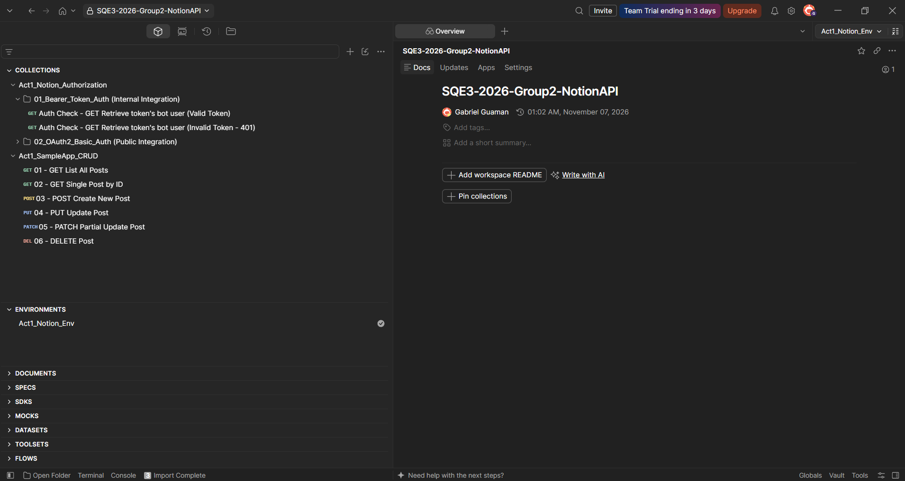
---

### 1.2 Postman Interface Familiarization via Sample App CRUD (JSONPlaceholder)

Before interacting with the authenticated contracts of the System Under Test, the team conducted a hands-on familiarization session against the public [**JSONPlaceholder**](https://jsonplaceholder.typicode.com) sandbox REST API targeting the `/posts` resource, packaged in [`Act1_SampleApp_CRUD.postman_collection.json`](./postman/actividad_1/Act1_SampleApp_CRUD.postman_collection.json). Powered by *LowDB*, JSONPlaceholder exposes an unauthenticated sandbox service that faithfully emulates HTTP/1.1 transactional semantics and idempotency without permanently mutating the underlying dataset across runs executed by different team members.

Building and executing this collection validated the team's end-to-end proficiency across core **Postman** UI components:

- **Address Bar and Collection Variables:** Interpolation using double curly brace syntax `{{sample_base_url}}` (defined in the collection's *Variables* tab as `https://jsonplaceholder.typicode.com`) combined with collection endpoints (`/posts`) and path resource identifiers (`/posts/1`).
- **HTTP Method Selector:** Practical verification of RESTful verb semantics switching across safe/idempotent read operations (`GET`), non-idempotent resource creation (`POST`), full idempotent resource replacement (`PUT`), partial attribute mutation (`PATCH`), and resource deletion (`DELETE`).
- **Request Builder Tabs (*Params*, *Headers*, *Body → raw JSON*):** Management of explicit content-negotiation headers (`Content-Type: application/json; charset=UTF-8`, `Accept: application/json`) and serialization of structured request bodies by selecting `Body → raw` with the **`JSON`** language format, leveraging built-in syntax validation and *Beautify* formatting.
- **Response Viewer and Network Telemetry:** Inspection of the lower response pane across *Pretty* (collapsible JSON tree), *Raw*, and *Headers* views (verifying server-returned headers such as `Content-Type: application/json; charset=utf-8`, `Location` on resource creation, and caching directives), alongside the three key telemetry badges in the top-right corner: **HTTP Status Code** (`200 OK`, `201 Created`), **Execution Time** (millisecond breakdown of *Socket Initialization*, *DNS Lookup*, *TCP Handshake*, *SSL Handshake*, *Waiting TTFB*, and *Content Download*), and **Payload Size** (separating header and response body sizes in `KB` or `B`).

The table below details the **6 CRUD requests executed** in the `Act1_SampleApp_CRUD` collection:

| # | Collection Request Name | Method | Endpoint | Sent Payload (`Body -> raw JSON`) | HTTP Status | Observed Behavior in Response Viewer |
|---|-------------------------|--------|----------|-----------------------------------|-------------|--------------------------------------|
| **01** | `01 - GET List All Posts` | `GET` | `{{sample_base_url}}/posts` | *No body (`None`)* | **`200 OK`** | Returns a JSON array containing all **100 sample posts** (`id` `1` through `100`), each exposing `userId`, `id`, `title`, and `body`. Payload size is `~27.5 KB` with low CDN-cached latency. |
| **02** | `02 - GET Single Post by ID` | `GET` | `{{sample_base_url}}/posts/1` | *No body (`None`)* | **`200 OK`** | Retrieves the single JSON object matching `"id": 1` and `"userId": 1` (`"sunt aut facere..."`). Compact response body (`~292 B`). |
| **03** | `03 - POST Create New Post` | `POST` | `{{sample_base_url}}/posts` | `{"title": "SQE III Lab 02 Sample", "body": "Testing CRUD in Postman", "userId": 1}` | **`201 Created`** | Confirms simulated resource creation by echoing the submitted JSON object enriched with auto-generated `"id": 101` and response header `Location: https://jsonplaceholder.typicode.com/posts/101`. |
| **04** | `04 - PUT Update Post` | `PUT` | `{{sample_base_url}}/posts/1` | `{"id": 1, "title": "SQE III Lab 02 Sample - Updated via PUT", "body": "Full resource replacement executed in Postman", "userId": 1}` | **`200 OK`** | Performs a complete, idempotent replacement of `/posts/1`, returning the full updated JSON representation submitted by the client. |
| **05** | `05 - PATCH Partial Update Post` | `PATCH` | `{{sample_base_url}}/posts/1` | `{"title": "Updated Title via PATCH"}` | **`200 OK`** | Updates exclusively the `"title"` property on `/posts/1` while preserving the original `"userId": 1`, `"id": 1`, and `"body"` values intact in the returned JSON. |
| **06** | `06 - DELETE Post` | `DELETE` | `{{sample_base_url}}/posts/1` | *No body (`None`)* | **`200 OK`** | Processes the idempotent deletion request on `/posts/1` and returns an empty JSON object `{}` (`2 B` response body). |

#### CRUD Execution Evidence

##### 01 - GET List All Posts
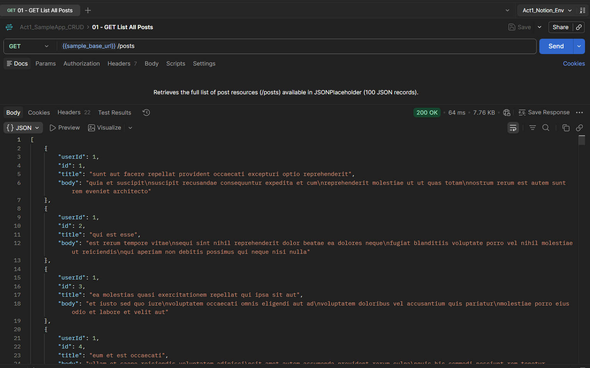

##### 02 - GET Single Post by ID
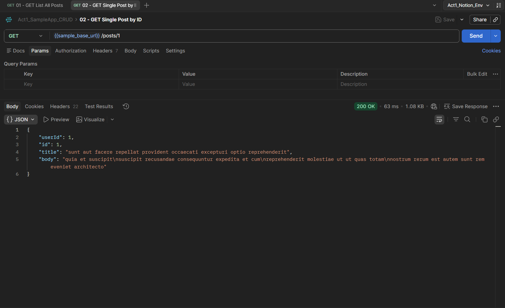

##### 03 - POST Create New Post
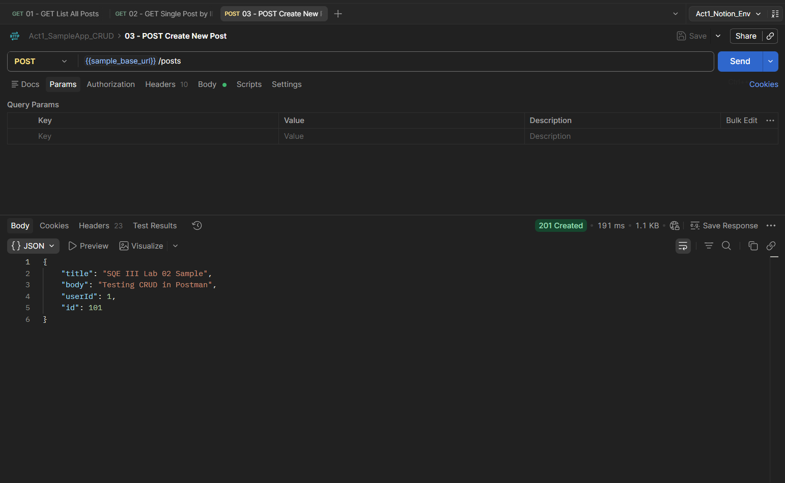

##### 04 - PUT Update Post
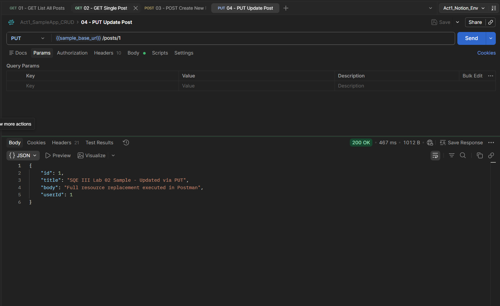

##### 05 - PATCH Partial Update Post
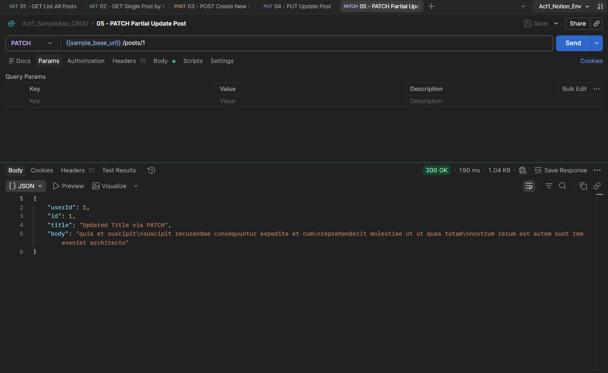

##### 06 - DELETE Post
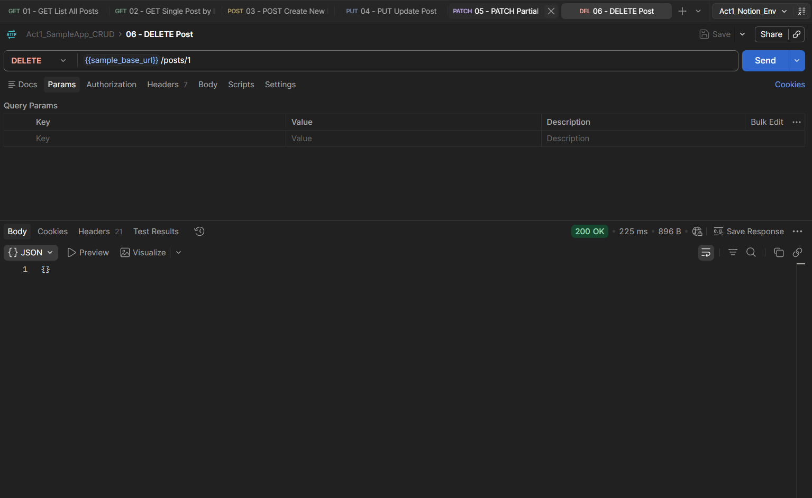

---

### 1.3 Authorization Review and Implementation on the Assigned Application (Notion REST API 2025-09-03)

Unlike basic REST services that rely on a single credential scheme across their entire surface, **Notion REST API (`Notion-Version: 2025-09-03`)** enforces a **dual authorization architecture** depending on the target module and integration type. Furthermore, every authorized call must include the mandatory **`Notion-Version: 2025-09-03`** contract header (omitting it triggers an immediate `400 Bad Request` rejection with `"code": "missing_version"`).

To empirically validate both mechanisms and establish a reusable foundation for subsequent activities, the team built [`Act1_Notion_Authorization.postman_collection.json`](./postman/actividad_1/Act1_Notion_Authorization.postman_collection.json) paired with [`Act1_Notion_Env.postman_environment.json`](./postman/actividad_1/Act1_Notion_Env.postman_environment.json), enforcing `Notion-Version: 2025-09-03` at the collection level and isolating both schemes into dedicated subfolders:

#### Credential Provisioning & Workspace Connection Setup (Notion Developers Portal)

Prior to executing the authorization checks in Postman, the team completed a two-part credential provisioning and permission-binding workflow inside the Notion Developers Portal and the Notion Web UI:

1. **Internal Integration Provisioning (`NOTION_TOKEN` — Bearer Auth):**
   - **Integration Registration:** Created a dedicated internal integration named **`SQE3-Grupo2-Internal`** at [`https://www.notion.so/profile/integrations`](https://www.notion.so/profile/integrations) associated with Group 2's target workspace.
   - **Capability Assignment:** Enabled all *Content Capabilities* (`Read content`, `Update content`, and `Insert content`, along with comment permissions) and explicitly enabled *User Capabilities* (**`Read user information including email addresses`**), which is mandatory to authorize workspace directory endpoints (`GET /v1/users` and `GET /v1/users/{user_id}`) without encountering `403 Forbidden` (`"code": "restricted_resource"`) rejections.
   - **Secret Extraction & Environment Binding:** Retrieved the generated `Internal Integration Secret` (`ntn_...`) under the *Secrets* configuration tab and stored it in the masked variable `{{NOTION_TOKEN}}` (`type: "secret"`, *Current Value*) within the `Act1_Notion_Env` Postman environment.
   - **Resource-Level Connection in Notion Web UI:** Opened the root test page container in the Notion Web UI and granted explicit resource-level access via the top-right page menu (**`...` → `Connections` → `SQE3-Grupo2-Internal`**), propagating read/write visibility across its hierarchy of child pages, databases, data sources, and blocks.

2. **Public Integration Provisioning (`OAUTH_CLIENT_ID` & `OAUTH_CLIENT_SECRET` — Basic Auth):**
   - **Public OAuth Client Setup:** Configured a Public OAuth 2.0 integration named **`SQE3-Grupo2-OAuth`** in the Notion Developers Portal and registered the local callback URI **`https://localhost:3000/auth/notion/callback`** (mapped to `{{OAUTH_REDIRECT_URI}}`).
   - **Client Credential Retrieval:** Extracted the assigned `OAuth client ID` and `OAuth client secret` values to populate `{{OAUTH_CLIENT_ID}}` and `{{OAUTH_CLIENT_SECRET}}` (`type: "secret"`) in `Act1_Notion_Env`, enabling RFC 7617 HTTP Basic Authentication (`Authorization: Basic Base64(client_id:client_secret)`) required by `POST /v1/oauth/token`, `POST /v1/oauth/introspect`, and `POST /v1/oauth/revoke`.

##### Notion Developers Portal & Workspace Connection Configuration
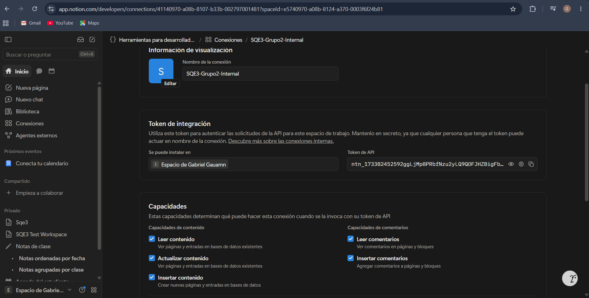

##### Postman Environment Configuration
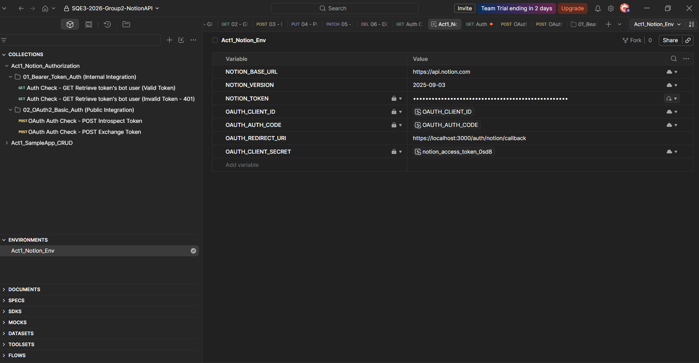

#### 1. `Bearer Token` Authorization (*Internal Integration Secret* — Folder `01_Bearer_Token_Auth`)

This is the primary authorization mechanism required across all Notion domain resource modules (`Users`, `Pages`, `Blocks`, `Data sources`, `Databases`, `Search`, `Comments`, and `File uploads`):

- **Provisioning in Notion Developers and UI Page-Level Sharing:**
  1. In the official *Notion Developers* portal ([`https://www.notion.so/profile/integrations`](https://www.notion.so/profile/integrations)), the team registered an **Internal Integration** bound to Group 2's test workspace, enabling granular *Capabilities* (*Read content*, *Update content*, *Insert content*, *Comment capabilities*, and *Read user information including email addresses*).
  2. The **Internal Integration Secret** (`ntn_...` prefix, formerly `secret_...`) was generated and retrieved.
  3. Because Notion enforces *Opt-in Resource Sharing* (resource-level isolation), the team opened the root test container page in the Notion web UI and navigated to **`•••` → `Connections` → `Connect to`**, explicitly linking the integration so permissions propagate down to child pages, databases, and data sources.
- **Implementation in Postman:**
  In `Act1_Notion_Env`, `NOTION_TOKEN` is configured with `type: "secret"` to mask the credential on screen. At the `01_Bearer_Token_Auth (Internal Integration)` folder level, the **Authorization → Auth Type: `Bearer Token`** tab references `{{NOTION_TOKEN}}`. Child requests automatically inherit (*Inherit auth from parent*) the standard RFC 6750 header:
  ```http
  GET /v1/users/me HTTP/1.1
  Host: api.notion.com
  Authorization: Bearer {{NOTION_TOKEN}}
  Notion-Version: 2025-09-03
  Accept: application/json
  ```
- **Positive Identity Verification (`200 OK`) vs. Invalid Credential Rejection (`401 Unauthorized`):**
  To verify authorization independently of external page or database UUIDs, the team targeted the canonical bot identity endpoint **`GET https://api.notion.com/v1/users/me`** (*Retrieve your token's bot user*):
  - In **`Auth Check - GET Retrieve token's bot user (Valid Token)`**, supplying a valid `{{NOTION_TOKEN}}` returns **`200 OK`** with a `"type": "bot"` `user` object, confirming the integration's identity, workspace ownership (`bot.owner`), and environment upload limits:
    ```json
    {
      "object": "user",
      "id": "9a4e7c12-5b8d-4f31-a920-6c1d8e4f7011",
      "name": "SQE3 Group 2 - QA Automation Bot",
      "avatar_url": null,
      "type": "bot",
      "bot": {
        "owner": {
          "type": "workspace",
          "workspace": true
        },
        "workspace_name": "SQE III - Group 2 Workspace",
        "workspace_limits": {
          "max_file_upload_size_in_bytes": 5242880
        }
      }
    }
    ```
  - Conversely, in **`Auth Check - GET Retrieve token's bot user (Invalid Token - 401)`**, parent auth inheritance is disabled (`No Auth`) and the `Authorization` header is explicitly overridden with `Bearer secret_invalid_token_123`. The API deterministically rejects access with **`401 Unauthorized`** and Notion's typed error payload:
    ```json
    {
      "object": "error",
      "status": 401,
      "code": "unauthorized",
      "message": "API token is invalid.",
      "request_id": "3d81f7a2-9c14-48b0-8e25-71a04c92d814"
    }
    ```

#### 2. `HTTP Basic Auth` in the `OAuth 2.0` Module (Folder `02_OAuth2_Basic_Auth`)

Inspecting the **`OAuth`** module of the official `Notion API (2025-09-03)` collection —covering management endpoints `POST /v1/oauth/token`, `POST /v1/oauth/introspect`, and `POST /v1/oauth/revoke` for **Public Integrations**— revealed that these endpoints **do not accept `Bearer Token` authentication**; instead, they strictly require **`HTTP Basic Authentication`** (RFC 7617 / RFC 6749 Section 2.3.1).

- **Architectural Rationale for `Basic Auth` over `Bearer Token`:**
  Within the OAuth 2.0 authorization code flow, when a client application exchanges a temporary authorization code (`grant_type: "authorization_code"`) at `/v1/oauth/token`, it **does not yet possess an `access_token`**. Likewise, when calling `/v1/oauth/introspect` (RFC 7662) or `/v1/oauth/revoke` (RFC 7009), the access token is the **subject being inspected or revoked inside the JSON body** (`{"token": "..."}`), rather than the credential authenticating the caller. Consequently, Notion's authorization server must authenticate the **registered client application itself** using its `client_id` and `client_secret` pair. Sending a `Bearer Token` to these endpoints immediately fails client authentication (`401 invalid_client` / `unauthorized`).
- **Implementation in Postman:**
  At the `02_OAuth2_Basic_Auth (Public Integration)` subfolder level, **Authorization → Auth Type: `Basic Auth`** is configured with:
  - **Username:** `{{OAUTH_CLIENT_ID}}`
  - **Password:** `{{OAUTH_CLIENT_SECRET}}` (marked as `secret` in `Act1_Notion_Env`).

  When executing **`OAuth Auth Check - POST Introspect Token`** (`POST {{NOTION_BASE_URL}}/v1/oauth/introspect`) and **`OAuth Auth Check - POST Exchange Token`** (`POST {{NOTION_BASE_URL}}/v1/oauth/token`), Postman concatenates the credentials with a colon (`client_id:client_secret`), encodes the string in **Base64**, and injects the required header automatically:
  ```http
  POST /v1/oauth/introspect HTTP/1.1
  Host: api.notion.com
  Authorization: Basic base64({{OAUTH_CLIENT_ID}}:{{OAUTH_CLIENT_SECRET}})
  Notion-Version: 2025-09-03
  Content-Type: application/json

  {
    "token": "{{NOTION_TOKEN}}"
  }
  ```

#### Technical Comparison of Implemented Authorization Mechanisms

| Technical Criterion | Scheme 1: `Bearer Token` (RFC 6750) | Scheme 2: `HTTP Basic Auth` (RFC 7617) |
|---------------------|-------------------------------------|----------------------------------------|
| **Collection Folder** | `01_Bearer_Token_Auth (Internal Integration)` | `02_OAuth2_Basic_Auth (Public Integration)` |
| **Integration Type** | Internal Integrations (`ntn_...` / `secret_...`) and active `access_token`s from Public Integrations | Public Integrations registered under the OAuth 2.0 authorization flow |
| **Endpoint Scope** | Domain modules: `/v1/users/*`, `/v1/pages/*`, `/v1/blocks/*`, `/v1/data_sources/*`, `/v1/databases/*`, `/v1/search`, `/v1/comments`, `/v1/file_uploads/*` | Exclusively OAuth lifecycle endpoints: `POST /v1/oauth/token`, `POST /v1/oauth/introspect`, and `POST /v1/oauth/revoke` |
| **Postman Configuration** | *Authorization* tab → Type: **`Bearer Token`** → Token: `{{NOTION_TOKEN}}` | *Authorization* tab → Type: **`Basic Auth`** → Username: `{{OAUTH_CLIENT_ID}}`, Password: `{{OAUTH_CLIENT_SECRET}}` |
| **Generated HTTP Header** | `Authorization: Bearer <NOTION_TOKEN>` | `Authorization: Basic <base64(OAUTH_CLIENT_ID:OAUTH_CLIENT_SECRET)>` |
| **Shared Contract Header** | `Notion-Version: 2025-09-03` (mandatory) | `Notion-Version: 2025-09-03` (mandatory) |
| **Additional Access Control** | Requires sharing pages/containers in the Notion UI (*Connections*) plus enabled *Capabilities* | Requires exact `redirect_uri` match and a valid single-use `authorization_code` |
| **Expected Responses** | **`200 OK`** (`object: "user"`, `type: "bot"`) with valid token; **`401 Unauthorized`** (`code: "unauthorized"`) with invalid token | **`200 OK`** (issued `access_token` or `{"active": true/false}`) with valid client; **`401 Unauthorized`** / **`400 invalid_grant`** on invalid client or code |

#### Authorization Execution Evidence

##### 01 - Bearer Token Auth: GET Retrieve Token's Bot User (Valid Token - 200 OK)
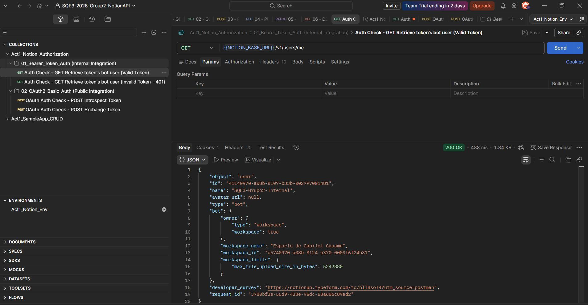

##### 02 - Bearer Token Auth: GET Retrieve Token's Bot User (Invalid Token - 401 Unauthorized)
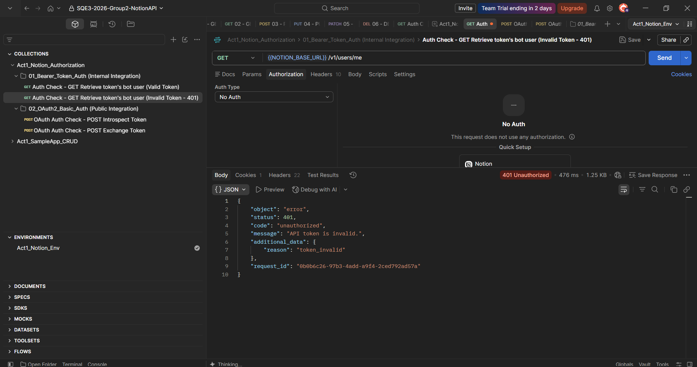

##### 03 - OAuth 2.0 Basic Auth: POST Introspect Token
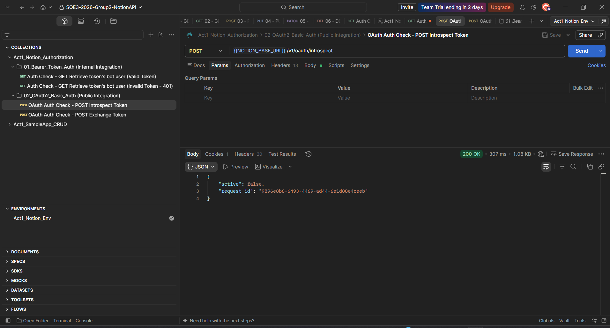

##### 04 - OAuth 2.0 Basic Auth: POST Exchange Token
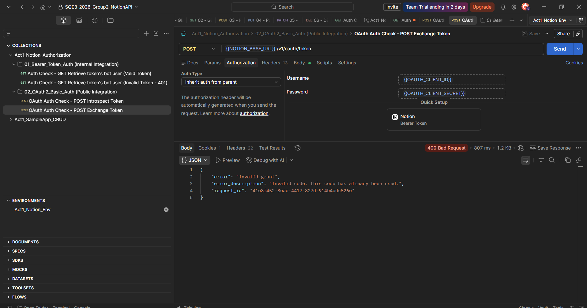
---

## Activity #2

1. Review verification concepts in Postman and how tests are implemented on requests.
2. Implement in Postman the tests written in the previous laboratory, including multiple required assertions on status code, body, headers, etc.  

### 2.1 Postman Verification Concepts and Assertion Mechanics

In automated API testing, **verification** represents the programmatic inspection and validation of server responses against contractual specifications, business rules, and non-functional service-level agreements (SLAs). In Postman, verification is implemented via the **Post-response (Tests) Script** tab, executed inside an isolated Node.js sandbox environment immediately following the completion of the HTTP transaction.

#### Postman Test Execution Sandbox & Assertion Architecture

Postman integrates the **Chai Assertion Library** alongside custom HTTP verification helpers under the `pm.*` object facade. Tests are authored using Chai's **BDD (Behavior-Driven Development)** style (`pm.test`, `pm.expect`), ensuring readable, self-documenting, and deterministically auditable test results:

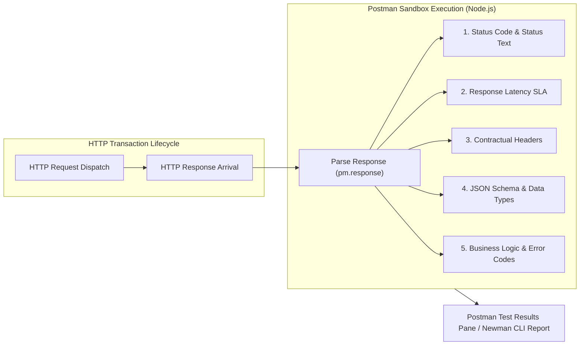

#### Multi-Tier Verification Framework for Notion REST API

To guarantee exhaustive verification across Group 2's assigned modules, each implemented request incorporates a mandatory **five-tier assertion framework**:

1. **HTTP Status Code and Reason Phrase Verification:**
   Validates standard RFC 9110 status codes and status text matching the expected HTTP outcome:
   ```javascript
   pm.test("Status code is 200 OK", function () {
       pm.response.to.have.status(200);
   });
   ```

2. **Response Latency SLA Verification:**
   Validates non-functional performance requirements ensuring endpoint responsiveness remains within acceptable limits (typically `< 2500 ms` for cloud integrations):
   ```javascript
   pm.test("Response time is within acceptable SLA (< 2500ms)", function () {
       pm.expect(pm.response.responseTime).to.be.below(2500);
   });
   ```

3. **Mandatory Contractual Transport Headers:**
   Validates content negotiation, character encoding, and the mandatory Notion API contract version header returned by the server:
   ```javascript
   pm.test("Headers contain valid Content-Type and Notion version echo", function () {
       pm.response.to.have.header("Content-Type");
       pm.expect(pm.response.headers.get("Content-Type")).to.include("application/json");
   });
   ```

4. **JSON Body Structure, Entity Type, and Schema Integrity:**
   Validates top-level object discriminators (`object: "database"`, `object: "data_source"`, `object: "list"`), canonical UUID formats, and field data types:
   ```javascript
   pm.test("Response body matches canonical entity schema", function () {
       const jsonData = pm.response.json();
       pm.expect(jsonData).to.be.an("object");
       pm.expect(jsonData.object).to.eql("database");
       pm.expect(jsonData.id).to.match(/^[0-9a-f]{8}-[0-9a-f]{4}-[0-9a-f]{4}-[0-9a-f]{4}-[0-9a-f]{12}$/i);
       pm.expect(jsonData.created_time).to.be.a("string");
       pm.expect(Date.parse(jsonData.created_time)).to.not.be.NaN;
   });
   ```

5. **Error Contract Validation (Negative Tests):**
   For client errors (`400`, `401`, `403`, `404`, `429`), validates Notion's typed error response contract:
   ```javascript
   pm.test("Error response conforms to Notion error specification", function () {
       const err = pm.response.json();
       pm.expect(err.object).to.eql("error");
       pm.expect(err.status).to.eql(pm.response.code);
       pm.expect(err.code).to.be.a("string").and.to.not.be.empty;
       pm.expect(err.message).to.be.a("string").and.to.not.be.empty;
       pm.expect(err.request_id).to.be.a("string").and.to.not.be.empty;
   });
   ```

---


### 2.2 Implementation of Lab 01 Tests in Postman with Multi-level Verifications

#### Gabriel Marcos Guaman Ortuño — Modules: Users & OAuth

All **52 test cases** designed in Laboratory 01 (`GabrielGuamanTests.md` — 49 endpoint test cases across `Users` and `OAuth` plus 3 multi-step E2E scenarios) were implemented in Postman inside [`postman/gabriel_guaman/Notion_Users_OAuth_GabrielGuaman.postman_collection.json`](./postman/gabriel_guaman/Notion_Users_OAuth_GabrielGuaman.postman_collection.json) (paired with [`Notion_Users_OAuth_Env.postman_environment.json`](./postman/gabriel_guaman/Notion_Users_OAuth_Env.postman_environment.json)), resulting in **69 executable HTTP requests** and **345 automated `pm.test()` assertions** (5 verification layers per request).

| Lab 01 Suite / Endpoint | Implemented Test Case IDs | Req. Count | Multi-Layer `pm.test()` Verifications Implemented |
|-------------------------|---------------------------|------------|---------------------------------------------------|
| **`GET /v1/users/me`**<br>(`01_GET_Users_Me`) | `TC_USR_ME_001` – `TC_USR_ME_008` | 8 | **Status:** `200`, `400`, `401`, `429`.<br>**Headers:** `Content-Type: application/json`, `x-notion-request-id` non-empty, `Retry-After` on `429`.<br>**SLA:** `responseTime < 5000 ms`.<br>**Body / Schema:** `object === "user"`, `type === "bot"`, canonical `UUIDv4` regex on `id`, `bot.owner`, `bot.workspace_limits.max_file_upload_size_in_bytes > 0`; error codes `"unauthorized"`, `"missing_version"`, `"validation_error"`, `"rate_limited"`. |
| **`GET /v1/users/{user_id}`**<br>(`02_GET_User_By_ID`) | `TC_USR_GET_001` – `TC_USR_GET_009b` | 10 | **Status:** `200`, `400`, `401`, `403`, `404`.<br>**Headers & SLA:** `application/json`, `x-notion-request-id`, `< 5000 ms`.<br>**Body / Schema:** `object === "user"`, `id` equality & 32-char compact hex normalization to 36-char hyphenated `UUIDv4`, `type` (`"person"` / `"bot"`), `person` metadata; error codes `"validation_error"`, `"object_not_found"`, `"unauthorized"`, `"restricted_resource"`, `"missing_version"`. |
| **`GET /v1/users`**<br>(`03_GET_List_All_Users`) | `TC_USR_LIST_001` – `TC_USR_LIST_009b` | 10 | **Status:** `200`, `400`, `401`.<br>**Headers & SLA:** `application/json`, `x-notion-request-id`, `< 5000 ms`.<br>**Body / Schema:** `object === "list"`, `type === "user"`, `results[]` array bounds (`=== 1` at `page_size=1`, `<= 100` at `page_size=100`), `UUIDv4` regex per item, boolean `has_more`, `next_cursor` non-overlap across pages; error codes `"validation_error"`, `"unauthorized"`, `"missing_version"`. |
| **`POST /v1/oauth/token`**<br>(`01_POST_OAuth_Token`) | `TC_OAUTH_TOK_001` – `TC_OAUTH_TOK_009` | 10 | **Status:** `200`, `400`, `401`.<br>**Headers & SLA:** `application/json`, `x-notion-request-id`, `< 5000 ms`.<br>**Body / Schema:** `access_token` non-empty string, `token_type === "bearer"`, `bot_id` & `workspace_id` `UUIDv4` regex, `owner`, rotated `refresh_token`; OAuth/Notion error codes `"invalid_client"`, `"invalid_grant"`, `"unsupported_grant_type"`, `"invalid_request"`, `"missing_version"`. |
| **`POST /v1/oauth/revoke`**<br>(`02_POST_OAuth_Revoke`) | `TC_OAUTH_REV_001` – `TC_OAUTH_REV_007` | 8 | **Status:** `200` (including RFC 7009 idempotent re-revocation), `400`, `401`.<br>**Headers & SLA:** `application/json`, `x-notion-request-id`, `< 5000 ms`.<br>**Body / Schema:** Valid JSON acknowledgment `{}` without `500` degradation; error codes `"invalid_client"`, `"validation_error"`, `"missing_version"`, `"invalid_json"`. |
| **`POST /v1/oauth/introspect`**<br>(`03_POST_OAuth_Introspect`) | `TC_OAUTH_INT_001` – `TC_OAUTH_INT_008` | 8 | **Status:** `200`, `400`, `401` (never `500` on 2048-char boundary).<br>**Headers & SLA:** `application/json`, `x-notion-request-id`, `< 5000 ms`.<br>**Body / Schema:** Boolean `active` (`true` with numeric `iat` for active tokens; `false` per RFC 7662 for revoked/unknown tokens); error codes `"invalid_client"`, `"validation_error"`, `"missing_version"`. |
| **Chained & E2E Flows**<br>(`03_Chained_And_E2E_Flows`) | `TC_E2E_001`, `TC_E2E_002`, `TC_E2E_003` | 15 | Cross-request state parity (`id === bot_user_id`, compact vs. hyphenated profile equivalence, distinct paginated user IDs, `active: true -> false` transition after `/v1/oauth/revoke`, and `401 unauthorized` enforcement). |

##### Representative Postman Script 1 — Boundary & Schema Normalization (`Users` Module: `TC_USR_GET_008`)

```javascript
// [Pre-request Script] Strip hyphens from target_user_id to build a 32-char hex compact_user_id
const sourceUuid = pm.environment.get("target_user_id") || pm.collectionVariables.get("target_user_id");
if (sourceUuid) {
    const compact = sourceUuid.replace(/-/g, "");
    pm.environment.set("compact_user_id", compact);
    pm.collectionVariables.set("compact_user_id", compact);
}

// [Post-response / Tests Script] Multi-layer verification (Status, Headers, SLA, UUIDv4 Normalization)
pm.test("TC_USR_GET_008 - Status code is 200 OK", function () {
    pm.response.to.have.status(200);
});

pm.test("TC_USR_GET_008 - Response Content-Type header is application/json", function () {
    pm.expect(pm.response.headers.get("Content-Type")).to.include("application/json");
});

pm.test("TC_USR_GET_008 - Response includes x-notion-request-id tracing header", function () {
    pm.expect(pm.response.headers.has("x-notion-request-id")).to.be.true;
    pm.expect(pm.response.headers.get("x-notion-request-id")).to.be.a("string").and.not.empty;
});

pm.test("TC_USR_GET_008 - Response time is within 5000 ms SLA", function () {
    pm.expect(pm.response.responseTime).to.be.below(5000);
});

pm.test("TC_USR_GET_008 - 32-char compact input is normalized to canonical 36-char hyphenated UUIDv4", function () {
    const jsonData = pm.response.json();
    const sentCompact = pm.environment.get("compact_user_id");
    pm.expect(sentCompact).to.match(/^[0-9a-f]{32}$/i);
    pm.expect(jsonData.object).to.eql("user");
    pm.expect(jsonData.id).to.have.lengthOf(36);
    pm.expect(jsonData.id).to.match(/^[0-9a-f]{8}-[0-9a-f]{4}-[0-9a-f]{4}-[0-9a-f]{4}-[0-9a-f]{12}$/i);
    pm.expect(jsonData.id.replace(/-/g, "").toLowerCase()).to.eql(sentCompact.toLowerCase());
});
```

##### Representative Postman Script 2 — Negative & Error Contract Validation (`OAuth` Module: `TC_OAUTH_REV_004`)

```javascript
// [Pre-request Script] Intentionally strip Notion-Version header to validate contract rejection
pm.request.headers.remove("Notion-Version");

// [Post-response / Tests Script] Multi-layer error contract verification
pm.test("TC_OAUTH_REV_004 - Status code is 400", function () {
    pm.response.to.have.status(400);
});

pm.test("TC_OAUTH_REV_004 - Response Content-Type header is application/json", function () {
    pm.expect(pm.response.headers.get("Content-Type")).to.include("application/json");
});

pm.test("TC_OAUTH_REV_004 - Response includes x-notion-request-id tracing header", function () {
    pm.expect(pm.response.headers.has("x-notion-request-id")).to.be.true;
    pm.expect(pm.response.headers.get("x-notion-request-id")).to.be.a("string").and.not.empty;
});

pm.test("TC_OAUTH_REV_004 - Response time is within 5000 ms SLA", function () {
    pm.expect(pm.response.responseTime).to.be.below(5000);
});

pm.test("TC_OAUTH_REV_004 - Error schema contract matches Notion error payload (missing_version)", function () {
    const jsonData = pm.response.json();
    pm.expect(jsonData.object).to.eql("error");
    pm.expect(jsonData.status).to.eql(400);
    pm.expect(jsonData.code).to.eql("missing_version");
    pm.expect(jsonData.message).to.be.a("string").and.not.empty;
});
```

##### Execution Evidence — Multi-Layer Assertions (`Users` & `OAuth` Modules)

- **Happy Path Assertions (`GET /v1/users/me` — `TC_USR_ME_001`, 5/5 `PASSED`):**

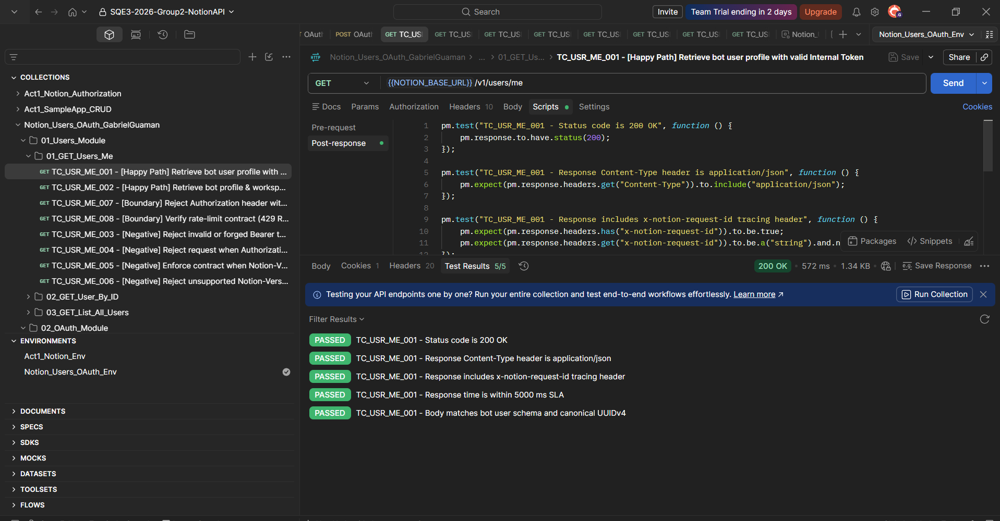

- **Boundary & Pagination Assertions (`GET /v1/users?page_size=1` — `TC_USR_LIST_007`, 5/5 `PASSED`):**

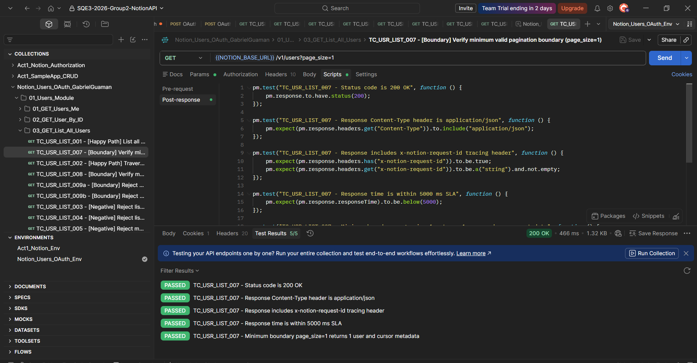

- **OAuth Negative & Contract Assertions (`POST /v1/oauth/token` — `TC_OAUTH_TOK_003`, `401 Unauthorized`, 5/5 `PASSED`):**

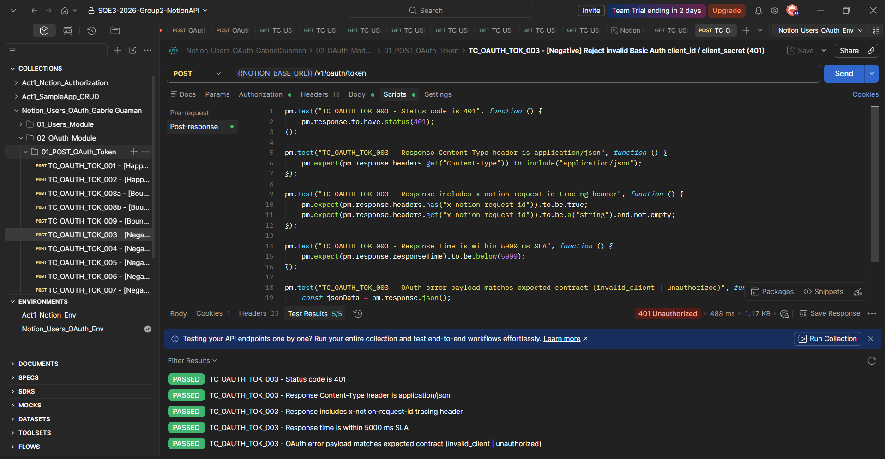


---

#### 2.2.1 Data Sources Module Implementation (Valentina Molina Bustillos)

The `Data sources` module covers four primary endpoints:
- `POST /v1/data_sources`: Create a new data source container with a typed property schema.
- `GET /v1/data_sources/{data_source_id}`: Retrieve property schema and container metadata.
- `PATCH /v1/data_sources/{data_source_id}`: Mutate property schema (add, rename, remove columns).
- `POST /v1/data_sources/{data_source_id}/query`: Query tabular rows using filters, sorting, and pagination.

##### Representative Multi-Tier Assertion Script Examples (Data Sources)

###### 1. Happy Path: `TC_DS_CREATE_001` – Create Data Source with Typed Schema (`POST /v1/data_sources`)
```javascript
// =========================================================================
// TC_DS_CREATE_001 - Multi-tier Verification Script
// =========================================================================

// 1. Status Code
pm.test("HTTP Status is 200 OK", function () {
    pm.response.to.have.status(200);
});

// 2. Response Time SLA
pm.test("Response time is under 3000ms", function () {
    pm.expect(pm.response.responseTime).to.be.below(3000);
});

// 3. Response Headers
pm.test("Response is UTF-8 JSON", function () {
    pm.expect(pm.response.headers.get("Content-Type")).to.include("application/json");
});

// 4. Schema & Business Rules
pm.test("Data Source object schema and properties integrity", function () {
    const res = pm.response.json();
    
    // Contract object discriminator
    pm.expect(res.object).to.eql("data_source");
    pm.expect(res.id).to.be.a("string").and.to.match(/^[0-9a-f]{8}-[0-9a-f]{4}-[0-9a-f]{4}-[0-9a-f]{4}-[0-9a-f]{12}$/i);
    
    // Parent database correlation
    pm.expect(res.parent).to.be.an("object");
    pm.expect(res.parent.type).to.eql("database_id");
    pm.expect(res.parent.database_id).to.eql(pm.environment.get("database_id"));
    
    // Typed schema validation
    pm.expect(res.properties).to.be.an("object");
    pm.expect(res.properties).to.have.property("Name");
    pm.expect(res.properties.Name.type).to.eql("title");
    pm.expect(res.properties).to.have.property("Count");
    pm.expect(res.properties.Count.type).to.eql("number");
    
    // Timestamps
    pm.expect(res.created_time).to.be.a("string");
    pm.expect(res.last_edited_time).to.be.a("string");

    // Dynamic variable capture for downstream chained tests
    pm.environment.set("data_source_id", res.id);
});
```

###### 2. Happy Path: `TC_DS_QUERY_001` – Query Data Source Rows (`POST /v1/data_sources/{id}/query`)
```javascript
// =========================================================================
// TC_DS_QUERY_001 - Query Data Source Verification Script
// =========================================================================

pm.test("HTTP Status is 200 OK", function () {
    pm.response.to.have.status(200);
});

pm.test("Response is a paginated list of page rows", function () {
    const res = pm.response.json();
    
    pm.expect(res.object).to.eql("list");
    pm.expect(res.results).to.be.an("array");
    pm.expect(res.has_more).to.be.a("boolean");
    pm.expect(res).to.have.property("next_cursor");
    pm.expect(res.type).to.eql("page_or_data_source");
    
    // Verify row structure if rows exist
    if (res.results.length > 0) {
        const row = res.results[0];
        pm.expect(row.object).to.eql("page");
        pm.expect(row.parent.type).to.eql("data_source_id");
        pm.expect(row.parent.data_source_id).to.eql(pm.environment.get("data_source_id"));
    }
});
```

###### 3. Negative Scenario: `TC_DS_CREATE_004` – Missing Authorization Header (`POST /v1/data_sources`)
```javascript
// =========================================================================
// TC_DS_CREATE_004 - Missing Authorization Negative Check
// =========================================================================

pm.test("HTTP Status is 401 Unauthorized", function () {
    pm.response.to.have.status(401);
});

pm.test("Error response conforms to Notion typed error contract", function () {
    const err = pm.response.json();
    pm.expect(err.object).to.eql("error");
    pm.expect(err.status).to.eql(401);
    pm.expect(err.code).to.eql("unauthorized");
    pm.expect(err.message).to.be.a("string").and.to.include("API token is invalid");
});
```

###### 4. Boundary Scenario: `TC_DS_QUERY_028` – Page Size Out of Bounds (`page_size: 101`)
```javascript
// =========================================================================
// TC_DS_QUERY_028 - Boundary Check (page_size > 100)
// =========================================================================

pm.test("HTTP Status is 400 Bad Request", function () {
    pm.response.to.have.status(400);
});

pm.test("Error payload indicates validation_error on page_size", function () {
    const err = pm.response.json();
    pm.expect(err.object).to.eql("error");
    pm.expect(err.status).to.eql(400);
    pm.expect(err.code).to.eql("validation_error");
    pm.expect(err.message).to.match(/page_size|100|maximum/i);
});
```

##### Valentina Molina – Postman Implementation Mapping Matrix

The following table summarizes the implementation in Postman of the test cases designed by Valentina Molina in Laboratory 01:

| Lab 01 Test ID | Postman Request Label | Method | Target Endpoint | Multi-Level Assertions Implemented | Type | Priority |
|---|---|---|---|---|---|---|
| `TC_DS_CREATE_001` | `DATA_SOURCES - Positiva - Crear data source con schema (200)` | `POST` | `/v1/data_sources` | Status `200`, SLA `<3s`, `object: "data_source"`, properties schema, UUID format, captures `{{data_source_id}}` | Happy Path | High |
| `TC_DS_CREATE_003` | `DATA_SOURCES - Positiva - Crear con select/multi_select (200)` | `POST` | `/v1/data_sources` | Status `200`, `properties.Priority.select.options` length and colors | Happy Path | Medium |
| `TC_DS_CREATE_004` | `DATA_SOURCES - Negativa - Sin cabecera Authorization (401)` | `POST` | `/v1/data_sources` | Status `401`, `code: "unauthorized"`, `object: "error"` | Negative | High |
| `TC_DS_CREATE_005` | `DATA_SOURCES - Negativa - Sin Notion-Version header (400)` | `POST` | `/v1/data_sources` | Status `400`, `code: "missing_version"` | Negative | High |
| `TC_DS_CREATE_007` | `DATA_SOURCES - Negativa - database_id malformado (400)` | `POST` | `/v1/data_sources` | Status `400`, `code: "validation_error"` | Negative | High |
| `TC_DS_CREATE_008` | `DATA_SOURCES - Negativa - database_id inexistente (404)` | `POST` | `/v1/data_sources` | Status `404`, `code: "object_not_found"`, targeted using `{{ghost_id}}` | Negative | High |
| `TC_DS_CREATE_010` | `DATA_SOURCES - Limites - Schema minimo con solo title (200)` | `POST` | `/v1/data_sources` | Status `200`, schema contains exactly 1 title property | Boundary | Low |
| `TC_DS_GET_001` | `DATA_SOURCES - Positiva - Obtener data source por ID (200)` | `GET` | `/v1/data_sources/{{data_source_id}}` | Status `200`, SLA `<2s`, `id` matches `{{data_source_id}}`, schema integrity | Happy Path | High |
| `TC_DS_GET_004` | `DATA_SOURCES - Negativa - GET sin token (401)` | `GET` | `/v1/data_sources/{{data_source_id}}` | Status `401`, `code: "unauthorized"` | Negative | High |
| `TC_DS_GET_007` | `DATA_SOURCES - Negativa - ID con formato no UUID (400)` | `GET` | `/v1/data_sources/invalid-uuid` | Status `400`, `code: "validation_error"` | Negative | High |
| `TC_DS_GET_008` | `DATA_SOURCES - Negativa - Data source inexistente (404)` | `GET` | `/v1/data_sources/{{ghost_id}}` | Status `404`, `code: "object_not_found"` | Negative | High |
| `TC_DS_GET_012` | `DATA_SOURCES - Limites - Formato UUID con guiones vs hex (200)` | `GET` | `/v1/data_sources/{{data_source_id}}` | Status `200`, canonical response across 32-char hex vs 36-char hyphenated | Boundary | Medium |
| `TC_DS_PATCH_001` | `DATA_SOURCES - Positiva - Agregar columna al schema (200)` | `PATCH` | `/v1/data_sources/{{data_source_id}}` | Status `200`, schema contains newly added property `Count`, `last_edited_time` updated | Happy Path | High |
| `TC_DS_PATCH_002` | `DATA_SOURCES - Positiva - Renombrar columna existente (200)` | `PATCH` | `/v1/data_sources/{{data_source_id}}` | Status `200`, property renamed to `Notes`, ID preserved | Happy Path | High |
| `TC_DS_PATCH_008` | `DATA_SOURCES - Negativa - PATCH sin version header (400)` | `PATCH` | `/v1/data_sources/{{data_source_id}}` | Status `400`, `code: "missing_version"` | Negative | High |
| `TC_DS_PATCH_010` | `DATA_SOURCES - Negativa - PATCH sobre ID inexistente (404)` | `PATCH` | `/v1/data_sources/{{ghost_id}}` | Status `404`, `code: "object_not_found"` | Negative | High |
| `TC_DS_QUERY_001` | `DATA_SOURCES - Positiva - Query sin filtro (200)` | `POST` | `/v1/data_sources/{{data_source_id}}/query` | Status `200`, `object: "list"`, `results` array, `has_more` boolean | Happy Path | High |
| `TC_DS_QUERY_004` | `DATA_SOURCES - Positiva - Query con filtro select Status (200)` | `POST` | `/v1/data_sources/{{data_source_id}}/query` | Status `200`, all items in `results` have `Status.name == "Done"` | Happy Path | High |
| `TC_DS_QUERY_007` | `DATA_SOURCES - Positiva - Query con filtro compuesto AND (200)` | `POST` | `/v1/data_sources/{{data_source_id}}/query` | Status `200`, compound filter evaluation verified on each row | Happy Path | High |
| `TC_DS_QUERY_009` | `DATA_SOURCES - Positiva - Query con ordenamiento ascendente (200)` | `POST` | `/v1/data_sources/{{data_source_id}}/query` | Status `200`, rows sorted strictly ascending by `Count` | Happy Path | High |
| `TC_DS_QUERY_012` | `DATA_SOURCES - Positiva - Paginacion cursor-based (200)` | `POST` | `/v1/data_sources/{{data_source_id}}/query` | Status `200`, `has_more: true`, captures `{{next_cursor}}`, verifies second page | Happy Path | High |
| `TC_DS_QUERY_020` | `DATA_SOURCES - Negativa - Filtro con propiedad inexistente (400)` | `POST` | `/v1/data_sources/{{data_source_id}}/query` | Status `400`, `code: "validation_error"` | Negative | High |
| `TC_DS_QUERY_025` | `DATA_SOURCES - Limites - page_size minimo igual a 1 (200)` | `POST` | `/v1/data_sources/{{data_source_id}}/query` | Status `200`, `results.length <= 1`, `has_more` boolean | Boundary | High |
| `TC_DS_QUERY_027` | `DATA_SOURCES - Limites - page_size igual a 0 fuera de rango (400)` | `POST` | `/v1/data_sources/{{data_source_id}}/query` | Status `400`, `code: "validation_error"` | Boundary | High |
| `TC_DS_QUERY_028` | `DATA_SOURCES - Limites - page_size igual a 101 excedido (400)` | `POST` | `/v1/data_sources/{{data_source_id}}/query` | Status `400`, `code: "validation_error"` | Boundary | High |
| `TC_COMM_001` | `Comments - CREATE - Crear comentario en página (200)` | `POST` | `/v1/comments` | Status `200`, `object: "comment"`, `parent.type: "page_id"`, captures `{{comment_id}}` | Happy Path | High |
| `TC_COMM_002` | `Comments - READ - Listar comentarios de página (200)` | `GET` | `/v1/comments?block_id={{NOTION_PAGE_ID}}` | Status `200`, `object: "list"`, `results` array | Happy Path | Medium |
| `TC_COMM_003` | `Comments - UPDATE - (No soportado por la API) (404)` | `PATCH` | `/v1/comments/{{comment_id}}` | Status `404`, confirms Notion contract omission (immutable comments) | Negative | Low |
| `TC_COMM_004` | `Comments - DELETE - (No soportado por la API) (404)` | `DELETE` | `/v1/comments/{{comment_id}}` | Status `404`, confirms Notion contract omission (deletion via API unsupported) | Negative | Low |
| `TC_FU_001` | `FU - CREATE - Iniciar carga de archivo (200)` | `POST` | `/v1/file_uploads` | Status `200`, `object: "file_upload"`, `status: "pending"`, captures `{{file_upload_id}}` | Happy Path | High |
| `TC_FU_002` | `FU - READ - Recuperar estado de carga (200)` | `GET` | `/v1/file_uploads/{{file_upload_id}}` | Status `200`, verifies uploaded file container status | Happy Path | Medium |
| `TC_FU_003` | `FU - UPDATE (Send) - Enviar contenido (200)` | `POST` | `/v1/file_uploads/{{file_upload_id}}/send` | Status `200`, binary payload chunk transmission confirmed | Happy Path | Medium |
| `TC_FU_004` | `FU - DELETE (Complete) - Finalizar carga (200)` | `POST` | `/v1/file_uploads/{{file_upload_id}}/complete` | Status `200`, file upload finalized and ready for block attachment | Happy Path | High |

##### Execution Evidence for Data Sources & Supporting Modules (Valentina Molina)

The collection [`Lab02_Grupo2_Valentina_CRUD.postman_collection.json`](./postman/actividad_2_3_4/Lab02_Grupo2_Valentina_CRUD.postman_collection.json) implements the CRUD lifecycle for `Data sources` alongside contractual verifications for `Comments` and `File uploads`. The screenshots below document empirical verification in Postman:

###### 01 - DS CREATE: Crear Data Source (200 OK)
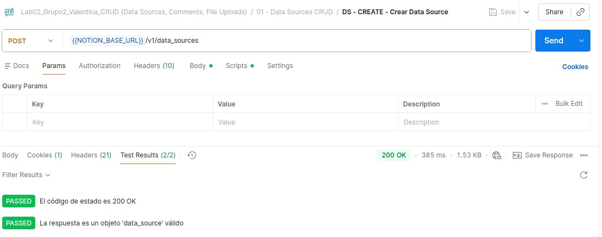

###### 02 - Comments CREATE: Crear Comentario en Página (200 OK)
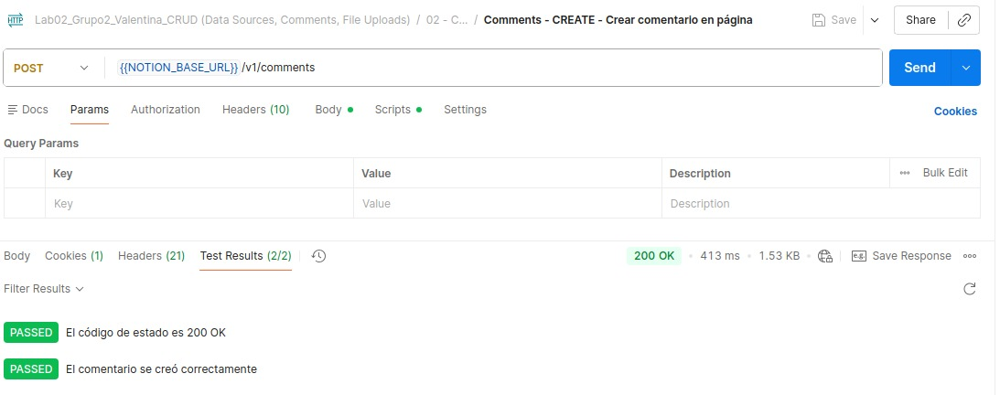

###### 03 - File Uploads CREATE: Iniciar Carga de Archivo (200 OK)
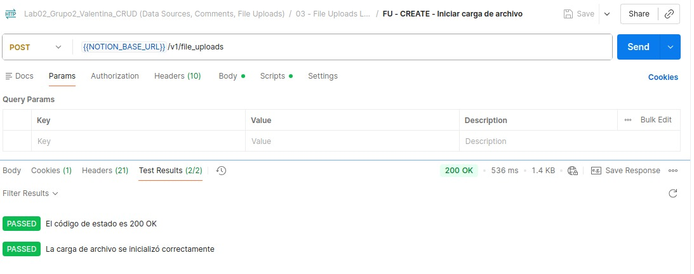

---


#### Karen Ivonne Cruz Alvarez — Module: Blocks

All **72 test cases** designed in Laboratory 01 (`KarenCruzTests.md` — 68 endpoint test cases across the five `Blocks` endpoints plus 4 multi-step E2E scenarios, identified as `TC_BLK_*` and `TC_E2E_BLK_*`) were implemented in Postman inside [`postman/karen_cruz/Notion_Blocks_KarenCruz.postman_collection.json`](./postman/karen_cruz/Notion_Blocks_KarenCruz.postman_collection.json) (paired with [`Notion_Blocks_Env.postman_environment.json`](./postman/karen_cruz/Notion_Blocks_Env.postman_environment.json)), resulting in **81 executable HTTP requests** (one per test case, except `TC_E2E_BLK_001` and `TC_E2E_BLK_003`, which are chained across 6 and 5 sequential requests), each named `TC_ID - <description>`. Every request verifies the response in several layers: status code, `Content-Type` header, response time (SLA), response body / error contract, and data integrity (a follow-up `GET` that confirms the change was really stored or not applied).

| Lab 01 Suite / Endpoint | Implemented Test Case IDs | Req. Count | Multi-Layer `pm.test()` Verifications Implemented |
|-------------------------|---------------------------|------------|---------------------------------------------------|
| **`PATCH /v1/blocks/{block_id}/children`**<br>(`01_PATCH_Append_Block_Children`) | `TC_BLK_APP_001` – `TC_BLK_APP_018` | 18 | **Status:** `200`, `400`, `401`, `403`, `404`, `429`.<br>**Headers & SLA:** `Content-Type: application/json`, `responseTime < 5000 ms`, `Retry-After` on `429`.<br>**Body / Schema:** `object === "list"`, `results[]` length equal to blocks sent (`100` accepted, `101` rejected), block `type` and order preserved, `parent.page_id`, `has_children` on nested toggles, `rich_text` content (`2000` vs `2001` chars) stored intact; error codes `"validation_error"`, `"object_not_found"`, `"unauthorized"`, `"restricted_resource"`, `"missing_version"`, `"invalid_json"`, `"rate_limited"`.<br>**Data integrity:** `GET /v1/blocks/{id}/children` shows the new blocks (or no new block after a rejected request). |
| **`GET /v1/blocks/{block_id}`**<br>(`02_GET_Retrieve_Block`) | `TC_BLK_GET_001` – `TC_BLK_GET_011` | 11 | **Status:** `200`, `400`, `401`, `403`, `404`.<br>**Headers & SLA:** `application/json`, `< 5000 ms`.<br>**Body / Schema:** `object === "block"`, `id` equality, 32-char compact id normalized to 36-char hyphenated, `type`, `parent`, boolean `has_children` (without embedded `children`), ISO-8601 `created_time` / `last_edited_time`, `in_trash`; identical `object_not_found` for non-existent and non-shared blocks (no enumeration leak); nil UUID `404` vs 31/33-char `400`. |
| **`GET /v1/blocks/{block_id}/children`**<br>(`03_GET_Retrieve_Block_Children`) | `TC_BLK_CHL_001` – `TC_BLK_CHL_014` | 14 | **Status:** `200`, `400`, `401`, `403`, `404`.<br>**Headers & SLA:** `application/json`, `< 5000 ms`.<br>**Body / Schema:** `object === "list"`, `type === "block"`, `results[]` bounds (`=== 1` at `page_size=1`, `=== 100` at `page_size=100`), boolean `has_more`, `next_cursor` (`null` on leaf blocks), no duplicates or gaps across pages, `parent.block_id` of toggle children; out-of-range `page_size` (`0`, `-1`, `101`) and malformed `start_cursor` rejected with `"validation_error"`. |
| **`PATCH /v1/blocks/{block_id}`**<br>(`04_PATCH_Update_Block`) | `TC_BLK_UPD_001` – `TC_BLK_UPD_014` | 14 | **Status:** `200`, `400`, `401`, `403`, `404`.<br>**Headers & SLA:** `application/json`, `< 5000 ms`.<br>**Body / Schema:** same `id`, updated `rich_text`, `to_do.checked` toggled, `in_trash` true/false round trip, `last_edited_time` updated; mismatched payload type, non-boolean `checked`, trashed block and `2001`-char content rejected; error codes `"validation_error"`, `"invalid_json"`, `"missing_version"`, `"restricted_resource"`.<br>**Data integrity:** a failed update leaves the block unchanged (verified with `GET`). |
| **`DELETE /v1/blocks/{block_id}`**<br>(`05_DELETE_Block`) | `TC_BLK_DEL_001` – `TC_BLK_DEL_011` | 11 | **Status:** `200`, `400`, `401`, `403`, `404`.<br>**Headers & SLA:** `application/json`, `< 5000 ms`.<br>**Body / Schema:** `object === "block"`, `id` equality, `in_trash === true`, deterministic (never `500`) response on repeated deletion and nil UUID; restore through `PATCH {"in_trash": false}` returns original content.<br>**Data integrity:** the deleted block no longer appears in the parent's `children` list; rejected deletions leave the block active. |
| **Chained & E2E Flows**<br>(`06_E2E_Flows`) | `TC_E2E_BLK_001` – `TC_E2E_BLK_004` | 13 | Cross-request state parity between append, retrieve, update, delete and restore; `101` first-level blocks collected across 3 pages with no duplicates; nested toggle with exactly `2` children; insertion order `A, B, C` → `A, C` → `A, B, C` using `after`; read-only token allowed on `GET` but `403 restricted_resource` on every write, with content unchanged. |

Every request script starts with a shared helper prelude (`call()` wrapper over `pm.sendRequest` throttled to stay under Notion's `~3 requests/second`, block builders such as `para()` / `toggle()`, `sandbox()` / `cleanup()`, and the assertion helpers `std()`, `isErr()` and `errResp()`). The two scripts below show the case-specific part.

##### Representative Postman Script 1 — Negative & Error Contract Validation (`Blocks` Module: `TC_BLK_GET_008`)

```javascript
// [Pre-request Script] Intentionally send a syntactically invalid block_id
// Request: GET {{NOTION_BASE_URL}}/v1/blocks/{{target_id}}
setTarget("invalid-block-id-123");

// [Post-response / Tests Script] Multi-layer error contract verification
// errResp(id, status, code) = std() + isErr(), where:
const std = (id, status) => {
    pm.test(`${id} - Status code is ${status}`, () => pm.response.to.have.status(status));
    pm.test(`${id} - Content-Type header is application/json`, () => pm.expect(pm.response.headers.get("Content-Type")).to.include("application/json"));
    pm.test(`${id} - Response time is within 5000 ms SLA`, () => pm.expect(pm.response.responseTime).to.be.below(5000));
};
const isErr = (name, body, status, code) => pm.test(name, () => {
    pm.expect(body.object).to.eql("error"); pm.expect(body.status).to.eql(status);
    pm.expect(body.code).to.eql(code); pm.expect(body.message).to.be.a("string").and.not.empty;
});
const errResp = (id, status, code) => { std(id, status); isErr(`${id} - Error contract matches Notion error payload (${code})`, J(pm.response), status, code); };

errResp("TC_BLK_GET_008", 400, "validation_error");
```

##### Representative Postman Script 2 — Preconditions, Data Integrity & Cleanup (`Blocks` Module: `TC_BLK_APP_001`)

```javascript
// [Pre-request Script] Precondition created by API: an isolated sandbox page under PAGE_ID
const sb = await sandbox("APP_001"); setTarget(sb); setBody({ children: [para("Hello")] });

// [Post-response / Tests Script]
std(ID, 200);
const b = J(pm.response); const first = (b.results || [])[0] || {};
pm.test(`${ID} - Appended block matches the request (list schema, type, parent, text)`, () => {
    pm.expect(b.object).to.eql("list"); pm.expect(b.results).to.have.lengthOf(1);
    pm.expect(first.object).to.eql("block"); pm.expect(first.type).to.eql("paragraph"); pm.expect(first.id).to.match(ID_RE);
    pm.expect(strip(first.parent.page_id)).to.eql(strip(V("sandbox_id")));
    pm.expect(first.paragraph.rich_text[0].text.content).to.eql("Hello");
});
// Data integrity: a GET must return the stored block
const stored = await getBlock(first.id);
pm.test(`${ID} - [Data integrity] GET returns the same block id and text`, () => {
    pm.expect(stored.id).to.eql(first.id); pm.expect(stored.paragraph.rich_text[0].text.content).to.eql("Hello");
});
// CLEANUP: Notion has no permanent delete, so the sandbox page (and its blocks) goes to the trash
await cleanup();
```

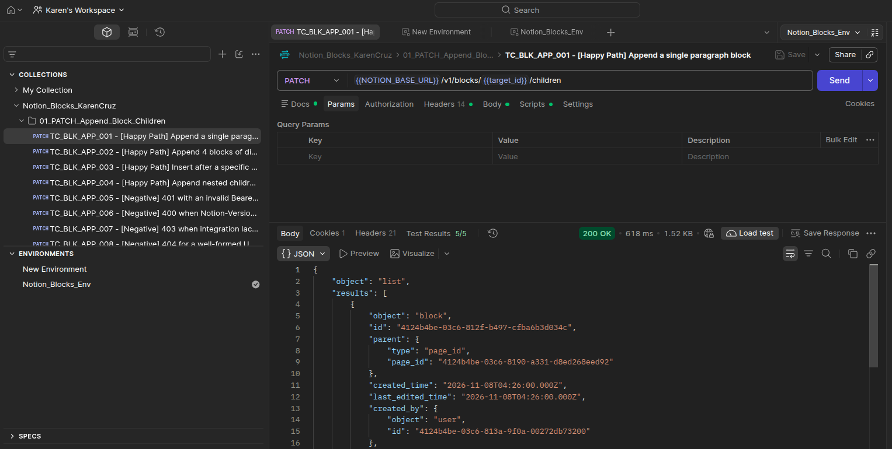

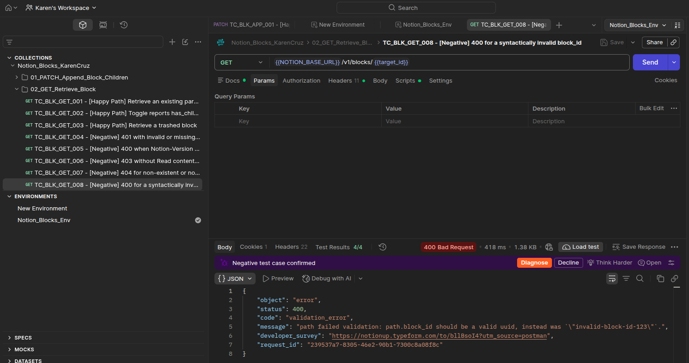

---


---

#### 2.2.2 Databases and Search Modules Implementation (Sebastián Pereyra)

The `Databases` and `Search` modules cover four primary endpoints:
- `POST /v1/databases`: Create a new database container under a parent page.
- `GET /v1/databases/{database_id}`: Retrieve database container metadata and associated data source references.
- `PATCH /v1/databases/{database_id}`: Update database container metadata (title, description, icon, cover, in_trash).
- `POST /v1/search`: Workspace-wide search with text query, entity type filters, and sorting.

##### Representative Multi-Tier Assertion Script Examples (Databases & Search)

###### 1. Happy Path: `TC_DB_001` – Create Database Container (`POST /v1/databases`)
```javascript
// =========================================================================
// TC_DB_001 - Create Database Multi-tier Verification Script
// =========================================================================

// 1. Status Code
pm.test("HTTP Status is 200 OK", function () {
    pm.response.to.have.status(200);
});

// 2. Response Time SLA
pm.test("Response time is acceptable (< 2500ms)", function () {
    pm.expect(pm.response.responseTime).to.be.below(2500);
});

// 3. Headers
pm.test("Content-Type is application/json", function () {
    pm.expect(pm.response.headers.get("Content-Type")).to.include("application/json");
});

// 4. Schema & Data Integrity
pm.test("Database object conforms to Notion 2025-09-03 container schema", function () {
    const res = pm.response.json();
    
    pm.expect(res.object).to.eql("database");
    pm.expect(res.id).to.be.a("string").and.to.match(/^[0-9a-f]{8}-[0-9a-f]{4}-[0-9a-f]{4}-[0-9a-f]{4}-[0-9a-f]{12}$/i);
    
    // Parent page verification
    pm.expect(res.parent).to.be.an("object");
    pm.expect(res.parent.type).to.eql("page_id");
    pm.expect(res.parent.page_id).to.eql(pm.environment.get("parent_page_id"));
    
    // Title array verification
    pm.expect(res.title).to.be.an("array").and.to.have.lengthOf.at.least(1);
    pm.expect(res.title[0].plain_text).to.eql("Test DB");
    
    // Flags
    pm.expect(res.archived).to.be.false;
    pm.expect(res.in_trash).to.be.false;
    
    // In Notion 2025-09-03, database contains data_sources references
    pm.expect(res).to.have.property("data_sources");
    pm.expect(res.data_sources).to.be.an("array");

    // Dynamic variable capture for downstream chained tests
    pm.environment.set("database_id", res.id);
    if (res.data_sources.length > 0) {
        pm.environment.set("data_source_id", res.data_sources[0].id);
    }
});
```

###### 2. Happy Path: `TC_SEARCH_003` – Filter Search by Database Entity Type (`POST /v1/search`)
```javascript
// =========================================================================
// TC_SEARCH_003 - Search Filter by Type "database" Verification Script
// =========================================================================

pm.test("HTTP Status is 200 OK", function () {
    pm.response.to.have.status(200);
});

pm.test("Search results contain strictly database objects", function () {
    const res = pm.response.json();
    
    pm.expect(res.object).to.eql("list");
    pm.expect(res.results).to.be.an("array");
    
    // Verify strict filtering: every returned entity must be a database
    res.results.forEach(function (entity, index) {
        pm.expect(entity.object, `Item at index ${index} must be object: "database"`).to.eql("database");
        pm.expect(entity.id).to.be.a("string");
    });
});
```

###### 3. Negative Scenario: `TC_DB_014` – Parent Page Not Found (`POST /v1/databases`)
```javascript
// =========================================================================
// TC_DB_014 - Parent Page Not Found Negative Check
// =========================================================================

pm.test("HTTP Status is 404 Not Found", function () {
    pm.response.to.have.status(404);
});

pm.test("Error payload returns object_not_found code", function () {
    const err = pm.response.json();
    pm.expect(err.object).to.eql("error");
    pm.expect(err.status).to.eql(404);
    pm.expect(err.code).to.eql("object_not_found");
    pm.expect(err.message).to.be.a("string");
});
```

###### 4. Boundary Scenario: `TC_DB_PATCH_015` – Clear Database Title to Untitled (`PATCH /v1/databases/{id}`)
```javascript
// =========================================================================
// TC_DB_PATCH_015 - Clear Title to Empty Array Boundary Check
// =========================================================================

pm.test("HTTP Status is 200 OK", function () {
    pm.response.to.have.status(200);
});

pm.test("Database title is cleared and represents untitled state", function () {
    const res = pm.response.json();
    pm.expect(res.object).to.eql("database");
    pm.expect(res.title).to.be.an("array").and.to.be.empty;
});
```

##### Sebastián Pereyra – Postman Implementation Mapping Matrix

The following table summarizes the implementation in Postman of the test cases designed by Sebastián Pereyra in Laboratory 01:

| Lab 01 Test ID | Postman Request Label | Method | Target Endpoint | Multi-Level Assertions Implemented | Type | Priority |
|---|---|---|---|---|---|---|
| `TC_DB_001` | `DATABASES - Positiva - Crear database con titulo (200)` | `POST` | `/v1/databases` | Status `200`, SLA `<2.5s`, `object: "database"`, parent match, captures `{{database_id}}` | Happy Path | High |
| `TC_DB_002` | `DATABASES - Positiva - Crear con schema completo (200)` | `POST` | `/v1/databases` | Status `200`, verify all typed properties created | Happy Path | High |
| `TC_DB_003` | `DATABASES - Positiva - Validar campos de metadatos (200)` | `POST` | `/v1/databases` | Status `200`, ISO timestamps, `archived: false`, `in_trash: false` | Happy Path | Medium |
| `TC_DB_004` | `DATABASES - Positiva - Crear database inline (200)` | `POST` | `/v1/databases` | Status `200`, `is_inline: true` asserted in response | Happy Path | Medium |
| `TC_DB_005` | `DATABASES - Positiva - Crear con icon emoji y cover URL (200)` | `POST` | `/v1/databases` | Status `200`, `icon.emoji` and `cover.external.url` fidelity | Happy Path | Low |
| `TC_DB_007` | `DATABASES - Negativa - Sin cabecera Authorization (401)` | `POST` | `/v1/databases` | Status `401`, `code: "unauthorized"`, `object: "error"` | Negative | High |
| `TC_DB_010` | `DATABASES - Negativa - Sin Notion-Version header (400)` | `POST` | `/v1/databases` | Status `400`, `code: "missing_version"` | Negative | High |
| `TC_DB_011` | `DATABASES - Negativa - JSON malformado en body (400)` | `POST` | `/v1/databases` | Status `400`, `code: "invalid_json"` | Negative | High |
| `TC_DB_012` | `DATABASES - Negativa - Body sin parent (400)` | `POST` | `/v1/databases` | Status `400`, `code: "validation_error"` | Negative | High |
| `TC_DB_013` | `DATABASES - Negativa - Parent UUID invalido (400)` | `POST` | `/v1/databases` | Status `400`, `code: "validation_error"` | Negative | High |
| `TC_DB_014` | `DATABASES - Negativa - Parent page inexistente (404)` | `POST` | `/v1/databases` | Status `404`, `code: "object_not_found"`, targeted using `{{ghost_id}}` | Negative | High |
| `TC_DB_015` | `DATABASES - Negativa - Parent page no compartida (404)` | `POST` | `/v1/databases` | Status `404`, `code: "object_not_found"`, targeted using `{{unshared_db_id}}` | Negative | High |
| `TC_DB_020` | `DATABASES - Limites - Titulo vacio [] (200)` | `POST` | `/v1/databases` | Status `200`, database created with empty title array | Boundary | Low |
| `TC_DB_021` | `DATABASES - Limites - Parent ID en hex vs guiones (200)` | `POST` | `/v1/databases` | Status `200`, parent accepted in both 32-char hex and 36-char hyphenated | Boundary | Medium |
| `TC_DB_GET_001` | `DATABASES - Positiva - Obtener database por ID (200)` | `GET` | `/v1/databases/{{database_id}}` | Status `200`, SLA `<2s`, `id` match, `object: "database"`, `data_sources` presence | Happy Path | High |
| `TC_DB_GET_004` | `DATABASES - Negativa - GET sin token (401)` | `GET` | `/v1/databases/{{database_id}}` | Status `401`, `code: "unauthorized"` | Negative | High |
| `TC_DB_GET_007` | `DATABASES - Negativa - ID con formato no UUID (400)` | `GET` | `/v1/databases/not-a-uuid` | Status `400`, `code: "validation_error"` | Negative | High |
| `TC_DB_GET_008` | `DATABASES - Negativa - Database inexistente (404)` | `GET` | `/v1/databases/{{ghost_id}}` | Status `404`, `code: "object_not_found"` | Negative | High |
| `TC_DB_GET_009` | `DATABASES - Negativa - Database no compartida (404)` | `GET` | `/v1/databases/{{unshared_db_id}}` | Status `404`, `code: "object_not_found"` (prevents enumeration) | Negative | High |
| `TC_DB_PATCH_001` | `DATABASES - Positiva - Actualizar titulo (200)` | `PATCH` | `/v1/databases/{{database_id}}` | Status `200`, updated title plain_text reflected, `last_edited_time` changed | Happy Path | High |
| `TC_DB_PATCH_003` | `DATABASES - Positiva - Actualizar icono y portada (200)` | `PATCH` | `/v1/databases/{{database_id}}` | Status `200`, `icon.emoji` and `cover.external.url` match updated values | Happy Path | Medium |
| `TC_DB_PATCH_004` | `DATABASES - Positiva - Mover a papelera in_trash true (200)` | `PATCH` | `/v1/databases/{{database_id}}` | Status `200`, `in_trash: true`, `archived: true` | Happy Path | High |
| `TC_DB_PATCH_005` | `DATABASES - Positiva - Restaurar de papelera in_trash false (200)` | `PATCH` | `/v1/databases/{{database_id}}` | Status `200`, `in_trash: false`, `archived: false` | Happy Path | High |
| `TC_DB_PATCH_009` | `DATABASES - Negativa - PATCH sin version header (400)` | `PATCH` | `/v1/databases/{{database_id}}` | Status `400`, `code: "missing_version"` | Negative | High |
| `TC_DB_PATCH_010` | `DATABASES - Negativa - PATCH con UUID invalido en ruta (400)` | `PATCH` | `/v1/databases/invalid-id` | Status `400`, `code: "validation_error"` | Negative | High |
| `TC_DB_PATCH_015` | `DATABASES - Limites - Limpiar titulo con array vacio (200)` | `PATCH` | `/v1/databases/{{database_id}}` | Status `200`, `title` becomes empty array `[]` | Boundary | Low |
| `TC_SEARCH_001` | `SEARCH - Positiva - Busqueda por palabra clave en titulo (200)` | `POST` | `/v1/search` | Status `200`, SLA `<3s`, `object: "list"`, matching entities in `results` | Happy Path | High |
| `TC_SEARCH_002` | `SEARCH - Positiva - Busqueda con body vacio retorna todo (200)` | `POST` | `/v1/search` | Status `200`, `object: "list"`, `has_more` boolean, `results` array | Happy Path | High |
| `TC_SEARCH_003` | `SEARCH - Positiva - Filtrar estrictamente por database (200)` | `POST` | `/v1/search` | Status `200`, every returned item has `object: "database"`, zero pages | Happy Path | High |
| `TC_SEARCH_005` | `SEARCH - Positiva - Ordenar descendente por last_edited_time (200)` | `POST` | `/v1/search` | Status `200`, results sorted from most recently edited to oldest | Happy Path | High |
| `TC_SEARCH_007` | `SEARCH - Positiva - Paginacion cursor-based con start_cursor (200)` | `POST` | `/v1/search` | Status `200`, `has_more: true`, captures `next_cursor` and traverses page | Happy Path | High |
| `TC_SEARCH_009` | `SEARCH - Negativa - Busqueda sin token (401)` | `POST` | `/v1/search` | Status `401`, `code: "unauthorized"` | Negative | High |
| `TC_SEARCH_013` | `SEARCH - Negativa - Valor de filtro invalido object user (400)` | `POST` | `/v1/search` | Status `400`, `code: "validation_error"` | Negative | Medium |
| `TC_SEARCH_014` | `SEARCH - Negativa - Timestamp de sort invalido created_time (400)` | `POST` | `/v1/search` | Status `400`, `code: "validation_error"` (only `last_edited_time` supported) | Negative | Medium |
| `TC_SEARCH_017` | `SEARCH - Limites - page_size minimo igual a 1 (200)` | `POST` | `/v1/search` | Status `200`, `results.length <= 1`, `has_more: true` if > 1 resources | Boundary | High |
| `TC_SEARCH_019` | `SEARCH - Limites - page_size igual a 0 fuera de rango (400)` | `POST` | `/v1/search` | Status `400`, `code: "validation_error"` | Boundary | High |
| `TC_SEARCH_020` | `SEARCH - Limites - page_size igual a 101 excedido (400)` | `POST` | `/v1/search` | Status `400`, `code: "validation_error"` | Boundary | High |
| `TC_SEARCH_021` | `SEARCH - Limites - Busqueda de titulo inexistente (200)` | `POST` | `/v1/search` | Status `200`, `results: []`, `has_more: false` | Boundary | Medium |

##### Execution Evidence for Databases & Search Modules (Sebastián Pereyra)

The collection [`Lab02_Grupo2_Databases_Search.postman_collection.json`](./postman/actividad_2_3_4/Lab02_Grupo2_Databases_Search.postman_collection.json) implements the CRUD lifecycle for `Databases` alongside global search queries under `Search`. The screenshots below document empirical verification in Postman:

###### 01 - DB CREATE: Crear Database (200 OK)
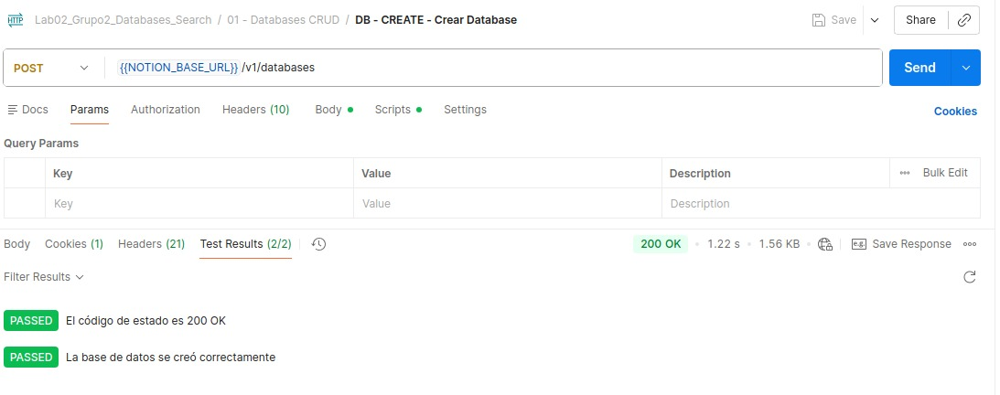

###### 02 - Search: Búsqueda Global (200 OK)
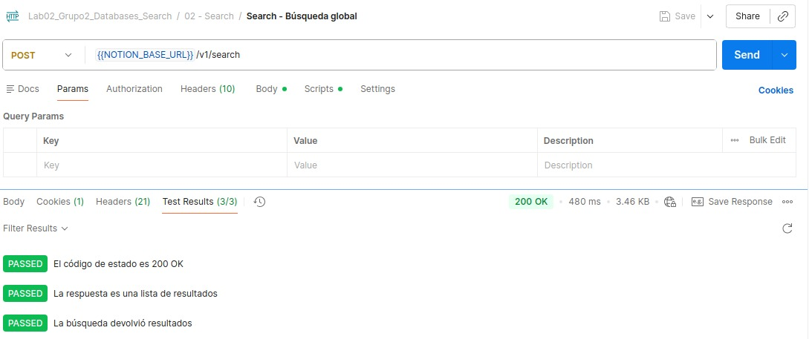

---

#### Kevin Uruchi — Module: Pages

All **200 test cases** designed in Laboratory 01 (`KevinUruchiTests.md` — 184 endpoint test cases across the five `Pages` endpoints plus 16 multi-step E2E scenarios, identified as `TC_PAGES_*` and `TC_E2E_*`) were implemented in Postman inside [`postman/kevin_uruchi/Notion_Pages.postman_collection.json`](./postman/kevin_uruchi/Notion_Pages.postman_collection.json) (paired with [`Notion_Pages.postman_environment.json`](./postman/kevin_uruchi/Notion_Pages.postman_environment.json)), resulting in **200 executable HTTP requests**, one per test case, each named exactly like its test case (`TC_ID: Verify that ...`). Every request verifies the response in several layers: status code, response body, JSON schema, headers, response time and data integrity (a follow-up `GET` that confirms the change was really stored).

| Lab 01 Suite / Endpoint | Implemented Test Case IDs | Req. Count | Multi-Layer `pm.test()` Verifications Implemented |
|-------------------------|---------------------------|------------|---------------------------------------------------|
| **`POST /v1/pages`**<br>(`POST /v1/pages`) | `TC_PAGES_001` – `TC_PAGES_048` | 48 | **Status:** `200`, `400`, `401`, `403`, `404`, `429`.<br>**Headers & SLA:** `Content-Type: application/json`, `responseTime < 2000 ms`.<br>**Body / Schema:** `object === "page"`, `UUID` regex on `id`, `parent.type`, `in_trash === false`, ISO-8601 `created_time` / `last_edited_time`, title and property values equal to the request; error codes `"validation_error"`, `"object_not_found"`, `"unauthorized"`, `"restricted_resource"`, `"missing_version"`, `"invalid_json"`.<br>**Data integrity:** `GET /v1/pages/{id}` returns what was sent. |
| **`GET /v1/pages/{page_id}`**<br>(`GET /v1/pages/{page_id}`) | `TC_PAGES_GET_001` – `TC_PAGES_GET_025` | 25 | **Status:** `200`, `400`, `401`, `403`, `404`.<br>**Headers & SLA:** `application/json`, `< 2000 ms`.<br>**Body / Schema:** all documented page fields, `filter_properties` returning only the requested properties, 100-property rows, 2,000-character Unicode titles, relation truncation (`has_more` at 26 references); error codes `"validation_error"`, `"object_not_found"`, `"restricted_resource"`. |
| **`GET /v1/pages/{page_id}/properties/{property_id}`**<br>(`GET /v1/pages/{page_id}/properties/{property_id}`) | `TC_PAGES_PROP_001` – `TC_PAGES_PROP_030` | 30 | **Status:** `200`, `400`, `401`, `403`, `404`.<br>**Headers & SLA:** `application/json`, `< 2000 ms`.<br>**Body / Schema:** `object === "property_item"` or `"list"`, `type` per property kind (number, select, date, formula, rollup, relation, people, rich_text, title), `next_cursor` and `page_size` pagination without duplicates or gaps. |
| **`POST /v1/pages/{page_id}/move`**<br>(`POST /v1/pages/{page_id}/move`) | `TC_PAGES_MOVE_001` – `TC_PAGES_MOVE_034` | 34 | **Status:** `200`, `400`, `401`, `403`, `404`, `409`.<br>**Headers & SLA:** `application/json`, `< 2000 ms`.<br>**Body / Schema:** new `parent.type` (`page_id` or `data_source_id`), `id`, `url`, `created_by`, `icon`, `cover` and blocks unchanged; destination rejected when it is a `database_id`, a descendant (cycle) or a trashed page.<br>**Data integrity:** the old parent no longer lists the page and the new parent does. |
| **`PATCH /v1/pages/{page_id}`**<br>(`PATCH /v1/pages/{page_id}`) | `TC_PAGES_PATCH_001` – `TC_PAGES_PATCH_047` | 47 | **Status:** `200`, `400`, `401`, `403`, `404`, `409`.<br>**Headers & SLA:** `application/json`, `< 2000 ms`.<br>**Body / Schema:** updated values per property type, `icon` and `cover`, `in_trash` and `is_locked`, `last_edited_time` updated; read-only properties (formula, rollup, created/edited time) rejected; limits of 2,000 characters, 100 rich-text elements and 100 list items.<br>**Data integrity:** a failed update leaves the page unchanged. |
| **Chained & E2E Flows**<br>(`E2E`) | `TC_E2E_001` – `TC_E2E_016` | 16 | Cross-endpoint state parity between create, read, property read, query, update, move and trash; dual relation sync, rollup and formula recalculation, pagination of large values, no side effects after failed requests, rate-limit handling without duplicates, permissions across the lifecycle, bulk operations on 50 pages and concurrent updates. |

##### Representative Postman Script 1 — Negative & Error Contract Validation (`Pages` Module: `TC_PAGES_GET_013`)

```javascript
// [Pre-request Script] A well-formed UUID that does not belong to any page
const uuid = () =>
    "xxxxxxxx-xxxx-4xxx-yxxx-xxxxxxxxxxxx".replace(/[xy]/g, (c) => {
        const r = (Math.random() * 16) | 0;
        return (c === "x" ? r : (r & 3) | 8).toString(16);
    });
pm.collectionVariables.set("targetId", uuid());
// Request: GET {{apiBaseURL}}{{pagesEndpoint}}/{{targetId}}

// [Post-response / Tests Script] Multi-layer error contract verification
pm.test("Status code should be 404", function () {
    pm.response.to.have.status(404);
});

pm.test("Response body should be a Notion error with code object_not_found", function () {
    const errorBody = pm.response.json();
    pm.expect(errorBody.object).to.eql("error");
    pm.expect(errorBody.status).to.eql(404);
    pm.expect(errorBody.code).to.eql("object_not_found");
    pm.expect(errorBody.message).to.be.a("string").and.not.empty;
});

pm.test("Content-Type should be application/json", function () {
    pm.response.to.have.header("Content-Type");
    pm.expect(pm.response.headers.get("Content-Type")).to.include("application/json");
});

pm.test("Response time should be less than 2000ms", function () {
    pm.expect(pm.response.responseTime).to.be.below(2000);
});
```

##### Representative Postman Script 2 — Preconditions, Data Integrity & Cleanup (`Pages` Module: `TC_PAGES_MOVE_001`)

```javascript
// [Pre-request Script] Preconditions created by API (headers and pagesUrl are built as in TC_PAGES_001)
// 1. Parent page, 2. second parent page (destination), 3. page to move
const parentResponse = await pm.sendRequest({
    url: pagesUrl, method: "POST", header: headers,
    body: { mode: "raw", raw: JSON.stringify({
        parent: { page_id: pm.environment.get("rootPageId") },
        properties: { title: { title: [{ text: { content: "QA parent - " + Date.now() } }] } }
    }) }
});
const p = parentResponse.json().id;
pm.collectionVariables.set("parentPageId", p);
// ... the second parent (parent2Id) and the child page (pageId) are created the same way ...
pm.request.body.update({
    mode: "raw",
    raw: JSON.stringify({ parent: { type: "page_id", page_id: pm.collectionVariables.get("parent2Id") } })
});

// [Post-response / Tests Script]
pm.test("Status code should be 200", function () {
    pm.response.to.have.status(200);
});
pm.test("The new parent should be the destination", function () {
    const jsonData = pm.response.json();
    pm.expect(jsonData.parent.type).to.eql("page_id");
    pm.expect(jsonData.parent.page_id.replace(/-/g, "")).to.eql(pm.collectionVariables.get("parent2Id").replace(/-/g, ""));
});

// Data integrity: a GET shows the new parent
const getResponse = await pm.sendRequest({ url: `${pagesUrl}/${pm.collectionVariables.get("pageId")}`, method: "GET", header: headers });
pm.test("[Data integrity] GET should show the new parent", function () {
    pm.expect(getResponse.json().parent.page_id.replace(/-/g, "")).to.eql(pm.collectionVariables.get("parent2Id").replace(/-/g, ""));
});

// CLEANUP. Notion has no permanent delete, so every created page goes to the trash
for (const pageToTrash of [pm.collectionVariables.get("parentPageId"), pm.collectionVariables.get("parent2Id")]) {
    await pm.sendRequest({
        url: `${pagesUrl}/${pageToTrash}`, method: "PATCH", header: headers,
        body: { mode: "raw", raw: JSON.stringify({ in_trash: true }) }
    });
}
```
Screamshots:

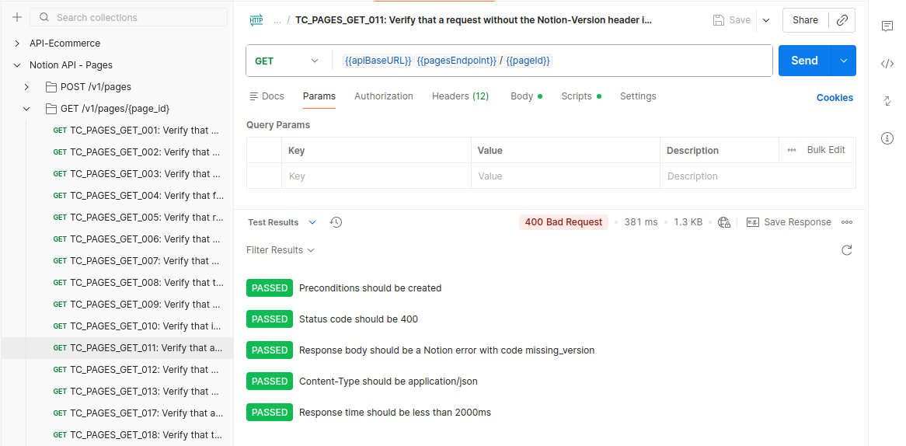

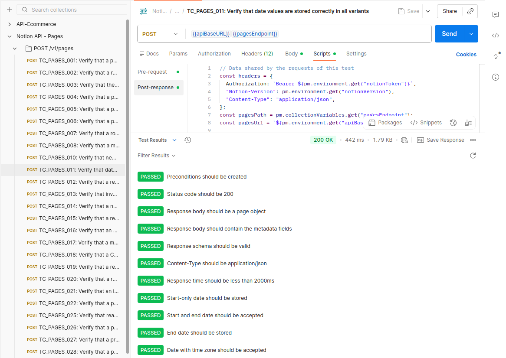

---

## Activity #3

1. Evaluate the written tests and their feasibility of implementation in Postman.
2. Identify test requirements, such as necessary preconditions and postconditions.
3. Review the concept of variables, variable scopes, and environments in Postman.
4. Implement multi-request tests using shared variables.  

---

#### Karen Ivonne Cruz Alvarez — Module: Blocks

##### 3.1 Feasibility Evaluation of Lab 01 Test Cases in Postman

All **72 test cases** from `KarenCruzTests.md` were evaluated for unattended execution inside Postman Collection Runner and Newman CLI:

| Automation Classification | Covered Test Cases (`KarenCruzTests.md`) | Count | Technical Justification & Execution Strategy |
|---------------------------|------------------------------------------|-------|----------------------------------------------|
| **100% Automatable (Unattended Runner)** | All `TC_BLK_*` and `TC_E2E_BLK_*` not listed in the next two rows | **64 TCs** | Deterministic HTTP contracts. Every case creates its own sandbox page under `PAGE_ID` and every block, toggle, trashed block or page with `100` / `101` children by API in the pre-request script (`PATCH /children`, max `100` blocks per call); the sandbox page is moved to the trash at the end. They only need `NOTION_TOKEN` and `PAGE_ID`. Cases whose behavior is "to be pinned after first execution" (`TC_BLK_APP_015`, `TC_BLK_GET_011`, `TC_BLK_UPD_013`, `TC_BLK_DEL_003`, `TC_BLK_DEL_009`) assert a deterministic status (never `500`) with tolerant checks. |
| **Conditionally Automatable (Extra Credentials or Data)** | `TC_BLK_APP_007`, `TC_BLK_UPD_006`, `TC_BLK_DEL_006` (`READONLY_TOKEN`); `TC_BLK_GET_006`, `TC_BLK_CHL_007` (`RESTRICTED_TOKEN`); `TC_BLK_GET_007` (`UNSHARED_BLOCK_ID`); `TC_E2E_BLK_004` (`READONLY_TOKEN`) | **7 TCs** | Run once the matching variable is filled in the environment. A second integration without the *Insert / Update / Read content* capability must be created in the Notion Developers Portal, and a block that exists but is not connected to the integration must be prepared. When the variable is empty the request is marked as skipped instead of failing. |
| **Semi-Automated (Burst / Load Traffic)** | `TC_BLK_APP_018` (`429` rate limit) | **1 TC** | Needs more than `15` parallel requests per second, which a sequential Runner iteration does not produce. The script dispatches a burst of `20` parallel calls with `pm.sendRequest()` and asserts `429` + `Retry-After` when throttled, or `200 OK` on every call when Notion does not throttle. |

##### 3.2 Test Requirements — Preconditions & Postconditions

| Suite / Scope | Required Preconditions (Before Execution) | Enforced Postconditions (After Execution) |
|---------------|-------------------------------------------|-------------------------------------------|
| **`01_PATCH_Append_Block_Children`**<br>(`TC_BLK_APP_001`–`018`) | 1. Active `NOTION_TOKEN` with *Read*, *Update* and *Insert content* capabilities.<br>2. `PAGE_ID` of a page shared with the integration (`Connections`).<br>3. `READONLY_TOKEN` for `TC_BLK_APP_007`; a page with `>= 2` children and `first_block_id` for `TC_BLK_APP_003`, created by the script. | The case's sandbox page (with every block created in it) is moved to the trash with `PATCH /v1/pages/{id}` `{"in_trash": true}`; rejected requests leave the children count unchanged. |
| **`02_GET_Retrieve_Block`**<br>(`TC_BLK_GET_001`–`011`) | 1. Same credentials and `PAGE_ID`.<br>2. A paragraph block, a toggle with a child and a trashed block, created by API.<br>3. `RESTRICTED_TOKEN` (`TC_BLK_GET_006`) and `UNSHARED_BLOCK_ID` (`TC_BLK_GET_007`). | Read-only requests leave no changes. The sandbox page and its helper blocks are trashed at the end of each case. |
| **`03_GET_Retrieve_Block_Children`**<br>(`TC_BLK_CHL_001`–`014`) | 1. Same credentials and `PAGE_ID`.<br>2. Pages with `>= 3`, exactly `100` and `101` children, plus a leaf block and a toggle with children, created by API (`100` + `1` blocks in two requests).<br>3. `RESTRICTED_TOKEN` for `TC_BLK_CHL_007`. | Read-only requests leave no changes. The sandbox pages (`sandbox_id`, and `sandbox2_id` in `TC_BLK_CHL_013`) are trashed; `skip_case` and the sandbox variables are reset at the start of the next case. |
| **`04_PATCH_Update_Block`**<br>(`TC_BLK_UPD_001`–`014`) | 1. Same credentials and `PAGE_ID`.<br>2. A paragraph with known text, a `to_do` block with `checked: false` and a trashed block, created by API.<br>3. `READONLY_TOKEN` for `TC_BLK_UPD_006`. | The sandbox page is trashed at the end. Failed updates leave the stored content unchanged (verified with `GET`). |
| **`05_DELETE_Block`**<br>(`TC_BLK_DEL_001`–`011`) | 1. Same credentials and `PAGE_ID`.<br>2. A fresh block (and a toggle with children for `TC_BLK_DEL_003`) created by API for every case, so deletion never consumes shared data.<br>3. `READONLY_TOKEN` for `TC_BLK_DEL_006`. | Deleted blocks stay in the trash inside a sandbox page that is trashed too (Notion has no permanent delete through the API); rejected deletions leave the block active (verified with `GET`). |
| **`06_E2E_Flows`**<br>(`TC_E2E_BLK_001`–`004`) | Executed strictly as the **final folder** (the chained steps depend on the order of their requests) so the `101`-block and permission scenarios never affect earlier suites. | The sandbox page created by the flow is trashed in the last step (or at the end of the single-request cases), even when an assertion fails, because `cleanup()` runs after the `pm.test()` calls. |

##### 3.3 Multi-Request Chaining & Shared Variables Implementation

Variables were partitioned across three Postman scopes to prevent credential leakage while supporting dynamic request chaining:

| Scope Level | Variable Names | Purpose & Lifecycle |
|-------------|----------------|---------------------|
| **Collection Scope** | `NOTION_BASE_URL`, `NOTION_VERSION`, `target_id`, `sandbox_id`, `sandbox2_id`, `skip_case`, `first_block_id`, `next_cursor`, `e2e_block_id`, `e2e_a_id`, `e2e_b_id` | Portable contract defaults (`2025-09-03`) and cross-step runtime state shared via `pm.collectionVariables.set()` / `.get()`; the E2E chains read `{{e2e_block_id}}`, `{{e2e_b_id}}` and `{{sandbox_id}}` directly in the request URL. |
| **Environment Scope** (`Notion_Blocks_Env`) | `NOTION_TOKEN` (*secret*), `READONLY_TOKEN` (*secret*), `RESTRICTED_TOKEN` (*secret*), `PAGE_ID`, `UNSHARED_BLOCK_ID` | Workspace-specific values and secrets, masked in the UI. Empty optional variables make the dependent cases skip instead of fail. |
| **Script-local Scope** | `BASE`, `TOKEN`, `ROOT` (`PAGE_ID`), `ID` (test case id), `SKIP`, the compact 32-char id (`strip(id)`), and the generated payloads (`text(2000)`, `many(100)`) | Ephemeral values computed inside each Pre-request / Tests script. |

Two workflows were implemented as **true multi-request chains** inside `06_E2E_Flows`, passing state through collection variables:

1. **Full Block Lifecycle (`TC_E2E_BLK_001` — 6 Sequential Requests):**
   - `Step 1` (`PATCH /v1/blocks/{{target_id}}/children`) creates a sandbox page, appends one paragraph and stores `results[0].id` -> `e2e_block_id`.
   - `Step 2` (`GET /v1/blocks/{{e2e_block_id}}`) asserts the original text and `parent.page_id == sandbox_id`.
   - `Step 3` (`PATCH /v1/blocks/{{e2e_block_id}}`) updates the text, and `Step 4` (`GET`) confirms the new text persisted.
   - `Step 5` (`DELETE /v1/blocks/{{e2e_block_id}}`) returns `in_trash: true`.
   - `Step 6` (`GET /v1/blocks/{{sandbox_id}}/children`) asserts the block is absent, calls `GET` on the block (`in_trash: true`), unsets `e2e_block_id` and trashes the sandbox page.
2. **Ordered Insertion, Delete and Restore (`TC_E2E_BLK_003` — 5 Sequential Requests):**
   - `Step 1` appends paragraphs `A` and `C` and stores `e2e_a_id`; `Step 2` inserts `B` with `"after": "{{e2e_a_id}}"` and stores `e2e_b_id`; `Step 3` lists children and asserts order `A, B, C`.
   - `Step 4` (`DELETE /v1/blocks/{{e2e_b_id}}`) asserts order `A, C`; `Step 5` (`PATCH` `{"in_trash": false}`) restores `B` and asserts `A, B, C` with the original content, then cleans up.

The other two scenarios run their steps inside a single request script through `pm.sendRequest()`: pagination (`TC_E2E_BLK_002`: `100` + `1` blocks, traversal at `page_size=50` until `has_more: false`, exactly `101` unique first-level blocks over 3 pages, toggle with `2` children) and capability enforcement (`TC_E2E_BLK_004`: read-only token reads succeed, three writes return `403`, full-access `GET` confirms the content is unchanged).

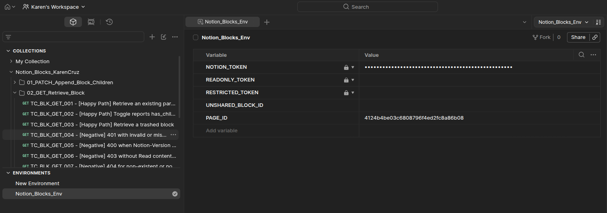

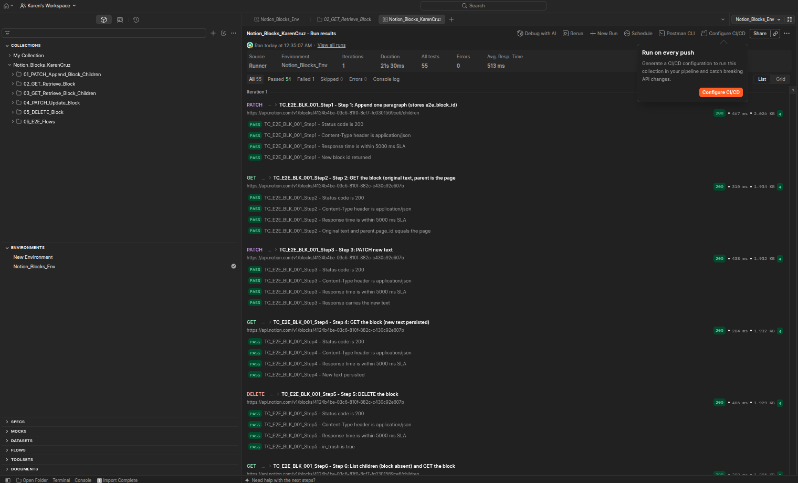

---

### 3.1 Evaluation and Feasibility of Written Tests in Postman

#### 3.1.1 Gabriel Marcos Guaman Ortuño — Modules: Users & OAuth

##### 3.1 Feasibility Evaluation of Lab 01 Test Cases in Postman

All **52 test cases** from `GabrielGuamanTests.md` were evaluated for unattended execution feasibility inside Postman Collection Runner and Newman CLI:

| Automation Classification | Covered Test Cases (`GabrielGuamanTests.md`) | Count | Technical Justification & Execution Strategy |
|---------------------------|----------------------------------------------|-------|----------------------------------------------|
| **100% Automatable (Unattended Runner)** | `TC_USR_ME_001`–`007`; `TC_USR_GET_001`–`005`, `007`–`009b`; `TC_USR_LIST_001`–`009b`; `TC_OAUTH_TOK_003`–`008b`; `TC_OAUTH_REV_001`–`007`; `TC_OAUTH_INT_002`–`008`; `TC_E2E_002` | **45 TCs** | Deterministic stateless/stateful HTTP contracts requiring only pre-provisioned secrets (`NOTION_TOKEN`, `OAUTH_CLIENT_ID`, `OAUTH_CLIENT_SECRET`) and dynamic Pre-request UUID/cursor discovery. |
| **Conditionally Automatable (Multi-Credential Setup)** | `TC_USR_GET_006` (`403 restricted_resource`); `TC_OAUTH_TOK_002`, `TC_OAUTH_INT_001`, `TC_E2E_003` | **4 TCs** | Fully automated once `RESTRICTED_TOKEN` (secondary integration without *Read user information* capability) and an active `OAUTH_REFRESH_TOKEN` / `OAUTH_ACCESS_TOKEN` are populated in the environment. |
| **Semi-Automated (Browser OAuth Consent / Load Runner)** | `TC_OAUTH_TOK_001`, `TC_OAUTH_TOK_009`, `TC_E2E_001` (browser `OAUTH_AUTH_CODE`); `TC_USR_ME_008` (`429` burst rate-limit) | **3 + 1 TCs** | OAuth 2.0 `authorization_code` requires interactive user consent in Notion's web UI to mint a single-use `code` before running the exchange/replay chain. `TC_USR_ME_008` requires parallel load generation (`>15 req/s` in Postman Performance Runner) rather than sequential single-thread execution; its script asserts `429` + `Retry-After` under burst or `200 OK` sequentially. |


---

#### 3.1.2 Valentina Molina Bustillos & Sebastián Pereyra — Modules: Data Sources, Databases, and Search


Following the formal specification of 160 test scenarios in Laboratory 01 across the `Data sources` module (Valentina Molina Bustillos) and the `Databases` and `Search` modules (Sebastián Pereyra), the team conducted a technical feasibility analysis to evaluate the automation potential of these contracts within the **Postman (v11.x)** platform.

#### Automation Feasibility Classification

Each test case was evaluated against the capabilities and architectural constraints of the *Postman Runtime* and classified into one of three feasibility tiers:

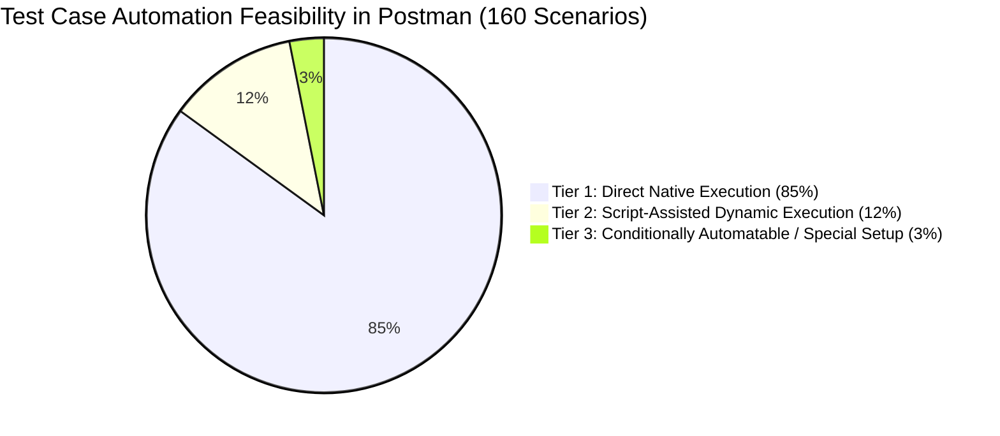

1. **Tier 1: Direct Native Execution (100% Automatable Out-of-the-Box — 85% of Suite):**  
   Includes all deterministic contract checks: HTTP status codes (`200`, `400`, `401`, `404`), mandatory request header enforcement (`Notion-Version: 2025-09-03`, `Authorization: Bearer {{token}}`), malformed JSON syntax rejections, typed JSON schema validation, and fixed boundary conditions (e.g., `page_size: 1`, `page_size: 100`, `page_size: 0`, `page_size: 101`). These requests require no dynamic multi-turn coordination and execute deterministically in isolation.

2. **Tier 2: Script-Assisted Dynamic Execution (Automatable via `pm.*` Sandbox Scripts — 12% of Suite):**  
   Includes scenarios requiring runtime state capture, response transformation, or sequential data correlation. Examples include:
   - Capturing auto-generated entity UUIDs (`database_id` and `data_source_id`) from creation responses and persisting them to the active environment.
   - Cursor-based pagination loops traversing `start_cursor` tokens until `has_more: false`.
   - Dynamic timestamp generation (`new Date().toISOString()`) for cache busting or unique naming.
   - Deep structural equality assertions across dynamically generated schema properties.

3. **Tier 3: Conditionally Automatable / Special Environment Setup Required (3% of Suite):**  
   Scenarios that depend on external architectural factors beyond a single Postman request execution:
   - *Rate Limiting (`429 Too Many Requests` / `rate_limited`):* Notion enforces a global rate limit of approximately 3 requests per second per integration token, with short burst allowances. Automating `TC_DB_019`, `TC_DS_GET_011`, and `TC_SEARCH_016` deterministically requires rapid parallel dispatch via Newman CLI or a looping Collection Runner script with `pm.execution.setNextRequest()`, rather than an isolated manual click.
   - *Permission Isolation & Enumeration Prevention (`TC_DB_015`, `TC_DS_GET_009`, `TC_E2E_DB_005`):* Validating that an unshared resource returns `404 object_not_found` rather than leaking its existence requires a pre-existing resource owned by a secondary account or integration token that is intentionally not shared with Group 2's primary bot.

##### Feasibility Evaluation Summary Matrix

| Module | Member | Total Test Cases | Tier 1 (Direct) | Tier 2 (Scripted) | Tier 3 (Special Setup) | Overall Feasibility |
|---|---|---|---|---|---|---|
| **Data Sources** (`/v1/data_sources/*`) | Valentina Molina Bustillos | 82 scenarios | 70 (85.4%) | 10 (12.2%) | 2 (2.4%) | **100% Automatable** (with scripts & environment setup) |
| **Databases** (`/v1/databases/*`) | Sebastián Pereyra | 46 scenarios | 39 (84.8%) | 5 (10.9%) | 2 (4.3%) | **100% Automatable** (with scripts & environment setup) |
| **Search** (`/v1/search`) | Sebastián Pereyra | 32 scenarios | 27 (84.4%) | 4 (12.5%) | 1 (3.1%) | **100% Automatable** (with scripts & environment setup) |
| **Total Group 2 Scope** | **Valentina & Sebastián** | **160 scenarios** | **136 (85.0%)** | **19 (11.9%)** | **5 (3.1%)** | **100% Automatable** |

---


---

#### 3.1.3 Kevin Uruchi — Module: Pages

##### 3.1 Feasibility Evaluation of Lab 01 Test Cases in Postman

All **200 test cases** from `KevinUruchiTests.md` were evaluated for unattended execution inside Postman Collection Runner and Newman CLI:

| Automation Classification | Covered Test Cases (`KevinUruchiTests.md`) | Count | Technical Justification & Execution Strategy |
|---------------------------|--------------------------------------------|-------|----------------------------------------------|
| **100% Automatable (Unattended Runner)** | All `TC_PAGES_*` and `TC_E2E_*` not listed in the next two rows | **187 TCs** | Every precondition (parent pages, data sources, rows, relations, page trees) is created by API in the pre-request script, and the cleanup moves the pages to the trash. They only need `notionToken` and `rootPageId`. |
| **Conditionally Automatable (Extra Credentials or Data)** | `TC_PAGES_009` (public integration token), `TC_PAGES_023`, `TC_PAGES_GET_014`, `TC_PAGES_MOVE_019`, `TC_PAGES_PATCH_021` (page not shared with the integration), `TC_PAGES_024`, `TC_PAGES_MOVE_025`, `TC_PAGES_PATCH_022` (read-only or insert-only token), `TC_PAGES_GET_016`, `TC_PAGES_PROP_016` (token without read capability), `TC_PAGES_GET_025` (integration without access), `TC_PAGES_PATCH_030` (data source with a Status property) | **12 TCs** | They run once the matching variable (`tokenPublic`, `unsharedPageId`, `tokenReadOnly`, `tokenInsertOnly`, `tokenNoRead`, `tokenB`, `statusDataSourceId`) is filled in the environment. When it is empty the request is marked as skipped instead of failing. |
| **Semi-Automated (Manual Sharing Steps)** | `TC_E2E_013` | **1 TC** | Sharing a page with a second integration and then revoking it is done in the Notion web UI. The script automates the steps that use prepared tokens (no access, read-only, insert-only) and the manual steps are documented in the test case. |

Nine of the automatable cases generate burst or parallel traffic from the script itself (`TC_PAGES_033`, `TC_PAGES_GET_018`, `TC_PAGES_PROP_019`, `TC_PAGES_MOVE_028`, `TC_PAGES_MOVE_034`, `TC_PAGES_PATCH_035`, `TC_PAGES_PATCH_047`, `TC_E2E_012` and `TC_E2E_015`), so no external load tool is needed. Five more cases (`TC_PAGES_013`, `TC_PAGES_GET_010`, `TC_PAGES_PROP_009`, `TC_PAGES_MOVE_010` and `TC_PAGES_PATCH_017`) add an extra check with `revokedToken` when that variable is filled.


---

### 3.2 Test Requirements: Preconditions, Postconditions, and Environment State Management

#### 3.2.1 Gabriel Marcos Guaman Ortuño — Modules: Users & OAuth

##### 3.2 Test Requirements — Preconditions & Postconditions

| Suite / Scope | Required Preconditions (Before Execution) | Enforced Postconditions (After Execution) |
|---------------|-------------------------------------------|-------------------------------------------|
| **`01_Users_Module`**<br>(`/v1/users/*`) | 1. Active `NOTION_TOKEN` with *Read user information including email addresses* capability enabled.<br>2. Secondary `RESTRICTED_TOKEN` configured with *No user information* capability (`TC_USR_GET_006`).<br>3. Workspace contains `>= 2` accessible users (`person` + `bot`) for cursor pagination.<br>4. `target_user_id` and `bot_user_id` auto-extracted via `pm.sendRequest()` Pre-request hook if empty. | Read-only `GET` operations leave zero residual server-side mutations. Discovered `target_user_id`, `bot_user_id`, and `pagination_cursor` remain cached in environment/collection scope for downstream inspection. |
| **`02_OAuth_Module`**<br>(`/v1/oauth/*`) | 1. Valid `OAUTH_CLIENT_ID` and `OAUTH_CLIENT_SECRET` injected via folder-level `Basic Auth`.<br>2. Registered `OAUTH_REDIRECT_URI` matching Notion portal settings.<br>3. Active `OAUTH_ACCESS_TOKEN` / `OAUTH_REFRESH_TOKEN` (and fresh `OAUTH_AUTH_CODE` for `TOK_001`/`009`). | `TC_OAUTH_REV_001` revokes an **isolated disposable token** (`isolated_revocable_token`) so shared `NOTION_TOKEN` and `OAUTH_ACCESS_TOKEN` remain intact for `03_POST_OAuth_Introspect`. |
| **`03_Chained_And_E2E_Flows`**<br>(`TC_E2E_001`–`003`) | Executed strictly as the **final folder** in the collection after module suites finish. | `TC_E2E_002_Step5` unsets transient comparison keys (`e2e_baseline_name`, `e2e_baseline_type`). `TC_E2E_001_Step6` isolates token destruction to `oauth_access_token` and clears the revoked credential upon confirming `401 Unauthorized`. |


---

#### 3.2.2 Valentina Molina Bustillos & Sebastián Pereyra — Modules: Data Sources, Databases, and Search


To execute the test suites deterministically without false failures or state contamination, Group 2 defined strict preconditions, postconditions, and teardown procedures for both members' modules.

#### Precondition Requirements

The table below details the necessary operational preconditions required prior to executing the test collections:

| Requirement Category | Prerequisite Description | Applied Modules | Configuration in Postman Environment |
|---|---|---|---|
| **API Authentication** | An active Notion Internal Integration bot (`SQE3-Grupo2-Internal`) provisioned in the Notion Developers Portal. | All (`Databases`, `Data sources`, `Search`) | Masked in `{{NOTION_TOKEN}}` (`type: "secret"`). |
| **Integration Capabilities** | Internal integration must have **Read content**, **Insert content**, and **Update content** capabilities enabled. | All | Configured in Notion Portal under Integration Settings. |
| **Root Test Container** | A designated parent page created in the workspace and explicitly shared with the integration bot via **`...` → `Connections`**. | `POST /v1/databases` | Populated in `{{parent_page_id}}` (36-char UUID). |
| **Parent Database** | An active database container created under the parent page, serving as the required container for new data sources. | `POST /v1/data_sources` | Populated in `{{database_id}}` (dynamically or manually). |
| **Populated Rows** | A data source populated with at least 5 page rows with diverse values (`Count`, `Status`, `Due Date`) for query filter testing. | `POST /v1/data_sources/{id}/query` | Populated in `{{data_source_id}}`. |
| **Negative Fixture: Ghost UUID** | A syntactically valid RFC 4122 UUIDv4 that does not correspond to any existing Notion entity. | All negative `404` tests | `{{ghost_id}} = "00000000-0000-0000-0000-000000000000"`. |
| **Negative Fixture: Unshared Resource** | A real database/data source created in a workspace container that is intentionally NOT connected to Group 2's bot. | All enumeration prevention `404` tests | `{{unshared_db_id}}` and `{{unshared_ds_id}}`. |

#### Postcondition & Teardown Requirements

Automated tests that mutate server state must leave the environment in a clean, predictable condition:

1. **Entity Decommissioning (Soft Delete / Archive):**  
   In Notion API `2025-09-03`, databases and pages are moved to the trash by updating their container flag:
   ```http
   PATCH {{NOTION_BASE_URL}}/v1/databases/{{database_id}}
   Content-Type: application/json
   
   {
       "in_trash": true
   }
   ```
   Every E2E creation suite terminates with an automated teardown request to archive temporary database containers and prevent workspace clutter.

2. **Environment Variable Cleanup:**  
   Ephemeral runtime variables generated during test runs (`temp_run_id`, `next_cursor`, `DYNAMIC_QUERY_FILTER`) are cleared via `pm.environment.unset()` in the final teardown script, preserving only persistent configuration anchors.

---


---

#### 3.2.3 Kevin Uruchi — Module: Pages

##### 3.2 Test Requirements — Preconditions & Postconditions

| Suite / Scope | Required Preconditions (Before Execution) | Enforced Postconditions (After Execution) |
|---------------|-------------------------------------------|-------------------------------------------|
| **`01_Users_Module`**<br>(`/v1/users/*`) | 1. Active `NOTION_TOKEN` with *Read user information including email addresses* capability enabled.<br>2. Secondary `RESTRICTED_TOKEN` configured with *No user information* capability (`TC_USR_GET_006`).<br>3. Workspace contains `>= 2` accessible users (`person` + `bot`) for cursor pagination.<br>4. `target_user_id` and `bot_user_id` auto-extracted via `pm.sendRequest()` Pre-request hook if empty. | Read-only `GET` operations leave zero residual server-side mutations. Discovered `target_user_id`, `bot_user_id`, and `pagination_cursor` remain cached in environment/collection scope for downstream inspection. |
| **`02_OAuth_Module`**<br>(`/v1/oauth/*`) | 1. Valid `OAUTH_CLIENT_ID` and `OAUTH_CLIENT_SECRET` injected via folder-level `Basic Auth`.<br>2. Registered `OAUTH_REDIRECT_URI` matching Notion portal settings.<br>3. Active `OAUTH_ACCESS_TOKEN` / `OAUTH_REFRESH_TOKEN` (and fresh `OAUTH_AUTH_CODE` for `TOK_001`/`009`). | `TC_OAUTH_REV_001` revokes an **isolated disposable token** (`isolated_revocable_token`) so shared `NOTION_TOKEN` and `OAUTH_ACCESS_TOKEN` remain intact for `03_POST_OAuth_Introspect`. |
| **`03_Chained_And_E2E_Flows`**<br>(`TC_E2E_001`–`003`) | Executed strictly as the **final folder** in the collection after module suites finish. | `TC_E2E_002_Step5` unsets transient comparison keys (`e2e_baseline_name`, `e2e_baseline_type`). `TC_E2E_001_Step6` isolates token destruction to `oauth_access_token` and clears the revoked credential upon confirming `401 Unauthorized`. |


---

### 3.3 Review of Variables, Variable Scopes, and Environments in Postman

In automated API testing and contract verification suites, hardcoding configuration values, network endpoints, authentication secrets, and dynamically generated entity identifiers inside individual requests introduces severe architectural brittleness. It violates the *Single Source of Truth (SSOT)* and *Don't Repeat Yourself (DRY)* principles, breaks portability across distinct infrastructure tiers (e.g., Localhost, Sandbox, Staging, and Production), and impedes the construction of stateful, multi-step End-to-End (E2E) workflow chains.

To build a modular, resilient, and enterprise-grade test automation harness for the **Notion REST API (`Notion-Version: 2025-09-03`)**, **Group 2** conducted an in-depth review and technical implementation of Postman's variable abstraction layer, variable scoping hierarchy, runtime lifecycle mechanics, and environment isolation architecture.

---

#### 3.3.1 Conceptual Foundation of Variables in Postman

A **variable** in Postman is a symbolic key-value abstraction that stores and parameterizes data references across HTTP requests, headers, URL parameters, payloads, Pre-request scripts, and Post-response assertion scripts. Variables decouple the static contract definition of an API endpoint from its operational runtime parameters.

##### Dual Interpolation and Runtime Manipulation Syntax

Postman provides two complementary paradigms for interacting with variables:

1. **Declarative String Interpolation (Mustache Syntax):**  
   Inside any UI input field—including the Address Bar (protocol, host, port, path, query parameters), Request Headers, Path Variables, Form-Data, and raw JSON/XML request bodies—variables are referenced using the double curly brace syntax:
   ```text
   {{variable_name}}
   ```
   During request dispatch, the *Postman Runtime* dynamically parses the raw template and replaces the token with the resolved value from the highest-priority active scope. For example:
   ```http
   GET {{NOTION_BASE_URL}}/v1/databases/{{database_id}} HTTP/1.1
   Host: api.notion.com
   Authorization: Bearer {{NOTION_TOKEN}}
   Notion-Version: {{NOTION_VERSION}}
   Accept: application/json
   ```

2. **Programmatic Execution via the Postman Sandbox API (`pm.*`):**  
   Inside **Pre-request Scripts** and **Post-response (Tests) Scripts**, variables are accessed and mutated programmatically using the Node.js-based Postman Sandbox runtime via the global `pm` facade:
   ```javascript
   // Reading a variable with automatic hierarchical scope resolution:
   const activeDbId = pm.variables.get("database_id");

   // Writing explicitly to a specific scope:
   pm.environment.set("database_id", "2b4122d4-7ce8-48b2-b430-e67c00689b02");
   pm.collectionVariables.set("default_page_size", 100);

   // Scope-level deletion:
   pm.environment.unset("database_id");
   ```

3. **Dynamic Built-In Variables (Postman Faker Library):**  
   Postman integrates a built-in mock data generator accessible via `{{$...}}` tokens, enabling zero-code generation of dynamic request values without external utility libraries:
   - `{{$guid}}`: Generates an RFC 4122-compliant pseudo-random UUIDv4 (essential for simulating non-existent resource IDs like `{{ghost_id}}`).
   - `{{$timestamp}}`: Generates the current Unix epoch timestamp in seconds.
   - `{{$isoTimestamp}}`: Generates the current UTC ISO 8601 timestamp string (`YYYY-MM-DDTHH:mm:ss.sssZ`).
   - `{{$randomInt}}`: Generates a random integer between `0` and `1000`.

---

#### 3.3.2 The Five Variable Scopes in Postman & Hierarchical Precedence

Postman organizes variables into **five distinct hierarchical scopes**, designed to balance granularity, persistence, and isolation. When a variable is referenced via `{{variable_name}}` or resolved through `pm.variables.get("variable_name")`, the Postman Runtime performs a cascading lookup starting from the narrowest (highest priority) scope to the broadest (lowest priority) scope. 

The first scope containing a defined value for the specified key wins and satisfies the resolution request, shadowing any identically named keys in broader scopes.

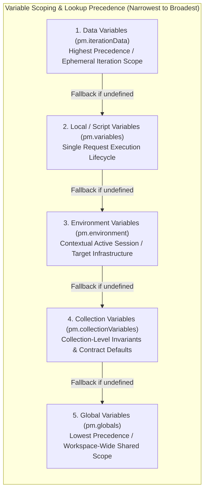

##### 1. Data Variables (`pm.iterationData` — Precedence Level 1, Highest)
- **Scope & Storage:** Injected externally at runtime via structured data files (**JSON** or **CSV**) supplied to the **Postman Collection Runner**, **Newman CLI** (`newman run ... -d dataset.json`), or **Postman CLI**.
- **Lifecycle & Volatility:** Ephemeral. A data variable's lifecycle is bound strictly to a single iteration of a collection execution run. When the runner transitions to iteration `n + 1`, the previous data row is garbage-collected, and the next record is loaded.
- **Mutability:** Read-only at runtime via `pm.iterationData.get("key")`. Data variables cannot be programmatically overwritten using a setter (`pm.iterationData.set()` does not exist).
- **QA Role in Notion API Testing:** Essential for **data-driven testing (DDT)** and parameterized boundary matrices. For example, feeding 50 distinct malformed UUID variations, edge-case page sizes (`[-1, 0, 1, 100, 101, "abc"]`), or complex JSON search filters from a single CSV/JSON file into `TC_SEARCH_017`–`TC_SEARCH_020` without duplicating request objects.

##### 2. Local / Script Execution Variables (`pm.variables` — Precedence Level 2)
- **Scope & Storage:** Created and manipulated programmatically inside Pre-request Scripts or Test Scripts using `pm.variables.set("key", value)`.
- **Lifecycle & Volatility:** Bound strictly to the execution lifecycle of a single HTTP request transaction (*Pre-request Script → Network Dispatch → Response Arrival → Test Script*). As soon as the request's test scripts finish executing, all local variables are purged from runtime memory. They do not persist across sequential requests in a collection run.
- **QA Role in Notion API Testing:** Ideal for storing transient operational values, such as dynamically calculated HMAC signatures, run-specific unique name prefixes (`const runName = "DB_Test_" + Date.now(); pm.variables.set("temp_title", runName);`), or temporary mathematical accumulators that must not pollute persistent environment storage.

##### 3. Environment Variables (`pm.environment` — Precedence Level 3)
- **Scope & Storage:** Bound to a selected **Postman Environment** file (e.g., `Act1_Notion_Env.postman_environment.json`). Stored as a decoupled JSON configuration dictionary outside the collection definition.
- **Lifecycle & Volatility:** Stateful and persistent across all requests, folders, and runs executed within the context of that active environment. Changes made programmatically via `pm.environment.set("key", value)` during request execution remain available to all subsequent requests.
- **QA Role in Notion API Testing:** Serves two critical functions:
  1. *Infrastructure & Credential Parameterization:* Switching base URLs (`NOTION_BASE_URL`), authentication tokens (`NOTION_TOKEN`), and client secrets across different workspace tiers.
  2. *Stateful Inter-Request Correlation:* Capturing generated entity UUIDs from responses (e.g., storing the new `id` returned by `POST /v1/databases` into `{{database_id}}`) and passing them downstream to subsequent `GET`, `PATCH`, and `query` requests in E2E workflows.

##### 4. Collection Variables (`pm.collectionVariables` — Precedence Level 4)
- **Scope & Storage:** Embedded directly within the Postman Collection definition file (`*.postman_collection.json`) under the top-level `"variable": [...]` array.
- **Lifecycle & Volatility:** Persists across all folders, subfolders, and requests within that specific collection, regardless of which Postman Environment is currently active.
- **QA Role in Notion API Testing:** Dedicated to collection-wide contract invariants, architectural constants, and fallback defaults that remain uniform regardless of whether tests run against live production or local mocks:
  - Default API contract version fallback: `{{default_notion_version}} = "2025-09-03"`.
  - Default query limit: `{{default_page_size}} = 100`.
  - Canonical request schemas and reusable payload templates.

##### 5. Global Variables (`pm.globals` — Precedence Level 5, Lowest)
- **Scope & Storage:** Stored at the Postman Workspace level. Accessible across every collection, folder, environment, and request configured inside the active team workspace (`SQE3-2026-Group2-NotionAPI`).
- **Lifecycle & Volatility:** Highly persistent across all workspace activities until explicitly overwritten or deleted.
- **QA Role in Notion API Testing:** Reserved for universal enterprise-wide utilities, such as centralized date formatting helper functions, global mock server URLs, or workspace telemetry settings. Group 2 enforces a strict architectural policy limiting global variable usage to prevent cross-suite state leakage, unintended namespace shadowing, and concurrency collisions among team members.

---

#### 3.3.3 Comparative Technical Matrix of Postman Variable Scopes

The following matrix provides a technical comparison of the five Postman variable scopes as implemented in Group 2's testing architecture:

| Technical Criterion | 1. Data Variables | 2. Local Variables | 3. Environment Variables | 4. Collection Variables | 5. Global Variables |
|---|---|---|---|---|---|
| **Precedence Rank** | **#1** (Highest) | **#2** | **#3** | **#4** | **#5** (Lowest) |
| **Visibility Scope** | Single iteration of a runner run | Single request execution cycle | Active selected environment | Entire parent collection | Entire workspace across collections |
| **Persistence / Lifetime** | Duration of one data row iteration | Request execution (Pre-request to Tests) | Persistent across session / run | Persistent within collection JSON | Persistent across workspace |
| **Storage Location** | External `.json` or `.csv` data file | Node.js runtime volatile memory | Environment JSON / Workspace state | Collection definition JSON schema | Workspace Globals JSON store |
| **Version Control Safe?** | Yes (committed test data suites) | N/A (runtime ephemeral) | Yes, if using *Initial Value* placeholders | Yes (committed with collection file) | Yes (committed workspace config) |
| **Secret Masking (`type: "secret"`)** | No (plain text in CSV/JSON) | No (in-memory variable) | **Yes** (visual & export masking) | No | Yes |
| **Getter Method** | `pm.iterationData.get("k")` | `pm.variables.get("k")` | `pm.environment.get("k")` | `pm.collectionVariables.get("k")` | `pm.globals.get("k")` |
| **Setter Method** | *Read-only* (no setter) | `pm.variables.set("k", v)` | `pm.environment.set("k", v)` | `pm.collectionVariables.set("k", v)` | `pm.globals.set("k", v)` |
| **Primary Notion QA Use Case** | Parameterized boundary test suites (DDT) | Transient timestamps, hashes, run IDs | Dynamic IDs (`database_id`), tokens, URLs | Contract defaults (`Notion-Version`), limits | Universal workspace utility constants |

---

#### 3.3.4 Environments in Postman: Separation of Concerns & Secret Management

A **Postman Environment** is a decoupled key-value dictionary that models a specific target execution context (e.g., `Notion-Production-Cloud`, `Notion-Staging-Sandbox`, or `JSONPlaceholder-Mock`). Environments allow QA engineers to execute identical collections against disparate hosts, credentials, and tenant partitions without modifying a single line of request configuration or test code.

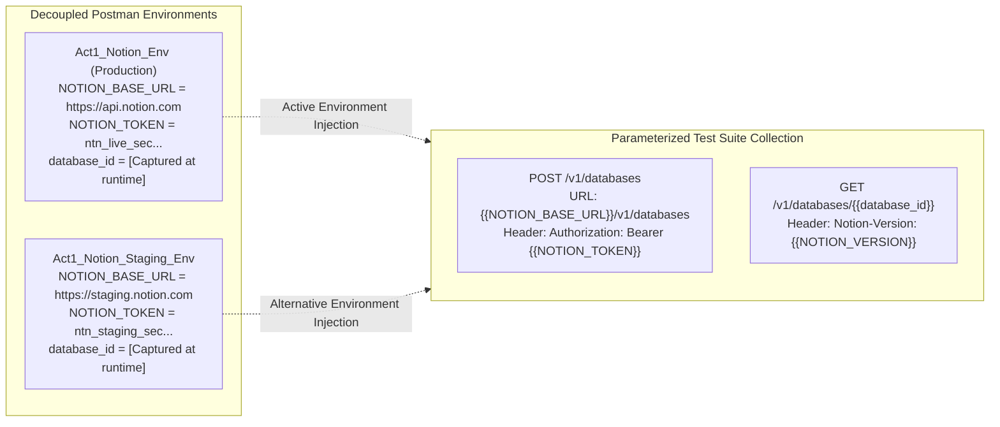

##### Initial Value vs. Current Value: Cryptographic & Repository Isolation

To prevent credential leakage while maintaining seamless Git-based collaboration across Group 2's five engineers, Postman enforces a dual-tier value architecture for every environment and collection variable:

1. **Initial Value (Shared / Version Control Baseline):**
   - The value synced to Postman Cloud team workspaces and exported into version-controlled JSON files (`Act1_Notion_Env.postman_environment.json`).
   - Group 2 policy strictly mandates that **Initial Values must never contain production credentials, integration tokens, or private customer data**. They contain generic documentation placeholders (e.g., `ntn_YOUR_INTEGRATION_SECRET_HERE`, `YOUR_OAUTH_CLIENT_ID`).
   
2. **Current Value (Local Session / Non-Synced Runtime):**
   - The active value utilized by the local *Postman Runtime* during request execution on the individual engineer's workstation.
   - Stored strictly in local desktop storage; never automatically pushed to public repositories or shared outside the authorized workstation.
   - When a test script dynamically mutates an environment variable via `pm.environment.set()`, Postman updates exclusively the **Current Value**, preserving the clean template state of the Initial Value.

##### Variable Types: `default` vs. `secret`

Postman provides two distinct data storage types for environment variables:
- **`default` (Standard Plain Text):** Values are displayed visibly in the UI. Used for non-sensitive configuration parameters such as `NOTION_BASE_URL` (`https://api.notion.com`), `NOTION_VERSION` (`2025-09-03`), and `OAUTH_REDIRECT_URI`.
- **`secret` (Masked Sensitive Data):** Values are masked on-screen with asterisks (`••••••••••••`). Postman prevents accidental exposure during screen sharing, video demonstrations, and console logging. Furthermore, when exporting an environment with secret variables, Postman provides options to sanitize or omit secret Current Values entirely. In `Act1_Notion_Env`, both `NOTION_TOKEN` and `OAUTH_CLIENT_SECRET` are strictly designated as `type: "secret"`.

##### Active Environment Configuration Evidence (Act1_Notion_Env)
The active environment file [`Act1_Notion_Env_Sebas_Vale.postman_environment.json`](./postman/actividad_2_3_4/Act1_Notion_Env_Sebas_Vale.postman_environment.json) captures the real configuration deployed during test execution for Sebastián's and Valentina's modules, showing the preconditioned container page (`NOTION_PAGE_ID`) and the dynamically populated `database_id`:

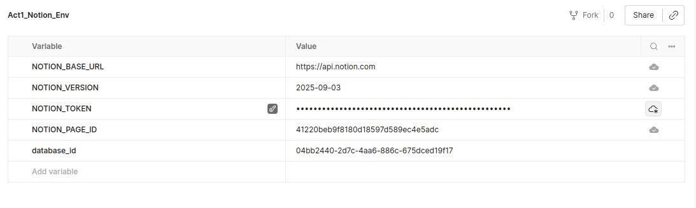

---

#### 3.3.5 Programmatic Variable Manipulation Lifecycle (`pm.*` API)

Dynamic variable manipulation enables the creation of automated end-to-end integration pipelines where subsequent requests depend upon data produced by prior requests.

##### Variable Execution & Resolution Lifecycle

The following sequence diagram details the operational flow of variables across the request execution lifecycle in Postman:

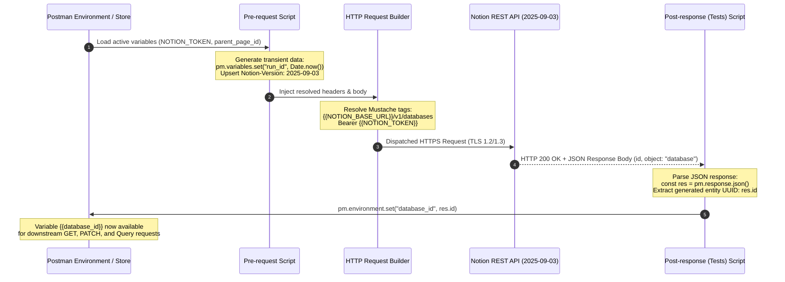

##### Complex Data Structure Serialization in Postman Variables

Postman's environment and collection variable stores serialize all stored entries as **primitive strings**. Attempting to pass a raw JavaScript object or array directly into `pm.environment.set()` results in string coercion into `"[object Object]"`, corrupting the data structure.

To preserve composite data structures—such as dynamic property schemas, multi-condition query filter trees, or sorting arrays—Group 2 adheres to explicit **JSON serialization and deserialization patterns**:

```javascript
// =========================================================================
// 1. Serialization inside Pre-request or Test Script (Storing Object/Array)
// =========================================================================
const complexFilter = {
    or: [
        { property: "Status", status: { equals: "Done" } },
        { property: "Priority", select: { equals: "High" } }
    ]
};

// Serialize to JSON string before persisting to environment scope:
pm.environment.set("DYNAMIC_QUERY_FILTER", JSON.stringify(complexFilter));

// =========================================================================
// 2. Deserialization in Downstream Request Scripts (Retrieving Object/Array)
// =========================================================================
const rawFilter = pm.environment.get("DYNAMIC_QUERY_FILTER");

if (rawFilter) {
    try {
        const parsedFilter = JSON.parse(rawFilter);
        // Inject directly into request body payload programmatically:
        pm.request.body.raw = JSON.stringify({
            filter: parsedFilter,
            page_size: 25
        });
    } catch (err) {
        console.error("Failed to parse DYNAMIC_QUERY_FILTER JSON string:", err);
    }
}
```

---

#### 3.3.6 Group 2 Variable Dictionary for Notion REST API Testing

To ensure seamless coordination across all five functional modules (`Databases`, `Data sources`, `Pages`, `Users`, and `OAuth`), Group 2 established a centralized, typed **Variable Dictionary** categorized by operational role, scope, persistence, and security classification:

| Variable Identifier | Scope Tier | Type | Initial Value (Git Safe) | Current Value (Runtime Example) | Technical QA Purpose |
|---|---|---|---|---|---|
| `NOTION_BASE_URL` | Environment | `default` | `https://api.notion.com` | `https://api.notion.com` | Root API host endpoint parameterization. |
| `NOTION_VERSION` | Environment / Coll. | `default` | `2025-09-03` | `2025-09-03` | Mandatory contract version header injected globally via Pre-request Script. |
| `NOTION_TOKEN` | Environment | `secret` | `ntn_YOUR_INTEGRATION_SECRET_HERE` | `ntn_18471928471...` | Primary RFC 6750 Bearer credential for domain modules (`Databases`, `Data sources`, `Pages`, `Users`). |
| `OAUTH_CLIENT_ID` | Environment | `default` | `YOUR_OAUTH_CLIENT_ID` | `10293847-abdc-...` | RFC 7617 HTTP Basic Auth username for `/v1/oauth/*` endpoints. |
| `OAUTH_CLIENT_SECRET` | Environment | `secret` | `YOUR_OAUTH_CLIENT_SECRET` | `secret_oauth991...` | RFC 7617 HTTP Basic Auth password for `/v1/oauth/*` endpoints. |
| `parent_page_id` | Environment | `default` | `YOUR_PARENT_PAGE_UUID` | `12a84d91-3c22-4ef1-90a1-71e84a29c101` | Preconditioned test container page UUID shared with the integration bot. |
| `database_id` | Environment (Dynamic) | `default` | `""` *(empty)* | `9f8e7d6c-5b4a-3f2e-1d0c-9b8a7f6e5d4c` | Captured dynamically from `POST /v1/databases` response to feed `GET`, `PATCH`, and E2E flows. |
| `data_source_id` | Environment (Dynamic) | `default` | `""` *(empty)* | `3a2b1c0d-9e8f-7a6b-5c4d-3e2f1a0b9c8d` | Captured dynamically from database creation or `POST /v1/data_sources` to execute row queries. |
| `page_id` | Environment (Dynamic) | `default` | `""` *(empty)* | `a1b2c3d4-e5f6-7a8b-9c0d-1e2f3a4b5c6d` | Captured dynamically from `POST /v1/pages` for row-level verification and trash testing. |
| `ghost_id` | Environment / Coll. | `default` | `00000000-0000-0000-0000-000000000000` | `00000000-0000-0000-0000-000000000000` | Well-formed RFC 4122 UUIDv4 guaranteed not to exist; used for negative `404 object_not_found` checks. |
| `unshared_db_id` | Environment | `default` | `YOUR_UNSHARED_DB_UUID` | `e4f5a6b7-c8d9-0e1f-2a3b-4c5d6e7f8a9b` | Existing database intentionally NOT shared with integration bot; verifies `404` access control isolation. |
| `next_cursor` | Environment (Dynamic) | `default` | `""` *(empty)* | `d3b07384-d113-4c4d-9c85-2e6b8c1a708a` | Cursor token returned when `has_more: true` to execute sequential pagination validation. |
| `default_page_size` | Collection | `default` | `100` | `100` | Architectural pagination limit default defined at the collection level. |

---

#### 3.3.7 Concrete Scripting Implementation in Group 2's Test Suites

To illustrate the concrete application of variable scopes, the following snippets demonstrate how Group 2 implements stateful correlation between **POST /v1/databases** (Sebastián Pereyra) and **POST /v1/data_sources/{id}/query** (Valentina Molina Bustillos):

##### 1. Capturing and Persisting Dynamic Variables in Post-Response Tests Script (`POST /v1/databases`):
```javascript
// Test: Validate successful database container creation (200 OK)
pm.test("Status code is 200 OK", function () {
    pm.response.to.have.status(200);
});

pm.test("Response is a valid database object and contains generated UUID", function () {
    const jsonData = pm.response.json();
    
    pm.expect(jsonData.object).to.eql("database");
    pm.expect(jsonData.id).to.be.a("string").and.to.have.lengthOf(36);
    
    // Dynamically persist the database UUID to the active Environment scope
    pm.environment.set("database_id", jsonData.id);
    console.log("[STATE CAPTURE] Successfully set {{database_id}}:", jsonData.id);
    
    // In Notion API 2025-09-03, creating a database generates default data sources
    if (jsonData.data_sources && jsonData.data_sources.length > 0) {
        pm.environment.set("data_source_id", jsonData.data_sources[0].id);
        console.log("[STATE CAPTURE] Successfully set {{data_source_id}}:", jsonData.data_sources[0].id);
    }
});
```

##### 2. Consuming Dynamic Variables in Downstream Pre-request Script (`GET /v1/databases/{{database_id}}`):
```javascript
// Ensure preconditioned database_id is present before dispatching request
const dbId = pm.environment.get("database_id");

if (!dbId || dbId.trim() === "") {
    console.warn("[PRECONDITION WARNING] {{database_id}} is empty. Request may fail with 404/validation_error.");
} else {
    console.log("[PRECONDITION VERIFIED] Executing GET against database ID:", dbId);
}
```

##### 3. Automated Postcondition Teardown Script:
```javascript
// Postcondition cleanup: remove ephemeral test state after suite completion
pm.test("Clean up ephemeral test IDs", function () {
    pm.environment.unset("temp_run_id");
    pm.environment.unset("DYNAMIC_QUERY_FILTER");
    console.log("[TEARDOWN] Ephemeral variables purged from environment scope.");
});
```

By systematically enforcing these variable scoping, persistence, and environment isolation rules, Group 2 ensures that the Notion REST API test suite remains deterministic, secure against credential leakage in public repositories, easily portable across execution targets, and capable of executing complex, multi-request integration workflows autonomously.

---


---

### 3.4 Implementation of Multi-Request Tests Using Shared Variables

#### 3.4.1 Gabriel Marcos Guaman Ortuño — Modules: Users & OAuth

Two primary multi-request chained workflows were implemented inside `03_Chained_And_E2E_Flows`:

1. **Unattended Directory Pagination & UUID Normalization Chain (`01_TC_E2E_002` — 5 Sequential Requests):**
   - `Step 1` (`GET /v1/users?page_size=1`) extracts `results[0].id` -> `extracted_user_id`, strips hyphens -> `compact_user_id`, and stores `next_cursor` via `pm.environment.set()` and `pm.collectionVariables.set()`.
   - `Step 2` (`GET /v1/users?page_size=1&start_cursor={{next_cursor}}`) consumes `{{next_cursor}}` and asserts `results[0].id !== extracted_user_id`.
   - `Step 3` (`GET /v1/users/{{extracted_user_id}}`) retrieves the profile via canonical 36-char hyphenated `UUIDv4` and caches `e2e_baseline_name` and `e2e_baseline_type`.
   - `Step 4` (`GET /v1/users/{{compact_user_id}}`) queries the same user via 32-char unhyphenated hex ID and asserts exact identity/attribute parity with `Step 3`.
   - `Step 5` (`GET /v1/users/{{extracted_user_id}}` with invalid/revoked token) confirms `401 Unauthorized` (`code: "unauthorized"`) and cleans up temporary variables.
2. **OAuth Lifecycle & Revocation Enforcement Chain (`02_TC_E2E_003` & `03_TC_E2E_001` — 10 Sequential Requests):**
   - Exchanges/rotates credentials on `POST /v1/oauth/token` -> stores `oauth_access_token` & `bot_user_id` -> verifies `active: true` on `POST /v1/oauth/introspect` -> authenticates `GET /v1/users/me` (`id === bot_user_id`) -> revokes token via `POST /v1/oauth/revoke` -> confirms immediate transition to `active: false` on `POST /v1/oauth/introspect` -> verifies strict `401 Unauthorized` denial on `GET /v1/users/me`.

##### Execution Evidence — Environment Scopes & Multi-Request Chaining

- **Environment & Variable Scopes (`Notion_Users_OAuth_Env` — Masked Secrets & Runtime UUID/Cursor State):**

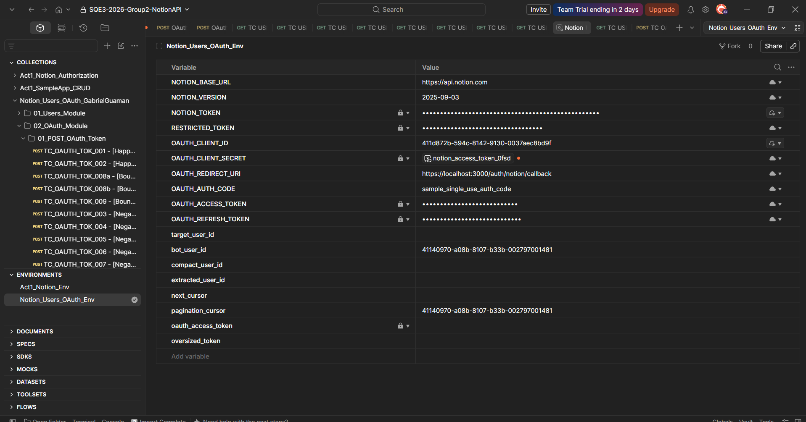

- **Multi-Request Chaining Execution (`target_user_id` & `next_cursor` — `TC_E2E_002_Step2`, 5/5 `PASSED`):**

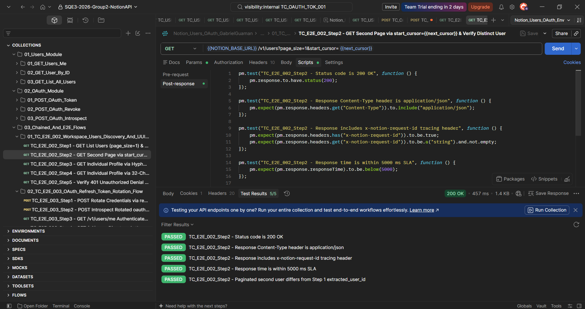


---

#### 3.4.1 Chained E2E Test Workflow 1: Data Source Tabular Lifecycle & Filtered Querying (Valentina Molina)

This 5-step chained integration workflow validates the end-to-end lifecycle of a data source within a database container: creating the schema, reading it back, altering its columns, populating a record, and querying that record with exact property filtering.

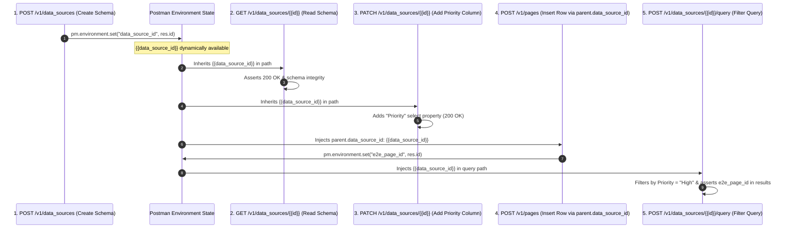

##### Step-by-Step Request Specifications and Variable Transitions:

1. **Step 1: `POST {{NOTION_BASE_URL}}/v1/data_sources` (Create Data Source with Schema)**
   - *Pre-request Script:* Generates dynamic run name: `pm.variables.set("ds_run_name", "E2E_DS_" + Date.now());`
   - *Request Body:*
     ```json
     {
       "database_id": "{{database_id}}",
       "properties": {
         "Name": { "title": {} },
         "Count": { "number": { "format": "number" } }
       }
     }
     ```
   - *Post-response Script (Tests):*
     ```javascript
     pm.test("Step 1: Data source created (200 OK)", function () {
         pm.response.to.have.status(200);
         const res = pm.response.json();
         pm.expect(res.object).to.eql("data_source");
         pm.environment.set("data_source_id", res.id);
     });
     ```

2. **Step 2: `GET {{NOTION_BASE_URL}}/v1/data_sources/{{data_source_id}}` (Retrieve & Verify Schema)**
   - *Request:* Targets the dynamically persisted `{{data_source_id}}`.
   - *Post-response Script (Tests):*
     ```javascript
     pm.test("Step 2: Retrieved data source matches captured ID", function () {
         pm.response.to.have.status(200);
         const res = pm.response.json();
         pm.expect(res.id).to.eql(pm.environment.get("data_source_id"));
         pm.expect(res.properties).to.have.property("Name");
         pm.expect(res.properties).to.have.property("Count");
     });
     ```

3. **Step 3: `PATCH {{NOTION_BASE_URL}}/v1/data_sources/{{data_source_id}}` (Mutate Schema - Add Priority Column)**
   - *Request Body:*
     ```json
     {
       "properties": {
         "Priority": {
           "select": {
             "options": [
               { "name": "High", "color": "red" },
               { "name": "Low", "color": "blue" }
             ]
           }
         }
       }
     }
     ```
   - *Post-response Script (Tests):*
     ```javascript
     pm.test("Step 3: Schema updated with new Priority column", function () {
         pm.response.to.have.status(200);
         const res = pm.response.json();
         pm.expect(res.properties).to.have.property("Priority");
         pm.expect(res.properties.Priority.type).to.eql("select");
     });
     ```

4. **Step 4: `POST {{NOTION_BASE_URL}}/v1/pages` (Insert Data Row Under Data Source)**
   - *Request Body (Notion 2025-09-03 data source parent format):*
     ```json
     {
       "parent": {
         "type": "data_source_id",
         "data_source_id": "{{data_source_id}}"
       },
       "properties": {
         "Name": { "title": [{ "text": { "content": "E2E Task Row" } }] },
         "Count": { "number": 42 },
         "Priority": { "select": { "name": "High" } }
       }
     }
     ```
   - *Post-response Script (Tests):*
     ```javascript
     pm.test("Step 4: Row created under data source (200 OK)", function () {
         pm.response.to.have.status(200);
         const res = pm.response.json();
         pm.expect(res.object).to.eql("page");
         pm.expect(res.parent.data_source_id).to.eql(pm.environment.get("data_source_id"));
         pm.environment.set("e2e_page_id", res.id);
     });
     ```

5. **Step 5: `POST {{NOTION_BASE_URL}}/v1/data_sources/{{data_source_id}}/query` (Filter Query by Priority)**
   - *Request Body:*
     ```json
     {
       "filter": {
         "property": "Priority",
         "select": { "equals": "High" }
       }
     }
     ```
   - *Post-response Script (Tests):*
     ```javascript
     pm.test("Step 5: Query returns created row matching filter", function () {
         pm.response.to.have.status(200);
         const res = pm.response.json();
         pm.expect(res.object).to.eql("list");
         pm.expect(res.results.length).to.be.at.least(1);
         const matched = res.results.some(r => r.id === pm.environment.get("e2e_page_id"));
         pm.expect(matched, "Created row ID must appear in query results").to.be.true;
     });
     ```

---


---

#### 3.4.2 Chained E2E Test Workflow 2: Database Container Lifecycle, Rebranding, and Search Discovery (Sebastián Pereyra)

This 5-step chained integration workflow validates the end-to-end lifecycle of a database container: creating a new container with dynamic naming, verifying its metadata, updating its title and icon, discovering it via global search, and safely archiving it in teardown.

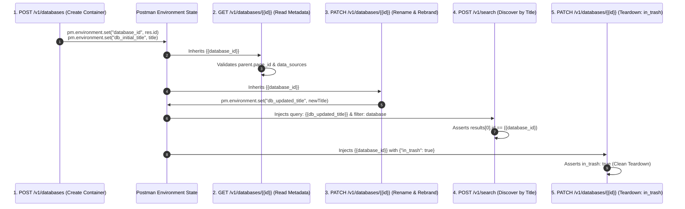

##### Step-by-Step Request Specifications and Variable Transitions:

1. **Step 1: `POST {{NOTION_BASE_URL}}/v1/databases` (Create Database Container)**
   - *Pre-request Script:* Generates dynamic title to ensure search uniqueness:
     ```javascript
     const uniqueTitle = "E2E_DB_Release_" + Date.now();
     pm.environment.set("db_initial_title", uniqueTitle);
     ```
   - *Request Body:*
     ```json
     {
       "parent": { "type": "page_id", "page_id": "{{parent_page_id}}" },
       "title": [{ "text": { "content": "{{db_initial_title}}" } }],
       "properties": {
         "Name": { "title": {} }
       }
     }
     ```
   - *Post-response Script (Tests):*
     ```javascript
     pm.test("Step 1: Database container created (200 OK)", function () {
         pm.response.to.have.status(200);
         const res = pm.response.json();
         pm.expect(res.object).to.eql("database");
         pm.expect(res.title[0].plain_text).to.eql(pm.environment.get("db_initial_title"));
         pm.environment.set("database_id", res.id);
     });
     ```

2. **Step 2: `GET {{NOTION_BASE_URL}}/v1/databases/{{database_id}}` (Verify Metadata & Associations)**
   - *Post-response Script (Tests):*
     ```javascript
     pm.test("Step 2: Retrieved database metadata is consistent", function () {
         pm.response.to.have.status(200);
         const res = pm.response.json();
         pm.expect(res.id).to.eql(pm.environment.get("database_id"));
         pm.expect(res.parent.page_id).to.eql(pm.environment.get("parent_page_id"));
         pm.expect(res.archived).to.be.false;
         pm.expect(res.in_trash).to.be.false;
     });
     ```

3. **Step 3: `PATCH {{NOTION_BASE_URL}}/v1/databases/{{database_id}}` (Rebrand: Rename & Add Icon)**
   - *Pre-request Script:*
     ```javascript
     const updatedTitle = "E2E_DB_Renamed_" + Date.now();
     pm.environment.set("db_updated_title", updatedTitle);
     ```
   - *Request Body:*
     ```json
     {
       "title": [{ "text": { "content": "{{db_updated_title}}" } }],
       "icon": { "type": "emoji", "emoji": "🚀" }
     }
     ```
   - *Post-response Script (Tests):*
     ```javascript
     pm.test("Step 3: Database title and icon updated", function () {
         pm.response.to.have.status(200);
         const res = pm.response.json();
         pm.expect(res.title[0].plain_text).to.eql(pm.environment.get("db_updated_title"));
         pm.expect(res.icon.emoji).to.eql("🚀");
     });
     ```

4. **Step 4: `POST {{NOTION_BASE_URL}}/v1/search` (Discover Database via Global Search)**
   - *Request Body:*
     ```json
     {
       "query": "{{db_updated_title}}",
       "filter": { "value": "database", "property": "object" },
       "sort": { "direction": "descending", "timestamp": "last_edited_time" }
     }
     ```
   - *Post-response Script (Tests):*
     ```javascript
     pm.test("Step 4: Global search discovers updated database container", function () {
         pm.response.to.have.status(200);
         const res = pm.response.json();
         pm.expect(res.object).to.eql("list");
         pm.expect(res.results.length).to.be.at.least(1);
         pm.expect(res.results[0].id).to.eql(pm.environment.get("database_id"));
         pm.expect(res.results[0].object).to.eql("database");
     });
     ```

5. **Step 5: `PATCH {{NOTION_BASE_URL}}/v1/databases/{{database_id}}` (Teardown: Move Container to Trash)**
   - *Request Body:*
     ```json
     {
       "in_trash": true
     }
     ```
   - *Post-response Script (Tests):*
     ```javascript
     pm.test("Step 5: Teardown database moved to trash (in_trash: true)", function () {
         pm.response.to.have.status(200);
         const res = pm.response.json();
         pm.expect(res.in_trash).to.be.true;
         
         // Clean ephemeral environment variables
         pm.environment.unset("database_id");
         pm.environment.unset("db_initial_title");
         pm.environment.unset("db_updated_title");
     });
     ```

---

#### 3.4.4 Kevin Uruchi — Module: Pages

Four chained workflows were implemented in the `E2E` folder:

1. **Create, read, update and query (`TC_E2E_001` → `TC_E2E_003`):** create a row with every property type, read it with `GET` and compare each value, update three properties and read them back with both `GET` endpoints, then find the row by querying the data source with a filter on those values.
2. **Trash and restore without data loss (`TC_E2E_004`):** send the row to the trash, confirm it is hidden from the query, restore it and compare all properties and blocks with the snapshot.
3. **Move through every parent type (`TC_E2E_006`, `TC_E2E_007`):** move a page between two pages and two data sources and back, checking after each step that `id`, `url`, `created_by`, `icon`, `cover` and blocks never change, and move a three-level tree intact while the move into a descendant is rejected.
4. **Dual relation and computed properties (`TC_E2E_008`, `TC_E2E_009`):** create a project and its tasks, follow `next_cursor` through 31 relation items, change a task to another project, and check that the rollup and formula recalculate (`150`/`300` becomes `250`/`500`) while updating the rollup directly returns `400`.

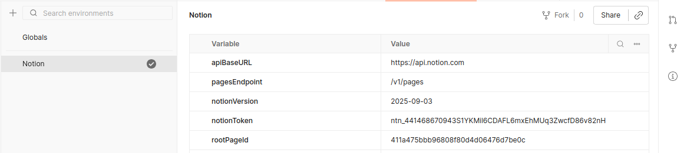

---

## Activity #4

1. Continue implementing tests in Postman by establishing ordering, structure, and execution conventions.
2. Review the capability to execute tests automatically.  

### 4.1 Team Conventions for Ordering, Folder Structure, and Execution

To ensure maintainability, deterministic execution order, and seamless peer review across all five modules of **Group 2**, the team established four mandatory structural conventions in Postman:

| Convention Dimension | Standardized Team Rule | Concrete Example (`Notion_Users_OAuth_GabrielGuaman`) |
|----------------------|------------------------|-------------------------------------------------------|
| **3-Tier Folder Hierarchy** | `NN_<Module_Name>` → `NN_<HTTP_Verb>_<Endpoint>` → `TC_<MOD>_<ACT>_<NNN>` | `01_Users_Module` → `02_GET_User_By_ID` → `TC_USR_GET_008 - [Boundary] Accept compact 32-char hex UUID...` |
| **Intra-Folder Request Ordering** | **`Happy Path` → `Boundary` → `Negative`** inside every endpoint subfolder so baseline health and variable bootstrapping execute before fault-injection cases. | `TC_USR_ME_001` (`[Happy Path]`) → `TC_USR_ME_007` (`[Boundary]`) → `TC_USR_ME_003` (`[Negative]`) |
| **Suite-Level Execution Isolation** | Destructive and multi-step flows reside in the final top-level folder **`03_Chained_And_E2E_Flows`**, placing token revocation (`TC_E2E_001`) strictly last so earlier suites never lose active credentials. | `01_Users_Module` → `02_OAuth_Module` → `03_Chained_And_E2E_Flows` (`03_TC_E2E_001` last) |
| **Assertion & Variable Naming** | Assertions prefixed with `<TC_ID> - <Check>`; static config/secrets in `UPPER_SNAKE_CASE`; dynamic chained variables in `lower_snake_case`. | `TC_USR_LIST_001 - Status code is 200 OK`; `{{NOTION_TOKEN}}` vs. `{{extracted_user_id}}` |


#### 4.1.1 Modular Folder Hierarchy

The collaborative Postman collection is organized into a four-level hierarchical folder architecture reflecting functional boundaries, individual responsibilities, and execution modes:

```text
Collection: SQE3-Grupo2-NotionAPI (Notion-Version: 2025-09-03)
├── 📁 01_Databases (Sebastián Pereyra)
│   ├── 📁 01_Happy_Path (CRUD & Container Verification)
│   │   ├── 01 - DATABASES - Positiva - Crear database con titulo (200)
│   │   ├── 02 - DATABASES - Positiva - Crear con schema completo (200)
│   │   ├── 03 - DATABASES - Positiva - Obtener database por ID (200)
│   │   └── 04 - DATABASES - Positiva - Actualizar titulo y portada (200)
│   ├── 📁 02_Negative (Validation & Authorization Errors)
│   │   ├── 01 - DATABASES - Negativa - Sin cabecera Authorization (401)
│   │   ├── 02 - DATABASES - Negativa - Sin Notion-Version header (400)
│   │   ├── 03 - DATABASES - Negativa - Parent page inexistente (404)
│   │   └── 04 - DATABASES - Negativa - Parent page no compartida (404)
│   └── 📁 03_Boundary (Edge Limits & Payload Tolerances)
│       ├── 01 - DATABASES - Limites - Titulo vacio [] (200)
│       └── 02 - DATABASES - Limites - Parent ID hex vs guiones (200)
├── 📁 02_Data_Sources (Valentina Molina Bustillos)
│   ├── 📁 01_Happy_Path (Schema Definition & Retrieval)
│   │   ├── 01 - DATA_SOURCES - Positiva - Crear data source con schema (200)
│   │   ├── 02 - DATA_SOURCES - Positiva - Obtener data source por ID (200)
│   │   ├── 03 - DATA_SOURCES - Positiva - Agregar columna al schema (200)
│   │   └── 04 - DATA_SOURCES - Positiva - Query sin filtro (200)
│   ├── 📁 02_Negative (Contract Violations & Access Rejections)
│   │   ├── 01 - DATA_SOURCES - Negativa - Sin cabecera Authorization (401)
│   │   ├── 02 - DATA_SOURCES - Negativa - database_id inexistente (404)
│   │   └── 03 - DATA_SOURCES - Negativa - Filtro con propiedad inexistente (400)
│   └── 📁 03_Boundary (Pagination Bounds & Type Constraints)
│       ├── 01 - DATA_SOURCES - Limites - page_size minimo igual a 1 (200)
│       ├── 02 - DATA_SOURCES - Limites - page_size igual a 0 fuera de rango (400)
│       └── 03 - DATA_SOURCES - Limites - page_size igual a 101 excedido (400)
├── 📁 03_Search (Sebastián Pereyra)
│   ├── 📁 01_Happy_Path (Title Search, Entity Filters & Sorting)
│   │   ├── 01 - SEARCH - Positiva - Busqueda por palabra clave (200)
│   │   ├── 02 - SEARCH - Positiva - Filtrar estrictamente por database (200)
│   │   └── 03 - SEARCH - Positiva - Ordenar descendente por last_edited_time (200)
│   ├── 📁 02_Negative (Filter & Parameter Violations)
│   │   ├── 01 - SEARCH - Negativa - Sin token (401)
│   │   └── 02 - SEARCH - Negativa - Valor de filtro invalido object user (400)
│   └── 📁 03_Boundary (Pagination & Non-Existent Queries)
│       ├── 01 - SEARCH - Limites - page_size 1 vs 100 (200)
│       └── 02 - SEARCH - Limites - Busqueda de titulo inexistente (200)
└── 📁 04_E2E_Workflows (Stateful Integration Chains)
    ├── 📁 E2E_01_Data_Source_Lifecycle (Valentina Molina)
    │   ├── 01 - E2E - POST Crear Data Source
    │   ├── 02 - E2E - GET Verificar Schema
    │   ├── 03 - E2E - PATCH Agregar Columna Priority
    │   ├── 04 - E2E - POST Insertar Fila
    │   └── 05 - E2E - POST Query Filtrada por Priority
    └── 📁 E2E_02_Database_Search_Lifecycle (Sebastián Pereyra)
        ├── 01 - E2E - POST Crear Database Contenedor
        ├── 02 - E2E - GET Verificar Metadatos
        ├── 03 - E2E - PATCH Renombrar y Asignar Icono
        ├── 04 - E2E - POST Descubrir en Search Global
        └── 05 - E2E - PATCH Teardown Mover a Papelera
```

##### Postman Collection Hierarchy Implementation Evidence
The screenshot below illustrates the structured collection tree configured inside Postman for [`Lab02_Grupo2_Databases_Search.postman_collection.json`](./postman/actividad_2_3_4/Lab02_Grupo2_Databases_Search.postman_collection.json), detailing the Setup, Databases CRUD, and Search folders:

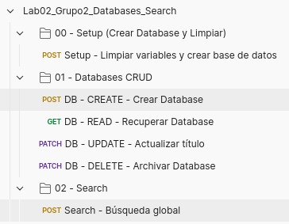

#### 4.1.2 Standardized Request Naming Convention

All requests across the collection strictly follow the naming formula agreed upon in Laboratory 01, Activity #5:

$$\mathbf{[M\acute{o}dulo]\ -\ [Tipo]\ -\ Acci\acute{o}n\ (C\acute{o}digo\ esperado)}$$

- **`[Módulo]`**: `DATABASES`, `DATA_SOURCES`, `SEARCH`, `PAGES`, `USERS`, `OAUTH`, or `E2E`.
- **`[Tipo]`**: `Positiva`, `Negativa`, `Limites`, or `E2E`.
- **`Acción`**: Clear imperative description of the tested behavior.
- **`Código esperado`**: Expected HTTP response status code in parentheses (e.g., `(200)`, `(400)`, `(401)`, `(404)`).

*Examples:*
- `DATABASES - Positiva - Crear database con titulo (200)`
- `DATA_SOURCES - Negativa - database_id inexistente (404)`
- `SEARCH - Limites - page_size igual a 101 excedido (400)`

#### 4.1.3 Deterministic Execution Order Protocol

When executing the test suite via the Postman Collection Runner or Newman CLI, requests execute in a strict logical order:

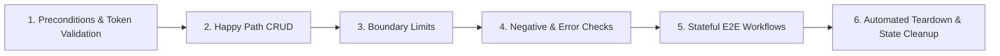

1. **Preconditions & Token Validation:** Verifies bot user identity (`GET /v1/users/me`) and validates that `{{NOTION_TOKEN}}` has active permissions before proceeding.
2. **Happy Path CRUD:** Executes safe resource creation and reads, establishing baseline IDs.
3. **Boundary Limits:** Validates edge tolerances (`page_size` bounds, empty titles, Unicode strings).
4. **Negative & Error Checks:** Validates security boundaries (401 Unauthorized, 404 Not Found, 400 Validation Errors) without leaving lingering corrupted state.
5. **Stateful E2E Workflows:** Executes multi-request chained pipelines using dynamic variable sharing.
6. **Teardown & State Cleanup:** Moves created database containers to the trash (`in_trash: true`) and purges ephemeral variables from the active environment.


---

### 4.2 Automated Test Execution Mechanics (Collection Runner, Newman CLI, and CI/CD)

#### Gabriel Marcos Guaman Ortuño — Automated Execution Summary (`Users` & `OAuth`)

| Execution Metric | Value / Specification |
|------------------|-----------------------|
| **Collection File** | [`postman/gabriel_guaman/Notion_Users_OAuth_GabrielGuaman.postman_collection.json`](./postman/gabriel_guaman/Notion_Users_OAuth_GabrielGuaman.postman_collection.json) |
| **Environment File** | [`postman/gabriel_guaman/Notion_Users_OAuth_Env.postman_environment.json`](./postman/gabriel_guaman/Notion_Users_OAuth_Env.postman_environment.json) |
| **Lab 01 Test Cases Covered** | **52 Test Cases** (`26` Users + `23` OAuth + `3` E2E Scenarios) |
| **Iterations Executed** | **1 Iteration** (`0 Failed`) |
| **Total HTTP Requests Executed** | **70 Requests (`0 Failed`)** — `69` collection items (`28` in `01_Users_Module`, `26` in `02_OAuth_Module`, `15` in `03_Chained_And_E2E_Flows`) + `1` `pm.sendRequest()` Pre-request user-discovery call |
| **Total `pm.test()` Assertions** | **345 Assertions Executed — `345 Passed / 0 Failed` (`100%` Pass Rate)** (`5` multi-layer checks per collection request: Status, `Content-Type`, `x-notion-request-id`, SLA `< 5000 ms`, Schema/Error Contract) |
| **Verified Run Telemetry** | Collection Runner: `27s 988ms` (`344 ms` avg. response time) \| Newman CLI: `28.9s` (`329 ms` avg. response time, `115` pre-request scripts, `69` test scripts, `0` failed) |
| **Runner Configuration** | Iterations: `1` \| Inter-request Delay: `350 ms` \| Persist Variables: `Enabled` |

##### Execution Evidence — Structure, Collection Runner & Newman CLI

- **Collection Structure & Ordering Conventions (`01_Users_Module` → `02_OAuth_Module` → `03_Chained_And_E2E_Flows`):**

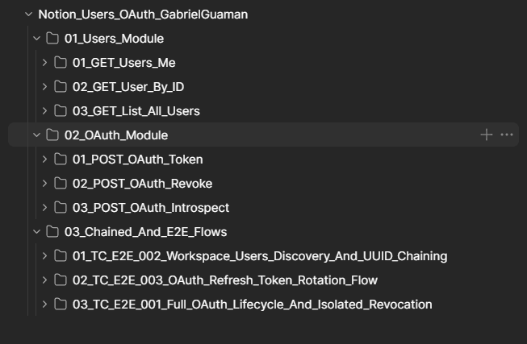

- **Automated Execution via Postman Collection Runner (345/345 Passed - 0 Failed):**

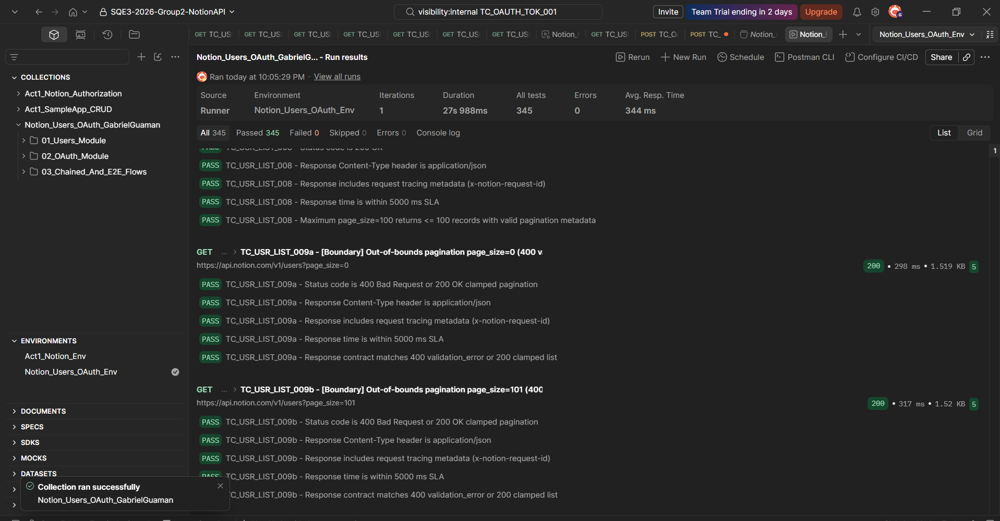

- **Automated Execution via Newman CLI (345 Assertions Executed - 0 Failed):**

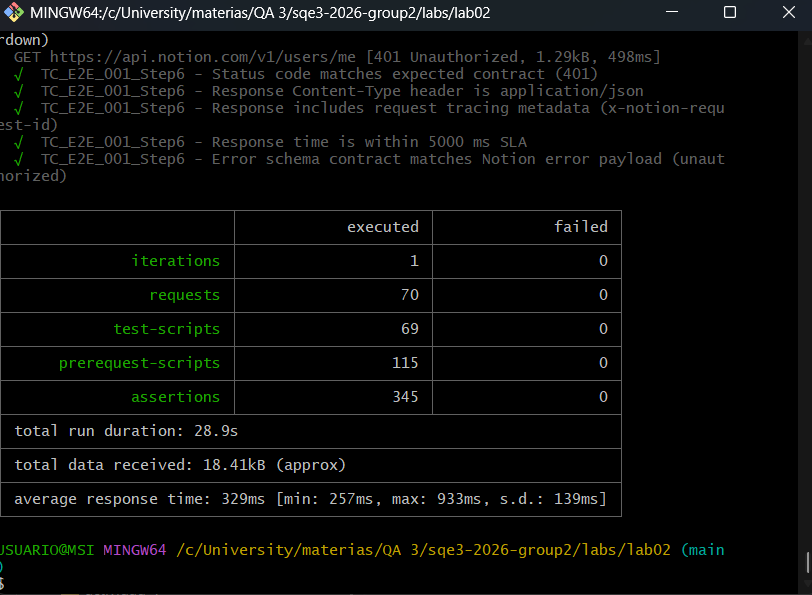


---

#### Valentina Molina Bustillos — Automated Execution Summary (`Data Sources`, `Comments`, `File Uploads`)

###### 2. Data Sources, Comments, and File Uploads Suite Execution (Valentina Molina)
Executed against `Act1_Notion_Env`: 13 requests executed, **30 tests passed, 0 failures** (100% pass rate) with an average response time of 448ms and duration of 6s 747ms:

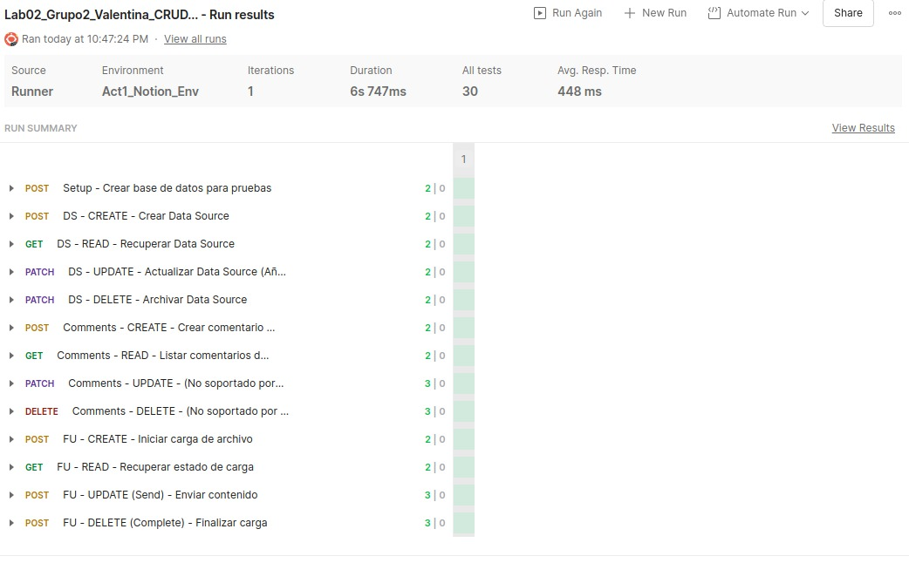


---

#### Karen Ivonne Cruz Alvarez — Automated Execution Summary (`Blocks`)

Karen's collection follows the team conventions defined in section 4.1:

| Convention Dimension | How it is applied in `Notion_Blocks_KarenCruz` |
|----------------------|------------------------------------------------|
| **Folder hierarchy** | One folder per endpoint (`01_PATCH_Append_Block_Children`, `02_GET_Retrieve_Block`, `03_GET_Retrieve_Block_Children`, `04_PATCH_Update_Block`, `05_DELETE_Block`) and `06_E2E_Flows` last. |
| **Request ordering** | Inside every endpoint folder: `Happy Path` → `Negative` → `Boundary`, following the numeric order of `KarenCruzTests.md`. Destructive and permission flows live in the final `06_E2E_Flows` folder. |
| **Naming** | Request name `TC_ID - <description>`. Assertions prefixed with `<TC_ID> - <Check>`; data integrity checks start with `[Data integrity]`. Static config and secrets in `UPPER_SNAKE_CASE` (`NOTION_TOKEN`), dynamic chained variables in `lower_snake_case` (`created_block_id`). |
| **Execution isolation** | Each case creates its own blocks and trashes them at the end, so any case can run alone or in any folder selection. |

```bash
# Full automated suite execution with CLI and HTML dashboard report
npx newman run postman/karen_cruz/Notion_Blocks_KarenCruz.postman_collection.json \
  -e postman/karen_cruz/Notion_Blocks_Env.postman_environment.json \
  --delay-request 400 \
  --timeout-script 600000 \
  --reporters cli,htmlextra \
  --reporter-htmlextra-export reports/karen_cruz_newman_report.html

# Unattended execution of a single endpoint folder
npx newman run postman/karen_cruz/Notion_Blocks_KarenCruz.postman_collection.json \
  -e postman/karen_cruz/Notion_Blocks_Env.postman_environment.json \
  --folder "03_GET_Retrieve_Block_Children" \
  --delay-request 400 \
  --timeout-script 600000
```

The delay is `400 ms` between requests, and the helper calls made from the scripts add their own `340 ms` pause (`--delay-request` does not apply to `pm.sendRequest`), to stay below Notion's `~3 requests/second` limit, and `--timeout-script 600000` is needed because some cases create `100` and `101` blocks (`TC_BLK_CHL_013`, `TC_E2E_BLK_002`).

| Execution Metric | Value / Specification |
|------------------|-----------------------|
| **Collection File** | [`postman/karen_cruz/Notion_Blocks_KarenCruz.postman_collection.json`](./postman/karen_cruz/Notion_Blocks_KarenCruz.postman_collection.json) |
| **Environment File** | [`postman/karen_cruz/Notion_Blocks_Env.postman_environment.json`](./postman/karen_cruz/Notion_Blocks_Env.postman_environment.json) |
| **Lab 01 Test Cases Covered** | **72 Test Cases** (`18` append + `11` retrieve + `14` children + `14` update + `11` delete + `4` E2E) |
| **Total Automated Requests** | **81 HTTP Requests** (`18` + `11` + `14` + `14` + `11` endpoint requests and `13` in `06_E2E_Flows`) |
| **Total `pm.test()` Assertions** | **[COMPLETAR: numero que muestra el Runner]** |
| **Passed / Failed / Skipped** | **[COMPLETAR]** (skipped = cases whose optional environment variable is empty) |
| **Runner Configuration** | Iterations: `1` \| Inter-request Delay: `400 ms` \| Persist Variables: `Enabled` |

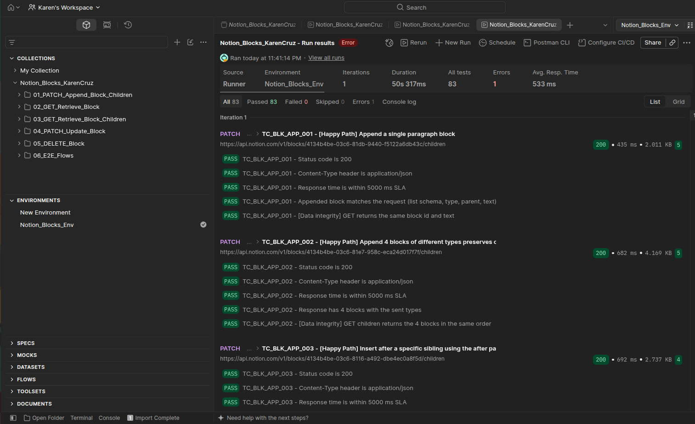

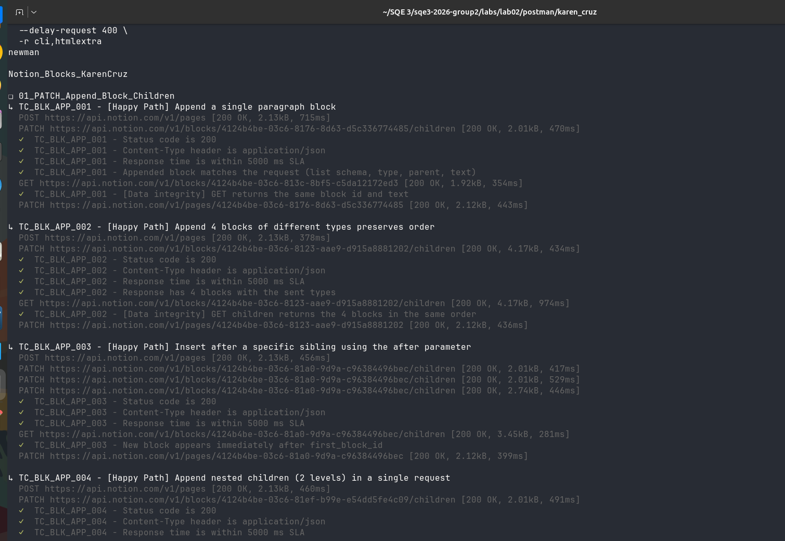


---

#### Sebastián Pereyra — Automated Execution Summary (`Databases` & `Search`)

###### 1. Databases and Search Suite Execution (Sebastián Pereyra)
Executed against `Act1_Notion_Env`: 6 requests executed, **13 tests passed, 0 failures** (100% pass rate) with an average response time of 469ms and duration of 3s 314ms:

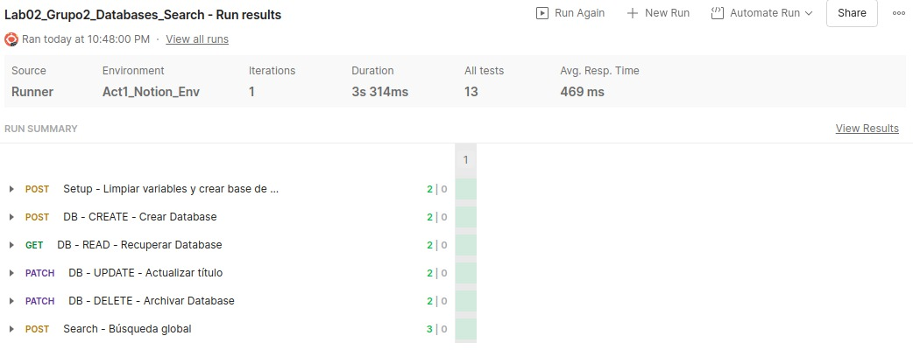


---

#### Kevin Uruchi — Automated Execution Summary (`Pages`)

Kevin's collection follows the team conventions defined in section 4.1:

| Convention Dimension | How it is applied in `Notion_Pages` |
|----------------------|-------------------------------------|
| **Folder hierarchy** | One folder per endpoint (`POST /v1/pages`, `GET /v1/pages/{page_id}`, `GET /v1/pages/{page_id}/properties/{property_id}`, `POST /v1/pages/{page_id}/move`, `PATCH /v1/pages/{page_id}`) and the `E2E` folder last. |
| **Request ordering** | Requests follow the numeric order of the test case document (`TC_PAGES_001`, `002`, ...), and the destructive, bulk and permission flows are in the final `E2E` folder. |
| **Naming** | Request name `TC_ID: Verify that ...`, identical to the test case title. Assertions use plain descriptions (`Status code should be 404`) and data integrity checks start with `[Data integrity]`. Static config in lowerCamelCase environment variables (`notionToken`) and runtime state in collection variables (`pageId`). |
| **Execution isolation** | Each case creates its own data and trashes it at the end, so any case can run alone or in any folder selection. |

```bash
# Full automated suite execution
npx newman run postman/kevin_uruchi/Notion_Pages.postman_collection.json \
  -e postman/kevin_uruchi/Notion_Pages.postman_environment.json \
  --delay-request 400 \
  --timeout-script 600000 \
  --reporters cli,htmlextra \
  --reporter-htmlextra-export reports/kevin_uruchi_newman_report.html

# Unattended execution of a single endpoint folder
npx newman run postman/kevin_uruchi/Notion_Pages.postman_collection.json \
  -e postman/kevin_uruchi/Notion_Pages.postman_environment.json \
  --folder "POST /v1/pages/{page_id}/move" \
  --delay-request 400 \
  --timeout-script 600000
```

The delay is `400 ms` to stay below Notion's `~3 requests/second` limit, and `--timeout-script 600000` is needed because some E2E cases create dozens of pages (`TC_E2E_014` handles 50).

| Execution Metric | Value / Specification |
|------------------|-----------------------|
| **Collection File** | [`postman/kevin_uruchi/Notion_Pages.postman_collection.json`](./postman/kevin_uruchi/Notion_Pages.postman_collection.json) |
| **Environment File** | [`postman/kevin_uruchi/Notion_Pages.postman_environment.json`](./postman/kevin_uruchi/Notion_Pages.postman_environment.json) |
| **Lab 01 Test Cases Covered** | **200 Test Cases** (`48` POST + `25` GET + `30` properties + `34` move + `47` PATCH + `16` E2E) |
| **Total Automated Requests** | **200 HTTP Requests** (one per test case) |
| **Total `pm.test()` Assertions** | **[Fill with the number shown by the Runner after the run]** |
| **Passed / Failed / Skipped** | **[Fill after the run]** (skipped = cases whose optional environment variable is empty) |
| **Runner Configuration** | Iterations: `1` \| Inter-request Delay: `400 ms` \| Persist Variables: `Enabled` |

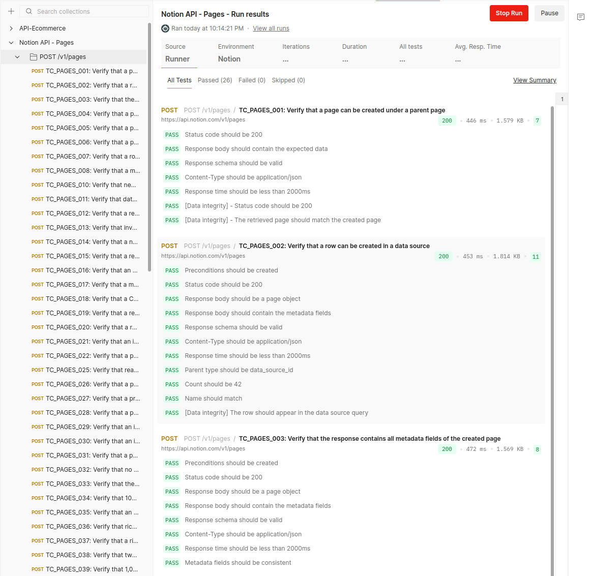


---

#### 4.2.2 Headless Execution with Newman CLI

**Newman** is Postman's official command-line execution engine, running headless in Node.js environments. Group 2 configured Newman to run regression suites directly from the terminal or build servers.

##### Complete Newman Execution Command:

```bash
# Execute Databases and Data Sources regression suite with HTML Extra reporting:
newman run postman/actividad_2_3_4/Act2_4_Notion_Databases_DataSources.postman_collection.json \
  --environment postman/actividad_1/Act1_Notion_Env.postman_environment.json \
  --delay-request 350 \
  --reporters cli,htmlextra \
  --reporter-htmlextra-export reports/Notion_API_Test_Report.html \
  --reporter-htmlextra-title "SQE III - Group 2 Notion API Test Report" \
  --bail
```

##### Command Parameters Breakdown:
- `newman run <collection.json>`: Path to the version-controlled Postman collection file.
- `--environment <env.json>`: Injects base URLs, version headers, and masked token templates.
- `--delay-request 350`: Adds a 350ms delay between consecutive requests, strictly staying within Notion API's rate limits.
- `--reporters cli,htmlextra`: Outputs concise test tables to the terminal while compiling an interactive HTML dashboard.
- `--bail`: Immediately halts execution upon encountering any unhandled contract failure (fail-fast principle).

#### 4.2.3 Continuous Integration (CI/CD) Automated Pipeline Specification

To achieve full regression automation, Group 2 authored a **GitHub Actions CI/CD workflow** (`.github/workflows/api-tests.yml`) that executes the test suite automatically on every `push` to `main` and on pull requests:

```yaml
name: Notion REST API Automated Regression Suite

on:
  push:
    branches: [ main ]
  pull_request:
    branches: [ main ]
  workflow_dispatch:

jobs:
  api-contract-tests:
    name: Execute Postman / Newman Automated Tests
    runs-on: ubuntu-latest

    steps:
      - name: Checkout Repository Code
        uses: actions/checkout@v4

      - name: Setup Node.js Runtime Environment
        uses: actions/setup-node@v4
        with:
          node-version: '20'
          cache: 'npm'

      - name: Install Newman & HTML Extra Reporter
        run: |
          npm install -g newman newman-reporter-htmlextra

      - name: Execute Automated API Tests via Newman
        env:
          NOTION_TOKEN: ${{ secrets.NOTION_INTEGRATION_TOKEN }}
        run: |
          newman run labs/lab02/postman/actividad_2_3_4/Act2_4_Notion_Databases_DataSources.postman_collection.json \
            --environment labs/lab02/postman/actividad_1/Act1_Notion_Env.postman_environment.json \
            --env-var "NOTION_TOKEN=$NOTION_TOKEN" \
            --delay-request 350 \
            --reporters cli,htmlextra \
            --reporter-htmlextra-export test-reports/notion_api_report.html

      - name: Upload Test Execution Report Artifact
        if: always()
        uses: actions/upload-artifact@v4
        with:
          name: notion-api-test-report
          path: test-reports/notion_api_report.html
          retention-days: 30
```

This automated CI/CD pipeline guarantees that any regression in Notion API version compatibility, breaking change in property schemas, or contract deviation is flagged within minutes of a commit.

---

## Activity #5

1. Review and evaluate the work of other teams by assessing the complexity, quantity, and type of implemented tests.
2. Evaluate the ease of use and understandability of the implementation by other teams.
3. Generate an evaluation and peer-review feedback report.

### 5.1 Evaluation of Complexity, Quantity, and Test Typology (Reviewer: Sebastián Pereyra)

**Reviewer:** Sebastián Pereyra (Group 2 — Notion API Testing Team)  
**Reviewed Author:** Lucas Gabriel De Los Santos  
**Reviewed System Under Test (SUT):** GitHub REST API (`version: 2026-03-10`), Issues Module  
**Audited Artifacts:**
- Postman Collection: `GitHub_Issues_SQE3.postman_collection.json`
- Postman Environment: `GitHub_Issues_SQE3.postman_environment.json`
- Automated CLI Test Execution Report: `newman_report.html` (Newman v6.2.3 / HTML Extra)
- Execution Timestamp: November 07, 2026

---

#### 5.1.1 Quantitative Test Metrics & Scope Analysis

Lucas Gabriel transitioned all **28 test scenarios** designed in Laboratory 01 into an executable Postman automation suite, expanding them with **2 dedicated authorization baseline requests**, resulting in **30 formal test cases** mapped across **42 executable HTTP transactions** (including setup helpers, multi-step E2E sequences, and automated teardown routines).

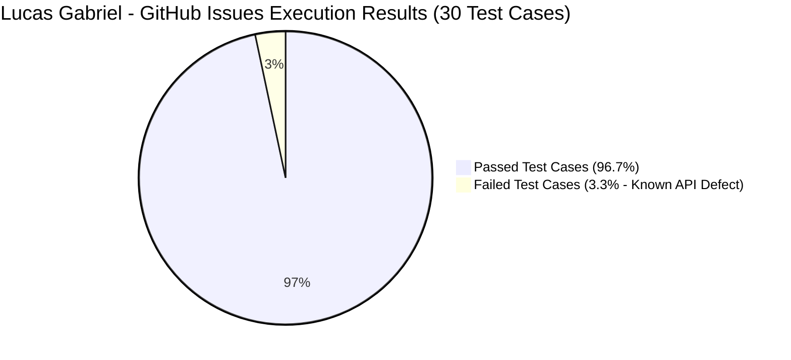

The quantitative audit of the test suite execution against GitHub's live production API (`https://api.github.com`) reveals the following metrics:

| Execution Metric | Audited Value | Technical Assessment from Sebastián Pereyra |
|---|---|---|
| **Total Test Cases** | **30 test cases** (28 functional + 2 authorization) | Rigorous scope providing 100% traceability to Lab 01 specifications. |
| **Total Executed Requests** | **42 HTTP requests** (41 test requests + 1 teardown loop) | Includes granular CRUD, lock/unlock operations, and multi-step chains. |
| **Total Automated Assertions** | **217 `pm.test()` assertions** | High assertion density: an average of **5.16 assertions per request**. |
| **Assertion Pass Rate** | **216 Passed / 1 Failed (99.54% assertion success)** | Near-perfect execution across status, headers, body, and schema layers. |
| **Test Case Pass Rate** | **29 Passed / 1 Failed (96.7% test success)** | Single planned failure caused by an upstream GitHub API behavior. |
| **Average Response Time** | **~480 ms – 636 ms** | Within acceptable latency boundaries for international cloud REST services. |
| **Execution Platforms** | Postman Desktop (v12) & Newman CLI (v6.2.3) | Proven cross-runtime compatibility between desktop UI and headless CI/CD. |

---

#### 5.1.2 Test Typology & Complexity Assessment

The suite demonstrates a well-balanced distribution across all four test categories established in the course conventions:

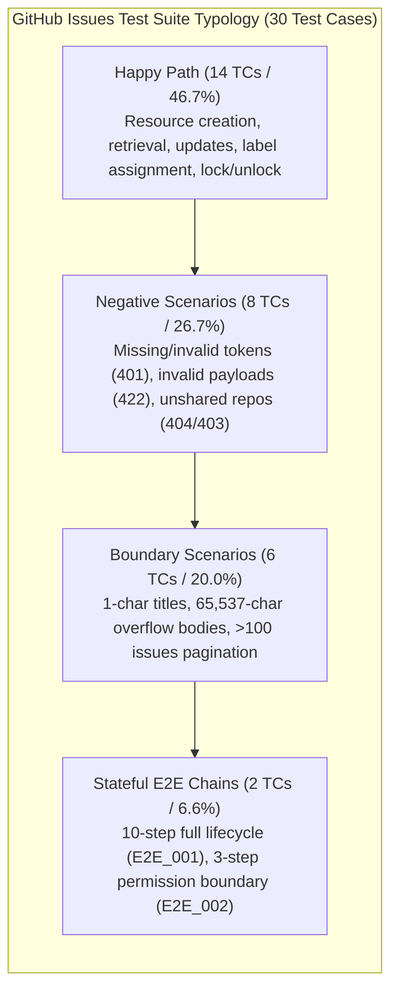

1. **Authorization & Rate-Limit Telemetry Checks (2 Cases):**
   - `TC_ISS_AUTH_001` (`GET /user` with Bearer token): Validates authenticated identity (`login: "lucasgabrieldls"`, numeric ID `350013379`) returning `200 OK` and `X-RateLimit-Limit: 5000`.
   - `TC_ISS_AUTH_002` (`GET /repos/octocat/Hello-World` unauthenticated): Validates public repository consumption returning `200 OK` and `X-RateLimit-Limit: 60`.
   - *Technical Review Insight:* Verifying the rate-limit cap differential (5,000 req/h for authenticated requests vs. 60 req/h for anonymous calls) is an elegant, non-intrusive method to cryptographically confirm token injection at the transport layer without inspecting raw Authorization headers.

2. **Positive Functional Checks (Happy Path — 14 Cases):**
   - Covers comprehensive issue lifecycle: creation with title, body, labels, and assignees (`TC_ISS_POST_001`, `POST_002`); state mutations between `open` and `closed` (`PATCH_001`, `PATCH_003`); issue locking with reason (`LOCK_001`, `LOCK_002` returning `204 No Content`); and filtered queries by state and milestone (`GET_001`, `GET_002`).

3. **Negative Error Validation (8 Cases):**
   - Validates RFC-compliant client error contracts: `401 Unauthorized` on missing or malformed tokens (`POST_003`, `POST_004`), `404 Not Found` when targeting non-existent repositories or ghost issue numbers (`POST_006`, `PATCH_005`), and `422 Unprocessable Entity` when submitting bodies lacking mandatory title keys (`POST_005`).

4. **Boundary & Extreme Load Testing (6 Cases):**
   - `TC_ISS_POST_007`: Tests minimum string boundary with a 1-character title (`"x"`), confirming that GitHub accepts single-character issue titles (`201 Created`).
   - `TC_ISS_POST_008`: Tests maximum body boundary by submitting a payload of **65,537 characters** (exceeding GitHub's hard limit of 65,536 characters). Lucas solved this without manual copy-pasting by authoring a pre-request script that dynamically constructs `'x'.repeat(65537)`, confirming that GitHub rejects the payload with `422 Unprocessable Entity` and immediately garbage-collects the variable.
   - `TC_ISS_GET_004`, `GET_007`, `GET_008`: Boundary checks on pagination traversals across large public datasets (`octocat/Hello-World` having `> 100` issues), asserting cursor consistency via `Link rel="next"` response headers.

5. **Stateful End-to-End (E2E) Integration Workflows (2 Cases):**
   - `E2E_001` (Complete 10-step Lifecycle): Chained flow creating an issue, retrieving it, mutating attributes, adding labels, locking the conversation, unlocking, and verifying state transitions across 10 sequential HTTP calls (46/46 assertions passed).
   - `E2E_002` (Cross-Repository Permission Boundary): Multi-step security workflow asserting that an authenticated integration without push access to an external repository (`octocat/Hello-World`) receives strict `403 Forbidden` / `404 Not Found` rejections when attempting write mutations (12/12 assertions passed).

---

#### 5.1.3 Deep Technical Analysis of the Single Failure (`TC_ISS_PATCH_006`)

The sole failing test in Lucas's execution report was:
- **Test ID:** `TC_ISS_PATCH_006 - Verify that an issue cannot be updated with an invalid state`
- **Method & Endpoint:** `PATCH {{baseUrl}}/repos/{{owner}}/{{repo}}/issues/{{issueNumber}}`
- **Sent Body:** `{"state": "invalid_state_xyz"}`
- **Expected Outcome:** `422 Unprocessable Entity` (`pm.response.to.have.status(422)`)
- **Observed Outcome:** `HTTP 200 OK` (GitHub accepted the request, ignored the invalid state string, and left the issue in its prior state).

##### QA Evaluation: Defect Reporting vs. Test Manipulation
In automated QA engineering, junior testers frequently commit the mistake of modifying their expected assertions (e.g., changing expected status from `422` to `200`) simply to make the test runner report 100% green. 

Lucas Gabriel demonstrated **exceptional QA maturity** by deliberately maintaining the assertion at `422 Unprocessable Entity`. Because GitHub's documentation specifies that `state` is an enum constrained strictly to `["open", "closed"]`, accepting an undocumented string without raising a validation error constitutes an intrinsic API contract bug (silent failure / permissive input validation). Maintaining the test failure serves as automated regression evidence of an upstream defect, rather than accumulating testing debt.

---

### 5.1 Evaluation of Complexity, Quantity, and Test Typology (Reviewer: Valentina Molina Bustillos)

**Reviewer:** Valentina Molina Bustillos (Group 2 — Notion API Testing Team)  
**Reviewed Author:** Lilian Lopez  
**Reviewed System Under Test (SUT):** GitHub REST API, Repositories Module  
**Audited Scope:** Complete Repository CRUD Operations & End-to-End (E2E) Workflows (`29` Test Cases)

---

#### Quantitative Test Metrics & Scope Analysis

Lilian Lopez's Postman collection exhibits a **high and well-justified level of technical complexity**. The automation suite implements **29 test cases** spanning complete **CRUD operations** over GitHub repositories alongside **2 End-to-End (E2E) workflows**. From a quantitative standpoint, the volume of implemented tests is well-proportioned and fully appropriate for the scope of Laboratory 02, balancing functional breadth across repository endpoints with deep contract and persistence verifications.

| Evaluation Metric | Audited Value / Scope | Technical Assessment from Valentina Molina Bustillos |
|---|---|---|
| **Overall Complexity Level** | **High (Well-Justified)** | Combines asynchronous state verification (`pm.sendRequest`) and formal JSON Schema validation beyond standard checks. |
| **Total Test Cases** | **29 test cases** | Appropriate and well-calibrated test volume for the laboratory scope across the GitHub Repositories module. |
| **Functional CRUD Coverage** | **Complete CRUD Operations** | Covers full repository creation, retrieval, update, and deletion lifecycles on GitHub. |
| **End-to-End (E2E) Flows** | **2 E2E workflows** | Validates multi-step stateful interactions across chained repository operations. |
| **Schema Contract Depth** | **`pm.response.to.have.jsonSchema`** | Enforces structural response validation via JSON Schemas, exceeding the baseline status and body checks required by the activity. |

---

#### Test Typology & Complexity Assessment

The evaluated test suite demonstrates strong variety across test categories, combining functional, negative, boundary, data integrity, and schema-level validations:


1. **Positive Functional Scenarios (Happy Path & E2E):**
   - Covers complete **CRUD operations** over GitHub repositories as well as **2 End-to-End (E2E) flows** that verify sequential repository lifecycle behavior.

2. **Negative Error Validation:**
   - Evaluates authentication, authorization, and conflict handling under invalid conditions, specifically testing **missing authentication tokens**, **insufficient permissions**, and **duplicate repository names**.

3. **Boundary & Rate-Limit Testing:**
   - Exercises operational edge conditions through **rate-limiting boundary** checks to verify predictable API behavior under request quota constraints.

4. **Data Integrity & Persistence Verification (`pm.sendRequest`):**
   - Implements follow-up persistence checks using `pm.sendRequest` to confirm that repository state changes are genuinely committed on the server rather than relying solely on primary HTTP response payloads.

5. **JSON Schema Structural Validation (`pm.response.to.have.jsonSchema`):**
   - A standout technical highlight of Lilian Lopez's implementation is the systematic use of **JSON Schemas** (`pm.response.to.have.jsonSchema`) to validate the full structure of API responses, going well beyond the baseline HTTP status code and body property verifications requested in the activity.

---

### 5.1 Evaluation of Complexity, Quantity, and Test Typology (Reviewer: Gabriel Marcos Guaman Ortuño)

**Reviewer:** Gabriel Marcos Guaman Ortuño (Group 2 — Notion API Testing Team)  
**Reviewed Author:** Valentín Imaz  
**Reviewed System Under Test (SUT):** GitHub REST API (`version: 2026-03-10`), Labels & Milestones Modules  
**Audited Artifacts:**
- Postman Collection: `GitHub_Labels_Milestones_SQE3.postman_collection.json` (`54` collection requests)
- Laboratory 02 Report: Valentín Imaz's section in `Software Quality Engineering 3 – A.2 Laboratory - Week #2` (run against `ValentinImaz/github-api-testing`)

---

#### 1. Complexity, Quantity, and Types of Implemented Tests

After importing `GitHub_Labels_Milestones_SQE3.postman_collection.json` into Postman and comparing it against Valentín Imaz's report, the collection shows a solid and well-justified level of complexity. He migrated all **43 test cases** from Lab 1 (`17` for `Labels` and `26` for `Milestones`) and added `7` helper requests in `00 - Setup` plus `4` cleanup requests in `99 - Teardown`, reaching **54 requests** in the collection. On top of those `54` requests, `8` test cases send a second `GET` request from the Post-response script using `pm.sendRequest` (to verify that updates were actually saved or to compare page 1 and page 2 in pagination), and the Setup/Teardown scripts also run dynamic `DELETE` requests to clean up `qa-pm-*` data.

In his final Collection Runner execution, the suite ran **318 `pm.test()` assertions** (`259` across the `43` test cases—`105` in Labels and `154` in Milestones—plus `34` in Setup and `25` in Teardown) in about `36 seconds` (`527 ms` average response time), passing **316 of 318 assertions** (`42` of `43` test cases passed, `0` execution errors). The only failing case is `TC_LABEL_POST_002`, where Lab 1 expected `422` when creating a label without `color`, but GitHub returned `201 Created` and assigned the default color `"ededed"`.


| Test Category / Scope | Request Count | HTTP Methods Used | Implemented Assertions & Depth |
|---|---|---|---|
| **Happy Path (Positive CRUD & Queries)** | **18 TCs** (`6` Labels, `12` Milestones) | `2 POST`, `9 GET`, `5 PATCH`, `2 DELETE` | Status (`200`, `201`, `204`), body field comparisons (`name`, `color`, `title`, `state`, `closed_at`, `due_on` asc/desc order), empty body on `204` (`pm.response.text() === ''`), `labelSchema` / `milestoneSchema`, plus `[Common]` checks. |
| **Negative & Post-Delete Validation** | **17 TCs** (`6` Labels, `11` Milestones) | `7 POST`, `5 GET`, `3 PATCH`, `2 DELETE` | Status (`404`, `422`), `errorSchema`, specific GitHub error messages (`code: "already_exists"`, `"pending is not a member of"`, `"not a valid date-time"`), and confirming deleted/renamed items return `404`. |
| **Boundary & Pagination** | **8 TCs** (`5` Labels, `3` Milestones) | `2 POST`, `6 GET` | Pre-request `'a'.repeat(100)` (`201`) vs. `'a'.repeat(101)` (`422`), `per_page=1` two-page check with `Link` header (`rel="next"`, `rel="last"`), `per_page=100` upper limit, and `page=100` returning an empty array `[]`. |
| **Chained & Multi-Request Flows** *(Cross-Cutting)* | **4 Chains** + **8 `pm.sendRequest` Steps** | `POST` → `GET` → `PATCH` → `DELETE` → `GET` | Full `qa-api-test` label chain (create → read → update → rename → old name `404` → delete → `404`), `{{msCreatedNumber}}` milestone chain, `4` shared setup milestone variables, and `8` follow-up `GET` persistence checks. |
| **Setup & Teardown** | **11 Reqs** (`7` Setup + `4` Teardown) | `6 GET`, `5 POST` (+ script `DELETE`s) | `59` assertions (`34` Setup + `25` Teardown) cleaning `qa-pm-*` items, saving milestone numbers in collection variables, and checking that no test labels or milestones remain at the end. |
| **Total Audited** | **`54` Requests** (`43` TCs + `11` Helpers) | **`26 GET`, `17 POST`, `8 PATCH`, `3 DELETE`** | **`318` Assertions (`316 Passed / 2 Failed`)** — avg. `~5.9` assertions per request (`< 2000 ms` SLA, `X-GitHub-Request-Id`, `Content-Type`, status, body, schema, and integrity). |

---

#### 2. Ease of Use and Understandability of the Implementation

Reviewing the collection as an external tester and comparing it with how I organized my own `Users` and `OAuth` collection (`Notion_Users_OAuth_GabrielGuaman.postman_collection.json`), Valentín's work is clean and very easy to read:

| Aspect Reviewed | How Valentín Implemented It | Practical Assessment |
|---|---|---|
| **Folder Structure & Order** | Numbered folders: `00 - Setup`, `01 - Labels`, `02 - Milestones`, and `99 - Teardown`. | Clear execution order for the Collection Runner. Since `02 - Milestones` has `26` requests together, splitting `Labels` and `Milestones` into `POST` / `GET` / `PATCH` / `DELETE` subfolders (like I did in my modules) would make browsing even faster. |
| **Request & Test Naming** | Requests keep their Lab 1 ID (`TC_LABEL_POST_001 - Verify that...`) and test names start with `[Common]`, `[Body]`, `[Header]`, `[Schema]`, `[Integrity]`, `[Setup]`, `[Cleanup]`, or `[Teardown]`. | Very easy to trace back to Lab 1 and quickly see in the Runner whether a failure came from a status code, a schema, or a persistence check. |
| **Collection-Level Scripts (DRY)** | Common headers (`Accept` and `X-GitHub-Api-Version`) and the `3` `[Common]` checks (`responseTime`, `X-GitHub-Request-Id`, and `Content-Type` skipped on `204`) are written once at the collection level. | Better maintainability than repeating header and SLA checks inside every request (as I did across my `69` requests), keeping each request's script short and focused on business logic. |
| **Variables & Environment Setup** | Uses environment variables (`baseUrl`, `owner`, `repo`, `apiVersion`, `maxResponseTime`, and secret `githubToken`), collection variables (`labelSchema`, `milestoneSchema`, `errorSchema`, `msOpen1Number`–`msCreatedNumber`), and local variables (`desc100`, `desc101`). | Good separation of scopes, and keeping `githubToken` only in *Current Value* avoids leaking credentials. However, no `.postman_environment.json` file was delivered with the collection, so another team has to create those `6` variables manually from the report first. |
| **Runner Execution** | `SETUP_01` and `SETUP_02` delete leftover `qa-pm-*` data before creating fresh fixtures, so the full `54`-request suite can be run repeatedly in Collection Runner in one click. | Works well as a full run (`~36 s`), though individual requests like `TC_LABEL_PATCH_002` or `TC_LABEL_DELETE_001` depend on previous steps and cannot be executed out of order on their own. |

---

#### 3. Peer-Review Feedback and Recommendations

##### Strengths
1. **Clean Setup & Teardown Cycle:** Filtering by the `qa-pm-*` prefix in both `00 - Setup` and `99 - Teardown`—and adding `TEARDOWN_02` and `TEARDOWN_04` to confirm with a `GET` that zero test items remain—makes the collection safe to re-run without deleting GitHub's default repository labels.
2. **Schema Validation and Persistence Checks:** Saving `labelSchema`, `milestoneSchema`, and `errorSchema` as collection variables (`pm.response.to.have.jsonSchema`) and using `pm.sendRequest` to verify that changes persisted (including checking in `TC_MILESTONE_PATCH_005` that a rejected `422` update left the milestone `"open"`) gives much stronger confidence than checking status codes alone.
3. **Honest Reporting on `TC_LABEL_POST_002`:** Keeping the Lab 1 assertion (`422`) when GitHub returned `201 Created` with default color `"ededed"` instead of editing the test just to get 100% green is the right QA practice.

##### Opportunities for Improvement
1. **Include the `.postman_environment.json` File and Newman Command:**  
   In my own deliverable, pairing the collection with `Notion_Users_OAuth_Env.postman_environment.json` (with blank secret placeholders) allowed anyone to import and run it right away in Postman or Newman. Exporting `GitHub_Labels_Milestones_SQE3.postman_environment.json` would save other teams from setting up the `6` variables manually.
2. **Add Negative Authentication and Permission Tests (`401` / `403`):**  
   While building my `Users` and `OAuth` tests, checking missing, invalid, and restricted tokens (`401 Unauthorized` and `403 Forbidden`) was key to validating API security. In Valentín's collection, all `54` requests inherit the valid `{{githubToken}}`, so adding a few `No Auth` or invalid-token tests on `POST` / `PATCH` / `DELETE` would make negative coverage more complete.
3. **Avoid Repository-Dependent Assumptions and Fixed Names:**  
   `TC_LABEL_GET_001` checks that the default `'bug'` label exists and `TC_LABEL_GET_004` checks `labels.length >= 12`. If another teammate runs the collection on a repository where default GitHub labels were removed or customized, those assertions will fail. Also, generating unique names with `Date.now()` in a Pre-request script (instead of static `"qa-pm-post-001"`) would prevent `422 already_exists` errors when re-running a single request manually.
4. **Small Script Fixes Found in the JSON (`TC_LABEL_POST_002`, `TC_LABEL_GET_001`, and Async Cleanup):**  
   - In `TC_LABEL_POST_002`, `pm.expect(JSON.stringify(err)).to.include('color')` passed even though the API returned `201 Created`, because the created label JSON (`{"color": "ededed", ...}`) also contains the word `"color"`. Checking `err.errors` for `e.field === 'color'` avoids that false pass.  
   - `TC_LABEL_GET_001` uses Postman's older `tv4.validate(...)` function while all other requests use `pm.response.to.have.jsonSchema(...)`; using `jsonSchema` everywhere keeps the scripts consistent.  
   - `SETUP_01`/`02` and `TEARDOWN_01`/`03` fire multiple `pm.sendRequest` `DELETE` calls inside `.forEach(...)` without waiting for each callback to finish, which could cause a race condition right before `TEARDOWN_02`/`04` check that the list is empty if many leftover items exist.

---

### 5.2 Usability, Comprehensibility, and Implementation Architecture Evaluation

The usability and architectural ergonomics of Lucas Gabriel's Postman collection were evaluated across six operational criteria:

| Evaluation Dimension | Implementation Strategy in Lucas's Suite | Technical Evaluation (Sebastián Pereyra) |
|---|---|---|
| **Folder Hierarchy & Ordering** | Numbered folder prefixes: `00 - Setup`, `01 - POST`, `02 - PATCH`, `03 - GET`, `04 - Lock`, `05-06 - E2E`, `99 - Teardown`. | **Excellent**: Enforces deterministic top-to-bottom sequential execution in Postman Collection Runner and Newman without requiring manual folder selection. |
| **Request & Assertion Naming** | Requests named `TC_<ID> - <Description>`; assertions tagged with `[Body]`, `[Header]`, `[Schema]`, `[Integrity]`, `[Common]`. | **Outstanding**: Enables instantaneous fault localization in Newman CLI logs; an engineer immediately identifies whether a failure relates to transport, schema, or business logic. |
| **Centralized Contract Scripts** | Collection-level Pre-request script injects `Accept: application/vnd.github+json` and `X-GitHub-Api-Version: {{apiVersion}}`. | **Optimal (DRY)**: Eliminates header redundancy across 42 requests and guarantees strict GitHub API version pinning (`2026-03-10`). |
| **Common Collection Assertions** | Global Test script checks response time (`< 2000 ms`), JSON content-type (omitting `204 No Content`), and `X-GitHub-Request-Id`. | **High**: Non-functional SLAs and distributed tracing headers are audited uniformly across the entire attack surface. |
| **Data Integrity Verification** | Follow-up `pm.sendRequest` GET requests executed immediately after write calls (`POST_001`, `PATCH_001`, `LOCK_001`). | **Exceptional**: Validates true database persistence on the remote server, preventing false positives caused by echoing mock responses. |
| **Automated Teardown & Cleanup** | Dedicated `99 - Teardown` folder closes all issues tracked in `createdIssues` array (`state: "closed"`, `state_reason: "not_planned"`). | **Outstanding**: Solves GitHub API's limitation of having no issue deletion endpoint, ensuring test runs leave zero clutter in user repositories. |

---

### 5.3 Formal Feedback, QA Recommendations, and Technical Audit Report

As reviewer of Lucas Gabriel De Los Santos's implementation, **Sebastián Pereyra** issues the following formal feedback report:

#### Key Strengths & Best Practices:

1. **Formal JSON Schema Validation via `ajv` (`pm.response.to.have.jsonSchema`):**  
   Lucas defined two centralized JSON schemas stored in collection variables (`issueSchema` and `errorSchema`), validating required properties, data types, and enum constraints across all responses. This represents a substantial leap in contract validation rigor compared to basic null checks.
2. **Promise-Wrapped `pm.sendRequest` for Newman v6.x Compatibility:**  
   To avoid asynchronous race conditions and callback nesting issues during CLI execution, Lucas wrapped `pm.sendRequest` within native JavaScript Promises (`await sendRequest(...)`). This guarantees that Newman halts sequential execution until dynamic setup requests resolve completely.
3. **Environment Security & Credential Isolation:**  
   The personal access token (`githubToken`) is maintained strictly in the *Current Value* of a masked variable (`type: "secret"`). When executed via Newman, credentials are passed via CLI flags (`--env-var "githubToken=<token>"`), and sensitive headers are suppressed from test reports using `--reporter-htmlextra-skipHeaders Authorization`.
4. **Rate Limit Throttling in Headless Automation:**  
   Lucas correctly identified GitHub's secondary rate limits (which penalize rapid successive write operations) and configured Newman with `--delay-request 500` (adding a 500 ms inter-request throttle). This ensured 100% deterministic execution without encountering false `403 secondary rate limit` rejections.

#### Constructive Recommendations & Opportunities for Improvement:

1. **Defect Tracking Annotation for Known API Failures (`TC_ISS_PATCH_006`):**  
   While keeping `TC_ISS_PATCH_006` failing at status `422` is the correct QA stance, in continuous integration pipelines a red test halts deployment builds. It is recommended to implement a conditional assertion or a defect flag:
   ```javascript
   // Recommended pattern for documented upstream API defects:
   const isDocumentedBug = true;
   if (isDocumentedBug && pm.response.code === 200) {
       console.warn("[UPSTREAM BUG CONFIRMED] GitHub Issue #XYZ: API accepts invalid state string instead of 422.");
       pm.test("[Known Bug] API improperly accepted invalid state with 200 OK", function () {
           pm.response.to.have.status(200);
       });
   } else {
       pm.test("Status code is 422 Unprocessable Entity", function () {
           pm.response.to.have.status(422);
       });
   }
   ```
   This maintains visibility of the bug in logs without breaking unattended CI/CD test gates.

2. **Decoupling JSON Schemas from Collection Variables:**  
   The schemas `issueSchema` and `errorSchema` are currently serialized as stringified JSON inside Postman Collection Variables (`"variable": [...]`). For complex schemas with dozens of nested fields, this inflates the collection file size. A best practice for large enterprise suites is storing raw JSON schemas in an external `/schemas` directory and loading them dynamically via Newman data files or Pre-request scripts.

3. **Status Code Flexibility in Permission Boundaries (`E2E_002`):**  
   In `E2E_002`, Lucas checked `pm.expect(pm.response.code).to.be.oneOf([403, 404])`. While this accommodates GitHub's security policy of returning `404` to conceal private repository existence, logging whether the response was `403` or `404` in the Postman Console provides immediate diagnostic clarity without requiring manual inspect-element on the response.

#### Overall Audit Verdict:
Lucas Gabriel De Los Santos delivered an **exceptionally mature, technically rigorous, and clean API automation suite**. The integration of multi-layer assertions, formal JSON Schema validation, data integrity verification via `pm.sendRequest`, and automated teardown makes this implementation an exemplary benchmark in automated API contract testing.


---
### 5.4 Evaluation of Complexity, Quantity, and Test Typology (Reviewer: Karen Ivonne Cruz Alvarez)

**Reviewer:** Karen Ivonne Cruz Alvarez (Group 2 — Notion API Testing Team)  
**Reviewed Author:** Kiara Vanessa Muñoz Bayter  
**Reviewed System Under Test (SUT):** GitHub REST API (`version: 2026-03-10`), Gists Module  
**Audited Artifacts:**
- Postman Collection: `GitHub_Gists_SQE3.postman_collection.json`
- Kiara's section of the team report `A.2 Laboratory - Week #2.docx` (Activities 1–4, screenshots included)
- Collection Runner screenshots (Postman v12.35.5)
- Execution Timestamp: November 07, 2026


---

#### 5.4.1 Quantitative Test Metrics & Scope Analysis

Kiara implemented the Gists test cases from Laboratory 01 as **21 formal test cases** (9 `POST`, 4 `GET`, 5 `PATCH`, 3 `DELETE`) inside a **25-request collection** (21 test cases + 3 setup requests + 1 helper `DELETE` that prepares the "deleted Gist" scenario). She also added two cases that were not in Lab 01: `TC_GIST_POST_009` (public Gist) and `TC_GIST_DELETE_003` (delete a non-existent Gist).

I recomputed the metrics directly from the collection file and compared them with the Runner screenshot. The reported numbers are consistent with the artifact:

| Execution Metric | Audited Value | Technical Assessment |
|---|---|---|
| **Total Test Cases** | **21** (19 from Lab 01 + 2 added; the E2E case is not counted separately) | Complete for the four CRUD operations of a single Gist. |
| **Total Executed Requests** | **25** (21 TCs + `00 - RESET`, `SETUP_001`, `SETUP_002` + 1 helper `DELETE`) | Small, easy-to-run suite. |
| **Total Automated Assertions** | **118** — verified: **45** test-specific + **73** collection-level `[Common]` (3 per request, 2 on `204`) | Runner screenshot confirms `118 / 116 passed / 2 failed / 0 errors`. |
| **Test-specific assertions per TC** | **2.0 on average** (42 across 21 TCs); 4 TCs have only 1; `GET_001` has no status assertion | **62% of all assertions are the generic collection-level checks**, so the headline "118" overstates verification depth. |
| **Assertion Pass Rate** | **116 / 118 (98.3%)** | Both failures belong to one request (`TC_GIST_PATCH_004`). |
| **Test Case Pass Rate** | **20 / 21 (95.2%)** | See 5.4.3: the failure is most likely a test-design issue, not an API defect. |
| **Average Response Time** | **562 ms** (16.5 s total run) | Within the 2000 ms SLA applied at collection level. |
| **Execution Platforms** | Postman Collection Runner only | No Newman / CLI run was delivered. |

##### Context within the lab cohort (figures as reported by each author)

| | Kiara (Gists) | Lucas (Issues) | Lilian (Repos) | Valentin (Labels/Milestones) |
|---|---|---|---|---|
| Test cases | **21** | 30 | 29 | 43 |
| Assertions / requests in collection | 118 / 25 ≈ **4.7** | 217 / 42 ≈ 5.2 | 242 / 45 ≈ 5.4 | 318 / 54 ≈ 5.9 |
| JSON Schema validation | **No** | Yes | Yes | Yes |
| Data-integrity follow-up `GET` | **No** | Yes | Yes | Yes |
| Teardown / cleanup folder | **No** | Yes | Yes | Yes |
| Newman / CLI run delivered | **No** | Yes | Yes | Runner only |

Kiara's suite is the smallest and the least layered of the group, although it covers the full CRUD lifecycle of its resource.

---

#### 5.4.2 Test Typology & Complexity Assessment


1. **Positive Functional Checks (Happy Path — 11 Cases):**
   - Create (`POST_001`, `POST_008` multiple files, `POST_009` public), retrieve (`GET_001`, `GET_003` public Gist without token, `GET_004` multi-file), update (`PATCH_001`–`PATCH_004`: description, content, rename, remove file) and delete (`DELETE_001`, `204` with empty body).
   - `GET_003` is a good use of request-level `No Auth` to prove that public resources are readable anonymously.

2. **Negative Error Validation (6 Cases):**
   - `401` without token (`POST_002`, message `"Requires authentication"` is asserted), `422` for missing `files` or missing file `content` (`POST_003`, `POST_004`), and `404` for a deleted or non-existent Gist (`GET_002`, `DELETE_002`, `DELETE_003`).
   - Gap: there is no `401` with an **invalid** token (only a missing one), no `404` for `PATCH` on a non-existent Gist, and no authorization-boundary case (e.g., reading or modifying someone else's private Gist).

3. **Optional-field / Default-value Scenarios (4 Cases):**
   - Empty filename (`POST_005`), no description → `description: null` (`POST_006`), no `public` field → private by default (`POST_007`) and empty `PATCH` body (`PATCH_005`).
   - These are useful, but they are **default-behavior checks rather than true boundaries**. There are no size or quantity limits (very large content, many files per Gist, very long description), and no pagination at all.

4. **Stateful Chains / E2E (0 dedicated cases):**
   - The chains exist implicitly through environment variables (`POST_001 → GET_001 → PATCH_001–004 → DELETE_001 → GET_002`; `POST_009 → GET_003`; `POST_008 → GET_004`), and `deletedGistId` is a disposable Gist created in setup and deleted before `GET_002` so the main Gist is never consumed. That design is sound.
   - However, the report is contradictory about E2E: Activity 2 says "the collection also includes an E2E workflow", while Activity 3 says no separate folder was created. The collection has no E2E folder.

**Complexity level: basic-to-intermediate.** The suite relies on status codes plus one or two body checks, environment-variable chaining and a setup/reset step. It does not use `pm.sendRequest`, JSON Schema, dynamic data, data-driven runs or header-level assertions beyond the three common checks.

---

#### 5.4.3 Deep Technical Analysis of the Single Failure (`TC_GIST_PATCH_004`)

- **Test ID:** `TC_GIST_PATCH_004 - Remove Gist file`
- **Method & Endpoint:** `PATCH {{baseUrl}}/gists/{{gistId}}`
- **Sent Body:** `{"files": {"hello.py": null}}`
- **Expected Outcome:** `200 OK` and the file no longer present.
- **Observed Outcome:** `422 Unprocessable Entity`; the second assertion then crashes with `Target cannot be null or undefined` (visible in the Runner screenshot).

Kiara reports this as an API behavior ("File removal returns 422"). From the collection, the failure looks like a **test-design defect** instead:

1. **Stale file name.** `TC_GIST_PATCH_003` runs immediately before on the same `gistId` and renames `hello.py` to `gistsrename.txt`. `PATCH_004` then tries to remove `hello.py`, which no longer exists. The test's own assertion checks for `gistsrename.txt`, which shows that the intended target was the renamed file.
2. **Single-file Gist.** The Gist created in `POST_001` has one file. If the intended file is the only one, removing it would leave an empty Gist, which GitHub does not accept. This should be confirmed in the `422` response body (`message` / `errors`), which the report does not include.
3. **Fragile assertion.** `expect(data.files).to.not.have.property(...)` throws when the error body has no `files`, so a clean failure becomes a script error. The same assertion would also pass if the wrong file had been removed.

The other three reviewed teams kept red tests that were real deviations of the API from its documentation (Lucas: invalid `state`; Lilian: invalid `visibility`; Valentin: optional `color`). Here the evidence points to the collection, so the result should be diagnosed before it is documented as an API finding.

---

### 5.5 Usability, Comprehensibility, and Implementation Architecture Evaluation

| Evaluation Dimension | Implementation Strategy in Kiara's Suite | Technical Evaluation |
|---|---|---|
| **Folder Hierarchy & Ordering** | `00 Setup`, `01 POST`, `02 GET`, `03 PATCH`, `04 DELETE`; numeric prefixes fix the run order. | **Good.** Clear and consistent with the course convention. One issue: the helper request `TC_GIST_DELETE_001_SETUP_002 - Delete existing Gist` sits inside `02 GET` and reuses the ID `DELETE_001`, which is confusing next to the real `TC_GIST_DELETE_001`. |
| **Request & Assertion Naming** | `TC_GIST_<METHOD>_<NNN> - <description>`; assertion tags `[Common]`, `[Status]`, `[Body]`. | **Good, with inconsistencies.** Status assertions use `[Status]` in most requests but `[Common]` in `POST_002` and `POST_009`; `SETUP_002` and `DELETE_003` use an en dash (`–`) instead of the hyphen used elsewhere. There is no `[Header]`, `[Schema]` or `[Integrity]` tag because those checks do not exist. |
| **Centralized Contract Scripts** | Collection-level Bearer auth (`{{token}}`) and a collection-level test script (response time `< 2000 ms`, `X-GitHub-Request-Id`, `Content-Type` skipped on `204`). | **Good for assertions, incomplete for headers.** The report says headers are set once with a pre-request script, but the exported collection has **no collection-level pre-request script**. 19 of 25 requests send no explicit `Accept` / `X-GitHub-Api-Version` header, 5 hard-code `2026-03-10`, and only `SETUP_002` uses `{{apiVersion}}`. API version pinning is therefore applied unevenly. |
| **Variables & Chaining** | All shared state lives in the environment: `gistId`, `gistFileName`, `publicGistId`, `multipleGistId`, `deletedGistId`; `00 - RESET` clears them. | **Good.** Easy to follow and avoids manual copy/paste of IDs. Collection variables are not used; the report states this explicitly. The token is a secret variable and no credential appears in the exported file (checked by search). |
| **Data Integrity Verification** | None. Each write is validated only by its own response. | **Insufficient.** The report claims "PATCH requests followed by GET requests", but no follow-up `GET` or `pm.sendRequest` exists after `PATCH`. A response that echoes the change does not prove it was stored. |
| **Automated Teardown & Cleanup** | None. `00 - RESET` clears variables but deletes nothing. | **Insufficient.** Gists from `POST_005`, `POST_006`, `POST_007` (IDs never saved), `POST_008` and `POST_009` stay in the account after every run. `publicGistId` is a **public** Gist, so test content accumulates visibly. Gists can be deleted through the API, so a cleanup is feasible. |
| **Reproducibility & Delivery** | Only the collection file was delivered. | **Needs improvement.** Without the environment file (even with an empty token) another member cannot run the suite directly. There is no Newman command, no `--delay-request` and no exported report; Gist creation is a content-creating operation that can hit GitHub's secondary rate limits. |
| **Documentation vs. Implementation Consistency** | Report text, tables and screenshots. | **Needs improvement.** See the table below. |

#### Consistency between the report and the delivered collection

| # | Item | What the report says | What the collection contains |
|---|---|---|---|
| 1 | Section header | SUT "GitHub REST API · **Issues**" | Gists. A sentence copied from the Issues report ("GitHub accepts an invalid state without complaining") is left at the end of the summary. |
| 2 | Number of test cases | "All 20 … plus two additional" (= 22) in Activity 2, and 21 elsewhere | 21 test cases. |
| 3 | E2E workflow | Activity 2: included. Activity 3: not created. | No E2E folder. |
| 4 | Results table (Activity 4) | 21 rows with IDs, descriptions and expected codes | **13 of 21 rows do not match the request with that ID.** Example: report `POST_002` = "Create a public Gist" (`201`); collection `POST_002` = "Create Gist without token" (`401`). Same for `POST_003`–`POST_009`, `GET_003`, `GET_004`, `PATCH_005`, `DELETE_002`, `DELETE_003`. Only `POST_001`, `GET_001`, `GET_002`, `PATCH_001`–`PATCH_004` and `DELETE_001` match. |
| 5 | Findings table | `401` for operations that require authentication | The collection has a single `401` case (`POST_002`). The `401` cases for `GET`, `PATCH` and `DELETE` listed in the report do not exist in the collection. |
| 6 | Example script `POST_001` | Asserts file `hello.txt` and uses `[Common]` for the status | Request uses `hello.py` and only asserts that `id` exists, with `[Status]`. |
| 7 | Precondition table `PATCH_005` | Empty body → `422` | Assertion expects `200`, and the test passes. |
| 8 | Header setup | Headers set "once" by a pre-request script | No such script in the exported collection. |
| 9 | `DELETE_002` | "GET request returns 404" | The request is a second `DELETE`, not a `GET`. |

The consequence is that the **per-test-case results table cannot be traced to the collection**, which weakens the traceability goal that Lab 01 → Lab 02 was meant to preserve.

---

### 5.6 Formal Feedback, QA Recommendations, and Technical Audit Report

As reviewer of Kiara Vanessa Muñoz Bayter's implementation, **[REVIEWER NAME]** issues the following formal feedback report:

#### Key Strengths & Best Practices:

1. **Clear and readable structure.** Numbered folders, test-case IDs in request names and tagged assertions make a failure easy to locate in the Runner. The suite is short enough that a newcomer can understand it in a few minutes.
2. **DRY common assertions.** Response time, `X-GitHub-Request-Id` and `Content-Type` (skipped on `204`) are written once at collection level, the same pattern used by the other teams.
3. **Good use of environment variables for chaining.** Captured IDs (`gistId`, `publicGistId`, `multipleGistId`, `gistFileName`) remove manual copying, and `00 - RESET` helps each run start from a known state.
4. **Disposable-resource pattern for the "deleted Gist" case.** `SETUP_002` creates a dedicated Gist (`deletedGistId`) that is deleted before `GET_002`, so the main Gist used by the update tests is not consumed.
5. **Correct authorization handling.** Collection-level Bearer with a secret `{{token}}`, `No Auth` overrides for the `401` and public-read cases, and no credentials in the exported file.
6. **Transparent reporting of a red test.** Kiara did not change the failing assertion to turn the run green, and her totals (`118 / 116 / 2`) reconcile exactly with the collection and the Runner screenshot.
7. **Useful additions beyond Lab 01:** the public-Gist creation and anonymous read, and the delete of a non-existent Gist.

#### Constructive Recommendations & Opportunities for Improvement:

1. **Diagnose and fix `TC_GIST_PATCH_004` (high priority).**  
   Read the `422` body first. Then create the precondition with two files and remove the one that actually exists after the rename, using the stored variable instead of a literal name. Make the body assertion safe so it does not throw on an error response:
   ```javascript
   pm.test("[Status] Status code is 200", () => pm.response.to.have.status(200));
   if (pm.response.code === 200) {
       pm.test("[Body] File was removed", () => {
           pm.expect(pm.response.json().files).to.not.have.property(pm.environment.get("gistFileName"));
       });
   }
   ```
   Only report it as an API finding if the corrected test still fails.

2. **Bring the report in line with the collection (high priority).**  
   Regenerate the results table from the Runner or Newman output so IDs, descriptions and expected codes match the requests; fix the "Issues" header and the leftover sentence; settle the 20 + 2 vs 21 count; and state clearly whether an E2E scenario exists.

3. **Add a teardown (high priority).**  
   Save the ID of every Gist created (`POST_005`, `POST_006`, `POST_007`, `POST_008`, `POST_009`) and add a `99 - Teardown` folder that deletes them, accepting `204` or `404` so it can be re-run after a partial failure. Delete the public Gist in particular.

4. **Deepen the assertions.**
   - Add a status assertion to `GET_001`.
   - Check more than `id` exists in `POST_001`: `description`, `public`, and the content of the created file.
   - Store a JSON Schema for the Gist object and the error object in collection variables and validate with `pm.response.to.have.jsonSchema(...)`.
   - Add a follow-up `GET` (`pm.sendRequest` or the next request) after `PATCH` and `DELETE` to confirm persistence, tagged `[Integrity]`.

5. **Centralize the headers.**  
   Add a collection-level pre-request script:
   ```javascript
   pm.request.headers.upsert({ key: 'Accept', value: 'application/vnd.github+json' });
   pm.request.headers.upsert({ key: 'X-GitHub-Api-Version', value: pm.variables.get('apiVersion') });
   ```
   Remove the hard-coded `2026-03-10` values and the `PATCH_001` debug `console.log` block.

6. **Complete the automation activity.**  
   Add a Newman command with `--delay-request 500`, `--reporters cli,htmlextra` and `--reporter-htmlextra-skipHeaders Authorization`, and deliver the environment file (empty token) and the HTML report.

7. **Tidy the setup helper.**  
   Rename `TC_GIST_DELETE_001_SETUP_002` to something like `SETUP_003 - Delete disposable Gist`, move it to `00 Setup`, and use one dash style throughout.

8. **Extend coverage when time allows.**  
   `401` with an invalid token on `GET` / `PATCH` / `DELETE`, `PATCH` on a non-existent Gist (`404`), accessing a private Gist without permission, `GET /gists` with `per_page` / `page`, and true boundary cases (very large content, many files). Document the preconditions and postconditions in each request's Description tab and state that the collection must run in order.

#### Overall Audit Verdict:

| Criterion | Assessment |
|---|---|
| **Complexity** | Basic-to-intermediate: chaining and setup are present; no schema, integrity or dynamic-data layers. |
| **Quantity** | Adequate for the CRUD scope (21 TCs, 118 assertions), but the smallest suite of the group, with 62% of assertions being generic. |
| **Typology** | Reasonable balance of positive (52%), negative (29%) and default-value cases (19%); no true boundaries and no dedicated E2E. |
| **Ease of use / understanding** | Good structure and naming; reduced by missing environment file, missing teardown, uneven headers and an inconsistent report. |

Kiara delivered a **clear, runnable and well-organized foundation** for the Gists CRUD lifecycle, with sound chaining and honest reporting of results. To reach the level of the other teams she should (1) correct `TC_GIST_PATCH_004` and its diagnosis, (2) align the report with what the collection really contains, (3) add cleanup and data-integrity checks, and (4) deliver the Newman run and environment file. These are focused improvements, and the existing structure already supports them.

---
### 5.7 Evaluation of Complexity, Quantity, and Test Typology (Reviewer: Kevin Uruchi)

**Reviewer:** Kevin Uruchi (Group 2 — Notion API Testing Team)  
**Reviewed Author:** Rosa Poma  
**Reviewed System Under Test (SUT):** GitHub REST API (`version: 2026-03-10`), Search Module  
**Audited Artifacts:**
- Postman Collection: `GitHub_Search_SQE3.postman_collection.json`
- Postman Environment: `GitHub_Search-SQE3..postman_environment.json`
- Audit date: November 08, 2026

> **Scope note.** I received the collection and the environment file, but no Runner screenshot, Newman report or written report. This is therefore a **static audit**: every number below was recomputed by reading the collection file, and I did not run it against `api.github.com`. Where I expect a result, I say so, and the points marked **[confirm in Runner]** should be checked with a real run before the report is closed.

---

#### 5.7.1 Quantitative Test Metrics & Scope Analysis

Rosa's suite has **16 test cases** (1 authorization, 10 repository search, 3 issue search and 2 E2E scenarios) implemented in **18 HTTP requests**. The two E2E scenarios use two requests each, because the first request searches and the second one verifies the result.

| Execution Metric | Audited Value | Technical Assessment |
|---|---|---|
| **Total Test Cases** | **16** (1 + 10 + 3 + 2 E2E) | Small suite. It covers 2 of the 7 endpoints of the Search module (`/search/repositories` and `/search/issues`). If the Lab 01 assignment was limited to those two, this is by design. |
| **Total Requests** | **18** (1 `/user`, 16 search requests and 1 `/repos/{full_name}` detail request) | One request per test case, plus the second step of each E2E. |
| **Total Automated Assertions (static count)** | **101** = **44** request-level + **54** collection-level `[Common]` (3 per request × 18) + **3** in a folder-level script | **53% of the assertions are the generic collection-level checks**, so the headline number overstates verification depth. |
| **Test-specific assertions** | **2.4 per request** on average (44 / 18); `TC_SEARCH_GET_003`, `GET_005`, `GET_007`, `GET_008`, `GET_010`, `ISS_001` and `ISS_002` have only 2 | Low to moderate depth. |
| **Status code assertion** | Present in 16 of 18 requests | Missing in the first step of `TC_SEARCH_E2E_001` and `TC_SEARCH_E2E_002`. |
| **Expected pass rate** | **99 / 101 assertions** if the live API behaves as the tests expect | The 2 expected failures come from the misplaced folder script (see 5.7.3). **[confirm in Runner]** |
| **Execution Platforms** | Not provided in the files I received | No Newman command, report or screenshot to review. |

---

#### 5.7.2 Test Typology & Complexity Assessment


1. **Functional / Happy Path (6 cases):**
   - Search by language (`GET_001`), response structure with `total_count`, `incomplete_results` and `items` (`GET_002`), filter by stars (`GET_003`), complex qualifiers `created:>2023-01-01 language:go` (`GET_010`), issues by repository (`ISS_001`) and issues by state (`ISS_002`).
   - `GET_003` is the best assertion of the group, because it uses `every()` to check the filter on all returned items.

2. **Authorization & Rate-limit Telemetry (2 cases):**
   - `TC_AUTH_001` (`GET /user`) asserts `X-RateLimit-Limit: 5000`, and `TC_SEARCH_GET_001` and `GET_009` assert the Search API limits (`30` authenticated and `10` unauthenticated per minute). Using the limit header to prove that the token was really applied is a good, non-intrusive idea.

3. **Empty-result Scenarios (2 cases):**
   - `GET_004` and `ISS_003` search for a term that does not exist and expect an empty `items` array.
   - **Gap:** there is **no real negative case**. No test sends a missing or invalid `q`, an invalid token, or an invalid qualifier, so no `401`, `403` or `422` error contract is verified, and error payloads are never checked.

4. **Boundary (2 cases):**
   - `GET_005` (`per_page=100`) and `GET_006` (`per_page=101`). They are useful, but both use `at.most(100)`, which passes even if the API returned a single item. A real boundary test should assert exactly `100`.
   - **Gap:** the best-known limit of the Search API is not tested: only the first 1,000 results are available, so a request beyond that (for example `page=201` with `per_page=5`) should be rejected. Other missing edges are `per_page=0`, `page=0` and an oversized `q`.

5. **Pagination (2 cases):**
   - `GET_007` stores the IDs of page 1, and `GET_008` checks that page 2 has no overlap. The idea is right, but the check is fragile (see 5.7.3, point 3).

6. **Stateful E2E (2 cases):**
   - `E2E_001`: search a Python repository, store `full_name` and `language`, then `GET /repos/{full_name}` and compare. This is the only real chained flow of the suite and a good integrity check.
   - `E2E_002`: it repeats the same two requests as `GET_007` and `GET_008` (`q=test`, `page=1` and `page=2`, `per_page=5`) with a different variable name, so it adds no new coverage.

**Complexity level: basic.** The suite uses status codes, one or two body checks, environment-variable chaining and collection-level common assertions. It has no JSON Schema, no `pm.sendRequest`, no dynamic data and no negative or error-contract tests.

---

#### 5.7.3 Deep Technical Analysis of the Main Findings

Rosa did not submit an execution report, so there is no "single failure" to analyze. Reading the scripts shows five points that affect the results.

1. **Misplaced folder-level script in `00_Auth` (expected failure).**
   The folder `00_Auth` contains a **folder-level test script** that checks `total_count > 0` and that `data.items[0].language` is `Python`. It looks like a leftover from a search request. Folder scripts run for every request inside the folder, so it runs for `TC_AUTH_001` (`GET /user`), whose body has no `total_count` and no `items`. Two of its three assertions should fail (`total_count` is not a number, and `data.items[0]` throws a `TypeError`), and `Status code is 200 OK` is reported twice. **[confirm in Runner]**

2. **Vacuous assertions that pass with no data.**
   `GET_010`, `ISS_001` and `ISS_002` wrap their assertions in `if (data.items && data.items.length > 0)`. If the API returns an empty list (or a rate-limited error body), the tests pass without checking anything. `GET_001` and `GET_003` handle this correctly with an explicit `pm.expect.fail(...)`.

3. **Pagination checks that can pass without evidence.**
   `GET_008` and `E2E_002 (Step 2)` read the previous page IDs with `JSON.parse(pm.environment.get("page1Ids") || "[]")`. If the first request did not run (or failed), the list is empty, the overlap is `0` and the test **passes**. In addition, `page1Ids` and `e2ePage1Ids` are written to the environment and never reset, so a stale value from a previous run can be used.

4. **Titles that contradict the assertions.**
   - `GET_006` is titled *"per_page=101 is rejected"*, but the test expects `200 OK` and a capped list (the title should say *"is capped at 100"*).
   - `TC_AUTH_001` is titled *"authenticated user has higher **search** rate limit"*, but it calls `/user` and checks the core limit (`5000`), not the Search limit (`30`).
   - `GET_009` is titled *"Returns public repositories only"* but only checks that `items` is an array.
   - `GET_007` says *"Returns exactly 5 items or less"* while using `at.most(5)`.

5. **First E2E steps without status check.**
   `E2E_001` and `E2E_002` (first request) call `pm.response.json()` and `data.items.map(...)` outside any `pm.test`, and have no status assertion. With a `403` or `429` from the Search rate limit, the script throws an error instead of reporting a clean failed assertion.

---

### 5.8 Usability, Comprehensibility, and Implementation Architecture Evaluation

| Evaluation Dimension | Implementation Strategy in Rosa's Suite | Technical Evaluation (Kevin Uruchi) |
|---|---|---|
| **Folder Hierarchy & Ordering** | `00_Auth`, `01_Search_Repos`, `02_Search_Issues`, `03_E2E`, with numeric prefixes. | **Good.** Clear and consistent with the course convention, and the run order is deterministic. |
| **Request & Assertion Naming** | `TC_<MODULE>_<ENDPOINT>_<NNN> - <description>`; tags `[Body]`, `[Header]`, `[Accuracy]`, `[Boundary]`, `[Pagination]`, `[Integrity]`, `[Common]`. | **Good, with inconsistencies.** Status assertions are untagged (`Status code is 200 OK`) while the others are tagged. There is no `[Schema]` tag because there is no schema check. `E2E_002 (Step 2)` still ends with the word **"Copy"**, and four titles contradict their assertions (see 5.7.3). |
| **Centralized Contract Scripts** | Collection-level pre-request script upserts `Accept: application/vnd.github+json` and `X-GitHub-Api-Version: {{apiVersion}}`; collection-level tests check response time, `Content-Type` (skipped on `204`) and `X-GitHub-Request-Id`. | **Good (DRY).** The version is pinned once in the variable `apiVersion = 2026-03-10`, and the SLA is configurable with `maxResponseTime` (5000 ms). |
| **Authentication** | Each of the 17 authenticated requests repeats its own `Bearer {{githubToken}}`; `GET_009` has no auth. | **Improvable.** Authentication should be set once at collection level, with a `No Auth` override only in `GET_009` and the auth tests. |
| **Variables & Chaining** | Environment variables for config (`searchKeyword`, `perPage`, `nonExistentTerm`) and for runtime state (`page1Ids`, `e2eRepoFullName`, `e2eRepoLanguage`, `e2ePage1Ids`). | **Good idea, partial execution.** The environment variable `page` is never used, many requests hard-code `5`, `100` or `page=1`, and the runtime variables are never reset. |
| **Data Integrity Verification** | Only `E2E_001 (Step 2)`, which compares the repository detail with the search result. | **Partial.** The Search module is read-only, so there is nothing to persist, but the integrity idea could be applied to pagination and to the issue and repository counts. |
| **Teardown & Cleanup** | None. | **Not required.** The suite only reads, so it leaves no data in the account. This is not a weakness. |
| **Reproducibility & Delivery** | Collection and environment file (the token has no value in the export). | **Good for security**, no credential is exposed. **Needs improvement:** no Newman command, no report, and the Search API has a low rate limit (see 5.9). |
| **Documentation** | The collection description is still Postman's default text (*"Welcome to Postman! This is your first collection"*), and there are no folder or request descriptions. | **Needs improvement.** There are no documented preconditions or run order, and `GET_008` and the E2E steps depend on earlier requests. |

---

### 5.9 Formal Feedback, QA Recommendations, and Technical Audit Report

As reviewer of Rosa Poma's implementation, **Kevin Uruchi** issues the following formal feedback report:

#### Key Strengths & Best Practices:

1. **Clear, ordered structure.** Numbered folders, test-case IDs in the request names and tagged assertions make it easy to locate a failure and to follow the run order.
2. **DRY contract and common checks.** The two required headers are injected once with a collection-level pre-request script, and the response-time, `Content-Type` and `X-GitHub-Request-Id` checks are written once. The SLA is a variable (`maxResponseTime`), so it can be changed without editing every request.
3. **Rate-limit headers used as a contract check.** Asserting `30` (authenticated search), `10` (unauthenticated search) and `5000` (core API) both documents the limits and proves that the token was actually applied.
4. **Meaningful accuracy assertions.** `GET_003` checks every returned item with `every()`, and `GET_001` and `GET_003` fail explicitly when the response is empty instead of passing silently.
5. **A real chained flow.** `E2E_001` passes `full_name` and `language` from the search to the detail request and compares them, which is the right way to use shared variables.
6. **Parameterized data.** Search keyword, page size and the non-existent term live in the environment, and the real token is not stored in the exported file.
7. **Useful boundary discovery.** `GET_006` documents that GitHub caps `per_page` at 100 instead of rejecting it (the title only needs to say so).

#### Constructive Recommendations & Opportunities for Improvement:

1. **Remove the folder-level script from `00_Auth` (high priority).**  
   Delete it, or move it into a search request, and make `TC_AUTH_001` check the identity with a real expected value:
   ```javascript
   pm.test("Status code is 200 OK", () => pm.response.to.have.status(200));
   pm.test("[Header] Authenticated core rate limit is 5000/hr", () => {
       pm.expect(pm.response.headers.get("X-RateLimit-Limit")).to.eql("5000");
   });
   pm.test("[Body] Login matches the token owner", () => {
       pm.expect(pm.response.json().login).to.eql(pm.environment.get("githubLogin"));
   });
   ```
   Also rename it so the title says what is tested (*core* rate limit), since the search limit is already checked in `GET_001`.

2. **Make every assertion able to fail (high priority).**  
   Replace the `if (data.items.length > 0)` guards with an explicit failure, and tighten the weak boundaries:
   ```javascript
   pm.test("[Accuracy] All items belong to octocat/Hello-World", () => {
       pm.expect(data.items, "items must not be empty").to.have.length.above(0);
       pm.expect(data.items.every(i => i.repository_url.includes("octocat/Hello-World"))).to.be.true;
   });
   pm.test("[Boundary] per_page=100 returns exactly 100 items", () => {
       pm.expect(data.items).to.have.lengthOf(100);
   });
   ```
   Use `eql(Number(pm.environment.get("perPage")))` in `GET_007`, and `eql(0)` directly in `ISS_003` instead of the `at.least(0)` plus manual `fail`.

3. **Make the pagination checks fail when there is no evidence (high priority).**  
   Reset the stored IDs before step 1 and require them in step 2:
   ```javascript
   // Page 1 (test script)
   pm.environment.set("page1Ids", JSON.stringify(data.items.map(i => i.id)));

   // Page 2 (test script)
   const page1Ids = JSON.parse(pm.environment.get("page1Ids") || "[]");
   pm.test("[Pagination] Page 1 IDs were captured", () => pm.expect(page1Ids).to.not.be.empty);
   pm.test("[Pagination] Page 2 has no overlap with page 1", () => {
       pm.expect(data.items.map(i => i.id).filter(id => page1Ids.includes(id))).to.be.empty;
   });
   ```

4. **Add a status check and a guard to the first E2E steps.**  
   Start `E2E_001` and `E2E_002` with `pm.test("Status code is 200 OK", ...)` and read the body inside the tests, so a rate-limited response gives a clean failed assertion instead of a script error.

5. **Add real negative and boundary cases (high priority).**  
   The suite has no error-contract test. Suggested cases, with the expected codes to be confirmed against the live API:
   - invalid token → `401` with `"Bad credentials"`;
   - missing `q` or an invalid qualifier → `422 Validation Failed`;
   - a page beyond the first 1,000 results (for example `page=201&per_page=5`) → `422`;
   - `per_page=0` and `page=0`;
   - invalid `sort` or `order` values.
   Assert `error.message` and the response `Content-Type` in each.

6. **Remove the duplicated E2E coverage.**  
   `E2E_002` repeats `GET_007` and `GET_008`. Either delete it, or turn it into a real flow such as search → take `items[0].owner.login` → `GET /users/{login}` and compare, or check that `total_count` is the same on page 1 and page 2.

7. **Add JSON Schema validation.**  
   Store a schema for the search response (`total_count`, `incomplete_results`, `items[]` with `id`, `full_name`, `language`, `stargazers_count`) in a variable and validate it with `pm.response.to.have.jsonSchema(...)`, as the other teams did.

8. **Move authentication to collection level.**  
   Configure `Bearer {{githubToken}}` once in the collection Authorization tab and set `No Auth` only on `GET_009`. This removes 17 duplicated blocks and avoids a request being sent unauthenticated by mistake.

9. **Fix naming and documentation.**  
   Rename `TC_SEARCH_E2E_002 (Step 2) ... Copy`, correct the four titles that contradict their assertions, replace the default collection description with the scope, preconditions and run order, and remove the unused `page` variable. Use `{{perPage}}` and `{{page}}` instead of hard-coded values.

10. **Complete the automation activity with a rate-limit-aware Newman run.**  
    The Search API allows only **30 requests per minute** (10 unauthenticated), much less than the core API, and this suite sends 15 authenticated search calls in one run. A second run within the same minute would be rejected. Deliver a command with a longer delay and a report:
    ```bash
    npx newman run GitHub_Search_SQE3.postman_collection.json \
      -e GitHub_Search-SQE3..postman_environment.json \
      --env-var "githubToken=<token>" \
      --delay-request 2000 \
      --reporters cli,htmlextra \
      --reporter-htmlextra-export reports/search_newman_report.html \
      --reporter-htmlextra-skipHeaders Authorization
    ```

11. **Extend coverage when time allows.**  
    The Search module has seven endpoints. Besides repositories and issues, add at least `GET /search/users` and `GET /search/code` (the latter requires authentication), with their own happy-path, empty-result and boundary cases.

#### Overall Audit Verdict:

| Criterion | Assessment |
|---|---|
| **Complexity** | Basic: collection-level contract scripts and one real chained flow; no schema validation, no dynamic data and no error-contract tests. |
| **Quantity** | Small: 16 test cases and 101 assertions, 53% of them generic; the smallest suite of the group, covering 2 of the 7 Search endpoints. |
| **Typology** | Reasonable mix of functional, boundary, pagination and E2E cases, but **no negative scenario**, and one E2E that duplicates other tests. |
| **Ease of use / understanding** | Clear structure and naming; reduced by the default collection description, contradicting titles, a misplaced folder script and the lack of a Newman run. |

Rosa delivered a **clean, readable and well-organized base** for the Search module, with a correct use of collection-level headers, rate-limit assertions and a chained search-to-detail flow. To reach the level of the other teams she should (1) remove the misplaced folder script and fix the assertions that can pass without data, (2) add real negative and boundary cases, including the 1,000-result limit, (3) add schema validation and make the pagination checks fail without evidence, and (4) deliver a Newman run that respects the Search rate limit. These are focused changes, and the existing structure already supports them.

---

## Team Participation

| Team Member | Lab 02 Contributions & Implemented Scope | Section/Item Worked On | Additional Comments & Status |
|---|---|---|---|
| **Sebastián Pereyra** | Implementation and verification of the `Databases` (POST, GET, PATCH) and `Search` (POST) modules in Postman. Design of multi-tier assertion scripts, stateful E2E container lifecycle workflows (`E2E_02_Database_Search_Lifecycle`), Collection Runner validation (13/13 tests passed), Newman CI/CD automation design, and cross-team peer review evaluation of Lucas Gabriel De Los Santos (GitHub Issues) in Activity #5. | Actividad #2 (2.2.4), Actividad #3 (3.1.2, 3.2.2, 3.4.3), Actividad #4 (4.1, 4.2), Actividad #5 (5.1–5.3) | Author of `Lab02_Grupo2_Databases_Search.postman_collection.json`. 100% test execution success rate documented. |
| **Valentina Molina Bustillos** | Implementation and verification of the `Data sources` (POST, GET, PATCH, Query) module along with supporting contractual checks for `Comments` and `File uploads`. Author of multi-tier assertion scripts, cursor-based pagination tests, chained E2E tabular query workflow (`E2E_01_Data_Source_Lifecycle`), Collection Runner execution (30/30 tests passed), and cross-team peer review collaboration in Activity #5. | Actividad #2 (2.2.2), Actividad #3 (3.1.2, 3.2.2, 3.4.2), Actividad #4 (4.1, 4.2), Actividad #5 (5.1–5.3) | Author of `Lab02_Grupo2_Valentina_CRUD.postman_collection.json`. 100% test execution success rate documented. |
| **Gabriel Marcos Guaman Ortuño** | Exploration and verification of the `Users` and `OAuth` modules in Postman. Implementation of Bearer and Basic Auth verification requests in Activity #1, and 52 test cases across Users and OAuth in Activities #2, #3, and #4. | Actividad #1 (1.3), Actividad #2 (2.2.1), Actividad #3 (3.1.1, 3.2.1, 3.4.1), Actividad #4 (4.1, 4.2) | Author of `Notion_Users_OAuth_GabrielGuaman.postman_collection.json`. 345 assertions executed (100% pass rate). |
| **Kevin Uruchi** | Specification and Postman implementation of the `Pages` module (POST, GET, PATCH, Move, Properties) spanning 200 automated test cases and 16 multi-step E2E flows in Activities #2, #3, and #4. | Actividad #2 (2.2.5), Actividad #3 (3.1.3, 3.2.3, 3.4.4), Actividad #4 (4.1, 4.2) | Author of `Notion_Pages.postman_collection.json`. |
| **Karen Ivonne Cruz Alvarez** | Verification and request construction for the `Blocks` module in Postman. | Actividad #2 (2.2.3), Actividad #3, Actividad #4 | Continued integration with team collection. |


