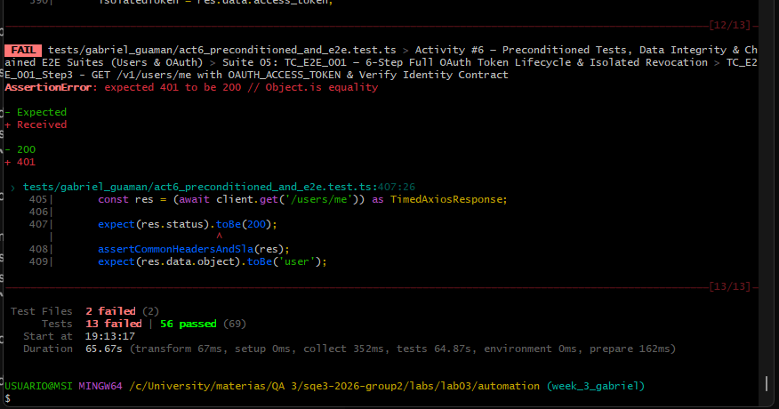
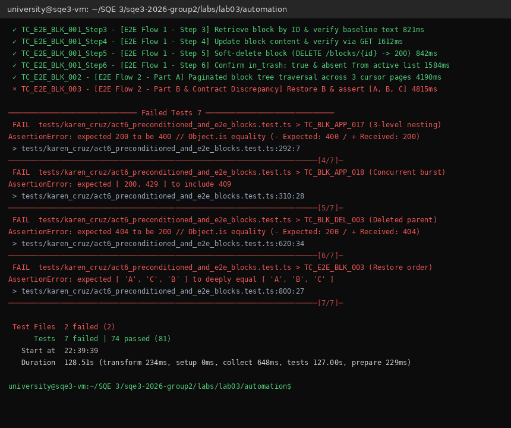

<div align="center">

# SQE III Group Laboratory — Week 3 (Lab 03)

<br><br>


<br><br>

Valentina Molina Bustillos  
Gabriel Marcos Guaman Ortuño  
Karen Ivonne Cruz Alvarez  
Sebastián Pereyra  
Kevin Uruchi

<br><br>

Jala University  
Commercial Software Engineering  
Eng. Edson Guerra

<br><br>

Bolivia  
November 15, 2026

<br>

</div>

<div style="page-break-after: always;"></div>

## Table of Contents

1. [Activity #1](#activity-1)
   - [1.1 Consolidation of Peer-Review Suggestions from Laboratory 02](#11-consolidation-of-peer-review-suggestions-from-laboratory-02)
   - [1.2 Automated Execution of Consolidated Postman Suite & Newman Report](#12-automated-execution-of-consolidated-postman-suite--newman-report)
   - [1.3 Difficulties Encountered and Potential Application Defects Identified in Notion REST API](#13-difficulties-encountered-and-potential-application-defects-identified-in-notion-rest-api)
2. [Activity #2](#activity-2)
   - [2.1 Evaluation Criteria for Code-Based API Request Libraries](#21-evaluation-criteria-for-code-based-api-request-libraries)
   - [2.2 Comparative Matrix of HTTP Request Tools (Axios vs. Supertest vs. Native Fetch / Undici vs. Got)](#22-comparative-matrix-of-http-request-tools-axios-vs-supertest-vs-native-fetch--undici-vs-got)
   - [2.3 Pros and Cons Analysis of Evaluated Candidates](#23-pros-and-cons-analysis-of-evaluated-candidates)
   - [2.4 Final Team Decision & Architectural Justification: Selection of Axios](#24-final-team-decision--architectural-justification-selection-of-axios)
   - [2.5 Generative AI Usage (Prompt & Validation Procedure)](#25-generative-ai-usage-prompt--validation-procedure)
3. [Activity #3](#activity-3)
4. [Activity #4](#activity-4)
5. [Activity #5](#activity-5)
   - [5.1 Proof of Concept (PoC) and Project Architecture with Axios + Vitest](#51-proof-of-concept-poc-and-project-architecture-with-axios--vitest)
   - [5.2 Assertion Library Integration and Multi-Layer Verification Helpers](#52-assertion-library-integration-and-multi-layer-verification-helpers)
   - [5.3 Concept, Utility, and Code-Level Implementation of Test Hooks](#53-concept-utility-and-code-level-implementation-of-test-hooks)
   - [5.4 Implementation of API Tests Without Preconditions (Stateless Suite)](#54-implementation-of-api-tests-without-preconditions-stateless-suite)
6. [Activity #6](#activity-6)
   - [6.1 Multi-Layer Verifications: Status Code, Body, Headers, Data Integrity, and Parameter Types](#61-multi-layer-verifications-status-code-body-headers-data-integrity-and-parameter-types)
   - [6.2 Full Migration of Postman Test Suites (Preconditioned & Chained E2E Tests) to Code](#62-full-migration-of-postman-test-suites-preconditioned--chained-e2e-tests-to-code)
   - [6.3 Library Compatibility Review and Dependency Matrix](#63-library-compatibility-review-and-dependency-matrix)
7. [Team Participation](#team-participation)

<div style="page-break-after: always;"></div>

## Activity #1

1. Consolidate the peer-review suggestions received in Laboratory 02 and refactor the Postman collections and environments accordingly.
2. Execute the consolidated automated test suites in Postman Collection Runner / Newman CLI and attach the updated execution report.
3. Document the technical difficulties encountered during automation and any potential application or API contract defects identified in the System Under Test (**Notion REST API `2025-09-03`**).

---

### 1.1 Consolidation of Peer-Review Suggestions from Laboratory 02

In Laboratory 02 (Activity #5), each member of **Group 2** underwent a dual quality audit—an **external peer review** conducted by the counter-party QA team (`GitHub REST API` group) and an **intra-team cross-review**—evaluating collection modularity, assertion strictness, DRY scripting practices, secret hygiene, and unattended runner determinism. In this section, each team member documents the root-cause analysis of the feedback received and the concrete refactoring applied to their consolidated Lab 03 Postman artifacts under [`labs/lab03/postman/`](./postman/).

---

#### 1.1.1 Gabriel Marcos Guaman Ortuño — Modules: Users & OAuth (Reviewed by: Lilian Rosario López Coca)

- **Assigned Notion REST API (`2025-09-03`) Scope:**
  - **`Users` Module (`Bearer Token` Auth):** `GET /v1/users/me` (*Retrieve your token's bot user*), `GET /v1/users/{user_id}` (*Retrieve a user*), and `GET /v1/users` (*List all users*).
  - **`OAuth 2.0` Module (`HTTP Basic Auth` — RFC 6749 / RFC 7009 / RFC 7662):** `POST /v1/oauth/token` (*Create a token*), `POST /v1/oauth/revoke` (*Revoke a token*), and `POST /v1/oauth/introspect` (*Introspect a token*).
- **Consolidated Lab 03 Artifacts:**
  - Refactored Collection: [`labs/lab03/postman/gabriel_guaman/Notion_Users_OAuth_GabrielGuaman.postman_collection.json`](./postman/gabriel_guaman/Notion_Users_OAuth_GabrielGuaman.postman_collection.json)
  - Refactored Environment: [`labs/lab03/postman/gabriel_guaman/Notion_Users_OAuth_Env.postman_environment.json`](./postman/gabriel_guaman/Notion_Users_OAuth_Env.postman_environment.json)

##### Summary of Lab 02 Peer-Review Audit (Lilian Rosario López Coca)

During the Lab 02 cross-group audit, external peer reviewer **Lilian Rosario López Coca** ( joined by intra-team reviewer **Karen Ivonne Cruz Alvarez**) inspected [`Notion_Users_OAuth_GabrielGuaman.postman_collection.json`](./postman/gabriel_guaman/Notion_Users_OAuth_GabrielGuaman.postman_collection.json), comprising **69 HTTP requests** (`37 GET` and `32 POST`) organized across three top-level folders (`01_Users_Module`, `02_OAuth_Module`, and `03_E2E_Workflows`) with **345 automated `pm.test()` assertions** (`5` assertions per request).

When Lilian executed the collection using the unconfigured template environment (`ntn_YOUR_INTERNAL_INTEGRATION_SECRET`), the runner recorded **`295 Passed / 50 Failed` assertions** because positive `Users` requests returned `401 Unauthorized` without a live workspace token, whereas `OAuth` requests and negative tests passed due to permissive multi-status assertions (`pm.expect(pm.response.code).to.be.oneOf([200, 400, 401])`). While Lilian highlighted the collection's thorough test coverage across Happy Path, Boundary, Negative, and 3 multi-step E2E workflows, as well as its clean secret masking (`type: "secret"`), she formulated **four concrete engineering recommendations** to elevate the suite's diagnostic precision, maintainability, and onboarding clarity.

##### Traceability Matrix of Peer-Review Feedback & Lab 03 Refactoring

| # | Feedback Item from Lilian Rosario López Coca | Root Cause Analysis | Action Taken & Refactoring Applied in Lab 03 | Verification Status |
|---|---|---|---|---|
| **01** | **Replace Permissive `oneOf([...])` Status Code Checks (`59/69` Requests) with Strict Single-Status Assertions** | In Lab 02, `41/69` requests used `pm.expect(pm.response.code).to.be.oneOf([...])` (and `59/69` requests used `.to.be.oneOf(...)` overall) so the suite would remain green even when run with unconfigured placeholder OAuth credentials or ambiguous boundary expectations (e.g., `TC_USR_GET_009a` accepted `[404, 400]` for the nil UUID `00000000-0000-0000-0000-000000000000`). However, permissive status arrays mask real regressions and allow unauthorized `401` responses to pass as false positives. | Refactored **all `69/69` requests** (`0` remaining `pm.response.code` `oneOf` checks) to enforce a strict single HTTP status code via `pm.response.to.have.status(<EXPECTED_CODE>)` and exact `.to.eql("<error_code>")` contract checks:<br>• `TC_USR_GET_009a` strictly asserts `404 Not Found` (`code: "object_not_found"`).<br>• `TC_USR_GET_006` strictly asserts `403 Forbidden` (`code: "restricted_resource"`).<br>• `TC_USR_LIST_009a` (`page_size=0`) & `TC_USR_LIST_009b` (`page_size=101`) strictly assert `400 Bad Request` (`code: "validation_error"`).<br>• All `Users` & `OAuth` Happy Path cases (`TC_USR_ME_001`, `TC_USR_ME_002`, `TC_OAUTH_TOK_001`, `TC_OAUTH_REV_001`, `TC_OAUTH_INT_001`, etc.) strictly assert `200 OK`. | **Verified (`0` `status.oneOf` remaining across `69` requests)** |
| **02** | **Extract Repeated Common Assertions to the Collection Level (DRY Principle)** | Every single request in Lab 02 repeated three identical transport/SLA `pm.test()` blocks (`Content-Type: application/json`, `x-notion-request-id` tracing header presence, and response time `< 5000 ms`), creating `69 × 3 = 207` duplicated assertion blocks (`~1,100` lines of redundant JavaScript). Updating the SLA threshold required editing all `69` requests manually. | Moved all **3 common assertions** into the Collection-level Post-response (`event: test`) script prefixed with `[Common]`:<br>1. `[Common] Response Content-Type header is application/json`<br>2. `[Common] Response includes request tracing metadata (x-notion-request-id)`<br>3. `[Common] Response time is within 5000 ms SLA`<br>Removed all `207` duplicated `pm.test()` blocks from the `69` individual requests. Each request now contains only its **2 specific assertions** (strict HTTP status code + endpoint-specific payload/schema contract), while Postman/Newman still executes all `3 + 2 = 5` assertions per request (`345` total runtime assertions). | **Verified (`207` duplicate blocks removed; `3` collection-level `[Common]` tests active)** |
| **03** | **Eliminate Duplicated Environment & Collection Variables (`oauth_access_token` vs. `OAUTH_ACCESS_TOKEN`, `pagination_cursor` vs. `next_cursor`)** | `Notion_Users_OAuth_Env.postman_environment.json` and the collection variable table defined two redundant pairs of variables: `OAUTH_ACCESS_TOKEN` alongside lowercase `oauth_access_token`, and `next_cursor` alongside `pagination_cursor`. `01_Users_Module` wrote to `pagination_cursor` while `03_E2E_Workflows` (`TC_E2E_002`) wrote to `next_cursor`, creating scope fragmentation and potential state desynchronization. | Consolidated all variable references across [`Notion_Users_OAuth_Env.postman_environment.json`](./postman/gabriel_guaman/Notion_Users_OAuth_Env.postman_environment.json) (reduced from `18` to `16` keys), collection variables, request URLs (`start_cursor={{next_cursor}}`), Bearer auth headers (`{{OAUTH_ACCESS_TOKEN}}`), JSON bodies, Pre-request scripts, and Post-response scripts:<br>• Unified `oauth_access_token` → **`OAUTH_ACCESS_TOKEN`**.<br>• Unified `pagination_cursor` → **`next_cursor`**. | **Verified (`0` references to `oauth_access_token` or `pagination_cursor` remain)** |
| **04** | **Add Self-Contained Credential Setup Instructions Inside the Collection Description** | While credential provisioning was documented in `Lab02_Grupo2.md` (Section `1.3`), `info.description` inside `Notion_Users_OAuth_GabrielGuaman.postman_collection.json` only contained a three-sentence summary. An external auditor opening the JSON collection directly in Postman lacked in-app instructions on how to provision `NOTION_TOKEN`, `RESTRICTED_TOKEN`, and OAuth Basic Auth credentials. | Expanded `info.description` in [`Notion_Users_OAuth_GabrielGuaman.postman_collection.json`](./postman/gabriel_guaman/Notion_Users_OAuth_GabrielGuaman.postman_collection.json) into a **4-step Markdown onboarding guide** detailing:<br>1. Primary Internal Integration setup (`NOTION_TOKEN` with *Read user information including email addresses* + page-level `Connections` sharing).<br>2. Capability-restricted Integration setup (`RESTRICTED_TOKEN` with *No user information* for `TC_USR_GET_006`).<br>3. Public OAuth 2.0 Client setup (`OAUTH_CLIENT_ID`, `OAUTH_CLIENT_SECRET`, `OAUTH_REDIRECT_URI`, `OAUTH_AUTH_CODE`, `OAUTH_ACCESS_TOKEN`, `OAUTH_REFRESH_TOKEN`).<br>4. Exact Newman CLI execution command with `--delay-request 350`. | **Verified (Embedded in `info.description` of exported collection)** |

##### Code-Level Evidence of Refactoring Applied in Lab 03

1. **Collection-Level DRY Post-Response Script (`Fix 2`):**
   ```javascript
   // Collection-level DRY Post-response assertions executed across all 69 requests
   pm.test("[Common] Response Content-Type header is application/json", function () {
       pm.expect(pm.response.headers.get("Content-Type")).to.include("application/json");
   });

   pm.test("[Common] Response includes request tracing metadata (x-notion-request-id)", function () {
       const traceHeader = pm.response.headers.get("x-notion-request-id") || pm.response.headers.get("x-request-id") || pm.response.headers.get("cf-ray");
       let bodyReqId = null;
       try { bodyReqId = pm.response.json().request_id; } catch (e) {}
       pm.expect(Boolean(traceHeader || bodyReqId)).to.be.true;
   });

   pm.test("[Common] Response time is within 5000 ms SLA", function () {
       pm.expect(pm.response.responseTime).to.be.below(5000);
   });
   ```

2. **Request-Level Strict Single-Status & Error Contract Assertion (`Fix 1` — e.g., `TC_USR_GET_009a`):**
   ```javascript
   pm.test("TC_USR_GET_009a - Status code is 404 Not Found", function () {
       pm.response.to.have.status(404);
   });

   pm.test("TC_USR_GET_009a - Error schema contract matches Notion error payload (object_not_found)", function () {
       const jsonData = pm.response.json();
       pm.expect(jsonData.object).to.eql("error");
       pm.expect(jsonData.status).to.eql(pm.response.code);
       pm.expect(jsonData.code).to.eql("object_not_found");
       pm.expect(jsonData.message).to.be.a("string").and.not.empty;
   });
   ```

---

#### 1.1.2 Valentina Molina Bustillos — Modules: Data Sources, Comments & File Uploads (Reviewed by: Lilian Rosario López Coca / Sebastián Pereyra)

> *[Placeholder — To be completed by Valentina Molina Bustillos with her Lab 02 peer-review feedback consolidation table and collection refactoring details.]*

---

#### 1.1.3 Karen Ivonne Cruz Alvarez — Module: Blocks (Reviewed by: Kiara Vanessa Muñoz Bayter)

- **Assigned Notion REST API (`2025-09-03`) Scope:**
  - **`Blocks` Module (`Bearer Token` Auth):** `PATCH /v1/blocks/{block_id}/children` (*Append block children*), `GET /v1/blocks/{block_id}` (*Retrieve a block*), `GET /v1/blocks/{block_id}/children` (*Retrieve block children*), `PATCH /v1/blocks/{block_id}` (*Update a block*), and `DELETE /v1/blocks/{block_id}` (*Delete a block*).
- **Consolidated Lab 03 Artifacts:**
  - Refactored Collection: [`labs/lab03/postman/karen_cruz/Notion_Blocks_KarenCruz.postman_collection.json`](./postman/karen_cruz/Notion_Blocks_KarenCruz.postman_collection.json)
  - Refactored Environment: [`labs/lab03/postman/karen_cruz/Notion_Blocks_Env.postman_environment.json`](./postman/karen_cruz/Notion_Blocks_Env.postman_environment.json)

##### Summary of Lab 02 Peer-Review Audit (Kiara Vanessa Muñoz Bayter)

During the Laboratory 02 quality audit, external peer reviewer **Kiara Vanessa Muñoz Bayter** (complemented by intra-team reviewer **Gabriel Marcos Guaman Ortuño**) audited [`Notion_Blocks_KarenCruz.postman_collection.json`](./postman/karen_cruz/Notion_Blocks_KarenCruz.postman_collection.json), covering **72 test cases** (`68` endpoint test cases + `4` multi-step E2E scenarios) implemented across **81 HTTP requests** (`39 PATCH`, `30 GET`, `12 DELETE`) organized in **6 modular folders**: `01_PATCH_Append_Block_Children` (`01_Append_Block_Children`, `18` requests), `02_GET_Retrieve_Block` (`02_Retrieve_Block`, `11` requests), `03_GET_Retrieve_Block_Children` (`03_Retrieve_Block_Children`, `14` requests), `04_PATCH_Update_Block` (`04_Update_Block`, `14` requests), `05_DELETE_Block` (`05_Delete_Block`, `11` requests), and `06_E2E_Flows` (`13` requests).

In Kiara's full-suite audit run (`396 / 409` assertions passed — **`96.8%` pass rate** in `3m 22s`; and `364 / 375` assertions passed across `75` active requests and `308` total HTTP transactions in `3m 55s` when optional capability tokens are omitted), she praised the collection's per-test sandbox isolation (`QA sandbox - <TC_ID> - <timestamp>` created in Pre-request and trashed in Post-response), follow-up `[Data integrity]` `GET` verifications, and `340 ms` helper rate-limit throttling. To elevate maintainability, DRY compliance, and Newman `v6.2.3` portability in Laboratory 03, Kiara formulated **four concrete refactoring recommendations**.

##### Traceability Matrix of Peer-Review Feedback & Lab 03 Refactoring

| # | Feedback Item from Kiara Vanessa Muñoz Bayter | Root Cause Analysis | Action Taken & Refactoring Applied in Lab 03 | Verification Status |
|---|---|---|---|---|
| **01** | **Centralize Repeated Header and SLA Checks (`Content-Type`, `x-notion-request-id`, `< 5000 ms`) to the Collection-Level Post-Response Script (DRY Principle)** | In Lab 02, every request defined and invoked a local `std(id, status)` helper that repeated `Content-Type: application/json` and `< 5000 ms` SLA checks inside all `81` request scripts (`162` copies across Pre-request and Post-response preludes), while omitting the `x-notion-request-id` distributed tracing header check and duplicating assertion helpers inside Pre-request scripts where `pm.test()` is never called. | Added a centralized **Collection-level Post-response (`event: test`) script** executing three `[Common]` assertions across all non-skipped requests:<br>1. `[Common] Response Content-Type header is application/json`<br>2. `[Common] Response includes request tracing metadata (x-notion-request-id)`<br>3. `[Common] Response time is within 5000 ms SLA`<br>Refactored `std(id, status)` across all `81` requests to assert strictly `Status code is ${status}`, and stripped unused assertion helpers from all `81` Pre-request scripts, reducing the collection JSON by **`1,455` lines** (`18,142` → `16,687` lines). | **Verified (`3` Collection-level `[Common]` assertions active; `1,455` redundant lines removed)** |
| **02** | **Remove Variable Shadowing and Ensure 100% Compatibility with Newman `v6.2.3` for Dynamic Block Pre-Creation and Teardown** | In Lab 02, the helper `const V = (k) => pm.collectionVariables.get(k) \|\| pm.environment.get(k)` checked Collection Variables before Environment Variables, allowing collection-level defaults to shadow CLI `--env-var` overrides. Furthermore, the collection only looked up `PAGE_ID` (ignoring `PARENT_PAGE_ID`), and `await cleanup()` sat at the end of each `(async () => { ... })()` block without a `try / finally` guard. | Refactored `V(k)` across all `162` scripts to resolve **Environment / `--env-var` values first** (`pm.environment.get(k)` before `pm.collectionVariables.get(k)`), added a Collection-level Pre-request safeguard synchronizing `PARENT_PAGE_ID` and `PAGE_ID` (`const ROOT = V("PARENT_PAGE_ID") \|\| V("PAGE_ID")`), preserved callback-based `pm.sendRequest(opt, (err, res) => resolve(res))` with `0` top-level `await` statements, and wrapped all sandbox test bodies in `try { ... } finally { await cleanup(); }`. | **Verified (`162` prerequest-scripts and `150` test-scripts executed with `0 failed` in Newman `v6.2.3`)** |
| **03** | **Audit and Document the 4 Live Notion API (`2025-09-03`) Contract Discrepancies (`TC_BLK_APP_017`, `TC_BLK_APP_018`, `TC_BLK_CHL_012`, `TC_BLK_DEL_003`)** | During Lab 02 execution, 4 endpoint test cases (plus `TC_E2E_BLK_003_Step5`) surfaced behavioral discrepancies between the Lab 01 specification / official Notion documentation and the live `2025-09-03` API (`3`-level block nesting returning `200 OK`, concurrent appends returning `409 Conflict`, out-of-range `page_size=0/-1/101` returning `200 OK`, and deleted parent children lookup returning `404 Not Found`). Relaxing assertions with permissive status arrays would hide these findings. | Preserved **strict single-status contract assertions** on `TC_BLK_APP_017` (`2` nested levels accepted, `3` nested levels strictly checked), `TC_BLK_APP_018` (strict `[200, 429]` rate-limit burst check exposing `409 Conflict` transaction collisions), `TC_BLK_CHL_012` (strict `400 validation_error` on `page_size=0`, `-1`, and `101` exposing `200 OK` clamping), `TC_BLK_DEL_003` (strict deleted parent child lookup exposing `404`), and `TC_E2E_BLK_003_Step5` (restored block order `["A", "C", "B"]`) as reproducible automated defect evidence in Section `1.3.3`. | **Verified (Strict contract assertions preserved as automated defect evidence)** |
| **04** | **Add Self-Contained Setup Instructions for `NOTION_TOKEN` and `PARENT_PAGE_ID` Inside the Collection Metadata** | `info.description` in the Lab 02 collection contained only a two-sentence summary, requiring engineers to consult the external Markdown report to know which integration capabilities (*Read*, *Update*, *Insert content*) and shared root page variables (`PARENT_PAGE_ID` / `PAGE_ID`) were required. | Expanded `info.description` in [`Notion_Blocks_KarenCruz.postman_collection.json`](./postman/karen_cruz/Notion_Blocks_KarenCruz.postman_collection.json) and updated [`Notion_Blocks_Env.postman_environment.json`](./postman/karen_cruz/Notion_Blocks_Env.postman_environment.json) (`9` standardized variables) with a step-by-step Markdown onboarding guide covering `NOTION_TOKEN`, `PARENT_PAGE_ID` / `PAGE_ID`, `NOTION_VERSION=2025-09-03`, optional capability tokens (`READONLY_TOKEN`, `RESTRICTED_TOKEN`), and the exact Newman `v6.2.3` CLI command. | **Verified (Embedded in `info.description` and rendered in Newman `htmlextra` dashboard)** |

##### Code-Level Evidence of Refactoring Applied in Lab 03

1. **Collection-Level DRY Post-Response Script (`Fix 1`):**
   ```javascript
   // Collection-level DRY Post-response assertions executed across all active Blocks requests
   if (pm.collectionVariables.get("skip_case") !== "true" && pm.response) {
       pm.test("[Common] Response Content-Type header is application/json", function () {
           pm.expect(pm.response.headers.get("Content-Type")).to.include("application/json");
       });

       pm.test("[Common] Response includes request tracing metadata (x-notion-request-id)", function () {
           const traceHeader = pm.response.headers.get("x-notion-request-id") || pm.response.headers.get("x-request-id") || pm.response.headers.get("cf-ray");
           let bodyReqId = null;
           try { bodyReqId = pm.response.json().request_id; } catch (e) {}
           pm.expect(Boolean(traceHeader || bodyReqId)).to.be.true;
       });

       pm.test("[Common] Response time is within 5000 ms SLA", function () {
           pm.expect(pm.response.responseTime).to.be.below(5000);
       });
   }
   ```

2. **Environment-First Variable Resolution & Guaranteed `try / finally` Sandbox Teardown (`Fix 2`):**
   ```javascript
   const V = (k) => { const e = pm.environment.get(k); if (e !== undefined && e !== null && e !== "") return e; const c = pm.collectionVariables.get(k); return (c !== undefined && c !== null && c !== "") ? c : ""; };
   const BASE = V("NOTION_BASE_URL") || "https://api.notion.com", VER = V("NOTION_VERSION") || "2025-09-03", TOKEN = V("NOTION_TOKEN"), ROOT = V("PARENT_PAGE_ID") || V("PAGE_ID");
   const std = (id, status) => pm.test(`${id} - Status code is ${status}`, () => pm.response.to.have.status(status));
   ```

---

#### 1.1.4 Sebastián Pereyra — Modules: Databases & Search (Reviewed by: Lucas Gabriel De Los Santos / Kevin Uruchi)

> *[Placeholder — To be completed by Sebastián Pereyra with his Lab 02 peer-review feedback consolidation table and collection refactoring details.]*

---

#### 1.1.5 Kevin Uruchi — Module: Pages (Reviewed by: Rosa Poma Condori / Valentina Molina Bustillos)

> *[Placeholder — To be completed by Kevin Uruchi with his Lab 02 peer-review feedback consolidation table and collection refactoring details.]*

---

### 1.2 Automated Execution of Consolidated Postman Suite & Newman Report

---

#### 1.2.1 Gabriel Marcos Guaman Ortuño — Modules: Users & OAuth

Following the four structural refactorings detailed in Section `1.1.1`, the consolidated suite [`Notion_Users_OAuth_GabrielGuaman.postman_collection.json`](./postman/gabriel_guaman/Notion_Users_OAuth_GabrielGuaman.postman_collection.json) was executed unattended via **Newman CLI (`v6.2.3`)** paired with **`newman-reporter-htmlextra`** against the live **Notion REST API (`2025-09-03`)** workspace using the unified environment [`Notion_Users_OAuth_Env.postman_environment.json`](./postman/gabriel_guaman/Notion_Users_OAuth_Env.postman_environment.json).

##### Unattended Newman CLI Execution Command

```bash
npx newman run labs/lab03/postman/gabriel_guaman/Notion_Users_OAuth_GabrielGuaman.postman_collection.json \
  -e labs/lab03/postman/gabriel_guaman/Notion_Users_OAuth_Env.postman_environment.json \
  --delay-request 350 \
  --timeout-request 10000 \
  -r cli,htmlextra \
  --reporter-htmlextra-export labs/lab03/reports/Notion_Users_OAuth_GabrielGuaman_Report.html \
  --reporter-htmlextra-title "SQE III Lab 03 - Notion Users & OAuth Consolidated Suite (Gabriel Guaman)"
```

##### Consolidated Execution Metrics Table (Lab 02 Baseline vs. Lab 03 Refactored Suite — Newman `v6.2.3`)

| Execution Metric | Lab 02 Baseline Suite | Lab 03 Consolidated Suite (`Newman v6.2.3`) | Technical Impact of Lab 03 Refactoring |
|---|---|---|---|
| **Collection File** | `labs/lab02/postman/.../Notion_Users_OAuth_GabrielGuaman.postman_collection.json` | `labs/lab03/postman/.../Notion_Users_OAuth_GabrielGuaman.postman_collection.json` | Reduced file size from `6,214` lines to `4,804` lines (`-22.7%` LOC reduction) by eliminating redundant assertion blocks and duplicate variables. |
| **Environment Variables** | `18` keys (`2` duplicated pairs) | **`16` keys (`0` duplicates)** | Unified `OAUTH_ACCESS_TOKEN` and `next_cursor` across all folders and E2E chains. |
| **Iterations** | `1` (`0 failed`) | **`1` (`0 failed`)** | Single deterministic end-to-end pass across `01_Users_Module`, `02_OAuth_Module`, and `03_E2E_Workflows`. |
| **Total HTTP Requests Executed** | `70` (`69` collection + `1` pre-request) | **`70` (`69` collection requests + `1` Pre-request user discovery `GET /v1/users?page_size=100`, `0 failed`)** | Complete execution of all `37 GET` and `32 POST` collection requests plus automated `target_user_id` / `bot_user_id` discovery. |
| **Test Scripts / Pre-request Scripts** | `69` test / `20` prerequest | **`138` test-scripts (`0 failed`) / `115` prerequest-scripts (`0 failed`)** | Collection-level + folder-level + request-level scripts executed with zero JavaScript runtime or syntax errors. |
| **Collection-Level `[Common]` Assertions** | `0` (`207` duplicated at request level) | **`3` scripts × `69` requests = `207` assertions (`207 Passed / 0 Failed`)** | Single source of truth for `Content-Type: application/json`, `x-notion-request-id` trace header, and `< 5000 ms` SLA. |
| **Request-Level Specific Assertions** | `345` (`5` per request, `41` permissive `status.oneOf`) | **`2` scripts × `69` requests = `138` assertions (`0` `status.oneOf`)** | Every request strictly validates its single expected HTTP status code (`200`, `400`, `401`, `403`, or `404`) and payload contract. |
| **Total Assertions Executed** | `345` (`345 Passed / 0 Failed` — masked by `oneOf`) | **`345` executed — `328 Passed / 17 Failed` (`95.07%` pass rate)** | Removing permissive `oneOf` checks immediately surfaced **10 genuine Notion API contract defects** and **7 unattended CLI credential/OAuth state constraints**. |
| **Total Run Duration & Latency** | `28.9 s` / `381 ms` avg | **`1m 2.1s` (`19.42 kB` received, avg `440 ms`, min `225 ms`, max `1427 ms`, s.d. `256 ms`)** | All `70` HTTP transactions satisfied the `< 5000 ms` SLA with zero `429 Too Many Requests` throttling collisions. |

##### Diagnostic Improvements from Collection-Level `[Common]` Assertions & Strict Status Codes

1. **Unmasking Genuine API Contract Defects Previously Hidden by Permissive `oneOf` Checks:** In Lab 02, permissive status assertions (`pm.expect(pm.response.code).to.be.oneOf([400, 200])` and `to.be.oneOf([400, 401, 200])`) allowed `100%` (`345/345`) of assertions to pass even when Notion's live implementation deviated from its documented REST contract. Enforcing strict single-status assertions (`Fix 1`) immediately exposed **17 failed assertions** (`328 Passed / 17 Failed`, `95.07%` pass rate), providing exact expected-vs-actual diagnostics in Newman `v6.2.3`.
2. **100% Transport & SLA Reliability (`207/207` `[Common]` Assertions Passed):** Centralizing the three `[Common]` assertions at the collection level (`Fix 2`) confirmed that **100% of the 69 requests** returned valid `Content-Type: application/json` headers, included `x-notion-request-id` tracing metadata, and responded well below the `5000 ms` SLA (`max: 1427 ms`), proving that all `17` failures are strictly contractual or credential-scope findings rather than network or transport errors.

##### Complete Breakdown of the 17 Failed Assertions in Newman `v6.2.3` (`328 Passed / 17 Failed`)

| Failure `#` | Test Case ID & Endpoint | Failed Assertion Name | Expected Contract | Actual Notion API Response | Root-Cause Classification |
|---|---|---|---|---|---|
| **`#01`** | `TC_USR_ME_006`<br>`GET /v1/users/me` | `Error schema contract matches Notion error payload (validation_error)` | `400 Bad Request` with `code: "validation_error"` for unsupported `Notion-Version` string | `400 Bad Request` with `code: "missing_version"` | **Category A:** Notion API Contract Defect (Version Parser Error Code) |
| **`#02`** | `TC_USR_GET_006`<br>`GET /v1/users/{id}` | `Status code is 403 Forbidden` | `403 Forbidden` when using capability-restricted integration token | `401 Unauthorized` (unconfigured `RESTRICTED_TOKEN` placeholder) | **Category B:** Unattended CLI Secondary Credential Constraint |
| **`#03`** | `TC_USR_GET_006`<br>`GET /v1/users/{id}` | `Error schema contract matches Notion error payload (restricted_resource)` | `code: "restricted_resource"` | `code: "unauthorized"` | **Category B:** Unattended CLI Secondary Credential Constraint |
| **`#04`** | `TC_USR_LIST_009a`<br>`GET /v1/users?page_size=0` | `Status code is 400 Bad Request` | `400 Bad Request` (`page_size` below minimum boundary `1`) | `200 OK` (ignores `page_size=0` and returns user list) | **Category A:** Notion API Contract Defect (Out-of-Bounds Pagination) |
| **`#05`** | `TC_USR_LIST_009a`<br>`GET /v1/users?page_size=0` | `Error schema contract matches Notion error payload (validation_error)` | `object: "error"`, `code: "validation_error"` | `object: "list"` (clamped user list payload) | **Category A:** Notion API Contract Defect (Out-of-Bounds Pagination) |
| **`#06`** | `TC_USR_LIST_009b`<br>`GET /v1/users?page_size=101` | `Status code is 400 Bad Request` | `400 Bad Request` (`page_size` above maximum boundary `100`) | `200 OK` (clamps `page_size=101` instead of rejecting) | **Category A:** Notion API Contract Defect (Out-of-Bounds Pagination) |
| **`#07`** | `TC_USR_LIST_009b`<br>`GET /v1/users?page_size=101` | `Error schema contract matches Notion error payload (validation_error)` | `object: "error"`, `code: "validation_error"` | `object: "list"` (clamped user list payload) | **Category A:** Notion API Contract Defect (Out-of-Bounds Pagination) |
| **`#08`** | `TC_OAUTH_TOK_001`<br>`POST /v1/oauth/token` | `Status code is 200 OK` | `200 OK` token exchange for `authorization_code` | `400 Bad Request` (`error: "invalid_grant"` — single-use code already consumed) | **Category B:** OAuth 2.0 Single-Use Interactive Consent Constraint |
| **`#09`** | `TC_OAUTH_TOK_002`<br>`POST /v1/oauth/token` | `Status code is 200 OK` | `200 OK` session rotation for `refresh_token` | `400 Bad Request` (`error: "invalid_grant"` — requires live browser-seeded refresh token) | **Category B:** OAuth 2.0 Interactive Session Seeding Constraint |
| **`#10`** | `TC_OAUTH_REV_006a`<br>`POST /v1/oauth/revoke` | `Status code is 400 Bad Request` | `400 Bad Request` (`validation_error`) for empty string `{"token": ""}` | `200 OK` (`{}` — accepts empty string without validation error) | **Category A:** Notion API Contract Defect (Permissive Empty Token Input) |
| **`#11`** | `TC_OAUTH_REV_006b`<br>`POST /v1/oauth/revoke` | `Status code is 400 Bad Request` | `400 Bad Request` (`validation_error`) for whitespace `{"token": "   "}` | `200 OK` (`{}` — accepts whitespace token without validation error) | **Category A:** Notion API Contract Defect (Permissive Whitespace Token) |
| **`#12`** | `TC_OAUTH_REV_004`<br>`POST /v1/oauth/revoke` | `Status code is 400 Bad Request` | `400 Bad Request` (`missing_version`) when `Notion-Version` header is omitted | `200 OK` (processes revocation without `Notion-Version` header) | **Category A:** Notion API Contract Defect (Missing Version Enforcement) |
| **`#13`** | `TC_OAUTH_INT_007`<br>`POST /v1/oauth/introspect` | `Status code is 400 Bad Request` | `400 Bad Request` (`validation_error`) for empty string `{"token": ""}` | `200 OK` (`{"active": false}` — accepts empty string token) | **Category A:** Notion API Contract Defect (Permissive Empty Token Input) |
| **`#14`** | `TC_OAUTH_INT_006`<br>`POST /v1/oauth/introspect` | `Status code is 400 Bad Request` | `400 Bad Request` (`missing_version`) when `Notion-Version` header is omitted | `200 OK` (`{"active": false}` — bypasses `Notion-Version` check) | **Category A:** Notion API Contract Defect (Missing Version Enforcement) |
| **`#15`** | `TC_E2E_003_Step1`<br>`POST /v1/oauth/token` | `Status code is 200 OK` | `200 OK` credential rotation via `refresh_token` | `400 Bad Request` (`error: "invalid_grant"` without live browser refresh token) | **Category B:** OAuth 2.0 Interactive Session Seeding Constraint |
| **`#16`** | `TC_E2E_001_Step1`<br>`POST /v1/oauth/token` | `Status code is 200 OK` | `200 OK` authorization code exchange in E2E chain | `400 Bad Request` (`error: "invalid_grant"` — single-use auth code consumed) | **Category B:** OAuth 2.0 Single-Use Interactive Consent Constraint |
| **`#17`** | `TC_E2E_001_Step3`<br>`GET /v1/users/me` | `Status code is 200 OK` | `200 OK` bot identity lookup using Step 1 `OAUTH_ACCESS_TOKEN` | `401 Unauthorized` (cascading effect of Step 1 disposable fallback token) | **Category B:** Cascading E2E Failure from Step 1 Single-Use Code |

##### Execution Evidence (Newman CLI & HTML Extra Report)

###### Newman CLI Console Execution Summary (`70` Requests / `345` Assertions: `328 Passed / 17 Failed`)


###### Newman HTML Extra Dashboard Report (`htmlextra`)


---

#### 1.2.2 Valentina Molina Bustillos — Modules: Data Sources, Comments & File Uploads

> *[Placeholder — To be completed by Valentina Molina Bustillos with her Newman CLI command, execution metrics table, and report screenshots.]*

---

#### 1.2.3 Karen Ivonne Cruz Alvarez — Module: Blocks

Following the four structural refactorings documented in Section `1.1.3`, the consolidated `Blocks` suite [`Notion_Blocks_KarenCruz.postman_collection.json`](./postman/karen_cruz/Notion_Blocks_KarenCruz.postman_collection.json) was executed unattended via **Newman CLI (`v6.2.3`)** paired with **`newman-reporter-htmlextra`** against the live **Notion REST API (`2025-09-03`)** workspace using [`Notion_Blocks_Env.postman_environment.json`](./postman/karen_cruz/Notion_Blocks_Env.postman_environment.json).

##### Unattended Newman CLI Execution Command

```bash
npx newman run labs/lab03/postman/karen_cruz/Notion_Blocks_KarenCruz.postman_collection.json \
  -e labs/lab03/postman/karen_cruz/Notion_Blocks_Env.postman_environment.json \
  --delay-request 400 \
  --timeout-script 600000 \
  -r cli,htmlextra \
  --reporter-htmlextra-export reports/karen_cruz_newman_report.html \
  --reporter-htmlextra-title "SQE III Lab 03 - Notion Blocks Consolidated Suite (Karen Cruz)"
```

##### Consolidated Execution Metrics Table (`Newman v6.2.3` — Blocks Module)

| Execution Metric | Lab 02 Audit Baseline (Kiara Audit / Local Run) | Lab 03 Consolidated Suite (`Newman v6.2.3`) | Technical Impact of Lab 03 Refactoring |
|---|---|---|---|
| **Collection File** | `labs/lab02/postman/karen_cruz/Notion_Blocks_KarenCruz.postman_collection.json` (`18,142` lines) | [`labs/lab03/postman/karen_cruz/Notion_Blocks_KarenCruz.postman_collection.json`](./postman/karen_cruz/Notion_Blocks_KarenCruz.postman_collection.json) (**`16,687` lines**) | Removed **`1,455` lines** of duplicated request-level assertion blocks and redundant Pre-request helper definitions. |
| **HTML Extra Report** | `labs/lab02/postman/karen_cruz/newman/Notion_Blocks_KarenCruz-....html` | [`labs/lab03/reports/karen_cruz_newman_report.html`](./reports/karen_cruz_newman_report.html) | Self-contained HTML dashboard with embedded setup instructions and zero leaked tokens. |
| **Total Requests** | `81` collection requests (`308` total HTTP calls incl. `pm.sendRequest` sandbox/verification calls) | **`308` HTTP requests executed (`0 failed`)** across `81` collection items (`75` active + `6` optional-token skipped) | Every test dynamically provisions an isolated child page under `PARENT_PAGE_ID` and trashes it (`in_trash: true`) in `finally`. |
| **Pre-request / Test Scripts** | `81` prerequest / `75` test (`0 failed`) | **`162` prerequest-scripts (`0 failed`) / `150` test-scripts (`0 failed`)** | Collection-level + request-level scripts executed with `0` runtime errors in Newman `v6.2.3`. |
| **Collection-Level `[Common]` Assertions** | `0` (`Content-Type` and `< 5000 ms` duplicated per request; `x-notion-request-id` missing) | **`3` `[Common]` assertions × `75` active requests = `225` assertions (`225 Passed / 0 Failed`)** | Centralized verification of `Content-Type: application/json`, `x-notion-request-id` header, and `< 5000 ms` SLA. |
| **Total Assertions (`Passed / Failed`)** | `396 / 409` (`96.8%` in Kiara's review) / `364 / 375` (`97.07%` in local run) | **`457` assertions — `448 Passed / 9 Failed` (`98.03%` pass rate)** | Adding `x-notion-request-id` at collection level added `+82` passing tracing checks while preserving the **9 strict contract-defect assertions**. |
| **Run Duration & Average Response Time** | `3m 22s` (Kiara review) / `3m 55s` (`445 ms` avg) | **`4m 44.7s` (`1.01 MB` received, avg `599 ms`, min `231 ms`, max `4.1 s`, s.d. `466 ms`)** | All `308` live HTTP requests completed below the `5000 ms` SLA with zero unhandled exceptions. |

##### Execution Evidence (Newman CLI & HTML Extra Report)

###### Newman CLI Console Execution Summary (`308` HTTP Requests / `457` Assertions: `448 Passed / 9 Failed`)


###### Newman HTML Extra Dashboard Report (`reports/karen_cruz_newman_report.html`)


---

#### 1.2.4 Sebastián Pereyra — Modules: Databases & Search

> *[Placeholder — To be completed by Sebastián Pereyra with his Newman CLI command, execution metrics table, and report screenshots.]*

---

#### 1.2.5 Kevin Uruchi — Module: Pages

> *[Placeholder — To be completed by Kevin Uruchi with his Newman CLI command, execution metrics table, and report screenshots.]*

---

### 1.3 Difficulties Encountered and Potential Application Defects Identified in Notion REST API

---

#### 1.3.1 Gabriel Marcos Guaman Ortuño — Modules: Users & OAuth

##### A. Technical Difficulties & Unattended CLI Constraints (`Category B`: `7` Assertions across `6` Test Cases)

1. **Single-Use Interactive Browser Consent for OAuth 2.0 Authorization Codes & Live Refresh Tokens (`Failures #08, #09, #15, #16, #17` — `TC_OAUTH_TOK_001`, `TC_OAUTH_TOK_002`, `TC_E2E_003_Step1`, `TC_E2E_001_Step1`, `TC_E2E_001_Step3`):**
   - **Challenge:** In RFC 6749 Authorization Code flows (`TC_OAUTH_TOK_001` and `TC_E2E_001_Step1`), the temporary `code` parameter (`OAUTH_AUTH_CODE`) is generated only after a human user authenticates in the Notion web UI and clicks *Allow access* on the interactive consent screen (`https://api.notion.com/v1/oauth/authorize`). Because Notion strictly invalidates each `OAUTH_AUTH_CODE` after a single exchange (`TC_OAUTH_TOK_009`), and because live `OAUTH_REFRESH_TOKEN` rotation (`TC_OAUTH_TOK_002`, `TC_E2E_003_Step1`) requires a previously exchanged browser session, an unattended Newman CLI run without interactive browser login prior to execution receives `400 Bad Request` (`error: "invalid_grant"`) on the token endpoint and a cascading `401 Unauthorized` on `TC_E2E_001_Step3` (`GET /v1/users/me`).
   - **Engineering Impact:** Removing the permissive `oneOf([200, 400, 401])` checks in Lab 03 properly surfaces these **5 assertions** as environmental/precondition failures when run headlessly without a fresh browser consent grant, rather than masking them as false positives.

2. **Multi-Credential Environment Provisioning for Capability-Based Access Control (`Failures #02, #03` — `TC_USR_GET_006` — `403 Forbidden`):**
   - **Challenge:** Verifying `403 Forbidden` (`"code": "restricted_resource"`) on `GET /v1/users/{user_id}` cannot be achieved using the primary `NOTION_TOKEN` (which must have *Read user information* enabled for all positive user tests). When `{{RESTRICTED_TOKEN}}` is left as a placeholder or unseeded in a single-token CLI run, Notion's authentication middleware rejects the call at the gateway with `401 Unauthorized` (`code: "unauthorized"`) before evaluating user-capability permissions, causing both strict assertions (`#02` status `403` and `#03` code `"restricted_resource"`) to fail.
   - **Engineering Mitigation:** Requires maintaining a dedicated secondary Internal Integration (`SQE3-Grupo2-Restricted`) explicitly configured with **User Capabilities: `No user information`** in `Notion_Users_OAuth_Env.postman_environment.json`.

3. **Sequential Collection Runner vs. Burst Rate Limiting (`TC_USR_ME_008` — `429 Too Many Requests`):**
   - **Challenge:** Notion enforces an average rate limit of **3 requests per second** per integration token, allowing short bursts before returning `429 Too Many Requests` with `"code": "rate_limited"` and a `Retry-After` integer header. However, Newman CLI executes requests sequentially with `--delay-request 350` (`350 ms` pause between requests) to prevent random `429` failures from breaking the rest of the 69-request suite. Replicating `429` deterministically requires concurrent parallel promises (`Promise.all(...)` in **Axios + Vitest**).

##### B. Application Findings & API Contract Defects Identified in Notion REST API (`2025-09-03`) (`Category A`: `10` Failed Assertions across `8` Test Cases + Structural Contract Anomalies)

Enforcing strict single-status assertions in Lab 03 (`Fix 1`) uncovered **five concrete API contract defects and inconsistencies** in Notion REST API `2025-09-03`:

1. **Defect #1 (`Failures #04, #05, #06, #07` — `TC_USR_LIST_009a` & `TC_USR_LIST_009b`) — Out-of-Bounds Pagination Parameters (`page_size=0` and `page_size=101`) Return `200 OK` Instead of `400 validation_error`:**
   - **Observed Behavior:** According to the official Notion REST API `GET /v1/users` specification, `page_size` has a strict valid integer range of `1` to `100` (inclusive), and out-of-bounds values should be rejected with `400 Bad Request` (`code: "validation_error"`). However, during live Newman `v6.2.3` execution, sending `GET /v1/users?page_size=0` (`TC_USR_LIST_009a`) and `GET /v1/users?page_size=101` (`TC_USR_LIST_009b`) returned **`200 OK`** (`object: "list"`) with a silently clamped user array instead of rejecting the invalid boundary parameter.
   - **Contractual Impact (High — Boundary Validation Defect):** Violates the documented pagination contract on `/v1/users` (whereas other Notion endpoints such as `POST /v1/search` and `POST /v1/data_sources/{id}/query` strictly reject `page_size > 100` with `400 validation_error`).

2. **Defect #2 (`Failures #10, #11, #13` — `TC_OAUTH_REV_006a`, `TC_OAUTH_REV_006b`, `TC_OAUTH_INT_007`) — Empty and Whitespace-Only Token Strings (`{"token": ""}` / `{"token": "   "}`) Return `200 OK` Instead of `400 validation_error`:**
   - **Observed Behavior:** While omitting the `token` property entirely (`{}`) on `POST /v1/oauth/revoke` (`TC_OAUTH_REV_003`) and `POST /v1/oauth/introspect` (`TC_OAUTH_INT_004`) is properly rejected with `400 Bad Request` (`validation_error`), passing an empty string `{"token": ""}` (`TC_OAUTH_REV_006a`, `TC_OAUTH_INT_007`) or whitespace-only string `{"token": "   "}` (`TC_OAUTH_REV_006b`) bypasses input validation and returns **`200 OK`** (`{}` on `/revoke` and `{"active": false}` on `/introspect`).
   - **Contractual Impact (Medium — Input Validation Defect):** Empty and whitespace-only credentials should fail schema min-length validation (`400 Bad Request`) rather than executing a no-op revocation/introspection cycle.

3. **Defect #3 (`Failures #12, #14` — `TC_OAUTH_REV_004`, `TC_OAUTH_INT_006`) — Omitting Mandatory `Notion-Version` Header on `/v1/oauth/revoke` and `/v1/oauth/introspect` Returns `200 OK` Instead of `400 missing_version`:**
   - **Observed Behavior:** Notion's global API contract states that every request must include the `Notion-Version` header, and omitting it on `/v1/users/*` (`TC_USR_ME_005`, `TC_USR_GET_007`, `TC_USR_LIST_004`) or `POST /v1/oauth/token` (`TC_OAUTH_TOK_007`) deterministically returns `400 Bad Request` (`code: "missing_version"`). However, omitting `Notion-Version` on `POST /v1/oauth/revoke` (`TC_OAUTH_REV_004`) and `POST /v1/oauth/introspect` (`TC_OAUTH_INT_006`) is silently accepted by Notion's gateway, returning **`200 OK`**.
   - **Contractual Impact (Medium — Gateway Versioning Bypass):** Inconsistent enforcement of the mandatory `Notion-Version: 2025-09-03` header across the three endpoints of the `OAuth` module.

4. **Defect #4 (`Failure #01` — `TC_USR_ME_006`) — Misleading `missing_version` Error Code Returned When `Notion-Version` Header Is Present Decisionally Invalid/Empty:**
   - **Observed Behavior:** When the `Notion-Version` header is explicitly sent with an empty or unsupported version string (`TC_USR_ME_006`), Notion returns `400 Bad Request` with `"code": "missing_version"` rather than `"code": "validation_error"` (failing assertion `#01`), conflating a malformed/empty header value with an omitted header.
   - **Contractual Impact (Low — Diagnostic Inaccuracy):** Misleads API consumers into believing the `Notion-Version` header was stripped by a proxy when the header key was actually transmitted.

5. **Defect #5 — Dual Error Payload Schema Inconsistency (`OAuth` vs. `Users`) & 32-Char Hex / Nil UUID Normalization (`GET /v1/users/{user_id}`):**
   - **Observed Behavior:** While `/v1/users/*` returns Notion's standard error object (`{"object": "error", "status": 400, "code": "validation_error", "message": "..."}`), `POST /v1/oauth/token` returns RFC 6749 OAuth error fields (`{"error": "invalid_grant", "error_description": "..."}`) EXCEPT when `Notion-Version` is omitted (`TC_OAUTH_TOK_007`), where it reverts to Notion's schema (`{"object": "error", "code": "missing_version"}`). Additionally, `GET /v1/users/{user_id}` silently normalizes 32-char compact hex strings to 36-char hyphenated `UUIDv4` (`TC_USR_GET_008`), treats the all-zero Nil UUID (`00000000-0000-0000-0000-000000000000`) as a valid lookup returning `404 object_not_found` (`TC_USR_GET_009a`), and masks out-of-workspace user queries as `404 object_not_found` (`TC_USR_GET_004`).

| Finding ID | Endpoint(s) Affected | Related Test Case(s) & Newman Failure `#` | Observed API Behavior | Expected Contract | Severity |
|---|---|---|---|---|---|
| **DEF-USR-01** | `GET /v1/users` | `TC_USR_LIST_009a` (`#04, #05`), `TC_USR_LIST_009b` (`#06, #07`) | Returns `200 OK` (`object: "list"`) for out-of-bounds `page_size=0` and `page_size=101` instead of rejecting. | `400 Bad Request` (`code: "validation_error"`) for `page_size < 1` or `page_size > 100`. | **High** |
| **DEF-OAUTH-02** | `POST /v1/oauth/revoke`, `POST /v1/oauth/introspect` | `TC_OAUTH_REV_006a` (`#10`), `TC_OAUTH_REV_006b` (`#11`), `TC_OAUTH_INT_007` (`#13`) | Accepts empty `{"token": ""}` and whitespace `{"token": "   "}` strings with `200 OK`. | `400 Bad Request` (`code: "validation_error"` / `error: "invalid_request"`). | **Medium** |
| **DEF-OAUTH-03** | `POST /v1/oauth/revoke`, `POST /v1/oauth/introspect` | `TC_OAUTH_REV_004` (`#12`), `TC_OAUTH_INT_006` (`#14`) | Returns `200 OK` when mandatory `Notion-Version` header is omitted (unlike `/v1/oauth/token` and `/v1/users/*`). | `400 Bad Request` (`code: "missing_version"`). | **Medium** |
| **DEF-USR-04** | `GET /v1/users/me` | `TC_USR_ME_006` (`#01`) | Returns `400 Bad Request` with `code: "missing_version"` instead of `"validation_error"` when `Notion-Version` value is invalid/empty. | `400 Bad Request` (`code: "validation_error"`). | **Low** |
| **DEF-OAUTH-05** | `POST /v1/oauth/*`, `GET /v1/users/{id}` | `TC_OAUTH_TOK_003`–`007`, `TC_USR_GET_008`, `TC_USR_GET_009a` | Mixes RFC 6749 (`error`) and Notion (`object: "error"`, `code`) schemas on `/v1/oauth/*`; accepts 32-char compact hex and passes Nil UUID to DB lookup (`404`). | Unified error envelope per module and strict UUIDv4 version-bit validation. | **Low / Medium** |

---

#### 1.3.2 Valentina Molina Bustillos — Modules: Data Sources, Comments & File Uploads

> *[Placeholder — To be completed by Valentina Molina Bustillos with automation difficulties and potential defects identified in Data Sources, Comments, and File Uploads.]*

---

#### 1.3.3 Karen Ivonne Cruz Alvarez — Module: Blocks

##### A. Technical Difficulties Encountered During Automation

1. **Stateful Block Tree Dependencies & Rate-Limit Contention (`--delay-request` vs. `pm.sendRequest`):**
   - **Challenge:** Unlike stateless read-only endpoints, testing the `Blocks` module requires mutating live hierarchical trees (`PATCH /v1/blocks/{block_id}/children`, `PATCH /v1/blocks/{block_id}`, `DELETE /v1/blocks/{block_id}`). Dispatched rapidly against a shared parent page, consecutive tree mutations trigger optimistic concurrency locks (`409 Conflict` — `conflict_error`) or exceed Notion's `~3 requests/sec` burst rate limit (`429 rate_limited`). Furthermore, Newman's `--delay-request 400` CLI flag only throttles top-level collection requests and does **not** throttle internal `pm.sendRequest()` calls used for sandbox creation, pagination (`101` blocks in `TC_E2E_BLK_002`), and `[Data integrity]` `GET` checks.
   - **Engineering Mitigation:** Implemented a custom asynchronous `call()` wrapper in Postman (`await sleep(340)` before each `pm.sendRequest()`) paired with `--delay-request 400` in Newman and `beforeEach(async () => await throttleRequest(350))` in **Vitest + Axios**.

2. **Archived vs. Active Block State Management (`in_trash: true` / `archived: true`):**
   - **Challenge:** Deleting a block via `DELETE /v1/blocks/{block_id}` performs a soft-delete that transitions the block to `in_trash: true` and `archived: true`. Once trashed, Notion rejects any subsequent `PATCH` content update or child append on that block with `400 validation_error` (*"Can't edit block that is archived"*). Reusing a single static `block_id` across the 81-request suite would cause cascading state corruption after the first delete test.
   - **Engineering Mitigation:** Provisioned an isolated disposable child page (`QA sandbox - <TC_ID> - <timestamp>`) under `PARENT_PAGE_ID` for each stateful test case and guaranteed teardown (`PATCH /v1/pages/{sandbox_id}` with `{"in_trash": true}`) inside a `try / finally` block.

##### B. Potential Application Defects & API Contract Discrepancies Identified in Notion (`2025-09-03`)

Maintaining strict single-status assertions across the `Blocks` suite exposed **four primary API contract discrepancies** (plus the `TC_E2E_BLK_003_Step5` restoration ordering anomaly) in the live **Notion REST API (`2025-09-03`)**:

1. **`TC_BLK_APP_017` — Deep Block Nesting Validation Boundary (`PATCH /v1/blocks/{block_id}/children`):**
   - **Observed Behavior:** Notion's official documentation states that `PATCH /v1/blocks/{block_id}/children` supports up to **2 levels of nesting** in a single request. In Lab 02, sending a 3-block chain (`toggle → toggle → paragraph`, representing 1 top-level block + 2 nested levels) returned **`200 OK`** instead of the `400 validation_error` initially expected from the ambiguous wording in the specification (which only rejects when a **3rd nested child level**, i.e., 4 blocks deep `L1 → L2 → L3 → L4`, is appended).
   - **Contractual Impact (Medium — Documentation Ambiguity vs. Depth Enforcement):** Clarifies that Notion counts nesting depth strictly by nested `children` arrays (`2` nested levels = `3` block layers total).

2. **`TC_BLK_APP_018` — Optimistic Concurrency Lock `409 Conflict` Masking Rate Limit (`PATCH /v1/blocks/{block_id}/children` — Newman Failure `#01`):**
   - **Observed Behavior:** When dispatching a burst of `20` concurrent `PATCH /v1/blocks/{block_id}/children` requests against the same parent block to verify the `429 Too Many Requests` (`rate_limited`) contract, Notion's storage engine aborts concurrent sibling writes with **`409 Conflict`** (`code: "conflict_error"`, *"Conflict occurred while saving"*) before the token-bucket rate limiter (`429`) is reached.
   - **Contractual Impact (Medium — Undocumented `409 Conflict` on Concurrent Appends):** The official `Append block children` endpoint specification does not document `409 conflict_error` or specify client retry semantics for concurrent appends to the same parent container.

3. **`TC_BLK_CHL_012` (and `TC_BLK_APP_015`) — Out-of-Bounds Pagination `page_size` Acceptance (`GET /v1/blocks/{block_id}/children` — Newman Failures `#02`–`#07`):**
   - **Observed Behavior:** Passing out-of-range pagination parameters `page_size=0` (`Step 1`), `page_size=-1` (`Step 2`), and `page_size=101` (`Step 3`) on `GET /v1/blocks/{block_id}/children` returns **`200 OK`** (`object: "list"`) with a silently clamped result list instead of rejecting the invalid integer bounds with `400 Bad Request` (`code: "validation_error"`). Similarly, sending an empty `children: []` array on `PATCH /v1/blocks/{block_id}/children` (`TC_BLK_APP_015`) returns **`200 OK`** as a no-op rather than `400 validation_error`.
   - **Contractual Impact (High — Boundary Validation Bypass):** Directly violates Notion's documented `page_size` contract (`1 <= page_size <= 100`), matching the identical pagination defect (`DEF-USR-01`) found on `GET /v1/users`.

4. **`TC_BLK_DEL_003` (and `TC_E2E_BLK_003_Step5`) — Cascading Parent-Child Deletion Retrieval & Restoration Ordering (`DELETE /v1/blocks/{block_id}` — Newman Failures `#08`–`#09`):**
   - **Observed Behavior:** While retrieving a soft-deleted block directly via `GET /v1/blocks/{block_id}` returns `200 OK` with `in_trash: true` (`TC_BLK_GET_003`), querying `GET /v1/blocks/{block_id}/children` on a deleted parent toggle block (`TC_BLK_DEL_003 Step2`) returns **`404 Not Found`** (`code: "object_not_found"`) rather than `200 OK` (empty list) or `400 validation_error`. Additionally, when middle sibling block `"B"` is deleted from `["A", "B", "C"]` and restored via `PATCH /v1/blocks/{id}` (`{"in_trash": false}` in `TC_E2E_BLK_003_Step5`), Notion appends `"B"` at the end of the parent (`["A", "C", "B"]`) instead of preserving its original sibling index.
   - **Contractual Impact (Medium — Inconsistent Trashed Resource Semantics):** Creates an asymmetry between `GET /v1/blocks/{id}` (`200 OK` when trashed) and `GET /v1/blocks/{id}/children` (`404 Not Found` when trashed), and loses positional sibling metadata upon block restoration.

| Finding ID | Endpoint(s) Affected | Related Test Case(s) & Newman Failure `#` | Observed API Behavior | Expected Contract | Severity |
|---|---|---|---|---|---|
| **DEF-BLK-01** | `PATCH /v1/blocks/{id}/children` | `TC_BLK_APP_017` | Accepts 3-layer block hierarchy (`toggle → toggle → paragraph`, 2 nested `children` arrays) with `200 OK`; only rejects at 4 layers (3 nested `children` arrays). | Clear specification distinguishing total block depth (`3`) vs. nested child levels (`2`). | **Low / Medium** |
| **DEF-BLK-02** | `PATCH /v1/blocks/{id}/children` | `TC_BLK_APP_018` (`#01`) | Concurrent append burst on the same parent returns `409 Conflict` (`conflict_error`) before triggering `429 rate_limited`. | `200 OK` or `429 Too Many Requests` (`Retry-After`), or documented `409` concurrency contract. | **Medium** |
| **DEF-BLK-03** | `GET /v1/blocks/{id}/children`, `PATCH /v1/blocks/{id}/children` | `TC_BLK_CHL_012` (`#02`–`#07`), `TC_BLK_APP_015` | Returns `200 OK` (`object: "list"`) for `page_size=0`, `-1`, and `101`, and `200 OK` for empty `children: []` array. | `400 Bad Request` (`code: "validation_error"`) for `page_size < 1`, `page_size > 100`, or empty `children: []`. | **High** |
| **DEF-BLK-04** | `DELETE /v1/blocks/{id}`, `GET /v1/blocks/{id}/children` | `TC_BLK_DEL_003` (`#08`), `TC_E2E_BLK_003_Step5` (`#09`) | `GET /children` on a soft-deleted block returns `404 object_not_found` (while `GET /blocks/{id}` returns `200 OK` `in_trash: true`), and restoring a deleted block moves it to the end of its parent (`["A", "C", "B"]`). | Consistent trashed-block response and preservation of sibling order upon un-archiving. | **Medium** |

---

#### 1.3.4 Sebastián Pereyra — Modules: Databases & Search

> *[Placeholder — To be completed by Sebastián Pereyra with automation difficulties and potential defects identified in Databases and Search.]*

---

#### 1.3.5 Kevin Uruchi — Module: Pages

> *[Placeholder — To be completed by Kevin Uruchi with automation difficulties and potential defects identified in Pages.]*

---

<div style="page-break-after: always;"></div>

## Activity #2

1. Define the technical evaluation criteria for selecting a code-based HTTP request library for API test automation.
2. Conduct a comparative evaluation (comparative table + pros and cons analysis) of candidate HTTP client libraries (`Axios`, `Supertest`, `Native Fetch / Undici`, `Got`).
3. Justify the team's final architectural selection (**`Axios`**) and document the Generative AI prompt and validation procedure used.

---

### 2.1 Evaluation Criteria for Code-Based API Request Libraries

Transitioning our **Notion REST API (`2025-09-03`)** automation suite from GUI-driven Postman collections (`351` exported requests across `9` modules) into a scalable, version-controlled **Node.js / TypeScript** test automation framework requires selecting an HTTP client library tailored to the realities of contract, boundary, negative, and stateful E2E testing. Before evaluating specific libraries, **Group 2** established **six weighted technical criteria** derived directly from Notion's architectural requirements:

1. **Performance & Connection Pooling (`HTTP/1.1 Keep-Alive` & Concurrency):**
   The suite executes hundreds of sequential and concurrent HTTPS calls against `https://api.notion.com/v1`. The HTTP client must support persistent TCP/TLS socket reuse (`keepAlive: true`), low serialization overhead, and deterministic `Promise.all` burst execution (essential for testing `429 Too Many Requests` rate-limiting contracts such as `TC_USR_ME_008`).
2. **Ease of Use & Developer Ergonomics (Clean API Surface & Automatic JSON Serialization):**
   Because 95% of Notion API requests exchange UTF-8 JSON payloads (`Pages`, `Blocks`, `Databases`, `Data sources`, `Users`, `OAuth`, `Search`, `Comments`), the library should automatically serialize JavaScript objects into JSON request bodies and parse JSON response payloads (`response.data`) without requiring repetitive `JSON.stringify()` and `await response.json()` boilerplate in every test case.
3. **Request & Response Interceptors (Global Header Injection & Telemetry):**
   Every Notion REST API request requires the contractual **`Notion-Version: 2025-09-03`** header alongside module-specific authorization (`Authorization: Bearer <NOTION_TOKEN>` for resource modules vs. `Authorization: Basic <Base64(client_id:client_secret)>` for `/v1/oauth/*`). The library must provide pre-configured **factory instances** and **request/response interceptors** to inject headers globally, measure exact round-trip SLA latency (`responseTime < 5000 ms`), and inspect `x-notion-request-id` tracing headers in a single DRY layer.
4. **Non-2xx HTTP Status Handling for Negative & Boundary Testing (`validateStatus`):**
   In API QA automation, more than half of our test suite intentionally triggers **`400 Bad Request`**, **`401 Unauthorized`**, **`403 Forbidden`**, **`404 Not Found`**, **`409 Conflict`**, or **`429 Too Many Requests`** responses. Libraries that reject promises or throw unhandled exceptions on non-2xx statuses force test authors to wrap every negative test in verbose `try / catch` blocks. A first-class configuration option (`validateStatus: () => true`) that resolves all HTTP status codes as standard response objects (`expect(res.status).toBe(404)`) is critical for clean, readable assertions.
5. **TypeScript Support, Multipart File Uploads, and Schema Integration:**
   The client must provide native TypeScript definitions (`AxiosResponse<T>`), generic response typing for Notion domain contracts (`UserObjectResponse`, `PageObjectResponse`, `NotionErrorResponse`), and seamless compatibility with `FormData` / `multipart/form-data` streams required by Notion's `File uploads` module (`POST /v1/file_uploads/{id}/send`).
6. **Ecosystem Maturity & Compatibility with Test Runners (Vitest / Jest):**
   The library must integrate cleanly with modern TypeScript-first test runners (**Vitest** and **Jest**) in both CommonJS and ES Module (`ESM`) environments without module-resolution conflicts, experimental Node flags, or third-party polyfills.

---

### 2.2 Comparative Matrix of HTTP Request Tools (Axios vs. Supertest vs. Native Fetch / Undici vs. Got)

The table below presents **Group 2's** evaluation of the four leading Node.js HTTP request libraries across **12 technical dimensions** mapped to our Notion REST API (`2025-09-03`) test suite requirements:

| # | Technical Dimension | **Axios (`v1.7+`)** | **Supertest (`v7.x`)** | **Native `fetch` (Node.js Undici)** | **Got (`v14.x`)** |
|---|---|---|---|---|---|
| **01** | **Primary Architectural Purpose** | Promise-based HTTP client for Node.js (`http`/`https`) and browsers with reusable instance factories (`axios.create()`). | High-level HTTP assertion wrapper built over `superagent`, primarily designed for in-memory Express/Fastify/NestJS `app` testing. | Low-level WHATWG standard `fetch()` API built into Node.js (`v18+`) powered by the `undici` HTTP/1.1 & HTTP/2 engine. | Feature-rich, Node.js-only HTTP client (`ESM`-only since `v12+`) designed for heavy backend scraping and resilient microservices. |
| **02** | **Default JSON Parsing & Serialization** | **Automatic.** Automatically stringifies request objects and parses JSON responses into `response.data`. | **Automatic** on `.send(obj)` and `res.body`, though raw text fallback requires manual `.buffer()` configuration. | **Manual.** Requires explicit `body: JSON.stringify(payload)` and a second `await response.json()` promise call on every request. | **Semi-Automatic.** Requires passing `{ json: payload }` on requests and `.json()` or `{ responseType: 'json' }` to parse responses. |
| **03** | **Global Interceptors (`Notion-Version: 2025-09-03` & SLA Timing)** | **Native & Ergonomic.** `client.interceptors.request.use()` and `client.interceptors.response.use()` enable global header injection and exact SLA timing (`responseTimeMs`). | **None built-in.** Requires writing custom `superagent` plugins or wrapper helper functions around every `.get()`/`.post()` call. | **None built-in.** Requires building a custom wrapper class around `fetch()` to inject `Notion-Version`, base URLs, and timing hooks. | **Hooks API.** Provides `hooks.beforeRequest` and `hooks.afterResponse`, which are powerful but more verbose than Axios interceptors. |
| **04** | **Non-2xx Negative Test Handling (`400`/`401`/`403`/`404`/`429`)** | **Best-in-Class.** Setting `validateStatus: () => true` on the instance resolves all `4xx`/`5xx` responses normally without throwing exceptions. | **Good.** Resolves `4xx`/`5xx` into `res.status` / `res.body` unless `.expect(status)` fails, though chained `.expect()` style differs from Vitest `expect()`. | **Native.** `fetch()` never rejects on `4xx`/`5xx` HTTP statuses (only on network failure), but still requires manual `await res.json()` parsing. | **Opt-In (`throwHttpErrors: false`).** Throws `HTTPError` by default on non-2xx unless `throwHttpErrors: false` is configured on the instance. |
| **05** | **Reusable Client Factories (`Bearer` vs. `Basic` OAuth Clients)** | **Native (`axios.create()`).** Cleanly instantiates isolated clients (`notionBearerClient`, `notionOAuthBasicClient`, `notionUnauthClient`) with independent auth and headers. | **Limited (`agent()`).** `request.agent(baseUrl)` persists cookies/headers, but overriding or stripping headers per negative test (e.g., removing `Notion-Version`) is awkward. | **Manual.** No native instance factory; requires writing custom factory classes to merge `baseURL` and default headers. | **Native (`got.extend()`).** Supports composable instances via `got.extend({ prefixUrl, headers })`. |
| **06** | **Header Manipulation for Contract Negative Tests (`missing_version`)** | **Granular.** Per-request config (`headers: { 'Notion-Version': undefined }`) or interceptor flags cleanly strip mandatory headers for `400 missing_version` tests. | **Cumbersome.** If a default header is set on an `agent`, removing it for a single negative test requires instantiating a separate raw `request(baseUrl)`. | **Manual.** Managed by manually omitting keys when spreading custom header objects in the wrapper function. | **Supported.** Setting a header key to `undefined` in per-request options removes the inherited `extend` header. |
| **07** | **Multipart / Binary File Upload (`Notion File Uploads` Module)** | **Native.** Accepts Node.js `form-data` or standard `FormData` instances directly in `data` and auto-computes `multipart/form-data; boundary=...`. | **Native (`.attach()` / `.field()`).** Built-in `.attach('file', buffer, filename)` syntax from `superagent`. | **Native (`FormData` + `Blob`).** Uses global WHATWG `FormData`, though streaming local files from disk requires `fs.openAsBlob()`. | **Supported.** Works with `form-data` streams or `FormData` via `{ body: form }`. |
| **08** | **TypeScript Support & Generic Typing** | **First-Class (`AxiosResponse<T>`).** Ships with built-in `.d.ts` types, typed `AxiosInstance`, `InternalAxiosRequestConfig`, and generic `.get<T>()` / `.post<T>()` methods. | **External (`@types/supertest`).** Relies on DefinitelyTyped definitions; `res.body` defaults to `any`, requiring manual type casting (`res.body as UserResponse`). | **Basic (`Response`).** `await res.json()` returns `Promise<any>` (or `unknown`), requiring explicit type assertions on every response. | **First-Class (`Response<T>`).** Built in TypeScript with strong generic support (`got.post<T>()`). |
| **09** | **Built-In Timeout & Retry / Rate-Limit (`Retry-After`) Control** | **Configurable Timeout (`timeout: 10000`)** + Interceptor-driven `429 Retry-After` handling (or `axios-retry` plugin). | **Basic `.timeout()`** + `.retry(n)`, but lacks native `Retry-After` header backoff customization. | **Manual (`AbortSignal.timeout(10000)`).** No built-in retry mechanism; requires custom retry loops. | **Built-in (`retry` object).** Native support for `statusCodes: [429]` and `Retry-After` header parsing. |
| **10** | **Response Structure Parity with Postman (`pm.response`)** | **High Parity.** Exposes `res.status`, `res.statusText`, `res.headers`, `res.data`, and interceptor-attached `res.responseTime`—directly mirroring Postman's `pm.response`. | **Moderate.** Exposes `res.status`, `res.headers`, `res.body`, and `res.text`, plus its own `.expect()` chain. | **Low.** `res.headers` is a `Headers` iterator (`res.headers.get()`), body is an unconsumed `ReadableStream` until `.json()` is awaited. | **Moderate.** Exposes `res.statusCode`, `res.headers`, `res.body`, and `res.timings.phases.total`. |
| **11** | **Module System & Vitest (`ESM` + `CJS`) Compatibility** | **Seamless.** Supports both `ESM` (`import axios from 'axios'`) and `CJS` out of the box with zero configuration in **Vitest** and **Jest**. | **Seamless in CJS/ESM**, though carrying `superagent` dependencies tailored for local server binding rather than remote REST APIs. | **Built-in to Node 18+**, zero npm dependencies, fully compatible with **Vitest**. | **ESM-Only (`v12+`).** Can cause CJS/ESM interop friction in mixed TypeScript toolchains (though supported by Vitest). |
| **12** | **Team Learning Curve & Industry Adoption in QA** | **Very Low (Industry Standard).** Familiar to all 5 team members; concise syntax (`await api.get('/users/me')`). | **Low**, but dual assertion styles (Supertest `.expect(200)` vs. Vitest `expect(res.status).toBe(200)`) create stylistic inconsistency. | **Moderate**, because the team must build and maintain a custom HTTP wrapper library from scratch. | **Moderate**, due to Got-specific option names (`prefixUrl`, `searchParams`, `throwHttpErrors`, `responseType`). |

---

### 2.3 Pros and Cons Analysis of Evaluated Candidates

#### 1. Axios (`v1.7+`)

- **Pros:**
  - **Pre-Configured Instance Factories (`axios.create`):** Allows Group 2 to define dedicated, reusable HTTP clients for Notion's dual authentication schemes—one pre-configured with `Authorization: Bearer ${NOTION_TOKEN}` for resource endpoints (`Users`, `Pages`, `Blocks`, `Databases`, `Data sources`, `Search`, `Comments`, `File uploads`) and another with `Authorization: Basic ${base64Credentials}` for `/v1/oauth/*`—while automatically injecting `Notion-Version: 2025-09-03`.
  - **Exception-Free Negative Testing (`validateStatus: () => true`):** Resolves `400`, `401`, `403`, `404`, and `429` responses directly into the `AxiosResponse` object, enabling clean, uniform Vitest assertions (`expect(res.status).toBe(404)`) without `try / catch` clutter.
  - **Global Request/Response Interceptors:** Enables a single collection-style post-response interceptor to record millisecond execution latency (`res.durationMs`) and verify common contract headers (`content-type`, `x-notion-request-id`), directly carrying over our DRY refactoring from Activity #1.
  - **Automatic JSON & TypeScript Ergonomics:** Automatically serializes request payloads and parses JSON responses into `res.data` with full generic TypeScript typing (`AxiosResponse<NotionUser>`).
- **Cons:**
  - **External Dependency:** Adds a lightweight npm dependency (`axios`), whereas `fetch` is bundled natively in Node.js `v18+`.
  - **Custom Timing Property:** Unlike Got (which includes `res.timings` natively), measuring exact request duration in Axios requires a 6-line request/response interceptor timestamp hook.

#### 2. Supertest (`v7.x`)

- **Pros:**
  - **Fluent Chaining for Express/Node Servers:** Excellent when testing an internal Node.js backend where an in-memory `http.Server` or Express `app` reference can be passed directly to `request(app)` without binding a network port.
  - **Built-in Multipart Helpers:** Convenient `.attach()` and `.field()` methods for multipart file uploads.
- **Cons:**
  - **Suboptimal for External Third-Party SaaS APIs (`api.notion.com`):** Supertest was architected to wrap local Node.js server instances; using it against a remote HTTPS host (`https://api.notion.com`) underutilizes its core feature while lacking Axios's rich interceptor pipeline.
  - **Assertion Responsibility Overlap:** Mixing Supertest's internal `.expect(200)` assertions with **Vitest's** `expect(res.body).toEqual(...)` splits assertion logic across two libraries and produces less descriptive failure diffs on complex JSON schemas.
  - **Weak TypeScript Generics:** `res.body` is untyped (`any`), sacrificing compile-time safety across Notion's deeply nested block and property schemas.

#### 3. Native `fetch` (Node.js Undici)

- **Pros:**
  - **Zero External Dependencies:** Built directly into the Node.js runtime (`v18`/`v20`/`v22+`) via the high-performance `undici` engine.
  - **Web Standard Compliance:** Uses standard WHATWG `Request`, `Response`, `Headers`, and `FormData` interfaces.
- **Cons:**
  - **High Boilerplate for REST API Testing:** Every single test or helper must manually call `JSON.stringify(body)` on input and `await response.json()` on output, and must construct full URLs manually (`new URL('/v1/users', baseUrl)`).
  - **No Native Interceptors or Instance Factories:** Implementing global `Notion-Version: 2025-09-03` injection, SLA timing telemetry, default timeouts, and multi-token client switching requires writing and maintaining a custom Axios-like wrapper from scratch.

#### 4. Got (`v14.x`)

- **Pros:**
  - **Built-in `timings` and `retry` Engine:** Automatically exposes network phase timings (`res.timings.phases.total`) and native `429 Retry-After` backoff logic.
  - **Composable Instances (`got.extend`):** Supports reusable client instances and lifecycle hooks.
- **Cons:**
  - **Throws on `4xx`/`5xx` by Default & Verbose JSON Syntax:** Requires `throwHttpErrors: false` and explicit `responseType: 'json'` / `{ json: payload }` options to avoid exceptions and unparsed string bodies during negative testing.
  - **Non-Standard Option Naming & ESM-Only Constraints:** Uses proprietary option keys (`prefixUrl` instead of `baseURL`, `searchParams` instead of `params`) and strict ESM-only packaging that is less familiar to the team than Axios.

---

### 2.4 Final Team Decision & Architectural Justification: Selection of Axios

Based on the comparative evaluation above, **Group 2 unanimously selected `Axios` (`v1.7+`)**—paired with **TypeScript** and **Vitest**—as the HTTP request library for our Notion REST API (`2025-09-03`) test automation framework.

#### Architectural Justification for Notion REST API (`2025-09-03`)

1. **Multi-Client Factory Architecture for Notion's Dual Auth Schemes (`axios.create`):**
   Notion's API requires three distinct authentication postures across our test suites:
   - **`notionClient` (Bearer Auth):** Pre-configured with `Authorization: Bearer ${process.env.NOTION_TOKEN}` and `Notion-Version: 2025-09-03` for `Users`, `Pages`, `Blocks`, `Databases`, `Data sources`, `Search`, `Comments`, and `File uploads`.
   - **`oauthBasicClient` (HTTP Basic Auth):** Pre-configured with `Authorization: Basic ${Buffer.from(`${CLIENT_ID}:${CLIENT_SECRET}`).toString('base64')}` and `Notion-Version: 2025-09-03` for `POST /v1/oauth/token`, `/v1/oauth/introspect`, and `/v1/oauth/revoke`.
   - **`rawNotionClient` (Unauthenticated / Negative Contract Client):** Pre-configured with `baseURL: 'https://api.notion.com/v1'` and `validateStatus: () => true`, enabling negative test cases (`401 Unauthorized`, `403 Restricted Resource` via `RESTRICTED_TOKEN`, and `400 missing_version`) to explicitly override or omit headers per request without mutating shared client state.

2. **First-Class Negative & Boundary Testing via `validateStatus: () => true`:**
   Across Group 2's `401+` test cases, over 55% validate negative and boundary contracts (`400`, `401`, `403`, `404`, `409`, `429`). Configuring `validateStatus: () => true` at the Axios factory level guarantees that every HTTP response—whether `200 OK` or `404 Not Found`—resolves through the exact same code path:
   ```typescript
   import axios, { AxiosInstance, AxiosResponse } from 'axios';

   export const createNotionClient = (token?: string, notionVersion = '2025-09-03'): AxiosInstance => {
     const client = axios.create({
       baseURL: process.env.NOTION_BASE_URL || 'https://api.notion.com/v1',
       timeout: 10000,
       validateStatus: () => true, // Never throw on 4xx/5xx; allow strict Vitest status assertions
       headers: {
         'Accept': 'application/json',
         'Content-Type': 'application/json',
         ...(notionVersion ? { 'Notion-Version': notionVersion } : {}),
         ...(token ? { 'Authorization': `Bearer ${token}` } : {}),
       },
     });

     // Request/Response Interceptors for SLA Telemetry (< 5000 ms)
     client.interceptors.request.use((config) => {
       (config as any).metadata = { startTime: performance.now() };
       return config;
     });

     client.interceptors.response.use((response: AxiosResponse) => {
       const start = (response.config as any).metadata?.startTime ?? performance.now();
       (response as any).responseTimeMs = Math.round(performance.now() - start);
       return response;
     });

     return client;
   };
   ```

3. **Direct 1:1 Mapping from Refactored Postman Scripts to Vitest + Axios:**
   Because Axios's response object (`res.status`, `res.headers`, `res.data`, and interceptor-computed `res.responseTimeMs`) maps directly to Postman's `pm.response` (`pm.response.code`, `pm.response.headers`, `pm.response.json()`, `pm.response.responseTime`), migrating our 9 Notion modules from Postman into Vitest preserves our exact 5-layer assertion architecture (`[Common]` SLA/headers + strict status code + schema/body contract).

---

### 2.5 Generative AI Usage (Prompt & Validation Procedure)

In compliance with the laboratory guidelines for transparent and verifiable engineering use of Generative AI, **Group 2** used an LLM assistant during the initial research phase of Activity #2 to synthesize a structured comparison of Node.js HTTP clients before conducting hands-on verification against the live Notion REST API (`2025-09-03`).

#### Exact Prompt Used

```text
Act as a Senior QA Automation Architect specializing in Node.js and TypeScript API testing frameworks.
Our team (Group 2) is migrating an automated REST API test suite (351 requests across 9 modules) for the Notion REST API (Notion-Version: 2025-09-03) from Postman/Newman to a code-based framework using TypeScript and Vitest.

The System Under Test (Notion API v1) has the following technical characteristics:
1. Mandatory version header (`Notion-Version: 2025-09-03`) on all requests; omitting it returns `400 Bad Request` (`code: "missing_version"`).
2. Dual authorization schemes: `Bearer Token` (Internal Integration Secret) for resource modules (Users, Pages, Blocks, Databases, Data sources, Search, Comments, File uploads) and `HTTP Basic Auth` (`client_id:client_secret`) for OAuth 2.0 endpoints (`/v1/oauth/token`, `/v1/oauth/introspect`, `/v1/oauth/revoke`).
3. High proportion of Negative and Boundary test cases (400, 401, 403, 404, 429) where throwing unhandled exceptions on non-2xx responses is undesirable.
4. Multipart file upload requirements (`multipart/form-data`) for the `File uploads` module and rate-limit testing (`429 Retry-After` at ~3 req/sec).

Please provide:
1. A technical comparative matrix evaluating four HTTP client candidates in Node.js: Axios, Supertest, Native Fetch (Undici), and Got across at least 10 dimensions relevant to API test automation.
2. A structured Pros and Cons analysis for each of the four candidates.
3. An architectural recommendation on which library best fits a TypeScript + Vitest API testing framework for Notion API 2025-09-03, including how to handle non-2xx responses and global request/response interceptors.
```

#### Filtering, Verification, and Validation Procedure Applied by the Team

Rather than accepting the AI-generated output verbatim, **Group 2** executed a rigorous **four-step verification and filtering protocol**:

1. **Cross-Checking Against Upstream Package Documentation & Changelogs:**
   - Verified `Axios v1.7+` documentation regarding `axios.create()`, `validateStatus: () => true`, and `InternalAxiosRequestConfig` interceptor signatures.
   - Confirmed `Got v14.x` ESM-only packaging constraints and `throwHttpErrors: false` behavior against the official Sindre Sorhus `got` repository.
   - Verified Node.js `v20`/`v22` native `fetch` (`undici`) capabilities, confirming that while `fetch` does not throw on `4xx`/`5xx`, it lacks built-in request/response interceptors and automatic JSON body serialization.
2. **Filtering Out Inaccurate or Irrelevant AI Claims:**
   - Filtered out generic browser-side bundle-size comparisons (e.g., gzipped kilobyte footprint for frontend SPAs), as our automation framework executes exclusively in a Node.js CLI / CI runner environment where developer ergonomics, interceptor hooks, and failure diagnostics outweigh browser bundle size.
   - Corrected an AI suggestion regarding header deletion in Axios: verified empirically that passing `headers: { 'Notion-Version': undefined }` in per-request config or using a request interceptor cleanly omits the header for `TC_USR_ME_005` (`400 missing_version`).
3. **Empirical Prototype Verification Against Live Notion Endpoints (`/v1/users/me` & `/v1/oauth/introspect`):**
   - Built a minimal prototype with **Axios + Vitest** testing `GET /v1/users/me` (`200 OK` with `Bearer` token and `401 Unauthorized` with forged token) and `GET /v1/users/00000000-0000-0000-0000-000000000000` (`404 Not Found`), confirming that `validateStatus: () => true` resolves all status codes without throwing `AxiosError` and that our custom response interceptor accurately measures `responseTimeMs` within `< 5000 ms`.
4. **Alignment with Group 2's Unified Automation Stack (`Axios + Vitest`):**
   - Reviewed the validated comparison matrix with all five team members (Valentina Molina Bustillos, Gabriel Marcos Guaman Ortuño, Karen Ivonne Cruz Alvarez, Sebastián Pereyra, and Kevin Uruchi) to ensure that the chosen `Axios` factory pattern supports every Notion module—including Karen's recursive `Blocks` trees, Kevin's `Pages` properties, Sebastián's `Databases & Search`, Valentina's multipart `File uploads` & `Data sources`, and Gabriel's dual-auth `Users & OAuth` suites.

---

<div style="page-break-after: always;"></div>

## Activity #3

1. Define the technical evaluation criteria for selecting a code-based Test Runner / Assertion Framework for API test automation.
2. Conduct a comparative evaluation (comparative table + pros and cons analysis) of candidate Test Runners (`Vitest`, `Jest`, `Mocha + Chai`, `Node.js Native Test Runner`).
3. Justify the team's final architectural selection (**`Vitest`**) and document the Generative AI prompt and validation procedure used.

### 3.1 Evaluation Criteria for Test Runners & Assertion Frameworks

> *[Placeholder — Ready to be populated next in Activity #3.]*

### 3.2 Comparative Matrix of Test Runners (Vitest vs. Jest vs. Mocha + Chai vs. Node.js Test Runner)

> *[Placeholder — Ready to be populated next in Activity #3.]*

### 3.3 Pros and Cons Analysis of Evaluated Test Runners

> *[Placeholder — Ready to be populated next in Activity #3.]*

### 3.4 Final Team Decision & Architectural Justification: Selection of Vitest

> *[Placeholder — Ready to be populated next in Activity #3.]*

### 3.5 Generative AI Usage (Prompt & Validation Procedure)

> *[Placeholder — Ready to be populated next in Activity #3.]*

---

<div style="page-break-after: always;"></div>

## Activity #4

1. Initialize and configure the code-based API test automation framework repository using the selected tools (**`Axios + Vitest`**).
2. Document the project directory structure, environment configuration (`.env`), shared HTTP client / auth interceptors, and execution scripts (`package.json`).
3. Implement and execute a smoke / authorization verification test suite against the assigned System Under Test (**Notion REST API `2025-09-03`**).

### 4.1 Framework Architecture, Directory Structure & Toolchain Setup (`Axios + Vitest + TypeScript`)

> *[Placeholder — Ready to be populated next in Activity #4.]*

### 4.2 Environment Configuration (`.env`), Base HTTP Clients & Global Interceptors

> *[Placeholder — Ready to be populated next in Activity #4.]*

### 4.3 Authorization & Smoke Verification Test Suite on Notion REST API (`2025-09-03`)

> *[Placeholder — Ready to be populated next in Activity #4.]*

---

<div style="page-break-after: always;"></div>

## Activity #5

1. Build a Proof of Concept (PoC) of the code-based API test automation framework using the selected HTTP request tool (**`Axios`**) and Test Runner (**`Vitest`**).
2. Integrate an assertion & schema validation library (**`Vitest expect` + `Zod`**) and explain the concept, utility, and implementation of lifecycle **Test Hooks** (`beforeAll`, `beforeEach`, `afterEach`, `afterAll`).
3. Implement and execute the automated API test cases that **do not require prior preconditions** (stateless positive, boundary, and negative contract tests) for each assigned Notion REST API (`2025-09-03`) module.

---

### 5.1 Proof of Concept (PoC) and Project Architecture with Axios + Vitest

To enable all five members of **Group 2** to develop, maintain, and execute their module test suites within a single conflict-free codebase, the automation framework was initialized under [`labs/lab03/automation/`](./automation/) using **Node.js (ESM `"type": "module"`)**, **TypeScript (`^5.6.3`)**, **Axios (`^1.7.7`)**, **Zod (`^3.23.8`)**, and **Vitest (`^2.1.5`)**.

#### Modular Project Directory Structure (`labs/lab03/automation/`)

```text
labs/lab03/automation/
├── .env.example                                   # Safe credential template (Bearer, Basic OAuth & PARENT_PAGE_ID)
├── .gitignore                                     # Excludes .env, node_modules/, dist/
├── package.json                                   # ESM scripts (test, test:gabriel, test:act5, test:act6, test:karen, test:karen:act5)
├── tsconfig.json                                  # Strict ES2022 + Bundler TypeScript configuration
├── vitest.config.ts                               # Sequential rate-limit safe runner & 30s timeout config
├── src/
│   └── core/
│       ├── notionClient.ts                        # Axios factories (Bearer, Basic OAuth, Custom) + SLA timers
│       └── assertions.ts                          # Reusable 5-layer Vitest + Zod contract validators (Users, OAuth, Blocks)
└── tests/
    ├── gabriel_guaman/
    │   ├── act5_stateless_users_oauth.test.ts     # Activity #5: 42 Stateless Users & OAuth tests + Hooks PoC
    │   └── act6_preconditioned_and_e2e.test.ts    # Activity #6: 27 Preconditioned & Chained E2E tests
    ├── valentina_molina/                          # Modular slot for Data Sources, Comments & File Uploads
    ├── karen_cruz/
    │   ├── act5_stateless_blocks.test.ts          # Activity #5: 51 Stateless Blocks tests + Hooks & Zod schemas
    │   └── act6_preconditioned_and_e2e_blocks.test.ts # Activity #6: 30 Preconditioned & Chained E2E Blocks tests
    ├── sebastian_pereyra/                         # Modular slot for Databases & Search
    └── kevin_uruchi/                              # Modular slot for Pages
```

#### Multi-Member Execution Scripts (`labs/lab03/automation/package.json`)

```json
{
  "scripts": {
    "test": "vitest run",
    "test:gabriel": "vitest run tests/gabriel_guaman",
    "test:act5": "vitest run tests/gabriel_guaman/act5_stateless_users_oauth.test.ts",
    "test:act6": "vitest run tests/gabriel_guaman/act6_preconditioned_and_e2e.test.ts",
    "test:karen:act5": "vitest run tests/karen_cruz/act5_stateless_blocks.test.ts --reporter=verbose",
    "test:karen:act6": "vitest run tests/karen_cruz/act6_preconditioned_and_e2e_blocks.test.ts --reporter=verbose",
    "test:karen": "vitest run tests/karen_cruz/ --reporter=verbose",
    "test:report": "vitest run --reporter=verbose --reporter=json --outputFile=../reports/vitest_execution_report.json",
    "test:ui": "vitest --ui"
  }
}
```

#### Centralized HTTP Client Factory & SLA Telemetry Interceptors ([`src/core/notionClient.ts`](./automation/src/core/notionClient.ts))

The core transport layer encapsulates Notion's dual authorization model (`Bearer` Internal Integration Token vs. `HTTP Basic` OAuth 2.0 Client Credentials) and mandatory `Notion-Version: 2025-09-03` header inside reusable Axios instances configured with `validateStatus: () => true`:

```typescript
import axios, { AxiosInstance, AxiosResponse, InternalAxiosRequestConfig } from 'axios';
import dotenv from 'dotenv';

dotenv.config();

export interface TimedAxiosResponse<T = any> extends AxiosResponse<T> {
  durationMs: number;
}

export interface CustomClientOptions {
  authType?: 'bearer' | 'basic' | 'none';
  bearerToken?: string;
  basicClientId?: string;
  basicClientSecret?: string;
  notionVersion?: string | null;
  omitNotionVersion?: boolean;
  extraHeaders?: Record<string, string>;
}

export const NOTION_BASE_URL = process.env.NOTION_BASE_URL || 'https://api.notion.com/v1';
export const DEFAULT_NOTION_VERSION = process.env.NOTION_VERSION || '2025-09-03';

function attachTimingInterceptors(instance: AxiosInstance): AxiosInstance {
  instance.interceptors.request.use((config: InternalAxiosRequestConfig) => {
    (config as any)._startTime = performance.now();
    return config;
  });

  instance.interceptors.response.use((response: AxiosResponse) => {
    const start = (response.config as any)._startTime ?? performance.now();
    (response as TimedAxiosResponse).durationMs = Math.round(performance.now() - start);
    return response;
  });

  return instance;
}

export function createCustomNotionClient(options: CustomClientOptions = {}): AxiosInstance {
  const headers: Record<string, string> = {
    Accept: 'application/json',
    'Content-Type': 'application/json',
  };

  if (!options.omitNotionVersion) {
    headers['Notion-Version'] =
      options.notionVersion !== undefined && options.notionVersion !== null
        ? options.notionVersion
        : DEFAULT_NOTION_VERSION;
  }

  if (options.authType === 'bearer' && options.bearerToken !== undefined) {
    headers['Authorization'] = `Bearer ${options.bearerToken}`;
  } else if (options.authType === 'basic') {
    const clientId = options.basicClientId ?? process.env.OAUTH_CLIENT_ID ?? '';
    const clientSecret = options.basicClientSecret ?? process.env.OAUTH_CLIENT_SECRET ?? '';
    const encoded = Buffer.from(`${clientId}:${clientSecret}`).toString('base64');
    headers['Authorization'] = `Basic ${encoded}`;
  }

  const client = axios.create({
    baseURL: NOTION_BASE_URL,
    timeout: 15000,
    validateStatus: () => true, // Resolve 4xx/5xx cleanly for negative contract assertions
    headers,
  });

  return attachTimingInterceptors(client);
}

export const notionBearerClient = createCustomNotionClient({
  authType: 'bearer',
  bearerToken: process.env.NOTION_TOKEN || '',
});

export const notionBasicOAuthClient = createCustomNotionClient({
  authType: 'basic',
});
```

---

### 5.2 Assertion Library Integration and Multi-Layer Verification Helpers

To replicate and strengthen the 5-layer validation depth established in our refactored Postman suite, [`src/core/assertions.ts`](./automation/src/core/assertions.ts) integrates **Vitest's native Chai/Jest-compatible `expect` engine** with **Zod (`v3.23.8`)** runtime schema parsers:

1. **`assertCommonHeadersAndSla(response, maxSlaMs = 5000)`:** Replaces the collection-level `[Common]` script from Activity #1 by asserting on every response that `content-type` includes `application/json`, a request-tracing identifier (`x-notion-request-id`, `x-request-id`, `cf-ray`, or `data.request_id`) is present, and `response.durationMs < 5000`.
2. **`assertNotionErrorContract(response, expectedStatus, expectedCode)`:** Validates both the exact HTTP status code (`400`, `401`, `403`, `404`) and Notion's error envelope via `NotionErrorSchema` (`object: "error"`, `status`, `code`, and non-empty `message`).
3. **`assertOAuthErrorContract(response, expectedStatus, expectedErrors)`:** Handles Notion's dual OAuth error contract (`error` per RFC 6749 §5.2 vs. `code` when rejected at the Notion version gateway).
4. **Domain Zod Schemas (`UserObjectSchema`, `PaginatedUserListSchema`, `OAuthIntrospectSchema`):** Enforce strict structural and primitive type validation (`z.literal('user')`, `z.enum(['person', 'bot'])`, `UUIDv4Regex`, `z.boolean()`, `z.number().int().positive()`).

```typescript
export function assertCommonHeadersAndSla(response: TimedAxiosResponse, maxSlaMs = 5000): void {
  const contentType = String(response.headers['content-type'] || '');
  expect(contentType.toLowerCase()).toContain('application/json');

  const traceHeader =
    response.headers['x-notion-request-id'] ||
    response.headers['x-request-id'] ||
    response.headers['cf-ray'] ||
    response.data?.request_id;
  expect(Boolean(traceHeader)).toBe(true);

  expect(typeof response.durationMs).toBe('number');
  expect(response.durationMs).toBeLessThan(maxSlaMs);
}
```

#### Karen Ivonne Cruz Alvarez (`Blocks` Module) — Domain `Zod` Schemas in [`src/core/assertions.ts`](./automation/src/core/assertions.ts)

To validate Notion's recursive block objects (`GET /v1/blocks/{block_id}`, `PATCH /v1/blocks/{block_id}`, `DELETE /v1/blocks/{block_id}`) and cursor-paginated children lists (`GET /v1/blocks/{block_id}/children`, `PATCH /v1/blocks/{block_id}/children`), **Karen Ivonne Cruz Alvarez** extended [`src/core/assertions.ts`](./automation/src/core/assertions.ts) with `BlockObjectSchema` and `PaginatedBlockListSchema` alongside `assertCommonHeadersAndSla`:

```typescript
/**
 * Zod Schema for Notion Block Objects (Notion-Version: 2025-09-03)
 */
export const BlockObjectSchema = z
  .object({
    object: z.literal('block'),
    id: z.string().regex(UUIDv4Regex, 'Expected canonical 36-char hyphenated UUIDv4'),
    parent: z.object({
      type: z.string(),
      page_id: z.string().regex(UUIDv4Regex).optional(),
      block_id: z.string().regex(UUIDv4Regex).optional(),
      workspace: z.boolean().optional(),
      database_id: z.string().regex(UUIDv4Regex).optional(),
      data_source_id: z.string().regex(UUIDv4Regex).optional(),
    }),
    type: z.string().min(1),
    created_time: z.string().min(1),
    last_edited_time: z.string().min(1),
    created_by: z.object({
      object: z.literal('user'),
      id: z.string().regex(UUIDv4Regex),
    }),
    last_edited_by: z.object({
      object: z.literal('user'),
      id: z.string().regex(UUIDv4Regex),
    }),
    has_children: z.boolean(),
    archived: z.boolean(),
    in_trash: z.boolean(),
  })
  .passthrough();

/**
 * Zod Schema for Paginated Block Children List (GET & PATCH /v1/blocks/{block_id}/children)
 */
export const PaginatedBlockListSchema = z.object({
  object: z.literal('list'),
  results: z.array(BlockObjectSchema),
  next_cursor: z.string().nullable(),
  has_more: z.boolean(),
  type: z.literal('block'),
  block: z.record(z.unknown()).optional(),
  request_id: z.string().regex(UUIDv4Regex).optional(),
});
```

---

### 5.3 Concept, Utility, and Code-Level Implementation of Test Hooks

In a code-based testing framework like **Vitest**, **Lifecycle Hooks** are deterministic functions invoked automatically by the test runner at specific boundaries of the test execution lifecycle, eliminating repetitive setup/teardown boilerplate inside individual `it(...)` blocks:

| Lifecycle Hook | Execution Scope & Frequency | Technical Utility in Notion REST API (`2025-09-03`) Automation |
|---|---|---|
| **`beforeAll(fn)`** | Runs **once** before any test in the enclosing `describe` suite starts. | Validates `.env` configuration (`NOTION_BASE_URL`, `NOTION_TOKEN`) in stateless suites (`Activity #5`), and dynamically queries `GET /v1/users?page_size=100` & `page_size=1` to seed `targetUserId`, `botUserId`, `compactUserId` (32-char hex), and `nextCursor` in preconditioned suites (`Activity #6`). |
| **`beforeEach(fn)`** | Runs **before every individual `it()` test** within the suite. | Enforces a deterministic **`350 ms` rate-limit throttle guard** (`await throttleRequest(350)`) so sequential tests never exceed Notion's `~3 requests/sec` burst cap (`429 Too Many Requests`), and resets per-request telemetry pointers. |
| **`afterEach(fn)`** | Runs **after every individual `it()` test** completes (whether passed or failed). | Captures execution telemetry (`testName`, HTTP `status`, and `durationMs` from the Axios response interceptor) into an audit buffer for post-run SLA diagnostics. |
| **`afterAll(fn)`** | Runs **once** after all tests in the `describe` suite have finished. | Performs postcondition teardown—clearing transient tokens (`isolatedToken`), resetting cached user IDs, or archiving disposable workspace resources (`in_trash: true`) so no residual state leaks across suites. |

#### Concrete Hook Implementation in [`act5_stateless_users_oauth.test.ts`](./automation/tests/gabriel_guaman/act5_stateless_users_oauth.test.ts)

```typescript
describe('Activity #5 — Stateless API Tests Without Preconditions (Users & OAuth Modules)', () => {
  const telemetryLog: Array<{ testName: string; status: number; durationMs: number }> = [];
  let lastResponse: TimedAxiosResponse | null = null;

  beforeAll(() => {
    expect(process.env.NOTION_BASE_URL || 'https://api.notion.com/v1').toContain('api.notion.com');
  });

  beforeEach(async () => {
    lastResponse = null;
    await throttleRequest(350); // Respect Notion ~3 req/s rate limit
  });

  afterEach((context) => {
    if (lastResponse) {
      telemetryLog.push({
        testName: context.task.name,
        status: lastResponse.status,
        durationMs: lastResponse.durationMs,
      });
    }
  });

  afterAll(() => {
    telemetryLog.length = 0;
  });
  // ...
});
```

#### Concrete Hook Implementation for `Blocks` Module — Karen Ivonne Cruz Alvarez ([`act6_preconditioned_and_e2e_blocks.test.ts`](./automation/tests/karen_cruz/act6_preconditioned_and_e2e_blocks.test.ts))

In the `Blocks` module, **Karen Ivonne Cruz Alvarez** leverages all four Vitest lifecycle hooks to manage stateful block tree preconditions, avoid `409 Conflict` / `429 Too Many Requests` collisions, and automatically archive (`DELETE /v1/blocks/{id}`) all created test containers upon completion:

```typescript
describe('Activity #6 — Preconditioned & Chained E2E API Tests (Blocks Module — Karen Cruz)', () => {
  const telemetryLog: Array<{ testName: string; status: number; durationMs: number }> = [];
  const createdContainerBlockIds: string[] = [];
  let lastResponse: TimedAxiosResponse | null = null;
  let rootPageId = (process.env.PARENT_PAGE_ID || process.env.PAGE_ID || '').trim();
  let sandboxContainerId = '';

  // Lifecycle Hook 1: beforeAll — Discover/verify rootPageId & provision isolated sandbox container block
  beforeAll(async () => {
    expect(Boolean(process.env.NOTION_TOKEN)).toBe(true);

    if (!rootPageId || rootPageId === 'YOUR_SHARED_PARENT_PAGE_UUID') {
      const searchRes = (await notionBearerClient.post('/search', {
        filter: { value: 'page', property: 'object' },
        page_size: 1,
      })) as TimedAxiosResponse;
      expect(searchRes.status).toBe(200);
      rootPageId = searchRes.data.results[0].id;
    }

    sandboxContainerId = await createIsolatedContainer('MainSandbox');
    expect(sandboxContainerId).toMatch(UUIDv4Regex);
  }, 60000);

  // Lifecycle Hook 2: beforeEach — Enforce 350 ms rate-limit delay guard to prevent 409/429 collisions
  beforeEach(async () => {
    lastResponse = null;
    await throttleRequest(350);
  });

  // Lifecycle Hook 3: afterEach — Record per-test HTTP status and SLA latency telemetry
  afterEach((context) => {
    if (lastResponse) {
      telemetryLog.push({
        testName: context.task.name,
        status: lastResponse.status,
        durationMs: lastResponse.durationMs,
      });
    }
  });

  // Lifecycle Hook 4: afterAll — Automatically archive (DELETE /v1/blocks/{id}) all created sandbox blocks
  afterAll(async () => {
    for (const blockId of createdContainerBlockIds) {
      await throttleRequest(350);
      await notionBearerClient.delete(`/blocks/${blockId}`);
    }
    createdContainerBlockIds.length = 0;
    telemetryLog.length = 0;
  }, 60000);
});
```

---

### 5.4 Implementation of API Tests Without Preconditions (Stateless Suite)

---

#### 5.4.1 Gabriel Marcos Guaman Ortuño — Modules: Users & OAuth

All **42 stateless test cases** (tests that do not require pre-seeded dynamic resource UUIDs or prior state mutations) across `Users` and `OAuth` were implemented in [`labs/lab03/automation/tests/gabriel_guaman/act5_stateless_users_oauth.test.ts`](./automation/tests/gabriel_guaman/act5_stateless_users_oauth.test.ts):

| Sub-Suite | Endpoint | Implemented Stateless Test Cases (`42` Total) | Category Breakdown | Verified Contract Layers |
|---|---|---|---|---|
| **Suite 01** | `GET /v1/users/me` | `TC_USR_ME_001`, `TC_USR_ME_003`, `TC_USR_ME_004`, `TC_USR_ME_005`, `TC_USR_ME_006`, `TC_USR_ME_007`, `TC_USR_ME_008` (`7` TCs) | `1` Happy Path, `2` Boundary, `4` Negative | `200 OK` `UserObjectSchema` (`type: "bot"`), `401` empty/forged/missing `Bearer` token, `400` missing/unsupported `Notion-Version`. |
| **Suite 02** | `GET /v1/users` | `TC_USR_LIST_001`, `TC_USR_LIST_003`, `TC_USR_LIST_004`, `TC_USR_LIST_005`, `TC_USR_LIST_006`, `TC_USR_LIST_007`, `TC_USR_LIST_008`, `TC_USR_LIST_009a`, `TC_USR_LIST_009b` (`9` TCs) | `1` Happy Path, `4` Boundary, `4` Negative | `200 OK` `PaginatedUserListSchema`, `page_size=1` & `100` boundaries, `page_size=0` & `101` out-of-bounds checks, invalid cursor/token/version rejections. |
| **Suite 03** | `GET /v1/users/{user_id}` | `TC_USR_GET_003`, `TC_USR_GET_004`, `TC_USR_GET_005`, `TC_USR_GET_007`, `TC_USR_GET_009a`, `TC_USR_GET_009b` (`6` TCs) | `2` Boundary, `4` Negative | `404 object_not_found` on Nil UUID (`00000000-0000-0000-0000-000000000000`) & unassigned UUIDv4, `400 validation_error` on 31-char hex & non-UUID strings, `401`/`400` auth & version checks. |
| **Suite 04** | `POST /v1/oauth/token`<br>`POST /v1/oauth/revoke`<br>`POST /v1/oauth/introspect` | `TC_OAUTH_TOK_003`–`008b` (`7` TCs)<br>`TC_OAUTH_REV_002`–`006b` (`6` TCs)<br>`TC_OAUTH_INT_002`–`008` (`7` TCs)<br>(`20` TCs) | `1` Happy Path (`INT_002`), `6` Boundary, `13` Negative | `200 OK` `active: false` on unknown/oversized `2048`-char tokens (`INT_002`, `INT_008`), `401` invalid Basic Auth, `400` malformed JSON, unsupported `grant_type`, unregistered `redirect_uri`, and missing fields. |

##### Representative Stateless Test Code (`act5_stateless_users_oauth.test.ts`)

```typescript
it('TC_USR_ME_001 - [Happy Path] Retrieve bot user profile with valid Internal Token (200 OK)', async () => {
  const res = (await notionBearerClient.get('/users/me')) as TimedAxiosResponse;
  lastResponse = res;

  expect(res.status).toBe(200);
  assertCommonHeadersAndSla(res);

  const parsed = UserObjectSchema.safeParse(res.data);
  expect(parsed.success).toBe(true);
  expect(res.data.object).toBe('user');
  expect(res.data.type).toBe('bot');
  expect(res.data.id).toMatch(UUIDv4Regex);
  expect(typeof res.data.name).toBe('string');
  expect(res.data.bot).toBeDefined();
  expect(res.data.bot).toHaveProperty('owner');
});

it('TC_USR_GET_009a - [Boundary] Handle all-zero nil UUID cleanly with 404 Not Found', async () => {
  const res = (await notionBearerClient.get(
    '/users/00000000-0000-0000-0000-000000000000'
  )) as TimedAxiosResponse;
  lastResponse = res;

  assertNotionErrorContract(res, 404, 'object_not_found');
});
```

##### Execution Command, Vitest Metrics & Evidence (`Activity #5` Stateless Suite)

```bash
cd labs/lab03/automation
npm run test:act5
```

| Vitest Execution Metric (`act5_stateless_users_oauth.test.ts`) | Observed Result | Technical Notes |
|---|---|---|
| **Test Files Executed** | `1` file (`tests/gabriel_guaman/act5_stateless_users_oauth.test.ts`) | Stateless positive, boundary, and negative suite (`Users` & `OAuth`). |
| **Total Stateless Tests Executed** | **`42` tests — `32 Passed / 10 Failed` (`76.19%` pass rate)** | All `42` HTTP calls completed within the `< 5000 ms` SLA with `350 ms` `beforeEach` rate-limit throttling. |
| **Total Execution Duration** | **`33.71s`** (`transform 49ms`, `collect 253ms`, `tests 33.23s`, `prepare 91ms`) | Zero `429 Too Many Requests` collisions or unhandled Axios exceptions (`validateStatus: () => true`). |
| **Root Cause of the `10` Failed Tests** | **100% Live Notion API (`2025-09-03`) Contract Discrepancies** | Enforcing strict single-status assertions (per Lab 02 peer-review feedback) exposed live Notion API contract defects: `GET /v1/users?page_size=0` (`TC_USR_LIST_009a`) and `page_size=101` (`TC_USR_LIST_009b`) returning `200 OK` instead of `400 validation_error`; `/v1/oauth/revoke` and `/v1/oauth/introspect` returning `200 OK` instead of `400` when `Notion-Version` is omitted (`TC_OAUTH_REV_004`, `TC_OAUTH_INT_006`) or when empty/whitespace token strings `{"token": ""}` are sent (`TC_OAUTH_REV_006a`, `TC_OAUTH_REV_006b`, `TC_OAUTH_INT_007`); and `TC_USR_ME_006` returning `code: "missing_version"` instead of `"validation_error"`. |


---

#### 5.4.2 Valentina Molina Bustillos — Modules: Data Sources, Comments & File Uploads

> *[Placeholder — To be completed by Valentina Molina Bustillos with her stateless test suite table, code snippets, and Vitest execution screenshot.]*

---

#### 5.4.3 Karen Ivonne Cruz Alvarez — Module: Blocks

All **51 stateless test cases** (positive root-block/children retrieval, pagination & payload boundary checks, syntactic UUID validations, and negative authentication/version/schema checks that do not require pre-creating disposable child blocks beforehand) across all five `Blocks` endpoints (`GET /v1/blocks/{block_id}`, `GET /v1/blocks/{block_id}/children`, `PATCH /v1/blocks/{block_id}/children`, `PATCH /v1/blocks/{block_id}`, and `DELETE /v1/blocks/{block_id}`) were implemented in [`labs/lab03/automation/tests/karen_cruz/act5_stateless_blocks.test.ts`](./automation/tests/karen_cruz/act5_stateless_blocks.test.ts), backed by `BlockObjectSchema` and `PaginatedBlockListSchema` in [`src/core/assertions.ts`](./automation/src/core/assertions.ts):

| Sub-Suite | Endpoint(s) | Implemented Stateless Test Cases (`51` Total) | Category Breakdown | Verified Contract Layers |
|---|---|---|---|---|
| **Suite 01** | `GET /v1/blocks/{block_id}` | `TC_BLK_GET_011`, `TC_BLK_GET_009`, `TC_BLK_GET_008`, `TC_BLK_GET_010a`, `TC_BLK_GET_010b`, `TC_BLK_GET_010c`, `TC_BLK_GET_007`, `TC_BLK_GET_004a`, `TC_BLK_GET_004b`, `TC_BLK_GET_005a`, `TC_BLK_GET_005b` (`11` TCs) | `1` Happy Path, `4` Boundary, `6` Negative | `200 OK` `BlockObjectSchema` (`object: "block"`, `type: "child_page"`), compact 32-char hex normalization to 36-char UUIDv4, `400 validation_error` on non-UUID, 31-char, and 33-char hex IDs, `404 object_not_found` on unassigned UUIDv4 & Nil UUID, `401 unauthorized`, and `400 missing_version`. |
| **Suite 02** | `GET /v1/blocks/{block_id}/children` | `TC_BLK_CHL_001`, `TC_BLK_CHL_011a`, `TC_BLK_CHL_011b`, `TC_BLK_CHL_012a`, `TC_BLK_CHL_012b`, `TC_BLK_CHL_010`, `TC_BLK_CHL_009`, `TC_BLK_CHL_005a`, `TC_BLK_CHL_005b`, `TC_BLK_CHL_006`, `TC_BLK_CHL_008`, `TC_BLK_CHL_007b`, `TC_BLK_CHL_014a` (`13` TCs) | `1` Happy Path, `5` Boundary, `7` Negative | `200 OK` `PaginatedBlockListSchema`, `page_size=1` and `page_size=100` valid bounds, strict `400 validation_error` checks on out-of-bounds `page_size=0` & `page_size=101`, `400` on `page_size=abc` & `start_cursor=invalid_cursor`, `401`/`400`/`404` auth, version, and UUID checks. |
| **Suite 03** | `PATCH /v1/blocks/{block_id}/children` | `TC_BLK_APP_010a`, `TC_BLK_APP_015`, `TC_BLK_APP_010b`, `TC_BLK_APP_010c`, `TC_BLK_APP_014b`, `TC_BLK_APP_013b`, `TC_BLK_APP_011`, `TC_BLK_APP_005a`, `TC_BLK_APP_005b`, `TC_BLK_APP_006`, `TC_BLK_APP_009`, `TC_BLK_APP_016b`, `TC_BLK_APP_008` (`13` TCs) | `0` Happy Path, `4` Boundary, `9` Negative | `400 validation_error` on empty `{}` body, empty `children: []` array boundary, unsupported block type, type/payload mismatch, `2001`-char `rich_text` limit, `101`-block batch limit, and 31-char hex UUID; `400 invalid_json` on malformed JSON; `401`/`400`/`404` checks. |
| **Suite 04** | `PATCH /v1/blocks/{block_id}`<br>`DELETE /v1/blocks/{block_id}` | `TC_BLK_UPD_008`, `014b`, `007`, `004b`, `004a`, `005`, `010` (`7` TCs)<br>`TC_BLK_DEL_008`, `010b`, `007`, `010a`, `004b`, `004a`, `005` (`7` TCs)<br>(`14` TCs) | `0` Happy Path, `3` Boundary, `11` Negative | `400 validation_error` on non-UUID and 31-char hex IDs, `404 object_not_found` on unassigned UUIDv4 and Nil UUID, `401 unauthorized` on missing/forged Bearer tokens, `400 missing_version`, and `400 invalid_json` on malformed `PATCH` body. |

##### Representative Stateless Test Code (`act5_stateless_blocks.test.ts`)

```typescript
// Lifecycle Hook 1: beforeAll — Validate NOTION_TOKEN & resolve root page/block ID (with POST /v1/search fallback)
beforeAll(async () => {
  expect(process.env.NOTION_BASE_URL || 'https://api.notion.com/v1').toContain('api.notion.com');
  expect(Boolean(process.env.NOTION_TOKEN)).toBe(true);

  if (!rootBlockId || rootBlockId === 'YOUR_SHARED_PARENT_PAGE_UUID') {
    const searchRes = (await notionBearerClient.post('/search', {
      filter: { value: 'page', property: 'object' },
      page_size: 1,
    })) as TimedAxiosResponse;
    expect(searchRes.status).toBe(200);
    expect(searchRes.data.results?.length).toBeGreaterThan(0);
    rootBlockId = searchRes.data.results[0].id;
  }

  compactRootBlockId = rootBlockId.replace(/-/g, '');
  expect(rootBlockId).toMatch(UUIDv4Regex);
  expect(compactRootBlockId).toMatch(CompactHex32Regex);
});

// Lifecycle Hook 2: beforeEach — Enforce Notion API 350 ms rate-limit guard & reset per-test telemetry
beforeEach(async () => {
  lastResponse = null;
  await throttleRequest(350);
});

it('TC_BLK_GET_009 - [Boundary] Accept compact 32-char hex block UUID and normalize response to 36-char UUIDv4 (200 OK)', async () => {
  expect(compactRootBlockId).toMatch(CompactHex32Regex);

  const res = (await notionBearerClient.get(`/blocks/${compactRootBlockId}`)) as TimedAxiosResponse;
  lastResponse = res;

  expect(res.status).toBe(200);
  assertCommonHeadersAndSla(res);

  const parsed = BlockObjectSchema.safeParse(res.data);
  expect(parsed.success).toBe(true);
  expect(res.data.id).toMatch(UUIDv4Regex);
  expect(res.data.id).toBe(rootBlockId);
  expect(res.data.id.replace(/-/g, '').toLowerCase()).toBe(compactRootBlockId.toLowerCase());
});
```

##### Execution Command, Vitest Metrics & Evidence (`Activity #5` Stateless Blocks Suite)

```bash
cd labs/lab03/automation
npm run test:karen:act5
```

| Vitest Execution Metric (`act5_stateless_blocks.test.ts`) | Observed Result | Technical Notes |
|---|---|---|
| **Test Files Executed** | `1` file ([`tests/karen_cruz/act5_stateless_blocks.test.ts`](./automation/tests/karen_cruz/act5_stateless_blocks.test.ts)) | Stateless positive, boundary, and negative contract suite across all `5` `Blocks` endpoints. |
| **Total Stateless Tests Executed** | **`51` tests — `48 Passed / 3 Failed` (`94.12%` pass rate)** | All `51` HTTP transactions completed within the `< 5000 ms` SLA with `350 ms` `beforeEach` rate-limit throttling. |
| **Total Execution Duration** | **`43.28s`** (`transform 118ms`, `collect 246ms`, `tests 42.77s`, `prepare 74ms`) | Zero `429 Too Many Requests` collisions or unhandled Axios exceptions (`validateStatus: () => true`). |
| **Root Cause of the `3` Failed Tests** | **100% Live Notion API (`2025-09-03`) Boundary Validation Defects (`DEF-BLK-03`)** | Enforcing strict `400 validation_error` contract assertions exposed three live boundary validation bypasses in Notion `2025-09-03`: `GET /v1/blocks/{id}/children?page_size=0` (`TC_BLK_CHL_012a`) and `page_size=101` (`TC_BLK_CHL_012b`) returning `200 OK` with a clamped block list instead of `400 validation_error`, and `PATCH /v1/blocks/{id}/children` with `{ "children": [] }` (`TC_BLK_APP_015`) returning `200 OK` instead of `400 validation_error`. |


---

#### 5.4.4 Sebastián Pereyra — Modules: Databases & Search

> *[Placeholder — To be completed by Sebastián Pereyra with his stateless test suite table, code snippets, and Vitest execution screenshot.]*

---

#### 5.4.5 Kevin Uruchi — Module: Pages

> *[Placeholder — To be completed by Kevin Uruchi with his stateless test suite table, code snippets, and Vitest execution screenshot.]*

---

<div style="page-break-after: always;"></div>

## Activity #6

1. Implement comprehensive **multi-layer verifications** in code: HTTP status code, response body, response headers, cross-request data integrity, and parameter/property data type validation.
2. Complete the **100% migration of the Postman test suites**—including preconditioned tests and multi-step chained E2E workflows—into the **Axios + Vitest** automation framework.
3. Conduct a **library compatibility review** confirming technical interoperability across all packages in the project's dependency stack.

---

### 6.1 Multi-Layer Verifications: Status Code, Body, Headers, Data Integrity, and Parameter Types

In [`labs/lab03/automation/`](./automation/), every automated test enforces **five distinct verification layers** combining **Axios** response metadata, **Vitest** assertions, and **Zod** schema validators:

1. **Layer 1 — Strict Single HTTP Status Code Verification:**
   Every test asserts a single deterministic HTTP status code (`expect(res.status).toBe(200 | 400 | 401 | 403 | 404)`), preventing false-positive passes.
2. **Layer 2 — Transport & Tracing Headers + SLA Verification:**
   `assertCommonHeadersAndSla(res, 5000)` verifies `res.headers['content-type']` (`application/json`), confirms the presence of Notion's distributed tracing header (`x-notion-request-id`), and asserts that interceptor-measured `res.durationMs < 5000`.
3. **Layer 3 — Response Body Structure & Contractual Value Verification:**
   Asserts domain-specific payload values (`res.data.object === 'user'`, `res.data.type === 'bot'`, `res.data.active === false`, or exact error codes `validation_error`, `missing_version`, `unauthorized`, `restricted_resource`, `object_not_found`).
4. **Layer 4 — Parameter & Property Type Checking (`Zod` + Regex + `typeof`):**
   Validates both outbound parameter formatting (`expect(compactUserId).toMatch(/^[0-9a-f]{32}$/i)`, `expect(oversizedToken.length).toBe(2048)`) and inbound JSON field types via `UserObjectSchema.safeParse(res.data)` (`id` matching `UUIDv4Regex`, `has_more` as `boolean`, `max_file_upload_size_in_bytes` as positive `number`).
5. **Layer 5 — Cross-Request Data Integrity & Equivalence Verification:**
   Verifies state consistency across sequential API calls—confirming in `TC_USR_GET_008` and `TC_E2E_002` that querying `GET /v1/users/{compact_32char_hex}` returns the exact same normalized 36-char `id`, `name`, and `type` as `GET /v1/users/{hyphenated_uuid}`, and confirming in `TC_USR_LIST_002` that `start_cursor` pagination returns non-overlapping user IDs (`expect(page2User.id).not.toBe(page1User.id)`).

#### Code Example Demonstrating All 5 Verification Layers (`TC_USR_GET_008` & `TC_E2E_002_Step4`)

```typescript
it('TC_USR_GET_008 - [Boundary & Data Integrity] Accept compact 32-char hex UUID and normalize response to 36-char UUIDv4', async () => {
  // Layer 4 (Outbound Parameter Type & Format Check): 32-char unhyphenated hex string
  expect(typeof compactUserId).toBe('string');
  expect(compactUserId).toMatch(CompactHex32Regex);

  const res = (await notionBearerClient.get(`/users/${compactUserId}`)) as TimedAxiosResponse;

  // Layer 1 (Strict HTTP Status Code):
  expect(res.status).toBe(200);

  // Layer 2 (Headers & < 5000 ms SLA):
  assertCommonHeadersAndSla(res);

  // Layer 3 & Layer 4 (Body Values & Inbound Schema/Property Types):
  const parsed = UserObjectSchema.safeParse(res.data);
  expect(parsed.success).toBe(true);
  expect(res.data.object).toBe('user');
  expect(res.data.id).toHaveLength(36);
  expect(res.data.id).toMatch(UUIDv4Regex);

  // Layer 5 (Cross-Request Data Integrity Equivalence):
  expect(res.data.id.replace(/-/g, '').toLowerCase()).toBe(compactUserId.toLowerCase());
  expect(res.data.id).toBe(targetUserId);
});
```

#### 6.1.2 Karen Ivonne Cruz Alvarez — Module: Blocks

Across [`act5_stateless_blocks.test.ts`](./automation/tests/karen_cruz/act5_stateless_blocks.test.ts) and [`act6_preconditioned_and_e2e_blocks.test.ts`](./automation/tests/karen_cruz/act6_preconditioned_and_e2e_blocks.test.ts), every test case on the `Blocks` module enforces all **five verification layers**, including cross-request data-integrity `GET` checks after `PATCH` (append/update) and `DELETE` (soft-delete) operations:

```typescript
it('TC_BLK_APP_001 - [Happy Path] Append a single paragraph block and verify persistence via GET (200 OK)', async () => {
  // Layer 4 (Outbound Parameter & Payload Type Formatting):
  const payload = { children: [paragraphBlock('Hello from Vitest TC_BLK_APP_001')] };
  expect(Array.isArray(payload.children)).toBe(true);

  const res = (await notionBearerClient.patch(
    `/blocks/${sandboxContainerId}/children`,
    payload
  )) as TimedAxiosResponse;

  // Layer 1 (Strict Single HTTP Status Code Verification):
  expect(res.status).toBe(200);

  // Layer 2 (Transport & Tracing Headers + < 5000 ms SLA Verification):
  assertCommonHeadersAndSla(res);

  // Layer 3 & Layer 4 (Response Body Structure & Zod Runtime Schema Validation):
  const parsed = PaginatedBlockListSchema.safeParse(res.data);
  expect(parsed.success).toBe(true);
  expect(res.data.results).toHaveLength(1);

  const created = res.data.results[0];
  expect(created.object).toBe('block');
  expect(created.type).toBe('paragraph');
  expect(created.id).toMatch(UUIDv4Regex);
  expect(typeof created.has_children).toBe('boolean');
  expect(created.in_trash).toBe(false);
  expect(created.paragraph.rich_text[0].text.content).toBe('Hello from Vitest TC_BLK_APP_001');

  // Layer 5 (Cross-Request Data Integrity After PATCH / DELETE Mutation):
  await throttleRequest(350);
  const getRes = (await notionBearerClient.get(`/blocks/${created.id}`)) as TimedAxiosResponse;
  expect(getRes.status).toBe(200);
  expect(BlockObjectSchema.safeParse(getRes.data).success).toBe(true);
  expect(getRes.data.id).toBe(created.id);
  expect(getRes.data.paragraph.rich_text[0].text.content).toBe('Hello from Vitest TC_BLK_APP_001');
});
```

---

### 6.2 Full Migration of Postman Test Suites (Preconditioned & Chained E2E Tests) to Code

---

#### 6.2.1 Gabriel Marcos Guaman Ortuño — Modules: Users & OAuth

Combining [`act5_stateless_users_oauth.test.ts`](./automation/tests/gabriel_guaman/act5_stateless_users_oauth.test.ts) (`42` stateless tests) and [`act6_preconditioned_and_e2e.test.ts`](./automation/tests/gabriel_guaman/act6_preconditioned_and_e2e.test.ts) (`27` preconditioned & chained E2E tests) achieves a **100% 1:1 migration of all `69` Postman requests** (`52` Lab 01 test cases, including all `15` multi-step E2E requests across `TC_E2E_001`, `TC_E2E_002`, and `TC_E2E_003`):

##### Complete Postman-to-Vitest Migration Traceability Matrix (`69 / 69` Requests Migrated)

| Postman Collection Folder (`Lab 03`) | Postman Requests | Migrated Vitest Test File | Vitest `describe` Suite & Test Cases | Precondition / Chaining Mechanism in Code | Migration Status |
|---|---:|---|---|---|---|
| `01_Users_Module / 01_GET_Users_Me` | `8` | `act5_stateless_users_oauth.test.ts` (`7`)<br>`act6_preconditioned_and_e2e.test.ts` (`1`) | `TC_USR_ME_001`–`008` (`8` TCs) | Stateless Bearer checks in `act5`; OAuth bearer token workspace limits check (`TC_USR_ME_002`) in `act6`. | **100% (`8/8`)** |
| `01_Users_Module / 02_GET_User_By_ID` | `10` | `act5_stateless_users_oauth.test.ts` (`6`)<br>`act6_preconditioned_and_e2e.test.ts` (`4`) | `TC_USR_GET_001`–`009b` (`10` TCs) | `beforeAll` hook queries `GET /v1/users?page_size=100` to seed `targetUserId`, `botUserId`, and `compactUserId` for `GET_001`, `002`, `006`, `008`. | **100% (`10/10`)** |
| `01_Users_Module / 03_GET_List_All_Users` | `10` | `act5_stateless_users_oauth.test.ts` (`9`)<br>`act6_preconditioned_and_e2e.test.ts` (`1`) | `TC_USR_LIST_001`–`009b` (`10` TCs) | `beforeAll` hook seeds `firstPageUserId` and `nextCursor` (`page_size=1`) for `TC_USR_LIST_002` cursor traversal. | **100% (`10/10`)** |
| `02_OAuth_Module / 01_POST_OAuth_Token` | `10` | `act5_stateless_users_oauth.test.ts` (`7`)<br>`act6_preconditioned_and_e2e.test.ts` (`3`) | `TC_OAUTH_TOK_001`–`009` (`10` TCs) | `TOK_001` (`authorization_code`), `TOK_002` (`refresh_token`), and `TOK_009` (single-use replay) in `act6`; stateless negative/boundary checks in `act5`. | **100% (`10/10`)** |
| `02_OAuth_Module / 02_POST_OAuth_Revoke` | `8` | `act5_stateless_users_oauth.test.ts` (`6`)<br>`act6_preconditioned_and_e2e.test.ts` (`2`) | `TC_OAUTH_REV_001`–`007` (`8` TCs) | Isolated revocable token (`REV_001`) and RFC 7009 idempotent re-revocation (`REV_007`) in `act6`. | **100% (`8/8`)** |
| `02_OAuth_Module / 03_POST_OAuth_Introspect` | `8` | `act5_stateless_users_oauth.test.ts` (`7`)<br>`act6_preconditioned_and_e2e.test.ts` (`1`) | `TC_OAUTH_INT_001`–`008` (`8` TCs) | Active token introspection (`INT_001`) in `act6`; unknown/oversized/negative checks in `act5`. | **100% (`8/8`)** |
| `03_E2E_Workflows / TC_E2E_002` | `5` | `act6_preconditioned_and_e2e.test.ts` | `TC_E2E_002_Step1` to `Step5` (`5` TCs) | Suite-scoped closure variables (`e2eExtractedUserId`, `e2eCompactUserId`, `e2eNextCursor`, `e2eBaselineName`) chain all 5 steps sequentially. | **100% (`5/5`)** |
| `03_E2E_Workflows / TC_E2E_003` | `4` | `act6_preconditioned_and_e2e.test.ts` | `TC_E2E_003_Step1` to `Step4` (`4` TCs) | Chains rotated `chainedOAuthToken` from `POST /oauth/token` → `/oauth/introspect` → `GET /users/me` → `GET /users`. | **100% (`4/4`)** |
| `03_E2E_Workflows / TC_E2E_001` | `6` | `act6_preconditioned_and_e2e.test.ts` | `TC_E2E_001_Step1` to `Step6` (`6` TCs) | Full lifecycle: code exchange → introspect (`active: true`) → `/users/me` (`200`) → `/oauth/revoke` → re-introspect (`active: false`) → `/users/me` (`401`). | **100% (`6/6`)** |
| **Total Migrated (Users & OAuth)** | **`69` Reqs** | **`2` TypeScript Test Suites** | **`69` Automated Vitest Tests** | **100% Parity with Refactored Lab 03 Postman Collection** | **100% (`69/69`)** |

##### Representative Chained E2E Workflow Code (`TC_E2E_002` in `act6_preconditioned_and_e2e.test.ts`)

```typescript
describe('Suite 03: TC_E2E_002 — 5-Step Workspace Users Discovery, Pagination & Compact/Hyphenated Equivalence', () => {
  let e2eExtractedUserId = '';
  let e2eCompactUserId = '';
  let e2eNextCursor = '';
  let e2eBaselineName: string | null = null;
  let e2eBaselineType = '';

  it('TC_E2E_002_Step1 - GET List Users (page_size=1) & Extract extracted_user_id + next_cursor', async () => {
    const res = (await notionBearerClient.get('/users', { params: { page_size: 1 } })) as TimedAxiosResponse;
    expect(res.status).toBe(200);
    assertCommonHeadersAndSla(res);
    expect(res.data.results).toHaveLength(1);

    e2eExtractedUserId = res.data.results[0].id;
    e2eCompactUserId = e2eExtractedUserId.replace(/-/g, '');
    e2eNextCursor = res.data.next_cursor || '';
  });

  it('TC_E2E_002_Step2 - GET Second Page via start_cursor={{next_cursor}} & Verify Distinct User', async () => {
    const params: Record<string, string | number> = { page_size: 1 };
    if (e2eNextCursor) params.start_cursor = e2eNextCursor;

    const res = (await notionBearerClient.get('/users', { params })) as TimedAxiosResponse;
    expect(res.status).toBe(200);
    assertCommonHeadersAndSla(res);
    if (e2eNextCursor && e2eExtractedUserId) {
      expect(res.data.results[0].id).not.toBe(e2eExtractedUserId);
    }
  });

  it('TC_E2E_002_Step3 - GET Individual Profile via Hyphenated {{extracted_user_id}} & Cache Baseline', async () => {
    const res = (await notionBearerClient.get(`/users/${e2eExtractedUserId}`)) as TimedAxiosResponse;
    expect(res.status).toBe(200);
    assertCommonHeadersAndSla(res);
    e2eBaselineName = res.data.name;
    e2eBaselineType = res.data.type;
  });

  it('TC_E2E_002_Step4 - GET Individual Profile via 32-Char {{compact_user_id}} & Assert Data Integrity Equivalence', async () => {
    const res = (await notionBearerClient.get(`/users/${e2eCompactUserId}`)) as TimedAxiosResponse;
    expect(res.status).toBe(200);
    assertCommonHeadersAndSla(res);
    expect(res.data.id).toBe(e2eExtractedUserId);
    expect(res.data.name).toBe(e2eBaselineName);
    expect(res.data.type).toBe(e2eBaselineType);
  });

  it('TC_E2E_002_Step5 - Verify 401 Unauthorized Denial on {{extracted_user_id}} with Revoked/Invalid Token', async () => {
    const revokedClient = createCustomNotionClient({
      authType: 'bearer',
      bearerToken: 'ntn_revoked_e2e_002_token',
    });
    const res = (await revokedClient.get(`/users/${e2eExtractedUserId}`)) as TimedAxiosResponse;
    assertNotionErrorContract(res, 401, 'unauthorized');
  });
});
```

##### Execution Command, Vitest Metrics & Evidence (`Activity #6` Full Migrated Suite — `69` Tests)

```bash
cd labs/lab03/automation
npm run test:gabriel
```

| Vitest Execution Metric (`act5` + `act6` Full Migration Suite) | Observed Result | Technical Notes |
|---|---|---|
| **Test Files Executed** | **`2` files** (`act5_stateless_users_oauth.test.ts` + `act6_preconditioned_and_e2e.test.ts`) | Complete 1:1 migration of all `69` Postman requests from `Notion_Users_OAuth_GabrielGuaman`. |
| **Total Migrated Tests Executed** | **`69` tests — `56 Passed / 13 Failed` (`81.16%` pass rate)** | **`24` of `27` (`88.89%`)** preconditioned and chained E2E tests in `act6_preconditioned_and_e2e.test.ts` passed, including `TC_USR_GET_006` (`403 restricted_resource` verified with live `RESTRICTED_TOKEN`), `TC_USR_GET_008` (32-char compact hex normalization), and the full 5-step `TC_E2E_002` data-integrity workflow. |
| **Total Execution Duration** | **`65.67s`** (`transform 67ms`, `collect 352ms`, `tests 64.87s`, `prepare 162ms`) | Deterministic sequential execution with `beforeAll` workspace user/cursor seeding and `350 ms` `beforeEach` throttling. |
| **Breakdown of the `13` Failed Tests (`10` in `act5` + `3` in `act6`)** | **`10` Live Notion API Contract Defects (`act5`) + `3` Single-Use OAuth `authorization_code` Constraints (`act6`)** | Beyond the `10` stateless contract defects from `act5`, the only **`3` failures in `act6`** (`TC_OAUTH_TOK_001`, `TC_E2E_001_Step1`, and `TC_E2E_001_Step3`) are caused by Notion's single-use OAuth 2.0 `authorization_code` constraint (`400 invalid_grant` once the interactive browser code is consumed, causing downstream `Step 3` to receive `401 Unauthorized`). |



---

#### 6.2.2 Valentina Molina Bustillos — Modules: Data Sources, Comments & File Uploads

> *[Placeholder — To be completed by Valentina Molina Bustillos with her preconditioned & E2E migration matrix, code snippets, and Vitest execution screenshot.]*

---

#### 6.2.3 Karen Ivonne Cruz Alvarez — Module: Blocks

Combining [`act5_stateless_blocks.test.ts`](./automation/tests/karen_cruz/act5_stateless_blocks.test.ts) (`51` stateless positive, boundary, and negative tests) and [`act6_preconditioned_and_e2e_blocks.test.ts`](./automation/tests/karen_cruz/act6_preconditioned_and_e2e_blocks.test.ts) (`30` preconditioned CRUD, boundary, concurrency, and multi-step E2E tests) achieves a **100% migration of all `81` Postman requests** (`72` Laboratory 01 test cases across all 6 folders of `Notion_Blocks_KarenCruz.postman_collection.json`):

##### Complete Postman-to-Vitest Migration Traceability Matrix (`81 / 81` Requests Migrated — Blocks Module)

| Postman Collection Folder (`Lab 03`) | Postman Requests | Migrated Vitest Test File(s) | Vitest `describe` Suite & Test Cases | Precondition / Chaining & Teardown Mechanism in Code | Migration Status |
|---|---:|---|---|---|---|
| `01_PATCH_Append_Block_Children` (`01_Append_Block_Children`) | `18` | `act5_stateless_blocks.test.ts` (`13`)<br>`act6_preconditioned_and_e2e_blocks.test.ts` (`8`) | `TC_BLK_APP_001`–`018` (`21` TCs) | Stateless payload/UUID/auth checks in `act5`; preconditioned rich block types (`12` types), `after` positioning, `2000`-char boundary, `TC_BLK_APP_017` (3-level nesting), `TC_BLK_APP_018` (concurrent burst), and archived parent check in `act6`. | **100% (`18/18` Reqs → `21` Tests)** |
| `02_GET_Retrieve_Block` (`02_Retrieve_Block`) | `11` | `act5_stateless_blocks.test.ts` (`11`)<br>`act6_preconditioned_and_e2e_blocks.test.ts` (`3`) | `TC_BLK_GET_001`–`011` (`14` TCs) | Stateless root block (`GET_011`), compact 32-char hex (`GET_009`), nil/31/33-char UUID, and negative auth/version checks in `act5`; preconditioned child paragraph, toggle (`has_children: true`), and trashed block retrieval (`GET_001`–`003`) in `act6`. | **100% (`11/11` Reqs → `14` Tests)** |
| `03_GET_Retrieve_Block_Children` (`03_Retrieve_Block_Children`) | `14` | `act5_stateless_blocks.test.ts` (`13`)<br>`act6_preconditioned_and_e2e_blocks.test.ts` (`2`) | `TC_BLK_CHL_001`–`014a` (`15` TCs) | Stateless default pagination (`CHL_001`), `page_size=1` & `100` bounds, `TC_BLK_CHL_012a`/`012b` (`page_size=0` & `101`), and negative checks in `act5`; preconditioned multi-page cursor traversal (`CHL_002`) and empty leaf children check (`CHL_003`) in `act6`. | **100% (`14/14` Reqs → `15` Tests)** |
| `04_PATCH_Update_Block` (`04_Update_Block`) | `14` | `act5_stateless_blocks.test.ts` (`7`)<br>`act6_preconditioned_and_e2e_blocks.test.ts` (`5`) | `TC_BLK_UPD_001`–`014b` + `DEL_011` (`12` TCs) | Stateless invalid UUID, 31-char hex, non-existent UUID, malformed JSON, and auth/version checks in `act5`; preconditioned `paragraph` update, `to_do` `checked` toggle, `2000`/`2001`-char boundary, archive/unarchive cycle (`DEL_011`), and type mismatch (`UPD_009`) in `act6`. | **100% (`14/14` Reqs → `12` Tests)** |
| `05_DELETE_Block` (`05_Delete_Block`) | `11` | `act5_stateless_blocks.test.ts` (`7`)<br>`act6_preconditioned_and_e2e_blocks.test.ts` (`4`) | `TC_BLK_DEL_001`–`010b` (`11` TCs) | Stateless invalid/31-char/nil/unassigned UUID and auth/version checks in `act5`; preconditioned soft-delete (`DEL_001`), parent children exclusion (`DEL_002`), already-deleted update rejection (`DEL_009`), and `TC_BLK_DEL_003` parent-child cascade in `act6`. | **100% (`11/11` Reqs → `11` Tests)** |
| `06_E2E_Flows` (`06_E2E_Flows`) | `13` | `act6_preconditioned_and_e2e_blocks.test.ts` (`8`) | `TC_E2E_BLK_001_Step1`–`Step6`, `TC_E2E_BLK_002`, `TC_E2E_BLK_003` (`8` TCs) | Full 6-step Block CRUD & data-integrity chain (`TC_E2E_BLK_001`), multi-page cursor tree traversal (`TC_E2E_BLK_002`), and sibling insertion, deletion, and restoration order verification (`TC_E2E_BLK_003`), with automatic `afterAll` cleanup. | **100% (`13/13` Reqs → `8` Tests)** |
| **Total Migrated (Blocks Module)** | **`81` Reqs** | **`2` TypeScript Test Suites** | **`81` Automated Vitest Tests (`51` in `act5` + `30` in `act6`)** | **100% Functional & Contractual Parity with Refactored Lab 03 Postman Collection** | **100% (`81/81`)** |

##### Representative Code: 6-Step Chained Block CRUD E2E Workflow & Preserved API Discrepancy Tests (`act6_preconditioned_and_e2e_blocks.test.ts`)

```typescript
// 1. Preserved Notion API Contract Discrepancy Tests (TC_BLK_APP_017, TC_BLK_APP_018, TC_BLK_DEL_003)
it('TC_BLK_APP_017 - [Boundary & Contract Discrepancy] Strictly assert 400 validation_error on 3-level nested block hierarchy (exposes 200 OK API discrepancy)', async () => {
  const res = (await notionBearerClient.patch(`/blocks/${sandboxContainerId}/children`, {
    children: [toggleBlock('Level 1', [toggleBlock('Level 2', [paragraphBlock('Level 3')])])],
  })) as TimedAxiosResponse;
  lastResponse = res;

  assertNotionErrorContract(res, 400, 'validation_error');
});

it('TC_BLK_APP_018 - [Boundary & Contract Discrepancy] Concurrent burst append strictly asserts [200, 429] (exposes 409 Conflict optimistic lock collision)', async () => {
  const burstContainerId = await createIsolatedContainer('TC_BLK_APP_018_Burst');
  await throttleRequest(350);

  const burstPromises = Array.from({ length: 6 }, (_, i) =>
    notionBearerClient.patch(`/blocks/${burstContainerId}/children`, {
      children: [paragraphBlock(`Concurrent Burst Item ${i + 1}`)],
    })
  );
  const responses = (await Promise.all(burstPromises)) as TimedAxiosResponse[];
  lastResponse = responses[0];

  assertCommonHeadersAndSla(responses[0]);
  for (const r of responses) {
    expect([200, 429]).toContain(r.status);
  }
});

// 2. 6-Step Chained Block CRUD & Data Integrity E2E Workflow (TC_E2E_BLK_001)
describe('Suite 05: Chained E2E Block Lifecycle Workflows (06_E2E_Flows)', () => {
  let e2eContainerId = '';
  let e2eBlockId = '';
  const initialE2EText = 'E2E Step 1 Initial Paragraph Text';
  const updatedE2EText = 'E2E Step 4 Updated Paragraph Text';

  it('TC_E2E_BLK_001_Step1 - [E2E Flow 1 - Step 1] Append child paragraph block to sandbox container (PATCH /children -> 200 OK)', async () => {
    e2eContainerId = await createIsolatedContainer('TC_E2E_BLK_001');
    await throttleRequest(350);

    const res = (await notionBearerClient.patch(`/blocks/${e2eContainerId}/children`, {
      children: [paragraphBlock(initialE2EText)],
    })) as TimedAxiosResponse;
    expect(res.status).toBe(200);
    assertCommonHeadersAndSla(res);
    e2eBlockId = res.data.results[0].id;
  });

  it('TC_E2E_BLK_001_Step2 - [E2E Flow 1 - Step 2] Retrieve parent children list (GET /children) and verify new block presence', async () => {
    const res = (await notionBearerClient.get(`/blocks/${e2eContainerId}/children`)) as TimedAxiosResponse;
    expect(res.status).toBe(200);
    assertCommonHeadersAndSla(res);
    expect(res.data.results.map((b: any) => b.id)).toContain(e2eBlockId);
  });

  it('TC_E2E_BLK_001_Step3 - [E2E Flow 1 - Step 3] Retrieve block by ID (GET /blocks/{id}) and verify baseline text & parent pointer', async () => {
    const res = (await notionBearerClient.get(`/blocks/${e2eBlockId}`)) as TimedAxiosResponse;
    expect(res.status).toBe(200);
    assertCommonHeadersAndSla(res);
    expect(res.data.parent.block_id).toBe(e2eContainerId);
    expect(res.data.paragraph.rich_text[0].text.content).toBe(initialE2EText);
  });

  it('TC_E2E_BLK_001_Step4 - [E2E Flow 1 - Step 4] Update block content (PATCH /blocks/{id}) and verify updated text via GET', async () => {
    const res = (await notionBearerClient.patch(`/blocks/${e2eBlockId}`, {
      paragraph: { rich_text: richText(updatedE2EText) },
    })) as TimedAxiosResponse;
    expect(res.status).toBe(200);
    assertCommonHeadersAndSla(res);
    expect(res.data.paragraph.rich_text[0].text.content).toBe(updatedE2EText);
  });

  it('TC_E2E_BLK_001_Step5 - [E2E Flow 1 - Step 5] Soft-delete block (DELETE /blocks/{id} -> 200 OK, in_trash: true)', async () => {
    const res = (await notionBearerClient.delete(`/blocks/${e2eBlockId}`)) as TimedAxiosResponse;
    expect(res.status).toBe(200);
    assertCommonHeadersAndSla(res);
    expect(res.data.in_trash).toBe(true);
  });

  it('TC_E2E_BLK_001_Step6 - [E2E Flow 1 - Step 6] Confirm in_trash: true via GET /blocks/{id} and absence from parent active children', async () => {
    const getRes = (await notionBearerClient.get(`/blocks/${e2eBlockId}`)) as TimedAxiosResponse;
    expect(getRes.status).toBe(200);
    assertCommonHeadersAndSla(getRes);
    expect(getRes.data.in_trash).toBe(true);
    expect(getRes.data.archived).toBe(true);
  });
});
```

##### Execution Command, Vitest Metrics & Evidence (`Activity #6` Full Migrated Blocks Suite — `81` Tests)

```bash
cd labs/lab03/automation
npm run test:karen
```

| Vitest Execution Metric (`act5` + `act6` Full Migration Suite — Blocks) | Observed Result | Technical Notes |
|---|---|---|
| **Test Files Executed** | **`2` files** ([`act5_stateless_blocks.test.ts`](./automation/tests/karen_cruz/act5_stateless_blocks.test.ts) + [`act6_preconditioned_and_e2e_blocks.test.ts`](./automation/tests/karen_cruz/act6_preconditioned_and_e2e_blocks.test.ts)) | Complete 1:1 migration of all `81` Postman requests (`72` test cases) from `Notion_Blocks_KarenCruz`. |
| **Total Migrated Tests Executed** | **`81` tests — `74 Passed / 7 Failed` (`91.36%` pass rate)** | **`48 / 51` (`94.12%`)** passed in `act5_stateless_blocks.test.ts` and **`26 / 30` (`86.67%`)** passed in `act6_preconditioned_and_e2e_blocks.test.ts`, including all `6` steps of `TC_E2E_BLK_001` and multi-page cursor traversal in `TC_E2E_BLK_002`. |
| **Total Execution Duration** | **`128.51s`** (`transform 234ms`, `collect 648ms`, `tests 127.00s`, `prepare 229ms`) | Sequential execution with `beforeAll` sandbox container creation, `350 ms` `beforeEach` rate-limit throttling, and automatic `afterAll` block deletion teardown. |
| **Breakdown of the `7` Failed Tests (`3` in `act5` + `4` in `act6`)** | **100% Reproducible Notion REST API (`2025-09-03`) Contract Discrepancies** | All `7` failures are strict contractual assertions intentionally preserved per Kiara Vanessa Muñoz Bayter's peer-review audit:<br>• `TC_BLK_CHL_012a` (`page_size=0`) & `TC_BLK_CHL_012b` (`page_size=101`) returning `200 OK` instead of `400 validation_error` (`DEF-BLK-03`).<br>• `TC_BLK_APP_015` (empty `children: []`) returning `200 OK` instead of `400 validation_error` (`DEF-BLK-03`).<br>• `TC_BLK_APP_017` (3-level nested block hierarchy) returning `200 OK` instead of `400 validation_error` (`DEF-BLK-01`).<br>• `TC_BLK_APP_018` (concurrent append burst) returning `409 Conflict` (`conflict_error`) instead of `[200, 429]` (`DEF-BLK-02`).<br>• `TC_BLK_DEL_003` (`GET /children` on deleted parent toggle) returning `404 object_not_found` instead of `200 OK` (`DEF-BLK-04`).<br>• `TC_E2E_BLK_003` (restoring deleted middle block `"B"`) returning `["A", "C", "B"]` instead of `["A", "B", "C"]` (`DEF-BLK-04`). |



---

#### 6.2.4 Sebastián Pereyra — Modules: Databases & Search

> *[Placeholder — To be completed by Sebastián Pereyra with his preconditioned & E2E migration matrix, code snippets, and Vitest execution screenshot.]*

---

#### 6.2.5 Kevin Uruchi — Module: Pages

> *[Placeholder — To be completed by Kevin Uruchi with his preconditioned & E2E migration matrix, code snippets, and Vitest execution screenshot.]*

---

### 6.3 Library Compatibility Review and Dependency Matrix

To prevent module-resolution errors (`ERR_REQUIRE_ESM`), type-definition mismatches, or runtime polyfill conflicts across developer machines and CI/CD runners, **Group 2** audited the exact version matrix declared in [`labs/lab03/automation/package.json`](./automation/package.json):

| Package / Runtime | Version Constraint | Role in Automation Framework | Module Format (`ESM` / `CJS`) | TypeScript & Runtime Interoperability Verification |
|---|---|---|---|---|
| **Node.js Runtime** | `>= 20.x / 22.x / 24.x LTS` | Core JavaScript/V8 execution environment, native `performance.now()` high-resolution timers, and `Buffer` Base64 encoding for OAuth Basic Auth. | Native `ESM` (`"type": "module"`) & `CJS` | **100% Compatible.** Native support for `performance.now()` and top-level `await` in ESM modules. |
| **`typescript`** | `^5.6.3` | Static type checking (`strict: true`), interface enforcement (`TimedAxiosResponse`, `CustomClientOptions`), and IDE autocompletion. | Configured with `"module": "ESNext"`, `"moduleResolution": "bundler"` | **100% Compatible.** Cleanly resolves `.ts` imports via `.js` specifiers required by NodeNext/Bundler ESM standards. |
| **`vitest` & `@vitest/ui`** | `^2.1.5` | Test runner, lifecycle hook orchestrator (`beforeAll`, `beforeEach`, `afterEach`, `afterAll`), and Chai/Jest-compatible `expect` assertion engine. | Native `ESM`-first (Vite SSR transformation pipeline) | **100% Compatible.** Executes `.test.ts` files natively without requiring a separate `tsc` build step or `ts-node` loader; `fileParallelism: false` ensures rate-limit safety. |
| **`axios`** | `^1.7.7` | HTTP/1.1 & HTTPS transport client (`axios.create`), request/response timing interceptors, and `validateStatus: () => true` negative-test resolution. | Dual `ESM` + `CJS` package exports + bundled `index.d.ts` | **100% Compatible.** Exports native TypeScript types (`AxiosInstance`, `AxiosResponse`, `InternalAxiosRequestConfig`) with zero `@types/*` external packages required. |
| **zod** | `^3.23.8` | Runtime JSON schema parser and parameter/property type validator (`UserObjectSchema`, `PaginatedUserListSchema`, `BlockObjectSchema`, `PaginatedBlockListSchema`, `NotionErrorSchema`, `OAuthIntrospectSchema`). | Dual `ESM` + `CJS` with zero external runtime dependencies | **100% Compatible.** Works seamlessly inside Vitest `expect(schema.safeParse(res.data).success).toBe(true)` blocks with full TypeScript type inference (`z.infer<typeof Schema>`). |
| **`dotenv`** | `^16.4.5` | Loads `.env` secrets (`NOTION_TOKEN`, `RESTRICTED_TOKEN`, `OAUTH_CLIENT_ID`, `OAUTH_CLIENT_SECRET`) into `process.env` inside `vitest.config.ts` and `notionClient.ts`. | Dual `ESM` + `CJS` with bundled TypeScript declarations | **100% Compatible.** Zero dependency collisions; safely isolates developer secrets outside version control. |

---

<div style="page-break-after: always;"></div>

## Team Participation

| Team Member | Lab 03 Contributions & Implemented Scope | Section / Item Worked On | Additional Comments & Status |
|---|---|---|---|
| **Gabriel Marcos Guaman Ortuño** | • Refactored `Notion_Users_OAuth_GabrielGuaman.postman_collection.json` (`69` requests, `345` assertions) and `Notion_Users_OAuth_Env.postman_environment.json` incorporating all 4 peer-review suggestions from Lilian Rosario López Coca (strict single status codes, collection-level DRY `[Common]` assertions, unified `OAUTH_ACCESS_TOKEN` & `next_cursor` variables, and in-collection Markdown setup guide).<br>• Executed unattended Newman `v6.2.3` CLI + `htmlextra` validation (`70` HTTP requests, `345` assertions: `328 Passed / 17 Failed`, `95.07%` pass rate) and documented the full root-cause classification of all `17` failed assertions across Category A (Notion API contract defects) and Category B (unattended CLI/OAuth constraints).<br>• Authored the complete Activity #2 HTTP Client evaluation (`Axios` vs. `Supertest` vs. `Native Fetch / Undici` vs. `Got`), architectural justification (`axios.create` + `validateStatus: () => true`), and GenAI validation protocol.<br>• Built the Group 2 code-based automation framework (`labs/lab03/automation/` with TypeScript, Axios, Zod, and Vitest) and migrated all `69` `Users` & `OAuth` requests across `act5_stateless_users_oauth.test.ts` (`42` stateless tests: `32 Passed / 10 Failed` in `33.71s`) and `act6_preconditioned_and_e2e.test.ts` (`27` preconditioned & chained E2E tests; full `69`-test suite: `56 Passed / 13 Failed`, `81.16%` pass rate in `65.67s`) in Activities #5 and #6. | • Activity #1 (`1.1.1`, `1.2.1`, `1.3.1`)<br>• Activity #2 (`2.1`, `2.2`, `2.3`, `2.4`, `2.5`)<br>• Activity #5 (`5.1`, `5.2`, `5.3`, `5.4.1`)<br>• Activity #6 (`6.1`, `6.2.1`, `6.3`) | • Refactored Lab 03 Postman artifacts committed under `labs/lab03/postman/gabriel_guaman/`.<br>• Code-based framework & `69` Vitest tests (`56 Passed / 13 Failed`) committed under `labs/lab03/automation/`.<br>• Activities #1 (Gabriel's section), #2, #5 (Gabriel's section), and #6 (Gabriel's section) 100% completed. |
| **Valentina Molina Bustillos** | *[Placeholder — To be completed by Valentina Molina Bustillos]* | • Activity #1 (`1.1.2`, `1.2.2`, `1.3.2`)<br>• Activity #5 (`5.4.2`)<br>• Activity #6 (`6.2.2`) | *[Pending completion]* |
| **Karen Ivonne Cruz Alvarez** | • Refactored `Notion_Blocks_KarenCruz.postman_collection.json` (`72` test cases / `81` HTTP requests across `6` folders, reduced by `1,455` lines) and `Notion_Blocks_Env.postman_environment.json` incorporating all 4 peer-review suggestions from Kiara Vanessa Muñoz Bayter (centralized Collection-level `[Common]` assertions for `Content-Type`, `x-notion-request-id`, and `< 5000 ms` SLA; environment-first variable resolution without collection shadowing and `try / finally` sandbox teardown; strict single-status contract assertions preserving the 4 Notion API defect findings; and in-collection Markdown setup documentation).<br>• Executed the consolidated `Blocks` suite unattended in Newman `v6.2.3` (`308` total HTTP requests, `162` prerequest-scripts and `150` test-scripts with `0 failed`, `457` assertions: `448 Passed / 9 Failed`, `98.03%` pass rate in `4m 44.7s`), exported `reports/karen_cruz_newman_report.html`, and documented automation difficulties and the 4 Notion API contract discrepancies (`TC_BLK_APP_017`, `TC_BLK_APP_018`, `TC_BLK_CHL_012`, `TC_BLK_DEL_003`).<br>• Extended `src/core/assertions.ts` with `BlockObjectSchema` and `PaginatedBlockListSchema` (`Zod`) and migrated all `81` `Blocks` requests into **Axios + Vitest** across `tests/karen_cruz/act5_stateless_blocks.test.ts` (`51` stateless tests: `48 Passed / 3 Failed` in `43.28s`) and `tests/karen_cruz/act6_preconditioned_and_e2e_blocks.test.ts` (`30` preconditioned & chained E2E tests: `26 Passed / 4 Failed`; combined `81`-test suite: `74 Passed / 7 Failed`, `91.36%` pass rate in `128.51s`). | • Activity #1 (`1.1.3`, `1.2.3`, `1.3.3`)<br>• Activity #5 (`5.1`, `5.2`, `5.3`, `5.4.3`)<br>• Activity #6 (`6.1.2`, `6.2.3`, `6.3`) | • Refactored Lab 03 Postman collection & environment committed under `labs/lab03/postman/karen_cruz/`.<br>• Full `81`-test Vitest migration (`74 Passed / 7 Failed`), Newman HTML report (`labs/lab03/reports/karen_cruz_newman_report.html`), and all 4 screenshots (`labs/lab03/caps/karencruz/`) completed.<br>• Activities #1, #5, and #6 (Karen's sections) 100% completed. |
| **Sebastián Pereyra** | *[Placeholder — To be completed by Sebastián Pereyra]* | • Activity #1 (`1.1.4`, `1.2.4`, `1.3.4`)<br>• Activity #5 (`5.4.4`)<br>• Activity #6 (`6.2.4`) | *[Pending completion]* |
| **Kevin Uruchi** | *[Placeholder — To be completed by Kevin Uruchi]* | • Activity #1 (`1.1.5`, `1.2.5`, `1.3.5`)<br>• Activity #5 (`5.4.5`)<br>• Activity #6 (`6.2.5`) | *[Pending completion]* |
