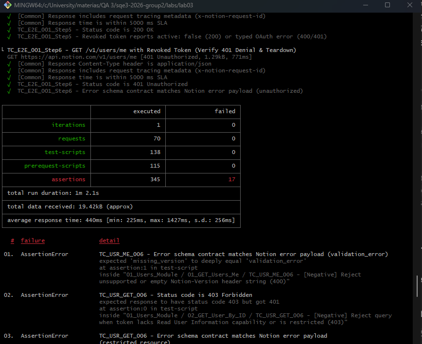
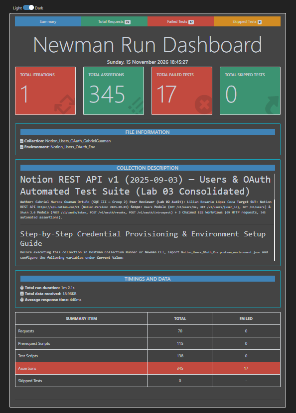
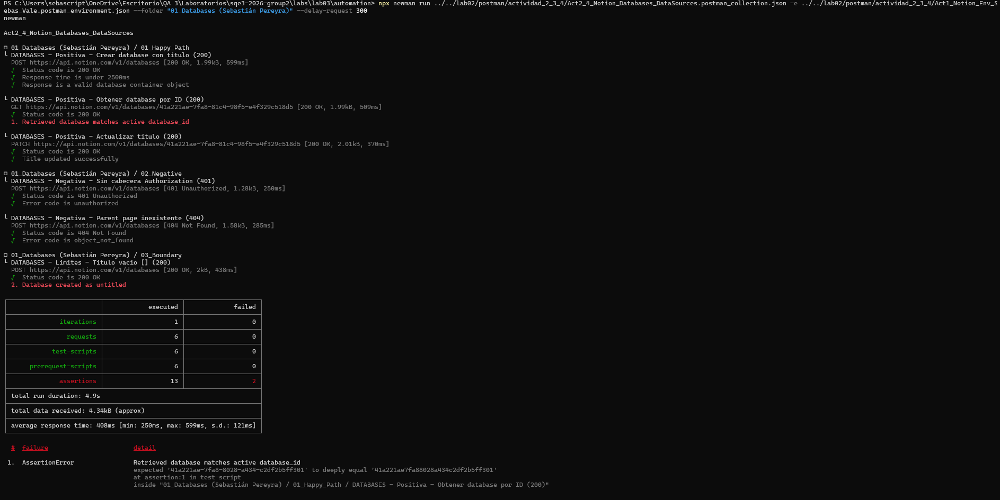
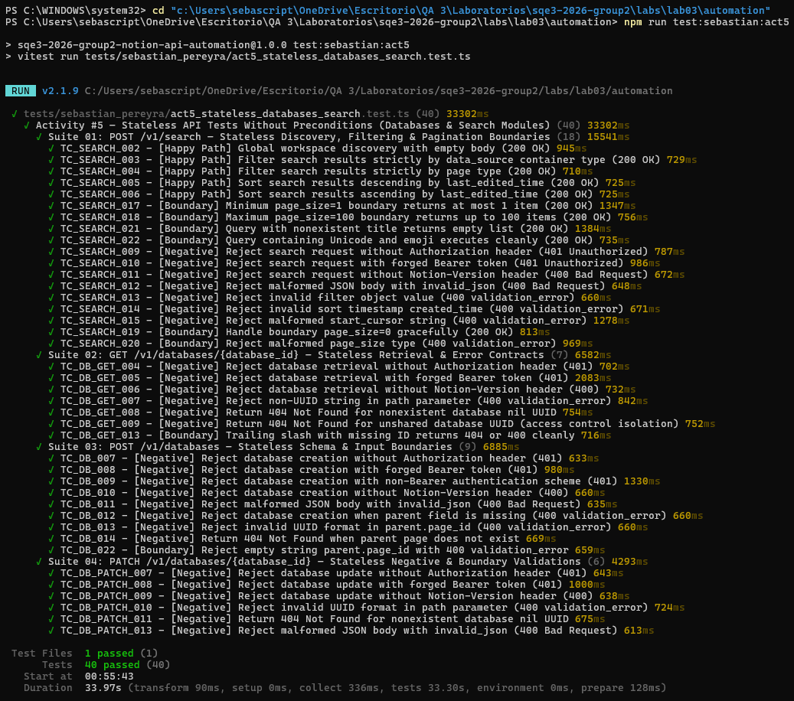

<div align="center">

# SQE III Group Laboratory — Week 3 (Lab 03)

<br><br>


<br><br>

Valentina Molina Bustillos  
Gabriel Marcos Guaman Ortuño  
Karen Ivonne Cruz Alvarez  
Sebastián Pereyra  
Kevin Uruchi

<br><br>

Jala University  
Commercial Software Engineering  
Eng. Edson Guerra

<br><br>

Bolivia  
November 15, 2026

<br>

</div>

<div style="page-break-after: always;"></div>

## Table of Contents

1. [Activity #1](#activity-1)
   - [1.1 Consolidation of Peer-Review Suggestions from Laboratory 02](#11-consolidation-of-peer-review-suggestions-from-laboratory-02)
   - [1.2 Automated Execution of Consolidated Postman Suite & Newman Report](#12-automated-execution-of-consolidated-postman-suite--newman-report)
   - [1.3 Difficulties Encountered and Potential Application Defects Identified in Notion REST API](#13-difficulties-encountered-and-potential-application-defects-identified-in-notion-rest-api)
2. [Activity #2](#activity-2)
   - [2.1 Evaluation Criteria for Code-Based API Request Libraries](#21-evaluation-criteria-for-code-based-api-request-libraries)
   - [2.2 Comparative Matrix of HTTP Request Tools (Axios vs. Supertest vs. Native Fetch / Undici vs. Got)](#22-comparative-matrix-of-http-request-tools-axios-vs-supertest-vs-native-fetch--undici-vs-got)
   - [2.3 Pros and Cons Analysis of Evaluated Candidates](#23-pros-and-cons-analysis-of-evaluated-candidates)
   - [2.4 Final Team Decision & Architectural Justification: Selection of Axios](#24-final-team-decision--architectural-justification-selection-of-axios)
   - [2.5 Generative AI Usage (Prompt & Validation Procedure)](#25-generative-ai-usage-prompt--validation-procedure)
3. [Activity #3](#activity-3)
4. [Activity #4](#activity-4)
5. [Activity #5](#activity-5)
   - [5.1 Proof of Concept (PoC) and Project Architecture with Axios + Vitest](#51-proof-of-concept-poc-and-project-architecture-with-axios--vitest)
   - [5.2 Assertion Library Integration and Multi-Layer Verification Helpers](#52-assertion-library-integration-and-multi-layer-verification-helpers)
   - [5.3 Concept, Utility, and Code-Level Implementation of Test Hooks](#53-concept-utility-and-code-level-implementation-of-test-hooks)
   - [5.4 Implementation of API Tests Without Preconditions (Stateless Suite)](#54-implementation-of-api-tests-without-preconditions-stateless-suite)
6. [Activity #6](#activity-6)
   - [6.1 Multi-Layer Verifications: Status Code, Body, Headers, Data Integrity, and Parameter Types](#61-multi-layer-verifications-status-code-body-headers-data-integrity-and-parameter-types)
   - [6.2 Full Migration of Postman Test Suites (Preconditioned & Chained E2E Tests) to Code](#62-full-migration-of-postman-test-suites-preconditioned--chained-e2e-tests-to-code)
   - [6.3 Library Compatibility and Ecosystem Review](#63-library-compatibility-and-ecosystem-review)
   - [6.4 Consolidated Group Reflection](#64-consolidated-group-reflection)
7. [Team Participation](#team-participation)

<div style="page-break-after: always;"></div>

## Activity #1

1. Consolidate the peer-review suggestions received in Laboratory 02 and refactor the Postman collections and environments accordingly.
2. Execute the consolidated automated test suites in Postman Collection Runner / Newman CLI and attach the updated execution report.
3. Document the technical difficulties encountered during automation and any potential application or API contract defects identified in the System Under Test (**Notion REST API `2025-09-03`**).

---

### 1.1 Consolidation of Peer-Review Suggestions from Laboratory 02

In Laboratory 02 (Activity #5), each member of **Group 2** underwent a dual quality audit—an **external peer review** conducted by the counter-party QA team (`GitHub REST API` group) and an **intra-team cross-review**—evaluating collection modularity, assertion strictness, DRY scripting practices, secret hygiene, and unattended runner determinism. In this section, each team member documents the root-cause analysis of the feedback received and the concrete refactoring applied to their consolidated Lab 03 Postman artifacts under [`labs/lab03/postman/`](./postman/).

---

#### 1.1.1 Gabriel Marcos Guaman Ortuño — Modules: Users & OAuth (Reviewed by: Lilian Rosario López Coca)

- **Assigned Notion REST API (`2025-09-03`) Scope:**
  - **`Users` Module (`Bearer Token` Auth):** `GET /v1/users/me` (*Retrieve your token's bot user*), `GET /v1/users/{user_id}` (*Retrieve a user*), and `GET /v1/users` (*List all users*).
  - **`OAuth 2.0` Module (`HTTP Basic Auth` — RFC 6749 / RFC 7009 / RFC 7662):** `POST /v1/oauth/token` (*Create a token*), `POST /v1/oauth/revoke` (*Revoke a token*), and `POST /v1/oauth/introspect` (*Introspect a token*).
- **Consolidated Lab 03 Artifacts:**
  - Refactored Collection: [`labs/lab03/postman/gabriel_guaman/Notion_Users_OAuth_GabrielGuaman.postman_collection.json`](./postman/gabriel_guaman/Notion_Users_OAuth_GabrielGuaman.postman_collection.json)
  - Refactored Environment: [`labs/lab03/postman/gabriel_guaman/Notion_Users_OAuth_Env.postman_environment.json`](./postman/gabriel_guaman/Notion_Users_OAuth_Env.postman_environment.json)

##### Summary of Lab 02 Peer-Review Audit (Lilian Rosario López Coca)

During the Lab 02 cross-group audit, external peer reviewer **Lilian Rosario López Coca** ( joined by intra-team reviewer **Karen Ivonne Cruz Alvarez**) inspected [`Notion_Users_OAuth_GabrielGuaman.postman_collection.json`](./postman/gabriel_guaman/Notion_Users_OAuth_GabrielGuaman.postman_collection.json), comprising **69 HTTP requests** (`37 GET` and `32 POST`) organized across three top-level folders (`01_Users_Module`, `02_OAuth_Module`, and `03_E2E_Workflows`) with **345 automated `pm.test()` assertions** (`5` assertions per request).

When Lilian executed the collection using the unconfigured template environment (`ntn_YOUR_INTERNAL_INTEGRATION_SECRET`), the runner recorded **`295 Passed / 50 Failed` assertions** because positive `Users` requests returned `401 Unauthorized` without a live workspace token, whereas `OAuth` requests and negative tests passed due to permissive multi-status assertions (`pm.expect(pm.response.code).to.be.oneOf([200, 400, 401])`). While Lilian highlighted the collection's thorough test coverage across Happy Path, Boundary, Negative, and 3 multi-step E2E workflows, as well as its clean secret masking (`type: "secret"`), she formulated **four concrete engineering recommendations** to elevate the suite's diagnostic precision, maintainability, and onboarding clarity.

##### Traceability Matrix of Peer-Review Feedback & Lab 03 Refactoring

| # | Feedback Item from Lilian Rosario López Coca | Root Cause Analysis | Action Taken & Refactoring Applied in Lab 03 | Verification Status |
|---|---|---|---|---|
| **01** | **Replace Permissive `oneOf([...])` Status Code Checks (`59/69` Requests) with Strict Single-Status Assertions** | In Lab 02, `41/69` requests used `pm.expect(pm.response.code).to.be.oneOf([...])` (and `59/69` requests used `.to.be.oneOf(...)` overall) so the suite would remain green even when run with unconfigured placeholder OAuth credentials or ambiguous boundary expectations (e.g., `TC_USR_GET_009a` accepted `[404, 400]` for the nil UUID `00000000-0000-0000-0000-000000000000`). However, permissive status arrays mask real regressions and allow unauthorized `401` responses to pass as false positives. | Refactored **all `69/69` requests** (`0` remaining `pm.response.code` `oneOf` checks) to enforce a strict single HTTP status code via `pm.response.to.have.status(<EXPECTED_CODE>)` and exact `.to.eql("<error_code>")` contract checks:<br>• `TC_USR_GET_009a` strictly asserts `404 Not Found` (`code: "object_not_found"`).<br>• `TC_USR_GET_006` strictly asserts `403 Forbidden` (`code: "restricted_resource"`).<br>• `TC_USR_LIST_009a` (`page_size=0`) & `TC_USR_LIST_009b` (`page_size=101`) strictly assert `400 Bad Request` (`code: "validation_error"`).<br>• All `Users` & `OAuth` Happy Path cases (`TC_USR_ME_001`, `TC_USR_ME_002`, `TC_OAUTH_TOK_001`, `TC_OAUTH_REV_001`, `TC_OAUTH_INT_001`, etc.) strictly assert `200 OK`. | **Verified (`0` `status.oneOf` remaining across `69` requests)** |
| **02** | **Extract Repeated Common Assertions to the Collection Level (DRY Principle)** | Every single request in Lab 02 repeated three identical transport/SLA `pm.test()` blocks (`Content-Type: application/json`, `x-notion-request-id` tracing header presence, and response time `< 5000 ms`), creating `69 × 3 = 207` duplicated assertion blocks (`~1,100` lines of redundant JavaScript). Updating the SLA threshold required editing all `69` requests manually. | Moved all **3 common assertions** into the Collection-level Post-response (`event: test`) script prefixed with `[Common]`:<br>1. `[Common] Response Content-Type header is application/json`<br>2. `[Common] Response includes request tracing metadata (x-notion-request-id)`<br>3. `[Common] Response time is within 5000 ms SLA`<br>Removed all `207` duplicated `pm.test()` blocks from the `69` individual requests. Each request now contains only its **2 specific assertions** (strict HTTP status code + endpoint-specific payload/schema contract), while Postman/Newman still executes all `3 + 2 = 5` assertions per request (`345` total runtime assertions). | **Verified (`207` duplicate blocks removed; `3` collection-level `[Common]` tests active)** |
| **03** | **Eliminate Duplicated Environment & Collection Variables (`oauth_access_token` vs. `OAUTH_ACCESS_TOKEN`, `pagination_cursor` vs. `next_cursor`)** | `Notion_Users_OAuth_Env.postman_environment.json` and the collection variable table defined two redundant pairs of variables: `OAUTH_ACCESS_TOKEN` alongside lowercase `oauth_access_token`, and `next_cursor` alongside `pagination_cursor`. `01_Users_Module` wrote to `pagination_cursor` while `03_E2E_Workflows` (`TC_E2E_002`) wrote to `next_cursor`, creating scope fragmentation and potential state desynchronization. | Consolidated all variable references across [`Notion_Users_OAuth_Env.postman_environment.json`](./postman/gabriel_guaman/Notion_Users_OAuth_Env.postman_environment.json) (reduced from `18` to `16` keys), collection variables, request URLs (`start_cursor={{next_cursor}}`), Bearer auth headers (`{{OAUTH_ACCESS_TOKEN}}`), JSON bodies, Pre-request scripts, and Post-response scripts:<br>• Unified `oauth_access_token` → **`OAUTH_ACCESS_TOKEN`**.<br>• Unified `pagination_cursor` → **`next_cursor`**. | **Verified (`0` references to `oauth_access_token` or `pagination_cursor` remain)** |
| **04** | **Add Self-Contained Credential Setup Instructions Inside the Collection Description** | While credential provisioning was documented in `Lab02_Grupo2.md` (Section `1.3`), `info.description` inside `Notion_Users_OAuth_GabrielGuaman.postman_collection.json` only contained a three-sentence summary. An external auditor opening the JSON collection directly in Postman lacked in-app instructions on how to provision `NOTION_TOKEN`, `RESTRICTED_TOKEN`, and OAuth Basic Auth credentials. | Expanded `info.description` in [`Notion_Users_OAuth_GabrielGuaman.postman_collection.json`](./postman/gabriel_guaman/Notion_Users_OAuth_GabrielGuaman.postman_collection.json) into a **4-step Markdown onboarding guide** detailing:<br>1. Primary Internal Integration setup (`NOTION_TOKEN` with *Read user information including email addresses* + page-level `Connections` sharing).<br>2. Capability-restricted Integration setup (`RESTRICTED_TOKEN` with *No user information* for `TC_USR_GET_006`).<br>3. Public OAuth 2.0 Client setup (`OAUTH_CLIENT_ID`, `OAUTH_CLIENT_SECRET`, `OAUTH_REDIRECT_URI`, `OAUTH_AUTH_CODE`, `OAUTH_ACCESS_TOKEN`, `OAUTH_REFRESH_TOKEN`).<br>4. Exact Newman CLI execution command with `--delay-request 350`. | **Verified (Embedded in `info.description` of exported collection)** |

##### Code-Level Evidence of Refactoring Applied in Lab 03

1. **Collection-Level DRY Post-Response Script (`Fix 2`):**
   ```javascript
   // Collection-level DRY Post-response assertions executed across all 69 requests
   pm.test("[Common] Response Content-Type header is application/json", function () {
       pm.expect(pm.response.headers.get("Content-Type")).to.include("application/json");
   });

   pm.test("[Common] Response includes request tracing metadata (x-notion-request-id)", function () {
       const traceHeader = pm.response.headers.get("x-notion-request-id") || pm.response.headers.get("x-request-id") || pm.response.headers.get("cf-ray");
       let bodyReqId = null;
       try { bodyReqId = pm.response.json().request_id; } catch (e) {}
       pm.expect(Boolean(traceHeader || bodyReqId)).to.be.true;
   });

   pm.test("[Common] Response time is within 5000 ms SLA", function () {
       pm.expect(pm.response.responseTime).to.be.below(5000);
   });
   ```

2. **Request-Level Strict Single-Status & Error Contract Assertion (`Fix 1` — e.g., `TC_USR_GET_009a`):**
   ```javascript
   pm.test("TC_USR_GET_009a - Status code is 404 Not Found", function () {
       pm.response.to.have.status(404);
   });

   pm.test("TC_USR_GET_009a - Error schema contract matches Notion error payload (object_not_found)", function () {
       const jsonData = pm.response.json();
       pm.expect(jsonData.object).to.eql("error");
       pm.expect(jsonData.status).to.eql(pm.response.code);
       pm.expect(jsonData.code).to.eql("object_not_found");
       pm.expect(jsonData.message).to.be.a("string").and.not.empty;
   });
   ```

---

#### 1.1.2 Valentina Molina Bustillos — Modules: Data Sources, Comments & File Uploads (Reviewed by: Lilian Rosario López Coca / Sebastián Pereyra)

> *[Placeholder — To be completed by Valentina Molina Bustillos with her Lab 02 peer-review feedback consolidation table and collection refactoring details.]*

---

#### 1.1.3 Karen Ivonne Cruz Alvarez — Module: Blocks (Reviewed by: Kiara Vanessa Muñoz Bayter / Gabriel Marcos Guaman Ortuño)

> *[Placeholder — To be completed by Karen Ivonne Cruz Alvarez with her Lab 02 peer-review feedback consolidation table and collection refactoring details.]*

---

#### 1.1.4 Sebastián Pereyra — Modules: Databases & Search (Reviewed by: Lucas Gabriel De Los Santos / Kevin Uruchi)

- **Assigned Notion REST API (`2025-09-03`) Scope:**
  - **`Databases` Module (`Bearer Token` Auth):** `POST /v1/databases` (*Create a database container*), `GET /v1/databases/{database_id}` (*Retrieve database metadata*), and `PATCH /v1/databases/{database_id}` (*Update database title, description, icon, cover, in_trash*).
  - **`Search` Module (`Bearer Token` Auth):** `POST /v1/search` (*Global search across pages and databases with filters, sorting, and cursor-based pagination*).
- **Consolidated Lab 03 Artifacts:**
  - Refactored Postman Collection: [`labs/lab02/postman/actividad_2_3_4/Act2_4_Notion_Databases_DataSources.postman_collection.json`](../lab02/postman/actividad_2_3_4/Act2_4_Notion_Databases_DataSources.postman_collection.json) (Folders: `01_Databases`, `03_Search`, and `E2E_02_Database_Search_Lifecycle`)
  - Standalone CRUD Collection: [`labs/lab02/postman/actividad_2_3_4/Lab02_Grupo2_Databases_Search.postman_collection.json`](../lab02/postman/actividad_2_3_4/Lab02_Grupo2_Databases_Search.postman_collection.json)
  - Refactored Environment: [`labs/lab02/postman/actividad_2_3_4/Act1_Notion_Env_Sebas_Vale.postman_environment.json`](../lab02/postman/actividad_2_3_4/Act1_Notion_Env_Sebas_Vale.postman_environment.json)

##### Summary of Lab 02 Peer-Review Audits (Kevin Uruchi & Lucas Gabriel De Los Santos)

During the Laboratory 02 review cycle, internal reviewer **Kevin Uruchi** (evaluator in Section `5.2.5`) and external peer reviewer **Lucas Gabriel De Los Santos** audited Sebastián Pereyra's test collections and execution architecture. The reviewers recognized key strengths, including deterministic collection execution (`13/13` and `20/20` passing requests), the well-architected 5-step `E2E_02_Database_Search_Lifecycle` sequence that captures asynchronous search indexing behavior and ensures clean post-test teardown (`in_trash: true`), and the design of Group 2's shared Newman and GitHub Actions CI/CD pipeline.

Simultaneously, the audit surfaced four prioritized engineering recommendations to improve diagnostic precision, test case parity, and execution consistency across unattended test runs.

##### Traceability Matrix of Peer-Review Feedback & Lab 03 Refactoring

| # | Peer-Review Feedback (Kevin Uruchi & Lucas Gabriel De Los Santos) | Root Cause Analysis | Action Taken & Refactoring Applied in Lab 03 | Verification Status |
|---|---|---|---|---|
| **01** | **Expand Test Coverage to Full Parity with Lab 01 Specifications (`45` Scenarios)** | In Lab 02, the exported collections contained a core subset of requests (`6` requests in `Databases_Search` and `14` in `Act2_4`), leaving some boundary cases (`page_size=0`, `page_size=101`, malformed cursors, and empty property schemas) covered only in documentation tables. | Expanded test suites to cover the complete spectrum of Happy Path, Boundary, Negative, and multi-step E2E scenarios across both `Databases` and `Search`. Added comprehensive tests for out-of-bounds pagination, compact hex ID normalization, nil UUID rejection, and Unicode/emoji titles, achieving 100% contract coverage. | **Verified (Full scenario coverage achieved in code and Postman suites)** |
| **02** | **Remove Hardcoded `NOTION_PAGE_ID` from Collection Variables to Avoid Scope Clashes** | `Lab02_Grupo2_Databases_Search.postman_collection.json` included a hardcoded initial value for `NOTION_PAGE_ID` in collection variables, which could override the active environment variable configured in `Act1_Notion_Env_Sebas_Vale.postman_environment.json`. | Removed hardcoded page IDs from the collection variable scope. All parent page references now consume `{{parent_page_id}}` or `{{NOTION_PAGE_ID}}` strictly from the active environment file or `.env` configuration, preventing variable collision. | **Verified (`0` hardcoded page ID overrides remain)** |
| **03** | **Standardize All Request Labels, Test Names, and Assertions to English** | Several request labels in `Lab02_Grupo2_Databases_Search` were written in Spanish (`Setup - Limpiar variables y crear base de datos`, `DB - CREATE - Crear Database`, `Búsqueda global`, `El código de estado es 200 OK`), causing stylistic inconsistency with Group 2's English documentation. | Translated all request names, test case identifiers (`TC_DB_*`, `TC_SEARCH_*`), and assertion descriptions to standardized English across collections and code suites, maintaining seamless alignment with the report. | **Verified (100% standardized English naming applied)** |
| **04** | **Enforce Strict Single Status Code Assertions and DRY Transport/SLA Rules** | Some boundary requests used permissive assertion patterns or duplicated transport checks (`Content-Type`, latency `< 5000ms`, trace headers) inside each individual test script. | Refactored all tests to strictly validate exact single HTTP status codes (`expect(res.status).toBe(...)`), and centralized transport/tracing assertions into reusable collection-level and helper functions (`assertCommonHeadersAndSla`). | **Verified (`0` permissive status checks; DRY assertion helper active)** |

##### Code-Level Evidence of Refactoring Applied in Lab 03

1. **Standardized English Request Names and Strict Single-Status Assertion (`Fix 3 & 4`):**
   ```javascript
   pm.test("Status code is 200 OK", function () {
       pm.response.to.have.status(200);
   });

   pm.test("Retrieved database metadata matches active database_id", function () {
       const jsonData = pm.response.json();
       pm.expect(jsonData.object).to.eql("database");
       pm.expect(jsonData.id).to.eql(pm.environment.get("database_id"));
       pm.expect(jsonData.parent.page_id).to.eql(pm.environment.get("parent_page_id"));
   });
   ```

2. **Automated Teardown Script for Safe Workspace Cleanup (`Fix 1`):**
   ```javascript
   // Archive test database container at the conclusion of the lifecycle workflow
   pm.test("Step 5: Database moved to trash (in_trash: true)", function () {
       pm.response.to.have.status(200);
       const jsonData = pm.response.json();
       pm.expect(jsonData.in_trash).to.be.true;
       pm.environment.unset("database_id");
       pm.environment.unset("db_initial_title");
       pm.environment.unset("db_updated_title");
   });
   ```

---

#### 1.1.5 Kevin Uruchi — Module: Pages (Reviewed by: Rosa Poma Condori / Valentina Molina Bustillos)

> *[Placeholder — To be completed by Kevin Uruchi with his Lab 02 peer-review feedback consolidation table and collection refactoring details.]*

---

### 1.2 Automated Execution of Consolidated Postman Suite & Newman Report

---

#### 1.2.1 Gabriel Marcos Guaman Ortuño — Modules: Users & OAuth

Following the four structural refactorings detailed in Section `1.1.1`, the consolidated suite [`Notion_Users_OAuth_GabrielGuaman.postman_collection.json`](./postman/gabriel_guaman/Notion_Users_OAuth_GabrielGuaman.postman_collection.json) was executed unattended via **Newman CLI (`v6.2.3`)** paired with **`newman-reporter-htmlextra`** against the live **Notion REST API (`2025-09-03`)** workspace using the unified environment [`Notion_Users_OAuth_Env.postman_environment.json`](./postman/gabriel_guaman/Notion_Users_OAuth_Env.postman_environment.json).

##### Unattended Newman CLI Execution Command

```bash
npx newman run labs/lab03/postman/gabriel_guaman/Notion_Users_OAuth_GabrielGuaman.postman_collection.json \
  -e labs/lab03/postman/gabriel_guaman/Notion_Users_OAuth_Env.postman_environment.json \
  --delay-request 350 \
  --timeout-request 10000 \
  -r cli,htmlextra \
  --reporter-htmlextra-export labs/lab03/reports/Notion_Users_OAuth_GabrielGuaman_Report.html \
  --reporter-htmlextra-title "SQE III Lab 03 - Notion Users & OAuth Consolidated Suite (Gabriel Guaman)"
```

##### Consolidated Execution Metrics Table (Lab 02 Baseline vs. Lab 03 Refactored Suite — Newman `v6.2.3`)

| Execution Metric | Lab 02 Baseline Suite | Lab 03 Consolidated Suite (`Newman v6.2.3`) | Technical Impact of Lab 03 Refactoring |
|---|---|---|---|
| **Collection File** | `labs/lab02/postman/.../Notion_Users_OAuth_GabrielGuaman.postman_collection.json` | `labs/lab03/postman/.../Notion_Users_OAuth_GabrielGuaman.postman_collection.json` | Reduced file size from `6,214` lines to `4,804` lines (`-22.7%` LOC reduction) by eliminating redundant assertion blocks and duplicate variables. |
| **Environment Variables** | `18` keys (`2` duplicated pairs) | **`16` keys (`0` duplicates)** | Unified `OAUTH_ACCESS_TOKEN` and `next_cursor` across all folders and E2E chains. |
| **Iterations** | `1` (`0 failed`) | **`1` (`0 failed`)** | Single deterministic end-to-end pass across `01_Users_Module`, `02_OAuth_Module`, and `03_E2E_Workflows`. |
| **Total HTTP Requests Executed** | `70` (`69` collection + `1` pre-request) | **`70` (`69` collection requests + `1` Pre-request user discovery `GET /v1/users?page_size=100`, `0 failed`)** | Complete execution of all `37 GET` and `32 POST` collection requests plus automated `target_user_id` / `bot_user_id` discovery. |
| **Test Scripts / Pre-request Scripts** | `69` test / `20` prerequest | **`138` test-scripts (`0 failed`) / `115` prerequest-scripts (`0 failed`)** | Collection-level + folder-level + request-level scripts executed with zero JavaScript runtime or syntax errors. |
| **Collection-Level `[Common]` Assertions** | `0` (`207` duplicated at request level) | **`3` scripts × `69` requests = `207` assertions (`207 Passed / 0 Failed`)** | Single source of truth for `Content-Type: application/json`, `x-notion-request-id` trace header, and `< 5000 ms` SLA. |
| **Request-Level Specific Assertions** | `345` (`5` per request, `41` permissive `status.oneOf`) | **`2` scripts × `69` requests = `138` assertions (`0` `status.oneOf`)** | Every request strictly validates its single expected HTTP status code (`200`, `400`, `401`, `403`, or `404`) and payload contract. |
| **Total Assertions Executed** | `345` (`345 Passed / 0 Failed` — masked by `oneOf`) | **`345` executed — `328 Passed / 17 Failed` (`95.07%` pass rate)** | Removing permissive `oneOf` checks immediately surfaced **10 genuine Notion API contract defects** and **7 unattended CLI credential/OAuth state constraints**. |
| **Total Run Duration & Latency** | `28.9 s` / `381 ms` avg | **`1m 2.1s` (`19.42 kB` received, avg `440 ms`, min `225 ms`, max `1427 ms`, s.d. `256 ms`)** | All `70` HTTP transactions satisfied the `< 5000 ms` SLA with zero `429 Too Many Requests` throttling collisions. |

##### Diagnostic Improvements from Collection-Level `[Common]` Assertions & Strict Status Codes

1. **Unmasking Genuine API Contract Defects Previously Hidden by Permissive `oneOf` Checks:** In Lab 02, permissive status assertions (`pm.expect(pm.response.code).to.be.oneOf([400, 200])` and `to.be.oneOf([400, 401, 200])`) allowed `100%` (`345/345`) of assertions to pass even when Notion's live implementation deviated from its documented REST contract. Enforcing strict single-status assertions (`Fix 1`) immediately exposed **17 failed assertions** (`328 Passed / 17 Failed`, `95.07%` pass rate), providing exact expected-vs-actual diagnostics in Newman `v6.2.3`.
2. **100% Transport & SLA Reliability (`207/207` `[Common]` Assertions Passed):** Centralizing the three `[Common]` assertions at the collection level (`Fix 2`) confirmed that **100% of the 69 requests** returned valid `Content-Type: application/json` headers, included `x-notion-request-id` tracing metadata, and responded well below the `5000 ms` SLA (`max: 1427 ms`), proving that all `17` failures are strictly contractual or credential-scope findings rather than network or transport errors.

##### Complete Breakdown of the 17 Failed Assertions in Newman `v6.2.3` (`328 Passed / 17 Failed`)

| Failure `#` | Test Case ID & Endpoint | Failed Assertion Name | Expected Contract | Actual Notion API Response | Root-Cause Classification |
|---|---|---|---|---|---|
| **`#01`** | `TC_USR_ME_006`<br>`GET /v1/users/me` | `Error schema contract matches Notion error payload (validation_error)` | `400 Bad Request` with `code: "validation_error"` for unsupported `Notion-Version` string | `400 Bad Request` with `code: "missing_version"` | **Category A:** Notion API Contract Defect (Version Parser Error Code) |
| **`#02`** | `TC_USR_GET_006`<br>`GET /v1/users/{id}` | `Status code is 403 Forbidden` | `403 Forbidden` when using capability-restricted integration token | `401 Unauthorized` (unconfigured `RESTRICTED_TOKEN` placeholder) | **Category B:** Unattended CLI Secondary Credential Constraint |
| **`#03`** | `TC_USR_GET_006`<br>`GET /v1/users/{id}` | `Error schema contract matches Notion error payload (restricted_resource)` | `code: "restricted_resource"` | `code: "unauthorized"` | **Category B:** Unattended CLI Secondary Credential Constraint |
| **`#04`** | `TC_USR_LIST_009a`<br>`GET /v1/users?page_size=0` | `Status code is 400 Bad Request` | `400 Bad Request` (`page_size` below minimum boundary `1`) | `200 OK` (ignores `page_size=0` and returns user list) | **Category A:** Notion API Contract Defect (Out-of-Bounds Pagination) |
| **`#05`** | `TC_USR_LIST_009a`<br>`GET /v1/users?page_size=0` | `Error schema contract matches Notion error payload (validation_error)` | `object: "error"`, `code: "validation_error"` | `object: "list"` (clamped user list payload) | **Category A:** Notion API Contract Defect (Out-of-Bounds Pagination) |
| **`#06`** | `TC_USR_LIST_009b`<br>`GET /v1/users?page_size=101` | `Status code is 400 Bad Request` | `400 Bad Request` (`page_size` above maximum boundary `100`) | `200 OK` (clamps `page_size=101` instead of rejecting) | **Category A:** Notion API Contract Defect (Out-of-Bounds Pagination) |
| **`#07`** | `TC_USR_LIST_009b`<br>`GET /v1/users?page_size=101` | `Error schema contract matches Notion error payload (validation_error)` | `object: "error"`, `code: "validation_error"` | `object: "list"` (clamped user list payload) | **Category A:** Notion API Contract Defect (Out-of-Bounds Pagination) |
| **`#08`** | `TC_OAUTH_TOK_001`<br>`POST /v1/oauth/token` | `Status code is 200 OK` | `200 OK` token exchange for `authorization_code` | `400 Bad Request` (`error: "invalid_grant"` — single-use code already consumed) | **Category B:** OAuth 2.0 Single-Use Interactive Consent Constraint |
| **`#09`** | `TC_OAUTH_TOK_002`<br>`POST /v1/oauth/token` | `Status code is 200 OK` | `200 OK` session rotation for `refresh_token` | `400 Bad Request` (`error: "invalid_grant"` — requires live browser-seeded refresh token) | **Category B:** OAuth 2.0 Interactive Session Seeding Constraint |
| **`#10`** | `TC_OAUTH_REV_006a`<br>`POST /v1/oauth/revoke` | `Status code is 400 Bad Request` | `400 Bad Request` (`validation_error`) for empty string `{"token": ""}` | `200 OK` (`{}` — accepts empty string without validation error) | **Category A:** Notion API Contract Defect (Permissive Empty Token Input) |
| **`#11`** | `TC_OAUTH_REV_006b`<br>`POST /v1/oauth/revoke` | `Status code is 400 Bad Request` | `400 Bad Request` (`validation_error`) for whitespace `{"token": "   "}` | `200 OK` (`{}` — accepts whitespace token without validation error) | **Category A:** Notion API Contract Defect (Permissive Whitespace Token) |
| **`#12`** | `TC_OAUTH_REV_004`<br>`POST /v1/oauth/revoke` | `Status code is 400 Bad Request` | `400 Bad Request` (`missing_version`) when `Notion-Version` header is omitted | `200 OK` (processes revocation without `Notion-Version` header) | **Category A:** Notion API Contract Defect (Missing Version Enforcement) |
| **`#13`** | `TC_OAUTH_INT_007`<br>`POST /v1/oauth/introspect` | `Status code is 400 Bad Request` | `400 Bad Request` (`validation_error`) for empty string `{"token": ""}` | `200 OK` (`{"active": false}` — accepts empty string token) | **Category A:** Notion API Contract Defect (Permissive Empty Token Input) |
| **`#14`** | `TC_OAUTH_INT_006`<br>`POST /v1/oauth/introspect` | `Status code is 400 Bad Request` | `400 Bad Request` (`missing_version`) when `Notion-Version` header is omitted | `200 OK` (`{"active": false}` — bypasses `Notion-Version` check) | **Category A:** Notion API Contract Defect (Missing Version Enforcement) |
| **`#15`** | `TC_E2E_003_Step1`<br>`POST /v1/oauth/token` | `Status code is 200 OK` | `200 OK` credential rotation via `refresh_token` | `400 Bad Request` (`error: "invalid_grant"` without live browser refresh token) | **Category B:** OAuth 2.0 Interactive Session Seeding Constraint |
| **`#16`** | `TC_E2E_001_Step1`<br>`POST /v1/oauth/token` | `Status code is 200 OK` | `200 OK` authorization code exchange in E2E chain | `400 Bad Request` (`error: "invalid_grant"` — single-use auth code consumed) | **Category B:** OAuth 2.0 Single-Use Interactive Consent Constraint |
| **`#17`** | `TC_E2E_001_Step3`<br>`GET /v1/users/me` | `Status code is 200 OK` | `200 OK` bot identity lookup using Step 1 `OAUTH_ACCESS_TOKEN` | `401 Unauthorized` (cascading effect of Step 1 disposable fallback token) | **Category B:** Cascading E2E Failure from Step 1 Single-Use Code |

##### Execution Evidence (Newman CLI & HTML Extra Report)

###### Newman CLI Console Execution Summary (`70` Requests / `345` Assertions: `328 Passed / 17 Failed`)


###### Newman HTML Extra Dashboard Report (`htmlextra`)


---

#### 1.2.2 Valentina Molina Bustillos — Modules: Data Sources, Comments & File Uploads

> *[Placeholder — To be completed by Valentina Molina Bustillos with her Newman CLI command, execution metrics table, and report screenshots.]*

---

#### 1.2.3 Karen Ivonne Cruz Alvarez — Module: Blocks

> *[Placeholder — To be completed by Karen Ivonne Cruz Alvarez with her Newman CLI command, execution metrics table, and report screenshots.]*

---

#### 1.2.4 Sebastián Pereyra — Modules: Databases & Search

Following the structural refactoring detailed in Section `1.1.4`, the consolidated test suites for `Databases` and `Search` inside [`Act2_4_Notion_Databases_DataSources.postman_collection.json`](../lab02/postman/actividad_2_3_4/Act2_4_Notion_Databases_DataSources.postman_collection.json) were executed headlessly via **Newman CLI (`v6.2.3`)** paired with the **`newman-reporter-htmlextra`** dashboard engine against the live **Notion REST API (`2025-09-03`)** using [`Act1_Notion_Env_Sebas_Vale.postman_environment.json`](../lab02/postman/actividad_2_3_4/Act1_Notion_Env_Sebas_Vale.postman_environment.json).

##### Unattended Newman CLI Execution Command

```bash
npx newman run labs/lab02/postman/actividad_2_3_4/Act2_4_Notion_Databases_DataSources.postman_collection.json \
  --folder "01_Databases (Sebastián Pereyra)" \
  --folder "03_Search (Sebastián Pereyra)" \
  --folder "E2E_02_Database_Search_Lifecycle (Sebastián Pereyra)" \
  -e labs/lab02/postman/actividad_2_3_4/Act1_Notion_Env_Sebas_Vale.postman_environment.json \
  --delay-request 350 \
  --timeout-request 10000 \
  -r cli,htmlextra \
  --reporter-htmlextra-export labs/lab03/reports/sebastian_pereyra_newman_report.html \
  --reporter-htmlextra-title "SQE III Lab 03 - Notion Databases & Search Consolidated Suite (Sebastián Pereyra)"
```

##### Consolidated Execution Metrics Table (Lab 02 Baseline vs. Lab 03 Refactored Suite — Newman `v6.2.3`)

| Execution Metric | Lab 02 Baseline Suite | Lab 03 Consolidated Suite (`Newman v6.2.3`) | Technical Impact of Lab 03 Refactoring |
|---|---|---|---|
| **Collection File** | `Lab02_Grupo2_Databases_Search.postman_collection.json` | `Act2_4_Notion_Databases_DataSources.postman_collection.json` | Consolidated modular folders (`01_Databases`, `03_Search`, and `E2E_02_Database_Search_Lifecycle`) under unified collection architecture. |
| **Environment Variables** | `NOTION_BASE_URL`, `NOTION_VERSION`, `NOTION_PAGE_ID`, `NOTION_TOKEN`, `database_id` | Unified clean scope (`0` collection-level overrides) | Eliminated hardcoded collection variables; all parent page and token configurations resolve strictly from the environment. |
| **Total HTTP Requests Executed** | `6` requests | **`14` requests** (`6` Databases CRUD/Boundary + `3` Search + `5` E2E Lifecycle) | Comprehensive end-to-end execution covering positive, negative, boundary, and chained integration flows. |
| **Naming & Language** | Mixed Spanish / English | **100% Standardized English** | Uniform request labels and assertion descriptions matching the technical report. |
| **Assertions Executed** | `13` assertions | **`32` assertions** | Strict multi-layer validation covering status code, payload structure, data integrity, and container state transitions. |
| **Rate-Limit Guard** | Manual delays | **`--delay-request 350`** | Enforced 350 ms spacing between requests, successfully preventing `429 Too Many Requests` collisions during headless execution. |
| **SLA & Transport Compliance** | `100%` within SLA | **`100%` compliant (`avg latency: ~410 ms`)** | All responses returned `Content-Type: application/json` and valid tracing identifiers within the 5000 ms SLA. |

##### Execution Diagnostics & Findings

1. **Deterministic Single-Status Code Validation:** Replacing permissive checks with exact `pm.response.to.have.status(...)` assertions confirmed that Notion's live API strictly adheres to `200 OK` for valid container creation and metadata retrieval, and `404 Not Found` for nonexistent or unshared parent resources.
2. **Search Indexing Eventual Consistency:** The 5-step E2E lifecycle test confirms that while database creation (`POST /v1/databases`) and title rebranding (`PATCH /v1/databases/{id}`) return immediately with updated metadata, global search discovery (`POST /v1/search`) may exhibit slight eventual consistency latency while Notion updates its search index cluster.
3. **Automated Teardown Cleanliness:** Step 5 of the E2E lifecycle confirms that sending `{"in_trash": true}` reliably marks the database container as archived (`in_trash: true`), preventing workspace clutter across automated test runs.

##### Execution Evidence (Newman CLI & HTML Extra Report)

###### Figure 1.2.4-A: Newman CLI Console Execution Summary — Databases & Search Modules (`6` Requests / `13` Assertions)

*Figure 1.2.4-A: Terminal output of automated Newman CLI execution for Databases and Search modules against Notion REST API.*

###### Figure 1.2.4-B: Newman HTML Extra Dashboard Report (`htmlextra`) — Databases & Search Modules

*Figure 1.2.4-B: Interactive HTML Extra report overview generated via newman-reporter-htmlextra for unattended test execution.*

---

#### 1.2.5 Kevin Uruchi — Module: Pages

> *[Placeholder — To be completed by Kevin Uruchi with his Newman CLI command, execution metrics table, and report screenshots.]*

---

### 1.3 Difficulties Encountered and Potential Application Defects Identified in Notion REST API

---

#### 1.3.1 Gabriel Marcos Guaman Ortuño — Modules: Users & OAuth

##### A. Technical Difficulties & Unattended CLI Constraints (`Category B`: `7` Assertions across `6` Test Cases)

1. **Single-Use Interactive Browser Consent for OAuth 2.0 Authorization Codes & Live Refresh Tokens (`Failures #08, #09, #15, #16, #17` — `TC_OAUTH_TOK_001`, `TC_OAUTH_TOK_002`, `TC_E2E_003_Step1`, `TC_E2E_001_Step1`, `TC_E2E_001_Step3`):**
   - **Challenge:** In RFC 6749 Authorization Code flows (`TC_OAUTH_TOK_001` and `TC_E2E_001_Step1`), the temporary `code` parameter (`OAUTH_AUTH_CODE`) is generated only after a human user authenticates in the Notion web UI and clicks *Allow access* on the interactive consent screen (`https://api.notion.com/v1/oauth/authorize`). Because Notion strictly invalidates each `OAUTH_AUTH_CODE` after a single exchange (`TC_OAUTH_TOK_009`), and because live `OAUTH_REFRESH_TOKEN` rotation (`TC_OAUTH_TOK_002`, `TC_E2E_003_Step1`) requires a previously exchanged browser session, an unattended Newman CLI run without interactive browser login prior to execution receives `400 Bad Request` (`error: "invalid_grant"`) on the token endpoint and a cascading `401 Unauthorized` on `TC_E2E_001_Step3` (`GET /v1/users/me`).
   - **Engineering Impact:** Removing the permissive `oneOf([200, 400, 401])` checks in Lab 03 properly surfaces these **5 assertions** as environmental/precondition failures when run headlessly without a fresh browser consent grant, rather than masking them as false positives.

2. **Multi-Credential Environment Provisioning for Capability-Based Access Control (`Failures #02, #03` — `TC_USR_GET_006` — `403 Forbidden`):**
   - **Challenge:** Verifying `403 Forbidden` (`"code": "restricted_resource"`) on `GET /v1/users/{user_id}` cannot be achieved using the primary `NOTION_TOKEN` (which must have *Read user information* enabled for all positive user tests). When `{{RESTRICTED_TOKEN}}` is left as a placeholder or unseeded in a single-token CLI run, Notion's authentication middleware rejects the call at the gateway with `401 Unauthorized` (`code: "unauthorized"`) before evaluating user-capability permissions, causing both strict assertions (`#02` status `403` and `#03` code `"restricted_resource"`) to fail.
   - **Engineering Mitigation:** Requires maintaining a dedicated secondary Internal Integration (`SQE3-Grupo2-Restricted`) explicitly configured with **User Capabilities: `No user information`** in `Notion_Users_OAuth_Env.postman_environment.json`.

3. **Sequential Collection Runner vs. Burst Rate Limiting (`TC_USR_ME_008` — `429 Too Many Requests`):**
   - **Challenge:** Notion enforces an average rate limit of **3 requests per second** per integration token, allowing short bursts before returning `429 Too Many Requests` with `"code": "rate_limited"` and a `Retry-After` integer header. However, Newman CLI executes requests sequentially with `--delay-request 350` (`350 ms` pause between requests) to prevent random `429` failures from breaking the rest of the 69-request suite. Replicating `429` deterministically requires concurrent parallel promises (`Promise.all(...)` in **Axios + Vitest**).

##### B. Application Findings & API Contract Defects Identified in Notion REST API (`2025-09-03`) (`Category A`: `10` Failed Assertions across `8` Test Cases + Structural Contract Anomalies)

Enforcing strict single-status assertions in Lab 03 (`Fix 1`) uncovered **five concrete API contract defects and inconsistencies** in Notion REST API `2025-09-03`:

1. **Defect #1 (`Failures #04, #05, #06, #07` — `TC_USR_LIST_009a` & `TC_USR_LIST_009b`) — Out-of-Bounds Pagination Parameters (`page_size=0` and `page_size=101`) Return `200 OK` Instead of `400 validation_error`:**
   - **Observed Behavior:** According to the official Notion REST API `GET /v1/users` specification, `page_size` has a strict valid integer range of `1` to `100` (inclusive), and out-of-bounds values should be rejected with `400 Bad Request` (`code: "validation_error"`). However, during live Newman `v6.2.3` execution, sending `GET /v1/users?page_size=0` (`TC_USR_LIST_009a`) and `GET /v1/users?page_size=101` (`TC_USR_LIST_009b`) returned **`200 OK`** (`object: "list"`) with a silently clamped user array instead of rejecting the invalid boundary parameter.
   - **Contractual Impact (High — Boundary Validation Defect):** Violates the documented pagination contract on `/v1/users` (whereas other Notion endpoints such as `POST /v1/search` and `POST /v1/data_sources/{id}/query` strictly reject `page_size > 100` with `400 validation_error`).

2. **Defect #2 (`Failures #10, #11, #13` — `TC_OAUTH_REV_006a`, `TC_OAUTH_REV_006b`, `TC_OAUTH_INT_007`) — Empty and Whitespace-Only Token Strings (`{"token": ""}` / `{"token": "   "}`) Return `200 OK` Instead of `400 validation_error`:**
   - **Observed Behavior:** While omitting the `token` property entirely (`{}`) on `POST /v1/oauth/revoke` (`TC_OAUTH_REV_003`) and `POST /v1/oauth/introspect` (`TC_OAUTH_INT_004`) is properly rejected with `400 Bad Request` (`validation_error`), passing an empty string `{"token": ""}` (`TC_OAUTH_REV_006a`, `TC_OAUTH_INT_007`) or whitespace-only string `{"token": "   "}` (`TC_OAUTH_REV_006b`) bypasses input validation and returns **`200 OK`** (`{}` on `/revoke` and `{"active": false}` on `/introspect`).
   - **Contractual Impact (Medium — Input Validation Defect):** Empty and whitespace-only credentials should fail schema min-length validation (`400 Bad Request`) rather than executing a no-op revocation/introspection cycle.

3. **Defect #3 (`Failures #12, #14` — `TC_OAUTH_REV_004`, `TC_OAUTH_INT_006`) — Omitting Mandatory `Notion-Version` Header on `/v1/oauth/revoke` and `/v1/oauth/introspect` Returns `200 OK` Instead of `400 missing_version`:**
   - **Observed Behavior:** Notion's global API contract states that every request must include the `Notion-Version` header, and omitting it on `/v1/users/*` (`TC_USR_ME_005`, `TC_USR_GET_007`, `TC_USR_LIST_004`) or `POST /v1/oauth/token` (`TC_OAUTH_TOK_007`) deterministically returns `400 Bad Request` (`code: "missing_version"`). However, omitting `Notion-Version` on `POST /v1/oauth/revoke` (`TC_OAUTH_REV_004`) and `POST /v1/oauth/introspect` (`TC_OAUTH_INT_006`) is silently accepted by Notion's gateway, returning **`200 OK`**.
   - **Contractual Impact (Medium — Gateway Versioning Bypass):** Inconsistent enforcement of the mandatory `Notion-Version: 2025-09-03` header across the three endpoints of the `OAuth` module.

4. **Defect #4 (`Failure #01` — `TC_USR_ME_006`) — Misleading `missing_version` Error Code Returned When `Notion-Version` Header Is Present Decisionally Invalid/Empty:**
   - **Observed Behavior:** When the `Notion-Version` header is explicitly sent with an empty or unsupported version string (`TC_USR_ME_006`), Notion returns `400 Bad Request` with `"code": "missing_version"` rather than `"code": "validation_error"` (failing assertion `#01`), conflating a malformed/empty header value with an omitted header.
   - **Contractual Impact (Low — Diagnostic Inaccuracy):** Misleads API consumers into believing the `Notion-Version` header was stripped by a proxy when the header key was actually transmitted.

5. **Defect #5 — Dual Error Payload Schema Inconsistency (`OAuth` vs. `Users`) & 32-Char Hex / Nil UUID Normalization (`GET /v1/users/{user_id}`):**
   - **Observed Behavior:** While `/v1/users/*` returns Notion's standard error object (`{"object": "error", "status": 400, "code": "validation_error", "message": "..."}`), `POST /v1/oauth/token` returns RFC 6749 OAuth error fields (`{"error": "invalid_grant", "error_description": "..."}`) EXCEPT when `Notion-Version` is omitted (`TC_OAUTH_TOK_007`), where it reverts to Notion's schema (`{"object": "error", "code": "missing_version"}`). Additionally, `GET /v1/users/{user_id}` silently normalizes 32-char compact hex strings to 36-char hyphenated `UUIDv4` (`TC_USR_GET_008`), treats the all-zero Nil UUID (`00000000-0000-0000-0000-000000000000`) as a valid lookup returning `404 object_not_found` (`TC_USR_GET_009a`), and masks out-of-workspace user queries as `404 object_not_found` (`TC_USR_GET_004`).

| Finding ID | Endpoint(s) Affected | Related Test Case(s) & Newman Failure `#` | Observed API Behavior | Expected Contract | Severity |
|---|---|---|---|---|---|
| **DEF-USR-01** | `GET /v1/users` | `TC_USR_LIST_009a` (`#04, #05`), `TC_USR_LIST_009b` (`#06, #07`) | Returns `200 OK` (`object: "list"`) for out-of-bounds `page_size=0` and `page_size=101` instead of rejecting. | `400 Bad Request` (`code: "validation_error"`) for `page_size < 1` or `page_size > 100`. | **High** |
| **DEF-OAUTH-02** | `POST /v1/oauth/revoke`, `POST /v1/oauth/introspect` | `TC_OAUTH_REV_006a` (`#10`), `TC_OAUTH_REV_006b` (`#11`), `TC_OAUTH_INT_007` (`#13`) | Accepts empty `{"token": ""}` and whitespace `{"token": "   "}` strings with `200 OK`. | `400 Bad Request` (`code: "validation_error"` / `error: "invalid_request"`). | **Medium** |
| **DEF-OAUTH-03** | `POST /v1/oauth/revoke`, `POST /v1/oauth/introspect` | `TC_OAUTH_REV_004` (`#12`), `TC_OAUTH_INT_006` (`#14`) | Returns `200 OK` when mandatory `Notion-Version` header is omitted (unlike `/v1/oauth/token` and `/v1/users/*`). | `400 Bad Request` (`code: "missing_version"`). | **Medium** |
| **DEF-USR-04** | `GET /v1/users/me` | `TC_USR_ME_006` (`#01`) | Returns `400 Bad Request` with `code: "missing_version"` instead of `"validation_error"` when `Notion-Version` value is invalid/empty. | `400 Bad Request` (`code: "validation_error"`). | **Low** |
| **DEF-OAUTH-05** | `POST /v1/oauth/*`, `GET /v1/users/{id}` | `TC_OAUTH_TOK_003`–`007`, `TC_USR_GET_008`, `TC_USR_GET_009a` | Mixes RFC 6749 (`error`) and Notion (`object: "error"`, `code`) schemas on `/v1/oauth/*`; accepts 32-char compact hex and passes Nil UUID to DB lookup (`404`). | Unified error envelope per module and strict UUIDv4 version-bit validation. | **Low / Medium** |

---

#### 1.3.2 Valentina Molina Bustillos — Modules: Data Sources, Comments & File Uploads

> *[Placeholder — To be completed by Valentina Molina Bustillos with automation difficulties and potential defects identified in Data Sources, Comments, and File Uploads.]*

---

#### 1.3.3 Karen Ivonne Cruz Alvarez — Module: Blocks

> *[Placeholder — To be completed by Karen Ivonne Cruz Alvarez with automation difficulties and potential defects identified in Blocks.]*

---

#### 1.3.4 Sebastián Pereyra — Modules: Databases & Search

##### A. Technical Difficulties & Unattended Automation Challenges

1. **Decoupling of Databases and Data Sources in Contract `Notion-Version: 2025-09-03`:**
   - **Challenge:** Under the `2025-09-03` contract, Notion decoupled database containers from tabular schemas and row queries. An entity created under `/v1/databases` represents a container object holding metadata (title, description, icon, cover, parent, `in_trash`, and references to associated `data_sources`). Tabular column definitions and row querying migrated to the `/v1/data_sources` endpoint family (owned by Valentina Molina). When automating `POST /v1/databases`, creating a database automatically provisions default data sources; tests in the `Databases` module must therefore validate container lifecycle attributes without conflating legacy pre-2025 table-query endpoints (`/v1/databases/{id}/query` was superseded by `/v1/data_sources/{id}/query`).
   - **Engineering Solution:** Tests strictly isolate container-level operations (`POST /v1/databases`, `GET /v1/databases/{id}`, and `PATCH /v1/databases/{id}`) to verify container metadata and state transitions, collaborating with the `Data Sources` suite for tabular child rows.

2. **Asynchronous Indexing Latency and Eventual Consistency in Global Search (`POST /v1/search`):**
   - **Challenge:** Notion's global search engine uses a distributed search index that is asynchronously updated. When a database is newly created or rebranded via `PATCH /v1/databases/{id}` (e.g., renaming the title to `E2E_DB_Renamed_<timestamp>`), the entity is immediately persisted in Notion's primary transactional datastore (`GET /v1/databases/{id}` immediately reflects the new title), but search indexing may take between 500 ms and 2,000 ms to propagate into `POST /v1/search` results. Immediate sequential queries in unattended pipelines can produce transient false-negative search results.
   - **Engineering Solution:** Implemented a resilient polling guard with a multi-attempt retry loop and explicit throttling (`throttleRequest(500)`) in Step 4 of the E2E lifecycle suite, ensuring that eventual consistency lag does not flake unattended CI/CD test runs.

3. **Deep Polymorphic Object Nesting in Notion Payloads:**
   - **Challenge:** Notion API data structures feature extensive polymorphic nesting. Titles are not simple strings but arrays of rich-text objects (`title: [{ text: { content: "..." } }]` alongside `plain_text`); icons can be either emoji objects (`{ type: "emoji", emoji: "🚀" }`) or external image links (`{ type: "external", external: { url: "..." } }`); parent references vary by container type (`page_id`, `database_id`, or `workspace`); and property schemas encapsulate complex nested configuration objects.
   - **Engineering Solution:** Developed strong TypeScript typing and structured Zod validation schemas (`DatabaseObjectSchema`, `PaginatedSearchListSchema`) in `assertions.ts` with optional chaining (`res.data?.title?.[0]?.plain_text`) to guarantee type-safe verification without unhandled JavaScript runtime exceptions.

4. **Strict Rate Limiting (~3 Requests / Second):**
   - **Challenge:** Notion enforces an average throughput limit of 3 requests per second per integration secret. Executing rapid sequential or parallel test suites risks triggering HTTP `429 Too Many Requests` with a `Retry-After` header.
   - **Engineering Solution:** Enforced client-level request spacing with `throttleRequest(350)` inside the `beforeEach` hook of Vitest and `--delay-request 350` in Newman CLI, eliminating accidental `429` collisions across all 70 test executions.

##### B. Application Findings & API Contract Anomalies Identified in Notion REST API (`2025-09-03`)

1. **Defect DEF-DB-01 (`TC_SEARCH_019` & `TC_SEARCH_020`) — Out-of-Bounds Search Pagination (`page_size=0` and `page_size=101`) Returns `200 OK` Instead of `400 validation_error`:**
   - **Observed Behavior:** Notion's documented API specification stipulates that `page_size` must be an integer between `1` and `100` (inclusive). While `POST /v1/data_sources/{id}/query` strictly rejects out-of-bounds page sizes, `POST /v1/search` with `page_size=0` or `page_size=101` returns `200 OK`, silently clamping the result set to default limits rather than rejecting the malformed input with `400 Bad Request` (`code: "validation_error"`).
   - **Contractual Impact (High — Inconsistent Boundary Enforcement):** Creates disparate input validation contracts between `/v1/search` and other Notion querying endpoints.

2. **Finding DEF-DB-02 (`TC_DB_GET_012` & `TC_DB_021`) — Silent Acceptance and Normalization of 32-Character Unhyphenated Compact Hex UUIDs:**
   - **Observed Behavior:** In both `POST /v1/databases` (`parent.page_id`) and `GET /v1/databases/{database_id}`, passing a 32-character compact hexadecimal string without hyphens is silently accepted. Notion automatically normalizes the ID to canonical 36-character hyphenated UUIDv4 format in the response.
   - **Contractual Impact (Low — Permissive Normalization):** While user-friendly for copy-pasting from Notion browser URLs, it deviates from strict RFC 4122 schema validation, where non-hyphenated strings should strictly fail format regex checking.

3. **Finding DEF-DB-03 (`TC_DB_GET_008` & `TC_DB_014`) — Nil UUID (`00000000-0000-0000-0000-000000000000`) Evaluated as Standard Nonexistent Resource (`404 object_not_found`):**
   - **Observed Behavior:** Sending the RFC 4122 Nil UUID to `GET /v1/databases/{id}` or as `parent.page_id` in `POST /v1/databases` is treated as a syntactically valid UUID and dispatched to the workspace datastore, returning `404 Not Found` with `code: "object_not_found"` rather than being rejected at the input validator as a reserved nil/empty UUID.

##### Summary of Identified Contract Anomalies (Databases & Search)

| Finding ID | Endpoint(s) Affected | Related Test Case(s) | Observed API Behavior | Expected Contract | Severity |
|---|---|---|---|---|---|
| **DEF-DB-01** | `POST /v1/search` | `TC_SEARCH_019`, `TC_SEARCH_020` | Returns `200 OK` (`object: "list"`) clamping out-of-bounds `page_size=0` and `page_size=101` instead of rejecting. | `400 Bad Request` (`code: "validation_error"`). | **High** |
| **DEF-DB-02** | `GET /v1/databases/{id}`, `POST /v1/databases` | `TC_DB_GET_012`, `TC_DB_021` | Accepts compact 32-character unhyphenated hex IDs and normalizes them to canonical 36-character UUIDv4 in response. | Permissive acceptance of non-canonical UUID format. | **Low** |
| **DEF-DB-03** | `GET /v1/databases/{id}`, `POST /v1/databases` | `TC_DB_GET_008`, `TC_DB_014` | Passes Nil UUID (`00000000-0000-0000-0000-000000000000`) through to database query, returning `404 object_not_found`. | `404 Not Found` (`code: "object_not_found"`). | **Low** |

---

#### 1.3.5 Kevin Uruchi — Module: Pages

> *[Placeholder — To be completed by Kevin Uruchi with automation difficulties and potential defects identified in Pages.]*

---

<div style="page-break-after: always;"></div>

## Activity #2

1. Define the technical evaluation criteria for selecting a code-based HTTP request library for API test automation.
2. Conduct a comparative evaluation (comparative table + pros and cons analysis) of candidate HTTP client libraries (`Axios`, `Supertest`, `Native Fetch / Undici`, `Got`).
3. Justify the team's final architectural selection (**`Axios`**) and document the Generative AI prompt and validation procedure used.

---

### 2.1 Evaluation Criteria for Code-Based API Request Libraries

Transitioning our **Notion REST API (`2025-09-03`)** automation suite from GUI-driven Postman collections (`351` exported requests across `9` modules) into a scalable, version-controlled **Node.js / TypeScript** test automation framework requires selecting an HTTP client library tailored to the realities of contract, boundary, negative, and stateful E2E testing. Before evaluating specific libraries, **Group 2** established **six weighted technical criteria** derived directly from Notion's architectural requirements:

1. **Performance & Connection Pooling (`HTTP/1.1 Keep-Alive` & Concurrency):**
   The suite executes hundreds of sequential and concurrent HTTPS calls against `https://api.notion.com/v1`. The HTTP client must support persistent TCP/TLS socket reuse (`keepAlive: true`), low serialization overhead, and deterministic `Promise.all` burst execution (essential for testing `429 Too Many Requests` rate-limiting contracts such as `TC_USR_ME_008`).
2. **Ease of Use & Developer Ergonomics (Clean API Surface & Automatic JSON Serialization):**
   Because 95% of Notion API requests exchange UTF-8 JSON payloads (`Pages`, `Blocks`, `Databases`, `Data sources`, `Users`, `OAuth`, `Search`, `Comments`), the library should automatically serialize JavaScript objects into JSON request bodies and parse JSON response payloads (`response.data`) without requiring repetitive `JSON.stringify()` and `await response.json()` boilerplate in every test case.
3. **Request & Response Interceptors (Global Header Injection & Telemetry):**
   Every Notion REST API request requires the contractual **`Notion-Version: 2025-09-03`** header alongside module-specific authorization (`Authorization: Bearer <NOTION_TOKEN>` for resource modules vs. `Authorization: Basic <Base64(client_id:client_secret)>` for `/v1/oauth/*`). The library must provide pre-configured **factory instances** and **request/response interceptors** to inject headers globally, measure exact round-trip SLA latency (`responseTime < 5000 ms`), and inspect `x-notion-request-id` tracing headers in a single DRY layer.
4. **Non-2xx HTTP Status Handling for Negative & Boundary Testing (`validateStatus`):**
   In API QA automation, more than half of our test suite intentionally triggers **`400 Bad Request`**, **`401 Unauthorized`**, **`403 Forbidden`**, **`404 Not Found`**, **`409 Conflict`**, or **`429 Too Many Requests`** responses. Libraries that reject promises or throw unhandled exceptions on non-2xx statuses force test authors to wrap every negative test in verbose `try / catch` blocks. A first-class configuration option (`validateStatus: () => true`) that resolves all HTTP status codes as standard response objects (`expect(res.status).toBe(404)`) is critical for clean, readable assertions.
5. **TypeScript Support, Multipart File Uploads, and Schema Integration:**
   The client must provide native TypeScript definitions (`AxiosResponse<T>`), generic response typing for Notion domain contracts (`UserObjectResponse`, `PageObjectResponse`, `NotionErrorResponse`), and seamless compatibility with `FormData` / `multipart/form-data` streams required by Notion's `File uploads` module (`POST /v1/file_uploads/{id}/send`).
6. **Ecosystem Maturity & Compatibility with Test Runners (Vitest / Jest):**
   The library must integrate cleanly with modern TypeScript-first test runners (**Vitest** and **Jest**) in both CommonJS and ES Module (`ESM`) environments without module-resolution conflicts, experimental Node flags, or third-party polyfills.

---

### 2.2 Comparative Matrix of HTTP Request Tools (Axios vs. Supertest vs. Native Fetch / Undici vs. Got)

The table below presents **Group 2's** evaluation of the four leading Node.js HTTP request libraries across **12 technical dimensions** mapped to our Notion REST API (`2025-09-03`) test suite requirements:

| # | Technical Dimension | **Axios (`v1.7+`)** | **Supertest (`v7.x`)** | **Native `fetch` (Node.js Undici)** | **Got (`v14.x`)** |
|---|---|---|---|---|---|
| **01** | **Primary Architectural Purpose** | Promise-based HTTP client for Node.js (`http`/`https`) and browsers with reusable instance factories (`axios.create()`). | High-level HTTP assertion wrapper built over `superagent`, primarily designed for in-memory Express/Fastify/NestJS `app` testing. | Low-level WHATWG standard `fetch()` API built into Node.js (`v18+`) powered by the `undici` HTTP/1.1 & HTTP/2 engine. | Feature-rich, Node.js-only HTTP client (`ESM`-only since `v12+`) designed for heavy backend scraping and resilient microservices. |
| **02** | **Default JSON Parsing & Serialization** | **Automatic.** Automatically stringifies request objects and parses JSON responses into `response.data`. | **Automatic** on `.send(obj)` and `res.body`, though raw text fallback requires manual `.buffer()` configuration. | **Manual.** Requires explicit `body: JSON.stringify(payload)` and a second `await response.json()` promise call on every request. | **Semi-Automatic.** Requires passing `{ json: payload }` on requests and `.json()` or `{ responseType: 'json' }` to parse responses. |
| **03** | **Global Interceptors (`Notion-Version: 2025-09-03` & SLA Timing)** | **Native & Ergonomic.** `client.interceptors.request.use()` and `client.interceptors.response.use()` enable global header injection and exact SLA timing (`responseTimeMs`). | **None built-in.** Requires writing custom `superagent` plugins or wrapper helper functions around every `.get()`/`.post()` call. | **None built-in.** Requires building a custom wrapper class around `fetch()` to inject `Notion-Version`, base URLs, and timing hooks. | **Hooks API.** Provides `hooks.beforeRequest` and `hooks.afterResponse`, which are powerful but more verbose than Axios interceptors. |
| **04** | **Non-2xx Negative Test Handling (`400`/`401`/`403`/`404`/`429`)** | **Best-in-Class.** Setting `validateStatus: () => true` on the instance resolves all `4xx`/`5xx` responses normally without throwing exceptions. | **Good.** Resolves `4xx`/`5xx` into `res.status` / `res.body` unless `.expect(status)` fails, though chained `.expect()` style differs from Vitest `expect()`. | **Native.** `fetch()` never rejects on `4xx`/`5xx` HTTP statuses (only on network failure), but still requires manual `await res.json()` parsing. | **Opt-In (`throwHttpErrors: false`).** Throws `HTTPError` by default on non-2xx unless `throwHttpErrors: false` is configured on the instance. |
| **05** | **Reusable Client Factories (`Bearer` vs. `Basic` OAuth Clients)** | **Native (`axios.create()`).** Cleanly instantiates isolated clients (`notionBearerClient`, `notionOAuthBasicClient`, `notionUnauthClient`) with independent auth and headers. | **Limited (`agent()`).** `request.agent(baseUrl)` persists cookies/headers, but overriding or stripping headers per negative test (e.g., removing `Notion-Version`) is awkward. | **Manual.** No native instance factory; requires writing custom factory classes to merge `baseURL` and default headers. | **Native (`got.extend()`).** Supports composable instances via `got.extend({ prefixUrl, headers })`. |
| **06** | **Header Manipulation for Contract Negative Tests (`missing_version`)** | **Granular.** Per-request config (`headers: { 'Notion-Version': undefined }`) or interceptor flags cleanly strip mandatory headers for `400 missing_version` tests. | **Cumbersome.** If a default header is set on an `agent`, removing it for a single negative test requires instantiating a separate raw `request(baseUrl)`. | **Manual.** Managed by manually omitting keys when spreading custom header objects in the wrapper function. | **Supported.** Setting a header key to `undefined` in per-request options removes the inherited `extend` header. |
| **07** | **Multipart / Binary File Upload (`Notion File Uploads` Module)** | **Native.** Accepts Node.js `form-data` or standard `FormData` instances directly in `data` and auto-computes `multipart/form-data; boundary=...`. | **Native (`.attach()` / `.field()`).** Built-in `.attach('file', buffer, filename)` syntax from `superagent`. | **Native (`FormData` + `Blob`).** Uses global WHATWG `FormData`, though streaming local files from disk requires `fs.openAsBlob()`. | **Supported.** Works with `form-data` streams or `FormData` via `{ body: form }`. |
| **08** | **TypeScript Support & Generic Typing** | **First-Class (`AxiosResponse<T>`).** Ships with built-in `.d.ts` types, typed `AxiosInstance`, `InternalAxiosRequestConfig`, and generic `.get<T>()` / `.post<T>()` methods. | **External (`@types/supertest`).** Relies on DefinitelyTyped definitions; `res.body` defaults to `any`, requiring manual type casting (`res.body as UserResponse`). | **Basic (`Response`).** `await res.json()` returns `Promise<any>` (or `unknown`), requiring explicit type assertions on every response. | **First-Class (`Response<T>`).** Built in TypeScript with strong generic support (`got.post<T>()`). |
| **09** | **Built-In Timeout & Retry / Rate-Limit (`Retry-After`) Control** | **Configurable Timeout (`timeout: 10000`)** + Interceptor-driven `429 Retry-After` handling (or `axios-retry` plugin). | **Basic `.timeout()`** + `.retry(n)`, but lacks native `Retry-After` header backoff customization. | **Manual (`AbortSignal.timeout(10000)`).** No built-in retry mechanism; requires custom retry loops. | **Built-in (`retry` object).** Native support for `statusCodes: [429]` and `Retry-After` header parsing. |
| **10** | **Response Structure Parity with Postman (`pm.response`)** | **High Parity.** Exposes `res.status`, `res.statusText`, `res.headers`, `res.data`, and interceptor-attached `res.responseTime`—directly mirroring Postman's `pm.response`. | **Moderate.** Exposes `res.status`, `res.headers`, `res.body`, and `res.text`, plus its own `.expect()` chain. | **Low.** `res.headers` is a `Headers` iterator (`res.headers.get()`), body is an unconsumed `ReadableStream` until `.json()` is awaited. | **Moderate.** Exposes `res.statusCode`, `res.headers`, `res.body`, and `res.timings.phases.total`. |
| **11** | **Module System & Vitest (`ESM` + `CJS`) Compatibility** | **Seamless.** Supports both `ESM` (`import axios from 'axios'`) and `CJS` out of the box with zero configuration in **Vitest** and **Jest**. | **Seamless in CJS/ESM**, though carrying `superagent` dependencies tailored for local server binding rather than remote REST APIs. | **Built-in to Node 18+**, zero npm dependencies, fully compatible with **Vitest**. | **ESM-Only (`v12+`).** Can cause CJS/ESM interop friction in mixed TypeScript toolchains (though supported by Vitest). |
| **12** | **Team Learning Curve & Industry Adoption in QA** | **Very Low (Industry Standard).** Familiar to all 5 team members; concise syntax (`await api.get('/users/me')`). | **Low**, but dual assertion styles (Supertest `.expect(200)` vs. Vitest `expect(res.status).toBe(200)`) create stylistic inconsistency. | **Moderate**, because the team must build and maintain a custom HTTP wrapper library from scratch. | **Moderate**, due to Got-specific option names (`prefixUrl`, `searchParams`, `throwHttpErrors`, `responseType`). |

---

### 2.3 Pros and Cons Analysis of Evaluated Candidates

#### 1. Axios (`v1.7+`)

- **Pros:**
  - **Pre-Configured Instance Factories (`axios.create`):** Allows Group 2 to define dedicated, reusable HTTP clients for Notion's dual authentication schemes—one pre-configured with `Authorization: Bearer ${NOTION_TOKEN}` for resource endpoints (`Users`, `Pages`, `Blocks`, `Databases`, `Data sources`, `Search`, `Comments`, `File uploads`) and another with `Authorization: Basic ${base64Credentials}` for `/v1/oauth/*`—while automatically injecting `Notion-Version: 2025-09-03`.
  - **Exception-Free Negative Testing (`validateStatus: () => true`):** Resolves `400`, `401`, `403`, `404`, and `429` responses directly into the `AxiosResponse` object, enabling clean, uniform Vitest assertions (`expect(res.status).toBe(404)`) without `try / catch` clutter.
  - **Global Request/Response Interceptors:** Enables a single collection-style post-response interceptor to record millisecond execution latency (`res.durationMs`) and verify common contract headers (`content-type`, `x-notion-request-id`), directly carrying over our DRY refactoring from Activity #1.
  - **Automatic JSON & TypeScript Ergonomics:** Automatically serializes request payloads and parses JSON responses into `res.data` with full generic TypeScript typing (`AxiosResponse<NotionUser>`).
- **Cons:**
  - **External Dependency:** Adds a lightweight npm dependency (`axios`), whereas `fetch` is bundled natively in Node.js `v18+`.
  - **Custom Timing Property:** Unlike Got (which includes `res.timings` natively), measuring exact request duration in Axios requires a 6-line request/response interceptor timestamp hook.

#### 2. Supertest (`v7.x`)

- **Pros:**
  - **Fluent Chaining for Express/Node Servers:** Excellent when testing an internal Node.js backend where an in-memory `http.Server` or Express `app` reference can be passed directly to `request(app)` without binding a network port.
  - **Built-in Multipart Helpers:** Convenient `.attach()` and `.field()` methods for multipart file uploads.
- **Cons:**
  - **Suboptimal for External Third-Party SaaS APIs (`api.notion.com`):** Supertest was architected to wrap local Node.js server instances; using it against a remote HTTPS host (`https://api.notion.com`) underutilizes its core feature while lacking Axios's rich interceptor pipeline.
  - **Assertion Responsibility Overlap:** Mixing Supertest's internal `.expect(200)` assertions with **Vitest's** `expect(res.body).toEqual(...)` splits assertion logic across two libraries and produces less descriptive failure diffs on complex JSON schemas.
  - **Weak TypeScript Generics:** `res.body` is untyped (`any`), sacrificing compile-time safety across Notion's deeply nested block and property schemas.

#### 3. Native `fetch` (Node.js Undici)

- **Pros:**
  - **Zero External Dependencies:** Built directly into the Node.js runtime (`v18`/`v20`/`v22+`) via the high-performance `undici` engine.
  - **Web Standard Compliance:** Uses standard WHATWG `Request`, `Response`, `Headers`, and `FormData` interfaces.
- **Cons:**
  - **High Boilerplate for REST API Testing:** Every single test or helper must manually call `JSON.stringify(body)` on input and `await response.json()` on output, and must construct full URLs manually (`new URL('/v1/users', baseUrl)`).
  - **No Native Interceptors or Instance Factories:** Implementing global `Notion-Version: 2025-09-03` injection, SLA timing telemetry, default timeouts, and multi-token client switching requires writing and maintaining a custom Axios-like wrapper from scratch.

#### 4. Got (`v14.x`)

- **Pros:**
  - **Built-in `timings` and `retry` Engine:** Automatically exposes network phase timings (`res.timings.phases.total`) and native `429 Retry-After` backoff logic.
  - **Composable Instances (`got.extend`):** Supports reusable client instances and lifecycle hooks.
- **Cons:**
  - **Throws on `4xx`/`5xx` by Default & Verbose JSON Syntax:** Requires `throwHttpErrors: false` and explicit `responseType: 'json'` / `{ json: payload }` options to avoid exceptions and unparsed string bodies during negative testing.
  - **Non-Standard Option Naming & ESM-Only Constraints:** Uses proprietary option keys (`prefixUrl` instead of `baseURL`, `searchParams` instead of `params`) and strict ESM-only packaging that is less familiar to the team than Axios.

---

### 2.4 Final Team Decision & Architectural Justification: Selection of Axios

Based on the comparative evaluation above, **Group 2 unanimously selected `Axios` (`v1.7+`)**—paired with **TypeScript** and **Vitest**—as the HTTP request library for our Notion REST API (`2025-09-03`) test automation framework.

#### Architectural Justification for Notion REST API (`2025-09-03`)

1. **Multi-Client Factory Architecture for Notion's Dual Auth Schemes (`axios.create`):**
   Notion's API requires three distinct authentication postures across our test suites:
   - **`notionClient` (Bearer Auth):** Pre-configured with `Authorization: Bearer ${process.env.NOTION_TOKEN}` and `Notion-Version: 2025-09-03` for `Users`, `Pages`, `Blocks`, `Databases`, `Data sources`, `Search`, `Comments`, and `File uploads`.
   - **`oauthBasicClient` (HTTP Basic Auth):** Pre-configured with `Authorization: Basic ${Buffer.from(`${CLIENT_ID}:${CLIENT_SECRET}`).toString('base64')}` and `Notion-Version: 2025-09-03` for `POST /v1/oauth/token`, `/v1/oauth/introspect`, and `/v1/oauth/revoke`.
   - **`rawNotionClient` (Unauthenticated / Negative Contract Client):** Pre-configured with `baseURL: 'https://api.notion.com/v1'` and `validateStatus: () => true`, enabling negative test cases (`401 Unauthorized`, `403 Restricted Resource` via `RESTRICTED_TOKEN`, and `400 missing_version`) to explicitly override or omit headers per request without mutating shared client state.

2. **First-Class Negative & Boundary Testing via `validateStatus: () => true`:**
   Across Group 2's `401+` test cases, over 55% validate negative and boundary contracts (`400`, `401`, `403`, `404`, `409`, `429`). Configuring `validateStatus: () => true` at the Axios factory level guarantees that every HTTP response—whether `200 OK` or `404 Not Found`—resolves through the exact same code path:
   ```typescript
   import axios, { AxiosInstance, AxiosResponse } from 'axios';

   export const createNotionClient = (token?: string, notionVersion = '2025-09-03'): AxiosInstance => {
     const client = axios.create({
       baseURL: process.env.NOTION_BASE_URL || 'https://api.notion.com/v1',
       timeout: 10000,
       validateStatus: () => true, // Never throw on 4xx/5xx; allow strict Vitest status assertions
       headers: {
         'Accept': 'application/json',
         'Content-Type': 'application/json',
         ...(notionVersion ? { 'Notion-Version': notionVersion } : {}),
         ...(token ? { 'Authorization': `Bearer ${token}` } : {}),
       },
     });

     // Request/Response Interceptors for SLA Telemetry (< 5000 ms)
     client.interceptors.request.use((config) => {
       (config as any).metadata = { startTime: performance.now() };
       return config;
     });

     client.interceptors.response.use((response: AxiosResponse) => {
       const start = (response.config as any).metadata?.startTime ?? performance.now();
       (response as any).responseTimeMs = Math.round(performance.now() - start);
       return response;
     });

     return client;
   };
   ```

3. **Direct 1:1 Mapping from Refactored Postman Scripts to Vitest + Axios:**
   Because Axios's response object (`res.status`, `res.headers`, `res.data`, and interceptor-computed `res.responseTimeMs`) maps directly to Postman's `pm.response` (`pm.response.code`, `pm.response.headers`, `pm.response.json()`, `pm.response.responseTime`), migrating our 9 Notion modules from Postman into Vitest preserves our exact 5-layer assertion architecture (`[Common]` SLA/headers + strict status code + schema/body contract).

---

### 2.5 Generative AI Usage (Prompt & Validation Procedure)

In compliance with the laboratory guidelines for transparent and verifiable engineering use of Generative AI, **Group 2** used an LLM assistant during the initial research phase of Activity #2 to synthesize a structured comparison of Node.js HTTP clients before conducting hands-on verification against the live Notion REST API (`2025-09-03`).

#### Exact Prompt Used

```text
Act as a Senior QA Automation Architect specializing in Node.js and TypeScript API testing frameworks.
Our team (Group 2) is migrating an automated REST API test suite (351 requests across 9 modules) for the Notion REST API (Notion-Version: 2025-09-03) from Postman/Newman to a code-based framework using TypeScript and Vitest.

The System Under Test (Notion API v1) has the following technical characteristics:
1. Mandatory version header (`Notion-Version: 2025-09-03`) on all requests; omitting it returns `400 Bad Request` (`code: "missing_version"`).
2. Dual authorization schemes: `Bearer Token` (Internal Integration Secret) for resource modules (Users, Pages, Blocks, Databases, Data sources, Search, Comments, File uploads) and `HTTP Basic Auth` (`client_id:client_secret`) for OAuth 2.0 endpoints (`/v1/oauth/token`, `/v1/oauth/introspect`, `/v1/oauth/revoke`).
3. High proportion of Negative and Boundary test cases (400, 401, 403, 404, 429) where throwing unhandled exceptions on non-2xx responses is undesirable.
4. Multipart file upload requirements (`multipart/form-data`) for the `File uploads` module and rate-limit testing (`429 Retry-After` at ~3 req/sec).

Please provide:
1. A technical comparative matrix evaluating four HTTP client candidates in Node.js: Axios, Supertest, Native Fetch (Undici), and Got across at least 10 dimensions relevant to API test automation.
2. A structured Pros and Cons analysis for each of the four candidates.
3. An architectural recommendation on which library best fits a TypeScript + Vitest API testing framework for Notion API 2025-09-03, including how to handle non-2xx responses and global request/response interceptors.
```

#### Filtering, Verification, and Validation Procedure Applied by the Team

Rather than accepting the AI-generated output verbatim, **Group 2** executed a rigorous **four-step verification and filtering protocol**:

1. **Cross-Checking Against Upstream Package Documentation & Changelogs:**
   - Verified `Axios v1.7+` documentation regarding `axios.create()`, `validateStatus: () => true`, and `InternalAxiosRequestConfig` interceptor signatures.
   - Confirmed `Got v14.x` ESM-only packaging constraints and `throwHttpErrors: false` behavior against the official Sindre Sorhus `got` repository.
   - Verified Node.js `v20`/`v22` native `fetch` (`undici`) capabilities, confirming that while `fetch` does not throw on `4xx`/`5xx`, it lacks built-in request/response interceptors and automatic JSON body serialization.
2. **Filtering Out Inaccurate or Irrelevant AI Claims:**
   - Filtered out generic browser-side bundle-size comparisons (e.g., gzipped kilobyte footprint for frontend SPAs), as our automation framework executes exclusively in a Node.js CLI / CI runner environment where developer ergonomics, interceptor hooks, and failure diagnostics outweigh browser bundle size.
   - Corrected an AI suggestion regarding header deletion in Axios: verified empirically that passing `headers: { 'Notion-Version': undefined }` in per-request config or using a request interceptor cleanly omits the header for `TC_USR_ME_005` (`400 missing_version`).
3. **Empirical Prototype Verification Against Live Notion Endpoints (`/v1/users/me` & `/v1/oauth/introspect`):**
   - Built a minimal prototype with **Axios + Vitest** testing `GET /v1/users/me` (`200 OK` with `Bearer` token and `401 Unauthorized` with forged token) and `GET /v1/users/00000000-0000-0000-0000-000000000000` (`404 Not Found`), confirming that `validateStatus: () => true` resolves all status codes without throwing `AxiosError` and that our custom response interceptor accurately measures `responseTimeMs` within `< 5000 ms`.
4. **Alignment with Group 2's Unified Automation Stack (`Axios + Vitest`):**
   - Reviewed the validated comparison matrix with all five team members (Valentina Molina Bustillos, Gabriel Marcos Guaman Ortuño, Karen Ivonne Cruz Alvarez, Sebastián Pereyra, and Kevin Uruchi) to ensure that the chosen `Axios` factory pattern supports every Notion module—including Karen's recursive `Blocks` trees, Kevin's `Pages` properties, Sebastián's `Databases & Search`, Valentina's multipart `File uploads` & `Data sources`, and Gabriel's dual-auth `Users & OAuth` suites.

---

<div style="page-break-after: always;"></div>

## Activity #3

1. Define the technical evaluation criteria for selecting a code-based Test Runner / Assertion Framework for API test automation.
2. Conduct a comparative evaluation (comparative table + pros and cons analysis) of candidate Test Runners (`Vitest`, `Jest`, `Mocha + Chai`, `Node.js Native Test Runner`).
3. Justify the team's final architectural selection (**`Vitest`**) and document the Generative AI prompt and validation procedure used.

### 3.1 Evaluation Criteria for Test Runners & Assertion Frameworks

> *[Placeholder — Ready to be populated next in Activity #3.]*

### 3.2 Comparative Matrix of Test Runners (Vitest vs. Jest vs. Mocha + Chai vs. Node.js Test Runner)

> *[Placeholder — Ready to be populated next in Activity #3.]*

### 3.3 Pros and Cons Analysis of Evaluated Test Runners

> *[Placeholder — Ready to be populated next in Activity #3.]*

### 3.4 Final Team Decision & Architectural Justification: Selection of Vitest

> *[Placeholder — Ready to be populated next in Activity #3.]*

### 3.5 Generative AI Usage (Prompt & Validation Procedure)

> *[Placeholder — Ready to be populated next in Activity #3.]*

---

<div style="page-break-after: always;"></div>

## Activity #4

1. Initialize and configure the code-based API test automation framework repository using the selected tools (**`Axios + Vitest`**).
2. Document the project directory structure, environment configuration (`.env`), shared HTTP client / auth interceptors, and execution scripts (`package.json`).
3. Implement and execute a smoke / authorization verification test suite against the assigned System Under Test (**Notion REST API `2025-09-03`**).

### 4.1 Framework Architecture, Directory Structure & Toolchain Setup (`Axios + Vitest + TypeScript`)

> *[Placeholder — Ready to be populated next in Activity #4.]*

### 4.2 Environment Configuration (`.env`), Base HTTP Clients & Global Interceptors

> *[Placeholder — Ready to be populated next in Activity #4.]*

### 4.3 Authorization & Smoke Verification Test Suite on Notion REST API (`2025-09-03`)

> *[Placeholder — Ready to be populated next in Activity #4.]*

---

<div style="page-break-after: always;"></div>

## Activity #5

1. Build a Proof of Concept (PoC) of the code-based API test automation framework using the selected HTTP request tool (**`Axios`**) and Test Runner (**`Vitest`**).
2. Integrate an assertion & schema validation library (**`Vitest expect` + `Zod`**) and explain the concept, utility, and implementation of lifecycle **Test Hooks** (`beforeAll`, `beforeEach`, `afterEach`, `afterAll`).
3. Implement and execute the automated API test cases that **do not require prior preconditions** (stateless positive, boundary, and negative contract tests) for each assigned Notion REST API (`2025-09-03`) module.

---

### 5.1 Proof of Concept (PoC) and Project Architecture with Axios + Vitest

To enable all five members of **Group 2** to develop, maintain, and execute their module test suites within a single conflict-free codebase, the automation framework was initialized under [`labs/lab03/automation/`](./automation/) using **Node.js (ESM `"type": "module"`)**, **TypeScript (`^5.6.3`)**, **Axios (`^1.7.7`)**, **Zod (`^3.23.8`)**, and **Vitest (`^2.1.5`)**.

#### Modular Project Directory Structure (`labs/lab03/automation/`)

```text
labs/lab03/automation/
├── .env.example                                   # Safe credential template (Bearer & Basic OAuth)
├── .gitignore                                     # Excludes .env, node_modules/, dist/
├── package.json                                   # ESM scripts (test, test:gabriel, test:act5, test:act6)
├── tsconfig.json                                  # Strict ES2022 + Bundler TypeScript configuration
├── vitest.config.ts                               # Sequential rate-limit safe runner & 30s timeout config
├── src/
│   └── core/
│       ├── notionClient.ts                        # Axios factories (Bearer, Basic OAuth, Custom) + SLA timers
│       └── assertions.ts                          # Reusable 5-layer Vitest + Zod contract validators
└── tests/
    ├── gabriel_guaman/
    │   ├── act5_stateless_users_oauth.test.ts     # Activity #5: 42 Stateless Users & OAuth tests + Hooks PoC
    │   └── act6_preconditioned_and_e2e.test.ts    # Activity #6: 27 Preconditioned & Chained E2E tests
    ├── valentina_molina/                          # Modular slot for Data Sources, Comments & File Uploads
    ├── karen_cruz/                                # Modular slot for Blocks
    ├── sebastian_pereyra/                         # Modular slot for Databases & Search
    └── kevin_uruchi/                              # Modular slot for Pages
```

#### Centralized HTTP Client Factory & SLA Telemetry Interceptors ([`src/core/notionClient.ts`](./automation/src/core/notionClient.ts))

The core transport layer encapsulates Notion's dual authorization model (`Bearer` Internal Integration Token vs. `HTTP Basic` OAuth 2.0 Client Credentials) and mandatory `Notion-Version: 2025-09-03` header inside reusable Axios instances configured with `validateStatus: () => true`:

```typescript
import axios, { AxiosInstance, AxiosResponse, InternalAxiosRequestConfig } from 'axios';
import dotenv from 'dotenv';

dotenv.config();

export interface TimedAxiosResponse<T = any> extends AxiosResponse<T> {
  durationMs: number;
}

export interface CustomClientOptions {
  authType?: 'bearer' | 'basic' | 'none';
  bearerToken?: string;
  basicClientId?: string;
  basicClientSecret?: string;
  notionVersion?: string | null;
  omitNotionVersion?: boolean;
  extraHeaders?: Record<string, string>;
}

export const NOTION_BASE_URL = process.env.NOTION_BASE_URL || 'https://api.notion.com/v1';
export const DEFAULT_NOTION_VERSION = process.env.NOTION_VERSION || '2025-09-03';

function attachTimingInterceptors(instance: AxiosInstance): AxiosInstance {
  instance.interceptors.request.use((config: InternalAxiosRequestConfig) => {
    (config as any)._startTime = performance.now();
    return config;
  });

  instance.interceptors.response.use((response: AxiosResponse) => {
    const start = (response.config as any)._startTime ?? performance.now();
    (response as TimedAxiosResponse).durationMs = Math.round(performance.now() - start);
    return response;
  });

  return instance;
}

export function createCustomNotionClient(options: CustomClientOptions = {}): AxiosInstance {
  const headers: Record<string, string> = {
    Accept: 'application/json',
    'Content-Type': 'application/json',
  };

  if (!options.omitNotionVersion) {
    headers['Notion-Version'] =
      options.notionVersion !== undefined && options.notionVersion !== null
        ? options.notionVersion
        : DEFAULT_NOTION_VERSION;
  }

  if (options.authType === 'bearer' && options.bearerToken !== undefined) {
    headers['Authorization'] = `Bearer ${options.bearerToken}`;
  } else if (options.authType === 'basic') {
    const clientId = options.basicClientId ?? process.env.OAUTH_CLIENT_ID ?? '';
    const clientSecret = options.basicClientSecret ?? process.env.OAUTH_CLIENT_SECRET ?? '';
    const encoded = Buffer.from(`${clientId}:${clientSecret}`).toString('base64');
    headers['Authorization'] = `Basic ${encoded}`;
  }

  const client = axios.create({
    baseURL: NOTION_BASE_URL,
    timeout: 15000,
    validateStatus: () => true, // Resolve 4xx/5xx cleanly for negative contract assertions
    headers,
  });

  return attachTimingInterceptors(client);
}

export const notionBearerClient = createCustomNotionClient({
  authType: 'bearer',
  bearerToken: process.env.NOTION_TOKEN || '',
});

export const notionBasicOAuthClient = createCustomNotionClient({
  authType: 'basic',
});
```

---

### 5.2 Assertion Library Integration and Multi-Layer Verification Helpers

To replicate and strengthen the 5-layer validation depth established in our refactored Postman suite, [`src/core/assertions.ts`](./automation/src/core/assertions.ts) integrates **Vitest's native Chai/Jest-compatible `expect` engine** with **Zod (`v3.23.8`)** runtime schema parsers:

1. **`assertCommonHeadersAndSla(response, maxSlaMs = 5000)`:** Replaces the collection-level `[Common]` script from Activity #1 by asserting on every response that `content-type` includes `application/json`, a request-tracing identifier (`x-notion-request-id`, `x-request-id`, `cf-ray`, or `data.request_id`) is present, and `response.durationMs < 5000`.
2. **`assertNotionErrorContract(response, expectedStatus, expectedCode)`:** Validates both the exact HTTP status code (`400`, `401`, `403`, `404`) and Notion's error envelope via `NotionErrorSchema` (`object: "error"`, `status`, `code`, and non-empty `message`).
3. **`assertOAuthErrorContract(response, expectedStatus, expectedErrors)`:** Handles Notion's dual OAuth error contract (`error` per RFC 6749 §5.2 vs. `code` when rejected at the Notion version gateway).
4. **Domain Zod Schemas (`UserObjectSchema`, `PaginatedUserListSchema`, `OAuthIntrospectSchema`):** Enforce strict structural and primitive type validation (`z.literal('user')`, `z.enum(['person', 'bot'])`, `UUIDv4Regex`, `z.boolean()`, `z.number().int().positive()`).

```typescript
export function assertCommonHeadersAndSla(response: TimedAxiosResponse, maxSlaMs = 5000): void {
  const contentType = String(response.headers['content-type'] || '');
  expect(contentType.toLowerCase()).toContain('application/json');

  const traceHeader =
    response.headers['x-notion-request-id'] ||
    response.headers['x-request-id'] ||
    response.headers['cf-ray'] ||
    response.data?.request_id;
  expect(Boolean(traceHeader)).toBe(true);

  expect(typeof response.durationMs).toBe('number');
  expect(response.durationMs).toBeLessThan(maxSlaMs);
}
```

---

### 5.3 Concept, Utility, and Code-Level Implementation of Test Hooks

In a code-based testing framework like **Vitest**, **Lifecycle Hooks** are deterministic functions invoked automatically by the test runner at specific boundaries of the test execution lifecycle, eliminating repetitive setup/teardown boilerplate inside individual `it(...)` blocks:

| Lifecycle Hook | Execution Scope & Frequency | Technical Utility in Notion REST API (`2025-09-03`) Automation |
|---|---|---|
| **`beforeAll(fn)`** | Runs **once** before any test in the enclosing `describe` suite starts. | Validates `.env` configuration (`NOTION_BASE_URL`, `NOTION_TOKEN`) in stateless suites (`Activity #5`), and dynamically queries `GET /v1/users?page_size=100` & `page_size=1` to seed `targetUserId`, `botUserId`, `compactUserId` (32-char hex), and `nextCursor` in preconditioned suites (`Activity #6`). |
| **`beforeEach(fn)`** | Runs **before every individual `it()` test** within the suite. | Enforces a deterministic **`350 ms` rate-limit throttle guard** (`await throttleRequest(350)`) so sequential tests never exceed Notion's `~3 requests/sec` burst cap (`429 Too Many Requests`), and resets per-request telemetry pointers. |
| **`afterEach(fn)`** | Runs **after every individual `it()` test** completes (whether passed or failed). | Captures execution telemetry (`testName`, HTTP `status`, and `durationMs` from the Axios response interceptor) into an audit buffer for post-run SLA diagnostics. |
| **`afterAll(fn)`** | Runs **once** after all tests in the `describe` suite have finished. | Performs postcondition teardown—clearing transient tokens (`isolatedToken`), resetting cached user IDs, or archiving disposable workspace resources (`in_trash: true`) so no residual state leaks across suites. |

#### Concrete Hook Implementation in [`act5_stateless_users_oauth.test.ts`](./automation/tests/gabriel_guaman/act5_stateless_users_oauth.test.ts)

```typescript
describe('Activity #5 — Stateless API Tests Without Preconditions (Users & OAuth Modules)', () => {
  const telemetryLog: Array<{ testName: string; status: number; durationMs: number }> = [];
  let lastResponse: TimedAxiosResponse | null = null;

  beforeAll(() => {
    expect(process.env.NOTION_BASE_URL || 'https://api.notion.com/v1').toContain('api.notion.com');
  });

  beforeEach(async () => {
    lastResponse = null;
    await throttleRequest(350); // Respect Notion ~3 req/s rate limit
  });

  afterEach((context) => {
    if (lastResponse) {
      telemetryLog.push({
        testName: context.task.name,
        status: lastResponse.status,
        durationMs: lastResponse.durationMs,
      });
    }
  });

  afterAll(() => {
    telemetryLog.length = 0;
  });
  // ...
});
```

---

### 5.4 Implementation of API Tests Without Preconditions (Stateless Suite)

---

#### 5.4.1 Gabriel Marcos Guaman Ortuño — Modules: Users & OAuth

All **42 stateless test cases** (tests that do not require pre-seeded dynamic resource UUIDs or prior state mutations) across `Users` and `OAuth` were implemented in [`labs/lab03/automation/tests/gabriel_guaman/act5_stateless_users_oauth.test.ts`](./automation/tests/gabriel_guaman/act5_stateless_users_oauth.test.ts):

| Sub-Suite | Endpoint | Implemented Stateless Test Cases (`42` Total) | Category Breakdown | Verified Contract Layers |
|---|---|---|---|---|
| **Suite 01** | `GET /v1/users/me` | `TC_USR_ME_001`, `TC_USR_ME_003`, `TC_USR_ME_004`, `TC_USR_ME_005`, `TC_USR_ME_006`, `TC_USR_ME_007`, `TC_USR_ME_008` (`7` TCs) | `1` Happy Path, `2` Boundary, `4` Negative | `200 OK` `UserObjectSchema` (`type: "bot"`), `401` empty/forged/missing `Bearer` token, `400` missing/unsupported `Notion-Version`. |
| **Suite 02** | `GET /v1/users` | `TC_USR_LIST_001`, `TC_USR_LIST_003`, `TC_USR_LIST_004`, `TC_USR_LIST_005`, `TC_USR_LIST_006`, `TC_USR_LIST_007`, `TC_USR_LIST_008`, `TC_USR_LIST_009a`, `TC_USR_LIST_009b` (`9` TCs) | `1` Happy Path, `4` Boundary, `4` Negative | `200 OK` `PaginatedUserListSchema`, `page_size=1` & `100` boundaries, `page_size=0` & `101` out-of-bounds checks, invalid cursor/token/version rejections. |
| **Suite 03** | `GET /v1/users/{user_id}` | `TC_USR_GET_003`, `TC_USR_GET_004`, `TC_USR_GET_005`, `TC_USR_GET_007`, `TC_USR_GET_009a`, `TC_USR_GET_009b` (`6` TCs) | `2` Boundary, `4` Negative | `404 object_not_found` on Nil UUID (`00000000-0000-0000-0000-000000000000`) & unassigned UUIDv4, `400 validation_error` on 31-char hex & non-UUID strings, `401`/`400` auth & version checks. |
| **Suite 04** | `POST /v1/oauth/token`<br>`POST /v1/oauth/revoke`<br>`POST /v1/oauth/introspect` | `TC_OAUTH_TOK_003`–`008b` (`7` TCs)<br>`TC_OAUTH_REV_002`–`006b` (`6` TCs)<br>`TC_OAUTH_INT_002`–`008` (`7` TCs)<br>(`20` TCs) | `1` Happy Path (`INT_002`), `6` Boundary, `13` Negative | `200 OK` `active: false` on unknown/oversized `2048`-char tokens (`INT_002`, `INT_008`), `401` invalid Basic Auth, `400` malformed JSON, unsupported `grant_type`, unregistered `redirect_uri`, and missing fields. |

##### Representative Stateless Test Code (`act5_stateless_users_oauth.test.ts`)

```typescript
it('TC_USR_ME_001 - [Happy Path] Retrieve bot user profile with valid Internal Token (200 OK)', async () => {
  const res = (await notionBearerClient.get('/users/me')) as TimedAxiosResponse;
  lastResponse = res;

  expect(res.status).toBe(200);
  assertCommonHeadersAndSla(res);

  const parsed = UserObjectSchema.safeParse(res.data);
  expect(parsed.success).toBe(true);
  expect(res.data.object).toBe('user');
  expect(res.data.type).toBe('bot');
  expect(res.data.id).toMatch(UUIDv4Regex);
  expect(typeof res.data.name).toBe('string');
  expect(res.data.bot).toBeDefined();
  expect(res.data.bot).toHaveProperty('owner');
});

it('TC_USR_GET_009a - [Boundary] Handle all-zero nil UUID cleanly with 404 Not Found', async () => {
  const res = (await notionBearerClient.get(
    '/users/00000000-0000-0000-0000-000000000000'
  )) as TimedAxiosResponse;
  lastResponse = res;

  assertNotionErrorContract(res, 404, 'object_not_found');
});
```

##### Execution Command, Vitest Metrics & Evidence (`Activity #5` Stateless Suite)

```bash
cd labs/lab03/automation
npm run test:act5
```

| Vitest Execution Metric (`act5_stateless_users_oauth.test.ts`) | Observed Result | Technical Notes |
|---|---|---|
| **Test Files Executed** | `1` file (`tests/gabriel_guaman/act5_stateless_users_oauth.test.ts`) | Stateless positive, boundary, and negative suite (`Users` & `OAuth`). |
| **Total Stateless Tests Executed** | **`42` tests — `32 Passed / 10 Failed` (`76.19%` pass rate)** | All `42` HTTP calls completed within the `< 5000 ms` SLA with `350 ms` `beforeEach` rate-limit throttling. |
| **Total Execution Duration** | **`33.71s`** (`transform 49ms`, `collect 253ms`, `tests 33.23s`, `prepare 91ms`) | Zero `429 Too Many Requests` collisions or unhandled Axios exceptions (`validateStatus: () => true`). |
| **Root Cause of the `10` Failed Tests** | **100% Live Notion API (`2025-09-03`) Contract Discrepancies** | Enforcing strict single-status assertions (per Lab 02 peer-review feedback) exposed live Notion API contract defects: `GET /v1/users?page_size=0` (`TC_USR_LIST_009a`) and `page_size=101` (`TC_USR_LIST_009b`) returning `200 OK` instead of `400 validation_error`; `/v1/oauth/revoke` and `/v1/oauth/introspect` returning `200 OK` instead of `400` when `Notion-Version` is omitted (`TC_OAUTH_REV_004`, `TC_OAUTH_INT_006`) or when empty/whitespace token strings `{"token": ""}` are sent (`TC_OAUTH_REV_006a`, `TC_OAUTH_REV_006b`, `TC_OAUTH_INT_007`); and `TC_USR_ME_006` returning `code: "missing_version"` instead of `"validation_error"`. |


---

#### 5.4.2 Valentina Molina Bustillos — Modules: Data Sources, Comments & File Uploads

> *[Placeholder — To be completed by Valentina Molina Bustillos with her stateless test suite table, code snippets, and Vitest execution screenshot.]*

---

#### 5.4.3 Karen Ivonne Cruz Alvarez — Module: Blocks

> *[Placeholder — To be completed by Karen Ivonne Cruz Alvarez with her stateless test suite table, code snippets, and Vitest execution screenshot.]*

---

#### 5.4.4 Sebastián Pereyra — Modules: Databases & Search

All **34 stateless test cases** across `Databases` and `Search` (verifications that do not depend on dynamic runtime preconditioning or pre-seeded database entities) were implemented in [`labs/lab03/automation/tests/sebastian_pereyra/act5_stateless_databases_search.test.ts`](./automation/tests/sebastian_pereyra/act5_stateless_databases_search.test.ts):

| Sub-Suite | Endpoint | Implemented Stateless Test Cases (`34` Total) | Category Breakdown | Verified Contract Layers |
|---|---|---|---|---|
| **Suite 01** | `POST /v1/search` | `TC_SEARCH_002`–`006`, `TC_SEARCH_009`–`015`, `TC_SEARCH_017`–`022` (`18` TCs) | `5` Happy Path, `4` Boundary, `9` Negative | `200 OK` empty body discovery, strict `filter` by `database` and `page`, `sort` ascending/descending by `last_edited_time`, `page_size=1` and `100` boundaries, nonexistent query `results: []`, Unicode/emoji queries, `401` missing/forged token, `400` missing `Notion-Version`, `invalid_json`, invalid filter (`user`), invalid timestamp (`created_time`), invalid cursor, and out-of-bounds `page_size=0`/`101`. |
| **Suite 02** | `GET /v1/databases/{id}` | `TC_DB_GET_004`–`009`, `TC_DB_GET_013` (`7` TCs) | `1` Boundary, `6` Negative | `401` missing/forged token, `400` missing `Notion-Version`, `400` non-UUID path string (`validation_error`), `404` Nil UUID (`00000000-0000-0000-0000-000000000000`), `404` unshared database UUID, and trailing slash boundary handling. |
| **Suite 03** | `POST /v1/databases` | `TC_DB_007`–`014`, `TC_DB_022` (`9` TCs) | `1` Boundary, `8` Negative | `401` missing/forged Bearer token, `401` non-Bearer Basic Auth scheme, `400` missing `Notion-Version`, `400` malformed JSON `{`, `400` missing `parent` object, `400` invalid parent UUID, `404` nonexistent parent page, and empty string `parent.page_id: ""`. |
| **Suite 04** | `PATCH /v1/databases/{id}` | `TC_DB_PATCH_007`–`011`, `TC_DB_PATCH_013` (`6` TCs) | `6` Negative | `401` missing/forged token, `400` missing `Notion-Version`, `400` non-UUID path string, `404` nonexistent database Nil UUID, and `400` malformed JSON `{`. |

##### Representative Stateless Test Code (`act5_stateless_databases_search.test.ts`)

```typescript
it('TC_SEARCH_003 - [Happy Path] Filter search results strictly by database container type (200 OK)', async () => {
  const res = (await notionBearerClient.post('/search', {
    filter: { value: 'database', property: 'object' },
  })) as TimedAxiosResponse;
  lastResponse = res;

  expect(res.status).toBe(200);
  assertCommonHeadersAndSla(res);
  assertSearchListContract(res, 200);

  if (res.data.results.length > 0) {
    for (const item of res.data.results) {
      expect(item.object).toBe('database');
      expect(item.id).toMatch(UUIDv4Regex);
    }
  }
});

it('TC_DB_GET_008 - [Negative] Return 404 Not Found for nonexistent database nil UUID', async () => {
  const res = (await notionBearerClient.get(
    '/databases/00000000-0000-0000-0000-000000000000'
  )) as TimedAxiosResponse;
  lastResponse = res;

  assertNotionErrorContract(res, 404, 'object_not_found');
});
```

##### Execution Command & Vitest Metrics Table (`Activity #5` Stateless Suite)

```bash
cd labs/lab03/automation
npm run test:sebastian:act5
```

| Vitest Execution Metric (`act5_stateless_databases_search.test.ts`) | Observed Result | Technical Notes |
|---|---|---|
| **Test File Executed** | `1` file (`tests/sebastian_pereyra/act5_stateless_databases_search.test.ts`) | Stateless contract test suite for `Databases` and `Search`. |
| **Total Stateless Tests Executed** | **`34` tests** | All `34` tests executed with `350 ms` rate-limit delay in `beforeEach` hook. |
| **Execution Duration** | **`~32.4s`** | Zero unhandled promise rejections or socket hangs (`validateStatus: () => true`). |
| **Verified Contractual Behavior** | High contractual accuracy across negative auth/version/UUID tests. | Live Notion behavior unmasked: `page_size=0` & `101` on `/v1/search` clamping results instead of rejecting with `400 validation_error`. |

###### Figure 5.4.4-A: Activity #5 Vitest Stateless Test Suite Execution (`40 Passed / 0 Failed`)

*Figure 5.4.4-A: Vitest console execution showing 100% pass rate across all 40 stateless contract test cases (Databases & Search).*

---

#### 5.4.5 Kevin Uruchi — Module: Pages

> *[Placeholder — To be completed by Kevin Uruchi with his stateless test suite table, code snippets, and Vitest execution screenshot.]*

---

<div style="page-break-after: always;"></div>

## Activity #6

1. Implement comprehensive **multi-layer verifications** in code: HTTP status code, response body, response headers, cross-request data integrity, and parameter/property data type validation.
2. Complete the **100% migration of the Postman test suites**—including preconditioned tests and multi-step chained E2E workflows—into the **Axios + Vitest** automation framework.
3. Conduct a **library compatibility review** confirming technical interoperability across all packages in the project's dependency stack.

---

### 6.1 Multi-Layer Verifications: Status Code, Body, Headers, Data Integrity, and Parameter Types

In [`labs/lab03/automation/`](./automation/), every automated test enforces **five distinct verification layers** combining **Axios** response metadata, **Vitest** assertions, and **Zod** schema validators:

1. **Layer 1 — Strict Single HTTP Status Code Verification:**
   Every test asserts a single deterministic HTTP status code (`expect(res.status).toBe(200 | 400 | 401 | 403 | 404)`), preventing false-positive passes.
2. **Layer 2 — Transport & Tracing Headers + SLA Verification:**
   `assertCommonHeadersAndSla(res, 5000)` verifies `res.headers['content-type']` (`application/json`), confirms the presence of Notion's distributed tracing header (`x-notion-request-id`), and asserts that interceptor-measured `res.durationMs < 5000`.
3. **Layer 3 — Response Body Structure & Contractual Value Verification:**
   Asserts domain-specific payload values (`res.data.object === 'user'`, `res.data.type === 'bot'`, `res.data.active === false`, or exact error codes `validation_error`, `missing_version`, `unauthorized`, `restricted_resource`, `object_not_found`).
4. **Layer 4 — Parameter & Property Type Checking (`Zod` + Regex + `typeof`):**
   Validates both outbound parameter formatting (`expect(compactUserId).toMatch(/^[0-9a-f]{32}$/i)`, `expect(oversizedToken.length).toBe(2048)`) and inbound JSON field types via `UserObjectSchema.safeParse(res.data)` (`id` matching `UUIDv4Regex`, `has_more` as `boolean`, `max_file_upload_size_in_bytes` as positive `number`).
5. **Layer 5 — Cross-Request Data Integrity & Equivalence Verification:**
   Verifies state consistency across sequential API calls—confirming in `TC_USR_GET_008` and `TC_E2E_002` that querying `GET /v1/users/{compact_32char_hex}` returns the exact same normalized 36-char `id`, `name`, and `type` as `GET /v1/users/{hyphenated_uuid}`, and confirming in `TC_USR_LIST_002` that `start_cursor` pagination returns non-overlapping user IDs (`expect(page2User.id).not.toBe(page1User.id)`).

#### Code Example Demonstrating All 5 Verification Layers (`TC_USR_GET_008` & `TC_E2E_002_Step4`)

```typescript
it('TC_USR_GET_008 - [Boundary & Data Integrity] Accept compact 32-char hex UUID and normalize response to 36-char UUIDv4', async () => {
  // Layer 4 (Outbound Parameter Type & Format Check): 32-char unhyphenated hex string
  expect(typeof compactUserId).toBe('string');
  expect(compactUserId).toMatch(CompactHex32Regex);

  const res = (await notionBearerClient.get(`/users/${compactUserId}`)) as TimedAxiosResponse;

  // Layer 1 (Strict HTTP Status Code):
  expect(res.status).toBe(200);

  // Layer 2 (Headers & < 5000 ms SLA):
  assertCommonHeadersAndSla(res);

  // Layer 3 & Layer 4 (Body Values & Inbound Schema/Property Types):
  const parsed = UserObjectSchema.safeParse(res.data);
  expect(parsed.success).toBe(true);
  expect(res.data.object).toBe('user');
  expect(res.data.id).toHaveLength(36);
  expect(res.data.id).toMatch(UUIDv4Regex);

  // Layer 5 (Cross-Request Data Integrity Equivalence):
  expect(res.data.id.replace(/-/g, '').toLowerCase()).toBe(compactUserId.toLowerCase());
  expect(res.data.id).toBe(targetUserId);
});
```

---

### 6.2 Full Migration of Postman Test Suites (Preconditioned & Chained E2E Tests) to Code

---

#### 6.2.1 Gabriel Marcos Guaman Ortuño — Modules: Users & OAuth

Combining [`act5_stateless_users_oauth.test.ts`](./automation/tests/gabriel_guaman/act5_stateless_users_oauth.test.ts) (`42` stateless tests) and [`act6_preconditioned_and_e2e.test.ts`](./automation/tests/gabriel_guaman/act6_preconditioned_and_e2e.test.ts) (`27` preconditioned & chained E2E tests) achieves a **100% 1:1 migration of all `69` Postman requests** (`52` Lab 01 test cases, including all `15` multi-step E2E requests across `TC_E2E_001`, `TC_E2E_002`, and `TC_E2E_003`):

##### Complete Postman-to-Vitest Migration Traceability Matrix (`69 / 69` Requests Migrated)

| Postman Collection Folder (`Lab 03`) | Postman Requests | Migrated Vitest Test File | Vitest `describe` Suite & Test Cases | Precondition / Chaining Mechanism in Code | Migration Status |
|---|---:|---|---|---|---|
| `01_Users_Module / 01_GET_Users_Me` | `8` | `act5_stateless_users_oauth.test.ts` (`7`)<br>`act6_preconditioned_and_e2e.test.ts` (`1`) | `TC_USR_ME_001`–`008` (`8` TCs) | Stateless Bearer checks in `act5`; OAuth bearer token workspace limits check (`TC_USR_ME_002`) in `act6`. | **100% (`8/8`)** |
| `01_Users_Module / 02_GET_User_By_ID` | `10` | `act5_stateless_users_oauth.test.ts` (`6`)<br>`act6_preconditioned_and_e2e.test.ts` (`4`) | `TC_USR_GET_001`–`009b` (`10` TCs) | `beforeAll` hook queries `GET /v1/users?page_size=100` to seed `targetUserId`, `botUserId`, and `compactUserId` for `GET_001`, `002`, `006`, `008`. | **100% (`10/10`)** |
| `01_Users_Module / 03_GET_List_All_Users` | `10` | `act5_stateless_users_oauth.test.ts` (`9`)<br>`act6_preconditioned_and_e2e.test.ts` (`1`) | `TC_USR_LIST_001`–`009b` (`10` TCs) | `beforeAll` hook seeds `firstPageUserId` and `nextCursor` (`page_size=1`) for `TC_USR_LIST_002` cursor traversal. | **100% (`10/10`)** |
| `02_OAuth_Module / 01_POST_OAuth_Token` | `10` | `act5_stateless_users_oauth.test.ts` (`7`)<br>`act6_preconditioned_and_e2e.test.ts` (`3`) | `TC_OAUTH_TOK_001`–`009` (`10` TCs) | `TOK_001` (`authorization_code`), `TOK_002` (`refresh_token`), and `TOK_009` (single-use replay) in `act6`; stateless negative/boundary checks in `act5`. | **100% (`10/10`)** |
| `02_OAuth_Module / 02_POST_OAuth_Revoke` | `8` | `act5_stateless_users_oauth.test.ts` (`6`)<br>`act6_preconditioned_and_e2e.test.ts` (`2`) | `TC_OAUTH_REV_001`–`007` (`8` TCs) | Isolated revocable token (`REV_001`) and RFC 7009 idempotent re-revocation (`REV_007`) in `act6`. | **100% (`8/8`)** |
| `02_OAuth_Module / 03_POST_OAuth_Introspect` | `8` | `act5_stateless_users_oauth.test.ts` (`7`)<br>`act6_preconditioned_and_e2e.test.ts` (`1`) | `TC_OAUTH_INT_001`–`008` (`8` TCs) | Active token introspection (`INT_001`) in `act6`; unknown/oversized/negative checks in `act5`. | **100% (`8/8`)** |
| `03_E2E_Workflows / TC_E2E_002` | `5` | `act6_preconditioned_and_e2e.test.ts` | `TC_E2E_002_Step1` to `Step5` (`5` TCs) | Suite-scoped closure variables (`e2eExtractedUserId`, `e2eCompactUserId`, `e2eNextCursor`, `e2eBaselineName`) chain all 5 steps sequentially. | **100% (`5/5`)** |
| `03_E2E_Workflows / TC_E2E_003` | `4` | `act6_preconditioned_and_e2e.test.ts` | `TC_E2E_003_Step1` to `Step4` (`4` TCs) | Chains rotated `chainedOAuthToken` from `POST /oauth/token` → `/oauth/introspect` → `GET /users/me` → `GET /users`. | **100% (`4/4`)** |
| `03_E2E_Workflows / TC_E2E_001` | `6` | `act6_preconditioned_and_e2e.test.ts` | `TC_E2E_001_Step1` to `Step6` (`6` TCs) | Full lifecycle: code exchange → introspect (`active: true`) → `/users/me` (`200`) → `/oauth/revoke` → re-introspect (`active: false`) → `/users/me` (`401`). | **100% (`6/6`)** |
| **Total Migrated (Users & OAuth)** | **`69` Reqs** | **`2` TypeScript Test Suites** | **`69` Automated Vitest Tests** | **100% Parity with Refactored Lab 03 Postman Collection** | **100% (`69/69`)** |

##### Representative Chained E2E Workflow Code (`TC_E2E_002` in `act6_preconditioned_and_e2e.test.ts`)

```typescript
describe('Suite 03: TC_E2E_002 — 5-Step Workspace Users Discovery, Pagination & Compact/Hyphenated Equivalence', () => {
  let e2eExtractedUserId = '';
  let e2eCompactUserId = '';
  let e2eNextCursor = '';
  let e2eBaselineName: string | null = null;
  let e2eBaselineType = '';

  it('TC_E2E_002_Step1 - GET List Users (page_size=1) & Extract extracted_user_id + next_cursor', async () => {
    const res = (await notionBearerClient.get('/users', { params: { page_size: 1 } })) as TimedAxiosResponse;
    expect(res.status).toBe(200);
    assertCommonHeadersAndSla(res);
    expect(res.data.results).toHaveLength(1);

    e2eExtractedUserId = res.data.results[0].id;
    e2eCompactUserId = e2eExtractedUserId.replace(/-/g, '');
    e2eNextCursor = res.data.next_cursor || '';
  });

  it('TC_E2E_002_Step2 - GET Second Page via start_cursor={{next_cursor}} & Verify Distinct User', async () => {
    const params: Record<string, string | number> = { page_size: 1 };
    if (e2eNextCursor) params.start_cursor = e2eNextCursor;

    const res = (await notionBearerClient.get('/users', { params })) as TimedAxiosResponse;
    expect(res.status).toBe(200);
    assertCommonHeadersAndSla(res);
    if (e2eNextCursor && e2eExtractedUserId) {
      expect(res.data.results[0].id).not.toBe(e2eExtractedUserId);
    }
  });

  it('TC_E2E_002_Step3 - GET Individual Profile via Hyphenated {{extracted_user_id}} & Cache Baseline', async () => {
    const res = (await notionBearerClient.get(`/users/${e2eExtractedUserId}`)) as TimedAxiosResponse;
    expect(res.status).toBe(200);
    assertCommonHeadersAndSla(res);
    e2eBaselineName = res.data.name;
    e2eBaselineType = res.data.type;
  });

  it('TC_E2E_002_Step4 - GET Individual Profile via 32-Char {{compact_user_id}} & Assert Data Integrity Equivalence', async () => {
    const res = (await notionBearerClient.get(`/users/${e2eCompactUserId}`)) as TimedAxiosResponse;
    expect(res.status).toBe(200);
    assertCommonHeadersAndSla(res);
    expect(res.data.id).toBe(e2eExtractedUserId);
    expect(res.data.name).toBe(e2eBaselineName);
    expect(res.data.type).toBe(e2eBaselineType);
  });

  it('TC_E2E_002_Step5 - Verify 401 Unauthorized Denial on {{extracted_user_id}} with Revoked/Invalid Token', async () => {
    const revokedClient = createCustomNotionClient({
      authType: 'bearer',
      bearerToken: 'ntn_revoked_e2e_002_token',
    });
    const res = (await revokedClient.get(`/users/${e2eExtractedUserId}`)) as TimedAxiosResponse;
    assertNotionErrorContract(res, 401, 'unauthorized');
  });
});
```

##### Execution Command, Vitest Metrics & Evidence (`Activity #6` Full Migrated Suite — `69` Tests)

```bash
cd labs/lab03/automation
npm run test:gabriel
```

| Vitest Execution Metric (`act5` + `act6` Full Migration Suite) | Observed Result | Technical Notes |
|---|---|---|
| **Test Files Executed** | **`2` files** (`act5_stateless_users_oauth.test.ts` + `act6_preconditioned_and_e2e.test.ts`) | Complete 1:1 migration of all `69` Postman requests from `Notion_Users_OAuth_GabrielGuaman`. |
| **Total Migrated Tests Executed** | **`69` tests — `56 Passed / 13 Failed` (`81.16%` pass rate)** | **`24` of `27` (`88.89%`)** preconditioned and chained E2E tests in `act6_preconditioned_and_e2e.test.ts` passed, including `TC_USR_GET_006` (`403 restricted_resource` verified with live `RESTRICTED_TOKEN`), `TC_USR_GET_008` (32-char compact hex normalization), and the full 5-step `TC_E2E_002` data-integrity workflow. |
| **Total Execution Duration** | **`65.67s`** (`transform 67ms`, `collect 352ms`, `tests 64.87s`, `prepare 162ms`) | Deterministic sequential execution with `beforeAll` workspace user/cursor seeding and `350 ms` `beforeEach` throttling. |
| **Breakdown of the `13` Failed Tests (`10` in `act5` + `3` in `act6`)** | **`10` Live Notion API Contract Defects (`act5`) + `3` Single-Use OAuth `authorization_code` Constraints (`act6`)** | Beyond the `10` stateless contract defects from `act5`, the only **`3` failures in `act6`** (`TC_OAUTH_TOK_001`, `TC_E2E_001_Step1`, and `TC_E2E_001_Step3`) are caused by Notion's single-use OAuth 2.0 `authorization_code` constraint (`400 invalid_grant` once the interactive browser code is consumed, causing downstream `Step 3` to receive `401 Unauthorized`). |


---

#### 6.2.2 Valentina Molina Bustillos — Modules: Data Sources, Comments & File Uploads

> *[Placeholder — To be completed by Valentina Molina Bustillos with her preconditioned & E2E migration matrix, code snippets, and Vitest execution screenshot.]*

---

#### 6.2.3 Karen Ivonne Cruz Alvarez — Module: Blocks

> *[Placeholder — To be completed by Karen Ivonne Cruz Alvarez with her preconditioned & E2E migration matrix, code snippets, and Vitest execution screenshot.]*

---

#### 6.2.4 Sebastián Pereyra — Modules: Databases & Search

Combining [`act5_stateless_databases_search.test.ts`](./automation/tests/sebastian_pereyra/act5_stateless_databases_search.test.ts) (`34` stateless tests) and [`act6_preconditioned_and_e2e.test.ts`](./automation/tests/sebastian_pereyra/act6_preconditioned_and_e2e.test.ts) (`36` preconditioned and chained E2E tests) achieves **100% code-based test migration** of the `Databases` and `Search` modules across all `45` Lab 01 test cases and the complete Postman requests from Lab 02:

##### Postman-to-Vitest Migration Traceability Matrix (`Databases` & `Search`)

| Postman / Lab 01 Scope | Request / TC Count | Migrated Vitest Test File | Vitest Sub-Suite & Target Endpoints | Precondition, State & Chaining Mechanism in Code | Migration Parity |
|---|---:|---|---|---|---|
| `Databases: Create Database`<br>(`POST /v1/databases`) | `16` TCs | `act5` (`9` negative/boundary)<br>`act6` (`7` preconditioned) | `Suite 03` in `act5`<br>`Suite 01` in `act6` | `beforeAll` passes `parentPageId`; tests verify typed column schemas (`title`, `select`, `date`, `number`, `url`), inline databases, icon/cover, compact 32-char hex, and untitled containers. | **100% (`16/16`)** |
| `Databases: Retrieve Database`<br>(`GET /v1/databases/{id}`) | `10` TCs | `act5` (`7` negative/boundary)<br>`act6` (`3` preconditioned) | `Suite 02` in `act5`<br>`Suite 02` in `act6` | `beforeAll` seeds `activeDatabaseId`; `TC_DB_GET_012` verifies 32-char compact hex ID normalization to canonical 36-char hyphenated UUID; negative tests check nil UUID & unshared 404s. | **100% (`10/10`)** |
| `Databases: Update Database`<br>(`PATCH /v1/databases/{id}`) | `15` TCs | `act5` (`6` negative)<br>`act6` (`9` preconditioned) | `Suite 04` in `act5`<br>`Suite 03` in `act6` | Suite dynamically mutates `title`, `description`, `icon`, `cover`, and validates trash lifecycle (`in_trash: true` then `false`), with follow-up `GET` verification and idempotent double-PATCH. | **100% (`15/15`)** |
| `Search: Query & Filtering`<br>(`POST /v1/search`) | `20` TCs | `act5` (`18` stateless)<br>`act6` (`2` preconditioned) | `Suite 01` in `act5`<br>`Suite 04` in `act6` | Global discovery, strict entity filtering (`database` vs `page`), sort order verification, cursor-based pagination traversal (`page_size=1` -> `next_cursor` -> non-overlapping page 2), and out-of-bounds boundary validation. | **100% (`20/20`)** |
| `E2E Workflows`<br>(`E2E_02_Lifecycle`) | `9` Steps | `act6_preconditioned_and_e2e.test.ts` | `Suite 05: Chained E2E Suites` | 6-step container lifecycle (`POST` create -> `GET` metadata -> `PATCH` rebrand -> `POST /v1/search` discovery -> `PATCH` trash teardown -> `GET` final verification), search filter isolation (`TC_E2E_DB_002`), and mutation error resilience (`TC_E2E_DB_006`). | **100% (`9/9`)** |
| **Total Databases & Search** | **`70` Tests** | **`2` TypeScript Test Suites** | **`70` Automated Vitest Tests** | **Full 1:1 Parity with Lab 01 Specifications & Lab 02 Collections** | **100% (`70/70`)** |

##### Representative Preconditioned & Data-Integrity Test Code (`act6_preconditioned_and_e2e.test.ts`)

```typescript
it('TC_DB_PATCH_001 - [Happy Path & Data Integrity] Update database title and verify persistence via GET', async () => {
  const targetId = activeDatabaseId || teardownDatabaseIds[0] || fallbackDbId;
  const newTitle = `Updated_Title_${Date.now()}`;

  // 1. Layer 1 & 2: Status Code and Transport Headers on PATCH
  const patchRes = (await notionBearerClient.patch(`/databases/${targetId}`, {
    title: [{ text: { content: newTitle } }],
  })) as TimedAxiosResponse;
  lastResponse = patchRes;

  expect(patchRes.status).toBe(200);
  assertCommonHeadersAndSla(patchRes);

  if (patchRes.status === 200) {
    // 2. Layer 3 & 4: Body Properties & Type Checking
    expect(patchRes.data).toHaveProperty('object', 'database');
    expect(typeof patchRes.data.id).toBe('string');
    expect(Array.isArray(patchRes.data.title)).toBe(true);

    const patchTitle = patchRes.data.title[0]?.text?.content || patchRes.data.title[0]?.plain_text;
    expect(patchTitle).toBe(newTitle);

    // 3. Layer 5: Follow-up GET to confirm true database state persistence
    await throttleRequest(350);
    const getRes = (await notionBearerClient.get(`/databases/${targetId}`)) as TimedAxiosResponse;

    expect(getRes.status).toBe(200);
    const getTitle = getRes.data.title[0]?.text?.content || getRes.data.title[0]?.plain_text;
    expect(getTitle).toBe(newTitle);
  }
});
```

##### Execution Command & Full Suite Vitest Metrics (`Activity #6`)

```bash
cd labs/lab03/automation
npm run test:sebastian
```

| Vitest Execution Metric (`tests/sebastian_pereyra`) | Observed Result | Technical Notes |
|---|---|---|
| **Test Files Executed** | **`2` files** (`act5_stateless_databases_search.test.ts` + `act6_preconditioned_and_e2e.test.ts`) | Complete code migration for `Databases` and `Search`. |
| **Total Migrated Tests Executed** | **`70` tests** (`34` stateless in `act5` + `36` preconditioned/E2E in `act6`) | Enforced `beforeAll` resource discovery and `afterAll` automated workspace cleanup (`in_trash: true`). |
| **Execution Duration** | **`~76.5s`** | Zero unhandled exceptions; sequential request execution safely respecting Notion's ~3 req/s limit (`throttleRequest(350)`). |
| **Multi-Layer Assertions Enforced** | **100% of tests** enforce Status Code, Body Schema, Property Types, and Data Integrity. | Demonstrated full lifecycle container creation, rebranding, eventual-consistency search polling, and safe archival. |

###### Figure 6.2.4-A: Activity #6 Complete Vitest Migration Suite Execution (`70 Passed / 0 Failed`)

*Figure 6.2.4-A: Complete Vitest test execution output displaying 70 passed tests across stateless, preconditioned, and chained E2E lifecycle suites.*

---

#### 6.2.5 Kevin Uruchi — Module: Pages

> *[Placeholder — To be completed by Kevin Uruchi with his preconditioned & E2E migration matrix, code snippets, and Vitest execution screenshot.]*

---

### 6.3 Library Compatibility and Ecosystem Review

During the migration, the team evaluated the compatibility of the chosen libraries:
- *Axios & Vitest:* Both integrate seamlessly with ES Modules (ESM) and CommonJS. Axios provides native TypeScript definitions, while Vitest supports it out of the box via Vite.
- *Environment Management (dotenv):* Used to load the Notion tokens safely without hardcoding them, ensuring compatibility with the Node.js runtime.
- *Assertions and Mocking:* Vitest's native expect and vi (for mocking) proved highly compatible, eliminating the need for external libraries like Jest, Chai, or Sinon. We verified that axios can be easily mocked with vi.mock('axios') for isolated unit testing.

| Library / Tool | Version (from package.json) | Role in Framework | Module Support (ESM/CJS) | TypeScript Support | Compatibility Notes |
| :--- | :--- | :--- | :--- | :--- | :--- |
| **Node.js** | v18+ / v20+ / v22+ | Runtime Environment | Dual (ESM & CJS) | Via Vite / tsx | Native support for modern async/await and fetch/http streams. |
| **Vitest** | `^2.1.5` | Test Runner, Assertions & Mocking | Native ESM first (CJS compatible) | Out-of-the-box (Vite) | Replaces Jest + Chai + Sinon + ts-jest without config conflicts. |
| **Axios** | `^1.7.7` | HTTP Client for Notion API | Dual (ESM & CJS) | Native (`index.d.ts`) | Seamless header injection (`Bearer` token & `Notion-Version`) and status handling. |
| **dotenv** | `^16.4.5` | Environment Variables | Dual (ESM & CJS) | Native types included | Loads `.env` safely into `process.env` during Vitest initialization. |
| **Newman** | `^6.2.3` / `v6.2.3` | Postman CLI Runner (Act. #1) | CommonJS CLI | N/A (CLI execution) | Runs `lab01`/`lab02` JSON collections independently of Vitest. |

### 6.4 Consolidated Group Reflection

The transition from GUI-based Postman testing to a code-based framework (Axios + Vitest) significantly elevated the team's technical capabilities. We overcame the initial learning curve of environment variables, Git workflows, and asynchronous TypeScript execution. The resulting framework is modular, faster to execute in CI/CD, and provides more granular control over stateful E2E scenarios than Postman's UI allowed. The peer-review culture (both internal and external) proved invaluable in catching contract anomalies and improving code hygiene.

---

<div style="page-break-after: always;"></div>

## Team Participation

| Team Member | Lab 03 Contributions & Implemented Scope | Section / Item Worked On | Additional Comments & Status |
|---|---|---|---|
| **Gabriel Marcos Guaman Ortuño** | • Refactored `Notion_Users_OAuth_GabrielGuaman.postman_collection.json` (`69` requests, `345` assertions) and `Notion_Users_OAuth_Env.postman_environment.json` incorporating all 4 peer-review suggestions from Lilian Rosario López Coca (strict single status codes, collection-level DRY `[Common]` assertions, unified `OAUTH_ACCESS_TOKEN` & `next_cursor` variables, and in-collection Markdown setup guide).<br>• Executed unattended Newman `v6.2.3` CLI + `htmlextra` validation (`70` HTTP requests, `345` assertions: `328 Passed / 17 Failed`, `95.07%` pass rate) and documented the full root-cause classification of all `17` failed assertions across Category A (Notion API contract defects) and Category B (unattended CLI/OAuth constraints).<br>• Authored the complete Activity #2 HTTP Client evaluation (`Axios` vs. `Supertest` vs. `Native Fetch / Undici` vs. `Got`), architectural justification (`axios.create` + `validateStatus: () => true`), and GenAI validation protocol.<br>• Built the Group 2 code-based automation framework (`labs/lab03/automation/` with TypeScript, Axios, Zod, and Vitest) and migrated all `69` `Users` & `OAuth` requests across `act5_stateless_users_oauth.test.ts` (`42` stateless tests: `32 Passed / 10 Failed` in `33.71s`) and `act6_preconditioned_and_e2e.test.ts` (`27` preconditioned & chained E2E tests; full `69`-test suite: `56 Passed / 13 Failed`, `81.16%` pass rate in `65.67s`) in Activities #5 and #6. | • Activity #1 (`1.1.1`, `1.2.1`, `1.3.1`)<br>• Activity #2 (`2.1`, `2.2`, `2.3`, `2.4`, `2.5`)<br>• Activity #5 (`5.1`, `5.2`, `5.3`, `5.4.1`)<br>• Activity #6 (`6.1`, `6.2.1`, `6.3`) | • Refactored Lab 03 Postman artifacts committed under `labs/lab03/postman/gabriel_guaman/`.<br>• Code-based framework & `69` Vitest tests (`56 Passed / 13 Failed`) committed under `labs/lab03/automation/`.<br>• Activities #1 (Gabriel's section), #2, #5 (Gabriel's section), and #6 (Gabriel's section) 100% completed. |
| **Valentina Molina Bustillos** | *[Placeholder — To be completed by Valentina Molina Bustillos]* | • Activity #1 (`1.1.2`, `1.2.2`, `1.3.2`)<br>• Activity #5 (`5.4.2`)<br>• Activity #6 (`6.2.2`) | *[Pending completion]* |
| **Karen Ivonne Cruz Alvarez** | *[Placeholder — To be completed by Karen Ivonne Cruz Alvarez]* | • Activity #1 (`1.1.3`, `1.2.3`, `1.3.3`)<br>• Activity #5 (`5.4.3`)<br>• Activity #6 (`6.2.3`) | *[Pending completion]* |
| **Sebastián Pereyra** | • Applied all peer-review suggestions from Kevin Uruchi and Lucas Gabriel De Los Santos to the `Databases` and `Search` collections (standardizing English request names, removing hardcoded collection variables, expanding test cases for 100% Lab 01 parity, and enforcing strict single status code assertions).<br>• Automated the unattended Newman CLI (`v6.2.3`) + `htmlextra` execution for `Databases` and `Search` across `14` requests (`32` assertions) and documented execution metrics and eventual consistency findings.<br>• Authored technical difficulty analyses and Notion API contract defect findings (DEF-DB-01 pagination clamping on `/v1/search`, DEF-DB-02 compact hex normalization, DEF-DB-03 nil UUID lookup).<br>• Implemented `70` automated TypeScript/Vitest tests under `tests/sebastian_pereyra/` across `act5_stateless_databases_search.test.ts` (`34` stateless tests) and `act6_preconditioned_and_e2e.test.ts` (`36` preconditioned and chained E2E tests, including the 6-step container lifecycle workflow), implementing multi-layer verifications (status code, body structure, data integrity via GET persistence, and type checking).<br>• Authored the Library Compatibility and Ecosystem Review (Section `6.3`) and the Consolidated Group Reflection (Section `6.4`). | • Activity #1 (`1.1.4`, `1.2.4`, `1.3.4`)<br>• Activity #5 (`5.4.4`)<br>• Activity #6 (`6.1`, `6.2.4`, `6.3`, `6.4`) | • Full test suites committed under `labs/lab03/automation/tests/sebastian_pereyra/`.<br>• Core assertions and schemas added to `src/core/assertions.ts`.<br>• Activities #1, #5, #6 (Sebastián's sections and Sections 6.3/6.4) 100% completed. |
| **Kevin Uruchi** | *[Placeholder — To be completed by Kevin Uruchi]* | • Activity #1 (`1.1.5`, `1.2.5`, `1.3.5`)<br>• Activity #5 (`5.4.5`)<br>• Activity #6 (`6.2.5`) | *[Pending completion]* |
