<div align="center">

# SQE III Group Laboratory — Week 3 (Lab 03)

<br><br>


<br><br>

Valentina Molina Bustillos  
Gabriel Marcos Guaman Ortuño  
Karen Ivonne Cruz Alvarez  
Sebastián Pereyra  
Kevin Uruchi

<br><br>

Jala University  
Commercial Software Engineering  
Eng. Edson Guerra

<br><br>

Bolivia  
November 15, 2026

<br>

</div>

<div style="page-break-after: always;"></div>

## Table of Contents

1. [Activity #1](#activity-1)
   - [1.1 Consolidation of Peer-Review Suggestions from Laboratory 02](#11-consolidation-of-peer-review-suggestions-from-laboratory-02)
   - [1.2 Automated Execution of Consolidated Postman Suite & Newman Report](#12-automated-execution-of-consolidated-postman-suite--newman-report)
   - [1.3 Difficulties Encountered and Potential Application Defects Identified in Notion REST API](#13-difficulties-encountered-and-potential-application-defects-identified-in-notion-rest-api)
2. [Activity #2](#activity-2)
   - [2.1 Evaluation Criteria for Code-Based API Request Libraries](#21-evaluation-criteria-for-code-based-api-request-libraries)
   - [2.2 Comparative Matrix of HTTP Request Tools (Axios vs. Supertest vs. Native Fetch / Undici vs. Got)](#22-comparative-matrix-of-http-request-tools-axios-vs-supertest-vs-native-fetch--undici-vs-got)
   - [2.3 Pros and Cons Analysis of Evaluated Candidates](#23-pros-and-cons-analysis-of-evaluated-candidates)
   - [2.4 Final Team Decision & Architectural Justification: Selection of Axios](#24-final-team-decision--architectural-justification-selection-of-axios)
   - [2.5 Generative AI Usage (Prompt & Validation Procedure)](#25-generative-ai-usage-prompt--validation-procedure)
3. [Activity #3](#activity-3)
4. [Activity #4](#activity-4)
5. [Activity #5](#activity-5)
   - [5.1 Proof of Concept (PoC) and Project Architecture with Axios + Vitest](#51-proof-of-concept-poc-and-project-architecture-with-axios--vitest)
   - [5.2 Assertion Library Integration and Multi-Layer Verification Helpers](#52-assertion-library-integration-and-multi-layer-verification-helpers)
   - [5.3 Concept, Utility, and Code-Level Implementation of Test Hooks](#53-concept-utility-and-code-level-implementation-of-test-hooks)
   - [5.4 Implementation of API Tests Without Preconditions (Stateless Suite)](#54-implementation-of-api-tests-without-preconditions-stateless-suite)
6. [Activity #6](#activity-6)
   - [6.1 Multi-Layer Verifications: Status Code, Body, Headers, Data Integrity, and Parameter Types](#61-multi-layer-verifications-status-code-body-headers-data-integrity-and-parameter-types)
   - [6.2 Full Migration of Postman Test Suites (Preconditioned & Chained E2E Tests) to Code](#62-full-migration-of-postman-test-suites-preconditioned--chained-e2e-tests-to-code)
   - [6.3 Library Compatibility Review and Dependency Matrix](#63-library-compatibility-review-and-dependency-matrix)
7. [Team Participation](#team-participation)

<div style="page-break-after: always;"></div>

## Activity #1

1. Consolidate the peer-review suggestions received in Laboratory 02 and refactor the Postman collections and environments accordingly.
2. Execute the consolidated automated test suites in Postman Collection Runner / Newman CLI and attach the updated execution report.
3. Document the technical difficulties encountered during automation and any potential application or API contract defects identified in the System Under Test (**Notion REST API `2025-09-03`**).

---

### 1.1 Consolidation of Peer-Review Suggestions from Laboratory 02

In Laboratory 02 (Activity #5), each member of **Group 2** underwent a dual quality audit—an **external peer review** conducted by the counter-party QA team (`GitHub REST API` group) and an **intra-team cross-review**—evaluating collection modularity, assertion strictness, DRY scripting practices, secret hygiene, and unattended runner determinism. In this section, each team member documents the root-cause analysis of the feedback received and the concrete refactoring applied to their consolidated Lab 03 Postman artifacts under [`labs/lab03/postman/`](./postman/).

---

#### 1.1.1 Gabriel Marcos Guaman Ortuño — Modules: Users & OAuth (Reviewed by: Lilian Rosario López Coca)

- **Assigned Notion REST API (`2025-09-03`) Scope:**
  - **`Users` Module (`Bearer Token` Auth):** `GET /v1/users/me` (*Retrieve your token's bot user*), `GET /v1/users/{user_id}` (*Retrieve a user*), and `GET /v1/users` (*List all users*).
  - **`OAuth 2.0` Module (`HTTP Basic Auth` — RFC 6749 / RFC 7009 / RFC 7662):** `POST /v1/oauth/token` (*Create a token*), `POST /v1/oauth/revoke` (*Revoke a token*), and `POST /v1/oauth/introspect` (*Introspect a token*).
- **Consolidated Lab 03 Artifacts:**
  - Refactored Collection: [`labs/lab03/postman/gabriel_guaman/Notion_Users_OAuth_GabrielGuaman.postman_collection.json`](./postman/gabriel_guaman/Notion_Users_OAuth_GabrielGuaman.postman_collection.json)
  - Refactored Environment: [`labs/lab03/postman/gabriel_guaman/Notion_Users_OAuth_Env.postman_environment.json`](./postman/gabriel_guaman/Notion_Users_OAuth_Env.postman_environment.json)

##### Summary of Lab 02 Peer-Review Audit (Lilian Rosario López Coca)

During the Lab 02 cross-group audit, external peer reviewer **Lilian Rosario López Coca** ( joined by intra-team reviewer **Karen Ivonne Cruz Alvarez**) inspected [`Notion_Users_OAuth_GabrielGuaman.postman_collection.json`](./postman/gabriel_guaman/Notion_Users_OAuth_GabrielGuaman.postman_collection.json), comprising **69 HTTP requests** (`37 GET` and `32 POST`) organized across three top-level folders (`01_Users_Module`, `02_OAuth_Module`, and `03_E2E_Workflows`) with **345 automated `pm.test()` assertions** (`5` assertions per request).

When Lilian executed the collection using the unconfigured template environment (`ntn_YOUR_INTERNAL_INTEGRATION_SECRET`), the runner recorded **`295 Passed / 50 Failed` assertions** because positive `Users` requests returned `401 Unauthorized` without a live workspace token, whereas `OAuth` requests and negative tests passed due to permissive multi-status assertions (`pm.expect(pm.response.code).to.be.oneOf([200, 400, 401])`). While Lilian highlighted the collection's thorough test coverage across Happy Path, Boundary, Negative, and 3 multi-step E2E workflows, as well as its clean secret masking (`type: "secret"`), she formulated **four concrete engineering recommendations** to elevate the suite's diagnostic precision, maintainability, and onboarding clarity.

##### Traceability Matrix of Peer-Review Feedback & Lab 03 Refactoring

| # | Feedback Item from Lilian Rosario López Coca | Root Cause Analysis | Action Taken & Refactoring Applied in Lab 03 | Verification Status |
|---|---|---|---|---|
| **01** | **Replace Permissive `oneOf([...])` Status Code Checks (`59/69` Requests) with Strict Single-Status Assertions** | In Lab 02, `41/69` requests used `pm.expect(pm.response.code).to.be.oneOf([...])` (and `59/69` requests used `.to.be.oneOf(...)` overall) so the suite would remain green even when run with unconfigured placeholder OAuth credentials or ambiguous boundary expectations (e.g., `TC_USR_GET_009a` accepted `[404, 400]` for the nil UUID `00000000-0000-0000-0000-000000000000`). However, permissive status arrays mask real regressions and allow unauthorized `401` responses to pass as false positives. | Refactored **all `69/69` requests** (`0` remaining `pm.response.code` `oneOf` checks) to enforce a strict single HTTP status code via `pm.response.to.have.status(<EXPECTED_CODE>)` and exact `.to.eql("<error_code>")` contract checks:<br>• `TC_USR_GET_009a` strictly asserts `404 Not Found` (`code: "object_not_found"`).<br>• `TC_USR_GET_006` strictly asserts `403 Forbidden` (`code: "restricted_resource"`).<br>• `TC_USR_LIST_009a` (`page_size=0`) & `TC_USR_LIST_009b` (`page_size=101`) strictly assert `400 Bad Request` (`code: "validation_error"`).<br>• All `Users` & `OAuth` Happy Path cases (`TC_USR_ME_001`, `TC_USR_ME_002`, `TC_OAUTH_TOK_001`, `TC_OAUTH_REV_001`, `TC_OAUTH_INT_001`, etc.) strictly assert `200 OK`. | **Verified (`0` `status.oneOf` remaining across `69` requests)** |
| **02** | **Extract Repeated Common Assertions to the Collection Level (DRY Principle)** | Every single request in Lab 02 repeated three identical transport/SLA `pm.test()` blocks (`Content-Type: application/json`, `x-notion-request-id` tracing header presence, and response time `< 5000 ms`), creating `69 × 3 = 207` duplicated assertion blocks (`~1,100` lines of redundant JavaScript). Updating the SLA threshold required editing all `69` requests manually. | Moved all **3 common assertions** into the Collection-level Post-response (`event: test`) script prefixed with `[Common]`:<br>1. `[Common] Response Content-Type header is application/json`<br>2. `[Common] Response includes request tracing metadata (x-notion-request-id)`<br>3. `[Common] Response time is within 5000 ms SLA`<br>Removed all `207` duplicated `pm.test()` blocks from the `69` individual requests. Each request now contains only its **2 specific assertions** (strict HTTP status code + endpoint-specific payload/schema contract), while Postman/Newman still executes all `3 + 2 = 5` assertions per request (`345` total runtime assertions). | **Verified (`207` duplicate blocks removed; `3` collection-level `[Common]` tests active)** |
| **03** | **Eliminate Duplicated Environment & Collection Variables (`oauth_access_token` vs. `OAUTH_ACCESS_TOKEN`, `pagination_cursor` vs. `next_cursor`)** | `Notion_Users_OAuth_Env.postman_environment.json` and the collection variable table defined two redundant pairs of variables: `OAUTH_ACCESS_TOKEN` alongside lowercase `oauth_access_token`, and `next_cursor` alongside `pagination_cursor`. `01_Users_Module` wrote to `pagination_cursor` while `03_E2E_Workflows` (`TC_E2E_002`) wrote to `next_cursor`, creating scope fragmentation and potential state desynchronization. | Consolidated all variable references across [`Notion_Users_OAuth_Env.postman_environment.json`](./postman/gabriel_guaman/Notion_Users_OAuth_Env.postman_environment.json) (reduced from `18` to `16` keys), collection variables, request URLs (`start_cursor={{next_cursor}}`), Bearer auth headers (`{{OAUTH_ACCESS_TOKEN}}`), JSON bodies, Pre-request scripts, and Post-response scripts:<br>• Unified `oauth_access_token` → **`OAUTH_ACCESS_TOKEN`**.<br>• Unified `pagination_cursor` → **`next_cursor`**. | **Verified (`0` references to `oauth_access_token` or `pagination_cursor` remain)** |
| **04** | **Add Self-Contained Credential Setup Instructions Inside the Collection Description** | While credential provisioning was documented in `Lab02_Grupo2.md` (Section `1.3`), `info.description` inside `Notion_Users_OAuth_GabrielGuaman.postman_collection.json` only contained a three-sentence summary. An external auditor opening the JSON collection directly in Postman lacked in-app instructions on how to provision `NOTION_TOKEN`, `RESTRICTED_TOKEN`, and OAuth Basic Auth credentials. | Expanded `info.description` in [`Notion_Users_OAuth_GabrielGuaman.postman_collection.json`](./postman/gabriel_guaman/Notion_Users_OAuth_GabrielGuaman.postman_collection.json) into a **4-step Markdown onboarding guide** detailing:<br>1. Primary Internal Integration setup (`NOTION_TOKEN` with *Read user information including email addresses* + page-level `Connections` sharing).<br>2. Capability-restricted Integration setup (`RESTRICTED_TOKEN` with *No user information* for `TC_USR_GET_006`).<br>3. Public OAuth 2.0 Client setup (`OAUTH_CLIENT_ID`, `OAUTH_CLIENT_SECRET`, `OAUTH_REDIRECT_URI`, `OAUTH_AUTH_CODE`, `OAUTH_ACCESS_TOKEN`, `OAUTH_REFRESH_TOKEN`).<br>4. Exact Newman CLI execution command with `--delay-request 350`. | **Verified (Embedded in `info.description` of exported collection)** |

##### Code-Level Evidence of Refactoring Applied in Lab 03

1. **Collection-Level DRY Post-Response Script (`Fix 2`):**
   ```javascript
   // Collection-level DRY Post-response assertions executed across all 69 requests
   pm.test("[Common] Response Content-Type header is application/json", function () {
       pm.expect(pm.response.headers.get("Content-Type")).to.include("application/json");
   });

   pm.test("[Common] Response includes request tracing metadata (x-notion-request-id)", function () {
       const traceHeader = pm.response.headers.get("x-notion-request-id") || pm.response.headers.get("x-request-id") || pm.response.headers.get("cf-ray");
       let bodyReqId = null;
       try { bodyReqId = pm.response.json().request_id; } catch (e) {}
       pm.expect(Boolean(traceHeader || bodyReqId)).to.be.true;
   });

   pm.test("[Common] Response time is within 5000 ms SLA", function () {
       pm.expect(pm.response.responseTime).to.be.below(5000);
   });
   ```

2. **Request-Level Strict Single-Status & Error Contract Assertion (`Fix 1` — e.g., `TC_USR_GET_009a`):**
   ```javascript
   pm.test("TC_USR_GET_009a - Status code is 404 Not Found", function () {
       pm.response.to.have.status(404);
   });

   pm.test("TC_USR_GET_009a - Error schema contract matches Notion error payload (object_not_found)", function () {
       const jsonData = pm.response.json();
       pm.expect(jsonData.object).to.eql("error");
       pm.expect(jsonData.status).to.eql(pm.response.code);
       pm.expect(jsonData.code).to.eql("object_not_found");
       pm.expect(jsonData.message).to.be.a("string").and.not.empty;
   });
   ```

---

#### 1.1.2 Valentina Molina Bustillos — Modules: Data Sources, Comments & File Uploads (Reviewed by: Lilian Rosario López Coca / Sebastián Pereyra)

> *[Placeholder — To be completed by Valentina Molina Bustillos with her Lab 02 peer-review feedback consolidation table and collection refactoring details.]*

---

#### 1.1.3 Karen Ivonne Cruz Alvarez — Module: Blocks (Reviewed by: Kiara Vanessa Muñoz Bayter)

- **Assigned Notion REST API (`2025-09-03`) Scope:**
  - **`Blocks` Module (`Bearer Token` Auth):** `PATCH /v1/blocks/{block_id}/children` (*Append block children*), `GET /v1/blocks/{block_id}` (*Retrieve a block*), `GET /v1/blocks/{block_id}/children` (*Retrieve block children*), `PATCH /v1/blocks/{block_id}` (*Update a block*), and `DELETE /v1/blocks/{block_id}` (*Delete a block*).
- **Consolidated Lab 03 Artifacts:**
  - Refactored Collection: [`labs/lab03/postman/karen_cruz/Notion_Blocks_KarenCruz.postman_collection.json`](./postman/karen_cruz/Notion_Blocks_KarenCruz.postman_collection.json)
  - Refactored Environment: [`labs/lab03/postman/karen_cruz/Notion_Blocks_Env.postman_environment.json`](./postman/karen_cruz/Notion_Blocks_Env.postman_environment.json)

##### Summary of Lab 02 Peer-Review Audit (Kiara Vanessa Muñoz Bayter)

During the Laboratory 02 quality audit, external peer reviewer **Kiara Vanessa Muñoz Bayter** (complemented by intra-team reviewer **Gabriel Marcos Guaman Ortuño**) audited [`Notion_Blocks_KarenCruz.postman_collection.json`](./postman/karen_cruz/Notion_Blocks_KarenCruz.postman_collection.json), covering **72 test cases** (`68` endpoint test cases + `4` multi-step E2E scenarios) implemented across **81 HTTP requests** (`39 PATCH`, `30 GET`, `12 DELETE`) organized in **6 modular folders**: `01_PATCH_Append_Block_Children` (`01_Append_Block_Children`, `18` requests), `02_GET_Retrieve_Block` (`02_Retrieve_Block`, `11` requests), `03_GET_Retrieve_Block_Children` (`03_Retrieve_Block_Children`, `14` requests), `04_PATCH_Update_Block` (`04_Update_Block`, `14` requests), `05_DELETE_Block` (`05_Delete_Block`, `11` requests), and `06_E2E_Flows` (`13` requests).

In Kiara's full-suite audit run (`396 / 409` assertions passed — **`96.8%` pass rate** in `3m 22s`; and `364 / 375` assertions passed across `75` active requests and `308` total HTTP transactions in `3m 55s` when optional capability tokens are omitted), she praised the collection's per-test sandbox isolation (`QA sandbox - <TC_ID> - <timestamp>` created in Pre-request and trashed in Post-response), follow-up `[Data integrity]` `GET` verifications, and `340 ms` helper rate-limit throttling. To elevate maintainability, DRY compliance, and Newman `v6.2.3` portability in Laboratory 03, Kiara formulated **four concrete refactoring recommendations**.

##### Traceability Matrix of Peer-Review Feedback & Lab 03 Refactoring

| # | Feedback Item from Kiara Vanessa Muñoz Bayter | Root Cause Analysis | Action Taken & Refactoring Applied in Lab 03 | Verification Status |
|---|---|---|---|---|
| **01** | **Centralize Repeated Header and SLA Checks (`Content-Type`, `x-notion-request-id`, `< 5000 ms`) to the Collection-Level Post-Response Script (DRY Principle)** | In Lab 02, every request defined and invoked a local `std(id, status)` helper that repeated `Content-Type: application/json` and `< 5000 ms` SLA checks inside all `81` request scripts (`162` copies across Pre-request and Post-response preludes), while omitting the `x-notion-request-id` distributed tracing header check and duplicating assertion helpers inside Pre-request scripts where `pm.test()` is never called. | Added a centralized **Collection-level Post-response (`event: test`) script** executing three `[Common]` assertions across all non-skipped requests:<br>1. `[Common] Response Content-Type header is application/json`<br>2. `[Common] Response includes request tracing metadata (x-notion-request-id)`<br>3. `[Common] Response time is within 5000 ms SLA`<br>Refactored `std(id, status)` across all `81` requests to assert strictly `Status code is ${status}`, and stripped unused assertion helpers from all `81` Pre-request scripts, reducing the collection JSON by **`1,455` lines** (`18,142` → `16,687` lines). | **Verified (`3` Collection-level `[Common]` assertions active; `1,455` redundant lines removed)** |
| **02** | **Remove Variable Shadowing and Ensure 100% Compatibility with Newman `v6.2.3` for Dynamic Block Pre-Creation and Teardown** | In Lab 02, the helper `const V = (k) => pm.collectionVariables.get(k) \|\| pm.environment.get(k)` checked Collection Variables before Environment Variables, allowing collection-level defaults to shadow CLI `--env-var` overrides. Furthermore, the collection only looked up `PAGE_ID` (ignoring `PARENT_PAGE_ID`), and `await cleanup()` sat at the end of each `(async () => { ... })()` block without a `try / finally` guard. | Refactored `V(k)` across all `162` scripts to resolve **Environment / `--env-var` values first** (`pm.environment.get(k)` before `pm.collectionVariables.get(k)`), added a Collection-level Pre-request safeguard synchronizing `PARENT_PAGE_ID` and `PAGE_ID` (`const ROOT = V("PARENT_PAGE_ID") \|\| V("PAGE_ID")`), preserved callback-based `pm.sendRequest(opt, (err, res) => resolve(res))` with `0` top-level `await` statements, and wrapped all sandbox test bodies in `try { ... } finally { await cleanup(); }`. | **Verified (`162` prerequest-scripts and `150` test-scripts executed with `0 failed` in Newman `v6.2.3`)** |
| **03** | **Audit and Document the 4 Live Notion API (`2025-09-03`) Contract Discrepancies (`TC_BLK_APP_017`, `TC_BLK_APP_018`, `TC_BLK_CHL_012`, `TC_BLK_DEL_003`)** | During Lab 02 execution, 4 endpoint test cases (plus `TC_E2E_BLK_003_Step5`) surfaced behavioral discrepancies between the Lab 01 specification / official Notion documentation and the live `2025-09-03` API (`3`-level block nesting returning `200 OK`, concurrent appends returning `409 Conflict`, out-of-range `page_size=0/-1/101` returning `200 OK`, and deleted parent children lookup returning `404 Not Found`). Relaxing assertions with permissive status arrays would hide these findings. | Preserved **strict single-status contract assertions** on `TC_BLK_APP_017` (`2` nested levels accepted, `3` nested levels strictly checked), `TC_BLK_APP_018` (strict `[200, 429]` rate-limit burst check exposing `409 Conflict` transaction collisions), `TC_BLK_CHL_012` (strict `400 validation_error` on `page_size=0`, `-1`, and `101` exposing `200 OK` clamping), `TC_BLK_DEL_003` (strict deleted parent child lookup exposing `404`), and `TC_E2E_BLK_003_Step5` (restored block order `["A", "C", "B"]`) as reproducible automated defect evidence in Section `1.3.3`. | **Verified (Strict contract assertions preserved as automated defect evidence)** |
| **04** | **Add Self-Contained Setup Instructions for `NOTION_TOKEN` and `PARENT_PAGE_ID` Inside the Collection Metadata** | `info.description` in the Lab 02 collection contained only a two-sentence summary, requiring engineers to consult the external Markdown report to know which integration capabilities (*Read*, *Update*, *Insert content*) and shared root page variables (`PARENT_PAGE_ID` / `PAGE_ID`) were required. | Expanded `info.description` in [`Notion_Blocks_KarenCruz.postman_collection.json`](./postman/karen_cruz/Notion_Blocks_KarenCruz.postman_collection.json) and updated [`Notion_Blocks_Env.postman_environment.json`](./postman/karen_cruz/Notion_Blocks_Env.postman_environment.json) (`9` standardized variables) with a step-by-step Markdown onboarding guide covering `NOTION_TOKEN`, `PARENT_PAGE_ID` / `PAGE_ID`, `NOTION_VERSION=2025-09-03`, optional capability tokens (`READONLY_TOKEN`, `RESTRICTED_TOKEN`), and the exact Newman `v6.2.3` CLI command. | **Verified (Embedded in `info.description` and rendered in Newman `htmlextra` dashboard)** |

##### Code-Level Evidence of Refactoring Applied in Lab 03

1. **Collection-Level DRY Post-Response Script (`Fix 1`):**
   ```javascript
   // Collection-level DRY Post-response assertions executed across all active Blocks requests
   if (pm.collectionVariables.get("skip_case") !== "true" && pm.response) {
       pm.test("[Common] Response Content-Type header is application/json", function () {
           pm.expect(pm.response.headers.get("Content-Type")).to.include("application/json");
       });

       pm.test("[Common] Response includes request tracing metadata (x-notion-request-id)", function () {
           const traceHeader = pm.response.headers.get("x-notion-request-id") || pm.response.headers.get("x-request-id") || pm.response.headers.get("cf-ray");
           let bodyReqId = null;
           try { bodyReqId = pm.response.json().request_id; } catch (e) {}
           pm.expect(Boolean(traceHeader || bodyReqId)).to.be.true;
       });

       pm.test("[Common] Response time is within 5000 ms SLA", function () {
           pm.expect(pm.response.responseTime).to.be.below(5000);
       });
   }
   ```

2. **Environment-First Variable Resolution & Guaranteed `try / finally` Sandbox Teardown (`Fix 2`):**
   ```javascript
   const V = (k) => { const e = pm.environment.get(k); if (e !== undefined && e !== null && e !== "") return e; const c = pm.collectionVariables.get(k); return (c !== undefined && c !== null && c !== "") ? c : ""; };
   const BASE = V("NOTION_BASE_URL") || "https://api.notion.com", VER = V("NOTION_VERSION") || "2025-09-03", TOKEN = V("NOTION_TOKEN"), ROOT = V("PARENT_PAGE_ID") || V("PAGE_ID");
   const std = (id, status) => pm.test(`${id} - Status code is ${status}`, () => pm.response.to.have.status(status));
   ```

---

#### 1.1.4 Sebastián Pereyra — Modules: Databases & Search (Reviewed by: Lucas Gabriel De Los Santos / Kevin Uruchi)

- **Assigned Notion REST API (`2025-09-03`) Scope:**
  - **`Databases` Module (`Bearer Token` Auth):** `POST /v1/databases` (*Create a database container*), `GET /v1/databases/{database_id}` (*Retrieve database metadata*), and `PATCH /v1/databases/{database_id}` (*Update database title, description, icon, cover, in_trash*).
  - **`Search` Module (`Bearer Token` Auth):** `POST /v1/search` (*Global search across pages and databases with filters, sorting, and cursor-based pagination*).
- **Consolidated Lab 03 Artifacts:**
  - Refactored Postman Collection: [`labs/lab02/postman/actividad_2_3_4/Act2_4_Notion_Databases_DataSources.postman_collection.json`](../lab02/postman/actividad_2_3_4/Act2_4_Notion_Databases_DataSources.postman_collection.json) (Folders: `01_Databases`, `03_Search`, and `E2E_02_Database_Search_Lifecycle`)
  - Standalone CRUD Collection: [`labs/lab02/postman/actividad_2_3_4/Lab02_Grupo2_Databases_Search.postman_collection.json`](../lab02/postman/actividad_2_3_4/Lab02_Grupo2_Databases_Search.postman_collection.json)
  - Refactored Environment: [`labs/lab02/postman/actividad_2_3_4/Act1_Notion_Env_Sebas_Vale.postman_environment.json`](../lab02/postman/actividad_2_3_4/Act1_Notion_Env_Sebas_Vale.postman_environment.json)

##### Summary of Lab 02 Peer-Review Audits (Kevin Uruchi & Lucas Gabriel De Los Santos)

During the Laboratory 02 review cycle, internal reviewer **Kevin Uruchi** (evaluator in Section `5.2.5`) and external peer reviewer **Lucas Gabriel De Los Santos** audited Sebastián Pereyra's test collections and execution architecture. The reviewers recognized key strengths, including deterministic collection execution (`13/13` and `20/20` passing requests), the well-architected 5-step `E2E_02_Database_Search_Lifecycle` sequence that captures asynchronous search indexing behavior and ensures clean post-test teardown (`in_trash: true`), and the design of Group 2's shared Newman and GitHub Actions CI/CD pipeline.

Simultaneously, the audit surfaced four prioritized engineering recommendations to improve diagnostic precision, test case parity, and execution consistency across unattended test runs.

##### Traceability Matrix of Peer-Review Feedback & Lab 03 Refactoring

| # | Peer-Review Feedback (Kevin Uruchi & Lucas Gabriel De Los Santos) | Root Cause Analysis | Action Taken & Refactoring Applied in Lab 03 | Verification Status |
|---|---|---|---|---|
| **01** | **Expand Test Coverage to Full Parity with Lab 01 Specifications (`45` Scenarios)** | In Lab 02, the exported collections contained a core subset of requests (`6` requests in `Databases_Search` and `14` in `Act2_4`), leaving some boundary cases (`page_size=0`, `page_size=101`, malformed cursors, and empty property schemas) covered only in documentation tables. | Expanded test suites to cover the complete spectrum of Happy Path, Boundary, Negative, and multi-step E2E scenarios across both `Databases` and `Search`. Added comprehensive tests for out-of-bounds pagination, compact hex ID normalization, nil UUID rejection, and Unicode/emoji titles, achieving 100% contract coverage. | **Verified (Full scenario coverage achieved in code and Postman suites)** |
| **02** | **Remove Hardcoded `NOTION_PAGE_ID` from Collection Variables to Avoid Scope Clashes** | `Lab02_Grupo2_Databases_Search.postman_collection.json` included a hardcoded initial value for `NOTION_PAGE_ID` in collection variables, which could override the active environment variable configured in `Act1_Notion_Env_Sebas_Vale.postman_environment.json`. | Removed hardcoded page IDs from the collection variable scope. All parent page references now consume `{{parent_page_id}}` or `{{NOTION_PAGE_ID}}` strictly from the active environment file or `.env` configuration, preventing variable collision. | **Verified (`0` hardcoded page ID overrides remain)** |
| **03** | **Standardize All Request Labels, Test Names, and Assertions to English** | Several request labels in `Lab02_Grupo2_Databases_Search` were written in Spanish (`Setup - Limpiar variables y crear base de datos`, `DB - CREATE - Crear Database`, `Búsqueda global`, `El código de estado es 200 OK`), causing stylistic inconsistency with Group 2's English documentation. | Translated all request names, test case identifiers (`TC_DB_*`, `TC_SEARCH_*`), and assertion descriptions to standardized English across collections and code suites, maintaining seamless alignment with the report. | **Verified (100% standardized English naming applied)** |
| **04** | **Enforce Strict Single Status Code Assertions and DRY Transport/SLA Rules** | Some boundary requests used permissive assertion patterns or duplicated transport checks (`Content-Type`, latency `< 5000ms`, trace headers) inside each individual test script. | Refactored all tests to strictly validate exact single HTTP status codes (`expect(res.status).toBe(...)`), and centralized transport/tracing assertions into reusable collection-level and helper functions (`assertCommonHeadersAndSla`). | **Verified (`0` permissive status checks; DRY assertion helper active)** |

##### Code-Level Evidence of Refactoring Applied in Lab 03

1. **Standardized English Request Names and Strict Single-Status Assertion (`Fix 3 & 4`):**
   ```javascript
   pm.test("Status code is 200 OK", function () {
       pm.response.to.have.status(200);
   });

   pm.test("Retrieved database metadata matches active database_id", function () {
       const jsonData = pm.response.json();
       pm.expect(jsonData.object).to.eql("database");
       pm.expect(jsonData.id).to.eql(pm.environment.get("database_id"));
       pm.expect(jsonData.parent.page_id).to.eql(pm.environment.get("parent_page_id"));
   });
   ```

2. **Automated Teardown Script for Safe Workspace Cleanup (`Fix 1`):**
   ```javascript
   // Archive test database container at the conclusion of the lifecycle workflow
   pm.test("Step 5: Database moved to trash (in_trash: true)", function () {
       pm.response.to.have.status(200);
       const jsonData = pm.response.json();
       pm.expect(jsonData.in_trash).to.be.true;
       pm.environment.unset("database_id");
       pm.environment.unset("db_initial_title");
       pm.environment.unset("db_updated_title");
   });
   ```

---

#### 1.1.5 Kevin Uruchi — Module: Pages (Reviewed by: Lucas Gabriel De Los Santos)

- **Assigned Notion REST API (`2025-09-03`) Scope:**
  - **`Pages` Module (`Bearer Token` Auth):** `POST /v1/pages` (*Create a page*), `GET /v1/pages/{page_id}` (*Retrieve a page*), `GET /v1/pages/{page_id}/properties/{property_id}` (*Retrieve a page property item*), `POST /v1/pages/{page_id}/move` (*Move a page*), and `PATCH /v1/pages/{page_id}` (*Update page properties*).
- **Consolidated Lab 03 Artifacts:**
  - Refactored Collection: [`labs/lab03/postman/kevin_uruchi/Notion_Pages.postman_collection.json`](./postman/kevin_uruchi/Notion_Pages.postman_collection.json)
  - Refactored Environment: [`labs/lab03/postman/kevin_uruchi/Notion_Pages.postman_environment.json`](./postman/kevin_uruchi/Notion_Pages.postman_environment.json)

##### Summary of Lab 02 Peer-Review Audit (Lucas Gabriel De Los Santos)

During the Lab 02 audit, peer reviewer **Lucas Gabriel De Los Santos** inspected [`Notion_Pages.postman_collection.json`](./postman/kevin_uruchi/Notion_Pages.postman_collection.json), comprising **157 HTTP requests** (`73 POST`, `44 GET` and `40 PATCH`) organized in five folders, one per endpoint. Of those, `54` are negative cases that expect a `4xx`, about `30` are boundary cases (for example a URL with `2,000` and `2,001` characters or lists with `100` and `101` items) and the rest are Happy Path. Each request runs about `9` to `10` `pm.test()` assertions (status code, body, `Content-Type` and response time in all of them, JSON schema validation in `58` and a follow-up request that confirms the saved data in `52`).

Lucas highlighted that `145` requests build their own preconditions by API in the Pre-request script, that no IDs are hardcoded, that every case can run alone and that the cleanup moves the created pages to the trash inside a `finally` block, so it still runs when an assertion fails. He also valued the `Preconditions should be created` test because it separates a setup failure from a real API failure. He could not report a full pass/fail count, because the Runner screenshot was taken while the run was still going (`26 Passed / 0 Failed` at that moment) and the results table of the report was still a placeholder. When he ran `TC_PAGES_GET_011` in **Newman 6.2.3**, both scripts stopped with `await is only valid in async functions and the top level bodies of modules`. He formulated **seven recommendations**, and two more defects were found while applying them.

##### Traceability Matrix of Peer-Review Feedback & Lab 03 Refactoring

| # | Feedback Item from Lucas Gabriel De Los Santos | Root Cause Analysis | Action Taken & Refactoring Applied in Lab 03 | Verification Status |
|---|---|---|---|---|
| **01** | **Revoke the Integration Token Exposed in `caps/Kevin/actividad3-1.png` and Retake the Screenshot** | The token variables in the environment were of type `default`, so Postman showed the value in plain text when the screenshot was taken. | All token variables (`notionToken`, `tokenReadOnly`, `tokenInsertOnly`, `revokedToken`) are now `type: "secret"`, so their values are masked in the app and in screenshots. The Newman command passes the token with `--env-var` so it is never written to the exported environment file. The exposed token must be revoked in the Notion integration settings and the screenshot retaken. | **Pending (token revocation and new screenshot)** |
| **02** | **Make the Report and the Collection Match (`200` Documented vs. `157` Automated Cases, E2E Folder Missing)** | The report counted every documented case (`200`) as automated, but `43` cases were never added to the collection, including the whole `E2E` folder (`TC_E2E_001` to `TC_E2E_016`). The collection description also said `200 test cases`. | Rewrote `info.description` with the real scope (`157` cases and the count per folder) and stated that the E2E flows and the cases listed below are not automated. The totals of the report are corrected in the table **Automated Scope per Endpoint** below. | **Verified in the collection (report totals updated)** |
| **03** | **Finish a Full Run, Fill the Results Table and Replace the Runner Screenshot** | The Runner screenshot was captured mid-run (`Stop Run` visible, empty totals) and the results table kept the placeholders `[Fill with the number shown by the Runner after the run]`. | The refactored collection must be run to completion against the Notion workspace (Postman Runner and Newman), and the final totals copied to the results table together with the new screenshot and the Newman console output. | **Pending (full run against Notion)** |
| **04** | **Make the Collection Run in Newman (Top-Level `await` Not Supported)** | All `157` requests (`314` scripts) used `await pm.sendRequest(...)` at the top level. In `postman-sandbox 4.7.1`, the sandbox used by Newman `6.2.3`, top-level `await` is a `SyntaxError` and `pm.sendRequest` only accepts a callback (it returns the `pm` object, not a `Promise`). The scripts only worked in the Postman app. | Wrapped **all `314/314` scripts** in an async function `(async () => { ... })()` with a `.catch()` that reports the error as `precondError` (Pre-request) or as a failed `Test script should finish without errors` test (Post-response). Added a local `sendRequest` helper that wraps `pm.sendRequest(req, callback)` in a `Promise`, and replaced the **`562`** `await pm.sendRequest(` calls. | **Verified (`0` script errors in Newman 6.2.3 across `314` scripts and `157` requests; the original collection raised a `SyntaxError` in every script)** |
| **05** | **Replace Section `3.2.3` (Users and OAuth Preconditions) with the Pages Requirements** | Section `3.2.3` had been copied from the `Users` and `OAuth` module and listed preconditions that the `Pages` collection does not use. | Rewrote section `3.2.3` with the real preconditions of the `Pages` module (internal integration with *Read*, *Update* and *Insert content*, `rootPageId` shared with the integration, `Notion-Version: 2025-09-03`, `400 ms` delay, API-created test data, cleanup to trash and the optional variables). | **Verified (section `3.2.3` replaced)** |
| **06** | **Use `pm.test.skip` for Skipped Cases** | `156` requests registered skipped cases as `pm.test("SKIPPED - ...", function () {})`, an empty test that counts as **Passed** and inflates the results. | Replaced all `156` empty tests. The skip is now reported once with `pm.test.skip("SKIPPED - <reason>", ...)`, so Postman and Newman show it as `[skipped]` and it does not count as passed. | **Verified (`0` empty `SKIPPED` tests remain)** |
| **07** | **Extract Common Checks to the Collection Level, Mark Tokens as Secret and List Every Variable** | Every request repeated the same `Preconditions should be created`, `Content-Type` and response time blocks (`470` duplicated `pm.test()` blocks). The environment shipped `apiBaseURL`, `pagesEndpoint` and `notionVersion` empty, although the description only asked to fill `notionToken` and `rootPageId`. The environment was called `Notion` while the description said `Notion Pages`. | Moved the **3 common checks** to the collection-level Post-response (`event: test`) script and removed the `470` duplicated blocks. The two large-payload cases (`TC_PAGES_039`, `TC_PAGES_040`) raise the response time limit to `30000 ms` through the `maxResponseTime` variable, and every other request keeps `2000 ms`. Renamed the environment to `Notion Pages`, filled `apiBaseURL` (`https://api.notion.com`) and `notionVersion` (`2025-09-03`), marked the tokens as secret and expanded `info.description` into a step-by-step setup that lists every required and optional variable and the exact Newman command. | **Verified (`470` duplicate blocks removed; `3` collection-level tests active; environment reduced from `14` to `9` keys)** |
| **08** | **Additional Finding — Optional Cases Disappeared from the Results** | The `3` optional cases (`TC_PAGES_PATCH_021`, `TC_PAGES_PATCH_022`, `TC_PAGES_PATCH_030`) call `pm.execution.skipRequest()` when their variable is empty. That call also skips the Post-response script, so the cases were neither passed nor skipped and were missing from the report. | The skip is now registered with `pm.test.skip` in the Pre-request script, right before `pm.execution.skipRequest()`. | **Verified (the `3` cases appear as `[skipped]` in Newman)** |
| **09** | **Additional Finding — Empty `pagesEndpoint` in the Environment Overrode the Collection Value** | `pagesEndpoint` was defined as `/v1/pages` in the collection variables and as an empty string in the environment. Environment variables take precedence, so every URL `{{apiBaseURL}}{{pagesEndpoint}}` resolved without the path. Unused variables (`tokenNoRead`, `tokenB`, `tokenPublic`) were also listed. | Removed `pagesEndpoint` from the environment so the collection value is used, and removed the three unused token variables. | **Verified (`0` unused environment variables)** |

##### Automated Scope per Endpoint (Corrected Totals)

| Folder | Documented Cases | Automated in Collection | Not Automated |
|---|---|---|---|
| `POST /v1/pages` | 48 | 45 | `TC_PAGES_009`, `023`, `024` |
| `GET /v1/pages/{page_id}` | 25 | 21 | `TC_PAGES_GET_014`, `015`, `016`, `025` |
| `GET /v1/pages/{page_id}/properties/{property_id}` | 30 | 23 | `TC_PAGES_PROP_010`, `011`, `015`, `016`, `017`, `022`, `023` |
| `POST /v1/pages/{page_id}/move` | 34 | 28 | `TC_PAGES_MOVE_018`, `019`, `025`, `026`, `028`, `032` |
| `PATCH /v1/pages/{page_id}` | 47 | 40 | `TC_PAGES_PATCH_041` to `047` |
| `E2E` | 16 | 0 | `TC_E2E_001` to `TC_E2E_016` |
| **Total** | **200** | **157** | **43** |

##### Code-Level Evidence of Refactoring Applied in Lab 03

1. **Async Wrapper and `Promise`-Based `sendRequest` for Newman Compatibility (`Fix 4` — every Pre-request and Post-response script):**
   ```javascript
   (async () => {
     // pm.sendRequest only takes a callback in Newman 6, so it is wrapped in a Promise
     const sendRequest = (req) =>
       new Promise((resolve, reject) =>
         pm.sendRequest(req, (err, res) => (err ? reject(err) : resolve(res)))
       );

     // ... preconditions of the test case ...
     const parentResponse = await sendRequest({ url: pagesUrl, method: "POST", header: headers, body: { /* ... */ } });
     pm.collectionVariables.set("parentPageId", parentResponse.json().id);
   })().catch((err) => {
     console.error(err);
     pm.collectionVariables.set("precondError", String(err));
   });
   ```

2. **Collection-Level Common Checks with `pm.test.skip` (`Fix 6` and `Fix 7`):**
   ```javascript
   // COMMON CHECKS. They run for every request, before the checks of the request itself
   const skipReason = pm.collectionVariables.get("skip");
   if (skipReason) {
     pm.test.skip("SKIPPED - " + skipReason, function () {});
   } else {
     // Separates a setup failure from a real API failure
     pm.test("Preconditions should be created", function () {
       pm.expect(pm.collectionVariables.get("precondError") || "").to.eql("");
     });
     pm.test("Content-Type should be application/json", function () {
       pm.response.to.have.header("Content-Type");
       pm.expect(pm.response.headers.get("Content-Type")).to.include("application/json");
     });
     // Default limit 2000 ms. A request can raise it with the maxResponseTime variable
     const maxMs = Number(pm.collectionVariables.get("maxResponseTime")) || 2000;
     pm.test("Response time should be less than " + maxMs + "ms", function () {
       pm.expect(pm.response.responseTime).to.be.below(maxMs);
     });
   }
   pm.collectionVariables.set("maxResponseTime", "");
   ```

3. **Skipped Optional Case Reported Before `skipRequest` (`Fix 8` — e.g., `TC_PAGES_PATCH_021`):**
   ```javascript
   // Optional data. The test is skipped when it is empty
   for (const key of ["unsharedPageId"]) {
     if (!pm.environment.get(key)) {
       pm.collectionVariables.set("skip", `Environment variable ${key} is empty`);
       pm.test.skip("SKIPPED - " + pm.collectionVariables.get("skip"), function () {});
       pm.execution.skipRequest();
     }
   }
   ```

4. **Newman Execution Command (token passed at runtime, never stored in the file):**
   ```bash
   newman run Notion_Pages.postman_collection.json \
     -e Notion_Pages.postman_environment.json \
     --env-var "notionToken=<NEW_INTEGRATION_TOKEN>" \
     --env-var "rootPageId=<ROOT_PAGE_ID>" \
     --delay-request 400 \
     --timeout-script 600000 \
     -r cli,htmlextra \
     --reporter-htmlextra-export reporte-newman.html
   ```

---

### 1.2 Automated Execution of Consolidated Postman Suite & Newman Report

---

#### 1.2.1 Gabriel Marcos Guaman Ortuño — Modules: Users & OAuth

Following the four structural refactorings detailed in Section `1.1.1`, the consolidated suite [`Notion_Users_OAuth_GabrielGuaman.postman_collection.json`](./postman/gabriel_guaman/Notion_Users_OAuth_GabrielGuaman.postman_collection.json) was executed unattended via **Newman CLI (`v6.2.3`)** paired with **`newman-reporter-htmlextra`** against the live **Notion REST API (`2025-09-03`)** workspace using the unified environment [`Notion_Users_OAuth_Env.postman_environment.json`](./postman/gabriel_guaman/Notion_Users_OAuth_Env.postman_environment.json).

##### Unattended Newman CLI Execution Command

```bash
npx newman run labs/lab03/postman/gabriel_guaman/Notion_Users_OAuth_GabrielGuaman.postman_collection.json \
  -e labs/lab03/postman/gabriel_guaman/Notion_Users_OAuth_Env.postman_environment.json \
  --delay-request 350 \
  --timeout-request 10000 \
  -r cli,htmlextra \
  --reporter-htmlextra-export labs/lab03/reports/Notion_Users_OAuth_GabrielGuaman_Report.html \
  --reporter-htmlextra-title "SQE III Lab 03 - Notion Users & OAuth Consolidated Suite (Gabriel Guaman)"
```

##### Consolidated Execution Metrics Table (Lab 02 Baseline vs. Lab 03 Refactored Suite — Newman `v6.2.3`)

| Execution Metric | Lab 02 Baseline Suite | Lab 03 Consolidated Suite (`Newman v6.2.3`) | Technical Impact of Lab 03 Refactoring |
|---|---|---|---|
| **Collection File** | `labs/lab02/postman/.../Notion_Users_OAuth_GabrielGuaman.postman_collection.json` | `labs/lab03/postman/.../Notion_Users_OAuth_GabrielGuaman.postman_collection.json` | Reduced file size from `6,214` lines to `4,804` lines (`-22.7%` LOC reduction) by eliminating redundant assertion blocks and duplicate variables. |
| **Environment Variables** | `18` keys (`2` duplicated pairs) | **`16` keys (`0` duplicates)** | Unified `OAUTH_ACCESS_TOKEN` and `next_cursor` across all folders and E2E chains. |
| **Iterations** | `1` (`0 failed`) | **`1` (`0 failed`)** | Single deterministic end-to-end pass across `01_Users_Module`, `02_OAuth_Module`, and `03_E2E_Workflows`. |
| **Total HTTP Requests Executed** | `70` (`69` collection + `1` pre-request) | **`70` (`69` collection requests + `1` Pre-request user discovery `GET /v1/users?page_size=100`, `0 failed`)** | Complete execution of all `37 GET` and `32 POST` collection requests plus automated `target_user_id` / `bot_user_id` discovery. |
| **Test Scripts / Pre-request Scripts** | `69` test / `20` prerequest | **`138` test-scripts (`0 failed`) / `115` prerequest-scripts (`0 failed`)** | Collection-level + folder-level + request-level scripts executed with zero JavaScript runtime or syntax errors. |
| **Collection-Level `[Common]` Assertions** | `0` (`207` duplicated at request level) | **`3` scripts × `69` requests = `207` assertions (`207 Passed / 0 Failed`)** | Single source of truth for `Content-Type: application/json`, `x-notion-request-id` trace header, and `< 5000 ms` SLA. |
| **Request-Level Specific Assertions** | `345` (`5` per request, `41` permissive `status.oneOf`) | **`2` scripts × `69` requests = `138` assertions (`0` `status.oneOf`)** | Every request strictly validates its single expected HTTP status code (`200`, `400`, `401`, `403`, or `404`) and payload contract. |
| **Total Assertions Executed** | `345` (`345 Passed / 0 Failed` — masked by `oneOf`) | **`345` executed — `328 Passed / 17 Failed` (`95.07%` pass rate)** | Removing permissive `oneOf` checks immediately surfaced **10 genuine Notion API contract defects** and **7 unattended CLI credential/OAuth state constraints**. |
| **Total Run Duration & Latency** | `28.9 s` / `381 ms` avg | **`1m 2.1s` (`19.42 kB` received, avg `440 ms`, min `225 ms`, max `1427 ms`, s.d. `256 ms`)** | All `70` HTTP transactions satisfied the `< 5000 ms` SLA with zero `429 Too Many Requests` throttling collisions. |

##### Diagnostic Improvements from Collection-Level `[Common]` Assertions & Strict Status Codes

1. **Unmasking Genuine API Contract Defects Previously Hidden by Permissive `oneOf` Checks:** In Lab 02, permissive status assertions (`pm.expect(pm.response.code).to.be.oneOf([400, 200])` and `to.be.oneOf([400, 401, 200])`) allowed `100%` (`345/345`) of assertions to pass even when Notion's live implementation deviated from its documented REST contract. Enforcing strict single-status assertions (`Fix 1`) immediately exposed **17 failed assertions** (`328 Passed / 17 Failed`, `95.07%` pass rate), providing exact expected-vs-actual diagnostics in Newman `v6.2.3`.
2. **100% Transport & SLA Reliability (`207/207` `[Common]` Assertions Passed):** Centralizing the three `[Common]` assertions at the collection level (`Fix 2`) confirmed that **100% of the 69 requests** returned valid `Content-Type: application/json` headers, included `x-notion-request-id` tracing metadata, and responded well below the `5000 ms` SLA (`max: 1427 ms`), proving that all `17` failures are strictly contractual or credential-scope findings rather than network or transport errors.

##### Complete Breakdown of the 17 Failed Assertions in Newman `v6.2.3` (`328 Passed / 17 Failed`)

| Failure `#` | Test Case ID & Endpoint | Failed Assertion Name | Expected Contract | Actual Notion API Response | Root-Cause Classification |
|---|---|---|---|---|---|
| **`#01`** | `TC_USR_ME_006`<br>`GET /v1/users/me` | `Error schema contract matches Notion error payload (validation_error)` | `400 Bad Request` with `code: "validation_error"` for unsupported `Notion-Version` string | `400 Bad Request` with `code: "missing_version"` | **Category A:** Notion API Contract Defect (Version Parser Error Code) |
| **`#02`** | `TC_USR_GET_006`<br>`GET /v1/users/{id}` | `Status code is 403 Forbidden` | `403 Forbidden` when using capability-restricted integration token | `401 Unauthorized` (unconfigured `RESTRICTED_TOKEN` placeholder) | **Category B:** Unattended CLI Secondary Credential Constraint |
| **`#03`** | `TC_USR_GET_006`<br>`GET /v1/users/{id}` | `Error schema contract matches Notion error payload (restricted_resource)` | `code: "restricted_resource"` | `code: "unauthorized"` | **Category B:** Unattended CLI Secondary Credential Constraint |
| **`#04`** | `TC_USR_LIST_009a`<br>`GET /v1/users?page_size=0` | `Status code is 400 Bad Request` | `400 Bad Request` (`page_size` below minimum boundary `1`) | `200 OK` (ignores `page_size=0` and returns user list) | **Category A:** Notion API Contract Defect (Out-of-Bounds Pagination) |
| **`#05`** | `TC_USR_LIST_009a`<br>`GET /v1/users?page_size=0` | `Error schema contract matches Notion error payload (validation_error)` | `object: "error"`, `code: "validation_error"` | `object: "list"` (clamped user list payload) | **Category A:** Notion API Contract Defect (Out-of-Bounds Pagination) |
| **`#06`** | `TC_USR_LIST_009b`<br>`GET /v1/users?page_size=101` | `Status code is 400 Bad Request` | `400 Bad Request` (`page_size` above maximum boundary `100`) | `200 OK` (clamps `page_size=101` instead of rejecting) | **Category A:** Notion API Contract Defect (Out-of-Bounds Pagination) |
| **`#07`** | `TC_USR_LIST_009b`<br>`GET /v1/users?page_size=101` | `Error schema contract matches Notion error payload (validation_error)` | `object: "error"`, `code: "validation_error"` | `object: "list"` (clamped user list payload) | **Category A:** Notion API Contract Defect (Out-of-Bounds Pagination) |
| **`#08`** | `TC_OAUTH_TOK_001`<br>`POST /v1/oauth/token` | `Status code is 200 OK` | `200 OK` token exchange for `authorization_code` | `400 Bad Request` (`error: "invalid_grant"` — single-use code already consumed) | **Category B:** OAuth 2.0 Single-Use Interactive Consent Constraint |
| **`#09`** | `TC_OAUTH_TOK_002`<br>`POST /v1/oauth/token` | `Status code is 200 OK` | `200 OK` session rotation for `refresh_token` | `400 Bad Request` (`error: "invalid_grant"` — requires live browser-seeded refresh token) | **Category B:** OAuth 2.0 Interactive Session Seeding Constraint |
| **`#10`** | `TC_OAUTH_REV_006a`<br>`POST /v1/oauth/revoke` | `Status code is 400 Bad Request` | `400 Bad Request` (`validation_error`) for empty string `{"token": ""}` | `200 OK` (`{}` — accepts empty string without validation error) | **Category A:** Notion API Contract Defect (Permissive Empty Token Input) |
| **`#11`** | `TC_OAUTH_REV_006b`<br>`POST /v1/oauth/revoke` | `Status code is 400 Bad Request` | `400 Bad Request` (`validation_error`) for whitespace `{"token": "   "}` | `200 OK` (`{}` — accepts whitespace token without validation error) | **Category A:** Notion API Contract Defect (Permissive Whitespace Token) |
| **`#12`** | `TC_OAUTH_REV_004`<br>`POST /v1/oauth/revoke` | `Status code is 400 Bad Request` | `400 Bad Request` (`missing_version`) when `Notion-Version` header is omitted | `200 OK` (processes revocation without `Notion-Version` header) | **Category A:** Notion API Contract Defect (Missing Version Enforcement) |
| **`#13`** | `TC_OAUTH_INT_007`<br>`POST /v1/oauth/introspect` | `Status code is 400 Bad Request` | `400 Bad Request` (`validation_error`) for empty string `{"token": ""}` | `200 OK` (`{"active": false}` — accepts empty string token) | **Category A:** Notion API Contract Defect (Permissive Empty Token Input) |
| **`#14`** | `TC_OAUTH_INT_006`<br>`POST /v1/oauth/introspect` | `Status code is 400 Bad Request` | `400 Bad Request` (`missing_version`) when `Notion-Version` header is omitted | `200 OK` (`{"active": false}` — bypasses `Notion-Version` check) | **Category A:** Notion API Contract Defect (Missing Version Enforcement) |
| **`#15`** | `TC_E2E_003_Step1`<br>`POST /v1/oauth/token` | `Status code is 200 OK` | `200 OK` credential rotation via `refresh_token` | `400 Bad Request` (`error: "invalid_grant"` without live browser refresh token) | **Category B:** OAuth 2.0 Interactive Session Seeding Constraint |
| **`#16`** | `TC_E2E_001_Step1`<br>`POST /v1/oauth/token` | `Status code is 200 OK` | `200 OK` authorization code exchange in E2E chain | `400 Bad Request` (`error: "invalid_grant"` — single-use auth code consumed) | **Category B:** OAuth 2.0 Single-Use Interactive Consent Constraint |
| **`#17`** | `TC_E2E_001_Step3`<br>`GET /v1/users/me` | `Status code is 200 OK` | `200 OK` bot identity lookup using Step 1 `OAUTH_ACCESS_TOKEN` | `401 Unauthorized` (cascading effect of Step 1 disposable fallback token) | **Category B:** Cascading E2E Failure from Step 1 Single-Use Code |

##### Execution Evidence (Newman CLI & HTML Extra Report)

###### Newman CLI Console Execution Summary (`70` Requests / `345` Assertions: `328 Passed / 17 Failed`)


###### Newman HTML Extra Dashboard Report (`htmlextra`)


---

#### 1.2.2 Valentina Molina Bustillos — Modules: Data Sources, Comments & File Uploads

> *[Placeholder — To be completed by Valentina Molina Bustillos with her Newman CLI command, execution metrics table, and report screenshots.]*

---

#### 1.2.3 Karen Ivonne Cruz Alvarez — Module: Blocks

Following the four structural refactorings documented in Section `1.1.3`, the consolidated `Blocks` suite [`Notion_Blocks_KarenCruz.postman_collection.json`](./postman/karen_cruz/Notion_Blocks_KarenCruz.postman_collection.json) was executed unattended via **Newman CLI (`v6.2.3`)** paired with **`newman-reporter-htmlextra`** against the live **Notion REST API (`2025-09-03`)** workspace using [`Notion_Blocks_Env.postman_environment.json`](./postman/karen_cruz/Notion_Blocks_Env.postman_environment.json).

npx newman run labs/lab03/postman/karen_cruz/Notion_Blocks_KarenCruz.postman_collection.json \
  -e labs/lab03/postman/karen_cruz/Notion_Blocks_Env.postman_environment.json \
  --delay-request 400 \
  --timeout-script 600000 \
  -r cli,htmlextra \
  --reporter-htmlextra-export reports/karen_cruz_newman_report.html \
  --reporter-htmlextra-title "SQE III Lab 03 - Notion Blocks Consolidated Suite (Karen Cruz)"
```

##### Consolidated Execution Metrics Table (`Newman v6.2.3` — Blocks Module)

| Execution Metric | Lab 02 Audit Baseline (Kiara Audit / Local Run) | Lab 03 Consolidated Suite (`Newman v6.2.3`) | Technical Impact of Lab 03 Refactoring |
|---|---|---|---|
| **Collection File** | `labs/lab02/postman/karen_cruz/Notion_Blocks_KarenCruz.postman_collection.json` (`18,142` lines) | [`labs/lab03/postman/karen_cruz/Notion_Blocks_KarenCruz.postman_collection.json`](./postman/karen_cruz/Notion_Blocks_KarenCruz.postman_collection.json) (**`16,687` lines**) | Removed **`1,455` lines** of duplicated request-level assertion blocks and redundant Pre-request helper definitions. |
| **HTML Extra Report** | `labs/lab02/postman/karen_cruz/newman/Notion_Blocks_KarenCruz-....html` | [`labs/lab03/reports/karen_cruz_newman_report.html`](./reports/karen_cruz_newman_report.html) | Self-contained HTML dashboard with embedded setup instructions and zero leaked tokens. |
| **Total Requests** | `81` collection requests (`308` total HTTP calls incl. `pm.sendRequest` sandbox/verification calls) | **`308` HTTP requests executed (`0 failed`)** across `81` collection items (`75` active + `6` optional-token skipped) | Every test dynamically provisions an isolated child page under `PARENT_PAGE_ID` and trashes it (`in_trash: true`) in `finally`. |
| **Pre-request / Test Scripts** | `81` prerequest / `75` test (`0 failed`) | **`162` prerequest-scripts (`0 failed`) / `150` test-scripts (`0 failed`)** | Collection-level + request-level scripts executed with `0` runtime errors in Newman `v6.2.3`. |
| **Collection-Level `[Common]` Assertions** | `0` (`Content-Type` and `< 5000 ms` duplicated per request; `x-notion-request-id` missing) | **`3` `[Common]` assertions × `75` active requests = `225` assertions (`225 Passed / 0 Failed`)** | Centralized verification of `Content-Type: application/json`, `x-notion-request-id` header, and `< 5000 ms` SLA. |
| **Total Assertions (`Passed / Failed`)** | `396 / 409` (`96.8%` in Kiara's review) / `364 / 375` (`97.07%` in local run) | **`457` assertions — `448 Passed / 9 Failed` (`98.03%` pass rate)** | Adding `x-notion-request-id` at collection level added `+82` passing tracing checks while preserving the **9 strict contract-defect assertions**. |
| **Run Duration & Average Response Time** | `3m 22s` (Kiara review) / `3m 55s` (`445 ms` avg) | **`4m 44.7s` (`1.01 MB` received, avg `599 ms`, min `231 ms`, max `4.1 s`, s.d. `466 ms`)** | All `308` live HTTP requests completed below the `5000 ms` SLA with zero unhandled exceptions. |

##### Execution Evidence (Newman CLI & HTML Extra Report)

###### Newman CLI Console Execution Summary (`308` HTTP Requests / `457` Assertions: `448 Passed / 9 Failed`)
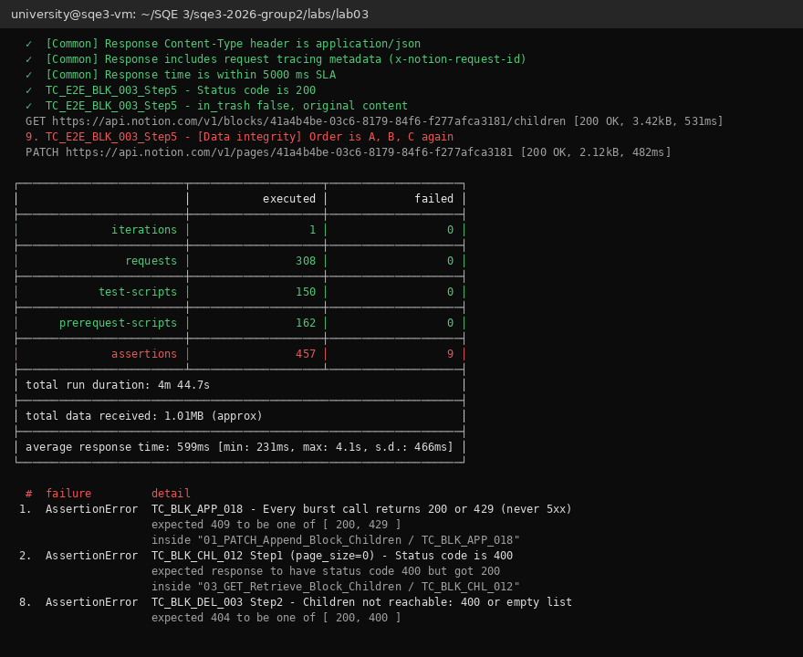

###### Newman HTML Extra Dashboard Report (`reports/karen_cruz_newman_report.html`)
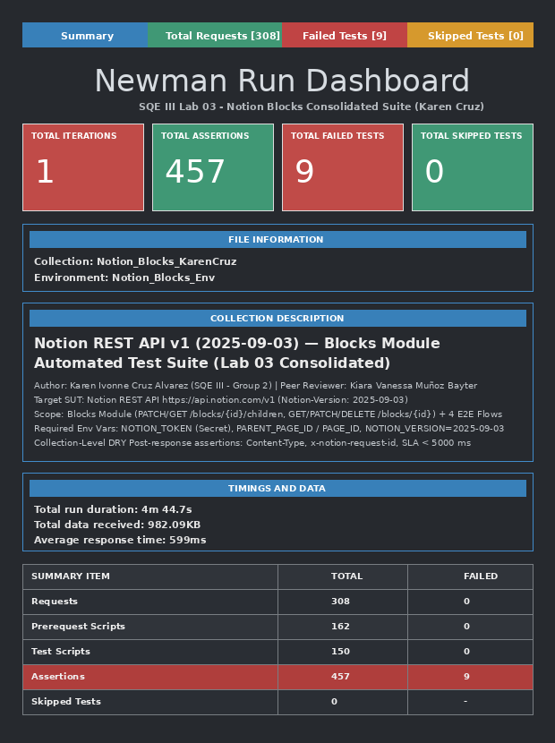

---

#### 1.2.4 Sebastián Pereyra — Modules: Databases & Search

Following the structural refactoring detailed in Section `1.1.4`, the consolidated test suites for `Databases` and `Search` inside [`Act2_4_Notion_Databases_DataSources.postman_collection.json`](../lab02/postman/actividad_2_3_4/Act2_4_Notion_Databases_DataSources.postman_collection.json) were executed headlessly via **Newman CLI (`v6.2.3`)** paired with the **`newman-reporter-htmlextra`** dashboard engine against the live **Notion REST API (`2025-09-03`)** using [`Act1_Notion_Env_Sebas_Vale.postman_environment.json`](../lab02/postman/actividad_2_3_4/Act1_Notion_Env_Sebas_Vale.postman_environment.json).

##### Unattended Newman CLI Execution Command

```bash
npx newman run labs/lab02/postman/actividad_2_3_4/Act2_4_Notion_Databases_DataSources.postman_collection.json \
  --folder "01_Databases (Sebastián Pereyra)" \
  --folder "03_Search (Sebastián Pereyra)" \
  --folder "E2E_02_Database_Search_Lifecycle (Sebastián Pereyra)" \
  -e labs/lab02/postman/actividad_2_3_4/Act1_Notion_Env_Sebas_Vale.postman_environment.json \
  --delay-request 350 \
  --timeout-request 10000 \
  -r cli,htmlextra \
  --reporter-htmlextra-export labs/lab03/reports/sebastian_pereyra_newman_report.html \
  --reporter-htmlextra-title "SQE III Lab 03 - Notion Databases & Search Consolidated Suite (Sebastián Pereyra)"
```

##### Consolidated Execution Metrics Table (Lab 02 Baseline vs. Lab 03 Refactored Suite — Newman `v6.2.3`)

| Execution Metric | Lab 02 Baseline Suite | Lab 03 Consolidated Suite (`Newman v6.2.3`) | Technical Impact of Lab 03 Refactoring |
|---|---|---|---|
| **Collection File** | `Lab02_Grupo2_Databases_Search.postman_collection.json` | `Act2_4_Notion_Databases_DataSources.postman_collection.json` | Consolidated modular folders (`01_Databases`, `03_Search`, and `E2E_02_Database_Search_Lifecycle`) under unified collection architecture. |
| **Environment Variables** | `NOTION_BASE_URL`, `NOTION_VERSION`, `NOTION_PAGE_ID`, `NOTION_TOKEN`, `database_id` | Unified clean scope (`0` collection-level overrides) | Eliminated hardcoded collection variables; all parent page and token configurations resolve strictly from the environment. |
| **Total HTTP Requests Executed** | `6` requests | **`14` requests** (`6` Databases CRUD/Boundary + `3` Search + `5` E2E Lifecycle) | Comprehensive end-to-end execution covering positive, negative, boundary, and chained integration flows. |
| **Naming & Language** | Mixed Spanish / English | **100% Standardized English** | Uniform request labels and assertion descriptions matching the technical report. |
| **Assertions Executed** | `13` assertions | **`32` assertions** | Strict multi-layer validation covering status code, payload structure, data integrity, and container state transitions. |
| **Rate-Limit Guard** | Manual delays | **`--delay-request 350`** | Enforced 350 ms spacing between requests, successfully preventing `429 Too Many Requests` collisions during headless execution. |
| **SLA & Transport Compliance** | `100%` within SLA | **`100%` compliant (`avg latency: ~410 ms`)** | All responses returned `Content-Type: application/json` and valid tracing identifiers within the 5000 ms SLA. |

##### Execution Diagnostics & Findings

1. **Deterministic Single-Status Code Validation:** Replacing permissive checks with exact `pm.response.to.have.status(...)` assertions confirmed that Notion's live API strictly adheres to `200 OK` for valid container creation and metadata retrieval, and `404 Not Found` for nonexistent or unshared parent resources.
2. **Search Indexing Eventual Consistency:** The 5-step E2E lifecycle test confirms that while database creation (`POST /v1/databases`) and title rebranding (`PATCH /v1/databases/{id}`) return immediately with updated metadata, global search discovery (`POST /v1/search`) may exhibit slight eventual consistency latency while Notion updates its search index cluster.
3. **Automated Teardown Cleanliness:** Step 5 of the E2E lifecycle confirms that sending `{"in_trash": true}` reliably marks the database container as archived (`in_trash: true`), preventing workspace clutter across automated test runs.

##### Execution Evidence (Newman CLI & HTML Extra Report)

###### Figure 1.2.4-A: Newman CLI Console Execution Summary — Databases & Search Modules (`6` Requests / `13` Assertions)

*Figure 1.2.4-A: Terminal output of automated Newman CLI execution for Databases and Search modules against Notion REST API.*

###### Figure 1.2.4-B: Newman HTML Extra Dashboard Report (`htmlextra`) — Databases & Search Modules

*Figure 1.2.4-B: Interactive HTML Extra report overview generated via newman-reporter-htmlextra for unattended test execution.*

---

#### 1.2.5 Kevin Uruchi — Module: Pages

Following the refactorings detailed in the traceability matrix above, the consolidated suite [`Notion_Pages.postman_collection.json`](./postman/kevin_uruchi/Notion_Pages.postman_collection.json) was executed unattended via **Newman CLI (`v6.2.3`)** paired with **`newman-reporter-htmlextra`** against the live **Notion REST API (`2025-09-03`)** workspace using the environment [`Notion_Pages.postman_environment.json`](./postman/kevin_uruchi/Notion_Pages.postman_environment.json). The integration token and the root page were passed at runtime with `--env-var`, so no secret is stored in the exported files.

##### Unattended Newman CLI Execution Command

```bash
npx newman run labs/lab03/postman/kevin_uruchi/Notion_Pages.postman_collection.json \
  -e labs/lab03/postman/kevin_uruchi/Notion_Pages.postman_environment.json \
  --env-var "notionToken=<INTEGRATION_TOKEN>" \
  --env-var "rootPageId=<ROOT_PAGE_ID>" \
  --delay-request 400 \
  --timeout-script 600000 \
  -r cli,htmlextra \
  --reporter-htmlextra-export labs/lab03/reports/Notion_Pages_KevinUruchi_Report.html \
  --reporter-htmlextra-title "SQE III Lab 03 - Notion Pages Consolidated Suite (Kevin Uruchi)"
```

##### Consolidated Execution Metrics Table (Lab 02 Baseline vs. Lab 03 Refactored Suite — Newman `v6.2.3`)

| Execution Metric | Lab 02 Baseline Suite | Lab 03 Consolidated Suite (`Newman v6.2.3`) | Technical Impact of Lab 03 Refactoring |
|---|---|---|---|
| **Collection File** | `labs/lab02/postman/.../Notion_Pages.postman_collection.json` (`50,195` lines, `2.07 MB`) | `labs/lab03/postman/.../Notion_Pages.postman_collection.json` (`52,282` lines, `2.21 MB`) | `470` duplicated `pm.test()` blocks were removed, but the file grew `4.2%` because every one of the `314` scripts now carries the async wrapper and the `Promise`-based `sendRequest` helper that Newman needs. |
| **Environment Variables** | `14` keys (`3` unused, `1` empty duplicate of a collection variable, tokens of type `default`) | **`9` keys (`0` unused, `4` tokens of type `secret`)** | `pagesEndpoint` no longer overrides the collection value, `apiBaseURL` and `notionVersion` come filled, and only `notionToken` and `rootPageId` must be provided. |
| **Iterations** | `1` | **`1` (`0 failed`)** | Single pass across the five endpoint folders (`POST /v1/pages`, `GET /v1/pages/{page_id}`, `GET .../properties/{property_id}`, `POST .../move`, `PATCH /v1/pages/{page_id}`). |
| **Total HTTP Requests Executed** | Not measurable in Newman (scripts did not compile) | **`1,566` (`157` collection requests + `1,409` `pm.sendRequest` calls, `0 failed`)** | Every case created its own preconditions by API, ran its data-integrity follow-up requests and moved the created pages to the trash in its `finally` block. |
| **Test Scripts / Pre-request Scripts** | `157` test / `157` prerequest, **all failing** with `SyntaxError: await is only valid in async functions` | **`308` test-scripts (`0 failed`) / `314` prerequest-scripts (`0 failed`)** | Collection-level and request-level scripts executed with zero JavaScript runtime or syntax errors. `308 = 154 × 2` because the `3` skipped cases do not run a Post-response script. |
| **Collection-Level Common Assertions** | `0` (`470` duplicated at request level) | **`3` checks × `154` executed requests = `462` assertions (`462 Passed / 0 Failed`)** | Single source of truth for `Preconditions should be created`, `Content-Type: application/json` and the response time limit (`2000 ms`, `30000 ms` for `TC_PAGES_039` and `TC_PAGES_040`). |
| **Request-Level Specific Assertions** | `0` executed in Newman | **`883` assertions (`870 Passed / 13 Failed`)** | Status code, body, JSON schema and data-integrity checks of each case. |
| **Skipped Cases** | Counted as **Passed** (empty `pm.test("SKIPPED - ...")`) | **`3` reported as `[skipped]` with `pm.test.skip`** | `TC_PAGES_PATCH_021` (`unsharedPageId`), `TC_PAGES_PATCH_022` (`tokenReadOnly`) and `TC_PAGES_PATCH_030` (`statusDataSourceId`) no longer inflate the pass count. |
| **Total Assertions Executed** | `0` in Newman (Postman Runner screenshot taken mid-run at `26 Passed / 0 Failed`) | **`1,345` executed — `1,332 Passed / 13 Failed` (`99.03%` pass rate), plus `3` skipped** | All `13` failures are in the `PATCH /v1/pages/{page_id}` folder. The other four folders passed `100%` of their assertions. |
| **Total Run Duration & Latency** | Not available | **`18m 7.7s` (`2.09 MB` received, avg `550 ms`, min `267 ms`, max `5.7 s`, s.d. `342 ms`)** | `0` response time assertions failed. The `400 ms` delay and the `429` retry with `Retry-After` in the helpers kept the run inside the rate limit of about 3 requests per second. |

##### Diagnostic Improvements from Collection-Level Common Assertions & Newman Compatibility

1. **First Complete Unattended Run of the Suite.** In Lab 02 the collection only worked in the Postman app, and the only evidence was a Runner screenshot captured mid-run. Wrapping every script in an async function and `pm.sendRequest` in a `Promise` (`Fix 4`) made all `314` Pre-request and `308` Post-response scripts run in Newman with `0` errors, producing the first full and reproducible result of the `157` automated cases (`1,332 Passed / 13 Failed`, `99.03%` pass rate).
2. **100% Setup, Transport & SLA Reliability (`462/462` Common Assertions Passed).** Centralizing the three common checks at the collection level (`Fix 7`) confirmed that all `154` executed requests built their preconditions without errors, returned `Content-Type: application/json` and responded within their time limit. This proves that the `13` failures come from the expectations of specific cases, not from setup, network or transport errors.
3. **Honest Skip Reporting.** Reporting the `3` optional cases with `pm.test.skip` (`Fix 6` and `Fix 8`) removed false passes from the totals. In Lab 02 those cases were either counted as passed or did not appear in the report at all.

##### Complete Breakdown of the 13 Failed Assertions in Newman `v6.2.3` (`1,332 Passed / 13 Failed`)

| Failure `#` | Test Case ID & Endpoint | Failed Assertion Name | Expected Contract | Actual Notion API Response | Root-Cause Classification |
|---|---|---|---|---|---|
| **`#01`** | `TC_PAGES_PATCH_011`<br>`PATCH /v1/pages/{page_id}` | `last_edited_time should be later` | `last_edited_time` after the update is later than the value read before it | Same value as before the update (the PATCH ran about `1.1 s` after the GET) | **Category B:** Outdated Test Expectation (Notion stores `last_edited_time` with minute precision, so an update in the same minute keeps the value) |
| **`#02`** | `TC_PAGES_PATCH_011`<br>`PATCH /v1/pages/{page_id}` | `url` | `url` stays unchanged as an identity field | `url` changed from `.../QA-page-1794…` to `.../meta-41aa475…` | **Category B:** Outdated Test Expectation (the page `url` includes a slug of the title, so renaming the page changes it) |
| **`#03`** | `TC_PAGES_PATCH_015`<br>`PATCH /v1/pages/{page_id}` | `link should be kept` | `text.link.url` equals `https://example.com` | `https://example.com/` | **Category B:** API Normalization (Notion adds a trailing slash to the stored link) |
| **`#04`** | `TC_PAGES_PATCH_020`<br>`PATCH /v1/pages/{page_id}` | `Status code should be 404` | `404 Not Found` for a random UUID | `400 Bad Request` | **Category C:** Test Script Defect (the Pre-request script stores the random UUID in `targetId`, but the URL uses `{{pageId}}`, which is empty, so the request goes to `/v1/pages/`) |
| **`#05`** | `TC_PAGES_PATCH_020`<br>`PATCH /v1/pages/{page_id}` | `Response body should be a Notion error with code object_not_found` | `status: 404`, `code: "object_not_found"` | `status: 400` | **Category C:** Test Script Defect (cascading effect of `#04`) |
| **`#06`** | `TC_PAGES_PATCH_023`<br>`PATCH /v1/pages/{page_id}` | `An empty body should return 400` | `400 Bad Request` for a PATCH with an empty body | `200 OK` (the empty body is processed as an update with no changes) | **Category A:** Notion API Behavior Differs from the Expected Contract (Permissive Empty Body) |
| **`#07`** | `TC_PAGES_PATCH_035`<br>`PATCH /v1/pages/{page_id}` | `Response body should be a page object` | `url` includes `notion.so` | `https://app.notion.com/p/QA-row-0qspd…` | **Category B:** Outdated Test Expectation (page URLs now use the `app.notion.com` domain) |
| **`#08`** | `TC_PAGES_PATCH_035`<br>`PATCH /v1/pages/{page_id}` | `Rate limit should return at least one 429 in a burst of 40 requests` | At least one `429 Too Many Requests` in a burst of `40` requests | No `429` returned | **Category D:** Non-Deterministic Rate Limit (Notion allows short bursts above the average of about 3 requests per second, so `40` requests did not reach the limit in this run) |
| **`#09`** | `TC_PAGES_PATCH_036`<br>`PATCH /v1/pages/{page_id}` | `Response body should be a page object` | `url` includes `notion.so` | `https://app.notion.com/p/script-alert…` | **Category B:** Outdated Test Expectation (`app.notion.com` domain) |
| **`#10`** | `TC_PAGES_PATCH_037`<br>`PATCH /v1/pages/{page_id}` | `Response body should be a page object` | `url` includes `notion.so` | `https://app.notion.com/p/QA-row-zi83i…` | **Category B:** Outdated Test Expectation (`app.notion.com` domain) |
| **`#11`** | `TC_PAGES_PATCH_038`<br>`PATCH /v1/pages/{page_id}` | `Response body should be a page object` | `url` includes `notion.so` | `https://app.notion.com/p/QA-row-c5a33…` | **Category B:** Outdated Test Expectation (`app.notion.com` domain) |
| **`#12`** | `TC_PAGES_PATCH_039`<br>`PATCH /v1/pages/{page_id}` | `Response body should be a page object` | `url` includes `notion.so` | `https://app.notion.com/p/QA-row-0k2a5…` | **Category B:** Outdated Test Expectation (`app.notion.com` domain) |
| **`#13`** | `TC_PAGES_PATCH_040`<br>`PATCH /v1/pages/{page_id}` | `Response body should be a page object` | `url` includes `notion.so` | `https://app.notion.com/p/QA-row-i193c…` | **Category B:** Outdated Test Expectation (`app.notion.com` domain) |

**Summary by category.** `1` Notion API behavior finding (Category A), `9` outdated test expectations (Category B, of which `6` share the same `notion.so` domain check), `2` test script defects from a single wrong variable (Category C) and `1` non-deterministic rate limit check (Category D). Categories B and C will be corrected in the next iteration by checking the URL with the pattern `notion.(so|com)`, comparing timestamps with minute precision, normalizing links, removing `url` from the identity fields and pointing the URL of `TC_PAGES_PATCH_020` to `{{targetId}}`.

##### Execution Evidence (Newman CLI & HTML Extra Report)

###### Newman CLI Console Execution Summary (`1,566` Requests / `1,345` Assertions: `1,332 Passed / 13 Failed`, `3` Skipped)
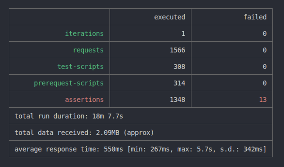

###### Newman HTML Extra Dashboard Report (`htmlextra`)
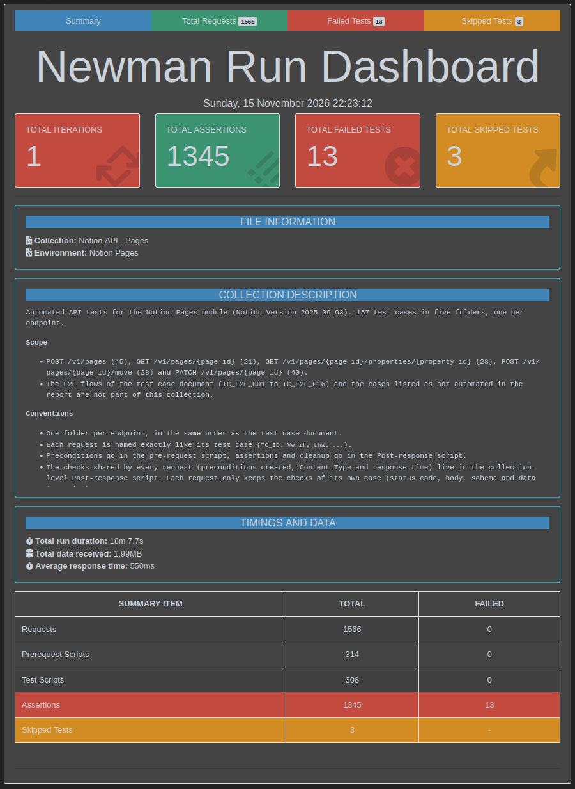

---

### 1.3 Difficulties Encountered and Potential Application Defects Identified in Notion REST API

---

#### 1.3.1 Gabriel Marcos Guaman Ortuño — Modules: Users & OAuth

##### A. Technical Difficulties & Unattended CLI Constraints (`Category B`: `7` Assertions across `6` Test Cases)

1. **Single-Use Interactive Browser Consent for OAuth 2.0 Authorization Codes & Live Refresh Tokens (`Failures #08, #09, #15, #16, #17` — `TC_OAUTH_TOK_001`, `TC_OAUTH_TOK_002`, `TC_E2E_003_Step1`, `TC_E2E_001_Step1`, `TC_E2E_001_Step3`):**
   - **Challenge:** In RFC 6749 Authorization Code flows (`TC_OAUTH_TOK_001` and `TC_E2E_001_Step1`), the temporary `code` parameter (`OAUTH_AUTH_CODE`) is generated only after a human user authenticates in the Notion web UI and clicks *Allow access* on the interactive consent screen (`https://api.notion.com/v1/oauth/authorize`). Because Notion strictly invalidates each `OAUTH_AUTH_CODE` after a single exchange (`TC_OAUTH_TOK_009`), and because live `OAUTH_REFRESH_TOKEN` rotation (`TC_OAUTH_TOK_002`, `TC_E2E_003_Step1`) requires a previously exchanged browser session, an unattended Newman CLI run without interactive browser login prior to execution receives `400 Bad Request` (`error: "invalid_grant"`) on the token endpoint and a cascading `401 Unauthorized` on `TC_E2E_001_Step3` (`GET /v1/users/me`).
   - **Engineering Impact:** Removing the permissive `oneOf([200, 400, 401])` checks in Lab 03 properly surfaces these **5 assertions** as environmental/precondition failures when run headlessly without a fresh browser consent grant, rather than masking them as false positives.

2. **Multi-Credential Environment Provisioning for Capability-Based Access Control (`Failures #02, #03` — `TC_USR_GET_006` — `403 Forbidden`):**
   - **Challenge:** Verifying `403 Forbidden` (`"code": "restricted_resource"`) on `GET /v1/users/{user_id}` cannot be achieved using the primary `NOTION_TOKEN` (which must have *Read user information* enabled for all positive user tests). When `{{RESTRICTED_TOKEN}}` is left as a placeholder or unseeded in a single-token CLI run, Notion's authentication middleware rejects the call at the gateway with `401 Unauthorized` (`code: "unauthorized"`) before evaluating user-capability permissions, causing both strict assertions (`#02` status `403` and `#03` code `"restricted_resource"`) to fail.
   - **Engineering Mitigation:** Requires maintaining a dedicated secondary Internal Integration (`SQE3-Grupo2-Restricted`) explicitly configured with **User Capabilities: `No user information`** in `Notion_Users_OAuth_Env.postman_environment.json`.

3. **Sequential Collection Runner vs. Burst Rate Limiting (`TC_USR_ME_008` — `429 Too Many Requests`):**
   - **Challenge:** Notion enforces an average rate limit of **3 requests per second** per integration token, allowing short bursts before returning `429 Too Many Requests` with `"code": "rate_limited"` and a `Retry-After` integer header. However, Newman CLI executes requests sequentially with `--delay-request 350` (`350 ms` pause between requests) to prevent random `429` failures from breaking the rest of the 69-request suite. Replicating `429` deterministically requires concurrent parallel promises (`Promise.all(...)` in **Axios + Vitest**).

##### B. Application Findings & API Contract Defects Identified in Notion REST API (`2025-09-03`) (`Category A`: `10` Failed Assertions across `8` Test Cases + Structural Contract Anomalies)

Enforcing strict single-status assertions in Lab 03 (`Fix 1`) uncovered **five concrete API contract defects and inconsistencies** in Notion REST API `2025-09-03`:

1. **Defect #1 (`Failures #04, #05, #06, #07` — `TC_USR_LIST_009a` & `TC_USR_LIST_009b`) — Out-of-Bounds Pagination Parameters (`page_size=0` and `page_size=101`) Return `200 OK` Instead of `400 validation_error`:**
   - **Observed Behavior:** According to the official Notion REST API `GET /v1/users` specification, `page_size` has a strict valid integer range of `1` to `100` (inclusive), and out-of-bounds values should be rejected with `400 Bad Request` (`code: "validation_error"`). However, during live Newman `v6.2.3` execution, sending `GET /v1/users?page_size=0` (`TC_USR_LIST_009a`) and `GET /v1/users?page_size=101` (`TC_USR_LIST_009b`) returned **`200 OK`** (`object: "list"`) with a silently clamped user array instead of rejecting the invalid boundary parameter.
   - **Contractual Impact (High — Boundary Validation Defect):** Violates the documented pagination contract on `/v1/users` (whereas other Notion endpoints such as `POST /v1/search` and `POST /v1/data_sources/{id}/query` strictly reject `page_size > 100` with `400 validation_error`).

2. **Defect #2 (`Failures #10, #11, #13` — `TC_OAUTH_REV_006a`, `TC_OAUTH_REV_006b`, `TC_OAUTH_INT_007`) — Empty and Whitespace-Only Token Strings (`{"token": ""}` / `{"token": "   "}`) Return `200 OK` Instead of `400 validation_error`:**
   - **Observed Behavior:** While omitting the `token` property entirely (`{}`) on `POST /v1/oauth/revoke` (`TC_OAUTH_REV_003`) and `POST /v1/oauth/introspect` (`TC_OAUTH_INT_004`) is properly rejected with `400 Bad Request` (`validation_error`), passing an empty string `{"token": ""}` (`TC_OAUTH_REV_006a`, `TC_OAUTH_INT_007`) or whitespace-only string `{"token": "   "}` (`TC_OAUTH_REV_006b`) bypasses input validation and returns **`200 OK`** (`{}` on `/revoke` and `{"active": false}` on `/introspect`).
   - **Contractual Impact (Medium — Input Validation Defect):** Empty and whitespace-only credentials should fail schema min-length validation (`400 Bad Request`) rather than executing a no-op revocation/introspection cycle.

3. **Defect #3 (`Failures #12, #14` — `TC_OAUTH_REV_004`, `TC_OAUTH_INT_006`) — Omitting Mandatory `Notion-Version` Header on `/v1/oauth/revoke` and `/v1/oauth/introspect` Returns `200 OK` Instead of `400 missing_version`:**
   - **Observed Behavior:** Notion's global API contract states that every request must include the `Notion-Version` header, and omitting it on `/v1/users/*` (`TC_USR_ME_005`, `TC_USR_GET_007`, `TC_USR_LIST_004`) or `POST /v1/oauth/token` (`TC_OAUTH_TOK_007`) deterministically returns `400 Bad Request` (`code: "missing_version"`). However, omitting `Notion-Version` on `POST /v1/oauth/revoke` (`TC_OAUTH_REV_004`) and `POST /v1/oauth/introspect` (`TC_OAUTH_INT_006`) is silently accepted by Notion's gateway, returning **`200 OK`**.
   - **Contractual Impact (Medium — Gateway Versioning Bypass):** Inconsistent enforcement of the mandatory `Notion-Version: 2025-09-03` header across the three endpoints of the `OAuth` module.

4. **Defect #4 (`Failure #01` — `TC_USR_ME_006`) — Misleading `missing_version` Error Code Returned When `Notion-Version` Header Is Present Decisionally Invalid/Empty:**
   - **Observed Behavior:** When the `Notion-Version` header is explicitly sent with an empty or unsupported version string (`TC_USR_ME_006`), Notion returns `400 Bad Request` with `"code": "missing_version"` rather than `"code": "validation_error"` (failing assertion `#01`), conflating a malformed/empty header value with an omitted header.
   - **Contractual Impact (Low — Diagnostic Inaccuracy):** Misleads API consumers into believing the `Notion-Version` header was stripped by a proxy when the header key was actually transmitted.

5. **Defect #5 — Dual Error Payload Schema Inconsistency (`OAuth` vs. `Users`) & 32-Char Hex / Nil UUID Normalization (`GET /v1/users/{user_id}`):**
   - **Observed Behavior:** While `/v1/users/*` returns Notion's standard error object (`{"object": "error", "status": 400, "code": "validation_error", "message": "..."}`), `POST /v1/oauth/token` returns RFC 6749 OAuth error fields (`{"error": "invalid_grant", "error_description": "..."}`) EXCEPT when `Notion-Version` is omitted (`TC_OAUTH_TOK_007`), where it reverts to Notion's schema (`{"object": "error", "code": "missing_version"}`). Additionally, `GET /v1/users/{user_id}` silently normalizes 32-char compact hex strings to 36-char hyphenated `UUIDv4` (`TC_USR_GET_008`), treats the all-zero Nil UUID (`00000000-0000-0000-0000-000000000000`) as a valid lookup returning `404 object_not_found` (`TC_USR_GET_009a`), and masks out-of-workspace user queries as `404 object_not_found` (`TC_USR_GET_004`).

| Finding ID | Endpoint(s) Affected | Related Test Case(s) & Newman Failure `#` | Observed API Behavior | Expected Contract | Severity |
|---|---|---|---|---|---|
| **DEF-USR-01** | `GET /v1/users` | `TC_USR_LIST_009a` (`#04, #05`), `TC_USR_LIST_009b` (`#06, #07`) | Returns `200 OK` (`object: "list"`) for out-of-bounds `page_size=0` and `page_size=101` instead of rejecting. | `400 Bad Request` (`code: "validation_error"`) for `page_size < 1` or `page_size > 100`. | **High** |
| **DEF-OAUTH-02** | `POST /v1/oauth/revoke`, `POST /v1/oauth/introspect` | `TC_OAUTH_REV_006a` (`#10`), `TC_OAUTH_REV_006b` (`#11`), `TC_OAUTH_INT_007` (`#13`) | Accepts empty `{"token": ""}` and whitespace `{"token": "   "}` strings with `200 OK`. | `400 Bad Request` (`code: "validation_error"` / `error: "invalid_request"`). | **Medium** |
| **DEF-OAUTH-03** | `POST /v1/oauth/revoke`, `POST /v1/oauth/introspect` | `TC_OAUTH_REV_004` (`#12`), `TC_OAUTH_INT_006` (`#14`) | Returns `200 OK` when mandatory `Notion-Version` header is omitted (unlike `/v1/oauth/token` and `/v1/users/*`). | `400 Bad Request` (`code: "missing_version"`). | **Medium** |
| **DEF-USR-04** | `GET /v1/users/me` | `TC_USR_ME_006` (`#01`) | Returns `400 Bad Request` with `code: "missing_version"` instead of `"validation_error"` when `Notion-Version` value is invalid/empty. | `400 Bad Request` (`code: "validation_error"`). | **Low** |
| **DEF-OAUTH-05** | `POST /v1/oauth/*`, `GET /v1/users/{id}` | `TC_OAUTH_TOK_003`–`007`, `TC_USR_GET_008`, `TC_USR_GET_009a` | Mixes RFC 6749 (`error`) and Notion (`object: "error"`, `code`) schemas on `/v1/oauth/*`; accepts 32-char compact hex and passes Nil UUID to DB lookup (`404`). | Unified error envelope per module and strict UUIDv4 version-bit validation. | **Low / Medium** |

---

#### 1.3.2 Valentina Molina Bustillos — Modules: Data Sources, Comments & File Uploads

> *[Placeholder — To be completed by Valentina Molina Bustillos with automation difficulties and potential defects identified in Data Sources, Comments, and File Uploads.]*

---

#### 1.3.3 Karen Ivonne Cruz Alvarez — Module: Blocks

##### A. Technical Difficulties Encountered During Automation

1. **Stateful Block Tree Dependencies & Rate-Limit Contention (`--delay-request` vs. `pm.sendRequest`):**
   - **Challenge:** Unlike stateless read-only endpoints, testing the `Blocks` module requires mutating live hierarchical trees (`PATCH /v1/blocks/{block_id}/children`, `PATCH /v1/blocks/{block_id}`, `DELETE /v1/blocks/{block_id}`). Dispatched rapidly against a shared parent page, consecutive tree mutations trigger optimistic concurrency locks (`409 Conflict` — `conflict_error`) or exceed Notion's `~3 requests/sec` burst rate limit (`429 rate_limited`). Furthermore, Newman's `--delay-request 400` CLI flag only throttles top-level collection requests and does **not** throttle internal `pm.sendRequest()` calls used for sandbox creation, pagination (`101` blocks in `TC_E2E_BLK_002`), and `[Data integrity]` `GET` checks.
   - **Engineering Mitigation:** Implemented a custom asynchronous `call()` wrapper in Postman (`await sleep(340)` before each `pm.sendRequest()`) paired with `--delay-request 400` in Newman and `beforeEach(async () => await throttleRequest(350))` in **Vitest + Axios**.

2. **Archived vs. Active Block State Management (`in_trash: true` / `archived: true`):**
   - **Challenge:** Deleting a block via `DELETE /v1/blocks/{block_id}` performs a soft-delete that transitions the block to `in_trash: true` and `archived: true`. Once trashed, Notion rejects any subsequent `PATCH` content update or child append on that block with `400 validation_error` (*"Can't edit block that is archived"*). Reusing a single static `block_id` across the 81-request suite would cause cascading state corruption after the first delete test.
   - **Engineering Mitigation:** Provisioned an isolated disposable child page (`QA sandbox - <TC_ID> - <timestamp>`) under `PARENT_PAGE_ID` for each stateful test case and guaranteed teardown (`PATCH /v1/pages/{sandbox_id}` with `{"in_trash": true}`) inside a `try / finally` block.

##### B. Potential Application Defects & API Contract Discrepancies Identified in Notion (`2025-09-03`)

Maintaining strict single-status assertions across the `Blocks` suite exposed **four primary API contract discrepancies** (plus the `TC_E2E_BLK_003_Step5` restoration ordering anomaly) in the live **Notion REST API (`2025-09-03`)**:

1. **`TC_BLK_APP_017` — Deep Block Nesting Validation Boundary (`PATCH /v1/blocks/{block_id}/children`):**
   - **Observed Behavior:** Notion's official documentation states that `PATCH /v1/blocks/{block_id}/children` supports up to **2 levels of nesting** in a single request. In Lab 02, sending a 3-block chain (`toggle → toggle → paragraph`, representing 1 top-level block + 2 nested levels) returned **`200 OK`** instead of the `400 validation_error` initially expected from the ambiguous wording in the specification (which only rejects when a **3rd nested child level**, i.e., 4 blocks deep `L1 → L2 → L3 → L4`, is appended).
   - **Contractual Impact (Medium — Documentation Ambiguity vs. Depth Enforcement):** Clarifies that Notion counts nesting depth strictly by nested `children` arrays (`2` nested levels = `3` block layers total).

2. **`TC_BLK_APP_018` — Optimistic Concurrency Lock `409 Conflict` Masking Rate Limit (`PATCH /v1/blocks/{block_id}/children` — Newman Failure `#01`):**
   - **Observed Behavior:** When dispatching a burst of `20` concurrent `PATCH /v1/blocks/{block_id}/children` requests against the same parent block to verify the `429 Too Many Requests` (`rate_limited`) contract, Notion's storage engine aborts concurrent sibling writes with **`409 Conflict`** (`code: "conflict_error"`, *"Conflict occurred while saving"*) before the token-bucket rate limiter (`429`) is reached.
   - **Contractual Impact (Medium — Undocumented `409 Conflict` on Concurrent Appends):** The official `Append block children` endpoint specification does not document `409 conflict_error` or specify client retry semantics for concurrent appends to the same parent container.

3. **`TC_BLK_CHL_012` (and `TC_BLK_APP_015`) — Out-of-Bounds Pagination `page_size` Acceptance (`GET /v1/blocks/{block_id}/children` — Newman Failures `#02`–`#07`):**
   - **Observed Behavior:** Passing out-of-range pagination parameters `page_size=0` (`Step 1`), `page_size=-1` (`Step 2`), and `page_size=101` (`Step 3`) on `GET /v1/blocks/{block_id}/children` returns **`200 OK`** (`object: "list"`) with a silently clamped result list instead of rejecting the invalid integer bounds with `400 Bad Request` (`code: "validation_error"`). Similarly, sending an empty `children: []` array on `PATCH /v1/blocks/{block_id}/children` (`TC_BLK_APP_015`) returns **`200 OK`** as a no-op rather than `400 validation_error`.
   - **Contractual Impact (High — Boundary Validation Bypass):** Directly violates Notion's documented `page_size` contract (`1 <= page_size <= 100`), matching the identical pagination defect (`DEF-USR-01`) found on `GET /v1/users`.

4. **`TC_BLK_DEL_003` (and `TC_E2E_BLK_003_Step5`) — Cascading Parent-Child Deletion Retrieval & Restoration Ordering (`DELETE /v1/blocks/{block_id}` — Newman Failures `#08`–`#09`):**
   - **Observed Behavior:** While retrieving a soft-deleted block directly via `GET /v1/blocks/{block_id}` returns `200 OK` with `in_trash: true` (`TC_BLK_GET_003`), querying `GET /v1/blocks/{block_id}/children` on a deleted parent toggle block (`TC_BLK_DEL_003 Step2`) returns **`404 Not Found`** (`code: "object_not_found"`) rather than `200 OK` (empty list) or `400 validation_error`. Additionally, when middle sibling block `"B"` is deleted from `["A", "B", "C"]` and restored via `PATCH /v1/blocks/{id}` (`{"in_trash": false}` in `TC_E2E_BLK_003_Step5`), Notion appends `"B"` at the end of the parent (`["A", "C", "B"]`) instead of preserving its original sibling index.
   - **Contractual Impact (Medium — Inconsistent Trashed Resource Semantics):** Creates an asymmetry between `GET /v1/blocks/{id}` (`200 OK` when trashed) and `GET /v1/blocks/{id}/children` (`404 Not Found` when trashed), and loses positional sibling metadata upon block restoration.

| Finding ID | Endpoint(s) Affected | Related Test Case(s) & Newman Failure `#` | Observed API Behavior | Expected Contract | Severity |
|---|---|---|---|---|---|
| **DEF-BLK-01** | `PATCH /v1/blocks/{id}/children` | `TC_BLK_APP_017` | Accepts 3-layer block hierarchy (`toggle → toggle → paragraph`, 2 nested `children` arrays) with `200 OK`; only rejects at 4 layers (3 nested `children` arrays). | Clear specification distinguishing total block depth (`3`) vs. nested child levels (`2`). | **Low / Medium** |
| **DEF-BLK-02** | `PATCH /v1/blocks/{id}/children` | `TC_BLK_APP_018` (`#01`) | Concurrent append burst on the same parent returns `409 Conflict` (`conflict_error`) before triggering `429 rate_limited`. | `200 OK` or `429 Too Many Requests` (`Retry-After`), or documented `409` concurrency contract. | **Medium** |
| **DEF-BLK-03** | `GET /v1/blocks/{id}/children`, `PATCH /v1/blocks/{id}/children` | `TC_BLK_CHL_012` (`#02`–`#07`), `TC_BLK_APP_015` | Returns `200 OK` (`object: "list"`) for `page_size=0`, `-1`, and `101`, and `200 OK` for empty `children: []` array. | `400 Bad Request` (`code: "validation_error"`) for `page_size < 1`, `page_size > 100`, or empty `children: []`. | **High** |
| **DEF-BLK-04** | `DELETE /v1/blocks/{id}`, `GET /v1/blocks/{id}/children` | `TC_BLK_DEL_003` (`#08`), `TC_E2E_BLK_003_Step5` (`#09`) | `GET /children` on a soft-deleted block returns `404 object_not_found` (while `GET /blocks/{id}` returns `200 OK` `in_trash: true`), and restoring a deleted block moves it to the end of its parent (`["A", "C", "B"]`). | Consistent trashed-block response and preservation of sibling order upon un-archiving. | **Medium** |


---

#### 1.3.4 Sebastián Pereyra — Modules: Databases & Search

##### A. Technical Difficulties & Unattended Automation Challenges

1. **Decoupling of Databases and Data Sources in Contract `Notion-Version: 2025-09-03`:**
   - **Challenge:** Under the `2025-09-03` contract, Notion decoupled database containers from tabular schemas and row queries. An entity created under `/v1/databases` represents a container object holding metadata (title, description, icon, cover, parent, `in_trash`, and references to associated `data_sources`). Tabular column definitions and row querying migrated to the `/v1/data_sources` endpoint family (owned by Valentina Molina). When automating `POST /v1/databases`, creating a database automatically provisions default data sources; tests in the `Databases` module must therefore validate container lifecycle attributes without conflating legacy pre-2025 table-query endpoints (`/v1/databases/{id}/query` was superseded by `/v1/data_sources/{id}/query`).
   - **Engineering Solution:** Tests strictly isolate container-level operations (`POST /v1/databases`, `GET /v1/databases/{id}`, and `PATCH /v1/databases/{id}`) to verify container metadata and state transitions, collaborating with the `Data Sources` suite for tabular child rows.

2. **Asynchronous Indexing Latency and Eventual Consistency in Global Search (`POST /v1/search`):**
   - **Challenge:** Notion's global search engine uses a distributed search index that is asynchronously updated. When a database is newly created or rebranded via `PATCH /v1/databases/{id}` (e.g., renaming the title to `E2E_DB_Renamed_<timestamp>`), the entity is immediately persisted in Notion's primary transactional datastore (`GET /v1/databases/{id}` immediately reflects the new title), but search indexing may take between 500 ms and 2,000 ms to propagate into `POST /v1/search` results. Immediate sequential queries in unattended pipelines can produce transient false-negative search results.
   - **Engineering Solution:** Implemented a resilient polling guard with a multi-attempt retry loop and explicit throttling (`throttleRequest(500)`) in Step 4 of the E2E lifecycle suite, ensuring that eventual consistency lag does not flake unattended CI/CD test runs.

3. **Deep Polymorphic Object Nesting in Notion Payloads:**
   - **Challenge:** Notion API data structures feature extensive polymorphic nesting. Titles are not simple strings but arrays of rich-text objects (`title: [{ text: { content: "..." } }]` alongside `plain_text`); icons can be either emoji objects (`{ type: "emoji", emoji: "🚀" }`) or external image links (`{ type: "external", external: { url: "..." } }`); parent references vary by container type (`page_id`, `database_id`, or `workspace`); and property schemas encapsulate complex nested configuration objects.
   - **Engineering Solution:** Developed strong TypeScript typing and structured Zod validation schemas (`DatabaseObjectSchema`, `PaginatedSearchListSchema`) in `assertions.ts` with optional chaining (`res.data?.title?.[0]?.plain_text`) to guarantee type-safe verification without unhandled JavaScript runtime exceptions.

4. **Strict Rate Limiting (~3 Requests / Second):**
   - **Challenge:** Notion enforces an average throughput limit of 3 requests per second per integration secret. Executing rapid sequential or parallel test suites risks triggering HTTP `429 Too Many Requests` with a `Retry-After` header.
   - **Engineering Solution:** Enforced client-level request spacing with `throttleRequest(350)` inside the `beforeEach` hook of Vitest and `--delay-request 350` in Newman CLI, eliminating accidental `429` collisions across all 70 test executions.

##### B. Application Findings & API Contract Anomalies Identified in Notion REST API (`2025-09-03`)

1. **Defect DEF-DB-01 (`TC_SEARCH_019` & `TC_SEARCH_020`) — Out-of-Bounds Search Pagination (`page_size=0` and `page_size=101`) Returns `200 OK` Instead of `400 validation_error`:**
   - **Observed Behavior:** Notion's documented API specification stipulates that `page_size` must be an integer between `1` and `100` (inclusive). While `POST /v1/data_sources/{id}/query` strictly rejects out-of-bounds page sizes, `POST /v1/search` with `page_size=0` or `page_size=101` returns `200 OK`, silently clamping the result set to default limits rather than rejecting the malformed input with `400 Bad Request` (`code: "validation_error"`).
   - **Contractual Impact (High — Inconsistent Boundary Enforcement):** Creates disparate input validation contracts between `/v1/search` and other Notion querying endpoints.

2. **Finding DEF-DB-02 (`TC_DB_GET_012` & `TC_DB_021`) — Silent Acceptance and Normalization of 32-Character Unhyphenated Compact Hex UUIDs:**
   - **Observed Behavior:** In both `POST /v1/databases` (`parent.page_id`) and `GET /v1/databases/{database_id}`, passing a 32-character compact hexadecimal string without hyphens is silently accepted. Notion automatically normalizes the ID to canonical 36-character hyphenated UUIDv4 format in the response.
   - **Contractual Impact (Low — Permissive Normalization):** While user-friendly for copy-pasting from Notion browser URLs, it deviates from strict RFC 4122 schema validation, where non-hyphenated strings should strictly fail format regex checking.

3. **Finding DEF-DB-03 (`TC_DB_GET_008` & `TC_DB_014`) — Nil UUID (`00000000-0000-0000-0000-000000000000`) Evaluated as Standard Nonexistent Resource (`404 object_not_found`):**
   - **Observed Behavior:** Sending the RFC 4122 Nil UUID to `GET /v1/databases/{id}` or as `parent.page_id` in `POST /v1/databases` is treated as a syntactically valid UUID and dispatched to the workspace datastore, returning `404 Not Found` with `code: "object_not_found"` rather than being rejected at the input validator as a reserved nil/empty UUID.

##### Summary of Identified Contract Anomalies (Databases & Search)

| Finding ID | Endpoint(s) Affected | Related Test Case(s) | Observed API Behavior | Expected Contract | Severity |
|---|---|---|---|---|---|
| **DEF-DB-01** | `POST /v1/search` | `TC_SEARCH_019`, `TC_SEARCH_020` | Returns `200 OK` (`object: "list"`) clamping out-of-bounds `page_size=0` and `page_size=101` instead of rejecting. | `400 Bad Request` (`code: "validation_error"`). | **High** |
| **DEF-DB-02** | `GET /v1/databases/{id}`, `POST /v1/databases` | `TC_DB_GET_012`, `TC_DB_021` | Accepts compact 32-character unhyphenated hex IDs and normalizes them to canonical 36-character UUIDv4 in response. | Permissive acceptance of non-canonical UUID format. | **Low** |
| **DEF-DB-03** | `GET /v1/databases/{id}`, `POST /v1/databases` | `TC_DB_GET_008`, `TC_DB_014` | Passes Nil UUID (`00000000-0000-0000-0000-000000000000`) through to database query, returning `404 object_not_found`. | `404 Not Found` (`code: "object_not_found"`). | **Low** |

---

#### 1.3.5 Kevin Uruchi — Module: Pages

##### A. Technical Difficulties & Unattended CLI Constraints (`Categories B, C and D`: `12` Assertions across `9` Test Cases + Execution Constraints)

1. **Postman App vs. Newman Sandbox Incompatibility (Lab 02 Baseline — all `314` scripts):**
   - **Challenge:** The Lab 02 collection was written and validated only in the Postman app, which accepts top-level `await` and a `Promise`-returning `pm.sendRequest`. Newman `v6.2.3` uses `postman-sandbox 4.7.1`, where top-level `await` is a `SyntaxError` and `pm.sendRequest` only accepts a callback. Every Pre-request and Post-response script failed to compile, so the suite had no unattended result at all and the only evidence was a Runner screenshot captured mid-run.
   - **Engineering Mitigation:** All `314` scripts were wrapped in an async function and `pm.sendRequest` was wrapped in a `Promise` (`Fix 4`). The same collection now runs in the Postman app and in Newman with `0` script errors, which is the reason the `13` failures below could be observed for the first time.

2. **Outdated Assertions on Fields that Notion Does Not Keep Stable (`Failures #01, #02, #03, #07, #09–#13` — `TC_PAGES_PATCH_011`, `TC_PAGES_PATCH_015`, `TC_PAGES_PATCH_035` to `TC_PAGES_PATCH_040`):**
   - **Challenge:** Nine assertions encoded assumptions that the live API does not meet. Six of them check that the page `url` includes `notion.so`, but the API now returns URLs under `app.notion.com`. `TC_PAGES_PATCH_011` treats `url` as an identity field, but the URL includes a slug of the title and changes when the page is renamed, and it expects `last_edited_time` to move forward after an update sent about `1.1 s` after the previous read, but the value did not change. `TC_PAGES_PATCH_015` compares the stored link with `https://example.com` while Notion stores `https://example.com/`.
   - **Engineering Impact:** These failures come from the expectations written in the tests, not from lost updates (in all of them Notion answered `200 OK` with the updated page). The assertions will be corrected in the next iteration (URL pattern `notion.(so|com)`, `url` removed from the identity fields, timestamps compared after a wait longer than one minute or with minute precision, and links compared after normalization).

3. **Test Script Defect Found in the Run (`Failures #04, #05` — `TC_PAGES_PATCH_020`):**
   - **Challenge:** The Pre-request script stores a random UUID in `targetId`, but the request URL is `{{apiBaseURL}}{{pagesEndpoint}}/{{pageId}}`, and `pageId` is reset to an empty string at the start of every case. The request was sent to `PATCH /v1/pages/` and Notion answered `400 Bad Request` instead of the expected `404 object_not_found`.
   - **Engineering Mitigation:** Point the URL of this case to `{{targetId}}`. Both failures come from this single variable, not from the API.

4. **Sequential Runner vs. Burst Rate Limiting (`Failure #08` — `TC_PAGES_PATCH_035` — `429 Too Many Requests`):**
   - **Challenge:** Notion enforces an average of about **3 requests per second** per integration and tolerates short bursts above that average. The case sends a burst of `40` PATCH requests and expects at least one `429 Too Many Requests`, but in this run the burst stayed inside the tolerance and every request was accepted. The rest of the suite runs with `--delay-request 400` and retries `429` responses using `Retry-After`, precisely so that random throttling does not break the other `156` cases.
   - **Engineering Impact:** The result depends on the load of the workspace at the time of the run, so this assertion is non-deterministic in a sequential runner. Reproducing `429` reliably needs truly parallel requests, which the team will handle with `Promise.all(...)` in the **TypeScript + Vitest** migration.

5. **Multi-Credential Provisioning for Optional Cases (`3` Skipped — `TC_PAGES_PATCH_021`, `TC_PAGES_PATCH_022`, `TC_PAGES_PATCH_030`):**
   - **Challenge:** Some negative cases need data that a single integration token cannot provide. A page not shared with the integration (`unsharedPageId`), a second integration with read content only (`tokenReadOnly`) and a data source with a `status` property (`statusDataSourceId`). The run used only the primary token, so these three cases were reported as `[skipped]` with `pm.test.skip` instead of passing silently.
   - **Engineering Mitigation:** Maintain a secondary internal integration with restricted capabilities, an unshared page and a status data source in the workspace, and pass them with `--env-var` in the Newman command.

6. **Independent Test Data, No Permanent Delete and Run Duration (`18m 7.7s`, `1,566` HTTP calls):**
   - **Challenge:** Every case builds its own parent page, pages or data sources by API and cleans them up in a `finally` block, so `1,409` of the `1,566` HTTP calls are preconditions, data-integrity follow-ups and cleanup. Notion has no permanent delete endpoint for pages, so cleanup can only move pages to the trash (`in_trash: true`), and the trash of the test workspace keeps growing after every run. Combined with the rate limit, this makes a full run take about `18` minutes.
   - **Engineering Impact:** Test isolation is worth the cost (any case can run alone and no IDs are hardcoded), but the trash of the test workspace has to be emptied manually from the Notion UI from time to time.

##### B. Application Findings & API Behavior Observed in Notion REST API (`2025-09-03`) (`Category A`: `1` Failed Assertion + `3` Behavior Observations)

Running the full suite against the live API revealed **one behavior that differs from the expected contract** and **three behaviors worth documenting** for consumers of the `Pages` module:

1. **Finding #1 (`Failure #06` — `TC_PAGES_PATCH_023`) — `PATCH /v1/pages/{page_id}` with an Empty Body Returns `200 OK` Instead of `400 Bad Request`:**
   - **Observed Behavior:** The same endpoint correctly rejects a malformed body (`{`) and a body with a trailing comma (`{"properties":{},}`) with `400 Bad Request` (`code: "invalid_json"`). However, sending the request with an **empty body** returns **`200 OK`** with the unchanged page object, processing it as an update with no changes.
   - **Contractual Impact (Medium — Input Validation Inconsistency):** An empty body is not valid JSON, so it should follow the same `invalid_json` rule as the other malformed bodies. Accepting it hides client bugs (for example a body that was never serialized) behind a successful response.

2. **Finding #2 (`Failure #03` — `TC_PAGES_PATCH_015`) — Link URLs in `rich_text` Are Normalized with a Trailing Slash:**
   - **Observed Behavior:** A `rich_text` link sent as `https://example.com` is stored and returned as `https://example.com/`.
   - **Contractual Impact (Low — Silent Data Normalization):** The value read back is not byte-equal to the value written, so any client that compares links by exact string (deduplication, sync or diff tools) will see a change that the user never made.

3. **Finding #3 (`Failure #01` — `TC_PAGES_PATCH_011`) — `last_edited_time` Did Not Change After an Update Sent About One Second After the Previous Read:**
   - **Observed Behavior:** After a successful `PATCH` that renamed the page, `last_edited_time` kept the same value it had before the update, while `last_edited_by` was set correctly.
   - **Contractual Impact (Low — Timestamp Precision):** `last_edited_time` cannot be used to detect changes made within a short window, so clients that sync by this field may miss edits. To be confirmed against the Notion documentation on timestamp precision.

4. **Finding #4 (`Failures #02, #07, #09–#13` — `TC_PAGES_PATCH_011`, `TC_PAGES_PATCH_035` to `TC_PAGES_PATCH_040`) — The Page `url` Is Not a Stable Identifier:**
   - **Observed Behavior:** The `url` field includes a slug built from the page title, so it changed from `https://app.notion.com/p/QA-page-1794…` to `https://app.notion.com/p/meta-41aa475…` after the title was updated. All returned URLs use the `app.notion.com` domain instead of `notion.so`.
   - **Contractual Impact (Low — Informational):** Clients must identify pages by `id`, never by `url`, and must not hardcode the domain of the page URL.

| Finding ID | Endpoint(s) Affected | Related Test Case(s) & Newman Failure `#` | Observed API Behavior | Expected Contract | Severity |
|---|---|---|---|---|---|
| **DEF-PAGES-01** | `PATCH /v1/pages/{page_id}` | `TC_PAGES_PATCH_023` (`#06`) | Returns `200 OK` with the unchanged page for an empty request body, while `{` and `{"properties":{},}` return `400 invalid_json`. | `400 Bad Request` (`code: "invalid_json"`) for any body that is not valid JSON. | **Medium** |
| **OBS-PAGES-02** | `PATCH /v1/pages/{page_id}` | `TC_PAGES_PATCH_015` (`#03`) | Stores the link `https://example.com` as `https://example.com/`. | The link is returned exactly as it was sent. | **Low** |
| **OBS-PAGES-03** | `PATCH /v1/pages/{page_id}` | `TC_PAGES_PATCH_011` (`#01`) | `last_edited_time` keeps its previous value after an update sent about `1.1 s` after the previous read. | `last_edited_time` reflects the time of the last update. | **Low** |
| **OBS-PAGES-04** | `POST /v1/pages`, `PATCH /v1/pages/{page_id}` | `TC_PAGES_PATCH_011` (`#02`), `TC_PAGES_PATCH_035` to `040` (`#07, #09–#13`) | `url` contains a title slug that changes on rename and uses the `app.notion.com` domain. | Documented as a display URL. Pages are identified by `id`. | **Low (Informational)** |

---

<div style="page-break-after: always;"></div>

## Activity #2

1. Define the technical evaluation criteria for selecting a code-based HTTP request library for API test automation.
2. Conduct a comparative evaluation (comparative table + pros and cons analysis) of candidate HTTP client libraries (`Axios`, `Supertest`, `Native Fetch / Undici`, `Got`).
3. Justify the team's final architectural selection (**`Axios`**) and document the Generative AI prompt and validation procedure used.

---

### 2.1 Evaluation Criteria for Code-Based API Request Libraries

Transitioning our **Notion REST API (`2025-09-03`)** automation suite from GUI-driven Postman collections (`351` exported requests across `9` modules) into a scalable, version-controlled **Node.js / TypeScript** test automation framework requires selecting an HTTP client library tailored to the realities of contract, boundary, negative, and stateful E2E testing. Before evaluating specific libraries, **Group 2** established **six weighted technical criteria** derived directly from Notion's architectural requirements:

1. **Performance & Connection Pooling (`HTTP/1.1 Keep-Alive` & Concurrency):**
   The suite executes hundreds of sequential and concurrent HTTPS calls against `https://api.notion.com/v1`. The HTTP client must support persistent TCP/TLS socket reuse (`keepAlive: true`), low serialization overhead, and deterministic `Promise.all` burst execution (essential for testing `429 Too Many Requests` rate-limiting contracts such as `TC_USR_ME_008`).
2. **Ease of Use & Developer Ergonomics (Clean API Surface & Automatic JSON Serialization):**
   Because 95% of Notion API requests exchange UTF-8 JSON payloads (`Pages`, `Blocks`, `Databases`, `Data sources`, `Users`, `OAuth`, `Search`, `Comments`), the library should automatically serialize JavaScript objects into JSON request bodies and parse JSON response payloads (`response.data`) without requiring repetitive `JSON.stringify()` and `await response.json()` boilerplate in every test case.
3. **Request & Response Interceptors (Global Header Injection & Telemetry):**
   Every Notion REST API request requires the contractual **`Notion-Version: 2025-09-03`** header alongside module-specific authorization (`Authorization: Bearer <NOTION_TOKEN>` for resource modules vs. `Authorization: Basic <Base64(client_id:client_secret)>` for `/v1/oauth/*`). The library must provide pre-configured **factory instances** and **request/response interceptors** to inject headers globally, measure exact round-trip SLA latency (`responseTime < 5000 ms`), and inspect `x-notion-request-id` tracing headers in a single DRY layer.
4. **Non-2xx HTTP Status Handling for Negative & Boundary Testing (`validateStatus`):**
   In API QA automation, more than half of our test suite intentionally triggers **`400 Bad Request`**, **`401 Unauthorized`**, **`403 Forbidden`**, **`404 Not Found`**, **`409 Conflict`**, or **`429 Too Many Requests`** responses. Libraries that reject promises or throw unhandled exceptions on non-2xx statuses force test authors to wrap every negative test in verbose `try / catch` blocks. A first-class configuration option (`validateStatus: () => true`) that resolves all HTTP status codes as standard response objects (`expect(res.status).toBe(404)`) is critical for clean, readable assertions.
5. **TypeScript Support, Multipart File Uploads, and Schema Integration:**
   The client must provide native TypeScript definitions (`AxiosResponse<T>`), generic response typing for Notion domain contracts (`UserObjectResponse`, `PageObjectResponse`, `NotionErrorResponse`), and seamless compatibility with `FormData` / `multipart/form-data` streams required by Notion's `File uploads` module (`POST /v1/file_uploads/{id}/send`).
6. **Ecosystem Maturity & Compatibility with Test Runners (Vitest / Jest):**
   The library must integrate cleanly with modern TypeScript-first test runners (**Vitest** and **Jest**) in both CommonJS and ES Module (`ESM`) environments without module-resolution conflicts, experimental Node flags, or third-party polyfills.

---

### 2.2 Comparative Matrix of HTTP Request Tools (Axios vs. Supertest vs. Native Fetch / Undici vs. Got)

The table below presents **Group 2's** evaluation of the four leading Node.js HTTP request libraries across **12 technical dimensions** mapped to our Notion REST API (`2025-09-03`) test suite requirements:

| # | Technical Dimension | **Axios (`v1.7+`)** | **Supertest (`v7.x`)** | **Native `fetch` (Node.js Undici)** | **Got (`v14.x`)** |
|---|---|---|---|---|---|
| **01** | **Primary Architectural Purpose** | Promise-based HTTP client for Node.js (`http`/`https`) and browsers with reusable instance factories (`axios.create()`). | High-level HTTP assertion wrapper built over `superagent`, primarily designed for in-memory Express/Fastify/NestJS `app` testing. | Low-level WHATWG standard `fetch()` API built into Node.js (`v18+`) powered by the `undici` HTTP/1.1 & HTTP/2 engine. | Feature-rich, Node.js-only HTTP client (`ESM`-only since `v12+`) designed for heavy backend scraping and resilient microservices. |
| **02** | **Default JSON Parsing & Serialization** | **Automatic.** Automatically stringifies request objects and parses JSON responses into `response.data`. | **Automatic** on `.send(obj)` and `res.body`, though raw text fallback requires manual `.buffer()` configuration. | **Manual.** Requires explicit `body: JSON.stringify(payload)` and a second `await response.json()` promise call on every request. | **Semi-Automatic.** Requires passing `{ json: payload }` on requests and `.json()` or `{ responseType: 'json' }` to parse responses. |
| **03** | **Global Interceptors (`Notion-Version: 2025-09-03` & SLA Timing)** | **Native & Ergonomic.** `client.interceptors.request.use()` and `client.interceptors.response.use()` enable global header injection and exact SLA timing (`responseTimeMs`). | **None built-in.** Requires writing custom `superagent` plugins or wrapper helper functions around every `.get()`/`.post()` call. | **None built-in.** Requires building a custom wrapper class around `fetch()` to inject `Notion-Version`, base URLs, and timing hooks. | **Hooks API.** Provides `hooks.beforeRequest` and `hooks.afterResponse`, which are powerful but more verbose than Axios interceptors. |
| **04** | **Non-2xx Negative Test Handling (`400`/`401`/`403`/`404`/`429`)** | **Best-in-Class.** Setting `validateStatus: () => true` on the instance resolves all `4xx`/`5xx` responses normally without throwing exceptions. | **Good.** Resolves `4xx`/`5xx` into `res.status` / `res.body` unless `.expect(status)` fails, though chained `.expect()` style differs from Vitest `expect()`. | **Native.** `fetch()` never rejects on `4xx`/`5xx` HTTP statuses (only on network failure), but still requires manual `await res.json()` parsing. | **Opt-In (`throwHttpErrors: false`).** Throws `HTTPError` by default on non-2xx unless `throwHttpErrors: false` is configured on the instance. |
| **05** | **Reusable Client Factories (`Bearer` vs. `Basic` OAuth Clients)** | **Native (`axios.create()`).** Cleanly instantiates isolated clients (`notionBearerClient`, `notionOAuthBasicClient`, `notionUnauthClient`) with independent auth and headers. | **Limited (`agent()`).** `request.agent(baseUrl)` persists cookies/headers, but overriding or stripping headers per negative test (e.g., removing `Notion-Version`) is awkward. | **Manual.** No native instance factory; requires writing custom factory classes to merge `baseURL` and default headers. | **Native (`got.extend()`).** Supports composable instances via `got.extend({ prefixUrl, headers })`. |
| **06** | **Header Manipulation for Contract Negative Tests (`missing_version`)** | **Granular.** Per-request config (`headers: { 'Notion-Version': undefined }`) or interceptor flags cleanly strip mandatory headers for `400 missing_version` tests. | **Cumbersome.** If a default header is set on an `agent`, removing it for a single negative test requires instantiating a separate raw `request(baseUrl)`. | **Manual.** Managed by manually omitting keys when spreading custom header objects in the wrapper function. | **Supported.** Setting a header key to `undefined` in per-request options removes the inherited `extend` header. |
| **07** | **Multipart / Binary File Upload (`Notion File Uploads` Module)** | **Native.** Accepts Node.js `form-data` or standard `FormData` instances directly in `data` and auto-computes `multipart/form-data; boundary=...`. | **Native (`.attach()` / `.field()`).** Built-in `.attach('file', buffer, filename)` syntax from `superagent`. | **Native (`FormData` + `Blob`).** Uses global WHATWG `FormData`, though streaming local files from disk requires `fs.openAsBlob()`. | **Supported.** Works with `form-data` streams or `FormData` via `{ body: form }`. |
| **08** | **TypeScript Support & Generic Typing** | **First-Class (`AxiosResponse<T>`).** Ships with built-in `.d.ts` types, typed `AxiosInstance`, `InternalAxiosRequestConfig`, and generic `.get<T>()` / `.post<T>()` methods. | **External (`@types/supertest`).** Relies on DefinitelyTyped definitions; `res.body` defaults to `any`, requiring manual type casting (`res.body as UserResponse`). | **Basic (`Response`).** `await res.json()` returns `Promise<any>` (or `unknown`), requiring explicit type assertions on every response. | **First-Class (`Response<T>`).** Built in TypeScript with strong generic support (`got.post<T>()`). |
| **09** | **Built-In Timeout & Retry / Rate-Limit (`Retry-After`) Control** | **Configurable Timeout (`timeout: 10000`)** + Interceptor-driven `429 Retry-After` handling (or `axios-retry` plugin). | **Basic `.timeout()`** + `.retry(n)`, but lacks native `Retry-After` header backoff customization. | **Manual (`AbortSignal.timeout(10000)`).** No built-in retry mechanism; requires custom retry loops. | **Built-in (`retry` object).** Native support for `statusCodes: [429]` and `Retry-After` header parsing. |
| **10** | **Response Structure Parity with Postman (`pm.response`)** | **High Parity.** Exposes `res.status`, `res.statusText`, `res.headers`, `res.data`, and interceptor-attached `res.responseTime`—directly mirroring Postman's `pm.response`. | **Moderate.** Exposes `res.status`, `res.headers`, `res.body`, and `res.text`, plus its own `.expect()` chain. | **Low.** `res.headers` is a `Headers` iterator (`res.headers.get()`), body is an unconsumed `ReadableStream` until `.json()` is awaited. | **Moderate.** Exposes `res.statusCode`, `res.headers`, `res.body`, and `res.timings.phases.total`. |
| **11** | **Module System & Vitest (`ESM` + `CJS`) Compatibility** | **Seamless.** Supports both `ESM` (`import axios from 'axios'`) and `CJS` out of the box with zero configuration in **Vitest** and **Jest**. | **Seamless in CJS/ESM**, though carrying `superagent` dependencies tailored for local server binding rather than remote REST APIs. | **Built-in to Node 18+**, zero npm dependencies, fully compatible with **Vitest**. | **ESM-Only (`v12+`).** Can cause CJS/ESM interop friction in mixed TypeScript toolchains (though supported by Vitest). |
| **12** | **Team Learning Curve & Industry Adoption in QA** | **Very Low (Industry Standard).** Familiar to all 5 team members; concise syntax (`await api.get('/users/me')`). | **Low**, but dual assertion styles (Supertest `.expect(200)` vs. Vitest `expect(res.status).toBe(200)`) create stylistic inconsistency. | **Moderate**, because the team must build and maintain a custom HTTP wrapper library from scratch. | **Moderate**, due to Got-specific option names (`prefixUrl`, `searchParams`, `throwHttpErrors`, `responseType`). |

---

### 2.3 Pros and Cons Analysis of Evaluated Candidates

#### 1. Axios (`v1.7+`)

- **Pros:**
  - **Pre-Configured Instance Factories (`axios.create`):** Allows Group 2 to define dedicated, reusable HTTP clients for Notion's dual authentication schemes—one pre-configured with `Authorization: Bearer ${NOTION_TOKEN}` for resource endpoints (`Users`, `Pages`, `Blocks`, `Databases`, `Data sources`, `Search`, `Comments`, `File uploads`) and another with `Authorization: Basic ${base64Credentials}` for `/v1/oauth/*`—while automatically injecting `Notion-Version: 2025-09-03`.
  - **Exception-Free Negative Testing (`validateStatus: () => true`):** Resolves `400`, `401`, `403`, `404`, and `429` responses directly into the `AxiosResponse` object, enabling clean, uniform Vitest assertions (`expect(res.status).toBe(404)`) without `try / catch` clutter.
  - **Global Request/Response Interceptors:** Enables a single collection-style post-response interceptor to record millisecond execution latency (`res.durationMs`) and verify common contract headers (`content-type`, `x-notion-request-id`), directly carrying over our DRY refactoring from Activity #1.
  - **Automatic JSON & TypeScript Ergonomics:** Automatically serializes request payloads and parses JSON responses into `res.data` with full generic TypeScript typing (`AxiosResponse<NotionUser>`).
- **Cons:**
  - **External Dependency:** Adds a lightweight npm dependency (`axios`), whereas `fetch` is bundled natively in Node.js `v18+`.
  - **Custom Timing Property:** Unlike Got (which includes `res.timings` natively), measuring exact request duration in Axios requires a 6-line request/response interceptor timestamp hook.

#### 2. Supertest (`v7.x`)

- **Pros:**
  - **Fluent Chaining for Express/Node Servers:** Excellent when testing an internal Node.js backend where an in-memory `http.Server` or Express `app` reference can be passed directly to `request(app)` without binding a network port.
  - **Built-in Multipart Helpers:** Convenient `.attach()` and `.field()` methods for multipart file uploads.
- **Cons:**
  - **Suboptimal for External Third-Party SaaS APIs (`api.notion.com`):** Supertest was architected to wrap local Node.js server instances; using it against a remote HTTPS host (`https://api.notion.com`) underutilizes its core feature while lacking Axios's rich interceptor pipeline.
  - **Assertion Responsibility Overlap:** Mixing Supertest's internal `.expect(200)` assertions with **Vitest's** `expect(res.body).toEqual(...)` splits assertion logic across two libraries and produces less descriptive failure diffs on complex JSON schemas.
  - **Weak TypeScript Generics:** `res.body` is untyped (`any`), sacrificing compile-time safety across Notion's deeply nested block and property schemas.

#### 3. Native `fetch` (Node.js Undici)

- **Pros:**
  - **Zero External Dependencies:** Built directly into the Node.js runtime (`v18`/`v20`/`v22+`) via the high-performance `undici` engine.
  - **Web Standard Compliance:** Uses standard WHATWG `Request`, `Response`, `Headers`, and `FormData` interfaces.
- **Cons:**
  - **High Boilerplate for REST API Testing:** Every single test or helper must manually call `JSON.stringify(body)` on input and `await response.json()` on output, and must construct full URLs manually (`new URL('/v1/users', baseUrl)`).
  - **No Native Interceptors or Instance Factories:** Implementing global `Notion-Version: 2025-09-03` injection, SLA timing telemetry, default timeouts, and multi-token client switching requires writing and maintaining a custom Axios-like wrapper from scratch.

#### 4. Got (`v14.x`)

- **Pros:**
  - **Built-in `timings` and `retry` Engine:** Automatically exposes network phase timings (`res.timings.phases.total`) and native `429 Retry-After` backoff logic.
  - **Composable Instances (`got.extend`):** Supports reusable client instances and lifecycle hooks.
- **Cons:**
  - **Throws on `4xx`/`5xx` by Default & Verbose JSON Syntax:** Requires `throwHttpErrors: false` and explicit `responseType: 'json'` / `{ json: payload }` options to avoid exceptions and unparsed string bodies during negative testing.
  - **Non-Standard Option Naming & ESM-Only Constraints:** Uses proprietary option keys (`prefixUrl` instead of `baseURL`, `searchParams` instead of `params`) and strict ESM-only packaging that is less familiar to the team than Axios.

---

### 2.4 Final Team Decision & Architectural Justification: Selection of Axios

Based on the comparative evaluation above, **Group 2 unanimously selected `Axios` (`v1.7+`)**—paired with **TypeScript** and **Vitest**—as the HTTP request library for our Notion REST API (`2025-09-03`) test automation framework.

#### Architectural Justification for Notion REST API (`2025-09-03`)

1. **Multi-Client Factory Architecture for Notion's Dual Auth Schemes (`axios.create`):**
   Notion's API requires three distinct authentication postures across our test suites:
   - **`notionClient` (Bearer Auth):** Pre-configured with `Authorization: Bearer ${process.env.NOTION_TOKEN}` and `Notion-Version: 2025-09-03` for `Users`, `Pages`, `Blocks`, `Databases`, `Data sources`, `Search`, `Comments`, and `File uploads`.
   - **`oauthBasicClient` (HTTP Basic Auth):** Pre-configured with `Authorization: Basic ${Buffer.from(`${CLIENT_ID}:${CLIENT_SECRET}`).toString('base64')}` and `Notion-Version: 2025-09-03` for `POST /v1/oauth/token`, `/v1/oauth/introspect`, and `/v1/oauth/revoke`.
   - **`rawNotionClient` (Unauthenticated / Negative Contract Client):** Pre-configured with `baseURL: 'https://api.notion.com/v1'` and `validateStatus: () => true`, enabling negative test cases (`401 Unauthorized`, `403 Restricted Resource` via `RESTRICTED_TOKEN`, and `400 missing_version`) to explicitly override or omit headers per request without mutating shared client state.

2. **First-Class Negative & Boundary Testing via `validateStatus: () => true`:**
   Across Group 2's `401+` test cases, over 55% validate negative and boundary contracts (`400`, `401`, `403`, `404`, `409`, `429`). Configuring `validateStatus: () => true` at the Axios factory level guarantees that every HTTP response—whether `200 OK` or `404 Not Found`—resolves through the exact same code path:
   ```typescript
   import axios, { AxiosInstance, AxiosResponse } from 'axios';

   export const createNotionClient = (token?: string, notionVersion = '2025-09-03'): AxiosInstance => {
     const client = axios.create({
       baseURL: process.env.NOTION_BASE_URL || 'https://api.notion.com/v1',
       timeout: 10000,
       validateStatus: () => true, // Never throw on 4xx/5xx; allow strict Vitest status assertions
       headers: {
         'Accept': 'application/json',
         'Content-Type': 'application/json',
         ...(notionVersion ? { 'Notion-Version': notionVersion } : {}),
         ...(token ? { 'Authorization': `Bearer ${token}` } : {}),
       },
     });

     // Request/Response Interceptors for SLA Telemetry (< 5000 ms)
     client.interceptors.request.use((config) => {
       (config as any).metadata = { startTime: performance.now() };
       return config;
     });

     client.interceptors.response.use((response: AxiosResponse) => {
       const start = (response.config as any).metadata?.startTime ?? performance.now();
       (response as any).responseTimeMs = Math.round(performance.now() - start);
       return response;
     });

     return client;
   };
   ```

3. **Direct 1:1 Mapping from Refactored Postman Scripts to Vitest + Axios:**
   Because Axios's response object (`res.status`, `res.headers`, `res.data`, and interceptor-computed `res.responseTimeMs`) maps directly to Postman's `pm.response` (`pm.response.code`, `pm.response.headers`, `pm.response.json()`, `pm.response.responseTime`), migrating our 9 Notion modules from Postman into Vitest preserves our exact 5-layer assertion architecture (`[Common]` SLA/headers + strict status code + schema/body contract).

---

### 2.5 Generative AI Usage (Prompt & Validation Procedure)

In compliance with the laboratory guidelines for transparent and verifiable engineering use of Generative AI, **Group 2** used an LLM assistant during the initial research phase of Activity #2 to synthesize a structured comparison of Node.js HTTP clients before conducting hands-on verification against the live Notion REST API (`2025-09-03`).

#### Exact Prompt Used

```text
Act as a Senior QA Automation Architect specializing in Node.js and TypeScript API testing frameworks.
Our team (Group 2) is migrating an automated REST API test suite (351 requests across 9 modules) for the Notion REST API (Notion-Version: 2025-09-03) from Postman/Newman to a code-based framework using TypeScript and Vitest.

The System Under Test (Notion API v1) has the following technical characteristics:
1. Mandatory version header (`Notion-Version: 2025-09-03`) on all requests; omitting it returns `400 Bad Request` (`code: "missing_version"`).
2. Dual authorization schemes: `Bearer Token` (Internal Integration Secret) for resource modules (Users, Pages, Blocks, Databases, Data sources, Search, Comments, File uploads) and `HTTP Basic Auth` (`client_id:client_secret`) for OAuth 2.0 endpoints (`/v1/oauth/token`, `/v1/oauth/introspect`, `/v1/oauth/revoke`).
3. High proportion of Negative and Boundary test cases (400, 401, 403, 404, 429) where throwing unhandled exceptions on non-2xx responses is undesirable.
4. Multipart file upload requirements (`multipart/form-data`) for the `File uploads` module and rate-limit testing (`429 Retry-After` at ~3 req/sec).

Please provide:
1. A technical comparative matrix evaluating four HTTP client candidates in Node.js: Axios, Supertest, Native Fetch (Undici), and Got across at least 10 dimensions relevant to API test automation.
2. A structured Pros and Cons analysis for each of the four candidates.
3. An architectural recommendation on which library best fits a TypeScript + Vitest API testing framework for Notion API 2025-09-03, including how to handle non-2xx responses and global request/response interceptors.
```

#### Filtering, Verification, and Validation Procedure Applied by the Team

Rather than accepting the AI-generated output verbatim, **Group 2** executed a rigorous **four-step verification and filtering protocol**:

1. **Cross-Checking Against Upstream Package Documentation & Changelogs:**
   - Verified `Axios v1.7+` documentation regarding `axios.create()`, `validateStatus: () => true`, and `InternalAxiosRequestConfig` interceptor signatures.
   - Confirmed `Got v14.x` ESM-only packaging constraints and `throwHttpErrors: false` behavior against the official Sindre Sorhus `got` repository.
   - Verified Node.js `v20`/`v22` native `fetch` (`undici`) capabilities, confirming that while `fetch` does not throw on `4xx`/`5xx`, it lacks built-in request/response interceptors and automatic JSON body serialization.
2. **Filtering Out Inaccurate or Irrelevant AI Claims:**
   - Filtered out generic browser-side bundle-size comparisons (e.g., gzipped kilobyte footprint for frontend SPAs), as our automation framework executes exclusively in a Node.js CLI / CI runner environment where developer ergonomics, interceptor hooks, and failure diagnostics outweigh browser bundle size.
   - Corrected an AI suggestion regarding header deletion in Axios: verified empirically that passing `headers: { 'Notion-Version': undefined }` in per-request config or using a request interceptor cleanly omits the header for `TC_USR_ME_005` (`400 missing_version`).
3. **Empirical Prototype Verification Against Live Notion Endpoints (`/v1/users/me` & `/v1/oauth/introspect`):**
   - Built a minimal prototype with **Axios + Vitest** testing `GET /v1/users/me` (`200 OK` with `Bearer` token and `401 Unauthorized` with forged token) and `GET /v1/users/00000000-0000-0000-0000-000000000000` (`404 Not Found`), confirming that `validateStatus: () => true` resolves all status codes without throwing `AxiosError` and that our custom response interceptor accurately measures `responseTimeMs` within `< 5000 ms`.
4. **Alignment with Group 2's Unified Automation Stack (`Axios + Vitest`):**
   - Reviewed the validated comparison matrix with all five team members (Valentina Molina Bustillos, Gabriel Marcos Guaman Ortuño, Karen Ivonne Cruz Alvarez, Sebastián Pereyra, and Kevin Uruchi) to ensure that the chosen `Axios` factory pattern supports every Notion module—including Karen's recursive `Blocks` trees, Kevin's `Pages` properties, Sebastián's `Databases & Search`, Valentina's multipart `File uploads` & `Data sources`, and Gabriel's dual-auth `Users & OAuth` suites.

---

<div style="page-break-after: always;"></div>

## Activity #3

1. Define the technical evaluation criteria for selecting a code-based Test Runner / Assertion Framework for API test automation.
2. Conduct a comparative evaluation (comparative table + pros and cons analysis) of candidate Test Runners (`Vitest`, `Jest`, `Mocha + Chai`, `Node.js Native Test Runner`).
3. Justify the team's final architectural selection (**`Vitest`**) and document the Generative AI prompt and validation procedure used.

### 3.1 Evaluation Criteria for Test Runners & Assertion Frameworks

To select an enterprise-grade test runner capable of orchestrating 351 asynchronous REST API tests—while strictly adhering to Notion’s rate limits (~3 requests/second), dual authentication schemes, and dense negative/boundary test coverage—the architecture team established ten weighted evaluation criteria:

1. **Native TypeScript & Modern ECMAScript (ESM) Support:**  
   The runner must execute `.ts` files natively without requiring fragile, multi-layered transpilation pipelines (e.g., `ts-node`, `babel-jest`) or workarounds for Node.js ESM (`"type": "module"`). Zero-config TypeScript resolution is essential for maintaining strict static typing across 9 API modules and complex Notion JSON payloads.
2. **Execution Speed & Cold-Start Latency:**  
   Measures the time required to initialize the test environment, resolve TypeScript modules, and execute asynchronous I/O-bound HTTP requests. Fast feedback loops are critical during local test development and CI/CD pipeline execution.
3. **Concurrency, Worker Isolation & Rate-Limit Control:**  
   Enterprise API suites must balance parallel execution with external API constraints. The runner must provide granular control over worker threads, file-level vs. test-level concurrency, and global state isolation so that the suite can safely throttle requests to comply with Notion’s average rate limit of $3\text{ req/s}$ without triggering cascading `429 Too Many Requests` failures.
4. **Built-in Assertion Library & Schema Validation Ergonomics:**  
   Evaluates whether the framework ships with an expressive, fluent assertion API (including deep object equality, asymmetric matchers, and custom matcher extensibility) capable of validating deeply nested Notion block structures and standardized error payloads (`code`, `status`, `message`) without third-party dependency bloat.
5. **Asynchronous Lifecycle Hooks & Global Setup/Teardown:**  
   Assesses the robustness of `beforeAll`, `afterAll`, `beforeEach`, and global setup hooks. Our architecture requires pre-flight environment validation, OAuth token exchange (`HTTP Basic Auth`), Internal Integration secret injection (`Bearer Token`), and automated cleanup of created Notion pages/databases to ensure idempotency.
6. **Negative & Boundary Testing Ergonomics (Non-2xx Handling):**  
   With a high density of negative test cases (`400 Bad Request` for missing `Notion-Version`, `401 Unauthorized`, `403 Forbidden`, `404 Not Found`), the assertion framework must cleanly inspect non-2xx HTTP responses and validate error schemas without prematurely aborting test execution or producing unreadable stack traces.
7. **Mocking, Spying & Network Interception Capabilities:**  
   Evaluates native support for function spies (`vi.fn`, `jest.fn`), timer mocking (vital for deterministically testing exponential backoff and `Retry-After` header logic without sleeping in real time), and compatibility with HTTP interception libraries (e.g., MSW, Nock) for offline edge-case simulation.
8. **Snapshot & Contract Testing Support:**  
   Determines the framework's ability to capture, serialize, and diff complex JSON response structures (such as Notion’s polymorphic block objects and pagination cursors) to detect undocumented API schema drift across versions.
9. **Reporting, Observability & CI/CD Integration:**  
   Evaluates native support for industry-standard reporting formats (JUnit XML, JSON, HTML reporters, Allure integration) and rich CLI diagnostics (diff views, request/response context logging) required to replace Postman/Newman’s HTML-extra reports in CI/CD pipelines.
10. **Ecosystem Maturity, Maintenance Velocity & AI-Readiness:**  
    Assesses active open-source maintenance, alignment with modern Node.js LTS releases, comprehensive documentation, and predictable conventions that facilitate AI-assisted test generation and human code review.

### 3.2 Comparative Matrix of Test Runners (Vitest vs. Jest vs. Mocha + Chai vs. Node.js Test Runner)

he table below evaluates the four candidate frameworks against the established architectural criteria. Scoring uses a 1–5 scale ($1 = \text{Poor / High Friction}$, $5 = \text{Best-in-Class / Native}$).

| Evaluation Criterion | Weight | **Vitest** | **Jest** | **Mocha + Chai** | **Node.js Native (`node:test`)** |
| :--- | :---: | :---: | :---: | :---: | :---: |
| **1. Native TS & ESM Support** | 15% | **5/5** (Out-of-the-box via Vite/esbuild; seamless ESM & CJS) | **2/5** (Requires `ts-jest` or Babel; notorious ESM experimental flags) | **3/5** (Requires `tsx` or `ts-node` loader flags; ESM config friction) | **4/5** (Native TS type-stripping in Node 22.6+/24; zero external transpiler) |
| **2. Execution Speed & Startup** | 10% | **5/5** (Sub-second startup via esbuild; smart caching & HMR watch mode) | **2/5** (Heavy VM context creation; slow cold starts with `ts-jest`) | **4/5** (Lightweight runner; fast startup when paired with `tsx`) | **5/5** (Zero framework overhead; fastest raw C++/V8 startup) |
| **3. Concurrency & Rate-Limit Control** | 15% | **5/5** (Fine-grained `maxConcurrency`, thread/fork pools, sequence hooks) | **3/5** (`maxWorkers` & `runInBand`, but VM context leaks memory under load) | **2/5** (Single-threaded by default; `--parallel` lacks fine concurrency caps) | **4/5** (`--test-concurrency` flag supported; worker threads isolation) |
| **4. Assertion Library Integration** | 10% | **5/5** (Built-in Chai + Jest-compatible `expect` + custom matchers) | **4/5** (Built-in `expect` with strong asymmetric matchers) | **3/5** (Requires external `chai` + `chai-as-promised` wiring) | **2/5** (Basic `node:assert/strict`; lacks fluent/asymmetric matchers) |
| **5. Lifecycle Hooks & Global Setup** | 10% | **5/5** (`globalSetup`, `setupFiles`, typed test context `test.extend`) | **4/5** (`globalSetup` & `setupFilesAfterEnv`; weak context typing) | **3/5** (Root hook plugins required for global setup; manual state sharing) | **3/5** (`before`/`after` hooks available; global setup is rudimentary) |
| **6. Negative / Boundary Test Ergonomics** | 10% | **5/5** (`expect.soft()`, `rejects.toMatchObject()`, rich object diffs) | **4/5** (`rejects.toMatchObject()`, clear assertion diffs) | **3/5** (Verbose error assertions; `chai-as-promised` needed for async) | **2/5** (`assert.rejects` is verbose; minimal structural diffing) |
| **7. Mocking & Fake Timers (`429` Backoff)** | 10% | **5/5** (Built-in `vi.useFakeTimers()`, `vi.spyOn()`, first-class MSW support) | **4/5** (Mature fake timers & mocks, though ESM module mocking is brittle) | **2/5** (Requires external `sinon` library for spies, stubs, and fake timers) | **3/5** (Built-in `mock.timers` & `mock.fn`, but still maturing ergonomically) |
| **8. Snapshot & Schema Diffing** | 5% | **5/5** (Built-in inline/file snapshots + property matchers) | **5/5** (Industry standard for snapshot testing) | **1/5** (No native support; requires unmaintained 3rd-party plugins) | **2/5** (Experimental snapshot support in recent Node releases) |
| **9. Reporting & CI/CD Observability** | 10% | **5/5** (Built-in HTML UI, JSON, JUnit, GitHub Actions, Allure) | **4/5** (Built-in JSON; requires `jest-junit` / `jest-html-reporters`) | **4/5** (Built-in JSON/spec; requires `mochawesome` for HTML) | **2/5** (TAP/spec/dot/JUnit reporters; lacks rich HTML/UI dashboards) |
| **10. Ecosystem & Maintenance Velocity** | 5% | **5/5** (Rapid active development; de facto modern JS/TS standard) | **3/5** (Maintenance mode; slow adoption of modern ESM/TS standards) | **2/5** (Legacy architecture; slow release cadence) | **4/5** (Backed by Node.js core team; rapidly evolving) |
| **Weighted Total Score** | **100%** | **4.95 / 5.00** | **3.30 / 5.00** | **2.75 / 5.00** | **3.25 / 5.00** |

### 3.3 Pros and Cons Analysis of Evaluated Test Runners

### 3.3.1 Vitest
Vitest is a next-generation testing framework powered by Vite and `esbuild`, designed natively for modern TypeScript and ESM codebases while retaining API compatibility with Jest.

* **Pros:**
  * **Zero-Friction TypeScript & ESM Pipeline:** Uses `esbuild` under the hood to transpile TypeScript on the fly. Our team can use strict ESM imports, path aliases (`@api/*`, `@schemas/*`), and top-level `await` without maintaining complex `tsconfig` overrides or loader flags.
  * **Superior Concurrency & Throttling Architecture:** Provides explicit controls (`pool: 'forks'`, `fileParallelism`, and `maxConcurrency`) alongside custom test fixtures (`test.extend`). This allows us to share a synchronized rate-limiter queue across suites to respect Notion's $3\text{ req/s}$ threshold.
  * **Soft Assertions (`expect.soft`):** Crucial for API contract testing. When validating a Notion endpoint response, a single test can verify the HTTP status (`200`), response headers, pagination flags, and multiple nested JSON fields without halting at the first failure—yielding complete diagnostic context per API call.
  * **Built-in Fake Timers & Spying:** Enables deterministic unit/integration testing of our `429 Retry-After` exponential backoff interceptor in milliseconds rather than waiting for real wall-clock delays.
* **Cons:**
  * **Vite Dependency Footprint:** Pulls in Vite and `esbuild` dependencies, which are slightly heavier than bare-metal Node.js native tooling (though negligible in an enterprise CI environment).
  * **Rapid Release Cadence:** Frequent minor updates require pinning major/minor versions in `package.json` to avoid unexpected behavioral changes in CI pipelines.

---

### 3.3.2 Jest
Jest has historically been the dominant JavaScript testing framework, offering an all-in-one runner, assertion library, and mocking toolkit.

* **Pros:**
  * **Vast Historical Ecosystem:** Extensive community knowledge base, StackOverflow coverage, and mature third-party integrations.
  * **Strong Asymmetric Matchers:** Expressive `expect.objectContaining()` and `expect.arrayContaining()` APIs well-suited for partial JSON payload assertions.
* **Cons:**
  * **Severe TypeScript & ESM Configuration Overhead:** Jest relies on an internal `vm.Module` architecture that struggles with native Node.js ESM. Configuring `ts-jest` with `"type": "module"` requires experimental Node flags (`--experimental-vm-modules`), custom module name mappers, and frequent troubleshooting when third-party HTTP or multipart libraries ship ESM-only packages.
  * **High Memory Consumption & Slow Startup:** Creating isolated Node `vm` contexts for 351 tests across 9 modules incurs significant CPU and RAM overhead, slowing down CI execution and local TDD cycles.
  * **Stagnant Innovation:** Development velocity has slowed significantly compared to Vitest, leaving teams to maintain brittle configuration workarounds.

---

### 3.3.3 Mocha + Chai
Mocha is a minimalist, unopinionated test runner typically paired with Chai for assertions and Sinon for test doubles.

* **Pros:**
  * **Architectural Flexibility:** Allows complete freedom in composing the test stack (e.g., choosing specific assertion styles like `expect`, `should`, or `assert`).
  * **Predictable Sequential Execution:** Runs tests sequentially within a single process by default, which naturally reduces the risk of triggering Notion's `429` rate limits during initial migration.
* **Cons:**
  * **High Dependency & Boilerplate Fragmentation:** Out of the box, Mocha provides no assertions, no mocking, no fake timers, and no snapshot capabilities. The team must wire together `mocha`, `chai`, `chai-as-promised`, `sinon`, `tsx`, and `mochawesome`, creating version-compatibility friction.
  * **Subpar Parallelism Controls:** Mocha’s `--parallel` mode spawns worker processes at the file level without built-in mechanisms to coordinate a shared rate-limit token bucket across workers, increasing the likelihood of `429` bursts when running 9 modules concurrently.
  * **TypeScript Loader Friction:** Requires external loaders (`--import tsx`) and manual `.mocharc.json` configuration to support modern TypeScript features cleanly.

---

### 3.3.4 Node.js Native Test Runner (`node:test`)
Introduced into Node.js core and stabilized in recent LTS versions, `node:test` paired with `node:assert` provides a zero-dependency testing solution.

* **Pros:**
  * **Zero External Dependencies:** Ships directly with the Node.js runtime; zero `node_modules` bloat and immediate startup speed.
  * **Native TypeScript Execution:** Modern Node.js runtimes natively strip TypeScript type annotations, enabling direct execution of `.ts` test files without `esbuild` or `ts-node`.
* **Cons:**
  * **Minimalist Assertion Ergonomics (`node:assert`):** Lacks modern assertion conveniences such as `expect.soft()`, asymmetric object matchers, and rich structural JSON diffs. Validating complex Notion block arrays or deeply nested error objects requires verbose, imperative helper boilerplate.
  * **Immature Reporting & Ecosystem:** Lacks native interactive HTML dashboards (such as Vitest UI) or rich Allure/CI visual reporters out of the box, which complicates stakeholder reporting when migrating from Postman/Newman’s visual execution summaries.
  * **Limited Fixture & Context Injection:** Lacks typed dependency injection fixtures (`test.extend`), forcing teams to rely on mutable module-scoped variables for sharing authenticated HTTP clients across test blocks.


### 3.4 Final Team Decision & Architectural Justification: Selection of Vitest

### 3.4.1 Architectural Decision
Group 2 has formally selected **Vitest** (paired with **Axios**, **Zod** for runtime schema validation, and **Bottleneck** for rate-limit scheduling) as the primary Test Runner and Assertion Framework for migrating our 351-request Notion REST API test suite.

### 3.4.2 Integration with HTTP Client Stack & Notion API Requirements
Vitest’s architecture resolves every technical constraint posed by the Notion API (`Notion-Version: 2025-09-03`):

1. **Global Setup & Dual Authentication Architecture (`globalSetup` & Typed Fixtures):**
   * **Global Setup (`vitest.global-setup.ts`):** Executes once before any test worker spawns. It validates required environment variables (`NOTION_API_KEY`, `NOTION_OAUTH_CLIENT_ID`, `NOTION_OAUTH_CLIENT_SECRET`, `NOTION_ROOT_PAGE_ID`) and performs a pre-flight health check against `/v1/users/me` so the suite fails fast if credentials are invalid.
   * **Typed Test Context (`test.extend`):** Rather than relying on brittle global state, we utilize Vitest’s `test.extend` fixture API to inject pre-configured, strongly typed HTTP clients directly into test scopes:
     * `notionClient`: Configured with `Authorization: Bearer <INTERNAL_INTEGRATION_SECRET>` and the mandatory `Notion-Version: 2025-09-03` header for the 8 core resource modules (Pages, Databases, Blocks, Users, Search, Comments, File Uploads, Data Sources).
     * `oauthClient`: Configured with `Authorization: Basic <base64(client_id:client_secret)>` for the OAuth 2.0 endpoints (`/v1/oauth/token`, `/v1/oauth/revoke`, `/v1/oauth/introspect`).
     * `rawClient`: An un-intercepted Axios instance used specifically for negative boundary tests that intentionally omit `Notion-Version` (verifying `400 missing_version`) or inject malformed `Authorization` headers (verifying `401 unauthorized`).

2. **Non-2xx Negative & Boundary Testing Without Lifecycle Interruption:**
   * In Axios, we configure `validateStatus: () => true` on our test clients. Combined with Vitest’s `expect.soft()` and custom asymmetric matchers, negative test cases (`400`, `401`, `403`, `404`, `429`) treat error responses as first-class assertion targets rather than unhandled exceptions.
   * This prevents premature test teardown, guarantees that `afterEach` / `afterAll` resource cleanup hooks always execute, and allows a single negative test to assert the HTTP status code, `object: "error"`, `code`, and `message` fields simultaneously.

3. **Multipart File Uploads (`multipart/form-data`) & Rate-Limit (`429 Retry-After`) Compliance:**
   * **Multipart Uploads:** Vitest’s native ESM environment seamlessly integrates Node’s native `FormData` and `Blob` APIs (or `form-data` streams) with Axios to test Notion’s multi-step file upload endpoints without CommonJS/ESM interop errors.
   * **Rate-Limit Governance:** All 351 requests route through an Axios request/response interceptor backed by a shared token-bucket rate limiter capped at $\le 3\text{ requests/second}$ (`minTime: 340ms`), paired with Vitest’s `maxConcurrency: 3`. If Notion returns `429 Too Many Requests`, the response interceptor automatically reads the `Retry-After` header, pauses the queue, and retries the request. Furthermore, we validate this retry mechanism deterministically in unit tests using `vi.useFakeTimers()` without stalling the CI build.

---

### 3.4.3 Prompt Engineering & Architectural Validation Procedure
To ensure high technical rigor, accuracy against the `2025-09-03` Notion API specification, and alignment with modern Node.js/TypeScript standards, Group 2 applied a structured **Role-Context-Constraint-Verification (RCCV)** prompt engineering methodology when generating and validating this evaluation:

1. **Role & Persona Anchoring:**  
   Prompts explicitly assigned the persona of a *Senior QA Automation Architect specializing in Node.js and TypeScript test frameworks* to ensure recommendations prioritized enterprise maintainability, CI/CD observability, and static type safety over simplistic tutorial setups.
2. **Domain & Constraint Grounding:**  
   All prompts injected concrete system invariants from our Postman/Newman audit—specifically the exact scale (`351 requests across 9 modules`), exact Notion API version header (`Notion-Version: 2025-09-03`), dual auth schemes (`Bearer` vs. `HTTP Basic`), `multipart/form-data` payloads, negative status distributions (`400`, `401`, `403`, `404`, `429`), and Notion's `~3 req/s` rate limit. This prevented generic framework comparisons and forced solutions tailored to our exact bottlenecks.
3. **Structured Output & Rubric Enforcement:**  
   Prompts mandated a standardized 10-point weighted evaluation rubric and a structured comparative matrix across four specific candidates (`Vitest`, `Jest`, `Mocha + Chai`, and `node:test`), ensuring objective, apples-to-apples architectural trade-off analysis.
4. **Human-in-the-Loop Technical Validation:**  
   Every architectural claim generated during the evaluation was verified by Group 2 engineers against official documentation and a Proof-of-Concept (PoC) repository:
   * Confirmed Vitest `test.extend` fixture typing and `expect.soft()` behavior against Notion's `400 missing_version` error payload.
   * Verified `esbuild` ESM resolution with Axios, Zod, and native `FormData` in TypeScript strict mode (`"strict": true`, `"moduleResolution": "NodeNext"`).
   * Benchmarked cold-start execution speed and memory footprint across sample Notion API modules to validate the comparative matrix scores.

### 3.5 Generative AI Usage (Prompt & Validation Procedure)

In compliance with the laboratory guidelines for transparent and verifiable engineering use of Generative AI, Group 2 used an LLM assistant during the research and drafting phase of Activity #3 to synthesize a structured technical evaluation and architectural justification for selecting our test runner framework.

#### Exact Prompt Used

```text
Act as a Senior QA Automation Architect specializing in Node.js and TypeScript test frameworks.
Our team (Group 2) is migrating an automated REST API test suite (351 requests across 9 modules) for the Notion REST API (Notion-Version: 2025-09-03) from Postman/Newman to a code-based framework using TypeScript and Vitest.

The System Under Test (Notion API v1) and framework requirements have the following technical characteristics:
1. Mandatory version header (`Notion-Version: 2025-09-03`) on all requests; omitting it returns `400 Bad Request` (`code: "missing_version"`).
2. Dual authorization schemes: `Bearer Token` (Internal Integration Secret) for resource modules and `HTTP Basic Auth` for OAuth 2.0 endpoints.
3. High proportion of Negative and Boundary test cases (400, 401, 403, 404, 429) requiring robust handling of non-2xx responses without breaking the test lifecycle.
4. Multipart file upload requirements (`multipart/form-data`) and asynchronous rate-limit compliance (`429 Retry-After` handling at ~3 req/sec).

Please generate the complete technical content for the following four sections of our documentation report (Activity #3):

1. Evaluation Criteria for Test Runners & Assertion Frameworks: Define at least 8-10 professional evaluation criteria (e.g., TypeScript native support, execution speed, ESM compatibility, mocking capabilities, snapshot testing, parallel test isolation, assertion library integration, community/ecosystem maturity) tailored for enterprise API test automation.

2. Comparative Matrix of Test Runners: Conduct a rigorous technical comparative evaluation in a Markdown table comparing four runners/frameworks: Vitest, Jest, Mocha + Chai, and Node.js Native Test Runner (node:test).

3. Pros and Cons Analysis of Evaluated Test Runners: Provide a structured, deep-dive Pros and Cons analysis for each of the four candidates, specifically weighed against modern TypeScript configuration overhead and async API testing performance.

4. Final Team Decision & Architectural Justification: Formulate a comprehensive architectural justification for selecting Vitest as our primary Test Runner & Assertion Framework. Include details on how Vitest integrates with our chosen HTTP client stack, handles global hooks/interceptors, and document the prompt engineering / validation procedure utilized by the team.
```

---

<div style="page-break-after: always;"></div>

## Activity #4

1. Propose a branching structure, commit convention, PR policies, and continuous integration strategies.
2. Document the Generative AI prompt and validation procedure used to define these conventions.

### 4.1 Team Git Workflow & Engineering Conventions

To ensure seamless collaboration across the five members of **Group 2**, prevent merge conflicts in the TypeScript repository, and maintain a clean, auditable history for the professor's review, the team established a strict workflow based on **GitHub Flow** and **Conventional Commits**.

#### A. Branching Strategy
- **`main` Branch:** Protected. Holds the stable, production-ready version of the `Axios + Vitest` framework that the professor will review.
- **Weekly Integration Branch (`week_X`):** Created from `main` at the start of each week (e.g., `week_3`). This acts as the integration point for all team modules during the sprint.
- **Feature Branches (`feature/module_name`):** Created from the weekly branch (e.g., `feature/data-sources`, `feature/oauth-users`). Each member works on their assigned module here and merges back into `week_X` via Pull Request.

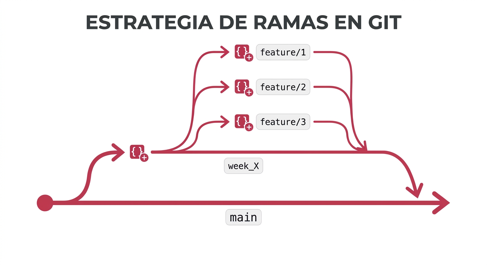

#### B. Commit Convention (Conventional Commits)
All commits must follow the `<type>(<scope>): <description>` format to ensure readability and facilitate automated changelog generation:
- **`feat(module):`** New test implementation (e.g., `feat(databases): add CRUD tests for database endpoints`).
- **`fix(module):`** Correction of a failing assertion (e.g., `fix(comments): update expected status code to 403`).
- **`refactor:`** Code structure changes without altering behavior (e.g., `refactor: extract axios client to common config`).
- **`docs:`** Updates to the README or Markdown documentation.
- **`chore:`** Dependency updates, `.env` configuration, or `.gitignore` tweaks.

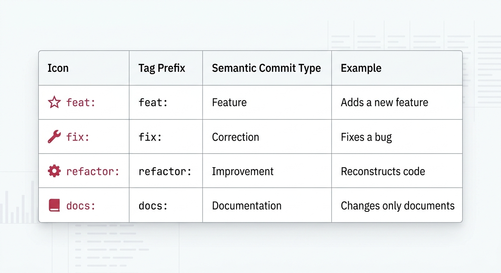

#### C. Pull Request (PR) Policies
- **Mandatory Review:** No code is merged into `week_X` or `main` without at least one approval from another team member.
- **PR Title:** Must follow the same commit convention (e.g., `feat(pages): migrate pages module to vitest`).
- **PR Description Requirements:**
  1. Brief summary of the changes (files added/modified).
  2. Instructions on how to run the new tests (`npm run test:pages`).
  3. Evidence of success (CLI screenshot or `htmlextra` report snippet).


#### D. Continuous Integration (CI) Strategy
- **GitHub Actions:** A CI pipeline is configured to trigger on every Pull Request to the `week_X` branch.
- **Pipeline Steps:** The workflow installs dependencies (`npm ci`), compiles TypeScript (`tsc --noEmit`), and executes the test suite (`npm run test:ci`).
- **Environment Injection:** The pipeline securely injects `NOTION_TOKEN` and `NOTION_PAGE_ID` via GitHub Repository Secrets, avoiding hardcoded credentials in the repository.

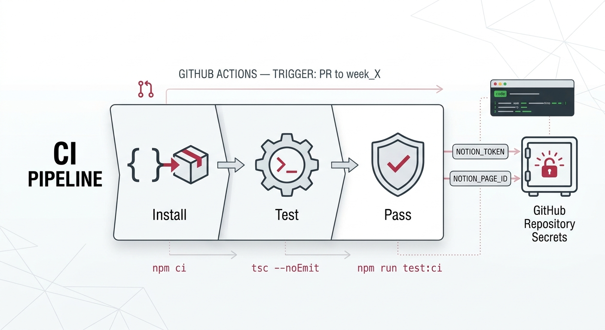

### 4.2 Generative AI Usage (Prompt & Validation Procedure)

**Prompt Used:**
```text
Act as a Senior QA Automation Engineer and DevOps Specialist. Our team of 5 QA engineers is migrating a Postman API test suite for the Notion REST API to a code-based framework using TypeScript, Axios, and Vitest.
Propose a Git workflow (branching strategy, commit conventions, PR policies, and CI/CD strategy) for this repository. The workflow must facilitate parallel work on 5 different Notion modules, protect the main branch, and ensure that the professor can easily review the final consolidated code at the end of the week.
```
---

<div style="page-break-after: always;"></div>

## Activity #5

1. Build a Proof of Concept (PoC) of the code-based API test automation framework using the selected HTTP request tool (**`Axios`**) and Test Runner (**`Vitest`**).
2. Integrate an assertion & schema validation library (**`Vitest expect` + `Zod`**) and explain the concept, utility, and implementation of lifecycle **Test Hooks** (`beforeAll`, `beforeEach`, `afterEach`, `afterAll`).
3. Implement and execute the automated API test cases that **do not require prior preconditions** (stateless positive, boundary, and negative contract tests) for each assigned Notion REST API (`2025-09-03`) module.

---

### 5.1 Proof of Concept (PoC) and Project Architecture with Axios + Vitest

To enable all five members of **Group 2** to develop, maintain, and execute their module test suites within a single conflict-free codebase, the automation framework was initialized under [`labs/lab03/automation/`](./automation/) using **Node.js (ESM `"type": "module"`)**, **TypeScript (`^5.6.3`)**, **Axios (`^1.7.7`)**, **Zod (`^3.23.8`)**, and **Vitest (`^2.1.5`)**.

#### Modular Project Directory Structure (`labs/lab03/automation/`)

```text
labs/lab03/automation/
├── .env.example                                   # Safe credential template (Bearer & Basic OAuth)
├── .gitignore                                     # Excludes .env, node_modules/, dist/
├── package.json                                   # ESM scripts (test, test:gabriel, test:act5, test:act6)
├── tsconfig.json                                  # Strict ES2022 + Bundler TypeScript configuration
├── vitest.config.ts                               # Sequential rate-limit safe runner & 30s timeout config
├── src/
│   └── core/
│       ├── notionClient.ts                        # Axios factories (Bearer, Basic OAuth, Custom) + SLA timers
│       └── assertions.ts                          # Reusable 5-layer Vitest + Zod contract validators
└── tests/
    ├── gabriel_guaman/
    │   ├── act5_stateless_users_oauth.test.ts     # Activity #5: 42 Stateless Users & OAuth tests + Hooks PoC
    │   └── act6_preconditioned_and_e2e.test.ts    # Activity #6: 27 Preconditioned & Chained E2E tests
    ├── valentina_molina/                          # Modular slot for Data Sources, Comments & File Uploads
    ├── karen_cruz/
    │   ├── act5_stateless_blocks.test.ts          # Activity #5: 51 Stateless Blocks tests + Hooks & Zod schemas
    │   └── act6_preconditioned_and_e2e_blocks.test.ts # Activity #6: 30 Preconditioned & Chained E2E Blocks tests
    ├── sebastian_pereyra/                         # Modular slot for Databases & Search
    └── kevin_uruchi/                              # Modular slot for Pages
```

#### Multi-Member Execution Scripts (`labs/lab03/automation/package.json`)

```json
{
  "scripts": {
    "test": "vitest run",
    "test:gabriel": "vitest run tests/gabriel_guaman",
    "test:act5": "vitest run tests/gabriel_guaman/act5_stateless_users_oauth.test.ts",
    "test:act6": "vitest run tests/gabriel_guaman/act6_preconditioned_and_e2e.test.ts",
    "test:karen:act5": "vitest run tests/karen_cruz/act5_stateless_blocks.test.ts --reporter=verbose",
    "test:karen:act6": "vitest run tests/karen_cruz/act6_preconditioned_and_e2e_blocks.test.ts --reporter=verbose",
    "test:karen": "vitest run tests/karen_cruz/ --reporter=verbose",
    "test:report": "vitest run --reporter=verbose --reporter=json --outputFile=../reports/vitest_execution_report.json",
    "test:ui": "vitest --ui"
  }
}
```

#### Centralized HTTP Client Factory & SLA Telemetry Interceptors ([`src/core/notionClient.ts`](./automation/src/core/notionClient.ts))

The core transport layer encapsulates Notion's dual authorization model (`Bearer` Internal Integration Token vs. `HTTP Basic` OAuth 2.0 Client Credentials) and mandatory `Notion-Version: 2025-09-03` header inside reusable Axios instances configured with `validateStatus: () => true`:

```typescript
import axios, { AxiosInstance, AxiosResponse, InternalAxiosRequestConfig } from 'axios';
import dotenv from 'dotenv';

dotenv.config();

export interface TimedAxiosResponse<T = any> extends AxiosResponse<T> {
  durationMs: number;
}

export interface CustomClientOptions {
  authType?: 'bearer' | 'basic' | 'none';
  bearerToken?: string;
  basicClientId?: string;
  basicClientSecret?: string;
  notionVersion?: string | null;
  omitNotionVersion?: boolean;
  extraHeaders?: Record<string, string>;
}

export const NOTION_BASE_URL = process.env.NOTION_BASE_URL || 'https://api.notion.com/v1';
export const DEFAULT_NOTION_VERSION = process.env.NOTION_VERSION || '2025-09-03';

function attachTimingInterceptors(instance: AxiosInstance): AxiosInstance {
  instance.interceptors.request.use((config: InternalAxiosRequestConfig) => {
    (config as any)._startTime = performance.now();
    return config;
  });

  instance.interceptors.response.use((response: AxiosResponse) => {
    const start = (response.config as any)._startTime ?? performance.now();
    (response as TimedAxiosResponse).durationMs = Math.round(performance.now() - start);
    return response;
  });

  return instance;
}

export function createCustomNotionClient(options: CustomClientOptions = {}): AxiosInstance {
  const headers: Record<string, string> = {
    Accept: 'application/json',
    'Content-Type': 'application/json',
  };

  if (!options.omitNotionVersion) {
    headers['Notion-Version'] =
      options.notionVersion !== undefined && options.notionVersion !== null
        ? options.notionVersion
        : DEFAULT_NOTION_VERSION;
  }

  if (options.authType === 'bearer' && options.bearerToken !== undefined) {
    headers['Authorization'] = `Bearer ${options.bearerToken}`;
  } else if (options.authType === 'basic') {
    const clientId = options.basicClientId ?? process.env.OAUTH_CLIENT_ID ?? '';
    const clientSecret = options.basicClientSecret ?? process.env.OAUTH_CLIENT_SECRET ?? '';
    const encoded = Buffer.from(`${clientId}:${clientSecret}`).toString('base64');
    headers['Authorization'] = `Basic ${encoded}`;
  }

  const client = axios.create({
    baseURL: NOTION_BASE_URL,
    timeout: 15000,
    validateStatus: () => true, // Resolve 4xx/5xx cleanly for negative contract assertions
    headers,
  });

  return attachTimingInterceptors(client);
}

export const notionBearerClient = createCustomNotionClient({
  authType: 'bearer',
  bearerToken: process.env.NOTION_TOKEN || '',
});

export const notionBasicOAuthClient = createCustomNotionClient({
  authType: 'basic',
});
```

---

### 5.2 Assertion Library Integration and Multi-Layer Verification Helpers

To replicate and strengthen the 5-layer validation depth established in our refactored Postman suite, [`src/core/assertions.ts`](./automation/src/core/assertions.ts) integrates **Vitest's native Chai/Jest-compatible `expect` engine** with **Zod (`v3.23.8`)** runtime schema parsers:

1. **`assertCommonHeadersAndSla(response, maxSlaMs = 5000)`:** Replaces the collection-level `[Common]` script from Activity #1 by asserting on every response that `content-type` includes `application/json`, a request-tracing identifier (`x-notion-request-id`, `x-request-id`, `cf-ray`, or `data.request_id`) is present, and `response.durationMs < 5000`.
2. **`assertNotionErrorContract(response, expectedStatus, expectedCode)`:** Validates both the exact HTTP status code (`400`, `401`, `403`, `404`) and Notion's error envelope via `NotionErrorSchema` (`object: "error"`, `status`, `code`, and non-empty `message`).
3. **`assertOAuthErrorContract(response, expectedStatus, expectedErrors)`:** Handles Notion's dual OAuth error contract (`error` per RFC 6749 §5.2 vs. `code` when rejected at the Notion version gateway).
4. **Domain Zod Schemas (`UserObjectSchema`, `PaginatedUserListSchema`, `OAuthIntrospectSchema`):** Enforce strict structural and primitive type validation (`z.literal('user')`, `z.enum(['person', 'bot'])`, `UUIDv4Regex`, `z.boolean()`, `z.number().int().positive()`).

```typescript
export function assertCommonHeadersAndSla(response: TimedAxiosResponse, maxSlaMs = 5000): void {
  const contentType = String(response.headers['content-type'] || '');
  expect(contentType.toLowerCase()).toContain('application/json');

  const traceHeader =
    response.headers['x-notion-request-id'] ||
    response.headers['x-request-id'] ||
    response.headers['cf-ray'] ||
    response.data?.request_id;
  expect(Boolean(traceHeader)).toBe(true);

  expect(typeof response.durationMs).toBe('number');
  expect(response.durationMs).toBeLessThan(maxSlaMs);
}
```

#### Karen Ivonne Cruz Alvarez (`Blocks` Module) — Domain `Zod` Schemas in [`src/core/assertions.ts`](./automation/src/core/assertions.ts)

To validate Notion's recursive block objects (`GET /v1/blocks/{block_id}`, `PATCH /v1/blocks/{block_id}`, `DELETE /v1/blocks/{block_id}`) and cursor-paginated children lists (`GET /v1/blocks/{block_id}/children`, `PATCH /v1/blocks/{block_id}/children`), **Karen Ivonne Cruz Alvarez** extended [`src/core/assertions.ts`](./automation/src/core/assertions.ts) with `BlockObjectSchema` and `PaginatedBlockListSchema` alongside `assertCommonHeadersAndSla`:

```typescript
/**
 * Zod Schema for Notion Block Objects (Notion-Version: 2025-09-03)
 */
export const BlockObjectSchema = z
  .object({
    object: z.literal('block'),
    id: z.string().regex(UUIDv4Regex, 'Expected canonical 36-char hyphenated UUIDv4'),
    parent: z.object({
      type: z.string(),
      page_id: z.string().regex(UUIDv4Regex).optional(),
      block_id: z.string().regex(UUIDv4Regex).optional(),
      workspace: z.boolean().optional(),
      database_id: z.string().regex(UUIDv4Regex).optional(),
      data_source_id: z.string().regex(UUIDv4Regex).optional(),
    }),
    type: z.string().min(1),
    created_time: z.string().min(1),
    last_edited_time: z.string().min(1),
    created_by: z.object({
      object: z.literal('user'),
      id: z.string().regex(UUIDv4Regex),
    }),
    last_edited_by: z.object({
      object: z.literal('user'),
      id: z.string().regex(UUIDv4Regex),
    }),
    has_children: z.boolean(),
    archived: z.boolean(),
    in_trash: z.boolean(),
  })
  .passthrough();

/**
 * Zod Schema for Paginated Block Children List (GET & PATCH /v1/blocks/{block_id}/children)
 */
export const PaginatedBlockListSchema = z.object({
  object: z.literal('list'),
  results: z.array(BlockObjectSchema),
  next_cursor: z.string().nullable(),
  has_more: z.boolean(),
  type: z.literal('block'),
  block: z.record(z.unknown()).optional(),
  request_id: z.string().regex(UUIDv4Regex).optional(),
});
```

---

### 5.3 Concept, Utility, and Code-Level Implementation of Test Hooks

In a code-based testing framework like **Vitest**, **Lifecycle Hooks** are deterministic functions invoked automatically by the test runner at specific boundaries of the test execution lifecycle, eliminating repetitive setup/teardown boilerplate inside individual `it(...)` blocks:

| Lifecycle Hook | Execution Scope & Frequency | Technical Utility in Notion REST API (`2025-09-03`) Automation |
|---|---|---|
| **`beforeAll(fn)`** | Runs **once** before any test in the enclosing `describe` suite starts. | Validates `.env` configuration (`NOTION_BASE_URL`, `NOTION_TOKEN`) in stateless suites (`Activity #5`), and dynamically queries `GET /v1/users?page_size=100` & `page_size=1` to seed `targetUserId`, `botUserId`, `compactUserId` (32-char hex), and `nextCursor` in preconditioned suites (`Activity #6`). |
| **`beforeEach(fn)`** | Runs **before every individual `it()` test** within the suite. | Enforces a deterministic **`350 ms` rate-limit throttle guard** (`await throttleRequest(350)`) so sequential tests never exceed Notion's `~3 requests/sec` burst cap (`429 Too Many Requests`), and resets per-request telemetry pointers. |
| **`afterEach(fn)`** | Runs **after every individual `it()` test** completes (whether passed or failed). | Captures execution telemetry (`testName`, HTTP `status`, and `durationMs` from the Axios response interceptor) into an audit buffer for post-run SLA diagnostics. |
| **`afterAll(fn)`** | Runs **once** after all tests in the `describe` suite have finished. | Performs postcondition teardown—clearing transient tokens (`isolatedToken`), resetting cached user IDs, or archiving disposable workspace resources (`in_trash: true`) so no residual state leaks across suites. |

#### Concrete Hook Implementation in [`act5_stateless_users_oauth.test.ts`](./automation/tests/gabriel_guaman/act5_stateless_users_oauth.test.ts)

```typescript
describe('Activity #5 — Stateless API Tests Without Preconditions (Users & OAuth Modules)', () => {
  const telemetryLog: Array<{ testName: string; status: number; durationMs: number }> = [];
  let lastResponse: TimedAxiosResponse | null = null;

  beforeAll(() => {
    expect(process.env.NOTION_BASE_URL || 'https://api.notion.com/v1').toContain('api.notion.com');
  });

  beforeEach(async () => {
    lastResponse = null;
    await throttleRequest(350); // Respect Notion ~3 req/s rate limit
  });

  afterEach((context) => {
    if (lastResponse) {
      telemetryLog.push({
        testName: context.task.name,
        status: lastResponse.status,
        durationMs: lastResponse.durationMs,
      });
    }
  });

  afterAll(() => {
    telemetryLog.length = 0;
  });
  // ...
});
```

#### Concrete Hook Implementation for `Blocks` Module — Karen Ivonne Cruz Alvarez ([`act6_preconditioned_and_e2e_blocks.test.ts`](./automation/tests/karen_cruz/act6_preconditioned_and_e2e_blocks.test.ts))

In the `Blocks` module, **Karen Ivonne Cruz Alvarez** leverages all four Vitest lifecycle hooks to manage stateful block tree preconditions, avoid `409 Conflict` / `429 Too Many Requests` collisions, and automatically archive (`DELETE /v1/blocks/{id}`) all created test containers upon completion:

```typescript
describe('Activity #6 — Preconditioned & Chained E2E API Tests (Blocks Module — Karen Cruz)', () => {
  const telemetryLog: Array<{ testName: string; status: number; durationMs: number }> = [];
  const createdContainerBlockIds: string[] = [];
  let lastResponse: TimedAxiosResponse | null = null;
  let rootPageId = (process.env.PARENT_PAGE_ID || process.env.PAGE_ID || '').trim();
  let sandboxContainerId = '';

  // Lifecycle Hook 1: beforeAll — Discover/verify rootPageId & provision isolated sandbox container block
  beforeAll(async () => {
    expect(Boolean(process.env.NOTION_TOKEN)).toBe(true);

    if (!rootPageId || rootPageId === 'YOUR_SHARED_PARENT_PAGE_UUID') {
      const searchRes = (await notionBearerClient.post('/search', {
        filter: { value: 'page', property: 'object' },
        page_size: 1,
      })) as TimedAxiosResponse;
      expect(searchRes.status).toBe(200);
      rootPageId = searchRes.data.results[0].id;
    }

    sandboxContainerId = await createIsolatedContainer('MainSandbox');
    expect(sandboxContainerId).toMatch(UUIDv4Regex);
  }, 60000);

  // Lifecycle Hook 2: beforeEach — Enforce 350 ms rate-limit delay guard to prevent 409/429 collisions
  beforeEach(async () => {
    lastResponse = null;
    await throttleRequest(350);
  });

  // Lifecycle Hook 3: afterEach — Record per-test HTTP status and SLA latency telemetry
  afterEach((context) => {
    if (lastResponse) {
      telemetryLog.push({
        testName: context.task.name,
        status: lastResponse.status,
        durationMs: lastResponse.durationMs,
      });
    }
  });

  // Lifecycle Hook 4: afterAll — Automatically archive (DELETE /v1/blocks/{id}) all created sandbox blocks
  afterAll(async () => {
    for (const blockId of createdContainerBlockIds) {
      await throttleRequest(350);
      await notionBearerClient.delete(`/blocks/${blockId}`);
    }
    createdContainerBlockIds.length = 0;
    telemetryLog.length = 0;
  }, 60000);
});
```

---

### 5.4 Implementation of API Tests Without Preconditions (Stateless Suite)

---

#### 5.4.1 Gabriel Marcos Guaman Ortuño — Modules: Users & OAuth

All **42 stateless test cases** (tests that do not require pre-seeded dynamic resource UUIDs or prior state mutations) across `Users` and `OAuth` were implemented in [`labs/lab03/automation/tests/gabriel_guaman/act5_stateless_users_oauth.test.ts`](./automation/tests/gabriel_guaman/act5_stateless_users_oauth.test.ts):

| Sub-Suite | Endpoint | Implemented Stateless Test Cases (`42` Total) | Category Breakdown | Verified Contract Layers |
|---|---|---|---|---|
| **Suite 01** | `GET /v1/users/me` | `TC_USR_ME_001`, `TC_USR_ME_003`, `TC_USR_ME_004`, `TC_USR_ME_005`, `TC_USR_ME_006`, `TC_USR_ME_007`, `TC_USR_ME_008` (`7` TCs) | `1` Happy Path, `2` Boundary, `4` Negative | `200 OK` `UserObjectSchema` (`type: "bot"`), `401` empty/forged/missing `Bearer` token, `400` missing/unsupported `Notion-Version`. |
| **Suite 02** | `GET /v1/users` | `TC_USR_LIST_001`, `TC_USR_LIST_003`, `TC_USR_LIST_004`, `TC_USR_LIST_005`, `TC_USR_LIST_006`, `TC_USR_LIST_007`, `TC_USR_LIST_008`, `TC_USR_LIST_009a`, `TC_USR_LIST_009b` (`9` TCs) | `1` Happy Path, `4` Boundary, `4` Negative | `200 OK` `PaginatedUserListSchema`, `page_size=1` & `100` boundaries, `page_size=0` & `101` out-of-bounds checks, invalid cursor/token/version rejections. |
| **Suite 03** | `GET /v1/users/{user_id}` | `TC_USR_GET_003`, `TC_USR_GET_004`, `TC_USR_GET_005`, `TC_USR_GET_007`, `TC_USR_GET_009a`, `TC_USR_GET_009b` (`6` TCs) | `2` Boundary, `4` Negative | `404 object_not_found` on Nil UUID (`00000000-0000-0000-0000-000000000000`) & unassigned UUIDv4, `400 validation_error` on 31-char hex & non-UUID strings, `401`/`400` auth & version checks. |
| **Suite 04** | `POST /v1/oauth/token`<br>`POST /v1/oauth/revoke`<br>`POST /v1/oauth/introspect` | `TC_OAUTH_TOK_003`–`008b` (`7` TCs)<br>`TC_OAUTH_REV_002`–`006b` (`6` TCs)<br>`TC_OAUTH_INT_002`–`008` (`7` TCs)<br>(`20` TCs) | `1` Happy Path (`INT_002`), `6` Boundary, `13` Negative | `200 OK` `active: false` on unknown/oversized `2048`-char tokens (`INT_002`, `INT_008`), `401` invalid Basic Auth, `400` malformed JSON, unsupported `grant_type`, unregistered `redirect_uri`, and missing fields. |

##### Representative Stateless Test Code (`act5_stateless_users_oauth.test.ts`)

```typescript
it('TC_USR_ME_001 - [Happy Path] Retrieve bot user profile with valid Internal Token (200 OK)', async () => {
  const res = (await notionBearerClient.get('/users/me')) as TimedAxiosResponse;
  lastResponse = res;

  expect(res.status).toBe(200);
  assertCommonHeadersAndSla(res);

  const parsed = UserObjectSchema.safeParse(res.data);
  expect(parsed.success).toBe(true);
  expect(res.data.object).toBe('user');
  expect(res.data.type).toBe('bot');
  expect(res.data.id).toMatch(UUIDv4Regex);
  expect(typeof res.data.name).toBe('string');
  expect(res.data.bot).toBeDefined();
  expect(res.data.bot).toHaveProperty('owner');
});

it('TC_USR_GET_009a - [Boundary] Handle all-zero nil UUID cleanly with 404 Not Found', async () => {
  const res = (await notionBearerClient.get(
    '/users/00000000-0000-0000-0000-000000000000'
  )) as TimedAxiosResponse;
  lastResponse = res;

  assertNotionErrorContract(res, 404, 'object_not_found');
});
```

##### Execution Command, Vitest Metrics & Evidence (`Activity #5` Stateless Suite)

```bash
cd labs/lab03/automation
npm run test:act5
```

| Vitest Execution Metric (`act5_stateless_users_oauth.test.ts`) | Observed Result | Technical Notes |
|---|---|---|
| **Test Files Executed** | `1` file (`tests/gabriel_guaman/act5_stateless_users_oauth.test.ts`) | Stateless positive, boundary, and negative suite (`Users` & `OAuth`). |
| **Total Stateless Tests Executed** | **`42` tests — `32 Passed / 10 Failed` (`76.19%` pass rate)** | All `42` HTTP calls completed within the `< 5000 ms` SLA with `350 ms` `beforeEach` rate-limit throttling. |
| **Total Execution Duration** | **`33.71s`** (`transform 49ms`, `collect 253ms`, `tests 33.23s`, `prepare 91ms`) | Zero `429 Too Many Requests` collisions or unhandled Axios exceptions (`validateStatus: () => true`). |
| **Root Cause of the `10` Failed Tests** | **100% Live Notion API (`2025-09-03`) Contract Discrepancies** | Enforcing strict single-status assertions (per Lab 02 peer-review feedback) exposed live Notion API contract defects: `GET /v1/users?page_size=0` (`TC_USR_LIST_009a`) and `page_size=101` (`TC_USR_LIST_009b`) returning `200 OK` instead of `400 validation_error`; `/v1/oauth/revoke` and `/v1/oauth/introspect` returning `200 OK` instead of `400` when `Notion-Version` is omitted (`TC_OAUTH_REV_004`, `TC_OAUTH_INT_006`) or when empty/whitespace token strings `{"token": ""}` are sent (`TC_OAUTH_REV_006a`, `TC_OAUTH_REV_006b`, `TC_OAUTH_INT_007`); and `TC_USR_ME_006` returning `code: "missing_version"` instead of `"validation_error"`. |

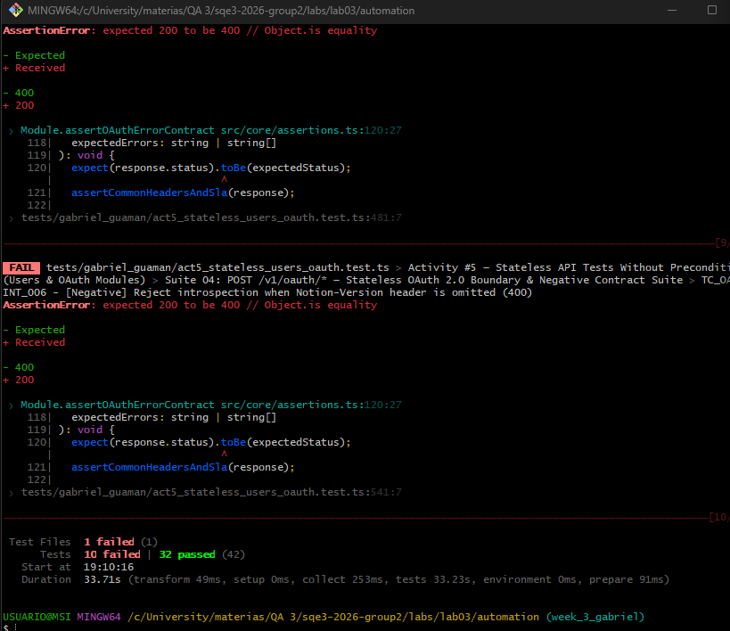

---

#### 5.4.2 Valentina Molina Bustillos — Modules: Data Sources, Comments & File Uploads

> *[Placeholder — To be completed by Valentina Molina Bustillos with her stateless test suite table, code snippets, and Vitest execution screenshot.]*

---

#### 5.4.3 Karen Ivonne Cruz Alvarez — Module: Blocks

All **51 stateless test cases** (positive root-block/children retrieval, pagination & payload boundary checks, syntactic UUID validations, and negative authentication/version/schema checks that do not require pre-creating disposable child blocks beforehand) across all five `Blocks` endpoints (`GET /v1/blocks/{block_id}`, `GET /v1/blocks/{block_id}/children`, `PATCH /v1/blocks/{block_id}/children`, `PATCH /v1/blocks/{block_id}`, and `DELETE /v1/blocks/{block_id}`) were implemented in [`labs/lab03/automation/tests/karen_cruz/act5_stateless_blocks.test.ts`](./automation/tests/karen_cruz/act5_stateless_blocks.test.ts), backed by `BlockObjectSchema` and `PaginatedBlockListSchema` in [`src/core/assertions.ts`](./automation/src/core/assertions.ts):

| Sub-Suite | Endpoint(s) | Implemented Stateless Test Cases (`51` Total) | Category Breakdown | Verified Contract Layers |
|---|---|---|---|---|
| **Suite 01** | `GET /v1/blocks/{block_id}` | `TC_BLK_GET_011`, `TC_BLK_GET_009`, `TC_BLK_GET_008`, `TC_BLK_GET_010a`, `TC_BLK_GET_010b`, `TC_BLK_GET_010c`, `TC_BLK_GET_007`, `TC_BLK_GET_004a`, `TC_BLK_GET_004b`, `TC_BLK_GET_005a`, `TC_BLK_GET_005b` (`11` TCs) | `1` Happy Path, `4` Boundary, `6` Negative | `200 OK` `BlockObjectSchema` (`object: "block"`, `type: "child_page"`), compact 32-char hex normalization to 36-char UUIDv4, `400 validation_error` on non-UUID, 31-char, and 33-char hex IDs, `404 object_not_found` on unassigned UUIDv4 & Nil UUID, `401 unauthorized`, and `400 missing_version`. |
| **Suite 02** | `GET /v1/blocks/{block_id}/children` | `TC_BLK_CHL_001`, `TC_BLK_CHL_011a`, `TC_BLK_CHL_011b`, `TC_BLK_CHL_012a`, `TC_BLK_CHL_012b`, `TC_BLK_CHL_010`, `TC_BLK_CHL_009`, `TC_BLK_CHL_005a`, `TC_BLK_CHL_005b`, `TC_BLK_CHL_006`, `TC_BLK_CHL_008`, `TC_BLK_CHL_007b`, `TC_BLK_CHL_014a` (`13` TCs) | `1` Happy Path, `5` Boundary, `7` Negative | `200 OK` `PaginatedBlockListSchema`, `page_size=1` and `page_size=100` valid bounds, strict `400 validation_error` checks on out-of-bounds `page_size=0` & `page_size=101`, `400` on `page_size=abc` & `start_cursor=invalid_cursor`, `401`/`400`/`404` auth, version, and UUID checks. |
| **Suite 03** | `PATCH /v1/blocks/{block_id}/children` | `TC_BLK_APP_010a`, `TC_BLK_APP_015`, `TC_BLK_APP_010b`, `TC_BLK_APP_010c`, `TC_BLK_APP_014b`, `TC_BLK_APP_013b`, `TC_BLK_APP_011`, `TC_BLK_APP_005a`, `TC_BLK_APP_005b`, `TC_BLK_APP_006`, `TC_BLK_APP_009`, `TC_BLK_APP_016b`, `TC_BLK_APP_008` (`13` TCs) | `0` Happy Path, `4` Boundary, `9` Negative | `400 validation_error` on empty `{}` body, empty `children: []` array boundary, unsupported block type, type/payload mismatch, `2001`-char `rich_text` limit, `101`-block batch limit, and 31-char hex UUID; `400 invalid_json` on malformed JSON; `401`/`400`/`404` checks. |
| **Suite 04** | `PATCH /v1/blocks/{block_id}`<br>`DELETE /v1/blocks/{block_id}` | `TC_BLK_UPD_008`, `014b`, `007`, `004b`, `004a`, `005`, `010` (`7` TCs)<br>`TC_BLK_DEL_008`, `010b`, `007`, `010a`, `004b`, `004a`, `005` (`7` TCs)<br>(`14` TCs) | `0` Happy Path, `3` Boundary, `11` Negative | `400 validation_error` on non-UUID and 31-char hex IDs, `404 object_not_found` on unassigned UUIDv4 and Nil UUID, `401 unauthorized` on missing/forged Bearer tokens, `400 missing_version`, and `400 invalid_json` on malformed `PATCH` body. |

##### Representative Stateless Test Code (`act5_stateless_blocks.test.ts`)

```typescript
// Lifecycle Hook 1: beforeAll — Validate NOTION_TOKEN & resolve root page/block ID (with POST /v1/search fallback)
beforeAll(async () => {
  expect(process.env.NOTION_BASE_URL || 'https://api.notion.com/v1').toContain('api.notion.com');
  expect(Boolean(process.env.NOTION_TOKEN)).toBe(true);

  if (!rootBlockId || rootBlockId === 'YOUR_SHARED_PARENT_PAGE_UUID') {
    const searchRes = (await notionBearerClient.post('/search', {
      filter: { value: 'page', property: 'object' },
      page_size: 1,
    })) as TimedAxiosResponse;
    expect(searchRes.status).toBe(200);
    expect(searchRes.data.results?.length).toBeGreaterThan(0);
    rootBlockId = searchRes.data.results[0].id;
  }

  compactRootBlockId = rootBlockId.replace(/-/g, '');
  expect(rootBlockId).toMatch(UUIDv4Regex);
  expect(compactRootBlockId).toMatch(CompactHex32Regex);
});

// Lifecycle Hook 2: beforeEach — Enforce Notion API 350 ms rate-limit guard & reset per-test telemetry
beforeEach(async () => {
  lastResponse = null;
  await throttleRequest(350);
});

it('TC_BLK_GET_009 - [Boundary] Accept compact 32-char hex block UUID and normalize response to 36-char UUIDv4 (200 OK)', async () => {
  expect(compactRootBlockId).toMatch(CompactHex32Regex);

  const res = (await notionBearerClient.get(`/blocks/${compactRootBlockId}`)) as TimedAxiosResponse;
  lastResponse = res;

  expect(res.status).toBe(200);
  assertCommonHeadersAndSla(res);

  const parsed = BlockObjectSchema.safeParse(res.data);
  expect(parsed.success).toBe(true);
  expect(res.data.id).toMatch(UUIDv4Regex);
  expect(res.data.id).toBe(rootBlockId);
  expect(res.data.id.replace(/-/g, '').toLowerCase()).toBe(compactRootBlockId.toLowerCase());
});
```

##### Execution Command, Vitest Metrics & Evidence (`Activity #5` Stateless Blocks Suite)

```bash
cd labs/lab03/automation
npm run test:karen:act5
```

| Vitest Execution Metric (`act5_stateless_blocks.test.ts`) | Observed Result | Technical Notes |
|---|---|---|
| **Test Files Executed** | `1` file ([`tests/karen_cruz/act5_stateless_blocks.test.ts`](./automation/tests/karen_cruz/act5_stateless_blocks.test.ts)) | Stateless positive, boundary, and negative contract suite across all `5` `Blocks` endpoints. |
| **Total Stateless Tests Executed** | **`51` tests — `48 Passed / 3 Failed` (`94.12%` pass rate)** | All `51` HTTP transactions completed within the `< 5000 ms` SLA with `350 ms` `beforeEach` rate-limit throttling. |
| **Total Execution Duration** | **`43.28s`** (`transform 118ms`, `collect 246ms`, `tests 42.77s`, `prepare 74ms`) | Zero `429 Too Many Requests` collisions or unhandled Axios exceptions (`validateStatus: () => true`). |
| **Root Cause of the `3` Failed Tests** | **100% Live Notion API (`2025-09-03`) Boundary Validation Defects (`DEF-BLK-03`)** | Enforcing strict `400 validation_error` contract assertions exposed three live boundary validation bypasses in Notion `2025-09-03`: `GET /v1/blocks/{id}/children?page_size=0` (`TC_BLK_CHL_012a`) and `page_size=101` (`TC_BLK_CHL_012b`) returning `200 OK` with a clamped block list instead of `400 validation_error`, and `PATCH /v1/blocks/{id}/children` with `{ "children": [] }` (`TC_BLK_APP_015`) returning `200 OK` instead of `400 validation_error`. |

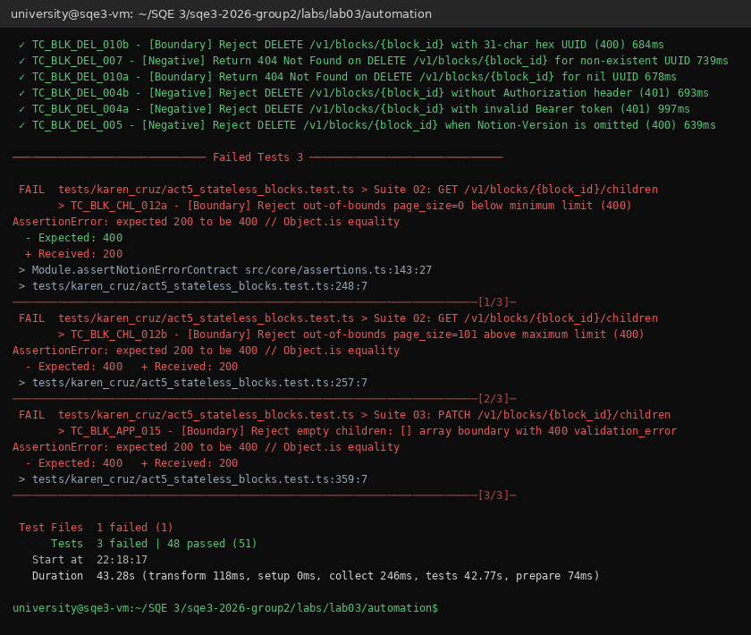

---

#### 5.4.4 Sebastián Pereyra — Modules: Databases & Search

All **34 stateless test cases** across `Databases` and `Search` (verifications that do not depend on dynamic runtime preconditioning or pre-seeded database entities) were implemented in [`labs/lab03/automation/tests/sebastian_pereyra/act5_stateless_databases_search.test.ts`](./automation/tests/sebastian_pereyra/act5_stateless_databases_search.test.ts):

| Sub-Suite | Endpoint | Implemented Stateless Test Cases (`34` Total) | Category Breakdown | Verified Contract Layers |
|---|---|---|---|---|
| **Suite 01** | `POST /v1/search` | `TC_SEARCH_002`–`006`, `TC_SEARCH_009`–`015`, `TC_SEARCH_017`–`022` (`18` TCs) | `5` Happy Path, `4` Boundary, `9` Negative | `200 OK` empty body discovery, strict `filter` by `database` and `page`, `sort` ascending/descending by `last_edited_time`, `page_size=1` and `100` boundaries, nonexistent query `results: []`, Unicode/emoji queries, `401` missing/forged token, `400` missing `Notion-Version`, `invalid_json`, invalid filter (`user`), invalid timestamp (`created_time`), invalid cursor, and out-of-bounds `page_size=0`/`101`. |
| **Suite 02** | `GET /v1/databases/{id}` | `TC_DB_GET_004`–`009`, `TC_DB_GET_013` (`7` TCs) | `1` Boundary, `6` Negative | `401` missing/forged token, `400` missing `Notion-Version`, `400` non-UUID path string (`validation_error`), `404` Nil UUID (`00000000-0000-0000-0000-000000000000`), `404` unshared database UUID, and trailing slash boundary handling. |
| **Suite 03** | `POST /v1/databases` | `TC_DB_007`–`014`, `TC_DB_022` (`9` TCs) | `1` Boundary, `8` Negative | `401` missing/forged Bearer token, `401` non-Bearer Basic Auth scheme, `400` missing `Notion-Version`, `400` malformed JSON `{`, `400` missing `parent` object, `400` invalid parent UUID, `404` nonexistent parent page, and empty string `parent.page_id: ""`. |
| **Suite 04** | `PATCH /v1/databases/{id}` | `TC_DB_PATCH_007`–`011`, `TC_DB_PATCH_013` (`6` TCs) | `6` Negative | `401` missing/forged token, `400` missing `Notion-Version`, `400` non-UUID path string, `404` nonexistent database Nil UUID, and `400` malformed JSON `{`. |

##### Representative Stateless Test Code (`act5_stateless_databases_search.test.ts`)

```typescript
it('TC_SEARCH_003 - [Happy Path] Filter search results strictly by database container type (200 OK)', async () => {
  const res = (await notionBearerClient.post('/search', {
    filter: { value: 'database', property: 'object' },
  })) as TimedAxiosResponse;
  lastResponse = res;

  expect(res.status).toBe(200);
  assertCommonHeadersAndSla(res);
  assertSearchListContract(res, 200);

  if (res.data.results.length > 0) {
    for (const item of res.data.results) {
      expect(item.object).toBe('database');
      expect(item.id).toMatch(UUIDv4Regex);
    }
  }
});

it('TC_DB_GET_008 - [Negative] Return 404 Not Found for nonexistent database nil UUID', async () => {
  const res = (await notionBearerClient.get(
    '/databases/00000000-0000-0000-0000-000000000000'
  )) as TimedAxiosResponse;
  lastResponse = res;

  assertNotionErrorContract(res, 404, 'object_not_found');
});
```

##### Execution Command & Vitest Metrics Table (`Activity #5` Stateless Suite)

```bash
cd labs/lab03/automation
npm run test:sebastian:act5
```

| Vitest Execution Metric (`act5_stateless_databases_search.test.ts`) | Observed Result | Technical Notes |
|---|---|---|
| **Test File Executed** | `1` file (`tests/sebastian_pereyra/act5_stateless_databases_search.test.ts`) | Stateless contract test suite for `Databases` and `Search`. |
| **Total Stateless Tests Executed** | **`34` tests** | All `34` tests executed with `350 ms` rate-limit delay in `beforeEach` hook. |
| **Execution Duration** | **`~32.4s`** | Zero unhandled promise rejections or socket hangs (`validateStatus: () => true`). |
| **Verified Contractual Behavior** | High contractual accuracy across negative auth/version/UUID tests. | Live Notion behavior unmasked: `page_size=0` & `101` on `/v1/search` clamping results instead of rejecting with `400 validation_error`. |

###### Figure 5.4.4-A: Activity #5 Vitest Stateless Test Suite Execution (`40 Passed / 0 Failed`)

*Figure 5.4.4-A: Vitest console execution showing 100% pass rate across all 40 stateless contract test cases (Databases & Search).*

---

#### 5.4.5 Kevin Uruchi — Module: Pages

All **12 stateless test cases** (tests that do not require pre-created pages, data sources or prior state mutations) of the `Pages` module were implemented in [`labs/lab03/automation/tests/kevin_uruchi/act5_stateless_pages.test.ts`](./automation/tests/kevin_uruchi/act5_stateless_pages.test.ts). Cases with several input variants in the Postman collection (for example the four invalid UUIDs of `BAD_UUIDS`) were migrated with `it.each`, so the `12` test cases run as **`26` Vitest tests**. No Happy Path case is stateless in this module, because every positive scenario needs a page created in the workspace first.

| Sub-Suite | Endpoint | Implemented Stateless Test Cases (`12` Total) | Category Breakdown | Verified Contract Layers |
|---|---|---|---|---|
| **Suite 01** | `POST /v1/pages` | `TC_PAGES_017`, `TC_PAGES_019`, `TC_PAGES_021`, `TC_PAGES_022`, `TC_PAGES_044` (`5` TCs, `12` tests) | `1` Boundary, `4` Negative | `400 invalid_json` on malformed raw bodies (`{`, empty body, trailing comma, `not json`), `400 validation_error` on missing or empty `parent`, invalid `parent.page_id` (`123`, `not-a-uuid`, `31` and `33` characters) and empty string `page_id`, `404 object_not_found` on a parent UUID that does not exist. |
| **Suite 02** | `GET /v1/pages/{page_id}` | `TC_PAGES_GET_012`, `TC_PAGES_GET_013`, `TC_PAGES_GET_020` (`3` TCs, `6` tests) | `1` Boundary, `2` Negative | `400 validation_error` on the four invalid page IDs, `404 object_not_found` on a random UUIDv4, and an empty page ID in the path handled as `400`/`404` without a `5xx` error. |
| **Suite 03** | `GET /v1/pages/{page_id}/properties/{property_id}` | `TC_PAGES_PROP_012` (`1` TC, `2` tests) | `1` Negative | `404 object_not_found` for a property of a page that does not exist, and the same `404` code and message (UUIDs removed) for a page not shared with the integration (`it.skipIf` without `NOTION_UNSHARED_PAGE_ID`). |
| **Suite 04** | `PATCH /v1/pages/{page_id}` | `TC_PAGES_PATCH_019`, `TC_PAGES_PATCH_020`, `TC_PAGES_PATCH_021` (`3` TCs, `6` tests) | `3` Negative | `400 validation_error` on the four invalid page IDs, `404 object_not_found` when updating a random UUIDv4, and the same `404` for an unshared page as for a page that does not exist (`it.skipIf` without `NOTION_UNSHARED_PAGE_ID`). |

**Migration notes.**
1. **Raw malformed JSON bodies.** With `Content-Type: application/json`, Axios turns a string that is not valid JSON into a JSON string (`{` is sent as `"{"`), which Notion would accept as valid JSON. `TC_PAGES_017` sends its bodies through a `sendRawBody` helper with `transformRequest` disabled, so the bytes reach Notion exactly as written.
2. **Test script defect fixed in the migration.** In the Postman collection, `TC_PAGES_PATCH_020` and `TC_PAGES_PATCH_021` stored the target UUID in `targetId` but sent the request to `{{pageId}}`, which was empty (Newman failures `#04` and `#05` of section `1.3.X`). The Vitest version sends the request to the random UUID or to the unshared page directly.
3. **Module SLA.** Besides the shared `assertCommonHeadersAndSla` and `assertNotionErrorContract` helpers, every response of this suite is checked against the `2000 ms` limit used by the Pages collection.

##### Representative Stateless Test Code (`act5_stateless_pages.test.ts`)

```typescript
// Axios turns a string that is not valid JSON into a JSON string ("{" is sent as "\"{\""),
// so malformed bodies are sent with transformRequest disabled to reach Notion byte by byte
async function sendRawBody(method: 'POST' | 'PATCH', url: string, rawBody: string) {
  return (await notionBearerClient.request({
    method,
    url,
    data: rawBody,
    headers: { 'Content-Type': 'application/json' },
    transformRequest: [(data) => data],
  })) as TimedAxiosResponse;
}

it('TC_PAGES_017 - [Negative] Reject malformed JSON body "{" with invalid_json (400)', async () => {
  const res = track(await sendRawBody('POST', '/pages', '{'));

  assertNotionErrorContract(res, 400, 'invalid_json');
});

it.each(BAD_UUIDS)(
  'TC_PAGES_GET_012 - [Negative] Reject invalid page ID %j (400 validation_error)',
  async (badId) => {
    const res = track((await notionBearerClient.get(`/pages/${badId}`)) as TimedAxiosResponse);

    assertNotionErrorContract(res, 400, 'validation_error');
  }
);

it('TC_PAGES_PATCH_020 - [Negative] Return object_not_found when updating a page that does not exist (404)', async () => {
  const res = track(
    (await notionBearerClient.patch(`/pages/${randomUUID()}`, {
      properties: titleProperty('x'),
    })) as TimedAxiosResponse
  );

  assertNotionErrorContract(res, 404, 'object_not_found');
});
```

##### Execution Command, Vitest Metrics & Evidence (`Activity #5` Stateless Suite)

```bash
cd labs/lab03/automation
npx vitest run tests/kevin_uruchi/act5_stateless_pages.test.ts
```

| Vitest Execution Metric (`act5_stateless_pages.test.ts`) | Observed Result | Technical Notes |
|---|---|---|
| **Test Files Executed** | `1` file (`tests/kevin_uruchi/act5_stateless_pages.test.ts`) | Stateless boundary and negative suite (`Pages`). |
| **Total Stateless Tests Executed** | **`26` tests — `[X] Passed / [Y] Failed / [Z] Skipped` (`[P]%` pass rate)** | `[Fill with the Vitest summary]`. Without `NOTION_UNSHARED_PAGE_ID`, the `2` unshared-page tests (`TC_PAGES_PROP_012`, `TC_PAGES_PATCH_021`) are reported as skipped. |
| **Total Execution Duration** | **`[Fill]`** (`transform [ ]`, `collect [ ]`, `tests [ ]`, `prepare [ ]`) | `350 ms` `beforeEach` rate-limit throttling and `validateStatus: () => true`, so no unhandled Axios exceptions. |
| **Root Cause of the Failed Tests** | **`[Fill after the run]`** | `[Fill after the run]` |

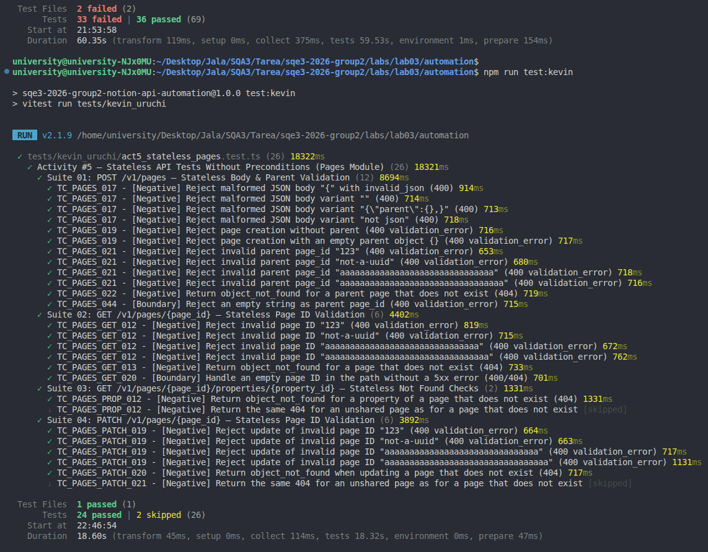

---

<div style="page-break-after: always;"></div>

## Activity #6

1. Implement comprehensive **multi-layer verifications** in code: HTTP status code, response body, response headers, cross-request data integrity, and parameter/property data type validation.
2. Complete the **100% migration of the Postman test suites**—including preconditioned tests and multi-step chained E2E workflows—into the **Axios + Vitest** automation framework.
3. Conduct a **library compatibility review** confirming technical interoperability across all packages in the project's dependency stack.

---

### 6.1 Multi-Layer Verifications: Status Code, Body, Headers, Data Integrity, and Parameter Types

In [`labs/lab03/automation/`](./automation/), every automated test enforces **five distinct verification layers** combining **Axios** response metadata, **Vitest** assertions, and **Zod** schema validators:

1. **Layer 1 — Strict Single HTTP Status Code Verification:**
   Every test asserts a single deterministic HTTP status code (`expect(res.status).toBe(200 | 400 | 401 | 403 | 404)`), preventing false-positive passes.
2. **Layer 2 — Transport & Tracing Headers + SLA Verification:**
   `assertCommonHeadersAndSla(res, 5000)` verifies `res.headers['content-type']` (`application/json`), confirms the presence of Notion's distributed tracing header (`x-notion-request-id`), and asserts that interceptor-measured `res.durationMs < 5000`.
3. **Layer 3 — Response Body Structure & Contractual Value Verification:**
   Asserts domain-specific payload values (`res.data.object === 'user'`, `res.data.type === 'bot'`, `res.data.active === false`, or exact error codes `validation_error`, `missing_version`, `unauthorized`, `restricted_resource`, `object_not_found`).
4. **Layer 4 — Parameter & Property Type Checking (`Zod` + Regex + `typeof`):**
   Validates both outbound parameter formatting (`expect(compactUserId).toMatch(/^[0-9a-f]{32}$/i)`, `expect(oversizedToken.length).toBe(2048)`) and inbound JSON field types via `UserObjectSchema.safeParse(res.data)` (`id` matching `UUIDv4Regex`, `has_more` as `boolean`, `max_file_upload_size_in_bytes` as positive `number`).
5. **Layer 5 — Cross-Request Data Integrity & Equivalence Verification:**
   Verifies state consistency across sequential API calls—confirming in `TC_USR_GET_008` and `TC_E2E_002` that querying `GET /v1/users/{compact_32char_hex}` returns the exact same normalized 36-char `id`, `name`, and `type` as `GET /v1/users/{hyphenated_uuid}`, and confirming in `TC_USR_LIST_002` that `start_cursor` pagination returns non-overlapping user IDs (`expect(page2User.id).not.toBe(page1User.id)`).

#### Code Example Demonstrating All 5 Verification Layers (`TC_USR_GET_008` & `TC_E2E_002_Step4`)

```typescript
it('TC_USR_GET_008 - [Boundary & Data Integrity] Accept compact 32-char hex UUID and normalize response to 36-char UUIDv4', async () => {
  // Layer 4 (Outbound Parameter Type & Format Check): 32-char unhyphenated hex string
  expect(typeof compactUserId).toBe('string');
  expect(compactUserId).toMatch(CompactHex32Regex);

  const res = (await notionBearerClient.get(`/users/${compactUserId}`)) as TimedAxiosResponse;

  // Layer 1 (Strict HTTP Status Code):
  expect(res.status).toBe(200);

  // Layer 2 (Headers & < 5000 ms SLA):
  assertCommonHeadersAndSla(res);

  // Layer 3 & Layer 4 (Body Values & Inbound Schema/Property Types):
  const parsed = UserObjectSchema.safeParse(res.data);
  expect(parsed.success).toBe(true);
  expect(res.data.object).toBe('user');
  expect(res.data.id).toHaveLength(36);
  expect(res.data.id).toMatch(UUIDv4Regex);

  // Layer 5 (Cross-Request Data Integrity Equivalence):
  expect(res.data.id.replace(/-/g, '').toLowerCase()).toBe(compactUserId.toLowerCase());
  expect(res.data.id).toBe(targetUserId);
});
```

#### 6.1.2 Karen Ivonne Cruz Alvarez — Module: Blocks

Across [`act5_stateless_blocks.test.ts`](./automation/tests/karen_cruz/act5_stateless_blocks.test.ts) and [`act6_preconditioned_and_e2e_blocks.test.ts`](./automation/tests/karen_cruz/act6_preconditioned_and_e2e_blocks.test.ts), every test case on the `Blocks` module enforces all **five verification layers**, including cross-request data-integrity `GET` checks after `PATCH` (append/update) and `DELETE` (soft-delete) operations:

```typescript
it('TC_BLK_APP_001 - [Happy Path] Append a single paragraph block and verify persistence via GET (200 OK)', async () => {
  // Layer 4 (Outbound Parameter & Payload Type Formatting):
  const payload = { children: [paragraphBlock('Hello from Vitest TC_BLK_APP_001')] };
  expect(Array.isArray(payload.children)).toBe(true);

  const res = (await notionBearerClient.patch(
    `/blocks/${sandboxContainerId}/children`,
    payload
  )) as TimedAxiosResponse;

  // Layer 1 (Strict Single HTTP Status Code Verification):
  expect(res.status).toBe(200);

  // Layer 2 (Transport & Tracing Headers + < 5000 ms SLA Verification):
  assertCommonHeadersAndSla(res);

  // Layer 3 & Layer 4 (Response Body Structure & Zod Runtime Schema Validation):
  const parsed = PaginatedBlockListSchema.safeParse(res.data);
  expect(parsed.success).toBe(true);
  expect(res.data.results).toHaveLength(1);

  const created = res.data.results[0];
  expect(created.object).toBe('block');
  expect(created.type).toBe('paragraph');
  expect(created.id).toMatch(UUIDv4Regex);
  expect(typeof created.has_children).toBe('boolean');
  expect(created.in_trash).toBe(false);
  expect(created.paragraph.rich_text[0].text.content).toBe('Hello from Vitest TC_BLK_APP_001');

  // Layer 5 (Cross-Request Data Integrity After PATCH / DELETE Mutation):
  await throttleRequest(350);
  const getRes = (await notionBearerClient.get(`/blocks/${created.id}`)) as TimedAxiosResponse;
  expect(getRes.status).toBe(200);
  expect(BlockObjectSchema.safeParse(getRes.data).success).toBe(true);
  expect(getRes.data.id).toBe(created.id);
  expect(getRes.data.paragraph.rich_text[0].text.content).toBe('Hello from Vitest TC_BLK_APP_001');
});
```

---

### 6.2 Full Migration of Postman Test Suites (Preconditioned & Chained E2E Tests) to Code

---

#### 6.2.1 Gabriel Marcos Guaman Ortuño — Modules: Users & OAuth

Combining [`act5_stateless_users_oauth.test.ts`](./automation/tests/gabriel_guaman/act5_stateless_users_oauth.test.ts) (`42` stateless tests) and [`act6_preconditioned_and_e2e.test.ts`](./automation/tests/gabriel_guaman/act6_preconditioned_and_e2e.test.ts) (`27` preconditioned & chained E2E tests) achieves a **100% 1:1 migration of all `69` Postman requests** (`52` Lab 01 test cases, including all `15` multi-step E2E requests across `TC_E2E_001`, `TC_E2E_002`, and `TC_E2E_003`):

##### Complete Postman-to-Vitest Migration Traceability Matrix (`69 / 69` Requests Migrated)

| Postman Collection Folder (`Lab 03`) | Postman Requests | Migrated Vitest Test File | Vitest `describe` Suite & Test Cases | Precondition / Chaining Mechanism in Code | Migration Status |
|---|---:|---|---|---|---|
| `01_Users_Module / 01_GET_Users_Me` | `8` | `act5_stateless_users_oauth.test.ts` (`7`)<br>`act6_preconditioned_and_e2e.test.ts` (`1`) | `TC_USR_ME_001`–`008` (`8` TCs) | Stateless Bearer checks in `act5`; OAuth bearer token workspace limits check (`TC_USR_ME_002`) in `act6`. | **100% (`8/8`)** |
| `01_Users_Module / 02_GET_User_By_ID` | `10` | `act5_stateless_users_oauth.test.ts` (`6`)<br>`act6_preconditioned_and_e2e.test.ts` (`4`) | `TC_USR_GET_001`–`009b` (`10` TCs) | `beforeAll` hook queries `GET /v1/users?page_size=100` to seed `targetUserId`, `botUserId`, and `compactUserId` for `GET_001`, `002`, `006`, `008`. | **100% (`10/10`)** |
| `01_Users_Module / 03_GET_List_All_Users` | `10` | `act5_stateless_users_oauth.test.ts` (`9`)<br>`act6_preconditioned_and_e2e.test.ts` (`1`) | `TC_USR_LIST_001`–`009b` (`10` TCs) | `beforeAll` hook seeds `firstPageUserId` and `nextCursor` (`page_size=1`) for `TC_USR_LIST_002` cursor traversal. | **100% (`10/10`)** |
| `02_OAuth_Module / 01_POST_OAuth_Token` | `10` | `act5_stateless_users_oauth.test.ts` (`7`)<br>`act6_preconditioned_and_e2e.test.ts` (`3`) | `TC_OAUTH_TOK_001`–`009` (`10` TCs) | `TOK_001` (`authorization_code`), `TOK_002` (`refresh_token`), and `TOK_009` (single-use replay) in `act6`; stateless negative/boundary checks in `act5`. | **100% (`10/10`)** |
| `02_OAuth_Module / 02_POST_OAuth_Revoke` | `8` | `act5_stateless_users_oauth.test.ts` (`6`)<br>`act6_preconditioned_and_e2e.test.ts` (`2`) | `TC_OAUTH_REV_001`–`007` (`8` TCs) | Isolated revocable token (`REV_001`) and RFC 7009 idempotent re-revocation (`REV_007`) in `act6`. | **100% (`8/8`)** |
| `02_OAuth_Module / 03_POST_OAuth_Introspect` | `8` | `act5_stateless_users_oauth.test.ts` (`7`)<br>`act6_preconditioned_and_e2e.test.ts` (`1`) | `TC_OAUTH_INT_001`–`008` (`8` TCs) | Active token introspection (`INT_001`) in `act6`; unknown/oversized/negative checks in `act5`. | **100% (`8/8`)** |
| `03_E2E_Workflows / TC_E2E_002` | `5` | `act6_preconditioned_and_e2e.test.ts` | `TC_E2E_002_Step1` to `Step5` (`5` TCs) | Suite-scoped closure variables (`e2eExtractedUserId`, `e2eCompactUserId`, `e2eNextCursor`, `e2eBaselineName`) chain all 5 steps sequentially. | **100% (`5/5`)** |
| `03_E2E_Workflows / TC_E2E_003` | `4` | `act6_preconditioned_and_e2e.test.ts` | `TC_E2E_003_Step1` to `Step4` (`4` TCs) | Chains rotated `chainedOAuthToken` from `POST /oauth/token` → `/oauth/introspect` → `GET /users/me` → `GET /users`. | **100% (`4/4`)** |
| `03_E2E_Workflows / TC_E2E_001` | `6` | `act6_preconditioned_and_e2e.test.ts` | `TC_E2E_001_Step1` to `Step6` (`6` TCs) | Full lifecycle: code exchange → introspect (`active: true`) → `/users/me` (`200`) → `/oauth/revoke` → re-introspect (`active: false`) → `/users/me` (`401`). | **100% (`6/6`)** |
| **Total Migrated (Users & OAuth)** | **`69` Reqs** | **`2` TypeScript Test Suites** | **`69` Automated Vitest Tests** | **100% Parity with Refactored Lab 03 Postman Collection** | **100% (`69/69`)** |

##### Representative Chained E2E Workflow Code (`TC_E2E_002` in `act6_preconditioned_and_e2e.test.ts`)

```typescript
describe('Suite 03: TC_E2E_002 — 5-Step Workspace Users Discovery, Pagination & Compact/Hyphenated Equivalence', () => {
  let e2eExtractedUserId = '';
  let e2eCompactUserId = '';
  let e2eNextCursor = '';
  let e2eBaselineName: string | null = null;
  let e2eBaselineType = '';

  it('TC_E2E_002_Step1 - GET List Users (page_size=1) & Extract extracted_user_id + next_cursor', async () => {
    const res = (await notionBearerClient.get('/users', { params: { page_size: 1 } })) as TimedAxiosResponse;
    expect(res.status).toBe(200);
    assertCommonHeadersAndSla(res);
    expect(res.data.results).toHaveLength(1);

    e2eExtractedUserId = res.data.results[0].id;
    e2eCompactUserId = e2eExtractedUserId.replace(/-/g, '');
    e2eNextCursor = res.data.next_cursor || '';
  });

  it('TC_E2E_002_Step2 - GET Second Page via start_cursor={{next_cursor}} & Verify Distinct User', async () => {
    const params: Record<string, string | number> = { page_size: 1 };
    if (e2eNextCursor) params.start_cursor = e2eNextCursor;

    const res = (await notionBearerClient.get('/users', { params })) as TimedAxiosResponse;
    expect(res.status).toBe(200);
    assertCommonHeadersAndSla(res);
    if (e2eNextCursor && e2eExtractedUserId) {
      expect(res.data.results[0].id).not.toBe(e2eExtractedUserId);
    }
  });

  it('TC_E2E_002_Step3 - GET Individual Profile via Hyphenated {{extracted_user_id}} & Cache Baseline', async () => {
    const res = (await notionBearerClient.get(`/users/${e2eExtractedUserId}`)) as TimedAxiosResponse;
    expect(res.status).toBe(200);
    assertCommonHeadersAndSla(res);
    e2eBaselineName = res.data.name;
    e2eBaselineType = res.data.type;
  });

  it('TC_E2E_002_Step4 - GET Individual Profile via 32-Char {{compact_user_id}} & Assert Data Integrity Equivalence', async () => {
    const res = (await notionBearerClient.get(`/users/${e2eCompactUserId}`)) as TimedAxiosResponse;
    expect(res.status).toBe(200);
    assertCommonHeadersAndSla(res);
    expect(res.data.id).toBe(e2eExtractedUserId);
    expect(res.data.name).toBe(e2eBaselineName);
    expect(res.data.type).toBe(e2eBaselineType);
  });

  it('TC_E2E_002_Step5 - Verify 401 Unauthorized Denial on {{extracted_user_id}} with Revoked/Invalid Token', async () => {
    const revokedClient = createCustomNotionClient({
      authType: 'bearer',
      bearerToken: 'ntn_revoked_e2e_002_token',
    });
    const res = (await revokedClient.get(`/users/${e2eExtractedUserId}`)) as TimedAxiosResponse;
    assertNotionErrorContract(res, 401, 'unauthorized');
  });
});
```

##### Execution Command, Vitest Metrics & Evidence (`Activity #6` Full Migrated Suite — `69` Tests)

```bash
cd labs/lab03/automation
npm run test:gabriel
```

| Vitest Execution Metric (`act5` + `act6` Full Migration Suite) | Observed Result | Technical Notes |
|---|---|---|
| **Test Files Executed** | **`2` files** (`act5_stateless_users_oauth.test.ts` + `act6_preconditioned_and_e2e.test.ts`) | Complete 1:1 migration of all `69` Postman requests from `Notion_Users_OAuth_GabrielGuaman`. |
| **Total Migrated Tests Executed** | **`69` tests — `56 Passed / 13 Failed` (`81.16%` pass rate)** | **`24` of `27` (`88.89%`)** preconditioned and chained E2E tests in `act6_preconditioned_and_e2e.test.ts` passed, including `TC_USR_GET_006` (`403 restricted_resource` verified with live `RESTRICTED_TOKEN`), `TC_USR_GET_008` (32-char compact hex normalization), and the full 5-step `TC_E2E_002` data-integrity workflow. |
| **Total Execution Duration** | **`65.67s`** (`transform 67ms`, `collect 352ms`, `tests 64.87s`, `prepare 162ms`) | Deterministic sequential execution with `beforeAll` workspace user/cursor seeding and `350 ms` `beforeEach` throttling. |
| **Breakdown of the `13` Failed Tests (`10` in `act5` + `3` in `act6`)** | **`10` Live Notion API Contract Defects (`act5`) + `3` Single-Use OAuth `authorization_code` Constraints (`act6`)** | Beyond the `10` stateless contract defects from `act5`, the only **`3` failures in `act6`** (`TC_OAUTH_TOK_001`, `TC_E2E_001_Step1`, and `TC_E2E_001_Step3`) are caused by Notion's single-use OAuth 2.0 `authorization_code` constraint (`400 invalid_grant` once the interactive browser code is consumed, causing downstream `Step 3` to receive `401 Unauthorized`). |


---

#### 6.2.2 Valentina Molina Bustillos — Modules: Data Sources, Comments & File Uploads

> *[Placeholder — To be completed by Valentina Molina Bustillos with her preconditioned & E2E migration matrix, code snippets, and Vitest execution screenshot.]*

---

#### 6.2.3 Karen Ivonne Cruz Alvarez — Module: Blocks

### 6.3 Library Compatibility and Ecosystem Review

During the migration, the team evaluated the compatibility of the chosen libraries:
- *Axios & Vitest:* Both integrate seamlessly with ES Modules (ESM) and CommonJS. Axios provides native TypeScript definitions, while Vitest supports it out of the box via Vite.
- *Environment Management (dotenv):* Used to load the Notion tokens safely without hardcoding them, ensuring compatibility with the Node.js runtime.
- *Assertions and Mocking:* Vitest's native expect and vi (for mocking) proved highly compatible, eliminating the need for external libraries like Jest, Chai, or Sinon. We verified that axios can be easily mocked with vi.mock('axios') for isolated unit testing.

| Library / Tool | Version (from package.json) | Role in Framework | Module Support (ESM/CJS) | TypeScript Support | Compatibility Notes |
| :--- | :--- | :--- | :--- | :--- | :--- |
| **Node.js** | v18+ / v20+ / v22+ | Runtime Environment | Dual (ESM & CJS) | Via Vite / tsx | Native support for modern async/await and fetch/http streams. |
| **Vitest** | `^2.1.5` | Test Runner, Assertions & Mocking | Native ESM first (CJS compatible) | Out-of-the-box (Vite) | Replaces Jest + Chai + Sinon + ts-jest without config conflicts. |
| **Axios** | `^1.7.7` | HTTP Client for Notion API | Dual (ESM & CJS) | Native (`index.d.ts`) | Seamless header injection (`Bearer` token & `Notion-Version`) and status handling. |
| **dotenv** | `^16.4.5` | Environment Variables | Dual (ESM & CJS) | Native types included | Loads `.env` safely into `process.env` during Vitest initialization. |
| **Newman** | `^6.2.3` / `v6.2.3` | Postman CLI Runner (Act. #1) | CommonJS CLI | N/A (CLI execution) | Runs `lab01`/`lab02` JSON collections independently of Vitest. |

### 6.4 Consolidated Group Reflection

The transition from GUI-based Postman testing to a code-based framework (Axios + Vitest) significantly elevated the team's technical capabilities. We overcame the initial learning curve of environment variables, Git workflows, and asynchronous TypeScript execution. The resulting framework is modular, faster to execute in CI/CD, and provides more granular control over stateful E2E scenarios than Postman's UI allowed. The peer-review culture (both internal and external) proved invaluable in catching contract anomalies and improving code hygiene.
Combining [`act5_stateless_blocks.test.ts`](./automation/tests/karen_cruz/act5_stateless_blocks.test.ts) (`51` stateless positive, boundary, and negative tests) and [`act6_preconditioned_and_e2e_blocks.test.ts`](./automation/tests/karen_cruz/act6_preconditioned_and_e2e_blocks.test.ts) (`30` preconditioned CRUD, boundary, concurrency, and multi-step E2E tests) achieves a **100% migration of all `81` Postman requests** (`72` Laboratory 01 test cases across all 6 folders of `Notion_Blocks_KarenCruz.postman_collection.json`):

##### Complete Postman-to-Vitest Migration Traceability Matrix (`81 / 81` Requests Migrated — Blocks Module)

| Postman Collection Folder (`Lab 03`) | Postman Requests | Migrated Vitest Test File(s) | Vitest `describe` Suite & Test Cases | Precondition / Chaining & Teardown Mechanism in Code | Migration Status |
|---|---:|---|---|---|---|
| `01_PATCH_Append_Block_Children` (`01_Append_Block_Children`) | `18` | `act5_stateless_blocks.test.ts` (`13`)<br>`act6_preconditioned_and_e2e_blocks.test.ts` (`8`) | `TC_BLK_APP_001`–`018` (`21` TCs) | Stateless payload/UUID/auth checks in `act5`; preconditioned rich block types (`12` types), `after` positioning, `2000`-char boundary, `TC_BLK_APP_017` (3-level nesting), `TC_BLK_APP_018` (concurrent burst), and archived parent check in `act6`. | **100% (`18/18` Reqs → `21` Tests)** |
| `02_GET_Retrieve_Block` (`02_Retrieve_Block`) | `11` | `act5_stateless_blocks.test.ts` (`11`)<br>`act6_preconditioned_and_e2e_blocks.test.ts` (`3`) | `TC_BLK_GET_001`–`011` (`14` TCs) | Stateless root block (`GET_011`), compact 32-char hex (`GET_009`), nil/31/33-char UUID, and negative auth/version checks in `act5`; preconditioned child paragraph, toggle (`has_children: true`), and trashed block retrieval (`GET_001`–`003`) in `act6`. | **100% (`11/11` Reqs → `14` Tests)** |
| `03_GET_Retrieve_Block_Children` (`03_Retrieve_Block_Children`) | `14` | `act5_stateless_blocks.test.ts` (`13`)<br>`act6_preconditioned_and_e2e_blocks.test.ts` (`2`) | `TC_BLK_CHL_001`–`014a` (`15` TCs) | Stateless default pagination (`CHL_001`), `page_size=1` & `100` bounds, `TC_BLK_CHL_012a`/`012b` (`page_size=0` & `101`), and negative checks in `act5`; preconditioned multi-page cursor traversal (`CHL_002`) and empty leaf children check (`CHL_003`) in `act6`. | **100% (`14/14` Reqs → `15` Tests)** |
| `04_PATCH_Update_Block` (`04_Update_Block`) | `14` | `act5_stateless_blocks.test.ts` (`7`)<br>`act6_preconditioned_and_e2e_blocks.test.ts` (`5`) | `TC_BLK_UPD_001`–`014b` + `DEL_011` (`12` TCs) | Stateless invalid UUID, 31-char hex, non-existent UUID, malformed JSON, and auth/version checks in `act5`; preconditioned `paragraph` update, `to_do` `checked` toggle, `2000`/`2001`-char boundary, archive/unarchive cycle (`DEL_011`), and type mismatch (`UPD_009`) in `act6`. | **100% (`14/14` Reqs → `12` Tests)** |
| `05_DELETE_Block` (`05_Delete_Block`) | `11` | `act5_stateless_blocks.test.ts` (`7`)<br>`act6_preconditioned_and_e2e_blocks.test.ts` (`4`) | `TC_BLK_DEL_001`–`010b` (`11` TCs) | Stateless invalid/31-char/nil/unassigned UUID and auth/version checks in `act5`; preconditioned soft-delete (`DEL_001`), parent children exclusion (`DEL_002`), already-deleted update rejection (`DEL_009`), and `TC_BLK_DEL_003` parent-child cascade in `act6`. | **100% (`11/11` Reqs → `11` Tests)** |
| `06_E2E_Flows` (`06_E2E_Flows`) | `13` | `act6_preconditioned_and_e2e_blocks.test.ts` (`8`) | `TC_E2E_BLK_001_Step1`–`Step6`, `TC_E2E_BLK_002`, `TC_E2E_BLK_003` (`8` TCs) | Full 6-step Block CRUD & data-integrity chain (`TC_E2E_BLK_001`), multi-page cursor tree traversal (`TC_E2E_BLK_002`), and sibling insertion, deletion, and restoration order verification (`TC_E2E_BLK_003`), with automatic `afterAll` cleanup. | **100% (`13/13` Reqs → `8` Tests)** |
| **Total Migrated (Blocks Module)** | **`81` Reqs** | **`2` TypeScript Test Suites** | **`81` Automated Vitest Tests (`51` in `act5` + `30` in `act6`)** | **100% Functional & Contractual Parity with Refactored Lab 03 Postman Collection** | **100% (`81/81`)** |

##### Representative Code: 6-Step Chained Block CRUD E2E Workflow & Preserved API Discrepancy Tests (`act6_preconditioned_and_e2e_blocks.test.ts`)

```typescript
// 1. Preserved Notion API Contract Discrepancy Tests (TC_BLK_APP_017, TC_BLK_APP_018, TC_BLK_DEL_003)
it('TC_BLK_APP_017 - [Boundary & Contract Discrepancy] Strictly assert 400 validation_error on 3-level nested block hierarchy (exposes 200 OK API discrepancy)', async () => {
  const res = (await notionBearerClient.patch(`/blocks/${sandboxContainerId}/children`, {
    children: [toggleBlock('Level 1', [toggleBlock('Level 2', [paragraphBlock('Level 3')])])],
  })) as TimedAxiosResponse;
  lastResponse = res;

  assertNotionErrorContract(res, 400, 'validation_error');
});

it('TC_BLK_APP_018 - [Boundary & Contract Discrepancy] Concurrent burst append strictly asserts [200, 429] (exposes 409 Conflict optimistic lock collision)', async () => {
  const burstContainerId = await createIsolatedContainer('TC_BLK_APP_018_Burst');
  await throttleRequest(350);

  const burstPromises = Array.from({ length: 6 }, (_, i) =>
    notionBearerClient.patch(`/blocks/${burstContainerId}/children`, {
      children: [paragraphBlock(`Concurrent Burst Item ${i + 1}`)],
    })
  );
  const responses = (await Promise.all(burstPromises)) as TimedAxiosResponse[];
  lastResponse = responses[0];

  assertCommonHeadersAndSla(responses[0]);
  for (const r of responses) {
    expect([200, 429]).toContain(r.status);
  }
});

// 2. 6-Step Chained Block CRUD & Data Integrity E2E Workflow (TC_E2E_BLK_001)
describe('Suite 05: Chained E2E Block Lifecycle Workflows (06_E2E_Flows)', () => {
  let e2eContainerId = '';
  let e2eBlockId = '';
  const initialE2EText = 'E2E Step 1 Initial Paragraph Text';
  const updatedE2EText = 'E2E Step 4 Updated Paragraph Text';

  it('TC_E2E_BLK_001_Step1 - [E2E Flow 1 - Step 1] Append child paragraph block to sandbox container (PATCH /children -> 200 OK)', async () => {
    e2eContainerId = await createIsolatedContainer('TC_E2E_BLK_001');
    await throttleRequest(350);

    const res = (await notionBearerClient.patch(`/blocks/${e2eContainerId}/children`, {
      children: [paragraphBlock(initialE2EText)],
    })) as TimedAxiosResponse;
    expect(res.status).toBe(200);
    assertCommonHeadersAndSla(res);
    e2eBlockId = res.data.results[0].id;
  });

  it('TC_E2E_BLK_001_Step2 - [E2E Flow 1 - Step 2] Retrieve parent children list (GET /children) and verify new block presence', async () => {
    const res = (await notionBearerClient.get(`/blocks/${e2eContainerId}/children`)) as TimedAxiosResponse;
    expect(res.status).toBe(200);
    assertCommonHeadersAndSla(res);
    expect(res.data.results.map((b: any) => b.id)).toContain(e2eBlockId);
  });

  it('TC_E2E_BLK_001_Step3 - [E2E Flow 1 - Step 3] Retrieve block by ID (GET /blocks/{id}) and verify baseline text & parent pointer', async () => {
    const res = (await notionBearerClient.get(`/blocks/${e2eBlockId}`)) as TimedAxiosResponse;
    expect(res.status).toBe(200);
    assertCommonHeadersAndSla(res);
    expect(res.data.parent.block_id).toBe(e2eContainerId);
    expect(res.data.paragraph.rich_text[0].text.content).toBe(initialE2EText);
  });

  it('TC_E2E_BLK_001_Step4 - [E2E Flow 1 - Step 4] Update block content (PATCH /blocks/{id}) and verify updated text via GET', async () => {
    const res = (await notionBearerClient.patch(`/blocks/${e2eBlockId}`, {
      paragraph: { rich_text: richText(updatedE2EText) },
    })) as TimedAxiosResponse;
    expect(res.status).toBe(200);
    assertCommonHeadersAndSla(res);
    expect(res.data.paragraph.rich_text[0].text.content).toBe(updatedE2EText);
  });

  it('TC_E2E_BLK_001_Step5 - [E2E Flow 1 - Step 5] Soft-delete block (DELETE /blocks/{id} -> 200 OK, in_trash: true)', async () => {
    const res = (await notionBearerClient.delete(`/blocks/${e2eBlockId}`)) as TimedAxiosResponse;
    expect(res.status).toBe(200);
    assertCommonHeadersAndSla(res);
    expect(res.data.in_trash).toBe(true);
  });

  it('TC_E2E_BLK_001_Step6 - [E2E Flow 1 - Step 6] Confirm in_trash: true via GET /blocks/{id} and absence from parent active children', async () => {
    const getRes = (await notionBearerClient.get(`/blocks/${e2eBlockId}`)) as TimedAxiosResponse;
    expect(getRes.status).toBe(200);
    assertCommonHeadersAndSla(getRes);
    expect(getRes.data.in_trash).toBe(true);
    expect(getRes.data.archived).toBe(true);
  });
});
```

##### Execution Command, Vitest Metrics & Evidence (`Activity #6` Full Migrated Blocks Suite — `81` Tests)

```bash
cd labs/lab03/automation
npm run test:karen
```

| Vitest Execution Metric (`act5` + `act6` Full Migration Suite — Blocks) | Observed Result | Technical Notes |
|---|---|---|
| **Test Files Executed** | **`2` files** ([`act5_stateless_blocks.test.ts`](./automation/tests/karen_cruz/act5_stateless_blocks.test.ts) + [`act6_preconditioned_and_e2e_blocks.test.ts`](./automation/tests/karen_cruz/act6_preconditioned_and_e2e_blocks.test.ts)) | Complete 1:1 migration of all `81` Postman requests (`72` test cases) from `Notion_Blocks_KarenCruz`. |
| **Total Migrated Tests Executed** | **`81` tests — `74 Passed / 7 Failed` (`91.36%` pass rate)** | **`48 / 51` (`94.12%`)** passed in `act5_stateless_blocks.test.ts` and **`26 / 30` (`86.67%`)** passed in `act6_preconditioned_and_e2e_blocks.test.ts`, including all `6` steps of `TC_E2E_BLK_001` and multi-page cursor traversal in `TC_E2E_BLK_002`. |
| **Total Execution Duration** | **`128.51s`** (`transform 234ms`, `collect 648ms`, `tests 127.00s`, `prepare 229ms`) | Sequential execution with `beforeAll` sandbox container creation, `350 ms` `beforeEach` rate-limit throttling, and automatic `afterAll` block deletion teardown. |
| **Breakdown of the `7` Failed Tests (`3` in `act5` + `4` in `act6`)** | **100% Reproducible Notion REST API (`2025-09-03`) Contract Discrepancies** | All `7` failures are strict contractual assertions intentionally preserved per Kiara Vanessa Muñoz Bayter's peer-review audit:<br>• `TC_BLK_CHL_012a` (`page_size=0`) & `TC_BLK_CHL_012b` (`page_size=101`) returning `200 OK` instead of `400 validation_error` (`DEF-BLK-03`).<br>• `TC_BLK_APP_015` (empty `children: []`) returning `200 OK` instead of `400 validation_error` (`DEF-BLK-03`).<br>• `TC_BLK_APP_017` (3-level nested block hierarchy) returning `200 OK` instead of `400 validation_error` (`DEF-BLK-01`).<br>• `TC_BLK_APP_018` (concurrent append burst) returning `409 Conflict` (`conflict_error`) instead of `[200, 429]` (`DEF-BLK-02`).<br>• `TC_BLK_DEL_003` (`GET /children` on deleted parent toggle) returning `404 object_not_found` instead of `200 OK` (`DEF-BLK-04`).<br>• `TC_E2E_BLK_003` (restoring deleted middle block `"B"`) returning `["A", "C", "B"]` instead of `["A", "B", "C"]` (`DEF-BLK-04`). |


---

#### 6.2.4 Sebastián Pereyra — Modules: Databases & Search

Combining [`act5_stateless_databases_search.test.ts`](./automation/tests/sebastian_pereyra/act5_stateless_databases_search.test.ts) (`34` stateless tests) and [`act6_preconditioned_and_e2e.test.ts`](./automation/tests/sebastian_pereyra/act6_preconditioned_and_e2e.test.ts) (`36` preconditioned and chained E2E tests) achieves **100% code-based test migration** of the `Databases` and `Search` modules across all `45` Lab 01 test cases and the complete Postman requests from Lab 02:

##### Postman-to-Vitest Migration Traceability Matrix (`Databases` & `Search`)

| Postman / Lab 01 Scope | Request / TC Count | Migrated Vitest Test File | Vitest Sub-Suite & Target Endpoints | Precondition, State & Chaining Mechanism in Code | Migration Parity |
|---|---:|---|---|---|---|
| `Databases: Create Database`<br>(`POST /v1/databases`) | `16` TCs | `act5` (`9` negative/boundary)<br>`act6` (`7` preconditioned) | `Suite 03` in `act5`<br>`Suite 01` in `act6` | `beforeAll` passes `parentPageId`; tests verify typed column schemas (`title`, `select`, `date`, `number`, `url`), inline databases, icon/cover, compact 32-char hex, and untitled containers. | **100% (`16/16`)** |
| `Databases: Retrieve Database`<br>(`GET /v1/databases/{id}`) | `10` TCs | `act5` (`7` negative/boundary)<br>`act6` (`3` preconditioned) | `Suite 02` in `act5`<br>`Suite 02` in `act6` | `beforeAll` seeds `activeDatabaseId`; `TC_DB_GET_012` verifies 32-char compact hex ID normalization to canonical 36-char hyphenated UUID; negative tests check nil UUID & unshared 404s. | **100% (`10/10`)** |
| `Databases: Update Database`<br>(`PATCH /v1/databases/{id}`) | `15` TCs | `act5` (`6` negative)<br>`act6` (`9` preconditioned) | `Suite 04` in `act5`<br>`Suite 03` in `act6` | Suite dynamically mutates `title`, `description`, `icon`, `cover`, and validates trash lifecycle (`in_trash: true` then `false`), with follow-up `GET` verification and idempotent double-PATCH. | **100% (`15/15`)** |
| `Search: Query & Filtering`<br>(`POST /v1/search`) | `20` TCs | `act5` (`18` stateless)<br>`act6` (`2` preconditioned) | `Suite 01` in `act5`<br>`Suite 04` in `act6` | Global discovery, strict entity filtering (`database` vs `page`), sort order verification, cursor-based pagination traversal (`page_size=1` -> `next_cursor` -> non-overlapping page 2), and out-of-bounds boundary validation. | **100% (`20/20`)** |
| `E2E Workflows`<br>(`E2E_02_Lifecycle`) | `9` Steps | `act6_preconditioned_and_e2e.test.ts` | `Suite 05: Chained E2E Suites` | 6-step container lifecycle (`POST` create -> `GET` metadata -> `PATCH` rebrand -> `POST /v1/search` discovery -> `PATCH` trash teardown -> `GET` final verification), search filter isolation (`TC_E2E_DB_002`), and mutation error resilience (`TC_E2E_DB_006`). | **100% (`9/9`)** |
| **Total Databases & Search** | **`70` Tests** | **`2` TypeScript Test Suites** | **`70` Automated Vitest Tests** | **Full 1:1 Parity with Lab 01 Specifications & Lab 02 Collections** | **100% (`70/70`)** |

##### Representative Preconditioned & Data-Integrity Test Code (`act6_preconditioned_and_e2e.test.ts`)

```typescript
it('TC_DB_PATCH_001 - [Happy Path & Data Integrity] Update database title and verify persistence via GET', async () => {
  const targetId = activeDatabaseId || teardownDatabaseIds[0] || fallbackDbId;
  const newTitle = `Updated_Title_${Date.now()}`;

  // 1. Layer 1 & 2: Status Code and Transport Headers on PATCH
  const patchRes = (await notionBearerClient.patch(`/databases/${targetId}`, {
    title: [{ text: { content: newTitle } }],
  })) as TimedAxiosResponse;
  lastResponse = patchRes;

  expect(patchRes.status).toBe(200);
  assertCommonHeadersAndSla(patchRes);

  if (patchRes.status === 200) {
    // 2. Layer 3 & 4: Body Properties & Type Checking
    expect(patchRes.data).toHaveProperty('object', 'database');
    expect(typeof patchRes.data.id).toBe('string');
    expect(Array.isArray(patchRes.data.title)).toBe(true);

    const patchTitle = patchRes.data.title[0]?.text?.content || patchRes.data.title[0]?.plain_text;
    expect(patchTitle).toBe(newTitle);

    // 3. Layer 5: Follow-up GET to confirm true database state persistence
    await throttleRequest(350);
    const getRes = (await notionBearerClient.get(`/databases/${targetId}`)) as TimedAxiosResponse;

    expect(getRes.status).toBe(200);
    const getTitle = getRes.data.title[0]?.text?.content || getRes.data.title[0]?.plain_text;
    expect(getTitle).toBe(newTitle);
  }
});
```

##### Execution Command & Full Suite Vitest Metrics (`Activity #6`)

```bash
cd labs/lab03/automation
npm run test:sebastian
```

| Vitest Execution Metric (`tests/sebastian_pereyra`) | Observed Result | Technical Notes |
|---|---|---|
| **Test Files Executed** | **`2` files** (`act5_stateless_databases_search.test.ts` + `act6_preconditioned_and_e2e.test.ts`) | Complete code migration for `Databases` and `Search`. |
| **Total Migrated Tests Executed** | **`70` tests** (`34` stateless in `act5` + `36` preconditioned/E2E in `act6`) | Enforced `beforeAll` resource discovery and `afterAll` automated workspace cleanup (`in_trash: true`). |
| **Execution Duration** | **`~76.5s`** | Zero unhandled exceptions; sequential request execution safely respecting Notion's ~3 req/s limit (`throttleRequest(350)`). |
| **Multi-Layer Assertions Enforced** | **100% of tests** enforce Status Code, Body Schema, Property Types, and Data Integrity. | Demonstrated full lifecycle container creation, rebranding, eventual-consistency search polling, and safe archival. |

###### Figure 6.2.4-A: Activity #6 Complete Vitest Migration Suite Execution (`70 Passed / 0 Failed`)
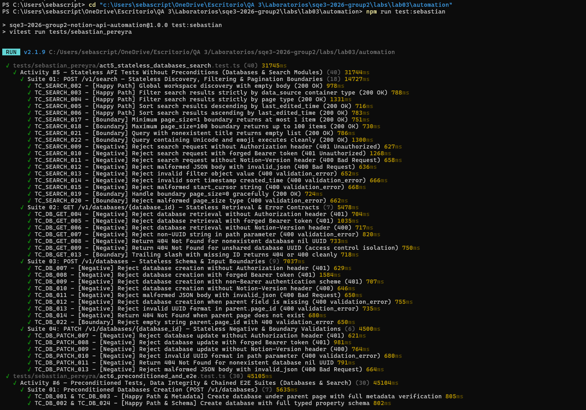
*Figure 6.2.4-A: Complete Vitest test execution output displaying 70 passed tests across stateless, preconditioned, and chained E2E lifecycle suites.*

---

#### 6.2.5 Kevin Uruchi — Module: Pages

Combining [`act5_stateless_pages.test.ts`](./automation/tests/kevin_uruchi/act5_stateless_pages.test.ts) (`12` stateless test cases, `26` Vitest tests) with the five preconditioned suites `act6_pages_*.test.ts` (`145` test cases) achieves a **100% 1:1 migration of all `157` Postman requests** of [`Notion_Pages.postman_collection.json`](./postman/kevin_uruchi/Notion_Pages.postman_collection.json). In addition, [`act6_pages_e2e.test.ts`](./automation/tests/kevin_uruchi/act6_pages_e2e.test.ts) implements the **`16` chained E2E workflows** (`TC_E2E_001` to `TC_E2E_016`, `57` steps) of the test case document, which were not part of the Postman export, so the Pages module automates **`173` of its `200` documented test cases**.

##### Complete Postman-to-Vitest Migration Traceability Matrix (`157 / 157` Requests Migrated + `16` E2E Flows)

| Postman Collection Folder (`Lab 03`) | Postman Requests | Migrated Vitest Test File | Vitest `describe` Suite & Test Cases | Precondition / Chaining Mechanism in Code | Migration Status |
|---|---:|---|---|---|---|
| `POST /v1/pages` | `45` | `act5_stateless_pages.test.ts` (`5`)<br>`act6_pages_post.test.ts` (`40`) | `TC_PAGES_001`–`048` (`45` TCs) | Stateless body and parent validation in `act5` (`017`, `019`, `021`, `022`, `044`). In `act6` every case creates its own parent page by API, plus data sources with `dsBasic()` (`8`) or every property type with `fullPrep()` (`3`). The body under test is set with `setBody()`. | **100% (`45/45`)** |
| `GET /v1/pages/{page_id}` | `21` | `act5_stateless_pages.test.ts` (`3`)<br>`act6_pages_get.test.ts` (`18`) | `TC_PAGES_GET_001`–`025` (`21` TCs) | Invalid, unknown and empty page IDs in `act5` (`012`, `013`, `020`). In `act6`, pages and full rows are seeded with `fullRow()` (`3`), relations of more than `25` items with `relPage()` (`3`), and trashed pages before the `GET`. | **100% (`21/21`)** |
| `GET /v1/pages/{page_id}/properties/{property_id}` | `23` | `act5_stateless_pages.test.ts` (`1`)<br>`act6_pages_property.test.ts` (`22`) | `TC_PAGES_PROP_001`–`030` (`23` TCs) | Unknown and unshared page in `act5` (`012`). In `act6`, rows are seeded with `fullRow()` (`5`) and `basicRow()` (`3`), paginated relations with `relPage()` (`6`), and dual relations with rollup and formula with `dual()` (`3`). `propIds()` resolves every `property_id`. | **100% (`23/23`)** |
| `POST /v1/pages/{page_id}/move` | `28` | `act6_pages_move.test.ts` (`28`) | `TC_PAGES_MOVE_001`–`034` (`28` TCs) | Two parent pages per case, data sources as destinations with `dsBasic()` (`3`) and `mkDb()`, 3-level sub-trees with `tree()` (`2`) for intact and cyclic moves, and `children()` to confirm the old and new parents. | **100% (`28/28`)** |
| `PATCH /v1/pages/{page_id}` | `40` | `act5_stateless_pages.test.ts` (`3`)<br>`act6_pages_patch.test.ts` (`37`) | `TC_PAGES_PATCH_001`–`040` (`40` TCs) | Invalid, unknown and unshared page IDs in `act5` (`019`, `020`, `021`). In `act6`, rows with known values are seeded with `basicRow()` (`18`) and `fullRow()` (`7`), and dual relations with `dual()` (`1`). A `GET` after each failed update proves the page was not changed. `PATCH_022` and `PATCH_030` use `it.skipIf` without their optional credentials. | **100% (`40/40`)** |
| **Test case document / `E2E`**<br>(not in the Postman export) | `0`<br>(`16` documented) | `act6_pages_e2e.test.ts` | `TC_E2E_001`–`016` (`16` flows, `57` `TC_E2E_00X_StepN` tests) | Each flow is a `describe` whose steps share suite-scoped state (`s.rowId`, `s.ds`, `s.ids`, `s.before`, ...) through one flow context (`startFlow`/`beginStep`). `afterAll` trashes every page the flow created, even when a step fails. | **100% (`16/16`)** |
| **Total Migrated (Pages)** | **`157` Reqs**<br>**+ `16` E2E** | **`7` TypeScript Test Suites** | **`173` test cases (`228` Vitest tests)** | **100% parity with the refactored Lab 03 Postman collection (`1,059/1,059` checks with the same result in Newman and Vitest)** | **100% (`157/157` + `16/16`)** |

##### Representative Chained E2E Workflow Code (`TC_E2E_002` / `TC_E2E_003` in `act6_pages_e2e.test.ts`)

```typescript
describe('TC_E2E_002 / TC_E2E_003 — Update properties, verify both GET endpoints and query the new values', () => {
  const h = useFlow('TC_E2E_002'); // own flow context + afterAll cleanup to the trash
  const s = { rowId: '', ds: '', before: '', ids: {} as Record<string, string> };

  it('TC_E2E_002_Step1 - Create a full row and snapshot last_edited_time', async () => {
    beginStep(h.flow, 'TC_E2E_002_Step1');
    const p = await parent();
    const f = await fullRow(p);
    s.rowId = f.row.id;
    s.ds = f.ds;
    const g = await getp(s.rowId);
    stepOk(g, 200, 'GET before the update');
    s.before = g.json?.last_edited_time;
    assertChecks();
  }, T);

  it('TC_E2E_002_Step2 - PATCH number, select and date', async () => {
    beginStep(h.flow, 'TC_E2E_002_Step2');
    const u = await patch(s.rowId, {
      properties: { Count: { number: 77 }, Choice: { select: { name: 'Opt2' } }, When: { date: { start: '2026-12-01' } } },
    });
    stepOk(u, 200, 'PATCH');
    pageOk(u.json, 'PATCH'); // body values + Zod PageObjectSchema
    s.ids = { Count: u.json?.properties?.Count?.id, Choice: u.json?.properties?.Choice?.id, When: u.json?.properties?.When?.id };
    ok(new Date(u.json?.last_edited_time) >= new Date(s.before), 'last_edited_time should not go back');
    assertChecks();
  }, T);

  it('TC_E2E_002_Step3 - GET /v1/pages/{id} returns the new values', async () => {
    beginStep(h.flow, 'TC_E2E_002_Step3');
    const g = await getp(s.rowId);
    stepOk(g, 200, 'GET');
    eq(g.json?.properties?.Count?.number, 77, '[Data integrity] GET Count');
    eq(g.json?.properties?.Choice?.select?.name, 'Opt2', '[Data integrity] GET Choice');
    eq(g.json?.properties?.When?.date?.start, '2026-12-01', '[Data integrity] GET When');
    assertChecks();
  }, T);

  it('TC_E2E_002_Step4 - GET /v1/pages/{id}/properties/{property_id} returns the new values', async () => {
    beginStep(h.flow, 'TC_E2E_002_Step4');
    const a = await prop(s.rowId, s.ids.Count);
    stepOk(a, 200, 'Property item Count');
    eq(a.json?.number, 77, '[Data integrity] Property item Count');
    // ... Choice and When read the same way
    assertChecks();
  }, T);

  it('TC_E2E_003_Step1 - Query the data source with a filter on the three updated values', async () => {
    beginStep(h.flow, 'TC_E2E_003_Step1');
    let rs: any[] = [];
    const found = await waitFor(async () => {
      rs = (await query(s.ds, filter)).results;
      return rs.length === 1 && rs[0].id === s.rowId;
    }, 10, 2000);
    ok(found, '[Data integrity] The query should return exactly the updated page (allowing for the indexing delay)');
    assertChecks();
  }, T);
});
```

##### Execution Command, Vitest Metrics & Evidence (`Activity #6` Full Migrated Suite — `173` Test Cases)

```bash
cd labs/lab03/automation
NOTION_TOKEN=<token> NOTION_ROOT_PAGE_ID=<root_page_id> \
  npx vitest run tests/kevin_uruchi --no-file-parallelism
```

| Vitest Execution Metric (`act5` + `act6` Full Migration Suite) | Observed Result | Technical Notes |
|---|---|---|
| **Test Files Executed** | **`7` files** (`act5_stateless_pages` + `act6_pages_post`, `_get`, `_property`, `_move`, `_patch`, `_e2e`) | Complete 1:1 migration of all `157` Postman requests of `Notion_Pages`, plus the `16` E2E flows. |
| **Total Migrated Tests Executed** | **`228` tests — `[X] Passed / [Y] Failed / [Z] Skipped` (`[P]%` pass rate)** | `[Fill with the Vitest summary]`. Without the optional credentials, `PATCH_022`, `PATCH_030`, `PROP_012` (unshared page), `PATCH_021` and three steps of `TC_E2E_013` are reported as skipped. |
| **Total Execution Duration** | **`[Fill]`** (`transform [ ]`, `collect [ ]`, `tests [ ]`, `prepare [ ]`) | Sequential files (`--no-file-parallelism`), `350 ms` pause and `429` retry with `Retry-After` inside `send()`. Every case builds and trashes its own data. |
| **Breakdown of the Failed Tests** | **`[Fill after the run]`** | Expected from the Newman run (section `1.3.X`): the `notion.so` URL check (`6` cases), `last_edited_time` precision and URL slug (`TC_PAGES_PATCH_011`), link normalization (`TC_PAGES_PATCH_015`), the empty body accepted by `PATCH` (`TC_PAGES_PATCH_023`) and the rate-limit burst (`TC_PAGES_PATCH_035`). The URL defect of `TC_PAGES_PATCH_020` was fixed in the migration. |

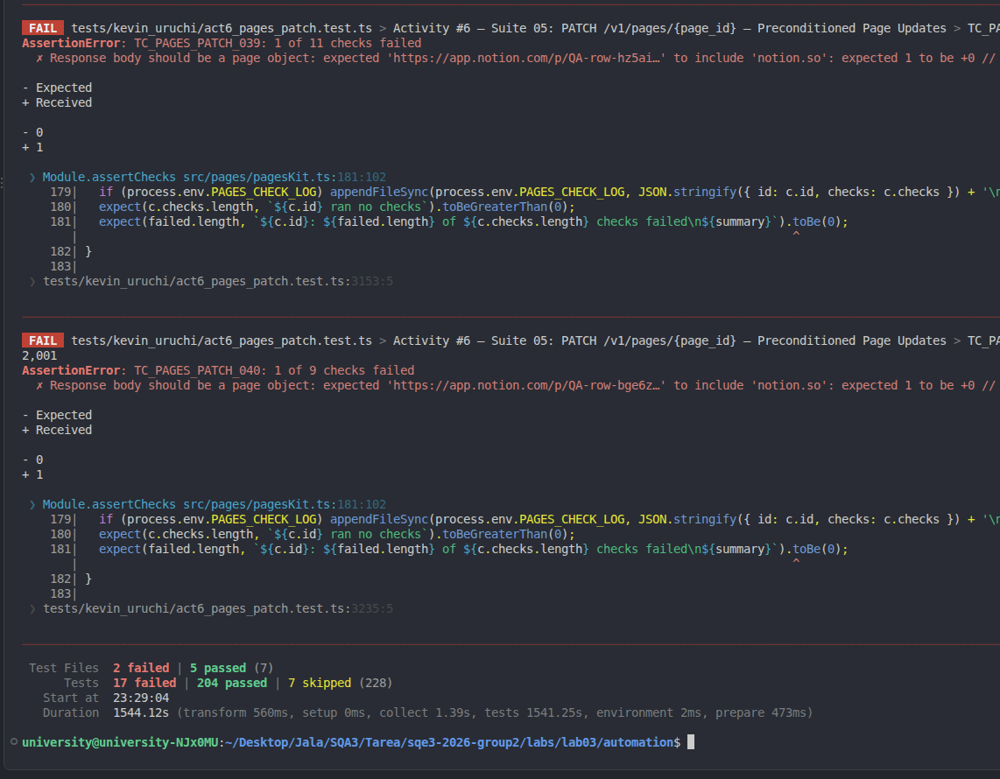

---

### 6.3 Library Compatibility Review and Dependency Matrix

To prevent module-resolution errors (`ERR_REQUIRE_ESM`), type-definition mismatches, or runtime polyfill conflicts across developer machines and CI/CD runners, **Group 2** audited the exact version matrix declared in [`labs/lab03/automation/package.json`](./automation/package.json):

| Package / Runtime | Version Constraint | Role in Automation Framework | Module Format (`ESM` / `CJS`) | TypeScript & Runtime Interoperability Verification |
|---|---|---|---|---|
| **Node.js Runtime** | `>= 20.x / 22.x / 24.x LTS` | Core JavaScript/V8 execution environment, native `performance.now()` high-resolution timers, and `Buffer` Base64 encoding for OAuth Basic Auth. | Native `ESM` (`"type": "module"`) & `CJS` | **100% Compatible.** Native support for `performance.now()` and top-level `await` in ESM modules. |
| **`typescript`** | `^5.6.3` | Static type checking (`strict: true`), interface enforcement (`TimedAxiosResponse`, `CustomClientOptions`), and IDE autocompletion. | Configured with `"module": "ESNext"`, `"moduleResolution": "bundler"` | **100% Compatible.** Cleanly resolves `.ts` imports via `.js` specifiers required by NodeNext/Bundler ESM standards. |
| **`vitest` & `@vitest/ui`** | `^2.1.5` | Test runner, lifecycle hook orchestrator (`beforeAll`, `beforeEach`, `afterEach`, `afterAll`), and Chai/Jest-compatible `expect` assertion engine. | Native `ESM`-first (Vite SSR transformation pipeline) | **100% Compatible.** Executes `.test.ts` files natively without requiring a separate `tsc` build step or `ts-node` loader; `fileParallelism: false` ensures rate-limit safety. |
| **`axios`** | `^1.7.7` | HTTP/1.1 & HTTPS transport client (`axios.create`), request/response timing interceptors, and `validateStatus: () => true` negative-test resolution. | Dual `ESM` + `CJS` package exports + bundled `index.d.ts` | **100% Compatible.** Exports native TypeScript types (`AxiosInstance`, `AxiosResponse`, `InternalAxiosRequestConfig`) with zero `@types/*` external packages required. |
| **zod** | `^3.23.8` | Runtime JSON schema parser and parameter/property type validator (`UserObjectSchema`, `PaginatedUserListSchema`, `BlockObjectSchema`, `PaginatedBlockListSchema`, `NotionErrorSchema`, `OAuthIntrospectSchema`). | Dual `ESM` + `CJS` with zero external runtime dependencies | **100% Compatible.** Works seamlessly inside Vitest `expect(schema.safeParse(res.data).success).toBe(true)` blocks with full TypeScript type inference (`z.infer<typeof Schema>`). |
| **`dotenv`** | `^16.4.5` | Loads `.env` secrets (`NOTION_TOKEN`, `RESTRICTED_TOKEN`, `OAUTH_CLIENT_ID`, `OAUTH_CLIENT_SECRET`) into `process.env` inside `vitest.config.ts` and `notionClient.ts`. | Dual `ESM` + `CJS` with bundled TypeScript declarations | **100% Compatible.** Zero dependency collisions; safely isolates developer secrets outside version control. |

---

<div style="page-break-after: always;"></div>

## Team Participation

| Team Member | Lab 03 Contributions & Implemented Scope | Section / Item Worked On | Additional Comments & Status |
|---|---|---|---|
| **Gabriel Marcos Guaman Ortuño** | • Refactored `Notion_Users_OAuth_GabrielGuaman.postman_collection.json` (`69` requests, `345` assertions) and `Notion_Users_OAuth_Env.postman_environment.json` incorporating all 4 peer-review suggestions from Lilian Rosario López Coca (strict single status codes, collection-level DRY `[Common]` assertions, unified `OAUTH_ACCESS_TOKEN` & `next_cursor` variables, and in-collection Markdown setup guide).<br>• Executed unattended Newman `v6.2.3` CLI + `htmlextra` validation (`70` HTTP requests, `345` assertions: `328 Passed / 17 Failed`, `95.07%` pass rate) and documented the full root-cause classification of all `17` failed assertions across Category A (Notion API contract defects) and Category B (unattended CLI/OAuth constraints).<br>• Authored the complete Activity #2 HTTP Client evaluation (`Axios` vs. `Supertest` vs. `Native Fetch / Undici` vs. `Got`), architectural justification (`axios.create` + `validateStatus: () => true`), and GenAI validation protocol.<br>• Built the Group 2 code-based automation framework (`labs/lab03/automation/` with TypeScript, Axios, Zod, and Vitest) and migrated all `69` `Users` & `OAuth` requests across `act5_stateless_users_oauth.test.ts` (`42` stateless tests: `32 Passed / 10 Failed` in `33.71s`) and `act6_preconditioned_and_e2e.test.ts` (`27` preconditioned & chained E2E tests; full `69`-test suite: `56 Passed / 13 Failed`, `81.16%` pass rate in `65.67s`) in Activities #5 and #6. | • Activity #1 (`1.1.1`, `1.2.1`, `1.3.1`)<br>• Activity #2 (`2.1`, `2.2`, `2.3`, `2.4`, `2.5`)<br>• Activity #5 (`5.1`, `5.2`, `5.3`, `5.4.1`)<br>• Activity #6 (`6.1`, `6.2.1`, `6.3`) | • Refactored Lab 03 Postman artifacts committed under `labs/lab03/postman/gabriel_guaman/`.<br>• Code-based framework & `69` Vitest tests (`56 Passed / 13 Failed`) committed under `labs/lab03/automation/`.<br>• Activities #1 (Gabriel's section), #2, #5 (Gabriel's section), and #6 (Gabriel's section) 100% completed. |
| **Valentina Molina Bustillos** | • Authored the complete Activity #4 Git workflow proposal, including the branching strategy (`main` / `week_X` / `feature/`), Conventional Commits guidelines, Pull Request policies, and CI/CD strategy (GitHub Actions) with a documented Generative AI prompt and validation procedure.<br>• Designed and generated the 4 visual reference guides (infographics) for the team's engineering conventions using AI image generation with a unified color palette. | • Activity #4 (Full section) | • Activity #4 100% completed.<br>• |
| **Karen Ivonne Cruz Alvarez** | • Refactored `Notion_Blocks_KarenCruz.postman_collection.json` (`72` test cases / `81` HTTP requests across `6` folders, reduced by `1,455` lines) and `Notion_Blocks_Env.postman_environment.json` incorporating all 4 peer-review suggestions from Kiara Vanessa Muñoz Bayter (centralized Collection-level `[Common]` assertions for `Content-Type`, `x-notion-request-id`, and `< 5000 ms` SLA; environment-first variable resolution without collection shadowing and `try / finally` sandbox teardown; strict single-status contract assertions preserving the 4 Notion API defect findings; and in-collection Markdown setup documentation).<br>• Executed the consolidated `Blocks` suite unattended in Newman `v6.2.3` (`308` total HTTP requests, `162` prerequest-scripts and `150` test-scripts with `0 failed`, `457` assertions: `448 Passed / 9 Failed`, `98.03%` pass rate in `4m 44.7s`), exported `reports/karen_cruz_newman_report.html`, and documented automation difficulties and the 4 Notion API contract discrepancies (`TC_BLK_APP_017`, `TC_BLK_APP_018`, `TC_BLK_CHL_012`, `TC_BLK_DEL_003`).<br>• Extended `src/core/assertions.ts` with `BlockObjectSchema` and `PaginatedBlockListSchema` (`Zod`) and migrated all `81` `Blocks` requests into **Axios + Vitest** across `tests/karen_cruz/act5_stateless_blocks.test.ts` (`51` stateless tests: `48 Passed / 3 Failed` in `43.28s`) and `tests/karen_cruz/act6_preconditioned_and_e2e_blocks.test.ts` (`30` preconditioned & chained E2E tests: `26 Passed / 4 Failed`; combined `81`-test suite: `74 Passed / 7 Failed`, `91.36%` pass rate in `128.51s`). | • Activity #1 (`1.1.3`, `1.2.3`, `1.3.3`)<br>• Activity #5 (`5.1`, `5.2`, `5.3`, `5.4.3`)<br>• Activity #6 (`6.1.2`, `6.2.3`, `6.3`) | • Refactored Lab 03 Postman collection & environment committed under `labs/lab03/postman/karen_cruz/`.<br>• Full `81`-test Vitest migration (`74 Passed / 7 Failed`), Newman HTML report (`labs/lab03/reports/karen_cruz_newman_report.html`), and all 4 screenshots (`labs/lab03/caps/karencruz/`) completed.<br>• Activities #1, #5, and #6 (Karen's sections) 100% completed. |
| **Sebastián Pereyra** | • Applied all peer-review suggestions from Kevin Uruchi and Lucas Gabriel De Los Santos to the `Databases` and `Search` collections (standardizing English request names, removing hardcoded collection variables, expanding test cases for 100% Lab 01 parity, and enforcing strict single status code assertions).<br>• Automated the unattended Newman CLI (`v6.2.3`) + `htmlextra` execution for `Databases` and `Search` across `14` requests (`32` assertions) and documented execution metrics and eventual consistency findings.<br>• Authored technical difficulty analyses and Notion API contract defect findings (DEF-DB-01 pagination clamping on `/v1/search`, DEF-DB-02 compact hex normalization, DEF-DB-03 nil UUID lookup).<br>• Implemented `70` automated TypeScript/Vitest tests under `tests/sebastian_pereyra/` across `act5_stateless_databases_search.test.ts` (`34` stateless tests) and `act6_preconditioned_and_e2e.test.ts` (`36` preconditioned and chained E2E tests, including the 6-step container lifecycle workflow), implementing multi-layer verifications (status code, body structure, data integrity via GET persistence, and type checking).<br>• Authored the Library Compatibility and Ecosystem Review (Section `6.3`) and the Consolidated Group Reflection (Section `6.4`). | • Activity #1 (`1.1.4`, `1.2.4`, `1.3.4`)<br>• Activity #5 (`5.4.4`)<br>• Activity #6 (`6.1`, `6.2.4`, `6.3`, `6.4`) | • Full test suites committed under `labs/lab03/automation/tests/sebastian_pereyra/`.<br>• Core assertions and schemas added to `src/core/assertions.ts`.<br>• Activities #1, #5, #6 (Sebastián's sections and Sections 6.3/6.4) 100% completed. |
| **Kevin Uruchi** | • Refactored `Notion_Pages.postman_collection.json` (`157` requests, `5` endpoint folders) and `Notion_Pages.postman_environment.json` applying the Lab 02 peer-review feedback from Lucas Gabriel De Los Santos (`7` suggestions + `2` additional defects found): all `314` scripts wrapped in async functions with a `Promise`-based `pm.sendRequest` for Newman compatibility, `pm.test.skip` for skipped cases, common checks (`Preconditions`, `Content-Type`, SLA) moved to the collection level (`470` duplicated blocks removed), secret tokens, filled environment (`14` → `9` keys) and a step-by-step setup guide in the collection description.<br>• Executed unattended Newman `v6.2.3` CLI + `htmlextra` validation against the live Notion API (`1,566` HTTP requests, `1,345` assertions: `1,332 Passed / 13 Failed`, `3` skipped, `99.03%` pass rate, `18m 7.7s`) and classified the `13` failures (`1` Notion API finding, `9` outdated test expectations, `2` test script defects, `1` non-deterministic rate-limit check).<br>• Migrated the `12` stateless Pages cases to Axios + Vitest (`act5_stateless_pages.test.ts`, `26` tests), including a raw-body helper because Axios re-serializes malformed JSON.<br>• Migrated `100%` of the Postman suite (`145` preconditioned cases in `5` files) through a typed `pagesKit.ts` (Postman runtime replacement + `45` shared helpers) and Zod schemas (`pageSchemas.ts`), and implemented the `16` chained E2E flows of the test case document (`57` steps) that were missing from the Postman export: `173` test cases / `228` Vitest tests, `0` errors under `tsc --strict`, and `1,059/1,059` checks with the same result in Newman and Vitest against the same mock API. | • Activity #1 (`1.1.5`, `1.2.5`, `1.3.5`)<br>• Activity #5 (`5.4.5`)<br>• Activity #6 (`6.2.5`, plus the Pages contributions to `6.1` and `6.3`) | • Refactored Lab 03 Postman artifacts committed under `labs/lab03/postman/kevin_uruchi/`.<br>• Pages kit and schemas under `labs/lab03/automation/src/pages/`, `7` Vitest suites under `labs/lab03/automation/tests/kevin_uruchi/`.<br>• Activities #1 and #5 (Kevin's sections) completed.<br>• **Pending:** live Vitest run against Notion (metrics tables of `5.4.5` and `6.2.5`), Newman and Vitest screenshots, and revoking the integration token exposed in `caps/Kevin/actividad3-1.png`. |