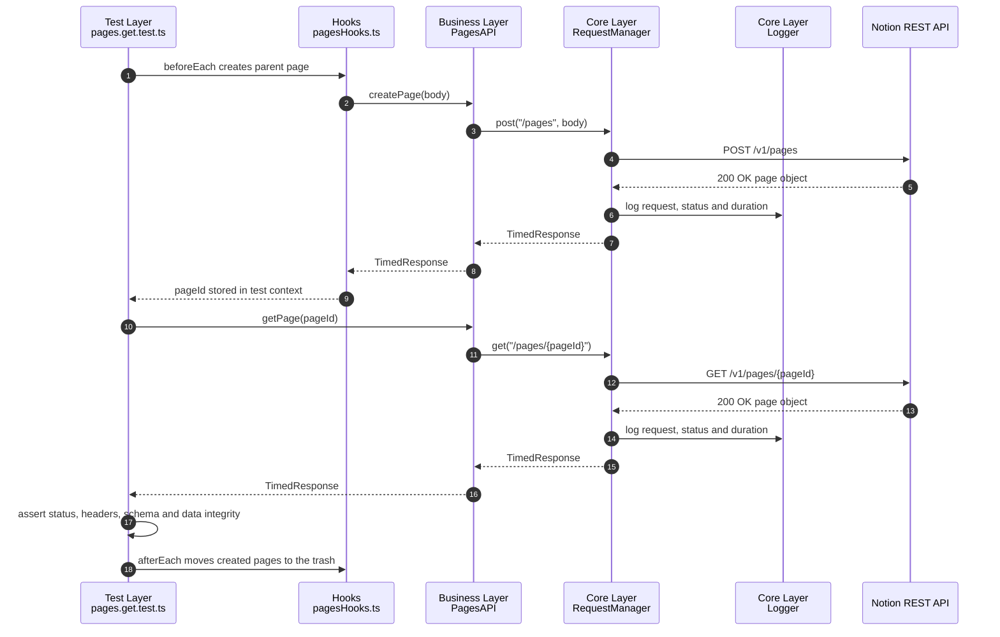
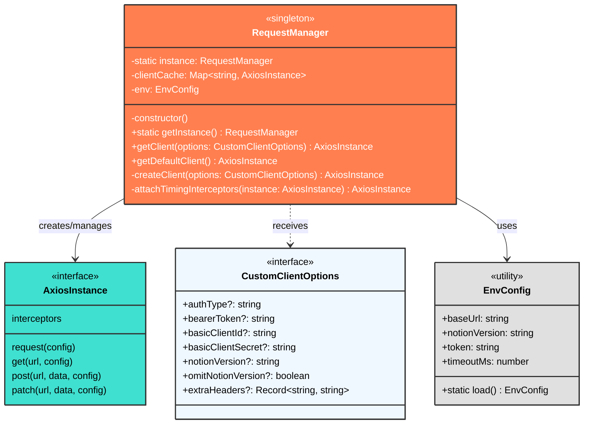

<div align="center">

# SQE III Group Laboratory — Week 4 (Lab 04)

<br><br>


<br><br>

Valentina Molina Bustillos  
Gabriel Marcos Guaman Ortuño  
Karen Ivonne Cruz Alvarez  
Sebastián Pereyra  
Kevin Uruchi

<br><br>

Jala University  
Commercial Software Engineering  
Eng. Edson Guerra

<br><br>

Bolivia  
November 22, 2026

<br>

</div>

<div style="page-break-after: always;"></div>

## Table of Contents

1. [Activity #1](#activity-1)
   - [1.1 Architecture of the Automation Framework](#11-architecture-of-the-automation-framework)
   - [1.2 Structure of the Automation Framework](#12-structure-of-the-automation-framework)
   - [1.3 Refactoring of the Lab 04 Code Following the Proposed Architecture and Structure](#13-refactoring-of-the-lab-04-code-following-the-proposed-architecture-and-structure)
   - [1.4 Configuration and Environment Files](#14-configuration-and-environment-files)
   - [1.5 Code Format Review Libraries (Linter)](#15-code-format-review-libraries-linter)
2. [Activity #2](#activity-2)
   - [2.1 Singleton Design Pattern for the Request Manager](#21-singleton-design-pattern-for-the-request-manager)
   - [2.2 Singleton Pattern Diagram](#22-singleton-pattern-diagram)
   - [2.3 Refactoring in Response to the Singleton Implementation](#23-refactoring-in-response-to-the-singleton-implementation)
3. [Activity #3](#activity-3)
   - [3.1 Logging Tool for Automated Test Execution](#31-logging-tool-for-automated-test-execution)
   - [3.2 Team Logger Conventions](#32-team-logger-conventions)
   - [3.3 Log Report Generation](#33-log-report-generation)
4. [Activity #4](#activity-4)
   - [4.1 Review of Preconditions and Postconditions](#41-review-of-preconditions-and-postconditions)
   - [4.2 Test Context Variables](#42-test-context-variables)
   - [4.3 Dynamic Datasets Generated with GenAI](#43-dynamic-datasets-generated-with-genai)
5. [Activity #5](#activity-5)
   - [5.1 Continued Implementation of the Test Suites](#51-continued-implementation-of-the-test-suites)
   - [5.2 Review of the Architecture Layers in the Implementation](#52-review-of-the-architecture-layers-in-the-implementation)
   - [5.3 Framework Functionality and Component Documentation](#53-framework-functionality-and-component-documentation)
6. [Team Participation](#team-participation)

<div style="page-break-after: always;"></div>

## Activity #1

1. Define and diagram the architecture of the automation framework to be developed.
2. Define and diagram the structure of the automation framework to be developed.
3. Refactor the code developed in the previous laboratory following the proposed architecture and structure diagrams.
4. Implement configuration and environment files for the automation framework.
5. Implement libraries for code format review (linter).

---

### 1.1 Architecture of the Automation Framework

In Lab 04, **Group 2** migrated the Postman suites of the **Notion REST API (`2025-09-03`)** to **Axios + Vitest**. The migration worked, but every test file still built its own requests, preconditions and helpers, and the HTTP client, the Zod schemas and the assertion helpers were shared through a single `src/core/` folder with no clear boundary between what is generic and what belongs to Notion. For Lab 05 the team adopts a **three-layer architecture** in which each layer has one responsibility and only depends on the layer directly below it.

#### 1.1.1 Architecture Layers

| Layer | Folder | Responsibility | Must Not |
|---|---|---|---|
| **Test Layer** | `tests/` | Holds the test scenarios of each Notion module and the hooks that build preconditions and clean up postconditions. Describes *what* is verified (status code, body, headers, data integrity, types). | Build URLs, set headers, call Axios directly or contain hardcoded IDs and tokens. |
| **Business Layer** | `main/` | Models the Notion REST API. One endpoint class per module (`PagesAPI`, `BlocksAPI`, `DatabasesAPI`, ...) exposes one method per endpoint, plus the Zod schemas and test data of the application. Knows *how* Notion is called. | Contain assertions or know about Vitest. |
| **Core Layer** | `core/` | Generic, application-agnostic infrastructure. Request Manager (Singleton over Axios), logger, log reporter, fake data generator, schema validator and configuration loader. | Know anything about Notion. The same core could serve any other REST API. |

The dependency rule is strictly top-down (`Test → Business → Core → Notion REST API`). Because the Core Layer knows nothing about Notion, it can be reused against any other REST API by writing a new Business Layer, in the same way the reference diagram reuses its core for Trello, Spotify and YouTube.

#### 1.1.2 Layered Architecture Diagram

```mermaid
flowchart TB
    subgraph TL["tests/"]
        direction LR
        TL0["Test Layer"]
        T1["Pages API<br/>test scenarios"]
        T2["Blocks API<br/>test scenarios"]
        T3["Databases and Search<br/>API test scenarios"]
        T4["Users and OAuth<br/>API test scenarios"]
        T5["Data Sources, Comments and<br/>File Uploads test scenarios"]
        T6["Hooks<br/>common and per module"]
    end

    subgraph BL["main/"]
        direction LR
        BL0["Business Layer"]
        B1["Pages API<br/>endpoints"]
        B2["Blocks API<br/>endpoints"]
        B3["Databases and Search<br/>API endpoints"]
        B4["Users and OAuth<br/>API endpoints"]
        B5["Data Sources, Comments and<br/>File Uploads endpoints"]
        B6["Resources<br/>schemas and data"]
    end

    subgraph CL["core/"]
        direction LR
        CL0["Core Layer"]
        C1["Request Manager<br/>Singleton"]
        C2["Logs"]
        C3["Reports"]
        C4["Faker data"]
        C5["API Schema<br/>Validator"]
        C6["Config and<br/>Environment"]
    end

    SUT[("Notion REST API<br/>api.notion.com/v1<br/>Notion-Version 2025-09-03")]

    TL ==> BL
    BL ==> CL
    CL ==>|HTTPS| SUT

    classDef layer fill:#e8f1fb,stroke:#1f6feb,stroke-width:2px,color:#1f6feb
    classDef ext fill:#fff4e5,stroke:#f0883e,stroke-width:2px,color:#b35900
    classDef dashed fill:#ffffff,stroke:#f0883e,stroke-dasharray:5 5,color:#b35900
    class TL0,BL0,CL0 layer
    class SUT ext
    class OTHER dashed
```



#### 1.1.3 Class Diagram of the Framework

The diagram below shows the main classes of each layer and how they depend on each other. `RequestManager` is the only class that talks to Axios, and every endpoint class obtains it through `RequestManager.getInstance()` (the Singleton is detailed in Activity #2).

```mermaid
classDiagram
    direction TB

    %% ================= TEST LAYER =================
    class PagesScenarios {
        <<scenario>>
        +postPagesTests()
        +getPageTests()
        +getPagePropertyTests()
        +movePageTests()
        +patchPageTests()
        +e2eFlows()
    }
    class CommonHooks {
        <<hook>>
        +throttle(ms) Promise~void~
        +recordTelemetry(context)
        +globalSetup()
    }
    class PagesHooks {
        <<hook>>
        +createParentPage() Promise~string~
        +createDataSourceRow() Promise~string~
        +trashCreatedPages() Promise~void~
    }

    %% ================= BUSINESS LAYER =================
    class PagesAPI {
        <<endpoint>>
        -RequestManager request
        +createPage(body) Promise~TimedResponse~
        +getPage(pageId) Promise~TimedResponse~
        +getPageProperty(pageId, propertyId) Promise~TimedResponse~
        +movePage(pageId, body) Promise~TimedResponse~
        +updatePage(pageId, body) Promise~TimedResponse~
    }
    class BlocksAPI {
        <<endpoint>>
        +appendChildren(blockId, body) Promise~TimedResponse~
        +getBlock(blockId) Promise~TimedResponse~
        +getChildren(blockId, params) Promise~TimedResponse~
        +updateBlock(blockId, body) Promise~TimedResponse~
        +deleteBlock(blockId) Promise~TimedResponse~
    }
    class DatabasesAPI {
        <<endpoint>>
        +createDatabase(body) Promise~TimedResponse~
        +getDatabase(databaseId) Promise~TimedResponse~
        +updateDatabase(databaseId, body) Promise~TimedResponse~
    }
    class SearchAPI {
        <<endpoint>>
        +search(body) Promise~TimedResponse~
    }
    class UsersAPI {
        <<endpoint>>
        +getMe() Promise~TimedResponse~
        +getUser(userId) Promise~TimedResponse~
        +listUsers(params) Promise~TimedResponse~
    }
    class OAuthAPI {
        <<endpoint>>
        +createToken(body) Promise~TimedResponse~
        +revokeToken(body) Promise~TimedResponse~
        +introspectToken(body) Promise~TimedResponse~
    }
    class DataSourcesAPI {
        <<endpoint>>
        +createDataSource(body) Promise~TimedResponse~
        +getDataSource(dataSourceId) Promise~TimedResponse~
        +updateDataSource(dataSourceId, body) Promise~TimedResponse~
        +queryDataSource(dataSourceId, body) Promise~TimedResponse~
    }
    class CommentsAPI {
        <<endpoint>>
        +createComment(body) Promise~TimedResponse~
        +listComments(params) Promise~TimedResponse~
    }
    class FileUploadsAPI {
        <<endpoint>>
        +createFileUpload(body) Promise~TimedResponse~
        +sendFile(fileUploadId, form) Promise~TimedResponse~
        +getFileUpload(fileUploadId) Promise~TimedResponse~
    }
    class NotionSchemas {
        <<schema>>
        +PageObjectSchema
        +BlockObjectSchema
        +UserObjectSchema
        +NotionErrorSchema
        +PaginatedListSchema
    }
    class NotionTestData {
        <<data>>
        +pagesPayloads.json
        +invalidIds.csv
    }

    %% ================= CORE LAYER =================
    class RequestManager {
        <<singleton>>
        -RequestManager instance$
        -AxiosInstance client
        -RequestManager()
        +getInstance()$ RequestManager
        +get(url, options) Promise~TimedResponse~
        +post(url, body, options) Promise~TimedResponse~
        +patch(url, body, options) Promise~TimedResponse~
        +delete(url, options) Promise~TimedResponse~
        +send(request) Promise~TimedResponse~
    }
    class Logger {
        <<utility>>
        +info(message, meta)
        +warn(message, meta)
        +error(message, meta)
        +debug(message, meta)
    }
    class LogReporter {
        <<utility>>
        +generate(logFile) Promise~void~
    }
    class DataFactory {
        <<utility>>
        +title(prefix) string
        +uuid() string
        +text(length) string
        +url() string
    }
    class SchemaValidator {
        <<utility>>
        +validate(schema, data) ValidationResult
        +assertValid(schema, data)
    }
    class EnvConfig {
        <<utility>>
        +baseUrl string
        +notionVersion string
        +token string
        +timeoutMs number
        +load()$ EnvConfig
    }

    %% ================= RELATIONSHIPS =================
    PagesScenarios ..> PagesAPI : calls endpoints
    PagesScenarios ..> PagesHooks : preconditions and cleanup
    PagesScenarios ..> CommonHooks : throttle and telemetry
    PagesScenarios ..> SchemaValidator : validates bodies
    PagesHooks ..> PagesAPI : builds test data
    PagesHooks ..> DataFactory : dynamic values

    PagesAPI --> RequestManager : getInstance()
    BlocksAPI --> RequestManager
    DatabasesAPI --> RequestManager
    SearchAPI --> RequestManager
    UsersAPI --> RequestManager
    OAuthAPI --> RequestManager
    DataSourcesAPI --> RequestManager
    CommentsAPI --> RequestManager
    FileUploadsAPI --> RequestManager

    SchemaValidator ..> NotionSchemas : uses
    PagesHooks ..> NotionTestData : reads datasets

    RequestManager --> EnvConfig : base URL, version, token
    RequestManager --> Logger : logs every request and response
    LogReporter ..> Logger : reads log output
```



> **Note.** The test scenarios of the other modules (`BlocksScenarios`, `DatabasesScenarios`, `UsersOAuthScenarios`, `DataSourcesScenarios`) and their hooks follow exactly the same pattern as `PagesScenarios` and `PagesHooks`, so they are omitted to keep the diagram readable.

#### 1.1.4 Request Flow Across the Layers

The sequence below shows how a single test case (`TC_PAGES_GET_001`) crosses the three layers. The test never touches Axios or Notion headers, it only asks the Business Layer for a page and verifies the result.



#### 1.1.5 Design Principles Applied

1. **Separation of concerns.** Tests describe behavior, endpoint classes describe the API and the core describes the transport. A change in Notion's URL or headers is fixed in one place.
2. **Single point of access to HTTP.** Only `RequestManager` creates the Axios instance, which allows the Singleton of Activity #2 and the logger of Activity #3 to be added without touching any test.
3. **Reusable core.** `core/` has no reference to Notion, so it can be reused by other projects of the course.
4. **One endpoint class per Notion module.** Each team member owns the endpoint classes, hooks and scenarios of their module, which keeps merge conflicts low in the `week_X` branch.

---

### 1.2 Structure of the Automation Framework

The repository is organized so that each folder maps to exactly one layer of the architecture defined in Section `1.1`. The tree below shows the current folders and the files that each one will hold. Files marked with `(new)` are created during Lab 05.

#### 1.2.1 Directory Tree

```text
.
├── core/                              # CORE LAYER (application-agnostic)
│   ├── api/
│   │   └── RequestManager.ts          # (new) Singleton over Axios, timing interceptors, 429 retry
│   └── utils/
│       ├── envConfig.ts               # (new) Loads and validates .env values
│       ├── logger.ts                  # (new) Logger wrapper (Activity #3)
│       ├── logReporter.ts             # (new) Builds the HTML/JSON report from the logs (Activity #3)
│       ├── dataFactory.ts             # (new) Faker-based dynamic values
│       └── schemaValidator.ts         # (new) Generic Zod validation helper
├── labs/                              # Lab reports, screenshots (caps/) and exported reports
├── main/                              # BUSINESS LAYER (Notion-specific)
│   ├── api/
│   │   ├── endpoints/
│   │   │   ├── pagesAPI.ts            # Pages module (Kevin Uruchi)
│   │   │   ├── blocksAPI.ts           # (new) Blocks module (Karen Cruz)
│   │   │   ├── databasesAPI.ts        # (new) Databases module (Sebastián Pereyra)
│   │   │   ├── searchAPI.ts           # (new) Search module (Sebastián Pereyra)
│   │   │   ├── usersAPI.ts            # (new) Users module (Gabriel Guaman)
│   │   │   ├── oauthAPI.ts            # (new) OAuth module (Gabriel Guaman)
│   │   │   ├── dataSourcesAPI.ts      # (new) Data Sources module (Valentina Molina)
│   │   │   ├── commentsAPI.ts         # (new) Comments module (Valentina Molina)
│   │   │   └── fileUploadsAPI.ts      # (new) File Uploads module (Valentina Molina)
│   │   └── resources/
│   │       ├── data/                  # Static and GenAI-generated datasets (JSON / CSV)
│   │       └── schemas/               # Zod schemas of Notion objects (page, block, user, error...)
│   └── resources/                     # Application-level config (Notion endpoints, version, defaults)
├── tests/                             # TEST LAYER
│   ├── hooks/
│   │   ├── common/                    # Global setup, throttle, telemetry, shared test context
│   │   └── pages/                     # Preconditions and cleanup of the Pages module
│   └── scenarios/
│       └── pages/                     # Test scenarios of the Pages module (*.test.ts)
├── .env.example                       # (new) Template of required variables, no secrets
├── eslint.config.js                   # (new) Linter configuration (Section 1.5)
├── .prettierrc                        # (new) Formatter configuration (Section 1.5)
├── package.json
├── tsconfig.json                      # Path aliases @core/*, @main/*, @tests/*
├── vitest.config.ts
└── README.md
```

The other modules follow the same pattern as `pages`. Each owner adds `tests/hooks/<module>/` and `tests/scenarios/<module>/` (for example `tests/scenarios/blocks/`), so the tree grows by module and not by team member, unlike Lab 04 where tests were grouped in `tests/<member_name>/`.


#### 1.2.2 Responsibility of Each Folder

| Folder | Layer | Contents | Imports Allowed From |
|---|---|---|---|
| `core/api/` | Core | `RequestManager` (only place where Axios is instantiated). | `core/utils/` |
| `core/utils/` | Core | Logger, log reporter, data factory, schema validator, environment loader. | External libraries only |
| `main/api/endpoints/` | Business | One class per Notion module with one method per endpoint. | `core/` |
| `main/api/resources/schemas/` | Business | Zod schemas of Notion objects and error envelope. | `zod` |
| `main/api/resources/data/` | Business | Static and GenAI-generated datasets in JSON or CSV (Activity #4). | none |
| `main/resources/` | Business | Application settings such as Notion endpoint paths, default `page_size` and SLA limits. | none |
| `tests/hooks/common/` | Test | Global setup, rate-limit throttle, telemetry and shared test context. | `core/`, `main/` |
| `tests/hooks/<module>/` | Test | Preconditions and cleanup of one module (create parent pages, trash created data). | `core/`, `main/` |
| `tests/scenarios/<module>/` | Test | `*.test.ts` files with the test cases of one module. | `main/`, `tests/hooks/`, `core/utils/` |
| `labs/` | none | Lab reports (`labXX/`), screenshots (`caps/`) and exported reports. | none |

#### 1.2.4 Naming Conventions

| Element | Convention | Example |
|---|---|---|
| Endpoint class file | `camelCase` + `API.ts` | `pagesAPI.ts` exporting `class PagesAPI` |
| Endpoint method | verb + resource | `createPage`, `getPageProperty`, `movePage` |
| Hook file | `<module>Hooks.ts` | `tests/hooks/pages/pagesHooks.ts` |
| Test file | `<module>.<endpoint>.test.ts` | `tests/scenarios/pages/pages.get.test.ts` |
| Schema | `PascalCase` + `Schema` | `PageObjectSchema`, `NotionErrorSchema` |
| Dataset | `<module>_<purpose>.json` or `.csv` | `pages_invalid_ids.csv` |
| Test case title | `TC_<MODULE>_<ENDPOINT>_<NNN> - [Category] description` | `TC_PAGES_GET_012 - [Negative] Reject invalid page ID` |

---

### 1.3 Refactoring of the Lab 04 Code Following the Proposed Architecture and Structure

#### 1.3.1 Gabriel Marcos Guaman Ortuño — Modules: Users & OAuth

> TODO 

#### 1.3.2 Valentina Molina Bustillos — Modules: Data Sources, Comments & File Uploads

> TODO 

#### 1.3.3 Karen Ivonne Cruz Alvarez — Module: Blocks

> TODO 

#### 1.3.4 Sebastián Pereyra — Modules: Databases & Search

The existing Lab 03 code for Databases and Search was organized under `tests/sebastian_pereyra/` with no layer separation — Axios calls, assertion helpers and test logic were mixed in the same files.

**Changes made during Lab 05 refactoring:**

| Before (Lab 03) | After (Lab 05) |
|---|---|
| Axios called directly inside test files | `DatabasesAPI` and `SearchAPI` classes in `main/api/endpoints/` wrap every endpoint |
| Hardcoded headers and `baseURL` per file | `RequestManager.getInstance().getDefaultClient()` provides a pre-configured client |
| No schema validation | `SchemaValidator.assertValid()` + Zod schemas in `main/api/resources/schemas/` |
| No data cleanup | `databasesHooks.ts` archives created databases in `afterAll` |
| `DataFactory`-like helpers were inline | `DataFactory` from `core/utils/` now generates titles and UUIDs |

**New files created:**

| File | Layer | Description |
|---|---|---|
| `main/api/endpoints/databasesAPI.ts` | Business | Wraps `POST /databases`, `GET /databases/:id`, `PATCH /databases/:id`, `POST /databases/:id/query` |
| `main/api/endpoints/searchAPI.ts` | Business | Wraps `POST /search` with typed `SearchBody` interface |
| `tests/hooks/databases/databasesHooks.ts` | Test | `createTestDatabase()` precondition and `archiveCreatedDatabases()` postcondition |
| `tests/scenarios/databases/databases.create.test.ts` | Test | 3 test cases for database creation |
| `tests/scenarios/databases/databases.get.test.ts` | Test | 3 test cases for database retrieval |
| `tests/scenarios/databases/databases.query.test.ts` | Test | 3 test cases for database queries |
| `tests/scenarios/search/search.test.ts` | Test | 6 test cases for the Search endpoint |

#### 1.3.5 Kevin Uruchi — Module: Pages

> TODO 

---

### 1.4 Configuration and Environment Files

> TODO 

---

### 1.5 Code Format Review Libraries (Linter)

> TODO 

---

<div style="page-break-after: always;"></div>

## Activity #2

1. Implement the Singleton design pattern for the request manager.
2. Diagram the implemented Singleton design pattern.
3. Continue the code refactoring work in response to the Singleton implementation.

---

### 2.1 Singleton Design Pattern for the Request Manager

The **Singleton** pattern was implemented in the `RequestManager` class inside `core/api/`. This class centralizes the creation and management of Axios instances across the framework.

**Design decisions:**
- **Private constructor:** Prevents any part of the code from creating a direct instance with `new RequestManager()`.
- **Static `getInstance()` method:** The only global access point. It guarantees a single instance of the manager exists in the entire application.
- **Client cache (`Map<string, AxiosInstance>`):** Although the Singleton guarantees a single manager instance, different parts of the code may require clients with distinct configurations (e.g., Basic auth for OAuth, or clients without the `Notion-Version` header for negative tests). To avoid redundant instances, the manager uses a cache keyed by the configuration options (`JSON.stringify(options)`). If a client with the same options is requested, the cached instance is returned.
- **Dependency injection:** The `RequestManager` loads configuration from `EnvConfig`, keeping the Core Layer agnostic to environment implementation details.

**Key files:**
- `core/api/RequestManager.ts`: Singleton implementation.
- `core/utils/envConfig.ts`: Environment variable loading and validation.

### 2.2 Singleton Pattern Diagram

[](https://mermaid.live/edit#pako:eNo9j01qwzAYRK9iZq0YWdZftE23vUDRwiL66hhiKagSpDW-e6lLu5yBecPbcM2R4DBNExjmskS4WhoxrFTW8BOx-dR1HvVGK3m4zqNQbM_TNd9z8fBpB8MjpLec1791yW2-wb2H-wcxtEcMlV6WMJew_reFUqRyyS1VOCUPBtyGJ5wYdc-1MtwqYbnUiuET7mRkL89GCa31aIXVamf4Ol55b7Xlg5GDGaQw43lgoLjUXF5_BQ_P_RvV3Ehu)



### 2.3 Refactoring in Response to the Singleton Implementation

> TODO 
---

<div style="page-break-after: always;"></div>

## Activity #3

1. Implement a specialized tool to generate logs of the automated test execution.
2. Define the team conventions for the use of the logger.
3. Implement the functionality to generate a report from the resulting logs.

---

### 3.1 Logging Tool for Automated Test Execution

> TODO 

### 3.2 Team Logger Conventions

> TODO 

### 3.3 Log Report Generation

> TODO 

---

<div style="page-break-after: always;"></div>

## Activity #4

1. Review the implementation of preconditions and postconditions.
2. Improve the code by implementing context variables for the automated tests.
3. Use GenAI to generate dynamic datasets (JSON or CSV) that strengthen the data-driven tests of the framework. Include the prompt and procedure used.

---

### 4.1 Review of Preconditions and Postconditions

> TODO 

### 4.2 Test Context Variables

> TODO 

### 4.3 Dynamic Datasets Generated with GenAI

#### Prompt Used

```text
> TODO
```

#### Generation and Validation Procedure

> TODO 

---

<div style="page-break-after: always;"></div>

## Activity #5

1. Continue the implementation of the tests written for the assigned application.
2. Review the implementation of the framework establishing the difference between the architecture layers.
3. Document the functionality of the framework and its components.

---

### 5.1 Continued Implementation of the Test Suites

#### 5.1.1 Gabriel Marcos Guaman Ortuño — Modules: Users & OAuth
> TODO

#### 5.1.2 Valentina Molina Bustillos — Modules: Data Sources, Comments & File Uploads
> TODO

#### 5.1.3 Karen Ivonne Cruz Alvarez — Module: Blocks
> TODO

#### 5.1.4 Sebastián Pereyra — Modules: Databases & Search

**Databases module** — 9 test cases across 3 files:

| Test File | Test Cases | Coverage |
|---|---|---|
| `databases.create.test.ts` | TC_DB_POST_001 to TC_DB_POST_003 | Happy path creation, missing parent (400), invalid parent UUID |
| `databases.get.test.ts` | TC_DB_GET_001 to TC_DB_GET_003 | Retrieve existing DB (200 + schema), non-existent UUID (404), malformed ID |
| `databases.query.test.ts` | TC_DB_QUERY_001 to TC_DB_QUERY_003 | Query empty DB (paginated list), `page_size` limit, non-existent DB (404) |

**Search module** — 6 test cases in 1 file:

| Test Case | Category | Assertion |
|---|---|---|
| TC_SEARCH_001 | Positive | Empty body → 200, `PaginatedListSchema` |
| TC_SEARCH_002 | Positive | Filter `page` → all results are `object: "page"` |
| TC_SEARCH_003 | Positive | Filter `database` → all results are `object: "database"` |
| TC_SEARCH_004 | Positive | Query with sort by `last_edited_time` → 200 |
| TC_SEARCH_005 | Positive | `page_size: 1` → results length ≤ 1 |
| TC_SEARCH_006 | Negative | Invalid sort direction → 400 or 422, `NotionErrorSchema` |

All test cases use `SchemaValidator.assertValid()` to verify the response body against Zod schemas and check `response.durationMs` against the SLA threshold.

#### 5.1.5 Kevin Uruchi — Module: Pages
> TODO

### 5.2 Review of the Architecture Layers in the Implementation

> TODO 

### 5.3 Framework Functionality and Component Documentation

This section documents the functionality of each component in the automation framework, organized by layer.

---

#### Core Layer — `core/`

The Core Layer is **application-agnostic**. It knows nothing about Notion and can be reused with any REST API by writing a new Business Layer on top.

##### `RequestManager` (`core/api/RequestManager.ts`)

The single point of access to Axios in the entire framework.

| Method | Description |
|---|---|
| `RequestManager.getInstance()` | Returns the global Singleton instance. Creates it on first call. |
| `.getClient(options)` | Returns a cached `AxiosInstance` for the given `CustomClientOptions`. Creates and caches a new one if not found. |
| `.getDefaultClient()` | Shorthand for `getClient({ authType: 'bearer', bearerToken: env.token })`. Used by all endpoint classes. |

**`CustomClientOptions` interface:**

| Field | Type | Purpose |
|---|---|---|
| `authType` | `'bearer' \| 'basic' \| 'none'` | Authentication strategy |
| `bearerToken` | `string` | Token for Bearer auth |
| `basicClientId / basicClientSecret` | `string` | Credentials for Basic auth (OAuth) |
| `notionVersion` | `string \| null` | Overrides the `Notion-Version` header |
| `omitNotionVersion` | `boolean` | Removes the `Notion-Version` header entirely (negative tests) |
| `extraHeaders` | `Record<string, string>` | Arbitrary additional headers |

Every Axios instance created by `RequestManager` has **timing interceptors** that measure request latency and expose it as `response.durationMs` on the `TimedAxiosResponse` type. The `validateStatus: () => true` option disables Axios error throwing so that 4xx/5xx responses are returned as normal responses, allowing the Test Layer to assert on them.

---

##### `EnvConfig` (`core/utils/envConfig.ts`)

Loads environment variables from `.env` once and exposes them as typed, read-only properties.

| Property | Env Variable | Default |
|---|---|---|
| `baseUrl` | `NOTION_BASE_URL` | `https://api.notion.com/v1` |
| `notionVersion` | `NOTION_VERSION` | `2025-09-03` |
| `token` | `NOTION_TOKEN` | _(required, throws if missing)_ |
| `timeoutMs` | `TIMEOUT_MS` | `15000` |

`EnvConfig.load()` is a Singleton factory method: it creates the instance once and returns it on every subsequent call, ensuring `.env` is parsed only once per test run.

---

##### `Logger` (`core/utils/logger.ts`)

A static logging utility used throughout the framework.

| Method | Console channel | Condition |
|---|---|---|
| `Logger.info(msg, meta?)` | `console.log` | Always |
| `Logger.warn(msg, meta?)` | `console.warn` | Always |
| `Logger.error(msg, meta?)` | `console.error` | Always |
| `Logger.debug(msg, meta?)` | `console.debug` | Only when `DEBUG=true` in `.env` |

All messages include an ISO-8601 timestamp and a severity prefix (`[INFO]`, `[WARN]`, etc.). `RequestManager` calls `Logger.debug()` on every outgoing request and incoming response, so setting `DEBUG=true` produces a full HTTP trace without changing any test code.

---

##### `SchemaValidator` (`core/utils/schemaValidator.ts`)

A generic wrapper around Zod's `safeParse`.

| Method | Returns | Behavior |
|---|---|---|
| `validate(schema, data)` | `{ success, data?, error? }` | Never throws; returns a result object |
| `assertValid(schema, data)` | Parsed `T` | Throws an `Error` with Zod issues if validation fails; used in `expect()` chains |

Both methods are generic, accepting any `z.ZodSchema<T>`, which makes them reusable across all Notion object types.

---

##### `DataFactory` (`core/utils/dataFactory.ts`)

Generates dynamic fake values for use in test bodies and preconditions.

| Method | Returns | Example output |
|---|---|---|
| `DataFactory.title(prefix?)` | `string` | `"Test DB 4f2a"` |
| `DataFactory.uuid()` | `string` | `"550e8400-e29b-41d4-a716-446655440000"` |
| `DataFactory.text(length?)` | `string` | `"aBcD3fGhIjKl"` |
| `DataFactory.url()` | `string` | `"https://example.com/xY2kPqRs"` |
| `DataFactory.integer(min?, max?)` | `number` | `42` |
| `DataFactory.pick(items)` | `T` | Random element from array |

`DataFactory` has **no dependency on `@faker-js/faker`**, relying instead on `Math.random()` and Node's `crypto.randomUUID()`, keeping the Core Layer lightweight.

---

#### Business Layer — `main/`

The Business Layer models the **Notion REST API (`2025-09-03`)**. Each class exposes one method per endpoint and uses `RequestManager` to send the request. It knows nothing about Vitest or test assertions.

##### `DatabasesAPI` (`main/api/endpoints/databasesAPI.ts`)

| Method | HTTP | Endpoint |
|---|---|---|
| `createDatabase(body)` | `POST` | `/databases` |
| `getDatabase(databaseId)` | `GET` | `/databases/:id` |
| `updateDatabase(databaseId, body)` | `PATCH` | `/databases/:id` |
| `queryDatabase(databaseId, body)` | `POST` | `/databases/:id/query` |

##### `SearchAPI` (`main/api/endpoints/searchAPI.ts`)

| Method | HTTP | Endpoint |
|---|---|---|
| `search(body)` | `POST` | `/search` |

The `SearchBody` interface constrains the request body to valid Notion search parameters (`query`, `sort`, `filter`, `start_cursor`, `page_size`), providing TypeScript compile-time safety for test authors.

---

#### Test Layer — `tests/`

The Test Layer contains only test logic (assertions, `describe`/`it` blocks) and hooks (preconditions/postconditions). It never calls Axios directly.

##### Databases Hooks (`tests/hooks/databases/databasesHooks.ts`)

| Function | Called In | Purpose |
|---|---|---|
| `createTestDatabase(parentPageId)` | `beforeAll` / `beforeEach` | Creates a minimal database in the workspace and records its ID |
| `archiveCreatedDatabases()` | `afterAll` | Archives all databases created during the suite, cleaning up the workspace |

The `createdDatabaseIds` array acts as the shared test context between hooks and test files, ensuring every resource created is tracked and cleaned up.

---

#### Schemas — `main/api/resources/schemas/notionSchemas.ts`

| Schema | Validates |
|---|---|
| `NotionErrorSchema` | Error envelope: `{ object: "error", status, code, message }` |
| `PaginatedListSchema` | Paginated response: `{ object: "list", results, next_cursor, has_more }` |

These schemas are shared across all modules and used in both positive tests (asserting the success shape) and negative tests (asserting the error envelope). 

---

<div style="page-break-after: always;"></div>

## Team Participation

| Team Member | Lab 05 Contributions & Implemented Scope | Section / Item Worked On | Additional Comments & Status |
|---|---|---|---|
| **Gabriel Marcos Guaman Ortuño** | > TODO | > TODO | > TODO |
| **Valentina Molina Bustillos** | > TODO | > TODO | > TODO |
| **Karen Ivonne Cruz Alvarez** | > TODO | > TODO | > TODO |
| **Sebastián Pereyra** | • Refactored Databases & Search modules from Lab 03 into the three-layer architecture.<br>• Created `DatabasesAPI` and `SearchAPI` endpoint classes in the Business Layer.<br>• Implemented `databasesHooks.ts` with `createTestDatabase` and `archiveCreatedDatabases`.<br>• Wrote 9 test cases for Databases (create, get, query) and 6 for Search.<br>• Completed `DataFactory` utility in the Core Layer.<br>• Documented all framework components in Section 5.3. | • Activity #1 (`1.3.4`)<br>• Activity #5 (`5.1.4`, `5.3`) | Complete ✅ |
| **Kevin Uruchi** | • Defined and diagrammed the three-layer architecture of the framework (layered diagram, class diagram and request sequence diagram in Mermaid).<br>• Defined and diagrammed the folder structure, folder responsibilities and naming conventions. | • Activity #1 (`1.1`, `1.2`) | > TODO |