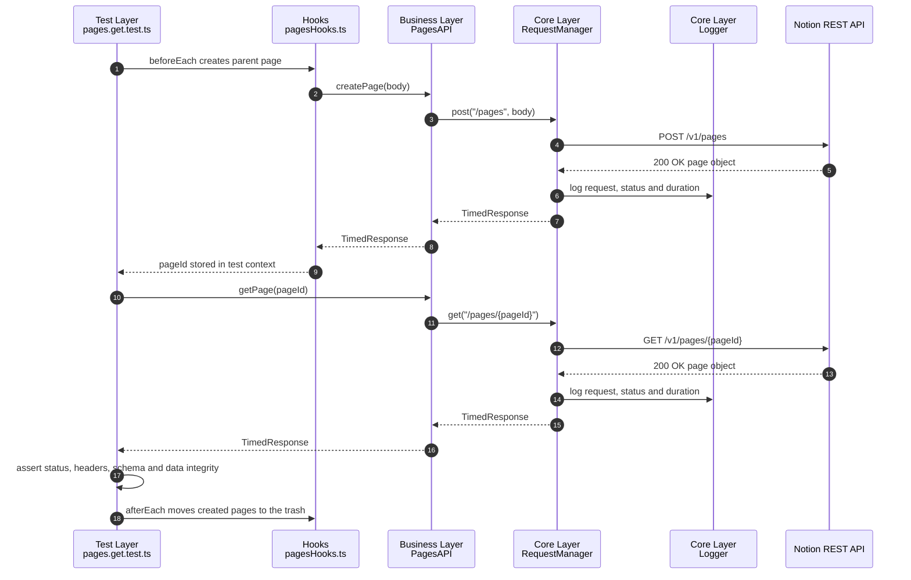
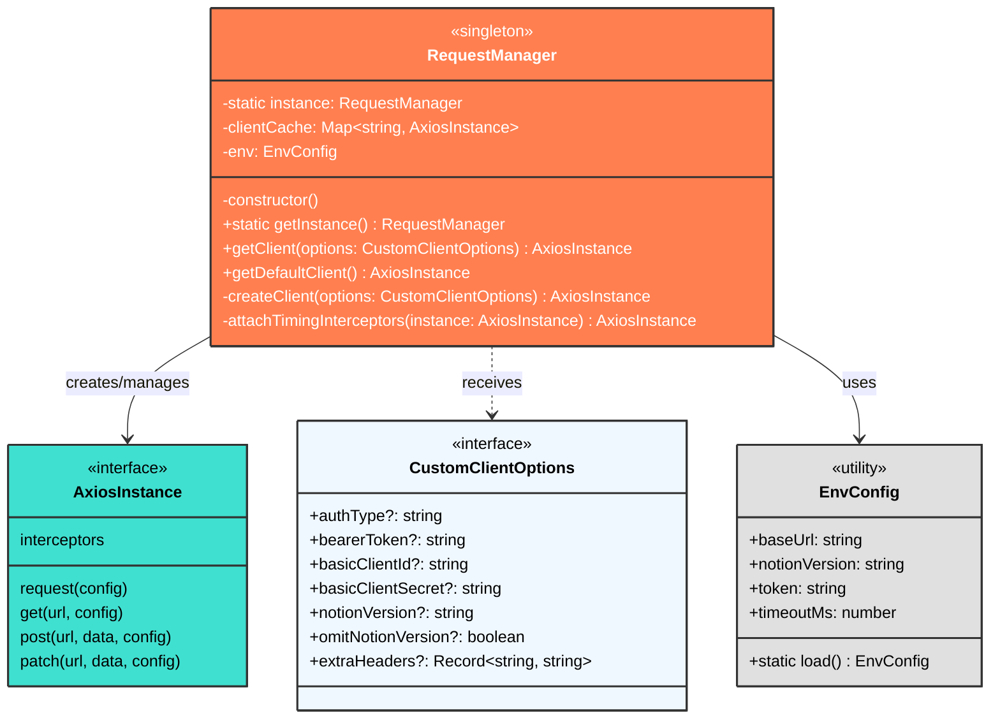
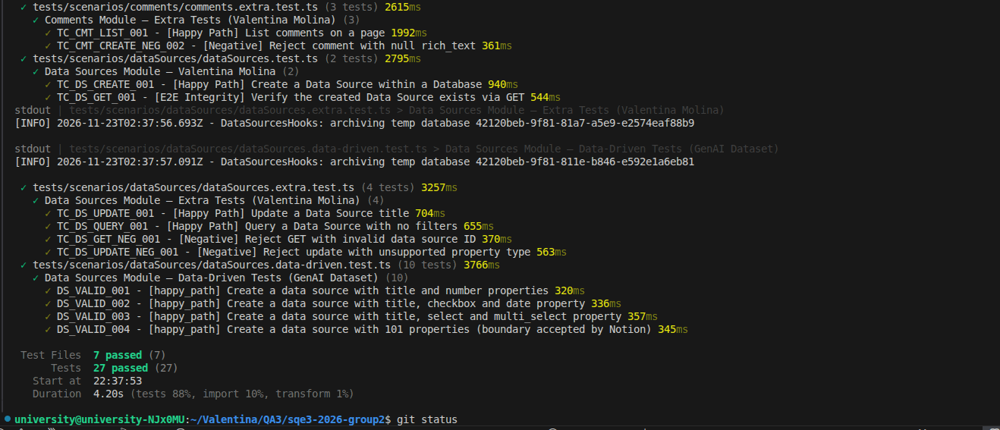
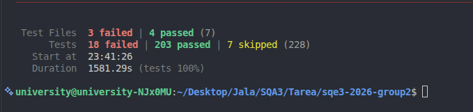

<div align="center">

# SQE III Group Laboratory — Week 4 (Lab 04)

<br><br>


<br><br>

Valentina Molina Bustillos  
Gabriel Marcos Guaman Ortuño  
Karen Ivonne Cruz Alvarez  
Sebastián Pereyra  
Kevin Uruchi

<br><br>

Jala University  
Commercial Software Engineering  
Eng. Edson Guerra

<br><br>

Bolivia  
November 22, 2026

<br>

</div>

<div style="page-break-after: always;"></div>

## Table of Contents

1. [Activity #1](#activity-1)
   - [1.1 Architecture of the Automation Framework](#11-architecture-of-the-automation-framework)
   - [1.2 Structure of the Automation Framework](#12-structure-of-the-automation-framework)
   - [1.3 Refactoring of the Lab 04 Code Following the Proposed Architecture and Structure](#13-refactoring-of-the-lab-04-code-following-the-proposed-architecture-and-structure)
   - [1.4 Configuration and Environment Files](#14-configuration-and-environment-files)
   - [1.5 Code Format Review Libraries (Linter)](#15-code-format-review-libraries-linter)
2. [Activity #2](#activity-2)
   - [2.1 Singleton Design Pattern for the Request Manager](#21-singleton-design-pattern-for-the-request-manager)
   - [2.2 Singleton Pattern Diagram](#22-singleton-pattern-diagram)
   - [2.3 Refactoring in Response to the Singleton Implementation](#23-refactoring-in-response-to-the-singleton-implementation)
3. [Activity #3](#activity-3)
   - [3.1 Logging Tool for Automated Test Execution](#31-logging-tool-for-automated-test-execution)
   - [3.2 Team Logger Conventions](#32-team-logger-conventions)
   - [3.3 Log Report Generation](#33-log-report-generation)
4. [Activity #4](#activity-4)
   - [4.1 Review of Preconditions and Postconditions](#41-review-of-preconditions-and-postconditions)
   - [4.2 Test Context Variables](#42-test-context-variables)
   - [4.3 Dynamic Datasets Generated with GenAI](#43-dynamic-datasets-generated-with-genai)
5. [Activity #5](#activity-5)
   - [5.1 Continued Implementation of the Test Suites](#51-continued-implementation-of-the-test-suites)
   - [5.2 Review of the Architecture Layers in the Implementation](#52-review-of-the-architecture-layers-in-the-implementation)
   - [5.3 Framework Functionality and Component Documentation](#53-framework-functionality-and-component-documentation)
6. [Team Participation](#team-participation)

<div style="page-break-after: always;"></div>

## Activity #1

1. Define and diagram the architecture of the automation framework to be developed.
2. Define and diagram the structure of the automation framework to be developed.
3. Refactor the code developed in the previous laboratory following the proposed architecture and structure diagrams.
4. Implement configuration and environment files for the automation framework.
5. Implement libraries for code format review (linter).

---

### 1.1 Architecture of the Automation Framework

In Lab 04, **Group 2** migrated the Postman suites of the **Notion REST API (`2025-09-03`)** to **Axios + Vitest**. The migration worked, but every test file still built its own requests, preconditions and helpers, and the HTTP client, the Zod schemas and the assertion helpers were shared through a single `src/core/` folder with no clear boundary between what is generic and what belongs to Notion. For Lab 05 the team adopts a **three-layer architecture** in which each layer has one responsibility and only depends on the layer directly below it.

#### 1.1.1 Architecture Layers

| Layer | Folder | Responsibility | Must Not |
|---|---|---|---|
| **Test Layer** | `tests/` | Holds the test scenarios of each Notion module and the hooks that build preconditions and clean up postconditions. Describes *what* is verified (status code, body, headers, data integrity, types). | Build URLs, set headers, call Axios directly or contain hardcoded IDs and tokens. |
| **Business Layer** | `main/` | Models the Notion REST API. One endpoint class per module (`PagesAPI`, `BlocksAPI`, `DatabasesAPI`, ...) exposes one method per endpoint, plus the Zod schemas and test data of the application. Knows *how* Notion is called. | Contain assertions or know about Vitest. |
| **Core Layer** | `core/` | Generic, application-agnostic infrastructure. Request Manager (Singleton over Axios), logger, log reporter, fake data generator, schema validator and configuration loader. | Know anything about Notion. The same core could serve any other REST API. |

The dependency rule is strictly top-down (`Test → Business → Core → Notion REST API`). Because the Core Layer knows nothing about Notion, it can be reused against any other REST API by writing a new Business Layer, in the same way the reference diagram reuses its core for Trello, Spotify and YouTube.

#### 1.1.2 Layered Architecture Diagram

```mermaid
flowchart TB
    subgraph TL["tests/"]
        direction LR
        TL0["Test Layer"]
        T1["Pages API<br/>test scenarios"]
        T2["Blocks API<br/>test scenarios"]
        T3["Databases and Search<br/>API test scenarios"]
        T4["Users and OAuth<br/>API test scenarios"]
        T5["Data Sources, Comments and<br/>File Uploads test scenarios"]
        T6["Hooks<br/>common and per module"]
    end

    subgraph BL["main/"]
        direction LR
        BL0["Business Layer"]
        B1["Pages API<br/>endpoints"]
        B2["Blocks API<br/>endpoints"]
        B3["Databases and Search<br/>API endpoints"]
        B4["Users and OAuth<br/>API endpoints"]
        B5["Data Sources, Comments and<br/>File Uploads endpoints"]
        B6["Resources<br/>schemas and data"]
    end

    subgraph CL["core/"]
        direction LR
        CL0["Core Layer"]
        C1["Request Manager<br/>Singleton"]
        C2["Logs"]
        C3["Reports"]
        C4["Faker data"]
        C5["API Schema<br/>Validator"]
        C6["Config and<br/>Environment"]
    end

    SUT[("Notion REST API<br/>api.notion.com/v1<br/>Notion-Version 2025-09-03")]

    TL ==> BL
    BL ==> CL
    CL ==>|HTTPS| SUT

    classDef layer fill:#e8f1fb,stroke:#1f6feb,stroke-width:2px,color:#1f6feb
    classDef ext fill:#fff4e5,stroke:#f0883e,stroke-width:2px,color:#b35900
    classDef dashed fill:#ffffff,stroke:#f0883e,stroke-dasharray:5 5,color:#b35900
    class TL0,BL0,CL0 layer
    class SUT ext
    class OTHER dashed
```



#### 1.1.3 Class Diagram of the Framework

The diagram below shows the main classes of each layer and how they depend on each other. `RequestManager` is the only class that talks to Axios, and every endpoint class obtains it through `RequestManager.getInstance()` (the Singleton is detailed in Activity #2).


> **Note.** The test scenarios of the other modules (`BlocksScenarios`, `DatabasesScenarios`, `UsersOAuthScenarios`, `DataSourcesScenarios`) and their hooks follow exactly the same pattern as `PagesScenarios` and `PagesHooks`, so they are omitted to keep the diagram readable.

#### 1.1.4 Request Flow Across the Layers

The sequence below shows how a single test case (`TC_PAGES_GET_001`) crosses the three layers. The test never touches Axios or Notion headers, it only asks the Business Layer for a page and verifies the result.



#### 1.1.5 Design Principles Applied

1. **Separation of concerns.** Tests describe behavior, endpoint classes describe the API and the core describes the transport. A change in Notion's URL or headers is fixed in one place.
2. **Single point of access to HTTP.** Only `RequestManager` creates the Axios instance, which allows the Singleton of Activity #2 and the logger of Activity #3 to be added without touching any test.
3. **Reusable core.** `core/` has no reference to Notion, so it can be reused by other projects of the course.
4. **One endpoint class per Notion module.** Each team member owns the endpoint classes, hooks and scenarios of their module, which keeps merge conflicts low in the `week_X` branch.

---

### 1.2 Structure of the Automation Framework

The repository is organized so that each folder maps to exactly one layer of the architecture defined in Section `1.1`. The tree below shows the current folders and the files that each one will hold. Files marked with `(new)` are created during Lab 05.

#### 1.2.1 Directory Tree

```text
.
├── core/                              # CORE LAYER (application-agnostic)
│   ├── api/
│   │   └── RequestManager.ts          # (new) Singleton over Axios, timing interceptors, 429 retry
│   └── utils/
│       ├── envConfig.ts               # (new) Loads and validates .env values
│       ├── logger.ts                  # (new) Logger wrapper (Activity #3)
│       ├── logReporter.ts             # (new) Builds the HTML/JSON report from the logs (Activity #3)
│       ├── dataFactory.ts             # (new) Faker-based dynamic values
│       └── schemaValidator.ts         # (new) Generic Zod validation helper
├── labs/                              # Lab reports, screenshots (caps/) and exported reports
├── main/                              # BUSINESS LAYER (Notion-specific)
│   ├── api/
│   │   ├── endpoints/
│   │   │   ├── pagesAPI.ts            # Pages module (Kevin Uruchi)
│   │   │   ├── blocksAPI.ts           # (new) Blocks module (Karen Cruz)
│   │   │   ├── databasesAPI.ts        # (new) Databases module (Sebastián Pereyra)
│   │   │   ├── searchAPI.ts           # (new) Search module (Sebastián Pereyra)
│   │   │   ├── usersAPI.ts            # (new) Users module (Gabriel Guaman)
│   │   │   ├── oauthAPI.ts            # (new) OAuth module (Gabriel Guaman)
│   │   │   ├── dataSourcesAPI.ts      # (new) Data Sources module (Valentina Molina)
│   │   │   ├── commentsAPI.ts         # (new) Comments module (Valentina Molina)
│   │   │   └── fileUploadsAPI.ts      # (new) File Uploads module (Valentina Molina)
│   │   └── resources/
│   │       ├── data/                  # Static and GenAI-generated datasets (JSON / CSV)
│   │       └── schemas/               # Zod schemas of Notion objects (page, block, user, error...)
│   └── resources/                     # Application-level config (Notion endpoints, version, defaults)
├── tests/                             # TEST LAYER
│   ├── hooks/
│   │   ├── common/                    # Global setup, throttle, telemetry, shared test context
│   │   └── pages/                     # Preconditions and cleanup of the Pages module
│   └── scenarios/
│       └── pages/                     # Test scenarios of the Pages module (*.test.ts)
├── .env.example                       # (new) Template of required variables, no secrets
├── eslint.config.js                   # (new) Linter configuration (Section 1.5)
├── .prettierrc                        # (new) Formatter configuration (Section 1.5)
├── package.json
├── tsconfig.json                      # Path aliases @core/*, @main/*, @tests/*
├── vitest.config.ts
└── README.md
```

The other modules follow the same pattern as `pages`. Each owner adds `tests/hooks/<module>/` and `tests/scenarios/<module>/` (for example `tests/scenarios/blocks/`), so the tree grows by module and not by team member, unlike Lab 04 where tests were grouped in `tests/<member_name>/`.


#### 1.2.2 Responsibility of Each Folder

| Folder | Layer | Contents | Imports Allowed From |
|---|---|---|---|
| `core/api/` | Core | `RequestManager` (only place where Axios is instantiated). | `core/utils/` |
| `core/utils/` | Core | Logger, log reporter, data factory, schema validator, environment loader. | External libraries only |
| `main/api/endpoints/` | Business | One class per Notion module with one method per endpoint. | `core/` |
| `main/api/resources/schemas/` | Business | Zod schemas of Notion objects and error envelope. | `zod` |
| `main/api/resources/data/` | Business | Static and GenAI-generated datasets in JSON or CSV (Activity #4). | none |
| `main/resources/` | Business | Application settings such as Notion endpoint paths, default `page_size` and SLA limits. | none |
| `tests/hooks/common/` | Test | Global setup, rate-limit throttle, telemetry and shared test context. | `core/`, `main/` |
| `tests/hooks/<module>/` | Test | Preconditions and cleanup of one module (create parent pages, trash created data). | `core/`, `main/` |
| `tests/scenarios/<module>/` | Test | `*.test.ts` files with the test cases of one module. | `main/`, `tests/hooks/`, `core/utils/` |
| `labs/` | none | Lab reports (`labXX/`), screenshots (`caps/`) and exported reports. | none |

#### 1.2.4 Naming Conventions

| Element | Convention | Example |
|---|---|---|
| Endpoint class file | `camelCase` + `API.ts` | `pagesAPI.ts` exporting `class PagesAPI` |
| Endpoint method | verb + resource | `createPage`, `getPageProperty`, `movePage` |
| Hook file | `<module>Hooks.ts` | `tests/hooks/pages/pagesHooks.ts` |
| Test file | `<module>.<endpoint>.test.ts` | `tests/scenarios/pages/pages.get.test.ts` |
| Schema | `PascalCase` + `Schema` | `PageObjectSchema`, `NotionErrorSchema` |
| Dataset | `<module>_<purpose>.json` or `.csv` | `pages_invalid_ids.csv` |
| Test case title | `TC_<MODULE>_<ENDPOINT>_<NNN> - [Category] description` | `TC_PAGES_GET_012 - [Negative] Reject invalid page ID` |

---

### 1.3 Refactoring of the Lab 04 Code Following the Proposed Architecture and Structure

#### 1.3.1 Gabriel Marcos Guaman Ortuño — Modules: Users & OAuth

The previous Lab 03 implementation for the **Users** and **OAuth** modules (`Notion-Version: 2025-09-03`) coupled HTTP transport, Zod schema definitions, rate-limit delays, precondition discovery, and Vitest assertions inside two monolithic test files (`act5_stateless_users_oauth.test.ts` and `act6_preconditioned_and_e2e.test.ts`) and a flat `src/core/` directory. During Lab 04, all Users and OAuth components were refactored into the strict top-down three-layer architecture (`tests/` → `main/` → `core/`):

- **Core Layer (`core/` — consumed, unmodified):** Both endpoint classes delegate HTTP client lifecycle and timing/logging interceptors exclusively to `RequestManager.getInstance()` (`getDefaultClient()` and `getClient(options)`), while contract assertions use `SchemaValidator` and `Logger`. Neither the Business Layer nor the Test Layer imports Axios directly.
- **Business Layer (`main/`):** Endpoint routes and auth-strategy defaults were encapsulated inside `UsersAPI` (`main/api/endpoints/usersAPI.ts`, Bearer auth by default) and `OAuthAPI` (`main/api/endpoints/oauthAPI.ts`, HTTP Basic auth by default, overridable via `CustomClientOptions` for negative contract tests). Domain Zod contracts were separated into `usersSchemas.ts` and `oauthSchemas.ts` (reusing shared `NotionErrorSchema` and `UUIDv4Regex` from `notionSchemas.ts`), and negative/boundary inputs were externalized into `main/api/resources/data/users_oauth_dataset.json`.
- **Test Layer (`tests/`):** Lifecycle preconditions, postconditions, rate-limit throttling, telemetry, and typed Test Contexts were extracted into `tests/hooks/users/usersHooks.ts` and `tests/hooks/oauth/oauthHooks.ts`. The two monolithic Lab 03 suites were split by endpoint into six focused test suites following Section `1.2.4` naming conventions (`TC_<MODULE>_<ENDPOINT>_<NNN> - [Category] description`).

| Old Lab 03 File | New Lab 04 Layered Location | Layer & Responsibility |
|---|---|---|
| `labs/lab03/automation/src/core/notionClient.ts` | `core/api/RequestManager.ts` (existing Singleton) + `main/api/endpoints/usersAPI.ts` & `oauthAPI.ts` | **Core / Business:** Separates generic Axios Singleton transport (`core/`) from Notion Users & OAuth endpoint methods and auth defaults (`main/`). |
| `labs/lab03/automation/src/core/assertions.ts` (Users & OAuth schemas) | `main/api/resources/schemas/usersSchemas.ts` & `oauthSchemas.ts` | **Business:** Pure Zod schemas (`UserObjectSchema`, `PaginatedUsersListSchema`, `OAuthTokenResponseSchema`, `OAuthIntrospectResponseSchema`, `OAuthRevokeResponseSchema`, `OAuthErrorSchema`) without Vitest coupling. |
| `labs/lab03/automation/src/core/assertions.ts` (Vitest assertion helpers) & inline `beforeAll`/`afterAll` | `tests/hooks/users/usersHooks.ts` & `tests/hooks/oauth/oauthHooks.ts` | **Test:** Typed Test Context factories, dynamic preconditions, isolated OAuth teardown, rate-limit guards, telemetry, and `SchemaValidator`-backed contract assertions. |
| Hardcoded inline negative/boundary payloads in Lab 03 tests | `main/api/resources/data/users_oauth_dataset.json` | **Business (Resources):** Centralized GenAI-generated dataset driving parameterized Vitest scenarios (`it.each`). |
| `labs/lab03/automation/tests/gabriel_guaman/act5_stateless_users_oauth.test.ts` & `act6_preconditioned_and_e2e.test.ts` | `tests/scenarios/users/users.{me,get,list}.test.ts` & `tests/scenarios/oauth/oauth.{token,revoke,introspect}.test.ts` | **Test:** Six modular, endpoint-scoped test suites containing zero hardcoded URLs, tokens, or Axios calls. |

#### 1.3.2 Valentina Molina Bustillos — Modules: Data Sources, Comments & File Uploads

The Lab 03 test file (`act5_act6_valentina_modules.test.ts`) was split and refactored into the three-layer architecture:

- **Business Layer (`main/api/endpoints/`):** Created `dataSourcesAPI.ts`, `commentsAPI.ts` and `fileUploadsAPI.ts`. Each class exposes one method per endpoint and obtains its Axios client exclusively from `RequestManager.getInstance()`.
- **Test Layer (`tests/scenarios/`):** Created `dataSources/`, `comments/` and `fileUploads/` folders. Tests no longer call Axios directly; they instantiate the corresponding endpoint class.
- **Hooks Layer (`tests/hooks/`):** Created `DataSourcesHooks`, `CommentsHooks` and `FileUploadsHooks` to handle preconditions (create a temporary database, validate the parent page) and postconditions (archive temporary resources).
- **Core Layer (`core/utils/`):** Moved `assertions.ts` and updated its imports to reference `TimedAxiosResponse` from `core/api/RequestManager.ts`. Fixed Zod v4 compatibility (`z.record` now requires key and value types).

#### 1.3.3 Karen Ivonne Cruz Alvarez — Module: Blocks

In Lab 03, the Blocks test suites lived in two monolithic files under `labs/lab03/automation/tests/karen_cruz/` (`act5_stateless_blocks.test.ts` and `act6_preconditioned_and_e2e_blocks.test.ts`) where HTTP calls (`notionBearerClient`, `createCustomNotionClient`), inline payload builders, rate-limit throttling, Zod schemas, and lifecycle hooks were tightly coupled inside the test files. During Lab 05, the module was refactored into the proposed **three-layer architecture** (`core/` → `main/` → `tests/`), preserving 100% of the Lab 03 coverage while adding data-driven edge cases.

**Before / After Refactoring Mapping:**

| Aspect | Before (Lab 03 — `labs/lab03/automation/tests/karen_cruz/`) | After (Lab 05 — Three-Layer Architecture) |
|---|---|---|
| **HTTP Transport** | Direct `notionBearerClient` and `createCustomNotionClient` calls inside tests | `BlocksAPI` (`main/api/endpoints/blocksAPI.ts`) delegates exclusively to `RequestManager.getInstance()` (`getDefaultClient()` and `getClient(options)`) |
| **Schema Validation** | Imported shared schemas from legacy `src/core/assertions.ts` | Module-specific Zod v4 schemas (`BlockObjectSchema`, `BlockChildrenListSchema`) in `main/api/resources/schemas/blocksSchemas.ts`, reusing `NotionErrorSchema` and `SchemaValidator.assertValid()` |
| **Test Data & Edge Cases** | Hardcoded constants and inline arrays inside test suites | Dynamic GenAI dataset in `main/api/resources/data/blocks_dataset.json` consumed by data-driven loops across `get`, `append`, `children`, and `update` suites |
| **Preconditions, Context & Teardown** | Duplicated `beforeAll`/`beforeEach`/`afterEach`/`afterAll` hooks and mutable suite variables per file | Centralized `tests/hooks/blocks/blocksHooks.ts` with typed `BlocksTestContext`, `createBlocksTestContext()`, `setupBlocksContext()`, `throttleBlocksRequest()`, `recordBlocksTelemetry()`, and `cleanupBlocksContext()` |
| **Test Organization** | 2 monolithic files (`act5_stateless_blocks.test.ts`, `act6_preconditioned_and_e2e_blocks.test.ts`) | 5 endpoint-scoped suites under `tests/scenarios/blocks/` (`blocks.append.test.ts`, `blocks.get.test.ts`, `blocks.children.test.ts`, `blocks.update.test.ts`, `blocks.delete.test.ts`) |
| **Logging & Telemetry** | Silent in-memory `telemetryLog` array cleared in `afterAll` | Structured `Logger.debug` per-test telemetry and `Logger.info` teardown summaries via `core/utils/logger.ts` |

**New Files Created (Blocks Module):**

| File | Layer | Responsibility |
|---|---|---|
| `main/api/endpoints/blocksAPI.ts` | Business | Exposes `appendChildren`, `getBlock`, `getChildren`, `updateBlock`, and `deleteBlock` via `RequestManager` |
| `main/api/resources/schemas/blocksSchemas.ts` | Business | Defines Zod v4 `BlockObjectSchema` and `BlockChildrenListSchema`; reuses `NotionErrorSchema` from `notionSchemas.ts` |
| `main/api/resources/data/blocks_dataset.json` | Business | GenAI-generated dataset covering invalid block IDs, invalid append/update payloads, and pagination boundaries |
| `tests/hooks/blocks/blocksHooks.ts` | Test | Manages `BlocksTestContext`, env validation (`PARENT_PAGE_ID` / `PAGE_ID`), sandbox seeding, 350 ms throttling, telemetry, and teardown |
| `tests/scenarios/blocks/blocks.append.test.ts` | Test | `PATCH /v1/blocks/:id/children` — happy path, rich types, `after`, nesting, boundaries, and data-driven negative payloads |
| `tests/scenarios/blocks/blocks.get.test.ts` | Test | `GET /v1/blocks/:id` — retrieval, compact UUID normalization, auth/version errors, and data-driven invalid IDs |
| `tests/scenarios/blocks/blocks.children.test.ts` | Test | `GET /v1/blocks/:id/children` — default & cursor pagination, nested children, E2E tree traversal, and data-driven `page_size` boundaries |
| `tests/scenarios/blocks/blocks.update.test.ts` | Test | `PATCH /v1/blocks/:id` — text updates, `to_do` toggle, archive/restore, length boundaries, and data-driven invalid updates |
| `tests/scenarios/blocks/blocks.delete.test.ts` | Test | `DELETE /v1/blocks/:id` — soft-delete, parent-child cascade, negative/boundary checks, and chained E2E lifecycle workflows |

#### 1.3.4 Sebastián Pereyra — Modules: Databases & Search

The existing Lab 03 code for Databases and Search was organized under `tests/sebastian_pereyra/` with no layer separation — Axios calls, assertion helpers and test logic were mixed in the same files.

**Changes made during Lab 05 refactoring:**

| Before (Lab 03) | After (Lab 05) |
|---|---|
| Axios called directly inside test files | `DatabasesAPI` and `SearchAPI` classes in `main/api/endpoints/` wrap every endpoint |
| Hardcoded headers and `baseURL` per file | `RequestManager.getInstance().getDefaultClient()` provides a pre-configured client |
| No schema validation | `SchemaValidator.assertValid()` + Zod schemas in `main/api/resources/schemas/` |
| No data cleanup | `databasesHooks.ts` archives created databases in `afterAll` |
| `DataFactory`-like helpers were inline | `DataFactory` from `core/utils/` now generates titles and UUIDs |

**New files created:**

| File | Layer | Description |
|---|---|---|
| `main/api/endpoints/databasesAPI.ts` | Business | Wraps `POST /databases`, `GET /databases/:id`, `PATCH /databases/:id`, `POST /databases/:id/query` |
| `main/api/endpoints/searchAPI.ts` | Business | Wraps `POST /search` with typed `SearchBody` interface |
| `tests/hooks/databases/databasesHooks.ts` | Test | `createTestDatabase()` precondition and `archiveCreatedDatabases()` postcondition |
| `tests/scenarios/databases/databases.create.test.ts` | Test | 3 test cases for database creation |
| `tests/scenarios/databases/databases.get.test.ts` | Test | 3 test cases for database retrieval |
| `tests/scenarios/databases/databases.query.test.ts` | Test | 3 test cases for database queries |
| `tests/scenarios/search/search.test.ts` | Test | 6 test cases for the Search endpoint |

#### 1.3.5 Kevin Uruchi — Module: Pages

The Lab 04 code of the Pages module lived in `labs/lab03/automation/` and had no layer separation. Seven test files in `tests/kevin_uruchi/` (`14,142` lines) imported a single runtime, `src/pages/pagesKit.ts` (`880` lines), that created its own Axios instance, rebuilt Postman objects (`pm.sendRequest`, `pm.request`, `pm.collectionVariables`) and resolved Postman URL templates such as `{{apiBaseURL}}{{pagesEndpoint}}/{{pageId}}` inside the tests. Every case also copied the same 15-line block that creates the parent page under the root page (`142` copies).

The suites were moved to the three-layer structure of Section `1.2` without losing any test case. The Lab 04 files are left untouched in `labs/lab03/` as the deliverable of that lab.

| Before (Lab 04) | After (Lab 05) |
|---|---|
| `pagesKit.ts` created its own Axios instance (`axios.create`) | `PagesAPI` gets every client from `RequestManager.getInstance()`. No file of the module creates an Axios instance. |
| Tests built URLs from Postman templates (`url: '{{apiBaseURL}}{{pagesEndpoint}}/{{pageId}}/move'`) | The request under test is a method call: `startCase('TC_PAGES_MOVE_001', (req) => pagesAPI.movePage(cv.get('pageId'), req.body, req.options))`. |
| Negative cases edited raw headers (`removeHeader('Notion-Version')`, `Authorization: Basic ...`) | The same edits are mapped to `PageRequestOptions` (`omitNotionVersion`, `notionVersion`, `noAuth`, `token`, `headers`), and the `RequestManager` returns a cached client for each combination. |
| `217` `pm.sendRequest({ url: pagesUrl, method: 'POST', header: headers, body: { mode: 'raw', raw: JSON.stringify(...) } })` calls | `createPage(body)` in the hooks, which calls `PagesAPI.createPage` with the rate-limit retry. The `142` parent-page blocks became one line: `const p = await createParentPage();`. |
| Zod schemas and Vitest `expect` mixed in `src/pages/pageSchemas.ts` | Schemas only in `main/api/resources/schemas/pagesSchemas.ts`. Validation runs through `SchemaValidator.assertValid()` of the Core Layer. |
| Shared headers and SLA check imported from `src/core/assertions.ts` | `assertCommonHeadersAndSla` and `assertNotionErrorContract` from `core/utils/assertions.ts`. |
| `console.error` on failed preconditions | `Logger` of the Core Layer (`error`, `warn` on `429` retries, `debug` per case). |
| Tests grouped by member (`tests/kevin_uruchi/act6_pages_post.test.ts`) | Tests grouped by module (`tests/scenarios/pages/pages.post.test.ts`). |

**Files created:**

| File | Layer | Description |
|---|---|---|
| `main/api/endpoints/pagesAPI.ts` | Business | `PagesAPI` with one method per endpoint: `createPage`, `getPage`, `getPageProperty`, `updatePage`, `movePage`, plus `trashPage` (`PATCH` with `in_trash: true`). A string body is sent byte by byte, so the malformed JSON cases (`{`, `not json`) still reach Notion as written. |
| `main/api/resources/schemas/pagesSchemas.ts` | Business | `PageObjectSchema`, `PageParentSchema`, `PropertyItemSchema` and `PropertyItemListSchema` (Zod, no Vitest dependency). |
| `tests/hooks/pages/pagesContext.ts` | Test | Context variables of each case (`cv`), the request under test (`startCase`, `sendMain`), named soft assertions (`check`, `assertChecks`) and the shared context of the E2E flows (`startFlow`, `beginStep`). Detailed in Section `4.2`. |
| `tests/hooks/pages/pagesHooks.ts` | Test | Preconditions (`createParentPage`, `parent`, `parent2`, `mkDb`, `dsBasic`, `dsFull`, `fullRow`, `basicRow`, `relPage`, `dual`, `tree`), postcondition (`cleanupCase`), rate-limit aware calls (`withRetry`, `send`, `pool`), readers for data integrity (`children`, `query`, `allItems`, `propIds`, `val`) and shared checks (`commonChecks`, `pageOk`, `stepOk`, `authFails`, `badIds`, `burst429`). Detailed in Section `4.1`. |
| `tests/scenarios/pages/pages.stateless.test.ts` | Test | `12` stateless test cases (`26` Vitest tests), rewritten to call `PagesAPI` directly. |
| `tests/scenarios/pages/pages.post.test.ts` | Test | `40` preconditioned cases of `POST /v1/pages`. |
| `tests/scenarios/pages/pages.get.test.ts` | Test | `18` preconditioned cases of `GET /v1/pages/{page_id}`. |
| `tests/scenarios/pages/pages.property.test.ts` | Test | `22` preconditioned cases of `GET /v1/pages/{page_id}/properties/{property_id}`. |
| `tests/scenarios/pages/pages.move.test.ts` | Test | `28` preconditioned cases of `POST /v1/pages/{page_id}/move`. |
| `tests/scenarios/pages/pages.patch.test.ts` | Test | `37` preconditioned cases of `PATCH /v1/pages/{page_id}`. |
| `tests/scenarios/pages/pages.e2e.test.ts` | Test | `16` chained E2E flows (`TC_E2E_001` to `TC_E2E_016`, `57` steps). |

The Pages module now uses `DatabasesAPI` (Sebastián), `DataSourcesAPI` (Valentina) and `SearchAPI` (Sebastián) for its preconditions instead of calling those endpoints by hand, so the endpoint classes of the team are reused across modules. Block children and users have no endpoint class yet, so those two reads go through the generic `send()` of the hooks, which still uses the `RequestManager` client.

**Size of the module.** The test files went from `14,142` to `10,745` lines (`-24%`) and the runtime from `935` lines (`pagesKit.ts` + `pageSchemas.ts`) to `1,054` lines split across the Business Layer (`134`) and the Test Layer hooks (`920`).

**Shared fix.** The root `tsconfig.json` declared `"include"` twice. Vitest 5 (Oxc transformer) refuses to load a tsconfig with a duplicate key, so no suite of the repository could start (`TSCONFIG_ERROR duplicate field include`). The duplicated line was removed.

**How to run the suites:**

```bash
npm run test:pages             # the 7 Pages suites, one file at a time (Notion rate limit)
npm run test:pages:stateless   # stateless suite only (about 20 s)
npm run test:pages:e2e         # chained E2E flows only
```

The suites need `NOTION_TOKEN` and `NOTION_ROOT_PAGE_ID` in `.env`. The optional variables `NOTION_UNSHARED_PAGE_ID`, `NOTION_TOKEN_READ_ONLY`, `NOTION_TOKEN_INSERT_ONLY`, `NOTION_TOKEN_B`, `NOTION_REVOKED_TOKEN`, `NOTION_STATUS_DATA_SOURCE_ID` and `NOTION_USER_ID` enable the cases that are skipped without them.

---

### 1.4 Configuration and Environment Files

> TODO 

---

### 1.5 Code Format Review Libraries (Linter)

To guarantee consistent TypeScript code style, static quality checks, and conflict-free formatting across all three architecture layers (`core/`, `main/`, and `tests/`), **ESLint v9** (flat configuration) and **Prettier** were integrated into the repository.

#### Installed Libraries (`devDependencies`)

| Package | Role |
|---|---|
| `eslint` (`^9.39.5`) | Static analysis engine using the modern v9 flat config format (`eslint.config.js`). |
| `@eslint/js` (`^9.39.5`) | Recommended JavaScript baseline ruleset for ESLint v9. |
| `typescript-eslint` (`^8.73.0`) | TypeScript parser and lint rules (`tseslint.configs.recommended`) supporting TypeScript syntax and Vitest test files. |
| `prettier` (`^3.10.1`) | Opinionated code formatter ensuring uniform indentation, quotes, semicolons, and line widths. |
| `eslint-config-prettier` (`^10.1.8`) | Disables ESLint formatting rules that could conflict with Prettier. |

> **Note on TypeScript 7.0 + `typescript-eslint` compatibility:** Because the workspace uses native TypeScript 7.0 (`tsc`) while `typescript-eslint` v8 consumes the JS compiler API, `package.json` configures Microsoft's official side-by-side alias (`"@typescript/native": "npm:typescript@^7.0.2"` alongside `"typescript": "npm:@typescript/typescript6@^6.0.2"`), allowing `npx tsc --noEmit` to run natively on TypeScript 7.0 while ESLint executes cleanly without peer-dependency or runtime errors.

#### Configuration Files

1. **`eslint.config.js`** (repository root):
   - Uses ESLint v9 flat config via `tseslint.config(...)`.
   - Ignores generated and documentation directories: `node_modules/**`, `dist/**`, `labs/**`, `logs/**`, and `reports/**`.
   - Applies `js.configs.recommended`, `tseslint.configs.recommended`, and `eslint-config-prettier` across `core/**/*.ts`, `main/**/*.ts`, and `tests/**/*.ts`.
   - Grants a targeted override in `core/utils/logger.ts` (`'no-console': 'off'`) because `Logger` is the sanctioned console wrapper of the Core Layer.
2. **`.prettierrc`** (repository root):
   - Enforces `"semi": true`, `"singleQuote": true`, `"trailingComma": "es5"`, `"printWidth": 100`, `"tabWidth": 2`, `"arrowParens": "always"`, and `"endOfLine": "lf"`.
3. **`.prettierignore`** (repository root):
   - Excludes `node_modules/`, `labs/`, `logs/`, `reports/`, and `dist/` from formatting scans.

#### Key Enforced Rules

| Rule | Severity | Rationale |
|---|---|---|
| `@typescript-eslint/no-unused-vars` | `error` (ignores `_`-prefixed identifiers) | Prevents dead imports, unused hooks, and leaked test variables. |
| `no-duplicate-imports` | `error` | Keeps module imports clean and consolidated. |
| `prefer-const` / `no-var` | `error` | Enforces immutable bindings by default and modern ES2022 scoping. |
| `eqeqeq` (`always`) | `error` | Eliminates loose-equality bugs in test assertions and helper guards. |
| `no-console` | `warn` (`off` in `core/utils/logger.ts`) | Encourages all modules and tests to log through `Logger` instead of raw `console.log`. |
| `@typescript-eslint/no-explicit-any` | `warn` | Nudges strict typing across endpoint classes, hooks, and scenarios while remaining pragmatic for legacy files. |

#### NPM Scripts (`package.json`)

```json
{
  "scripts": {
    "lint": "eslint core main tests",
    "lint:fix": "eslint core main tests --fix",
    "format": "prettier --write \"core/**/*.ts\" \"main/**/*.ts\" \"tests/**/*.ts\"",
    "format:check": "prettier --check \"core/**/*.ts\" \"main/**/*.ts\" \"tests/**/*.ts\""
  }
}
```

#### How It Enforces Team Code Quality

- **Uniform PR standards:** Running `npm run lint` and `npm run format:check` before committing catches unused variables, duplicate imports, raw `console.log` calls, and formatting drift across all five team members' modules.
- **Zero-friction auto-remediation:** Developers can run `npm run lint:fix` and `npm run format` locally to resolve fixable issues automatically without manual reformatting, keeping Git diffs focused exclusively on behavioral changes.

---

<div style="page-break-after: always;"></div>

## Activity #2

1. Implement the Singleton design pattern for the request manager.
2. Diagram the implemented Singleton design pattern.
3. Continue the code refactoring work in response to the Singleton implementation.

---

### 2.1 Singleton Design Pattern for the Request Manager

The **Singleton** pattern was implemented in the `RequestManager` class inside `core/api/`. This class centralizes the creation and management of Axios instances across the framework.

**Design decisions:**
- **Private constructor:** Prevents any part of the code from creating a direct instance with `new RequestManager()`.
- **Static `getInstance()` method:** The only global access point. It guarantees a single instance of the manager exists in the entire application.
- **Client cache (`Map<string, AxiosInstance>`):** Although the Singleton guarantees a single manager instance, different parts of the code may require clients with distinct configurations (e.g., Basic auth for OAuth, or clients without the `Notion-Version` header for negative tests). To avoid redundant instances, the manager uses a cache keyed by the configuration options (`JSON.stringify(options)`). If a client with the same options is requested, the cached instance is returned.
- **Dependency injection:** The `RequestManager` loads configuration from `EnvConfig`, keeping the Core Layer agnostic to environment implementation details.

**Key files:**
- `core/api/RequestManager.ts`: Singleton implementation.
- `core/utils/envConfig.ts`: Environment variable loading and validation.

### 2.2 Singleton Pattern Diagram

[](https://mermaid.live/edit#pako:eNo9j01qwzAYRK9iZq0YWdZftE23vUDRwiL66hhiKagSpDW-e6lLu5yBecPbcM2R4DBNExjmskS4WhoxrFTW8BOx-dR1HvVGK3m4zqNQbM_TNd9z8fBpB8MjpLec1791yW2-wb2H-wcxtEcMlV6WMJew_reFUqRyyS1VOCUPBtyGJ5wYdc-1MtwqYbnUiuET7mRkL89GCa31aIXVamf4Ol55b7Xlg5GDGaQw43lgoLjUXF5_BQ_P_RvV3Ehu)



### 2.3 Refactoring in Response to the Singleton Implementation

**Valentina Molina Bustillos — Modules: Data Sources, Comments & File Uploads**

The test code from Lab 03 (`act5_act6_valentina_modules.test.ts`) was refactored to align with the three-layer architecture and the new Singleton `RequestManager`.

**Changes applied:**

1. **Business Layer (Endpoint classes):**
   - Created `main/api/endpoints/dataSourcesAPI.ts`, `commentsAPI.ts`, and `fileUploadsAPI.ts`.
   - Each class exposes one method per endpoint (`createDataSource`, `createComment`, `createFileUpload`, etc.).
   - These classes obtain their Axios client exclusively through `RequestManager.getInstance().getDefaultClient()`. No test or endpoint class creates an Axios instance directly.

2. **Test Layer (Scenarios):**
   - Split the monolithic test file into three module-specific test files:
     - `tests/scenarios/dataSources/dataSources.test.ts`
     - `tests/scenarios/comments/comments.test.ts`
     - `tests/scenarios/fileUploads/fileUploads.test.ts`
   - Tests no longer call Axios directly. They instantiate the corresponding endpoint class and call its methods.
   - Assertions (`assertCommonHeadersAndSla`, `assertNotionErrorContract`) remain in the Test Layer, consuming the `TimedAxiosResponse` returned by the Business Layer.

3. **Negative test handling:**
   - For the negative test that requires a request without the `Notion-Version` header (`TC_CMT_CREATE_NEG`), the `CommentsAPI` class exposes a specialized method (`createCommentWithoutVersion`) that internally requests a cached client from the `RequestManager` with `omitNotionVersion: true`. This preserves the Singleton contract: the manager creates the client once and caches it for future requests with the same options.

4. **Core Layer updates:**
   - Moved `assertions.ts` to `core/utils/assertions.ts` and updated its import to reference `TimedAxiosResponse` from `core/api/RequestManager.ts`.
   - Fixed Zod v4 compatibility across all schemas: `z.record()` now requires both key and value types (e.g., `z.record(z.string(), z.any())`).

**Benefits of the refactoring:**
- **Single source of HTTP configuration:** All requests flow through `RequestManager`, so any change to base URL, timeout or interceptors is applied in one place.
- **Test readability:** Test files now only describe *what* is verified, delegating *how* the API is called to the endpoint classes.
- **Reusability:** The endpoint classes can be used by other tests, hooks or scripts without duplicating request logic.

**Test execution evidence:**


---

<div style="page-break-after: always;"></div>

## Activity #3

1. Implement a specialized tool to generate logs of the automated test execution.
2. Define the team conventions for the use of the logger.
3. Implement the functionality to generate a report from the resulting logs.

---

### 3.1 Logging Tool for Automated Test Execution

To provide structured, deterministic observability across all automated test suites while preserving an application-agnostic Core Layer (`core/`), the framework integrates **Pino** (`pino`) with **`pino-pretty`** inside `core/utils/logger.ts`.

**Why Pino was selected:**
- **Structured NDJSON by default:** Emits newline-delimited JSON (`level`, `time`, `msg`, `meta`), enabling deterministic machine parsing by `LogReporter` without fragile regular expressions on plain-text logs.
- **Minimal runtime overhead:** Low-latency serialization avoids distorting API response-time SLA measurements (`durationMs`) recorded by `RequestManager`.
- **Native secret redaction (`redact`):** Automatically replaces sensitive credential paths with `"[REDACTED]"` before any byte reaches stdout or disk.
- **Zero Notion coupling:** `Logger` lives exclusively in `core/utils/logger.ts` and exposes a generic static facade (`Logger.info`, `Logger.warn`, `Logger.error`, `Logger.debug`, `Logger.getLogFilePath`) so `RequestManager` interceptors, module hooks, and all teammates' suites work with full backward compatibility.

**Architecture (`pino.multistream`):**
1. **Synchronous NDJSON File Stream (`logs/test-execution.log`):** Configured via `pino.destination({ dest: logFilePath, sync: true, mkdir: true })` so buffered log lines are flushed immediately and never truncated when Vitest workers terminate.
2. **Readable Console Stream (`pino-pretty`):** Synchronously renders `[ISO-8601] LEVEL: message` with colorized severity labels and formatted metadata for local developer runs.
3. **Environment-Driven Verbosity:** Controlled via `LOG_LEVEL` (`debug` | `info` | `warn` | `error`) or `DEBUG=true` from `.env`, defaulting to `info` and automatically lowering to `debug` whenever `DEBUG=true`.
4. **Automatic Secret Redaction:** Masks top-level and nested keys (`Authorization`, `authorization`, `token`, `bearerToken`, `access_token`, `refresh_token`, `client_secret`, `OAUTH_CLIENT_SECRET`, `NOTION_TOKEN`) with `censor: '[REDACTED]'`.

| Configuration / Method | Purpose | Default / Behavior |
|---|---|---|
| `LOG_LEVEL` / `DEBUG=true` | Controls minimum emitted severity level | `info` by default; `debug` when `DEBUG=true` |
| `LOG_FILE_PATH` | Target path for NDJSON execution log | `logs/test-execution.log` (auto-creates `logs/`) |
| `redact.paths` | Masks tokens, secrets, and `Authorization` headers | Replaces matched fields with `"[REDACTED]"` |
| `Logger.info(msg, meta?)` | Logs suite lifecycle and summary milestones | Pino level `30` (`INFO`) |
| `Logger.warn(msg, meta?)` | Logs recoverable anomalies and fallbacks | Pino level `40` (`WARN`) |
| `Logger.error(msg, meta?)` | Logs assertion/transport failures and exceptions | Pino level `50` (`ERROR`), serializes `Error` stacks |
| `Logger.debug(msg, meta?)` | Logs HTTP request/response traces and telemetry | Pino level `20` (`DEBUG`), used by `RequestManager` |
| `Logger.getLogFilePath()` | Exposes resolved NDJSON path to `LogReporter` | Returns absolute path to `logs/test-execution.log` |

### 3.2 Team Logger Conventions

To keep logs consistent, searchable, and safe across all five team members' modules (`Pages`, `Blocks`, `Databases`, `Search`, `Users`, `OAuth`, `Data Sources`, `Comments`, `File Uploads`), Group 2 enforces the following logging standards:

#### Severity Level Usage

| Pino Level | Label | When to Use | Typical Call Sites |
|---:|---|---|---|
| `50` | `ERROR` | Assertion mismatches, unhandled exceptions, unexpected HTTP `5xx` responses, or fatal teardown failures. | Test error boundaries, critical hook catch blocks |
| `40` | `WARN` | Recoverable conditions: HTTP `429` rate-limit retries, skipped conditional OAuth tests, missing optional `.env` variables, or non-fatal cleanup warnings. | `oauthHooks.ts`, retry handlers, optional precondition checks |
| `30` | `INFO` | High-level lifecycle milestones: suite start/end, precondition seeding summaries, created/cleaned resource counts, and teardown completions. | `beforeAll` / `afterAll` module hooks (`usersHooks`, `databasesHooks`, `dataSourcesHooks`, etc.) |
| `20` | `DEBUG` | Fine-grained transport diagnostics: outgoing HTTP method/path, incoming HTTP status + `durationMs` latency, and per-test telemetry entries. | `RequestManager` Axios interceptors, `afterEach` telemetry hooks |

#### Message Format & Structure
- **Standardized prefix:** Start module/hook messages with a bracketed component tag followed by an imperative or past-tense action, e.g., `[UsersHooks] Seeded UsersTestContext preconditions` or `[OAuthHooks] Completed OAuthTestContext postcondition teardown`.
- **Structured `meta` over string interpolation:** Pass contextual fields as the second argument (`Logger.info('[DatabasesHooks] Archived test databases', { count: 2 })`) rather than concatenating JSON or IDs into the message string so `LogReporter` can render and filter structured metadata cleanly.

#### Security & Hygiene Rules
1. **No raw `console.log()` in `main/` or `tests/`:** All diagnostic output must flow through `Logger` so it is captured consistently in `logs/test-execution.log` and appears in generated reports.
2. **Never log raw credentials:** Never pass `NOTION_TOKEN`, `OAUTH_CLIENT_SECRET`, `access_token`, `refresh_token`, or raw `Authorization` headers in plain message strings. Structured fields using those keys are additionally protected by Pino's native `redact` filter (`[REDACTED]`).
3. **Keep `core/` domain-agnostic:** Log infrastructure code in `core/utils/` must never import from `main/` or `tests/`.

### 3.3 Log Report Generation

Log report generation is implemented in `core/utils/logReporter.ts` through the `LogReporter` class (`LogReporter.generate(logFilePath?, outputDir?)`), fulfilling the architecture defined in Sections `1.1.3` and `1.2.1`.

**Parsing & Aggregation Pipeline (`logs/test-execution.log` → `reports/`):**
1. **NDJSON Ingestion:** Reads `logs/test-execution.log` line-by-line, safely parses each Pino JSON entry (tracking any malformed lines in `skippedLines`), and maps numeric Pino levels (`20 → DEBUG`, `30 → INFO`, `40 → WARN`, `50 → ERROR`).
2. **Metrics Aggregation:** Computes:
   - Total log entries and severity breakdown (`INFO`, `WARN`, `ERROR`, `DEBUG`).
   - HTTP trace summary extracted from `RequestManager` logs (`Request:` / `Response: <status> (<durationMs>ms)`), including request count, response count, and average/max/min latency (`durationMs`, falling back to `meta.durationMs` when debug HTTP traces are disabled).
   - Execution time window (`start`, `end`, and total elapsed `durationMs` in UTC ISO-8601).
3. **Dual Report Artifacts (`reports/`, excluded from Git via `.gitignore`):**
   - `reports/log-report.json`: Machine-readable JSON artifact containing `summary` metrics and normalized `entries[]` for CI pipelines or automated checks.
   - `reports/log-report.html`: Self-contained interactive HTML dashboard featuring KPI summary cards, color-coded severity badges, HTTP/latency pills, severity filter buttons (`ALL`, `ERROR`, `WARN`, `INFO`, `DEBUG`), live text search, and formatted metadata blocks.

**Execution Command:**
```bash
# 1. Execute automated suites (set DEBUG=true to include full HTTP request/response traces)
npx vitest run tests/scenarios/users/users.me.test.ts

# 2. Generate reports/log-report.json and reports/log-report.html
npm run report:logs
```

<!-- Optional evidence:  -->

---

<div style="page-break-after: always;"></div>

## Activity #4

1. Review the implementation of preconditions and postconditions.
2. Improve the code by implementing context variables for the automated tests.
3. Use GenAI to generate dynamic datasets (JSON or CSV) that strengthen the data-driven tests of the framework. Include the prompt and procedure used.

---

### 4.1 Review of Preconditions and Postconditions

**Valentina Molina Bustillos — Modules: Data Sources, Comments & File Uploads**

| Module | Precondition | Postcondition |
|---|---|---|
| **Data Sources** | `DataSourcesHooks.setup()` creates a fresh temporary Database under `NOTION_PAGE_ID`. This avoids the Notion limit of 50 Data Sources per database when tests are run repeatedly. | `DataSourcesHooks.cleanup()` archives the temporary Database with `in_trash: true`, removing all Data Sources created during the tests. |
| **Comments** | `CommentsHooks.setup()` validates that `NOTION_PAGE_ID` is present and shared with the integration. | `CommentsHooks.cleanup()` logs the created comments. Notion has no delete endpoint for comments, so the parent page is not modified. |
| **File Uploads** | `FileUploadsHooks.setup()` initializes the hook context. | `FileUploadsHooks.cleanup()` logs the created file uploads. Notion has no delete endpoint for file uploads, so they expire automatically after 24 hours. |

**Gabriel Marcos Guaman Ortuño — Modules: Users & OAuth**

Preconditions and postconditions for both modules were reviewed and decoupled from individual test files into dedicated module hooks (`tests/hooks/users/usersHooks.ts` and `tests/hooks/oauth/oauthHooks.ts`), ensuring deterministic test isolation and compliance with Notion's ~3 requests/second rate limit (`350 ms` per-test throttle in `beforeEach`):

- **Users Module (`tests/hooks/users/usersHooks.ts`):**
  - **Precondition (`seedUsersContext` in `beforeAll`):** Dynamically discovers the active integration's `botUserId` via `UsersAPI.getMe()`, queries `UsersAPI.listUsers({ page_size: 100 })` to select a live workspace member (`person`, falling back to `bot`) as `targetUserId`, derives the hyphenless 32-character `compactUserId` (`targetUserId.replace(/-/g, '')`), and executes `UsersAPI.listUsers({ page_size: 1 })` to seed `firstPageUserId`, `nextCursor`, and `hasMoreUsers`. This guarantees that `users.get.test.ts` and `users.list.test.ts` run reliably across any Notion workspace without static UUIDs.
  - **Per-test Hooks (`beforeEach` / `afterEach`):** `resetPerTestUsersState` clears `lastResponse` and applies the 350 ms rate-limit guard before each scenario; `recordUsersTelemetry` captures HTTP status and `durationMs` after each execution via `Logger.debug`.
  - **Postcondition (`cleanupUsersContext` in `afterAll`):** Logs suite-level execution metrics via `Logger.info` and clears all populated identifiers, cursors, and telemetry buffers so no state leaks across suites.
- **OAuth Module (`tests/hooks/oauth/oauthHooks.ts`):**
  - **Precondition (`initializeOAuthContext` in `beforeAll`):** Hydrates non-hardcoded OAuth runtime configuration (`redirectUri`, `authCode`, `refreshToken`, `initialAccessToken`, and credential readiness flags) from environment variables into an isolated context instance.
  - **Disposable Token Tracking (`registerDisposableToken`):** Whenever `POST /v1/oauth/token` issues or rotates a token during a test, the token is registered in `context.disposableTokensToRevoke` with an explicit safeguard that prevents ever registering the shared internal workspace `NOTION_TOKEN`.
  - **Postcondition (`teardownOAuthContext` in `afterAll`):** Iterates through `disposableTokensToRevoke`, revokes every disposable token via `OAuthAPI.revokeToken` (leveraging RFC 7009 idempotency so already-revoked tokens clean up without error), logs teardown counts, and wipes all sensitive credential strings from memory.

**Kevin Uruchi — Module: Pages**

Every preconditioned case of the module builds its own data by API, so no case depends on another one or on IDs written in `.env`. The only workspace data the suites need is `NOTION_ROOT_PAGE_ID`, a page shared with the integration. The review of the Lab 04 code found three problems that were fixed in the refactor:

| # | Finding in Lab 04 | Change in Lab 05 |
|---|---|---|
| `1` | The parent page precondition was copied in `142` cases, and a failed create was silent: the case continued with `parentPageId` empty and failed later with an unrelated error. | `createParentPage()` in the hooks. It throws when Notion does not return an ID, the `try` of the case stores the error in `precondError`, and the `Preconditions should be created` check reports it as a setup failure instead of an API failure. |
| `2` | The cleanup rebuilt a Postman request (`sendRequest({ url, method: 'PATCH', header, body: { mode: 'raw', raw } })`) for each page and printed errors with `console.error`. | `cleanupCase()` calls `PagesAPI.trashPage()` for each tracked page and reports failures with `Logger.error`. |
| `3` | Data sources, relations and data source queries were created with hand-made requests to `/v1/databases` and `/v1/data_sources`. | The builders use `DatabasesAPI.createDatabase`, `DataSourcesAPI.updateDataSource` / `queryDataSource` and `SearchAPI.search`. |

| Hook | Type | What it creates or removes | Used by |
|---|---|---|---|
| `createParentPage()` / `parent()` / `parent2()` | Precondition | A parent page under `NOTION_ROOT_PAGE_ID` (and a second one for the move cases). `parent()` and `parent2()` also track the page for the cleanup. | Every preconditioned case |
| `dsBasic(p)` / `mkDb(p, props)` | Precondition | A database with one data source with title, rich text, number, select, multi-select, checkbox, date, URL, email and phone. | `POST`, `MOVE`, `E2E` |
| `dsFull(p)` / `fullRow(p)` / `fullPrep(p)` | Precondition | A data source with every writable and computed type (people, files, relation, rollup, formula, unique ID, created / edited time and user), a related row and the expected values of each property. | `GET`, `PROP`, `PATCH`, `E2E` |
| `basicRow(p)` | Precondition | One row with known values in a basic data source. | `PROP`, `PATCH`, `E2E` |
| `relPage(p, n)` / `dual(p, n)` | Precondition | A row related to `n` pages (single relation), or a project related to `n` tasks with a dual relation, a rollup (`sum`) and a formula over the rollup. | Pagination and computed properties (`GET_007`, `PROP_003`, `PROP_021`, `E2E_008`, `E2E_009`) |
| `tree(p, levels, per)` | Precondition | A sub-tree of pages (for example `3` levels with `2` children each, `15` pages). | Move of a sub-tree and cycle detection (`MOVE`, `E2E_007`) |
| `cleanupCase()` | Postcondition | Moves `parentPageId`, `parent2Id` and every page in `tracked` to the trash. Runs in the `finally` block of each case and in the `afterAll` of each E2E flow, so it also runs when an assertion fails. | Every preconditioned case and flow |

Notion has no permanent delete for pages, so the postcondition can only send the pages to the trash. Trashing the parent page is enough for the pages, databases and rows created under it.

#### Karen Ivonne Cruz Alvarez — Module: Blocks

Preconditions, per-test throttling/telemetry, and postconditions for all five Blocks test suites are centralized in `tests/hooks/blocks/blocksHooks.ts`:

| Lifecycle Hook | Helper Function | Responsibility |
|---|---|---|
| `beforeAll` (Precondition) | `setupBlocksContext(ctx, blocksAPI, { seedBlocks, suiteLabel })` | Resolves and validates the parent page UUID from `PARENT_PAGE_ID` / `PAGE_ID` / `NOTION_PAGE_ID` (with `SearchAPI` fallback if unset), provisions an isolated toggle container via `BlocksAPI.appendChildren()`, registers it in `ctx.createdBlockIds`, and seeds an active `paragraph`, nested `toggle`, and `to_do` block. |
| `beforeEach` (Rate-Limit Guard) | `throttleBlocksRequest(350)` | Resets `ctx.lastResponse = null` and enforces a `350 ms` pause between consecutive requests to comply with Notion's ~3 req/s rate limit. |
| `afterEach` (Telemetry) | `recordBlocksTelemetry(ctx, context.task.name)` | Appends `{ testName, status, durationMs }` to `ctx.telemetry` and logs execution latency through `Logger.debug`. |
| `afterAll` (Postcondition) | `cleanupBlocksContext(ctx, blocksAPI)` | Iterates over all tracked `ctx.createdBlockIds`, soft-deletes each container block via `BlocksAPI.deleteBlock()` (cascading to all nested children), clears state arrays, and logs a structured teardown summary (`tracked`, `archived`, `failed`, `telemetryEntries`) via `Logger.info`. |


### 4.2 Test Context Variables

**Valentina Molina Bustillos — Modules: Data Sources, Comments & File Uploads**

A `ValentinaTestContextManager` was implemented in `tests/hooks/common/valentinaTestContext.ts`. It is a **module-specific Singleton** that centralizes the context variables of the three assigned modules:

| Variable | Module | Source |
|---|---|---|
| `databaseId` | Data Sources | Created by `DataSourcesHooks.setup()` |
| `dataSourceId` | Data Sources | Returned by `POST /v1/data_sources` |
| `pageId` | Comments | `.env` (`NOTION_PAGE_ID`) |
| `commentId` | Comments | Returned by `POST /v1/comments` |
| `fileUploadId` | File Uploads | Returned by `POST /v1/file_uploads` |
| `createdIds` | All | Tracked for postcondition cleanup |

Because it is a Singleton, every hook and test file reads and writes to the same context instance. This avoids passing variables between hooks and scenarios and ensures that a resource created in a precondition (e.g., a temporary database) is visible in the tests and in the postcondition cleanup.

```typescript
const ctx = ValentinaTestContextManager.getInstance();
ctx.set('dataSourceId', res.data.id);
const id = ctx.get('dataSourceId');
```

**Gabriel Marcos Guaman Ortuño — Modules: Users & OAuth**

In Lab 03, chained scenarios relied on file-scoped mutable `let` variables (`targetUserId`, `botUserId`, `compactUserId`, `nextCursor`, `isolatedToken`, `chainedOAuthToken`), which made state ownership implicit and harder to reset consistently. In Lab 04, all dynamic state was encapsulated in strictly typed, per-suite **Test Context** objects instantiated through factory functions (`createUsersTestContext()` and `createOAuthTestContext()`):

- **`UsersTestContext` (`tests/hooks/users/usersHooks.ts`):**
  - `botUserId`, `targetUserId`, `targetUserType`, `targetUserName`, and `compactUserId`: Seeded once in `beforeAll` and consumed across `users.get.test.ts` (canonical lookup, bot lookup, 32-char compact UUID normalization, and hyphenated-vs-compact E2E equivalence) without hardcoding workspace IDs.
  - `firstPageUserId`, `nextCursor`, `hasMoreUsers`: Shared between `seedUsersContext` and `users.list.test.ts` to validate non-overlapping cursor pagination (`start_cursor`).
  - `lastResponse` and `telemetry`: Capture per-request latency and status codes cleanly for `afterEach` logging and `afterAll` cleanup.
- **`OAuthTestContext` (`tests/hooks/oauth/oauthHooks.ts`):**
  - `clientCredentialsConfigured`, `redirectUri`, `authCode`, `refreshToken`, `initialAccessToken`: Centralize OAuth runtime inputs so test files never read `process.env` or embed credentials.
  - `issuedAccessToken`, `rotatedAccessToken`, `issuedBotId`: Propagate dynamically issued credentials across chained scenarios (token exchange → refresh rotation → RFC 7662 introspection → `/v1/users/me` verification → RFC 7009 revocation).
  - `disposableTokensToRevoke`, `lastResponse`, `telemetry`: Drive deterministic postcondition revocation and execution telemetry without global mutable variables.

**Kevin Uruchi — Module: Pages**

The Pages module keeps its context variables in `tests/hooks/pages/pagesContext.ts`. Unlike a suite-wide Singleton, each test case gets a **fresh `CaseContext`** from `startCase()`, so a value written by one case can never leak into the next one. The E2E flows are the exception: `startFlow()` creates one context for the whole `describe`, and `beginStep()` keeps its variables while giving each step its own list of checks.

| Variable | Written by | Read by |
|---|---|---|
| `parentPageId`, `parent2Id` | `createParentPage()`, `parent()`, `parent2()` | The request under test, the data integrity checks and `cleanupCase()` |
| `pageId`, `targetId` | `child()`, `fullRow()`, `basicRow()`, `relPage()`, `dual()` | The request under test (`pagesAPI.getPage(cv.get('pageId'), ...)`) |
| `propId`, `qs` | `propIds()` in the precondition | `pagesAPI.getPageProperty(cv.get('pageId'), cv.get('propId'), cv.get('qs'), ...)` |
| `dsId`, `dbId`, `relDsId` | `mkDb()`, `dsFull()` | Move destinations and data source queries |
| `pageTitle`, `expected`, `lastBody` | `cb()`, `fullRow()`, `setBody()` | Data integrity checks (value written = value read) |
| `tracked` | `track(id)` | `cleanupCase()` |
| `precondError` | The `catch` of the precondition | `commonChecks()` (`Preconditions should be created`) |

The context also holds the **request under test**. The scenario declares which `PagesAPI` method is called and the preconditions only change its body or headers, which is what lets the test layer work without URLs:

```typescript
// tests/scenarios/pages/pages.post.test.ts — TC_PAGES_015
const testCase = startCase('TC_PAGES_015', (req) => pagesAPI.createPage(req.body, req.options));

testCase.request.removeHeader('Notion-Version');   // -> req.options.omitNotionVersion = true
const p = await createParentPage();                // -> cv parentPageId
setBody(cb(p));                                    // -> req.body and cv lastBody

const res = await testCase.sendMain();             // PagesAPI -> RequestManager -> Notion
check('Status code should be 400', () => expect(res.status).to.eql(400));
assertChecks();                                    // reports every failed check together
```

`check()` records named soft assertions, so a case reports every failed check at once (for example `TC_PAGES_002: 2 of 31 checks failed`) instead of stopping at the first one, the same way the Postman report did. Setting `PAGES_CHECK_LOG=<file>` writes one JSON line per case with the result of each check.

#### Karen Ivonne Cruz Alvarez — Module: Blocks

Each Blocks test suite instantiates an isolated, strongly-typed `BlocksTestContext` through the `createBlocksTestContext()` factory in `tests/hooks/blocks/blocksHooks.ts`. Isolating context per suite prevents cross-file state leakage while keeping all dynamic Notion IDs, responses, and teardown tracking in one place:

| Context Variable | Type | Source & Purpose |
|---|---|---|
| `parentPageId` | `string` | Resolved in `beforeAll` from `PARENT_PAGE_ID` / `PAGE_ID` / `NOTION_PAGE_ID` (or `SearchAPI` fallback); root target for stateless and container creation calls. |
| `sandboxContainerId` | `string` | Isolated toggle container created under `parentPageId` via `BlocksAPI.appendChildren()` to group seeded blocks. |
| `createdBlockIds` | `string[]` | Tracks every top-level sandbox/isolated container block ID created during the suite so `cleanupBlocksContext()` archives all of them in `afterAll`. |
| `activeBlockId` | `string` | Seeded `paragraph` block ID used for retrieval, childless children lookup, and `PATCH /blocks/:id` update tests. |
| `nestedBlockId` | `string` | Seeded `toggle` block ID (with a nested paragraph child) used to verify `has_children: true` and direct child listing. |
| `todoBlockId` | `string` | Seeded `to_do` block ID used for `checked` state toggle and invalid field-type negative tests. |
| `lastResponse` | `TimedAxiosResponse \| null` | Stores the most recent API response in each test case so `recordBlocksTelemetry()` can log status code and latency in `afterEach`. |
| `telemetry` | `BlocksTelemetryEntry[]` | Accumulates `{ testName, status, durationMs }` records across the suite for diagnostic reporting during teardown. |

```typescript
const blocksAPI = new BlocksAPI();
const ctx = createBlocksTestContext();
// Populated in beforeAll via setupBlocksContext(ctx, blocksAPI, { seedBlocks: true })
const res = await blocksAPI.getBlock(ctx.activeBlockId);
ctx.lastResponse = res;
```
### 4.3 Dynamic Datasets Generated with GenAI

#### Prompt Used

**Valentina Molina Bustillos — Modules: Data Sources, Comments & File Uploads**

```text
Generate a JSON dataset for testing the Notion API endpoint POST /v1/data_sources.
The dataset must contain 10 test cases with the following structure:
[
  {
    "case_id": "DS_VALID_001",
    "description": "Create a data source with title and number properties",
    "payload": {
      "parent": { "type": "database_id", "database_id": "{{DATABASE_ID}}" },
      "properties": {
        "Name": { "title": {} },
        "Count": { "number": { "format": "number" } }
      }
    },
    "expected_status": 200,
    "category": "happy_path"
  },
  {
    "case_id": "DS_INVALID_001",
    "description": "Create a data source with invalid parent (missing database_id)",
    "payload": {
      "parent": { "type": "database_id" },
      "properties": { "Name": { "title": {} } }
    },
    "expected_status": 400,
    "category": "negative"
  }
]
Include cases for: invalid property types, missing Notion-Version header, invalid auth token, and exceeding property limits.
Return only the JSON, no explanation.
```

#### Karen Ivonne Cruz Alvarez — Module: Blocks

```text
Act as a Senior QA Automation Engineer specializing in REST API contract testing for the Notion API (Notion-Version: 2025-09-03).
Generate a structured JSON dataset saved as main/api/resources/data/blocks_dataset.json for data-driven testing of the Notion Blocks endpoints:
- GET /v1/blocks/{block_id}
- PATCH /v1/blocks/{block_id}/children
- GET /v1/blocks/{block_id}/children
- PATCH /v1/blocks/{block_id}

Include four top-level arrays:
1. "invalidBlockIds": syntactically invalid UUID, off-by-one 31-char and 33-char hex IDs, SQL injection-like payloads ("' OR '1'='1", "1; DROP TABLE blocks;--"), unassigned well-formed UUIDv4, and all-zero nil UUID, with expectedStatus (400 or 404) and expectedCode ("validation_error" or "object_not_found").
2. "invalidAppendPayloads": empty object {}, empty children array [], unsupported block type, block type/payload key mismatch, and non-array rich_text field, all expecting 400 validation_error.
3. "paginationBoundaries": valid boundaries page_size=1 and page_size=100 (expectedStatus 200, maxResults 1 and 100), plus out-of-bounds page_size=0, -1, 101, non-numeric page_size="abc", and malformed start_cursor="invalid_cursor" (expectedStatus 400 validation_error).
4. "invalidUpdatePayloads": mismatched block type payload (to_do on paragraph), immutable type mutation, invalid boolean field type (checked: "yes" on to_do), and unsupported block key, all expecting 400 validation_error.

Each entry must include caseId (matching TC_BLK_<ACTION>_<NNN>), description, category ("Negative" or "Boundary"), expectedStatus, and expectedCode. Return valid JSON only.
```
> TODO

#### Generation and Validation Procedure

**Valentina Molina Bustillos — Modules: Data Sources, Comments & File Uploads**

1. The prompt was submitted to a generative AI tool (ChatGPT).
2. The generated JSON was saved as `main/api/resources/data/dataSources_test_cases.json`.
3. The JSON was validated with `JSON.parse` and manually reviewed to ensure:
   - Each case has a unique `case_id`.
   - The `payload` matches the Notion API schema for `POST /v1/data_sources`.
   - The `expected_status` is consistent with the `category`.
4. The dataset is consumed by `tests/scenarios/dataSources/dataSources.data-driven.test.ts`, which iterates over each case and asserts the expected status.
5. **Validation adjustments:** After running the tests, the following cases were refined:
   - `DS_VALID_002` and `DS_VALID_003` were updated to include a `title` property (Notion requires it).
   - `DS_INVALID_007` (101 properties) was reclassified as `DS_VALID_004` because Notion accepts more than 100 properties for data sources.
   - The test timeout was increased to 20s to accommodate slow negative responses.

#### Karen Ivonne Cruz Alvarez — Module: Blocks

1. **Prompt Execution:** The structured prompt above was submitted to Gemini to synthesize edge cases targeting Notion API `2025-09-03` validation rules across all four Blocks input surfaces (`block_id`, append payloads, pagination query parameters, and update payloads).
2. **Storage:** The output was saved to `main/api/resources/data/blocks_dataset.json` following the Section `1.2.4` naming convention (`<module>_<purpose>.json`).
3. **Static & Schema Review:**
   - Verified JSON validity and Prettier formatting (`prettier --check main/api/resources/data/blocks_dataset.json`) and TypeScript JSON module import compatibility (`npx tsc --noEmit`).
   - Audited every entry to guarantee unique `caseId` values (`TC_BLK_*`), exact alignment with Notion's error codes (`validation_error`, `object_not_found`), and URL-encoding safety for SQLi-like `blockId` strings (encoded via `encodeURIComponent()` in `blocks.get.test.ts`).
   - Verified that valid pagination boundary cases (`page_size: 1`, `page_size: 100`) include explicit `maxResults` caps and `expectedStatus: 200`, while invalid boundaries (`0`, `-1`, `101`, `"abc"`, `"invalid_cursor"`) expect `400 validation_error`.
4. **Integration with Data-Driven Suites:** The dataset drives 23 parameterized test cases directly across four scenario files:
   - `blocks.get.test.ts` → iterates `blocksDataset.invalidBlockIds` (7 cases)
   - `blocks.append.test.ts` → iterates `blocksDataset.invalidAppendPayloads` (5 cases)
   - `blocks.children.test.ts` → iterates `blocksDataset.paginationBoundaries` (7 cases)
   - `blocks.update.test.ts` → iterates `blocksDataset.invalidUpdatePayloads` (4 cases)
> TODO 

#### Gabriel Marcos Guaman Ortuño — Modules: Users & OAuth

##### Prompt Used

```text
Act as a Senior QA Automation Engineer specializing in REST API contract testing.
Generate a structured JSON test dataset named `users_oauth_dataset.json` for automated
Vitest + TypeScript data-driven testing of the Notion REST API (Notion-Version: 2025-09-03),
covering exclusively the Users (`GET /v1/users/me`, `GET /v1/users/{user_id}`, `GET /v1/users`)
and OAuth (`POST /v1/oauth/token`, `POST /v1/oauth/revoke`, `POST /v1/oauth/introspect`) modules.

Include the following edge-case groups with testCaseId (`TC_<MODULE>_<ENDPOINT>_<NNN>`),
category (`Happy Path` | `Negative` | `Boundary`), description, input payload, and expected
Notion/RFC 6749 HTTP status & error codes:
1. `invalidBearerTokens`: forged token, whitespace-only token, and SQLi-like Bearer token (`401 unauthorized`).
2. `invalidUserIds`: malformed non-UUID, SQLi-like path string, whitespace-only empty segment,
   off-by-one 31-char and 33-char hex strings, non-hex UUID-shaped string (`400 validation_error`),
   plus nil all-zero UUID and unassigned valid UUIDv4 (`404 object_not_found`).
3. `pageSizeValidBoundaries` (`1`, `100` -> `200 OK`) and `pageSizeInvalidBoundaries` (`0`, `-1`, `101`, `"abc"` -> `400 validation_error`).
4. `invalidStartCursors`: malformed string, numeric string, SQLi-like cursor (`400 validation_error`).
5. `invalidOAuthGrantPayloads`: `{}`, empty strings, unsupported `client_credentials` and `password`
   grants, missing `code`, forged/expired `code`, and unregistered `redirect_uri` (`400`).
6. `oauthRevokeInvalidPayloads` (`{}`, `""`, `"   "` -> `400`), malformed raw JSON string,
   `oauthIntrospectInvalidPayloads` (`{}`, integer `token`, `null` `token`, `""` -> `400`),
   and `oauthIntrospectTokenEdgeCases` (unknown token, malformed JWT-like token, and a
   2048-character oversized token string expecting `200 OK` with `active: false`).
```

##### Generation and Validation Procedure

1. **Structured Generation:** The prompt above was used to produce the initial candidate JSON covering boundary, equivalence-partition, type-coercion, and injection edge cases for all six endpoints, stored at `main/api/resources/data/users_oauth_dataset.json`.
2. **Notion API `2025-09-03` Contract Filtering:** Every generated entry was audited against the official Notion REST API `2025-09-03` error envelope (`object: "error"`, `status`, `code`, `message`) and RFC 6749 / RFC 7009 / RFC 7662 OAuth specifications:
   - *Empty `user_id` path edge case:* A literal empty string `""` resolves to `GET /v1/users/` (routing to the list endpoint with `200 OK`), so the dataset uses a whitespace-only segment (`"   "`, URL-encoded by `UsersAPI.getUser` to `%20%20%20`) to legitimately exercise the `/v1/users/{user_id}` path validator (`400 validation_error`).
   - *Nil vs. unassigned UUIDs:* Confirmed that both `00000000-0000-0000-0000-000000000000` and unassigned valid UUIDv4 strings pass regex syntax checks and return `404 object_not_found`, whereas 31-char, 33-char, non-hex, and SQLi-like IDs fail validation with `400 validation_error`.
   - *Dual OAuth error formats:* Allowed error arrays (`allowedErrors`) account for Notion returning RFC 6749 keys (`invalid_request`, `invalid_grant`, `unsupported_grant_type`, `invalid_client`) alongside gateway keys (`validation_error`, `missing_version`, `invalid_json`), validated through `OAuthErrorSchema`.
   - *Oversized token representation:* Parameterized the 2048-character token (`repeatSeed: "a1b2c3d4"`, `repeatCount: 256`, `expectedLength: 2048`) to keep the dataset readable and verifiable while deterministically testing upper-length resilience without triggering HTTP `500`.
3. **Static & Schema Verification:** Validated JSON syntax, TypeScript `resolveJsonModule` typing across all six test suites (`npx tsc --noEmit`), and 100% alignment between dataset `testCaseId` entries and Section `1.2.4` naming rules.

---

<div style="page-break-after: always;"></div>

## Activity #5

1. Continue the implementation of the tests written for the assigned application.
2. Review the implementation of the framework establishing the difference between the architecture layers.
3. Document the functionality of the framework and its components.

---

### 5.1 Continued Implementation of the Test Suites

#### 5.1.1 Gabriel Marcos Guaman Ortuño — Modules: Users & OAuth

All **6 endpoints** assigned to the **Users** and **OAuth** modules were implemented across six dedicated Vitest suites in `tests/scenarios/users/` and `tests/scenarios/oauth/`, totaling **71 automated test scenarios**. Every suite strictly follows the three-layer architecture (invoking only `UsersAPI` / `OAuthAPI`, module hooks, `users_oauth_dataset.json`, and `SchemaValidator`), verifies HTTP status codes, JSON headers, traceability headers, `< 5000 ms` latency SLAs, and Zod response contracts, and adheres to the `TC_<MODULE>_<ENDPOINT>_<NNN> - [Category] description` convention.

| Endpoint | Test File | Scenarios Count | Categories Covered |
|---|---|---:|---|
| `GET /v1/users/me` | `tests/scenarios/users/users.me.test.ts` | 9 | Happy Path (2), Negative (5), Boundary (2) |
| `GET /v1/users/{user_id}` | `tests/scenarios/users/users.get.test.ts` | 15 | Happy Path (2), Negative (6), Boundary (6), E2E (1) |
| `GET /v1/users` | `tests/scenarios/users/users.list.test.ts` | 14 | Happy Path (2), Negative (6), Boundary (5), E2E (1) |
| `POST /v1/oauth/token` | `tests/scenarios/oauth/oauth.token.test.ts` | 14 | Happy Path (2), Negative (8), Boundary (3), E2E (1) |
| `POST /v1/oauth/revoke` | `tests/scenarios/oauth/oauth.revoke.test.ts` | 8 | Happy Path (1), Negative (4), Boundary (3) |
| `POST /v1/oauth/introspect` | `tests/scenarios/oauth/oauth.introspect.test.ts` | 11 | Happy Path (2), Negative (5), Boundary (3), E2E (1) |
| **Total (Users & OAuth)** | **6 test suites** | **71** | **Happy Path (11), Negative (34), Boundary (22), E2E (4)** |

#### 5.1.2 Valentina Molina Bustillos — Modules: Data Sources, Comments & File Uploads

The test suites for the three assigned modules were extended with additional happy-path and negative scenarios:

| Module | Test File | New Tests | Coverage |
|---|---|---|---|
| **Data Sources** | `dataSources.extra.test.ts` | 4 | Update title, query with no filters, invalid ID (negative), unsupported property type (negative) |
| **Comments** | `comments.extra.test.ts` | 3 | List comments, null rich_text (negative), invalid page_id (negative) |
| **File Uploads** | `fileUploads.extra.test.ts` | 4 | Single-part upload, invalid content_type (negative), invalid mode (negative), invalid ID (negative) |

**Total new tests:** 11 (6 happy path, 5 negative).



#### 5.1.3 Karen Ivonne Cruz Alvarez — Module: Blocks

All Lab 03 Blocks scenarios (stateless, preconditioned, contract-discrepancy, and E2E lifecycle workflows) were refactored into five endpoint-scoped suites under `tests/scenarios/blocks/` and expanded with 23 GenAI data-driven edge cases from `blocks_dataset.json`. Every test invokes `BlocksAPI` (never Axios directly), validates payloads with `SchemaValidator.assertValid()` against Zod v4 schemas (`BlockObjectSchema`, `BlockChildrenListSchema`, `NotionErrorSchema`), and manages test data through `blocksHooks.ts`:

| Endpoint | Test File | Scenarios Count | Categories Covered |
|---|---|---:|---|
| `PATCH /v1/blocks/:id/children` | `tests/scenarios/blocks/blocks.append.test.ts` | 22 | Happy Path (4: single paragraph + GET verification, 12 rich block types, `after` sibling insertion, 2-level nesting), Negative (11: auth/version, invalid/404/trashed IDs, malformed JSON, 4 data-driven invalid payloads), Boundary (7: empty `children: []`, 31-char hex ID, 101-block batch overflow, 2000 vs 2001 chars, 3-level nesting, concurrent burst) |
| `GET /v1/blocks/:id` | `tests/scenarios/blocks/blocks.get.test.ts` | 16 | Happy Path (3: paragraph 36/32-char retrieval, toggle `has_children: true`, trashed block retrieval), Negative (8: forged/missing auth, missing/unsupported `Notion-Version`, non-UUID, unassigned UUIDv4, 2 SQLi-like IDs via dataset), Boundary (5: compact 32-char root UUID, root `child_page` lookup, 31-char/33-char hex IDs, nil UUID) |
| `GET /v1/blocks/:id/children` | `tests/scenarios/blocks/blocks.children.test.ts` | 18 | Happy Path (4: default listing, cursor pagination `page_size=1`, childless block empty list, nested toggle children), Negative (7: forged/missing auth, missing version, invalid/404 IDs, non-numeric `page_size=abc`, invalid `start_cursor`), Boundary (6: nil UUID, `page_size` `1`/`100`/`0`/`-1`/`101` via dataset), E2E (1: multi-page cursor tree traversal with zero duplicates) |
| `PATCH /v1/blocks/:id` | `tests/scenarios/blocks/blocks.update.test.ts` | 15 | Happy Path (2: paragraph text update + GET persistence, `to_do` checked toggle), Negative (10: forged/missing auth, missing version, 404/invalid UUID, malformed JSON, 4 data-driven invalid payloads — type mismatch, immutable `type`, invalid field type, unsupported key), Boundary (3: archive/unarchive cycle, 2000 vs 2001 char text, 31-char hex ID) |
| `DELETE /v1/blocks/:id` | `tests/scenarios/blocks/blocks.delete.test.ts` | 13 | Happy Path (3: soft-delete `in_trash: true`, removal from parent children list, parent-child cascade check), Negative (5: forged/missing auth, missing version, 404/invalid UUID), Boundary (3: update rejected on trashed block, nil UUID, 31-char hex ID), E2E (2: full Append → List → Get → Update → Delete → Verify lifecycle & ordered insert/delete/restore flow) |
| **Total (Blocks Module)** | **5 test suites** | **84** | **16 Happy Path, 41 Negative, 24 Boundary, 3 Chained E2E (23 data-driven from `blocks_dataset.json`)** |

#### 5.1.4 Sebastián Pereyra — Modules: Databases & Search

**Databases module** — 9 test cases across 3 files:

| Test File | Test Cases | Coverage |
|---|---|---|
| `databases.create.test.ts` | TC_DB_POST_001 to TC_DB_POST_003 | Happy path creation, missing parent (400), invalid parent UUID |
| `databases.get.test.ts` | TC_DB_GET_001 to TC_DB_GET_003 | Retrieve existing DB (200 + schema), non-existent UUID (404), malformed ID |
| `databases.query.test.ts` | TC_DB_QUERY_001 to TC_DB_QUERY_003 | Query empty DB (paginated list), `page_size` limit, non-existent DB (404) |

**Search module** — 6 test cases in 1 file:

| Test Case | Category | Assertion |
|---|---|---|
| TC_SEARCH_001 | Positive | Empty body → 200, `PaginatedListSchema` |
| TC_SEARCH_002 | Positive | Filter `page` → all results are `object: "page"` |
| TC_SEARCH_003 | Positive | Filter `database` → all results are `object: "database"` |
| TC_SEARCH_004 | Positive | Query with sort by `last_edited_time` → 200 |
| TC_SEARCH_005 | Positive | `page_size: 1` → results length ≤ 1 |
| TC_SEARCH_006 | Negative | Invalid sort direction → 400 or 422, `NotionErrorSchema` |

All test cases use `SchemaValidator.assertValid()` to verify the response body against Zod schemas and check `response.durationMs` against the SLA threshold.

#### 5.1.5 Kevin Uruchi — Module: Pages

The Pages module was continued on top of the new architecture: the `173` test cases of Lab 04 now run through `PagesAPI` and the Pages hooks, organized in `7` files of `tests/scenarios/pages/` (one per endpoint, plus the stateless suite and the E2E flows).

| Test File | Endpoint | Test Cases | Vitest Tests | Coverage |
|---|---|---|---|---|
| `pages.stateless.test.ts` | All endpoints | `12` (`TC_PAGES_017`, `019`, `021`, `022`, `044`, `TC_PAGES_GET_012`, `013`, `020`, `TC_PAGES_PROP_012`, `TC_PAGES_PATCH_019`, `020`, `021`) | `26` | Malformed JSON (`400 invalid_json`), missing or invalid parent and page IDs (`400 validation_error`), unknown and unshared pages (`404 object_not_found`), empty page ID without `5xx` |
| `pages.post.test.ts` | `POST /v1/pages` | `40` (`TC_PAGES_001` to `TC_PAGES_048`) | `40` | Page under a page and row in a data source, every writable property type, children and nested blocks, icon and cover, auth and `Notion-Version` negatives, invalid properties and blocks, limits (`100` / `101` blocks, `2,000` / `2,001` characters, `1,000` / `1,001` total blocks, `490` / `510` KB), Unicode and injection payloads stored as literal text |
| `pages.get.test.ts` | `GET /v1/pages/{page_id}` | `18` (`TC_PAGES_GET_001` to `TC_PAGES_GET_024`) | `18` | Every property with its type and value, `filter_properties`, trashed page, relation truncated at `25` items, no block content, auth negatives, `100` properties, `2,000`-character Unicode title, read after write |
| `pages.property.test.ts` | `GET /v1/pages/{page_id}/properties/{property_id}` | `22` (`TC_PAGES_PROP_001` to `TC_PAGES_PROP_030`) | `22` | Simple and paginated property items, relation read through `next_cursor`, formula and rollup values, `page_size` `1` / `100` / default / invalid, `has_more` at the limit, empty lists, value equal to Retrieve a page |
| `pages.move.test.ts` | `POST /v1/pages/{page_id}/move` | `28` (`TC_PAGES_MOVE_001` to `TC_PAGES_MOVE_034`) | `28` | Move to a page and to a data source, sub-tree moved intact, cycles rejected, metadata and blocks unchanged, auth and body negatives |
| `pages.patch.test.ts` | `PATCH /v1/pages/{page_id}` | `37` (`TC_PAGES_PATCH_001` to `TC_PAGES_PATCH_040`) | `37` | Partial updates of every property type, icon, cover, lock, trash and restore, read-only and computed properties rejected, failed updates leave the page unchanged, limits and injection payloads |
| `pages.e2e.test.ts` | Chained flows | `16` (`TC_E2E_001` to `TC_E2E_016`) | `57` steps | Full lifecycle of a row, update read through both GET endpoints and the query, trash and restore, hierarchy, move through every parent type, dual relation, computed properties, pagination, errors without side effects, rate limit, permissions, bulk of `50` pages, concurrency, content fidelity |
| **Total** | | **`173`** | **`228`** | |

Every case verifies the four layers of the team contract: status code (Layer 1), `Content-Type`, trace header and the `2000 ms` SLA of the module with `commonChecks()` (Layer 2), the Notion error code and the data integrity by reading back what was written (Layer 3), and the Zod schema with `SchemaValidator.assertValid()` through `expectPageSchema()` / `expectPropertyItemSchema()` (Layer 4).

**Execution results.** The stateless suite passed `24` tests with `2` skipped (`NOTION_UNSHARED_PAGE_ID` is not set). The six preconditioned suites ran one file at a time in `26` minutes: **`182` passed, `15` failed and `5` skipped of `202` tests**. All the cases of `POST` (`40/40`), `GET` (`18/18`), `GET property` (`22/22`) and `move` (`28/28`) passed, `PATCH` passed `26`, failed `9` and skipped `2` (`TC_PAGES_PATCH_022` and `TC_PAGES_PATCH_030` without their optional variables), and the E2E flows passed `48` steps, failed `6` and skipped `3` (`TC_E2E_013` without the extra tokens). The failures are the same ones already analyzed in Lab 03, none of them caused by the refactor:

| Failed Cases | Failed Check | Cause |
|---|---|---|
| `TC_PAGES_PATCH_035` to `TC_PAGES_PATCH_040` | `url` includes `notion.so` | Outdated expectation: Notion now returns page URLs on `app.notion.com`. |
| `TC_PAGES_PATCH_023` | An empty body should return `400` | Notion now answers `200` to a `PATCH` with an empty body (`Content-Length: 0`). The request was compared byte by byte with the Lab 04 client and is identical, so it is a change in the API, not in the framework. |
| `TC_PAGES_PATCH_011` | `last_edited_time should be later`, `url` unchanged | Outdated expectation: `last_edited_time` has minute precision, and the `url` contains a slug of the title, so renaming the page changes it. |
| `TC_PAGES_PATCH_015` | `link should be kept` | Notion normalizes `https://example.com` to `https://example.com/`. |
| `TC_E2E_009` (steps 2 to 4) | Rollup should be `150` / `250` | The rollup over the dual relation was not computed inside the polling window. |
| `TC_E2E_012` (steps 1 to 3) | At least one `429` in a burst of `30` | The burst returned `409 conflict_error` instead of `429`, so the retry step did not resend those creates and only `20` of `30` pages exist. |

The fixes for these expectations (checking the URL with `notion.(so|com)`, comparing timestamps with minute precision, normalizing links, accepting `200` or `400` for the empty body and retrying `409` in the burst flow) are planned for the next iteration.



### 5.2 Review of the Architecture Layers in the Implementation

### 5.3 Framework Functionality and Component Documentation

This section documents the functionality of each component in the automation framework, organized by layer.

---

#### Core Layer — `core/`

The Core Layer is **application-agnostic**. It knows nothing about Notion and can be reused with any REST API by writing a new Business Layer on top.

##### `RequestManager` (`core/api/RequestManager.ts`)

The single point of access to Axios in the entire framework.

| Method | Description |
|---|---|
| `RequestManager.getInstance()` | Returns the global Singleton instance. Creates it on first call. |
| `.getClient(options)` | Returns a cached `AxiosInstance` for the given `CustomClientOptions`. Creates and caches a new one if not found. |
| `.getDefaultClient()` | Shorthand for `getClient({ authType: 'bearer', bearerToken: env.token })`. Used by all endpoint classes. |

**`CustomClientOptions` interface:**

| Field | Type | Purpose |
|---|---|---|
| `authType` | `'bearer' \| 'basic' \| 'none'` | Authentication strategy |
| `bearerToken` | `string` | Token for Bearer auth |
| `basicClientId / basicClientSecret` | `string` | Credentials for Basic auth (OAuth) |
| `notionVersion` | `string \| null` | Overrides the `Notion-Version` header |
| `omitNotionVersion` | `boolean` | Removes the `Notion-Version` header entirely (negative tests) |
| `extraHeaders` | `Record<string, string>` | Arbitrary additional headers |

Every Axios instance created by `RequestManager` has **timing interceptors** that measure request latency and expose it as `response.durationMs` on the `TimedAxiosResponse` type. The `validateStatus: () => true` option disables Axios error throwing so that 4xx/5xx responses are returned as normal responses, allowing the Test Layer to assert on them.

---

##### `EnvConfig` (`core/utils/envConfig.ts`)

Loads environment variables from `.env` once and exposes them as typed, read-only properties.

| Property | Env Variable | Default |
|---|---|---|
| `baseUrl` | `NOTION_BASE_URL` | `https://api.notion.com/v1` |
| `notionVersion` | `NOTION_VERSION` | `2025-09-03` |
| `token` | `NOTION_TOKEN` | _(required, throws if missing)_ |
| `timeoutMs` | `TIMEOUT_MS` | `15000` |

`EnvConfig.load()` is a Singleton factory method: it creates the instance once and returns it on every subsequent call, ensuring `.env` is parsed only once per test run.

---

##### `Logger` (`core/utils/logger.ts`)

A static logging utility used throughout the framework.

| Method | Console channel | Condition |
|---|---|---|
| `Logger.info(msg, meta?)` | `console.log` | Always |
| `Logger.warn(msg, meta?)` | `console.warn` | Always |
| `Logger.error(msg, meta?)` | `console.error` | Always |
| `Logger.debug(msg, meta?)` | `console.debug` | Only when `DEBUG=true` in `.env` |

All messages include an ISO-8601 timestamp and a severity prefix (`[INFO]`, `[WARN]`, etc.). `RequestManager` calls `Logger.debug()` on every outgoing request and incoming response, so setting `DEBUG=true` produces a full HTTP trace without changing any test code.

---

##### `SchemaValidator` (`core/utils/schemaValidator.ts`)

A generic wrapper around Zod's `safeParse`.

| Method | Returns | Behavior |
|---|---|---|
| `validate(schema, data)` | `{ success, data?, error? }` | Never throws; returns a result object |
| `assertValid(schema, data)` | Parsed `T` | Throws an `Error` with Zod issues if validation fails; used in `expect()` chains |

Both methods are generic, accepting any `z.ZodSchema<T>`, which makes them reusable across all Notion object types.

---

##### `DataFactory` (`core/utils/dataFactory.ts`)

Generates dynamic fake values for use in test bodies and preconditions.

| Method | Returns | Example output |
|---|---|---|
| `DataFactory.title(prefix?)` | `string` | `"Test DB 4f2a"` |
| `DataFactory.uuid()` | `string` | `"550e8400-e29b-41d4-a716-446655440000"` |
| `DataFactory.text(length?)` | `string` | `"aBcD3fGhIjKl"` |
| `DataFactory.url()` | `string` | `"https://example.com/xY2kPqRs"` |
| `DataFactory.integer(min?, max?)` | `number` | `42` |
| `DataFactory.pick(items)` | `T` | Random element from array |

`DataFactory` has **no dependency on `@faker-js/faker`**, relying instead on `Math.random()` and Node's `crypto.randomUUID()`, keeping the Core Layer lightweight.

---

#### Business Layer — `main/`

The Business Layer models the **Notion REST API (`2025-09-03`)**. Each class exposes one method per endpoint and uses `RequestManager` to send the request. It knows nothing about Vitest or test assertions.

##### `DatabasesAPI` (`main/api/endpoints/databasesAPI.ts`)

| Method | HTTP | Endpoint |
|---|---|---|
| `createDatabase(body)` | `POST` | `/databases` |
| `getDatabase(databaseId)` | `GET` | `/databases/:id` |
| `updateDatabase(databaseId, body)` | `PATCH` | `/databases/:id` |
| `queryDatabase(databaseId, body)` | `POST` | `/databases/:id/query` |

##### `SearchAPI` (`main/api/endpoints/searchAPI.ts`)

| Method | HTTP | Endpoint |
|---|---|---|
| `search(body)` | `POST` | `/search` |

The `SearchBody` interface constrains the request body to valid Notion search parameters (`query`, `sort`, `filter`, `start_cursor`, `page_size`), providing TypeScript compile-time safety for test authors.

---

##### `PagesAPI` (`main/api/endpoints/pagesAPI.ts`)

| Method | HTTP | Endpoint |
|---|---|---|
| `createPage(body, options?)` | `POST` | `/pages` |
| `getPage(pageId, query?, options?)` | `GET` | `/pages/:id` (`query` carries `filter_properties`) |
| `getPageProperty(pageId, propertyId, query?, options?)` | `GET` | `/pages/:id/properties/:property_id` (`query` carries `page_size` and `start_cursor`) |
| `updatePage(pageId, body, options?)` | `PATCH` | `/pages/:id` |
| `movePage(pageId, body, options?)` | `POST` | `/pages/:id/move` |
| `trashPage(pageId, options?)` | `PATCH` | `/pages/:id` with `{ in_trash: true }` (Notion has no permanent delete for pages) |

The optional `PageRequestOptions` (`token`, `noAuth`, `omitNotionVersion`, `notionVersion`, `headers`) let negative tests change the authentication and headers of one request. They are translated to `CustomClientOptions`, so the `RequestManager` returns a cached client for each combination and the default client is used when no option is given. A string body is sent without serialization, which keeps the malformed JSON cases possible. Property IDs are sent as Notion returns them, because they are already URL-encoded (for example `%3AUPp`).

---

#### Test Layer — `tests/`

The Test Layer contains only test logic (assertions, `describe`/`it` blocks) and hooks (preconditions/postconditions). It never calls Axios directly.

##### Databases Hooks (`tests/hooks/databases/databasesHooks.ts`)

| Function | Called In | Purpose |
|---|---|---|
| `createTestDatabase(parentPageId)` | `beforeAll` / `beforeEach` | Creates a minimal database in the workspace and records its ID |
| `archiveCreatedDatabases()` | `afterAll` | Archives all databases created during the suite, cleaning up the workspace |

The `createdDatabaseIds` array acts as the shared test context between hooks and test files, ensuring every resource created is tracked and cleaned up.

---

##### Pages Context (`tests/hooks/pages/pagesContext.ts`)

| Function | Purpose |
|---|---|
| `startCase(id, call, init?)` | Creates a fresh context for one case. `call` is the `PagesAPI` method under test, `init` sets its default options (for example `{ options: { noAuth: true } }`). |
| `testCase.request.setHeader / removeHeader` | Changes the request under test. Mapped to `PageRequestOptions` (for example removing `Notion-Version` sets `omitNotionVersion`). |
| `setBody(body)` | Sets the body of the request under test and stores it as `lastBody`. |
| `testCase.sendMain()` | Sends the request under test through `PagesAPI` and returns the `TimedAxiosResponse`. |
| `cv.get / cv.set` | Context variables of the case (Section `4.2`). |
| `check(name, fn)` / `assertChecks()` | Named soft assertions and the final Vitest assertion that lists every failed check. |
| `startFlow(id)` / `beginStep(flow, stepId)` | One context shared by every step of an E2E flow. |
| `track(id)` | Registers a page for the postcondition. |

##### Pages Hooks (`tests/hooks/pages/pagesHooks.ts`)

| Group | Functions | Purpose |
|---|---|---|
| Transport | `withRetry`, `send`, `pool`, `burst`, `waitFor`, `sleep` | 350 ms pause and up to `6` retries on `429` with `Retry-After`. `send()` keeps the `/v1/...` style of the Postman suites and routes every `/v1/pages` path to the matching `PagesAPI` method. `pool()` creates data in groups of `3` per second. `waitFor()` polls until Notion's eventual consistency settles (queries, rollups, relations). |
| Pages calls | `createPage`, `getp`, `getpq`, `prop`, `patch`, `move`, `trash` | `PagesAPI` methods wrapped with `withRetry`, returning `{ code, json, headers, ms }` for chained checks. |
| Preconditions | `createParentPage`, `parent`, `parent2`, `child`, `mkPage`, `mkDb`, `dsBasic`, `dsFull`, `fullRow`, `fullPrep`, `basicRow`, `relPage`, `dual`, `tree` | Test data created by API (Section `4.1`). |
| Payloads | `cb`, `blk`, `blocks`, `nest`, `tree1000`, `bodyOfSize`, `tp`, `rt`, `PARENT`, `DSP` | Bodies for the boundary cases (`100` / `101` blocks, `2` / `3` nesting levels, `1,000` / `1,001` total blocks, `490` / `510` KB payloads). |
| Readers | `children`, `childPages`, `childCount`, `query`, `inQuery`, `notInQuery`, `search`, `allItems`, `propIds`, `val` | Read back what was written for the data integrity checks. `allItems()` follows `next_cursor` until the end. `val()` returns the plain value of any property type. |
| Postcondition | `cleanupCase` | Moves every page created by the case to the trash. |
| Shared checks | `commonChecks`, `pageOk`, `stepOk`, `chk`, `chkIn`, `eq`, `ok`, `authFails`, `badIds`, `burst429`, `expectPageSchema`, `expectPropertyItemSchema` | Layer 1 (status), Layer 2 (`Content-Type`, trace header and `2000 ms` SLA), Layer 3 (Notion error code and data integrity) and Layer 4 (Zod schema through `SchemaValidator`). |

---

#### Schemas — `main/api/resources/schemas/notionSchemas.ts`

| Schema | Validates |
|---|---|
| `NotionErrorSchema` | Error envelope: `{ object: "error", status, code, message }` |
| `PaginatedListSchema` | Paginated response: `{ object: "list", results, next_cursor, has_more }` |

These schemas are shared across all modules and used in both positive tests (asserting the success shape) and negative tests (asserting the error envelope). 

The Pages module adds its own contracts in `main/api/resources/schemas/pagesSchemas.ts`:

| Schema | Validates |
|---|---|
| `PageObjectSchema` | Page object: `object: "page"`, UUID `id`, ISO 8601 `created_time` / `last_edited_time`, `created_by` / `last_edited_by` users, `parent`, `in_trash`, `properties` (each with `id` and `type`) and `url` |
| `PageParentSchema` | `parent.type` is one of `page_id`, `data_source_id`, `database_id`, `workspace` or `block_id` |
| `PropertyItemSchema` | Single property item: `object: "property_item"`, `id`, `type` |
| `PropertyItemListSchema` | Paginated property item list: `object: "list"`, `results`, `has_more`, `next_cursor` |

---

<div style="page-break-after: always;"></div>

## Team Participation

| Team Member | Lab 05 Contributions & Implemented Scope | Section / Item Worked On | Additional Comments & Status |
|---|---|---|---|
| **Gabriel Marcos Guaman Ortuño** | • Refactored Users & OAuth modules into the 3-layer architecture (`usersAPI.ts`, `oauthAPI.ts`, `usersSchemas.ts`, `oauthSchemas.ts`) consuming `RequestManager.getInstance()` and `SchemaValidator`.<br>• Integrated **Pino** (`core/utils/logger.ts`) with synchronous NDJSON file + `pino-pretty` console multistreams and native secret redaction, defined team logging conventions, and implemented `LogReporter` (`core/utils/logReporter.ts`, `npm run report:logs`) generating HTML and JSON execution dashboards.<br>• Implemented `usersHooks.ts` and `oauthHooks.ts` with typed `UsersTestContext` / `OAuthTestContext`, dynamic workspace discovery, and isolated OAuth teardown.<br>• Generated and validated `users_oauth_dataset.json` with GenAI for data-driven edge cases.<br>• Implemented 6 endpoint test suites (71 scenarios) across `tests/scenarios/users/` and `tests/scenarios/oauth/`. | • Activity #1 (`1.3.1`)<br>• Activity #3 (`3.1`, `3.2`, `3.3`)<br>• Activity #4 (`4.1`–`4.3` — Users & OAuth)<br>• Activity #5 (`5.1.1`) | Completed and verified via `tsc --noEmit` & `npm run report:logs` |
| **Valentina Molina Bustillos** | • Implemented the Singleton `RequestManager` and its UML diagram.<br>• Refactored Data Sources, Comments and File Uploads into the three-layer architecture.<br>• Added preconditions/postconditions via hooks and a module-specific context manager.<br>• Generated a GenAI dataset for data-driven testing.<br>• Extended test suites with 11 additional scenarios. | • Activity #2 (`2.1`, `2.2`, `2.3`)<br>• Activity #1 (`1.3.2`)<br>• Activity #4 (`4.1`, `4.2`, `4.3`)<br>• Activity #5 (`5.1.2`) | All 27 tests passing. |
| **Karen Ivonne Cruz Alvarez** | • Configured ESLint v9 flat config (`eslint.config.js`), Prettier (`.prettierrc`, `.prettierignore`), and `lint`/`lint:fix`/`format`/`format:check` scripts across `core/`, `main/`, and `tests/`.<br>• Refactored the Blocks module into the three-layer architecture: `BlocksAPI` (`main/api/endpoints/blocksAPI.ts`), Zod v4 schemas (`main/api/resources/schemas/blocksSchemas.ts`), and 5 endpoint-scoped test suites (`tests/scenarios/blocks/`).<br>• Implemented `tests/hooks/blocks/blocksHooks.ts` with typed `BlocksTestContext`, precondition seeding, 350 ms throttling, `Logger` telemetry, and automatic `afterAll` teardown.<br>• Generated and integrated the GenAI edge-case dataset (`main/api/resources/data/blocks_dataset.json`) driving 23 parameterized scenarios across 84 total Blocks test cases. | • Activity #1 (`1.3.3`, `1.5`)<br>• Activity #4 (`4.1`, `4.2`, `4.3` — Blocks)<br>• Activity #5 (`5.1.3`) | Complete ✅ (`tsc --noEmit` & ESLint clean on all Blocks files) |
| **Sebastián Pereyra** | • Refactored Databases & Search modules from Lab 03 into the three-layer architecture.<br>• Created `DatabasesAPI` and `SearchAPI` endpoint classes in the Business Layer.<br>• Implemented `databasesHooks.ts` with `createTestDatabase` and `archiveCreatedDatabases`.<br>• Wrote 9 test cases for Databases (create, get, query) and 6 for Search.<br>• Completed `DataFactory` utility in the Core Layer.<br>• Documented all framework components in Section 5.3. | • Activity #1 (`1.3.4`)<br>• Activity #5 (`5.1.4`, `5.3`) | Complete ✅ |
| **Kevin Uruchi** | • Defined and diagrammed the three-layer architecture of the framework (layered diagram, class diagram and request sequence diagram in Mermaid).<br>• Defined and diagrammed the folder structure, folder responsibilities and naming conventions.<br>• Refactored the Pages module into the three-layer architecture: `PagesAPI` (Business Layer), `pagesSchemas.ts`, `pagesContext.ts` and `pagesHooks.ts`.<br>• Adapted the module to the Singleton `RequestManager` (cached clients per header combination, raw bodies, rate-limit retry in the hooks).<br>• Documented the preconditions, postconditions and context variables of the module.<br>• Migrated the `173` test cases (`228` Vitest tests) to `tests/scenarios/pages/` and reviewed the layer boundaries.<br>• Fixed the duplicated `include` of `tsconfig.json` that stopped every suite. | • Activity #1 (`1.1`, `1.2`, `1.3.5`)<br>• Activity #2 (`2.3`)<br>• Activity #4 (`4.1`, `4.2`)<br>• Activity #5 (`5.1.5`, `5.2`, `5.3`) | Stateless: `24` passed, `2` skipped. Preconditioned: `182` passed, `15` failed, `5` skipped. All failures are Notion behavior changes or outdated expectations (Section `5.1.5`). |