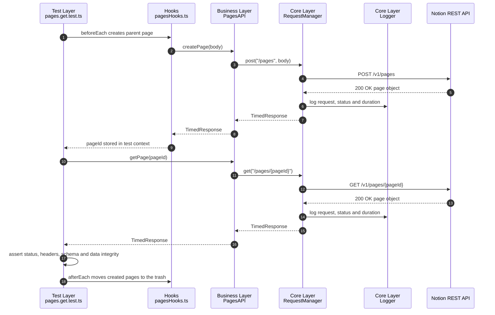
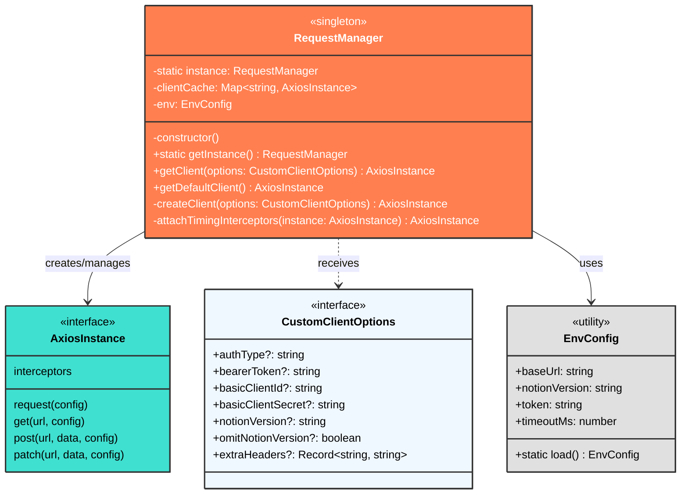
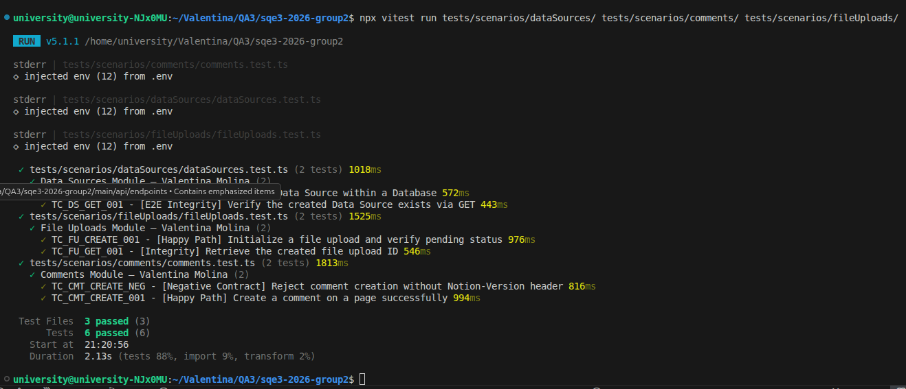

<div align="center">

# SQE III Group Laboratory — Week 4 (Lab 04)

<br><br>


<br><br>

Valentina Molina Bustillos  
Gabriel Marcos Guaman Ortuño  
Karen Ivonne Cruz Alvarez  
Sebastián Pereyra  
Kevin Uruchi

<br><br>

Jala University  
Commercial Software Engineering  
Eng. Edson Guerra

<br><br>

Bolivia  
November 22, 2026

<br>

</div>

<div style="page-break-after: always;"></div>

## Table of Contents

1. [Activity #1](#activity-1)
   - [1.1 Architecture of the Automation Framework](#11-architecture-of-the-automation-framework)
   - [1.2 Structure of the Automation Framework](#12-structure-of-the-automation-framework)
   - [1.3 Refactoring of the Lab 04 Code Following the Proposed Architecture and Structure](#13-refactoring-of-the-lab-04-code-following-the-proposed-architecture-and-structure)
   - [1.4 Configuration and Environment Files](#14-configuration-and-environment-files)
   - [1.5 Code Format Review Libraries (Linter)](#15-code-format-review-libraries-linter)
2. [Activity #2](#activity-2)
   - [2.1 Singleton Design Pattern for the Request Manager](#21-singleton-design-pattern-for-the-request-manager)
   - [2.2 Singleton Pattern Diagram](#22-singleton-pattern-diagram)
   - [2.3 Refactoring in Response to the Singleton Implementation](#23-refactoring-in-response-to-the-singleton-implementation)
3. [Activity #3](#activity-3)
   - [3.1 Logging Tool for Automated Test Execution](#31-logging-tool-for-automated-test-execution)
   - [3.2 Team Logger Conventions](#32-team-logger-conventions)
   - [3.3 Log Report Generation](#33-log-report-generation)
4. [Activity #4](#activity-4)
   - [4.1 Review of Preconditions and Postconditions](#41-review-of-preconditions-and-postconditions)
   - [4.2 Test Context Variables](#42-test-context-variables)
   - [4.3 Dynamic Datasets Generated with GenAI](#43-dynamic-datasets-generated-with-genai)
5. [Activity #5](#activity-5)
   - [5.1 Continued Implementation of the Test Suites](#51-continued-implementation-of-the-test-suites)
   - [5.2 Review of the Architecture Layers in the Implementation](#52-review-of-the-architecture-layers-in-the-implementation)
   - [5.3 Framework Functionality and Component Documentation](#53-framework-functionality-and-component-documentation)
6. [Team Participation](#team-participation)

<div style="page-break-after: always;"></div>

## Activity #1

1. Define and diagram the architecture of the automation framework to be developed.
2. Define and diagram the structure of the automation framework to be developed.
3. Refactor the code developed in the previous laboratory following the proposed architecture and structure diagrams.
4. Implement configuration and environment files for the automation framework.
5. Implement libraries for code format review (linter).

---

### 1.1 Architecture of the Automation Framework

In Lab 04, **Group 2** migrated the Postman suites of the **Notion REST API (`2025-09-03`)** to **Axios + Vitest**. The migration worked, but every test file still built its own requests, preconditions and helpers, and the HTTP client, the Zod schemas and the assertion helpers were shared through a single `src/core/` folder with no clear boundary between what is generic and what belongs to Notion. For Lab 05 the team adopts a **three-layer architecture** in which each layer has one responsibility and only depends on the layer directly below it.

#### 1.1.1 Architecture Layers

| Layer | Folder | Responsibility | Must Not |
|---|---|---|---|
| **Test Layer** | `tests/` | Holds the test scenarios of each Notion module and the hooks that build preconditions and clean up postconditions. Describes *what* is verified (status code, body, headers, data integrity, types). | Build URLs, set headers, call Axios directly or contain hardcoded IDs and tokens. |
| **Business Layer** | `main/` | Models the Notion REST API. One endpoint class per module (`PagesAPI`, `BlocksAPI`, `DatabasesAPI`, ...) exposes one method per endpoint, plus the Zod schemas and test data of the application. Knows *how* Notion is called. | Contain assertions or know about Vitest. |
| **Core Layer** | `core/` | Generic, application-agnostic infrastructure. Request Manager (Singleton over Axios), logger, log reporter, fake data generator, schema validator and configuration loader. | Know anything about Notion. The same core could serve any other REST API. |

The dependency rule is strictly top-down (`Test → Business → Core → Notion REST API`). Because the Core Layer knows nothing about Notion, it can be reused against any other REST API by writing a new Business Layer, in the same way the reference diagram reuses its core for Trello, Spotify and YouTube.

#### 1.1.2 Layered Architecture Diagram

```mermaid
flowchart TB
    subgraph TL["tests/"]
        direction LR
        TL0["Test Layer"]
        T1["Pages API<br/>test scenarios"]
        T2["Blocks API<br/>test scenarios"]
        T3["Databases and Search<br/>API test scenarios"]
        T4["Users and OAuth<br/>API test scenarios"]
        T5["Data Sources, Comments and<br/>File Uploads test scenarios"]
        T6["Hooks<br/>common and per module"]
    end

    subgraph BL["main/"]
        direction LR
        BL0["Business Layer"]
        B1["Pages API<br/>endpoints"]
        B2["Blocks API<br/>endpoints"]
        B3["Databases and Search<br/>API endpoints"]
        B4["Users and OAuth<br/>API endpoints"]
        B5["Data Sources, Comments and<br/>File Uploads endpoints"]
        B6["Resources<br/>schemas and data"]
    end

    subgraph CL["core/"]
        direction LR
        CL0["Core Layer"]
        C1["Request Manager<br/>Singleton"]
        C2["Logs"]
        C3["Reports"]
        C4["Faker data"]
        C5["API Schema<br/>Validator"]
        C6["Config and<br/>Environment"]
    end

    SUT[("Notion REST API<br/>api.notion.com/v1<br/>Notion-Version 2025-09-03")]

    TL ==> BL
    BL ==> CL
    CL ==>|HTTPS| SUT

    classDef layer fill:#e8f1fb,stroke:#1f6feb,stroke-width:2px,color:#1f6feb
    classDef ext fill:#fff4e5,stroke:#f0883e,stroke-width:2px,color:#b35900
    classDef dashed fill:#ffffff,stroke:#f0883e,stroke-dasharray:5 5,color:#b35900
    class TL0,BL0,CL0 layer
    class SUT ext
    class OTHER dashed
```



#### 1.1.3 Class Diagram of the Framework

The diagram below shows the main classes of each layer and how they depend on each other. `RequestManager` is the only class that talks to Axios, and every endpoint class obtains it through `RequestManager.getInstance()` (the Singleton is detailed in Activity #2).

```mermaid
classDiagram
    direction TB

    %% ================= TEST LAYER =================
    class PagesScenarios {
        <<scenario>>
        +postPagesTests()
        +getPageTests()
        +getPagePropertyTests()
        +movePageTests()
        +patchPageTests()
        +e2eFlows()
    }
    class CommonHooks {
        <<hook>>
        +throttle(ms) Promise~void~
        +recordTelemetry(context)
        +globalSetup()
    }
    class PagesHooks {
        <<hook>>
        +createParentPage() Promise~string~
        +createDataSourceRow() Promise~string~
        +trashCreatedPages() Promise~void~
    }

    %% ================= BUSINESS LAYER =================
    class PagesAPI {
        <<endpoint>>
        -RequestManager request
        +createPage(body) Promise~TimedResponse~
        +getPage(pageId) Promise~TimedResponse~
        +getPageProperty(pageId, propertyId) Promise~TimedResponse~
        +movePage(pageId, body) Promise~TimedResponse~
        +updatePage(pageId, body) Promise~TimedResponse~
    }
    class BlocksAPI {
        <<endpoint>>
        +appendChildren(blockId, body) Promise~TimedResponse~
        +getBlock(blockId) Promise~TimedResponse~
        +getChildren(blockId, params) Promise~TimedResponse~
        +updateBlock(blockId, body) Promise~TimedResponse~
        +deleteBlock(blockId) Promise~TimedResponse~
    }
    class DatabasesAPI {
        <<endpoint>>
        +createDatabase(body) Promise~TimedResponse~
        +getDatabase(databaseId) Promise~TimedResponse~
        +updateDatabase(databaseId, body) Promise~TimedResponse~
    }
    class SearchAPI {
        <<endpoint>>
        +search(body) Promise~TimedResponse~
    }
    class UsersAPI {
        <<endpoint>>
        +getMe() Promise~TimedResponse~
        +getUser(userId) Promise~TimedResponse~
        +listUsers(params) Promise~TimedResponse~
    }
    class OAuthAPI {
        <<endpoint>>
        +createToken(body) Promise~TimedResponse~
        +revokeToken(body) Promise~TimedResponse~
        +introspectToken(body) Promise~TimedResponse~
    }
    class DataSourcesAPI {
        <<endpoint>>
        +createDataSource(body) Promise~TimedResponse~
        +getDataSource(dataSourceId) Promise~TimedResponse~
        +updateDataSource(dataSourceId, body) Promise~TimedResponse~
        +queryDataSource(dataSourceId, body) Promise~TimedResponse~
    }
    class CommentsAPI {
        <<endpoint>>
        +createComment(body) Promise~TimedResponse~
        +listComments(params) Promise~TimedResponse~
    }
    class FileUploadsAPI {
        <<endpoint>>
        +createFileUpload(body) Promise~TimedResponse~
        +sendFile(fileUploadId, form) Promise~TimedResponse~
        +getFileUpload(fileUploadId) Promise~TimedResponse~
    }
    class NotionSchemas {
        <<schema>>
        +PageObjectSchema
        +BlockObjectSchema
        +UserObjectSchema
        +NotionErrorSchema
        +PaginatedListSchema
    }
    class NotionTestData {
        <<data>>
        +pagesPayloads.json
        +invalidIds.csv
    }

    %% ================= CORE LAYER =================
    class RequestManager {
        <<singleton>>
        -RequestManager instance$
        -AxiosInstance client
        -RequestManager()
        +getInstance()$ RequestManager
        +get(url, options) Promise~TimedResponse~
        +post(url, body, options) Promise~TimedResponse~
        +patch(url, body, options) Promise~TimedResponse~
        +delete(url, options) Promise~TimedResponse~
        +send(request) Promise~TimedResponse~
    }
    class Logger {
        <<utility>>
        +info(message, meta)
        +warn(message, meta)
        +error(message, meta)
        +debug(message, meta)
    }
    class LogReporter {
        <<utility>>
        +generate(logFile) Promise~void~
    }
    class DataFactory {
        <<utility>>
        +title(prefix) string
        +uuid() string
        +text(length) string
        +url() string
    }
    class SchemaValidator {
        <<utility>>
        +validate(schema, data) ValidationResult
        +assertValid(schema, data)
    }
    class EnvConfig {
        <<utility>>
        +baseUrl string
        +notionVersion string
        +token string
        +timeoutMs number
        +load()$ EnvConfig
    }

    %% ================= RELATIONSHIPS =================
    PagesScenarios ..> PagesAPI : calls endpoints
    PagesScenarios ..> PagesHooks : preconditions and cleanup
    PagesScenarios ..> CommonHooks : throttle and telemetry
    PagesScenarios ..> SchemaValidator : validates bodies
    PagesHooks ..> PagesAPI : builds test data
    PagesHooks ..> DataFactory : dynamic values

    PagesAPI --> RequestManager : getInstance()
    BlocksAPI --> RequestManager
    DatabasesAPI --> RequestManager
    SearchAPI --> RequestManager
    UsersAPI --> RequestManager
    OAuthAPI --> RequestManager
    DataSourcesAPI --> RequestManager
    CommentsAPI --> RequestManager
    FileUploadsAPI --> RequestManager

    SchemaValidator ..> NotionSchemas : uses
    PagesHooks ..> NotionTestData : reads datasets

    RequestManager --> EnvConfig : base URL, version, token
    RequestManager --> Logger : logs every request and response
    LogReporter ..> Logger : reads log output
```



> **Note.** The test scenarios of the other modules (`BlocksScenarios`, `DatabasesScenarios`, `UsersOAuthScenarios`, `DataSourcesScenarios`) and their hooks follow exactly the same pattern as `PagesScenarios` and `PagesHooks`, so they are omitted to keep the diagram readable.

#### 1.1.4 Request Flow Across the Layers

The sequence below shows how a single test case (`TC_PAGES_GET_001`) crosses the three layers. The test never touches Axios or Notion headers, it only asks the Business Layer for a page and verifies the result.



#### 1.1.5 Design Principles Applied

1. **Separation of concerns.** Tests describe behavior, endpoint classes describe the API and the core describes the transport. A change in Notion's URL or headers is fixed in one place.
2. **Single point of access to HTTP.** Only `RequestManager` creates the Axios instance, which allows the Singleton of Activity #2 and the logger of Activity #3 to be added without touching any test.
3. **Reusable core.** `core/` has no reference to Notion, so it can be reused by other projects of the course.
4. **One endpoint class per Notion module.** Each team member owns the endpoint classes, hooks and scenarios of their module, which keeps merge conflicts low in the `week_X` branch.

---

### 1.2 Structure of the Automation Framework

The repository is organized so that each folder maps to exactly one layer of the architecture defined in Section `1.1`. The tree below shows the current folders and the files that each one will hold. Files marked with `(new)` are created during Lab 05.

#### 1.2.1 Directory Tree

```text
.
├── core/                              # CORE LAYER (application-agnostic)
│   ├── api/
│   │   └── RequestManager.ts          # (new) Singleton over Axios, timing interceptors, 429 retry
│   └── utils/
│       ├── envConfig.ts               # (new) Loads and validates .env values
│       ├── logger.ts                  # (new) Logger wrapper (Activity #3)
│       ├── logReporter.ts             # (new) Builds the HTML/JSON report from the logs (Activity #3)
│       ├── dataFactory.ts             # (new) Faker-based dynamic values
│       └── schemaValidator.ts         # (new) Generic Zod validation helper
├── labs/                              # Lab reports, screenshots (caps/) and exported reports
├── main/                              # BUSINESS LAYER (Notion-specific)
│   ├── api/
│   │   ├── endpoints/
│   │   │   ├── pagesAPI.ts            # Pages module (Kevin Uruchi)
│   │   │   ├── blocksAPI.ts           # (new) Blocks module (Karen Cruz)
│   │   │   ├── databasesAPI.ts        # (new) Databases module (Sebastián Pereyra)
│   │   │   ├── searchAPI.ts           # (new) Search module (Sebastián Pereyra)
│   │   │   ├── usersAPI.ts            # (new) Users module (Gabriel Guaman)
│   │   │   ├── oauthAPI.ts            # (new) OAuth module (Gabriel Guaman)
│   │   │   ├── dataSourcesAPI.ts      # (new) Data Sources module (Valentina Molina)
│   │   │   ├── commentsAPI.ts         # (new) Comments module (Valentina Molina)
│   │   │   └── fileUploadsAPI.ts      # (new) File Uploads module (Valentina Molina)
│   │   └── resources/
│   │       ├── data/                  # Static and GenAI-generated datasets (JSON / CSV)
│   │       └── schemas/               # Zod schemas of Notion objects (page, block, user, error...)
│   └── resources/                     # Application-level config (Notion endpoints, version, defaults)
├── tests/                             # TEST LAYER
│   ├── hooks/
│   │   ├── common/                    # Global setup, throttle, telemetry, shared test context
│   │   └── pages/                     # Preconditions and cleanup of the Pages module
│   └── scenarios/
│       └── pages/                     # Test scenarios of the Pages module (*.test.ts)
├── .env.example                       # (new) Template of required variables, no secrets
├── eslint.config.js                   # (new) Linter configuration (Section 1.5)
├── .prettierrc                        # (new) Formatter configuration (Section 1.5)
├── package.json
├── tsconfig.json                      # Path aliases @core/*, @main/*, @tests/*
├── vitest.config.ts
└── README.md
```

The other modules follow the same pattern as `pages`. Each owner adds `tests/hooks/<module>/` and `tests/scenarios/<module>/` (for example `tests/scenarios/blocks/`), so the tree grows by module and not by team member, unlike Lab 04 where tests were grouped in `tests/<member_name>/`.


#### 1.2.2 Responsibility of Each Folder

| Folder | Layer | Contents | Imports Allowed From |
|---|---|---|---|
| `core/api/` | Core | `RequestManager` (only place where Axios is instantiated). | `core/utils/` |
| `core/utils/` | Core | Logger, log reporter, data factory, schema validator, environment loader. | External libraries only |
| `main/api/endpoints/` | Business | One class per Notion module with one method per endpoint. | `core/` |
| `main/api/resources/schemas/` | Business | Zod schemas of Notion objects and error envelope. | `zod` |
| `main/api/resources/data/` | Business | Static and GenAI-generated datasets in JSON or CSV (Activity #4). | none |
| `main/resources/` | Business | Application settings such as Notion endpoint paths, default `page_size` and SLA limits. | none |
| `tests/hooks/common/` | Test | Global setup, rate-limit throttle, telemetry and shared test context. | `core/`, `main/` |
| `tests/hooks/<module>/` | Test | Preconditions and cleanup of one module (create parent pages, trash created data). | `core/`, `main/` |
| `tests/scenarios/<module>/` | Test | `*.test.ts` files with the test cases of one module. | `main/`, `tests/hooks/`, `core/utils/` |
| `labs/` | none | Lab reports (`labXX/`), screenshots (`caps/`) and exported reports. | none |

#### 1.2.4 Naming Conventions

| Element | Convention | Example |
|---|---|---|
| Endpoint class file | `camelCase` + `API.ts` | `pagesAPI.ts` exporting `class PagesAPI` |
| Endpoint method | verb + resource | `createPage`, `getPageProperty`, `movePage` |
| Hook file | `<module>Hooks.ts` | `tests/hooks/pages/pagesHooks.ts` |
| Test file | `<module>.<endpoint>.test.ts` | `tests/scenarios/pages/pages.get.test.ts` |
| Schema | `PascalCase` + `Schema` | `PageObjectSchema`, `NotionErrorSchema` |
| Dataset | `<module>_<purpose>.json` or `.csv` | `pages_invalid_ids.csv` |
| Test case title | `TC_<MODULE>_<ENDPOINT>_<NNN> - [Category] description` | `TC_PAGES_GET_012 - [Negative] Reject invalid page ID` |

---

### 1.3 Refactoring of the Lab 04 Code Following the Proposed Architecture and Structure

#### 1.3.1 Gabriel Marcos Guaman Ortuño — Modules: Users & OAuth

> TODO 

#### 1.3.2 Valentina Molina Bustillos — Modules: Data Sources, Comments & File Uploads

The Lab 03 test file (`act5_act6_valentina_modules.test.ts`) was split and refactored into the three-layer architecture:

- **Business Layer (`main/api/endpoints/`):** Created `dataSourcesAPI.ts`, `commentsAPI.ts` and `fileUploadsAPI.ts`. Each class exposes one method per endpoint and obtains its Axios client exclusively from `RequestManager.getInstance()`.
- **Test Layer (`tests/scenarios/`):** Created `dataSources/`, `comments/` and `fileUploads/` folders. Tests no longer call Axios directly; they instantiate the corresponding endpoint class.
- **Hooks Layer (`tests/hooks/`):** Created `DataSourcesHooks`, `CommentsHooks` and `FileUploadsHooks` to handle preconditions (create a temporary database, validate the parent page) and postconditions (archive temporary resources).
- **Core Layer (`core/utils/`):** Moved `assertions.ts` and updated its imports to reference `TimedAxiosResponse` from `core/api/RequestManager.ts`. Fixed Zod v4 compatibility (`z.record` now requires key and value types).

#### 1.3.3 Karen Ivonne Cruz Alvarez — Module: Blocks

> TODO 

#### 1.3.4 Sebastián Pereyra — Modules: Databases & Search

> TODO

#### 1.3.5 Kevin Uruchi — Module: Pages

> TODO 

---

### 1.4 Configuration and Environment Files

> TODO 

---

### 1.5 Code Format Review Libraries (Linter)

> TODO 

---

<div style="page-break-after: always;"></div>

## Activity #2

1. Implement the Singleton design pattern for the request manager.
2. Diagram the implemented Singleton design pattern.
3. Continue the code refactoring work in response to the Singleton implementation.

---

### 2.1 Singleton Design Pattern for the Request Manager

The **Singleton** pattern was implemented in the `RequestManager` class inside `core/api/`. This class centralizes the creation and management of Axios instances across the framework.

**Design decisions:**
- **Private constructor:** Prevents any part of the code from creating a direct instance with `new RequestManager()`.
- **Static `getInstance()` method:** The only global access point. It guarantees a single instance of the manager exists in the entire application.
- **Client cache (`Map<string, AxiosInstance>`):** Although the Singleton guarantees a single manager instance, different parts of the code may require clients with distinct configurations (e.g., Basic auth for OAuth, or clients without the `Notion-Version` header for negative tests). To avoid redundant instances, the manager uses a cache keyed by the configuration options (`JSON.stringify(options)`). If a client with the same options is requested, the cached instance is returned.
- **Dependency injection:** The `RequestManager` loads configuration from `EnvConfig`, keeping the Core Layer agnostic to environment implementation details.

**Key files:**
- `core/api/RequestManager.ts`: Singleton implementation.
- `core/utils/envConfig.ts`: Environment variable loading and validation.

### 2.2 Singleton Pattern Diagram

[](https://mermaid.live/edit#pako:eNo9j01qwzAYRK9iZq0YWdZftE23vUDRwiL66hhiKagSpDW-e6lLu5yBecPbcM2R4DBNExjmskS4WhoxrFTW8BOx-dR1HvVGK3m4zqNQbM_TNd9z8fBpB8MjpLec1791yW2-wb2H-wcxtEcMlV6WMJew_reFUqRyyS1VOCUPBtyGJ5wYdc-1MtwqYbnUiuET7mRkL89GCa31aIXVamf4Ol55b7Xlg5GDGaQw43lgoLjUXF5_BQ_P_RvV3Ehu)



### 2.3 Refactoring in Response to the Singleton Implementation

**Valentina Molina Bustillos — Modules: Data Sources, Comments & File Uploads**

The test code from Lab 03 (`act5_act6_valentina_modules.test.ts`) was refactored to align with the three-layer architecture and the new Singleton `RequestManager`.

**Changes applied:**

1. **Business Layer (Endpoint classes):**
   - Created `main/api/endpoints/dataSourcesAPI.ts`, `commentsAPI.ts`, and `fileUploadsAPI.ts`.
   - Each class exposes one method per endpoint (`createDataSource`, `createComment`, `createFileUpload`, etc.).
   - These classes obtain their Axios client exclusively through `RequestManager.getInstance().getDefaultClient()`. No test or endpoint class creates an Axios instance directly.

2. **Test Layer (Scenarios):**
   - Split the monolithic test file into three module-specific test files:
     - `tests/scenarios/dataSources/dataSources.test.ts`
     - `tests/scenarios/comments/comments.test.ts`
     - `tests/scenarios/fileUploads/fileUploads.test.ts`
   - Tests no longer call Axios directly. They instantiate the corresponding endpoint class and call its methods.
   - Assertions (`assertCommonHeadersAndSla`, `assertNotionErrorContract`) remain in the Test Layer, consuming the `TimedAxiosResponse` returned by the Business Layer.

3. **Negative test handling:**
   - For the negative test that requires a request without the `Notion-Version` header (`TC_CMT_CREATE_NEG`), the `CommentsAPI` class exposes a specialized method (`createCommentWithoutVersion`) that internally requests a cached client from the `RequestManager` with `omitNotionVersion: true`. This preserves the Singleton contract: the manager creates the client once and caches it for future requests with the same options.

4. **Core Layer updates:**
   - Moved `assertions.ts` to `core/utils/assertions.ts` and updated its import to reference `TimedAxiosResponse` from `core/api/RequestManager.ts`.
   - Fixed Zod v4 compatibility across all schemas: `z.record()` now requires both key and value types (e.g., `z.record(z.string(), z.any())`).

**Benefits of the refactoring:**
- **Single source of HTTP configuration:** All requests flow through `RequestManager`, so any change to base URL, timeout or interceptors is applied in one place.
- **Test readability:** Test files now only describe *what* is verified, delegating *how* the API is called to the endpoint classes.
- **Reusability:** The endpoint classes can be used by other tests, hooks or scripts without duplicating request logic.

**Test execution evidence:**



---

<div style="page-break-after: always;"></div>

## Activity #3

1. Implement a specialized tool to generate logs of the automated test execution.
2. Define the team conventions for the use of the logger.
3. Implement the functionality to generate a report from the resulting logs.

---

### 3.1 Logging Tool for Automated Test Execution

> TODO 

### 3.2 Team Logger Conventions

> TODO 

### 3.3 Log Report Generation

> TODO 

---

<div style="page-break-after: always;"></div>

## Activity #4

1. Review the implementation of preconditions and postconditions.
2. Improve the code by implementing context variables for the automated tests.
3. Use GenAI to generate dynamic datasets (JSON or CSV) that strengthen the data-driven tests of the framework. Include the prompt and procedure used.

---

### 4.1 Review of Preconditions and Postconditions

**Valentina Molina Bustillos — Modules: Data Sources, Comments & File Uploads**

| Module | Precondition | Postcondition |
|---|---|---|
| **Data Sources** | `DataSourcesHooks.setup()` creates a fresh temporary Database under `NOTION_PAGE_ID`. This avoids the Notion limit of 50 Data Sources per database when tests are run repeatedly. | `DataSourcesHooks.cleanup()` archives the temporary Database with `in_trash: true`, removing all Data Sources created during the tests. |
| **Comments** | `CommentsHooks.setup()` validates that `NOTION_PAGE_ID` is present and shared with the integration. | `CommentsHooks.cleanup()` logs the created comments. Notion has no delete endpoint for comments, so the parent page is not modified. |
| **File Uploads** | `FileUploadsHooks.setup()` initializes the hook context. | `FileUploadsHooks.cleanup()` logs the created file uploads. Notion has no delete endpoint for file uploads, so they expire automatically after 24 hours. |


### 4.2 Test Context Variables

**Valentina Molina Bustillos — Modules: Data Sources, Comments & File Uploads**

A `ValentinaTestContextManager` was implemented in `tests/hooks/common/valentinaTestContext.ts`. It is a **module-specific Singleton** that centralizes the context variables of the three assigned modules:

| Variable | Module | Source |
|---|---|---|
| `databaseId` | Data Sources | Created by `DataSourcesHooks.setup()` |
| `dataSourceId` | Data Sources | Returned by `POST /v1/data_sources` |
| `pageId` | Comments | `.env` (`NOTION_PAGE_ID`) |
| `commentId` | Comments | Returned by `POST /v1/comments` |
| `fileUploadId` | File Uploads | Returned by `POST /v1/file_uploads` |
| `createdIds` | All | Tracked for postcondition cleanup |

Because it is a Singleton, every hook and test file reads and writes to the same context instance. This avoids passing variables between hooks and scenarios and ensures that a resource created in a precondition (e.g., a temporary database) is visible in the tests and in the postcondition cleanup.

```typescript
const ctx = ValentinaTestContextManager.getInstance();
ctx.set('dataSourceId', res.data.id);
const id = ctx.get('dataSourceId');
```

### 4.3 Dynamic Datasets Generated with GenAI

#### Prompt Used

**Valentina Molina Bustillos — Modules: Data Sources, Comments & File Uploads**

```text
Generate a JSON dataset for testing the Notion API endpoint POST /v1/data_sources.
The dataset must contain 10 test cases with the following structure:
[
  {
    "case_id": "DS_VALID_001",
    "description": "Create a data source with title and number properties",
    "payload": {
      "parent": { "type": "database_id", "database_id": "{{DATABASE_ID}}" },
      "properties": {
        "Name": { "title": {} },
        "Count": { "number": { "format": "number" } }
      }
    },
    "expected_status": 200,
    "category": "happy_path"
  },
  {
    "case_id": "DS_INVALID_001",
    "description": "Create a data source with invalid parent (missing database_id)",
    "payload": {
      "parent": { "type": "database_id" },
      "properties": { "Name": { "title": {} } }
    },
    "expected_status": 400,
    "category": "negative"
  }
]
Include cases for: invalid property types, missing Notion-Version header, invalid auth token, and exceeding property limits.
Return only the JSON, no explanation.
```
> TODO

#### Generation and Validation Procedure

**Valentina Molina Bustillos — Modules: Data Sources, Comments & File Uploads**

1. The prompt was submitted to a generative AI tool (ChatGPT).
2. The generated JSON was saved as `main/api/resources/data/dataSources_test_cases.json`.
3. The JSON was validated with `JSON.parse` and manually reviewed to ensure:
   - Each case has a unique `case_id`.
   - The `payload` matches the Notion API schema for `POST /v1/data_sources`.
   - The `expected_status` is consistent with the `category`.
4. The dataset is consumed by `tests/scenarios/dataSources/dataSources.data-driven.test.ts`, which iterates over each case and asserts the expected status.
5. **Validation adjustments:** After running the tests, the following cases were refined:
   - `DS_VALID_002` and `DS_VALID_003` were updated to include a `title` property (Notion requires it).
   - `DS_INVALID_007` (101 properties) was reclassified as `DS_VALID_004` because Notion accepts more than 100 properties for data sources.
   - The test timeout was increased to 20s to accommodate slow negative responses.
> TODO 

---

<div style="page-break-after: always;"></div>

## Activity #5

1. Continue the implementation of the tests written for the assigned application.
2. Review the implementation of the framework establishing the difference between the architecture layers.
3. Document the functionality of the framework and its components.

---

### 5.1 Continued Implementation of the Test Suites

#### 5.1.1 Gabriel Marcos Guaman Ortuño — Modules: Users & OAuth
> TODO

#### 5.1.2 Valentina Molina Bustillos — Modules: Data Sources, Comments & File Uploads

The test suites for the three assigned modules were extended with additional happy-path and negative scenarios:

| Module | Test File | New Tests | Coverage |
|---|---|---|---|
| **Data Sources** | `dataSources.extra.test.ts` | 4 | Update title, query with no filters, invalid ID (negative), unsupported property type (negative) |
| **Comments** | `comments.extra.test.ts` | 3 | List comments, null rich_text (negative), invalid page_id (negative) |
| **File Uploads** | `fileUploads.extra.test.ts` | 4 | Single-part upload, invalid content_type (negative), invalid mode (negative), invalid ID (negative) |

**Total new tests:** 11 (6 happy path, 5 negative).


#### 5.1.3 Karen Ivonne Cruz Alvarez — Module: Blocks
> TODO

#### 5.1.4 Sebastián Pereyra — Modules: Databases & Search
> TODO

#### 5.1.5 Kevin Uruchi — Module: Pages
> TODO

### 5.2 Review of the Architecture Layers in the Implementation

> TODO 

### 5.3 Framework Functionality and Component Documentation

> TODO 

---

<div style="page-break-after: always;"></div>

## Team Participation

| Team Member | Lab 05 Contributions & Implemented Scope | Section / Item Worked On | Additional Comments & Status |
|---|---|---|---|
| **Gabriel Marcos Guaman Ortuño** | > TODO | > TODO | > TODO |
| **Valentina Molina Bustillos** | • Implemented the Singleton `RequestManager` and its UML diagram.<br>• Refactored Data Sources, Comments and File Uploads into the three-layer architecture.<br>• Added preconditions/postconditions via hooks and a module-specific context manager.<br>• Generated a GenAI dataset for data-driven testing.<br>• Extended test suites with 11 additional scenarios. | • Activity #2 (`2.1`, `2.2`, `2.3`)<br>• Activity #1 (`1.3.2`)<br>• Activity #4 (`4.1`, `4.2`, `4.3`)<br>• Activity #5 (`5.1.2`) | All 27 tests passing. |
| **Karen Ivonne Cruz Alvarez** | > TODO | > TODO | > TODO |
| **Sebastián Pereyra** | > TODO | > TODO | > TODO |
| **Kevin Uruchi** | • Defined and diagrammed the three-layer architecture of the framework (layered diagram, class diagram and request sequence diagram in Mermaid).<br>• Defined and diagrammed the folder structure, folder responsibilities and naming conventions. | • Activity #1 (`1.1`, `1.2`) | > TODO |