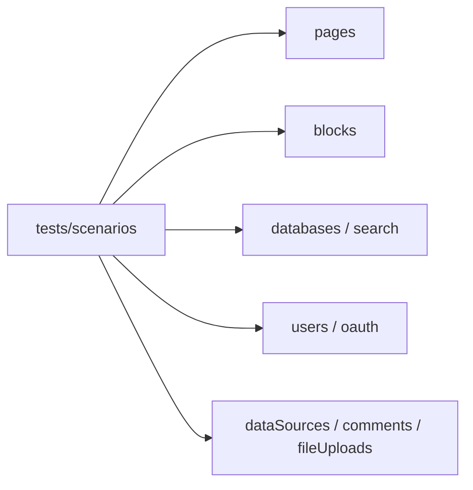
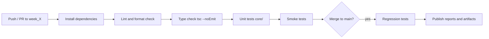

<div align="center">

# SQE III Group Laboratory — Week 5 (Lab 05)

<br><br>


<br><br>

Valentina Molina Bustillos  
Gabriel Marcos Guaman Ortuño  
Karen Ivonne Cruz Alvarez  
Sebastián Pereyra  
Kevin Uruchi

<br><br>

Jala University  
Commercial Software Engineering  
Eng. Edson Guerra

<br><br>

Bolivia  
November 29, 2026

<br>

</div>

<div style="page-break-after: always;"></div>

## Table of Contents

1. [Activity #1](#activity-1)
   - [1.1 Test Organization by Test Type and Application Area](#11-test-organization-by-test-type-and-application-area)
   - [1.2 Test Organization by Priority and Execution Moment (Smoke, Regression)](#12-test-organization-by-priority-and-execution-moment-smoke-regression)
2. [Activity #2](#activity-2)
   - [2.1 Test Execution Report Generation](#21-test-execution-report-generation)
   - [2.2 Execution Status of the Automation Framework by Team](#22-execution-status-of-the-automation-framework-by-team)
   - [2.3 Suggested Improvements Based on the Execution Status](#23-suggested-improvements-based-on-the-execution-status)
3. [Activity #3](#activity-3)
   - [3.1 Refactoring and Implementation of the Suggested Improvements](#31-refactoring-and-implementation-of-the-suggested-improvements)
   - [3.2 Maintenance of the Automated Tests](#32-maintenance-of-the-automated-tests)
   - [3.3 Coverage Review of the Implemented and Executed Tests](#33-coverage-review-of-the-implemented-and-executed-tests)
4. [Activity #4](#activity-4)
   - [4.1 Unit Tests Generated with GenAI for the Request Manager and Framework Utilities](#41-unit-tests-generated-with-genai-for-the-request-manager-and-framework-utilities)
5. [Activity #5](#activity-5)
   - [5.1 Continuous Integration Structure](#51-continuous-integration-structure)
   - [5.2 Continuous Testing Structure](#52-continuous-testing-structure)
   - [5.3 Consecutive Execution and Maintenance of the Results](#53-consecutive-execution-and-maintenance-of-the-results)
6. [Team Participation](#team-participation)

<div style="page-break-after: always;"></div>

## Activity #1

1. Organize the tests in the automation framework according to the test type and the application area.
2. Organize the tests in the automation framework according to their importance and execution moment (smoke, regression).

---

### 1.1 Test Organization by Test Type and Application Area

<!-- TODO: Explain the criteria used to classify the tests (type: functional, contract/schema, negative, boundary, E2E; area: Notion module). -->

#### 1.1.1 Classification Criteria

| Test Type | Definition | Examples in the Framework |
|---|---|---|
| **Functional (Happy Path)** | <!-- TODO --> | <!-- TODO --> |
| **Negative** | <!-- TODO --> | <!-- TODO --> |
| **Boundary** | <!-- TODO --> | <!-- TODO --> |
| **Contract / Schema** | <!-- TODO --> | <!-- TODO --> |
| **E2E (Chained Flows)** | <!-- TODO --> | <!-- TODO --> |

#### 1.1.2 Application Areas (Notion Modules)

| Area | Endpoints | Owner | Scenario Folder |
|---|---|---|---|
| Pages | `POST /pages`, `GET /pages/{id}`, `GET /pages/{id}/properties/{id}`, `PATCH /pages/{id}`, `POST /pages/{id}/move` | Kevin Uruchi | `tests/scenarios/pages/` |
| Blocks | <!-- TODO --> | Karen Cruz | `tests/scenarios/blocks/` |
| Databases & Search | <!-- TODO --> | Sebastián Pereyra | `tests/scenarios/databases/`, `tests/scenarios/search/` |
| Users & OAuth | <!-- TODO --> | Gabriel Guaman | `tests/scenarios/users/`, `tests/scenarios/oauth/` |
| Data Sources, Comments & File Uploads | <!-- TODO --> | Valentina Molina | `tests/scenarios/dataSources/`, `tests/scenarios/comments/`, `tests/scenarios/fileUploads/` |

#### 1.1.3 Tagging Mechanism

<!-- TODO: Describe how a test is tagged (e.g. title tags like [Negative], Vitest `describe` names, tags in the title, separate folders, custom vitest projects). Include a code example. -->

```typescript
// Example: tagging by type and area
// TODO
```

#### 1.1.4 Organization Diagram



#### 1.1.5 Distribution of Tests by Type and Area

| Area | Happy Path | Negative | Boundary | Contract | E2E | Total |
|---|---:|---:|---:|---:|---:|---:|
| Pages | | | | | | |
| Blocks | | | | | | |
| Databases & Search | | | | | | |
| Users & OAuth | | | | | | |
| Data Sources, Comments & File Uploads | | | | | | |
| **Total** | | | | | | |

---

### 1.2 Test Organization by Priority and Execution Moment (Smoke, Regression)

<!-- TODO: Define what smoke and regression mean for the team, and when each one runs. -->

#### 1.2.1 Execution Suites

| Suite | Purpose | When It Runs | Selection Criteria | Estimated Duration |
|---|---|---|---|---|
| **Smoke** | <!-- TODO --> | <!-- TODO: e.g. every push / PR --> | <!-- TODO: e.g. one happy path per endpoint --> | <!-- TODO --> |
| **Regression** | <!-- TODO --> | <!-- TODO: e.g. merge to main / nightly --> | <!-- TODO --> | <!-- TODO --> |
| **E2E** (optional) | <!-- TODO --> | <!-- TODO --> | <!-- TODO --> | <!-- TODO --> |

#### 1.2.2 Priority Levels

| Priority | Definition | Suite |
|---|---|---|
| `P1` / Critical | <!-- TODO --> | Smoke + Regression |
| `P2` / High | <!-- TODO --> | Regression |
| `P3` / Medium–Low | <!-- TODO --> | Regression |

#### 1.2.3 Implementation in the Framework

<!-- TODO: Explain how the suites are selected (tags, `--testNamePattern`, Vitest projects, separate config files). -->

```json
{
  "scripts": {
    "test:smoke": "TODO",
    "test:regression": "TODO",
    "test:e2e": "TODO"
  }
}
```

#### 1.2.4 Smoke Tests per Module

| Module | Smoke Test Cases | Owner |
|---|---|---|
| Pages | <!-- TODO: e.g. TC_PAGES_001, TC_PAGES_GET_001 --> | Kevin Uruchi |
| Blocks | <!-- TODO --> | Karen Cruz |
| Databases & Search | <!-- TODO --> | Sebastián Pereyra |
| Users & OAuth | <!-- TODO --> | Gabriel Guaman |
| Data Sources, Comments & File Uploads | <!-- TODO --> | Valentina Molina |

**Execution evidence:**

<!--  -->
<!--  -->

---

<div style="page-break-after: always;"></div>

## Activity #2

1. Include the functionality to generate reports of the automated test execution.
2. Present the execution status of the automation framework by team.
3. Suggest improvements that must be implemented based on the execution status.

---

### 2.1 Test Execution Report Generation

<!-- TODO: Tool selected (e.g. Vitest HTML reporter, JUnit XML, Allure) and why. Difference from the Lab 04 log report (LogReporter). -->

#### 2.1.1 Selected Reporting Tool

| Tool / Reporter | Output | Purpose |
|---|---|---|
| <!-- TODO --> | <!-- TODO: reports/test-report.html --> | <!-- TODO --> |
| <!-- TODO --> | <!-- TODO: reports/junit.xml --> | <!-- TODO: CI consumption --> |
| `LogReporter` (Lab 04) | `reports/log-report.html` / `.json` | Execution logs and HTTP latency |

#### 2.1.2 Configuration

```typescript
// vitest.config.ts — TODO: reporters configuration
```

```bash
# TODO: commands to run the tests and generate the reports
npm run test:report
```

#### 2.1.3 Report Contents

<!-- TODO: Describe what the report shows (totals, pass/fail/skip, duration, errors, filters by module/type). -->

<!--  -->

---

### 2.2 Execution Status of the Automation Framework by Team

<!-- TODO: Date and environment of the run, Notion version, command used. -->

#### 2.2.1 Overall Status

| Metric | Value |
|---|---|
| Execution date | <!-- TODO --> |
| Total test cases | <!-- TODO --> |
| Passed | <!-- TODO --> |
| Failed | <!-- TODO --> |
| Skipped | <!-- TODO --> |
| Pass rate | <!-- TODO --> |
| Total duration | <!-- TODO --> |

#### 2.2.2 Status by Module / Team Member

| Module | Owner | Total | Passed | Failed | Skipped | Pass Rate | Duration |
|---|---|---:|---:|---:|---:|---:|---|
| Pages | Kevin Uruchi | | | | | | |
| Blocks | Karen Cruz | | | | | | |
| Databases & Search | Sebastián Pereyra | | | | | | |
| Users & OAuth | Gabriel Guaman | | | | | | |
| Data Sources, Comments & File Uploads | Valentina Molina | | | | | | |
| **Total** | | | | | | | |

#### 2.2.3 Failure Analysis

| Module | Failed Case | Failed Check | Root Cause | Category |
|---|---|---|---|---|
| <!-- TODO --> | <!-- TODO --> | <!-- TODO --> | <!-- TODO --> | <!-- API change / outdated expectation / flaky / framework bug / environment --> |

---

### 2.3 Suggested Improvements Based on the Execution Status

| # | Finding | Suggested Improvement | Module(s) | Priority | Owner |
|---|---|---|---|---|---|
| `1` | <!-- TODO --> | <!-- TODO --> | <!-- TODO --> | <!-- High / Medium / Low --> | <!-- TODO --> |
| `2` | <!-- TODO: e.g. assertions.ts still in core/utils --> | <!-- TODO: move to tests/hooks/common --> | All | | |
| `3` | <!-- TODO --> | <!-- TODO --> | | | |

---

<div style="page-break-after: always;"></div>

## Activity #3

1. Refactor and implement the improvements suggested in the previous activity.
2. Perform maintenance tasks on the automated tests.
3. Review the coverage of the implemented and executed automated tests.

---

### 3.1 Refactoring and Implementation of the Suggested Improvements

#### 3.1.1 Kevin Uruchi — Module: Pages

| Improvement (Section 2.3) | Before | After | Files Changed |
|---|---|---|---|
| <!-- TODO --> | <!-- TODO --> | <!-- TODO --> | <!-- TODO --> |

#### 3.1.2 Karen Ivonne Cruz Alvarez — Module: Blocks

| Improvement (Section 2.3) | Before | After | Files Changed |
|---|---|---|---|
| <!-- TODO --> | | | |

#### 3.1.3 Sebastián Pereyra — Modules: Databases & Search

| Improvement (Section 2.3) | Before | After | Files Changed |
|---|---|---|---|
| <!-- TODO --> | | | |

#### 3.1.4 Gabriel Marcos Guaman Ortuño — Modules: Users & OAuth

| Improvement (Section 2.3) | Before | After | Files Changed |
|---|---|---|---|
| <!-- TODO --> | | | |

#### 3.1.5 Valentina Molina Bustillos — Modules: Data Sources, Comments & File Uploads

| Improvement (Section 2.3) | Before | After | Files Changed |
|---|---|---|---|
| <!-- TODO --> | | | |

---

### 3.2 Maintenance of the Automated Tests

<!-- TODO: Types of maintenance performed (corrective: fix outdated expectations; adaptive: Notion API changes; perfective: readability/duplication; preventive: flaky tests, retries). -->

| Module | Test Case | Maintenance Type | Change Applied | Result After Change |
|---|---|---|---|---|
| Pages | <!-- TODO: e.g. TC_PAGES_PATCH_035 --> | <!-- Corrective / Adaptive / Perfective / Preventive --> | <!-- TODO --> | <!-- Passed / Still failing --> |
| Blocks | <!-- TODO --> | | | |
| Databases & Search | <!-- TODO --> | | | |
| Users & OAuth | <!-- TODO --> | | | |
| Data Sources, Comments & File Uploads | <!-- TODO --> | | | |

**Execution evidence after maintenance:**

<!--  -->

---

### 3.3 Coverage Review of the Implemented and Executed Tests

<!-- TODO: Explain the coverage criteria used: endpoint coverage, acceptance-criteria coverage, test-type coverage, and code coverage of core/ (from Activity #4). -->

#### 3.3.1 Endpoint Coverage

| Module | Endpoints in the API | Endpoints Automated | Coverage |
|---|---:|---:|---:|
| Pages | | | |
| Blocks | | | |
| Databases & Search | | | |
| Users & OAuth | | | |
| Data Sources, Comments & File Uploads | | | |
| **Total** | | | |

#### 3.3.2 Planned vs. Executed Test Cases

| Module | Designed | Automated | Executed | Passed | Automation % | Pass % |
|---|---:|---:|---:|---:|---:|---:|
| Pages | | | | | | |
| Blocks | | | | | | |
| Databases & Search | | | | | | |
| Users & OAuth | | | | | | |
| Data Sources, Comments & File Uploads | | | | | | |
| **Total** | | | | | | |

#### 3.3.3 Coverage Gaps and Next Steps

| Gap | Module | Action Planned |
|---|---|---|
| <!-- TODO --> | | |

---

<div style="page-break-after: always;"></div>

## Activity #4

1. Use GenAI to speed up the creation of unit tests, focusing on the request manager and the framework utilities, ensuring the stability of the core logic of the framework. Include the prompt and procedure used with generative AI.

---

### 4.1 Unit Tests Generated with GenAI for the Request Manager and Framework Utilities

#### 4.1.1 Scope of the Unit Tests

| Core Component | File | Unit Test File | Behaviors Covered | Owner |
|---|---|---|---|---|
| `RequestManager` | `core/api/RequestManager.ts` | <!-- TODO: tests/unit/core/RequestManager.test.ts --> | <!-- TODO: Singleton, client cache, headers, auth types, omitNotionVersion, durationMs interceptor --> | <!-- TODO --> |
| `EnvConfig` | `core/utils/envConfig.ts` | <!-- TODO --> | <!-- TODO: defaults, missing NOTION_TOKEN throws, single load --> | |
| `Logger` | `core/utils/logger.ts` | <!-- TODO --> | <!-- TODO: levels, redaction --> | |
| `LogReporter` | `core/utils/logReporter.ts` | <!-- TODO --> | <!-- TODO: NDJSON parsing, malformed lines, metrics --> | |
| `SchemaValidator` | `core/utils/schemaValidator.ts` | <!-- TODO --> | <!-- TODO: validate / assertValid --> | |
| `DataFactory` | `core/utils/dataFactory.ts` | <!-- TODO --> | <!-- TODO: formats, ranges, pick --> | |

#### 4.1.2 Prompt Used

```text
TODO: paste the exact prompt used with the GenAI tool
```

#### 4.1.3 Generation and Validation Procedure

1. **GenAI tool used:** <!-- TODO: ChatGPT / Gemini / Claude / Copilot -->
2. **Input provided:** <!-- TODO: source files shared with the tool -->
3. **Storage:** <!-- TODO: folder where the generated tests were saved -->
4. **Review and adjustments:** <!-- TODO: tests that did not compile, wrong mocks, removed or rewritten cases -->
5. **Mocking strategy:** <!-- TODO: how Axios / network / env were mocked so unit tests do not call Notion -->
6. **Execution:** <!-- TODO: command -->

```bash
# TODO
npm run test:unit
npm run test:coverage
```

#### 4.1.4 Results

| Component | Unit Tests | Passed | Failed | Line Coverage | Branch Coverage |
|---|---:|---:|---:|---:|---:|
| `RequestManager` | | | | | |
| `EnvConfig` | | | | | |
| `Logger` | | | | | |
| `LogReporter` | | | | | |
| `SchemaValidator` | | | | | |
| `DataFactory` | | | | | |
| **Total `core/`** | | | | | |

<!--  -->

---

<div style="page-break-after: always;"></div>

## Activity #5

1. Establish a continuous integration structure for continuous development on the automation framework.
2. Include the continuous testing execution structure to automate the execution and monitoring of the tests.
3. Execute the automated tests consecutively and maintain the results.

---

### 5.1 Continuous Integration Structure

<!-- TODO: CI platform (GitHub Actions / GitLab CI), branching flow (week_X -> main), triggers. -->

#### 5.1.1 Pipeline Diagram



#### 5.1.2 Pipeline Stages

| Stage | Command | Trigger | Fails the Pipeline If |
|---|---|---|---|
| Install | `npm ci` | <!-- TODO --> | <!-- TODO --> |
| Lint | `npm run lint` / `npm run format:check` | <!-- TODO --> | <!-- TODO --> |
| Type check | `npx tsc --noEmit` | <!-- TODO --> | <!-- TODO --> |
| Unit tests | `npm run test:unit` | <!-- TODO --> | <!-- TODO --> |
| Smoke | `npm run test:smoke` | <!-- TODO --> | <!-- TODO --> |
| Regression | `npm run test:regression` | <!-- TODO --> | <!-- TODO --> |

#### 5.1.3 Pipeline Configuration File

```yaml
# TODO: .github/workflows/ci.yml or .gitlab-ci.yml
```

#### 5.1.4 Secrets Management

| Secret / Variable | Stored In | Used By |
|---|---|---|
| `NOTION_TOKEN` | <!-- TODO: repository secrets --> | <!-- TODO --> |
| `NOTION_ROOT_PAGE_ID` | <!-- TODO --> | <!-- TODO --> |
| <!-- TODO --> | | |

---

### 5.2 Continuous Testing Structure

<!-- TODO: Scheduled runs (cron), monitoring of results, notifications, report publishing (artifacts, GitHub Pages), rate-limit considerations. -->

| Element | Implementation | Details |
|---|---|---|
| Scheduled execution | <!-- TODO: cron --> | <!-- TODO --> |
| Report publishing | <!-- TODO --> | <!-- TODO --> |
| Result history | <!-- TODO --> | <!-- TODO --> |
| Notifications | <!-- TODO --> | <!-- TODO --> |
| Rate-limit handling | <!-- TODO: sequential files, throttle --> | <!-- TODO --> |

---

### 5.3 Consecutive Execution and Maintenance of the Results

#### 5.3.1 Execution History

| Run # | Date | Trigger | Suite | Total | Passed | Failed | Skipped | Duration | Link / Evidence |
|---:|---|---|---|---:|---:|---:|---:|---|---|
| `1` | | | | | | | | | |
| `2` | | | | | | | | | |
| `3` | | | | | | | | | |

#### 5.3.2 Stability Analysis (Flaky Tests)

| Test Case | Module | Run 1 | Run 2 | Run 3 | Cause | Action |
|---|---|---|---|---|---|---|
| <!-- TODO --> | | | | | | |

#### 5.3.3 Maintenance of the Results

<!-- TODO: What was fixed between runs, how reports and artifacts are retained, how failures are triaged. -->

<!--  -->

---

<div style="page-break-after: always;"></div>

## Team Participation

| Team Member | Lab 05 Contributions & Implemented Scope | Section / Item Worked On | Additional Comments & Status |
|---|---|---|---|
| **Gabriel Marcos Guaman Ortuño** | <!-- TODO --> | <!-- TODO --> | <!-- TODO --> |
| **Valentina Molina Bustillos** | <!-- TODO --> | <!-- TODO --> | <!-- TODO --> |
| **Karen Ivonne Cruz Alvarez** | <!-- TODO --> | <!-- TODO --> | <!-- TODO --> |
| **Sebastián Pereyra** | <!-- TODO --> | <!-- TODO --> | <!-- TODO --> |
| **Kevin Uruchi** | <!-- TODO --> | <!-- TODO --> | <!-- TODO --> |